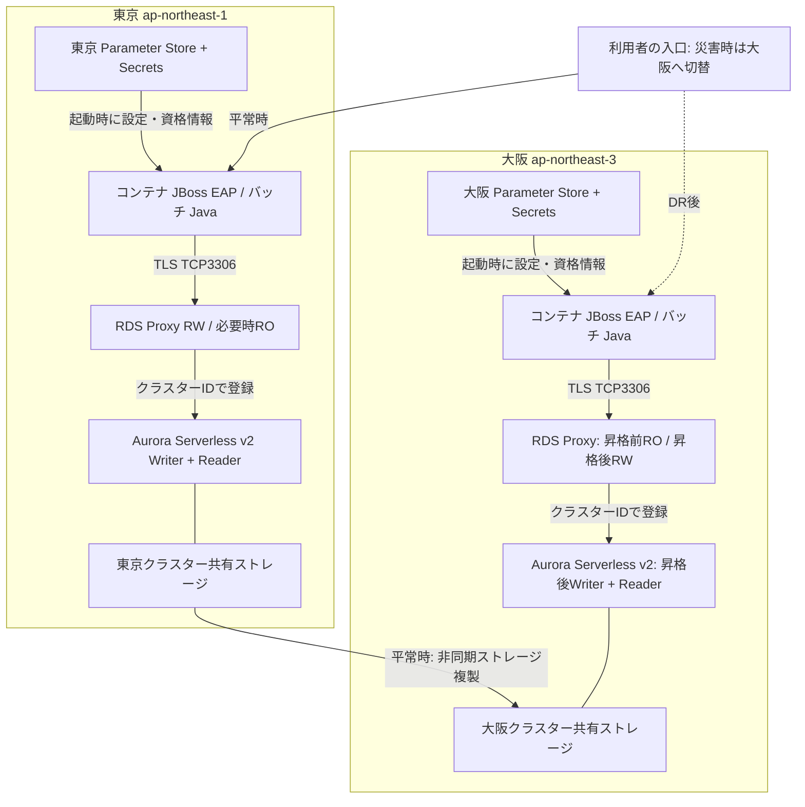

# Aurora Global Database 東京・大阪 DR構成 詳細評価

調査基準日：2026-10-11。Aurora MySQL 8.4.7 / Serverless v2 / RDS Proxy / JBoss EAP 8.1。

**結論：地域ごとのRDS Proxy固有エンドポイントへ接続し、地域障害時はDB・コンテナ・入口・ジョブをまとめて大阪へ切り替える方針を、条件付きで推奨する。**

本資料の数値は初期設計案。公式仕様、API取得値、Communityの参考値、設計提案、未実測を分けて記載する。実DB接続・負荷試験・DR切替は実施していない。

## 読み方

Excelと本文・一覧の内容を共通データから生成した。全パラメータの既定一覧と用途別推奨一覧は後半。クラスタ430行、インスタンス299行に8.4.8以降専用をそれぞれ1行含む。8.4.7の候補は429/298。

「明示上書きなし・既定列を継承」は保守的な推奨判断であり、検討漏れではない。AWS APIが値を省略する357項目のAurora実効値を創作せず、MySQLの参考値を別列に示す。

## 構成図



接続はリージョン内で完結する。大阪RWは昇格前に利用できず、昇格後に利用可能になる。既存東京接続を大阪へ移す機能ではない。[S04](https://docs.aws.amazon.com/AmazonRDS/latest/AuroraUserGuide/rds-proxy-gdb.html) [S05](https://docs.aws.amazon.com/AmazonRDS/latest/AuroraUserGuide/rds-proxy-creating.html) [S08](https://docs.aws.amazon.com/AmazonRDS/latest/AuroraUserGuide/rds-proxy.html)

## 結論：リージョン内で完結する接続と、システム全体のDR切り替えを採用する

調査基準日 2026-10-11。公式資料と東京・大阪の読み取り専用AWS APIに基づく設計評価。実環境の負荷試験・フェイルオーバー・DB接続は未実施。

| 論点 | 判定・推奨 | 動作原理・判断の理由 | 設計・運用・検証で具体化すること | 根拠 |
| --- | --- | --- | --- | --- |
| 全体判断 | 条件付き採用 | 東京を通常稼働、大阪を災害対策とするGlobal Databaseと、両リージョンのRDS Proxyを組み合わせる構成は成立する。アプリとDBを同じリージョンへまとめて切り替えることで、平常時も復旧後も通信の経路を短くできる。 | 採用条件は、書き込み主体が1リージョンに限定されること、大阪の必要資源が事前配置されること、オンラインとバッチの再実行が安全であること。 | [S03](https://docs.aws.amazon.com/AmazonRDS/latest/AuroraUserGuide/Concepts.Aurora_Fea_Regions_DB-eng.Feature.RDS_Proxy.html) [S04](https://docs.aws.amazon.com/AmazonRDS/latest/AuroraUserGuide/rds-proxy-gdb.html) [S15](https://docs.aws.amazon.com/AmazonRDS/latest/AuroraUserGuide/aurora-global-database.html) |
| 用語の補正 | Global Datasource → Aurora Global Database | AWSの構成はGlobal Database / global cluster。JBossのDataSourceはJavaアプリがDB接続を借りる窓口であり、AWSの複製単位とは別。「あ＠売り」はアプリの意味として評価した。 | 設計書では東京primary DB cluster、大阪secondary DB cluster、各リージョンのDataSourceと明記する。 | [S15](https://docs.aws.amazon.com/AmazonRDS/latest/AuroraUserGuide/aurora-global-database.html) [S24](https://docs.redhat.com/en/documentation/red_hat_jboss_enterprise_application_platform/8.1/html/configuration_guide/datasource_management) |
| バージョン | Aurora 8.4.7を指定版として評価 | 製品表示8.4.7、MySQL互換8.4.7、API値8.4.mysql_aurora.8.4.7、パラメータファミリーaurora-mysql8.4。指定版を「現在の最新マイナー」とは呼ばない。 | APIで東京・大阪ともavailableとdb.serverless/Global対応を確認。APIのEngineMode=provisionedはServerless v2でも正しい。 | [S01](https://docs.aws.amazon.com/AmazonRDS/latest/AuroraMySQLReleaseNotes/AuroraMySQL.Updates.847.html) [S58](https://docs.aws.amazon.com/AmazonRDS/latest/AuroraUserGuide/AuroraMySQL.Updates.Versions.html) |
| 評価の前提 | オンライン30秒、バッチはチャンク方式 | RTO/RPOの契約値、ピークTPS、最大コンテナ数、バッチ量が未提示。数値はオンライン要求期限30秒、バッチ1SQL90秒以内・1チャンク180秒以内を仮定した初期案。 | これらは製品既定値でも性能保証でもない。業務SLO、同時実行数、代表SQLで確定する。RTO例15分・RPO目標5秒は検証用の仮目標。 | 設計提案 |
| 全パラメータの収録 | クラスタ430行、インスタンス299行 | default.aurora-mysql8.4を自動ページング付きで全取得。クラスタ群にはインスタンス既定も含まれる。クラスタ専用131項目だけを全件と誤認しない。 | 全行に3用途の推奨、変更可否、適用条件、根拠を付ける。クラスタとインスタンスの両方に書ける項目はクラスターを基準とし、個別上書きを最小限にする。 | [S56](https://docs.aws.amazon.com/AmazonRDS/latest/APIReference/API_DescribeDBClusterParameters.html) [S57](https://docs.aws.amazon.com/AmazonRDS/latest/APIReference/API_DescribeDBParameters.html) |
| 8.4.7対象外 | aurora_transaction_timeoutは除外 | 取得した同じ8.4ファミリーにはMinimumEngineVersion=8.4.mysql_aurora.8.4.8の項目が1件含まれる。8.4.7では使わない。 | 8.4.7対象の候補はクラスタ429/インスタンス298。API上変更可は369/250。さらにServerless自動調整・非対応機能を区別する。 | [S56](https://docs.aws.amazon.com/AmazonRDS/latest/APIReference/API_DescribeDBClusterParameters.html) [S57](https://docs.aws.amazon.com/AmazonRDS/latest/APIReference/API_DescribeDBParameters.html) |
| 既定値の確実性 | API既定・参考既定・実効値を分離 | APIはクラスタ430行中73行に値/式を返し、357行は具体値を省略する。省略は0でも空文字でもない。Community MySQLの参考既定は別列に置く。 | Serverlessの容量依存値や実ユーザー設定は実機のSHOW GLOBAL VARIABLESと実際のパラメータ群を照合して確定する。未取得を既定の実測値として扱わない。 | [S20](https://docs.aws.amazon.com/AmazonRDS/latest/AuroraUserGuide/AuroraMySQL.Reference.ParameterGroups.html) [S53](https://dev.mysql.com/doc/refman/8.4/en/server-system-variables.html) [S54](https://dev.mysql.com/doc/refman/8.4/en/innodb-parameters.html) |
| 最重要の修正点 | ターゲットはクラスター識別子 | RDS ProxyへWriter/Reader/GlobalのDNS名を登録するという理解は不正確。Auroraでは同一リージョン・VPC内のDBクラスターを登録し、Proxyがその役割を判断する。 | DBClusterIdentifiersを使う。アプリのJDBC URLに設定するDNS名と、Proxy APIで指定する登録対象を分ける。 | [S05](https://docs.aws.amazon.com/AmazonRDS/latest/AuroraUserGuide/rds-proxy-creating.html) [S08](https://docs.aws.amazon.com/AmazonRDS/latest/AuroraUserGuide/rds-proxy.html) |
| 直接接続の意味 | アプリ → RDS Proxyの固有DNS名 | 「RDS Proxy直接接続」はアプリがProxyへ直接TCP接続する方式。Auroraへの直結を意味しない。独自CNAMEを挟まず証明書のホスト名確認を成立させる。 | 通常はRWエンドポイントへ接続。ROへ流す場合は別JNDI/別URLと整合性要件を設ける。 | [S08](https://docs.aws.amazon.com/AmazonRDS/latest/AuroraUserGuide/rds-proxy.html) [S11](https://docs.aws.amazon.com/AmazonRDS/latest/AuroraUserGuide/rds-proxy-endpoints.html) |
| 未検証範囲 | 本番承認前に残る実測 | 既存SG、VPC経路、ACU構成、スキーマ、JBoss設定、DB実効値は取得していない。提案構成を「既に安全」とは判定しない。 | テスト表の実測結果、RTO/RPO、キャンセル後のDB負荷と接続復旧、ローテーションを設計承認の材料にする。 | 設計提案 |

## 小学生にも説明できる動作のたとえと、技術が必要になった背景

たとえは理解の補助。DBの実際の単位は接続、トランザクション、ログ、ストレージである。

| 論点 | 判定・推奨 | 動作原理・判断の理由 | 設計・運用・検証で具体化すること | 根拠 |
| --- | --- | --- | --- | --- |
| DBとトランザクション | 学校の帳簿と、書きかけの伝票 | データベースは皆が同じ答えを見る帳簿。送金の「Aから引く」と「Bへ足す」を別々に確定するとお金が消える。両方まとめて確定する約束がトランザクション。 | アプリの成功応答はCOMMIT確認後に返す。COMMIT後に通信が切れた場合は結果不明になるため、業務IDで確認してから再実行する。 | 設計解説 |
| Auroraの共有領域 | 先生の机と、丈夫な書庫を分ける | DBインスタンスは計算する机、クラスターのデータ領域は書庫。WriterとReaderは同じリージョンの書庫を共有する。Readerごとに業務データを丸ごと複写する構成とは異なる。 | 計算力を増やすACUと、保存量のTiBは別に設計する。ReaderにもCPU・キャッシュ・一時領域が必要。 | [S35](https://docs.aws.amazon.com/AmazonRDS/latest/AuroraUserGuide/Aurora.Overview.StorageReliability.html) [S17](https://docs.aws.amazon.com/AmazonRDS/latest/AuroraUserGuide/aurora-serverless-v2.setting-capacity.html) |
| Global Database | 大阪にも別の書庫を用意する | 東京で確定した変更記録を専用の複製経路で大阪のストレージへ運ぶ。大阪Readerは到着済みの内容を読む。通常のbinlogレプリケーションでSQLを再実行する方式とは異なる。 | 輸送中の変更があるため非同期であり、地域障害時に未到着の変更が失われる可能性がある。複製遅延は保証値ではなく計測値として扱う。 | [S15](https://docs.aws.amazon.com/AmazonRDS/latest/AuroraUserGuide/aurora-global-database.html) [S47](https://aws.amazon.com/about-aws/whats-new/2018/11/announcing-amazon-aurora-global-database/) |
| Proxyの多重化 | 窓口係が少ない電話を順番に貸す | アプリの接続を受ける窓口と、DBへつなぐ実際の接続は別。処理が終わったらDB接続を別のアプリへ貸せるため、大量のコンテナが同時に接続してもDBの電話台数を抑えられる。 | SQLを実行するCPUやロックは減らない。常に処理中の接続が100本なら、Proxyを入れても1本では足りない。 | [S10](https://docs.aws.amazon.com/AmazonRDS/latest/AuroraUserGuide/rds-proxy.howitworks.html) |
| ピン留め | 机に私物を置くと次の人に貸せない | 一時表やサーバー側prepared statementなど、接続に残る状態を作ると、Proxyは正しさのため同じDB接続を占有させる。これがピン留め。 | JDBC PreparedStatementは安全なプレースホルダーのまま利用する。useServerPrepStmts=falseでクライアント側処理を基準とし、SQL文字列連結へ戻さない。 | [S09](https://docs.aws.amazon.com/AmazonRDS/latest/AuroraUserGuide/rds-proxy-pinning.html) [S27](https://dev.mysql.com/doc/connector-j/en/connector-j-reference-configuration-properties.html) |
| Serverless v2 | 机の広さを必要に応じて変える | 接続先の名前を保ったまま計算力・メモリを増減させる仕組み。サーバーが存在しない、無制限、必ず無料で停止する、という意味ではない。 | 最小ACUが小さすぎるとキャッシュが減る。最大ACUを大きくしてもその瞬間に重いSQLが必ず終わるわけではない。 | [S17](https://docs.aws.amazon.com/AmazonRDS/latest/AuroraUserGuide/aurora-serverless-v2.setting-capacity.html) [S19](https://docs.aws.amazon.com/AmazonRDS/latest/AuroraUserGuide/aurora-serverless-v2-auto-pause.html) |
| 接続プールが生まれた理由 | 毎回の認証と通信準備を減らす | Javaアプリは長く動くため、アプリ内の接続プールで接続作成の費用を減らした。その後、コンテナの大量増減により、各アプリが別々に持つ接続の合計がDBの上限を超えやすくなった。 | JBossプールはアプリ内の順番待ち、Proxyはアプリ群全体のDB接続管理。それぞれの役割があるため、Proxy利用時も小さなJBossプールを使う。 | [S07](https://docs.aws.amazon.com/AmazonRDS/latest/AuroraUserGuide/rds-proxy-connections.html) [S48](https://aws.amazon.com/blogs/aws/amazon-rds-proxy-now-generally-available/) |
| 2018-11-27 | Global Database登場 | 海外の利用者の近くで読みたい、都市全体の障害にも備えたい、という要求に対し、ストレージ層でのリージョン間複製が導入された。 | 初期発表時の対象地域や典型的な復旧秒数を、現在の東京・大阪構成の契約保証と混同しない。 | [S47](https://aws.amazon.com/about-aws/whats-new/2018/11/announcing-amazon-aurora-global-database/) |
| 2020-06-30 | RDS Proxy一般提供 | Lambdaやコンテナが急増すると接続も一斉に増える。その集中を受け止める管理された接続窓口として一般提供された。 | 接続集中、認証、DB切替を改善する。業務処理の自動再実行やリージョン全体の切替は別途必要。 | [S48](https://aws.amazon.com/blogs/aws/amazon-rds-proxy-now-generally-available/) |
| 2022年 | Serverless v2とGlobal Proxy対応 | 4月にServerless v2が一般提供され、Global Database、Reader、Proxyを組み合わせられるようになった。12月にはGlobal Databaseのprimary/secondaryでのProxy配置が明示的に提供された。 | Serverless v1時代の「Proxyと併用不可」という古い情報を流用しない。 | [S49](https://aws.amazon.com/about-aws/whats-new/2022/04/amazon-aurora-serverless-v2/) [S50](https://aws.amazon.com/about-aws/whats-new/2022/12/amazon-rds-proxy-creating-proxies-aurora-global-database-primary-secondary-regions/) |
| 2026-05-21 | Aurora MySQL 8.4 | 8.4.7互換で開始し、エンジン番号が分かりやすくなった。認証・TLSの既定も強化されたため、旧8.0の設定をそのままコピーすると見落としが出る。 | default_authentication_pluginからauthentication_policyへ移行。nativeプラグイン自体の有効/無効と、新規ユーザーの既定認証は別の話。 | [S51](https://aws.amazon.com/about-aws/whats-new/2026/05/amazon-aurora-mysql/8-4/) [S22](https://docs.aws.amazon.com/AmazonRDS/latest/AuroraUserGuide/AuroraMySQL.Upgrade-v3-v84-security.html) |

## 東京・大阪のGlobal Databaseと接続先の評価

推奨する基準構成：各リージョンにAurora Serverless v2を2台、RDS Proxyを1台、コンテナ基盤と必要な依存サービスを配置する。台数・ACUは負荷検証で確定する。

| 論点 | 判定・推奨 | 動作原理・判断の理由 | 設計・運用・検証で具体化すること | 根拠 |
| --- | --- | --- | --- | --- |
| 大阪の参加単位 | secondary DB clusterとして追加 | 大阪は東京クラスターの同一リージョンReaderを遠くへ置くのではなく、別リージョンのクラスターとしてGlobal Databaseに参加する。大阪にも独立したストレージとDBインスタンスを持つ。 | 東京Writer+別AZ Reader、大阪2 Readerを初期案とする。大阪の1台が昇格しても、もう1台がReaderとして残る。 | [S15](https://docs.aws.amazon.com/AmazonRDS/latest/AuroraUserGuide/aurora-global-database.html) |
| ヘッドレス構成 | 本件では採用しない | ストレージのみのセカンダリはコストを下げられるが、読めず、昇格前にDBインスタンスを準備する必要がある。今回はクロスリージョン読取と短いDR復旧が目的。 | 大阪Readerを常設する。1台案は低コストだが昇格後にReaderが消えるのでRO利用とAZ耐障害性が弱くなる。 | [S16](https://docs.aws.amazon.com/AmazonRDS/latest/AuroraUserGuide/aurora-global-database-disaster-recovery.html) |
| Proxyの登録 | 同一リージョンのクラスターID | 東京Proxy→東京クラスター、大阪Proxy→大阪クラスター。Global Databaseのwriter endpointはProxy登録対象にしない。そもそも任意ホストをターゲットとして登録するAPIではない。 | IaCの参照先はRegional DBClusterIdentifier。各ProxyはDBと同じVPCに置き、必要なら追加エンドポイントで同一リージョンの別VPCから入る。 | [S05](https://docs.aws.amazon.com/AmazonRDS/latest/AuroraUserGuide/rds-proxy-creating.html) [S08](https://docs.aws.amazon.com/AmazonRDS/latest/AuroraUserGuide/rds-proxy.html) |
| 平常時の書き込み | 東京コンテナ→東京Proxy RW | 東京RWエンドポイントは東京Writerへ送る。SELECTもRWエンドポイント経由ならWriterへ送る。SQLの内容を見てReaderへ自動振り分けする機能ではない。 | 通常JNDIはRWに統一。整合性が重要な画面表示や更新直後の確認はWriterで行う。 | [S04](https://docs.aws.amazon.com/AmazonRDS/latest/AuroraUserGuide/rds-proxy-gdb.html) [S11](https://docs.aws.amazon.com/AmazonRDS/latest/AuroraUserGuide/rds-proxy-endpoints.html) |
| 平常時の大阪読取 | 必要な処理だけ大阪Proxy RO | 大阪のROエンドポイントは大阪Readerへ接続する。東京から大阪を読むとネットワーク遅延と複製遅延が加わるので、東京オンラインの読取拡張の第一選択にはしない。 | DR確認、現地参照、許容遅延のある集計へ限定。平常時の大阪RWエンドポイントへの接続試験は失敗が正常である。 | [S04](https://docs.aws.amazon.com/AmazonRDS/latest/AuroraUserGuide/rds-proxy-gdb.html) |
| 切替後の書き込み | 大阪コンテナ→大阪Proxy RW | 大阪DBがprimaryへ昇格すると、大阪の同じProxy RW名を使って書けるようになる。東京のProxyが大阪Writerへ転送するのではない。 | 接続方式とJNDI名は変えない。実際のホスト値・接続ソケット・プロセスは大阪のものへ替わる。既存東京セッションが移動するわけではない。 | [S04](https://docs.aws.amazon.com/AmazonRDS/latest/AuroraUserGuide/rds-proxy-gdb.html) |
| 読み取り整合性 | read-your-writesはWriterで担保 | Readerはローカルでも遅延し得る。大阪の複製にはさらに地域間の遅延がある。購入直後の履歴をReaderに問い合わせると、購入が消えたように見える場合がある。 | 強い整合性が必要な処理と古くてもよい参照をJNDI/処理単位で分離する。setReadOnly(true)だけでProxy RWからROへ切り替わると考えない。 | [S04](https://docs.aws.amazon.com/AmazonRDS/latest/AuroraUserGuide/rds-proxy-gdb.html) [S11](https://docs.aws.amazon.com/AmazonRDS/latest/AuroraUserGuide/rds-proxy-endpoints.html) |
| Write forwarding | 今回の基準設計は無効 | 大阪アプリから東京へ書き込みを転送する機能は、通常稼働地域を固定する本方針では不要。地域障害時に東京へ依存する経路が増える。 | 有効化する別案件では転送枠をProxyの接続予算から控除し、ProxyとSESSION整合性の非対応を検証する。 | [S04](https://docs.aws.amazon.com/AmazonRDS/latest/AuroraUserGuide/rds-proxy-gdb.html) |
| Global writer endpoint | 本件ではアプリも使用しない | Global writer endpointは地域をまたいで現在のWriterを追うDNS名。アプリとProxyを地域単位で切り替える本件では地域Proxy名を使う方が構成責務を明確にできる。 | 独自DNSで東京Proxy名を大阪へ向け替える構成も採用しない。証明書のホスト名検証と、地域内完結という前提を保つ。 | [S08](https://docs.aws.amazon.com/AmazonRDS/latest/AuroraUserGuide/rds-proxy.html) [S16](https://docs.aws.amazon.com/AmazonRDS/latest/AuroraUserGuide/aurora-global-database-disaster-recovery.html) |
| Serverless容量 | 東京・大阪とも最小8 ACUを初期案 | AWSはGlobalのprimaryについて最小8 ACUを推奨する。大阪にも同じ値を初期設定するのは、昇格直後の余裕を確保する本資料の設計判断であり、AWSの全secondary必須条件ではない。 | 最大32 ACUを仮置きし、実データ/キャッシュ/同時実行で増減。各インスタンスにACU課金が発生し、2台なら1台分の料金ではない。 | [S17](https://docs.aws.amazon.com/AmazonRDS/latest/AuroraUserGuide/aurora-serverless-v2.setting-capacity.html) [S52](https://aws.amazon.com/rds/proxy/pricing/) |
| 自動停止 | 停止によるDR費用ゼロを前提にしない | Global Database参加やRDS Proxy接続は自動停止を妨げる条件となる。APIがMinCapacity=0を返しても、今回の組合せでゼロへ停止できる証拠にはならない。 | DR費用は常設の最小容量で見積もる。最小値を下げる変更は複製遅延・昇格後のウォームアップを測定して決める。 | [S19](https://docs.aws.amazon.com/AmazonRDS/latest/AuroraUserGuide/aurora-serverless-v2-auto-pause.html) |
| 地域障害以外 | 誤削除・攻撃は別の防御が必要 | 誤って削除したデータもGlobalの複製経路で大阪へ届く。離れた場所に同じ間違いが写されるため、Global Databaseはバックアップの代わりにならない。 | 独立バックアップ、保持期間、保管先の権限分離、復元訓練を別に設計する。 | [S39](https://docs.aws.amazon.com/AmazonRDS/latest/AuroraUserGuide/Aurora.Managing.Backups.html) [S40](https://aws.amazon.com/blogs/database/understanding-how-backups-work-in-amazon-aurora/) |

## DBとコンテナ環境を一体として切り替える手順

以下は運用設計案。実施はしていない。計画切替（switchover）と非計画切替（failover）を別の手順書にする。

| 論点 | 判定・推奨 | 動作原理・判断の理由 | 設計・運用・検証で具体化すること | 根拠 |
| --- | --- | --- | --- | --- |
| 平常時の準備 | 大阪を独立して起動可能にする | DBだけ存在しても、アプリのイメージ、設定、認証、外部API、DNSが東京依存なら復旧できない。 | 大阪のECR、SSM、Secrets/KMS、IAM、ALB、DNS、ログ、キュー、S3、ネットワークとサービスクォータを準備。東京を参照せずに新規コンテナを起動する訓練を行う。 | [S31](https://docs.aws.amazon.com/AmazonECS/latest/developerguide/secrets-envvar-ssm-paramstore.html) [S33](https://docs.aws.amazon.com/secretsmanager/latest/userguide/replicate-secrets.html) [S34](https://docs.aws.amazon.com/AmazonECR/latest/userguide/replication.html) |
| 1 障害判定 | DB単体障害と地域障害を分類 | 単一DBインスタンスの障害には地域内フェイルオーバーを使う。全体切替はデータ損失の可能性があるため、単発ヘルスチェックの失敗だけで即時に実行しない。 | DB・ALB・複数AZ・外部監視の信号を組み合わせる。切替責任者、判断期限、非計画RPO受容を運用ルールで定義する。 | [S16](https://docs.aws.amazon.com/AmazonRDS/latest/AuroraUserGuide/aurora-global-database-disaster-recovery.html) |
| 2 書き込み抑止 | 東京の受付とジョブ起動を止める | DNS切替だけでは既存接続や内部ジョブは止まらない。障害が部分的な場合、東京コンテナやバッチが動き続けることがある。 | 入口遮断、スケジューラ停止、キューconsumer停止、独立した切替権限/書込ゲートを組み合わせる。到達不能な旧地域の停止を無限に待たず、DB昇格と旧Writer隔離を管理手順で扱う。 | [S16](https://docs.aws.amazon.com/AmazonRDS/latest/AuroraUserGuide/aurora-global-database-disaster-recovery.html) 設計提案 |
| 3 復旧点を確認 | 大阪の複製遅延と業務チェックポイントを確認 | 障害直前のメトリクスが古いこともある。遅延グラフが0というだけでは、最後に成功応答した取引がすべて届いた証拠にならない。 | 最終COMMIT済み業務ID、決済先などの外部記録、バッチ実行履歴を突き合わせる。RPOを時刻と欠落件数の双方で記録する。 | [S16](https://docs.aws.amazon.com/AmazonRDS/latest/AuroraUserGuide/aurora-global-database-disaster-recovery.html) [S44](https://docs.aws.amazon.com/AmazonRDS/latest/AuroraUserGuide/Aurora.AuroraMonitoring.Metrics.html) |
| 4 DBを昇格 | 大阪をGlobal primaryへ変更 | 計画時は同期を確認するswitchoverでデータ損失を避ける。地域障害時のfailoverは未複製の損失を受容する操作。API名とallow-data-lossを混同しない。 | managed切替を基準にする。大阪側から実行可能な権限・API経路を事前確認する。手動detach/promoteは通常手順と別の復旧策として扱う。 | [S16](https://docs.aws.amazon.com/AmazonRDS/latest/AuroraUserGuide/aurora-global-database-disaster-recovery.html) |
| 5 Proxyと認証を検査 | 大阪RWターゲットが利用可能か確認 | Proxyの状態availableだけではDBに書けるとは限らない。ターゲットの役割、到達性、TLS、Secretsとの一致を確認する。 | DescribeDBProxyTargetsの正常性と、専用業務ヘルス確認の短い書込・読戻しを行う。試験テーブルのトランザクションは終了させる。 | [S04](https://docs.aws.amazon.com/AmazonRDS/latest/AuroraUserGuide/rds-proxy-gdb.html) [S08](https://docs.aws.amazon.com/AmazonRDS/latest/AuroraUserGuide/rds-proxy.html) |
| 6 大阪アプリを起動 | 地域SSM値を取得して新規プールを作る | コンテナは大阪SSMから大阪Proxy名を取得する。同じイメージでもJNDIの実URLは大阪へ変わり、新規接続プールが生成される。 | DB昇格前のreadinessはfalseにする。livenessまでDB障害連動にして再起動を連発しない。少数のcanaryから段階的に起動し接続嵐を防ぐ。 | [S31](https://docs.aws.amazon.com/AmazonECS/latest/developerguide/secrets-envvar-ssm-paramstore.html) 設計提案 |
| 7 入口を切替 | 大阪へ利用者の通信を誘導 | DBが書けても利用者の入口が東京ならサービスは復旧していない。Route 53や入口制御と業務ヘルス判定を合わせる。 | DNS TTLだけをRTOとしない。キャッシュ、既存HTTP接続、認証セッションを考慮。数件の実業務canary確認後に全面開放する。 | 設計提案 |
| 8 バッチ再開 | 実行台帳とチャンクから再開 | 途中まで更新済みのバッチを先頭から無条件再実行すると二重計上になり得る。単にJavaの再起動だけでは正しさを守れない。 | 処理対象IDとjob_execution_idに一意制約、チェックポイントと業務更新を同じDBトランザクションで確定。外部送信にはoutboxと受信側冪等性を使う。 | 設計提案 |
| 9 安定化 | 旧地域の自動再開を防ぐ | 東京が復旧しても自動でアプリやジョブを戻さない。旧地域の取り残された成功取引を確認する必要がある。 | managed復旧が旧東京をsecondaryとして再構成したことを確認。作成された障害時スナップショットがある場合は保全し、差分照合を行う。 | [S16](https://docs.aws.amazon.com/AmazonRDS/latest/AuroraUserGuide/aurora-global-database-disaster-recovery.html) |
| 10 切り戻し | 保守時間帯に計画switchover | 大阪で新たに確定したデータを東京へ同期してから、もう一度アプリ環境ごと戻す。東京復旧と同時の自動切り戻しは障害を再拡大させる。 | 同一エンジン版、設定ドリフト、秘密のローテーション主体、入口、ジョブ抑止を確認。切替と同じ受入試験を行う。 | [S16](https://docs.aws.amazon.com/AmazonRDS/latest/AuroraUserGuide/aurora-global-database-disaster-recovery.html) |
| RTOの分解 | 全体の最長依存経路を計測 | RTOは障害検知、意思決定、DB昇格、アプリ準備、動作検証、入口収束で決まる。並行できる準備もあるので、単純にDBの公表秒数で代表させない。 | 仮予算：検知60秒、判断180秒、DB復旧120秒、アプリ120秒、検証120秒、入口収束120秒＝720秒。15分以内は訓練で初めて評価できる。 | 設計提案 |

## Parameter Storeで地域別エンドポイントを起動時に解決する

コンテナ基盤は未指定のため、ECS/Fargateを具体例とする。EKS/OpenShiftではPod Identity等とSDK/同期機構へ置き換え、JBossとDBの原則は同じにする。

| 論点 | 判定・推奨 | 動作原理・判断の理由 | 設計・運用・検証で具体化すること | 根拠 |
| --- | --- | --- | --- | --- |
| 同一パス・別の値 | /app/prod/db/proxy-rw-host | 東京SSMには東京Proxyの固有FQDN、大阪SSMには大阪Proxyの固有FQDNを保存する。パラメータ名を同じにすれば、イメージ内で地域別の分岐を持たずに済む。 | ホストだけをStringとして保存し、ポート3306・DB名・タイムアウトは別設定へ。URLへ秘密やパスワードを混ぜない。 | [S31](https://docs.aws.amazon.com/AmazonECS/latest/developerguide/secrets-envvar-ssm-paramstore.html) [S32](https://docs.aws.amazon.com/systems-manager/latest/userguide/systems-manager-parameter-store.html) |
| 設定は同じ値を複製しない | 地域値をIaCで個別生成 | 東京のProxy DNS名を大阪へそのまま複製すると、災害時に東京へつなぐ誤設定になる。Parameter Storeに名前があるだけで自動的に地域値へ変換されるわけではない。 | 各リージョンのProxy Endpoint出力を同じ地域のSSMへ登録する。配布パイプラインでregion一致・RW/RO一致を検査する。 | 設計提案 |
| ECSの推奨方法 | secrets.valueFromで環境変数へ注入 | タスク起動時にECSが指定したSSMパラメータを取得し、DB_PROXY_HOSTへ渡す。秘密ではないホストでも、この参照機構を利用できる。 | task execution roleに対象パラメータのssm:GetParameters。コンテナ自身がSDKで取得する方式ではtask roleへssm:GetParameterを付ける。両者を混同しない。 | [S31](https://docs.aws.amazon.com/AmazonECS/latest/developerguide/secrets-envvar-ssm-paramstore.html) |
| 地域の決定 | 配置側のリージョンを明示 | ECS/EKSのデプロイ設定でAWS_REGIONと対象パスを渡す。環境名prodだけで地域を推測しない。SDKのデフォルトリージョンが意図しない値にならないよう確認する。 | 起動ログには地域、設定バージョン、論理接続先名までを出す。認証秘密は出さない。接続先の許可リストと地域整合性を起動時に検証する。 | 設計提案 |
| 動的の意味 | 起動時に解決・稼働中は固定 | 起動時注入は、Parameter Store変更後の稼働中コンテナを自動更新する機能ではない。既存のJNDIプールは古いURLを持ち続ける。 | 通常はローリング再デプロイで反映。稼働中の動的変更が必要なら、新プール生成→疎通→新規受付切替→旧プール排出の別実装が必要。 | [S31](https://docs.aws.amazon.com/AmazonECS/latest/developerguide/secrets-envvar-ssm-paramstore.html) |
| 取得失敗 | 起動を成功扱いにしない | SSM障害、権限不足、KMS不可、パラメータ不存在で起動失敗し得る。東京の値やWriter直結へ自動フォールバックすると、設計した分離を破る。 | 期限付き再試行とジッター。例：1/2/4秒＋乱数、合計30秒まで。失敗時はreadiness=falseで理由を通知し、再試行回数を制限する。 | 設計提案 |
| 地域内のAPI到達性 | SSM・Secrets・ECR等へHTTPS | DBの3306を許可してもコンテナの起動は完成しない。SSM、Secrets Manager、ECR API/DKR、S3、ログへの通信経路が必要。 | 大阪側に必要なVPCエンドポイントまたは地域内NATを配置。endpoint policy、private DNS、SG TCP443、KMS権限も含めて東京切断試験を行う。 | [S31](https://docs.aws.amazon.com/AmazonECS/latest/developerguide/secrets-envvar-ssm-paramstore.html) [S34](https://docs.aws.amazon.com/AmazonECR/latest/userguide/replication.html) |
| パスワード | Secrets Managerで管理 | ProxyはIAM認証を使わない構成でもSecrets Managerのユーザー名/パスワードを使う。アプリ用ユーザーとバッチ用ユーザーを分ける。 | 大阪にも対応する秘密とKMS権限を準備。秘密のhostフィールドをJDBC接続先として盲目的に使わず、接続先は地域SSMを正とする。 | [S05](https://docs.aws.amazon.com/AmazonRDS/latest/AuroraUserGuide/rds-proxy-creating.html) [S33](https://docs.aws.amazon.com/secretsmanager/latest/userguide/replicate-secrets.html) |
| ローテーション | 書き込めるprimaryを更新主体にする | ユーザー情報はGlobal DBで複製され、秘密はSecrets Managerで別に複製される。更新順序や複製遅延の差で、一時的に認証が一致しなくなる可能性がある。 | 大阪待機中に同じユーザーを独立ローテーションしない。DR後に秘密の管理主体、rotation LambdaとDB接続先を再設定。DB/Proxy/アプリの新規接続成功を確認する。 | [S33](https://docs.aws.amazon.com/secretsmanager/latest/userguide/replicate-secrets.html) |
| 共用イメージ | 同一digestを両地域に事前配置 | 同じアプリを実行することと、東京ECRから常にpullすることは別。東京ECRが停止しても大阪の新規タスクを起動できるようにする。 | 地域ECR URIは異なってもdigestを一致させる。複製設定以前のイメージは自動複製されないので、現行稼働版の大阪存在確認をリリース条件にする。 | [S34](https://docs.aws.amazon.com/AmazonECR/latest/userguide/replication.html) |

## RDS Proxyの全設計区分：既定値と明示設定

コンソールの見出しは更新され得るためAPI名を併記する。省略時の既定が公式APIに明示されない項目は断定せず、推奨構成では明示的に設定する。

| 設計区分 | 設定/API名 | デフォルト・制約 | 本構成の推奨初期値 | 理由・相互作用・確認事項 | 根拠 |
| --- | --- | --- | --- | --- | --- |
| プロキシ設定 | EngineFamily | 必須。固定の省略値なし | MYSQL | Aurora MySQLを選択。8.4.7はターゲットDBのエンジン版でありProxyに8.4.7と入力する項目ではない。 | [S05](https://docs.aws.amazon.com/AmazonRDS/latest/AuroraUserGuide/rds-proxy-creating.html) [S13](https://docs.aws.amazon.com/AmazonRDS/latest/APIReference/API_CreateDBProxy.html) |
| プロキシ設定 | DBProxyName | 必須。自動共通値なし | app-prod-tokyo / app-prod-osaka | 同じ命名規約で地域と用途を識別。識別子と接続用FQDNを区別。 | [S13](https://docs.aws.amazon.com/AmazonRDS/latest/APIReference/API_CreateDBProxy.html) |
| プロキシ設定 | IdleClientTimeout | 1800秒 | 1800秒を基準 | SQLの実行上限ではなく、クライアントが何も要求しない接続の期限。JBoss側idleを300秒にして先に返却する。 | [S05](https://docs.aws.amazon.com/AmazonRDS/latest/AuroraUserGuide/rds-proxy-creating.html) [S07](https://docs.aws.amazon.com/AmazonRDS/latest/AuroraUserGuide/rds-proxy-connections.html) |
| ターゲットグループ | TargetGroupName | defaultを自動生成 | default | 追加ターゲットグループは作成できない。「追加のターゲットグループの設定」は既存defaultの詳細設定として整理する。 | [S12](https://docs.aws.amazon.com/AmazonRDS/latest/UserGuide/rds-proxy-modifying-proxy.html) |
| ターゲットグループ | DBClusterIdentifiers | 未登録。コンソール選択時に登録 | 同じ地域のAuroraクラスターID | 1 Proxyに1 Aurora cluster。Writer/ReaderのDNS文字列やGlobal writer endpointは入力しない。 | [S05](https://docs.aws.amazon.com/AmazonRDS/latest/AuroraUserGuide/rds-proxy-creating.html) [S08](https://docs.aws.amazon.com/AmazonRDS/latest/AuroraUserGuide/rds-proxy.html) |
| ターゲットグループ | MaxConnectionsPercent | MySQLは100% | 80%を初期案 | 管理直結等へ余裕を残す設計。DB実効max_connectionsと実測MaxDatabaseConnectionsAllowedを使用。80%自体が性能を保証するわけではない。 | [S06](https://docs.aws.amazon.com/AmazonRDS/latest/APIReference/API_ConnectionPoolConfiguration.html) [S07](https://docs.aws.amazon.com/AmazonRDS/latest/AuroraUserGuide/rds-proxy-connections.html) |
| 追加のTG設定 | MaxIdleConnectionsPercent | MySQLはMaxConnectionsPercentの50% | 40%を明示 | 80%枠の50%＝DB max_connectionsの40%。現在開いている接続の40%という意味ではない。急増と費用/メモリを検証して調整。 | [S06](https://docs.aws.amazon.com/AmazonRDS/latest/APIReference/API_ConnectionPoolConfiguration.html) [S07](https://docs.aws.amazon.com/AmazonRDS/latest/AuroraUserGuide/rds-proxy-connections.html) |
| 追加のTG設定 | ConnectionBorrowTimeout | 120秒、範囲0～300秒 | 3秒 | 同一Proxyをオンラインとバッチで共有するため短い側へ合わせる。SQL実行時間の上限ではない。バッチの混雑待ちはジョブ側で再計画する。 | [S06](https://docs.aws.amazon.com/AmazonRDS/latest/APIReference/API_ConnectionPoolConfiguration.html) [S07](https://docs.aws.amazon.com/AmazonRDS/latest/AuroraUserGuide/rds-proxy-connections.html) |
| 追加のTG設定 | SessionPinningFilters | 指定なし | 空配列を維持 | EXCLUDE_VARIABLE_SETSは無条件に使わない。セッション状態を別利用者に流す正しさのリスクを作ってまで多重化率を上げない。 | [S05](https://docs.aws.amazon.com/AmazonRDS/latest/AuroraUserGuide/rds-proxy-creating.html) [S09](https://docs.aws.amazon.com/AmazonRDS/latest/AuroraUserGuide/rds-proxy-pinning.html) |
| 追加のTG設定 | InitQuery | なし | 原則空。共通値はDBパラメータで管理 | 必要時だけ全利用者共通のSETを使用。アプリ利用者別のSQLや秘密を入れない。online/batchの異なる時間制限はInitQuery一つでは分離できない。 | [S05](https://docs.aws.amazon.com/AmazonRDS/latest/AuroraUserGuide/rds-proxy-creating.html) [S06](https://docs.aws.amazon.com/AmazonRDS/latest/APIReference/API_ConnectionPoolConfiguration.html) |
| 認証 | DefaultAuthScheme | NONE | NONE | IAM DB認証を使用しないという本件の前提。NONEは無認証を意味せず、Secrets ManagerのDB資格情報を使う。 | [S05](https://docs.aws.amazon.com/AmazonRDS/latest/AuroraUserGuide/rds-proxy-creating.html) [S13](https://docs.aws.amazon.com/AmazonRDS/latest/APIReference/API_CreateDBProxy.html) |
| 認証 | Auth[].AuthScheme | 有効な指定はSECRETS | SECRETS | Proxy→DB間のパスワードをSecrets Managerから取得。Parameter Storeのホスト情報だけでは代用できない。 | [S14](https://docs.aws.amazon.com/AmazonRDS/latest/APIReference/API_UserAuthConfig.html) |
| 認証 | Auth[].SecretArn | NONE方式では指定必須 | 同じ地域のonline/batch用秘密を登録 | 通常ユーザーとバッチユーザーを別にし、必要権限だけ付与。全権限のmasterをアプリに使用しない。 | [S05](https://docs.aws.amazon.com/AmazonRDS/latest/AuroraUserGuide/rds-proxy-creating.html) |
| 認証 | Auth[].ClientPasswordAuthType | APIのMySQL既定はMYSQL_CACHING_SHA2_PASSWORD | MYSQL_CACHING_SHA2_PASSWORDを明示 | DBユーザーもcaching_sha2_password、クライアントも対応ドライバとTLS。古い画面のnative選択例を流用しない。 | [S14](https://docs.aws.amazon.com/AmazonRDS/latest/APIReference/API_UserAuthConfig.html) [S22](https://docs.aws.amazon.com/AmazonRDS/latest/AuroraUserGuide/AuroraMySQL.Upgrade-v3-v84-security.html) |
| 認証 | Auth[].IAMAuth | APIで統一省略値は明示されない | DISABLEDを明示 | コンソールではNot Allowed相当。DB認証をIAMにしないことと、AWS APIのIAM権限を使わないことは別。 | [S05](https://docs.aws.amazon.com/AmazonRDS/latest/AuroraUserGuide/rds-proxy-creating.html) [S14](https://docs.aws.amazon.com/AmazonRDS/latest/APIReference/API_UserAuthConfig.html) |
| 認証 | RoleArn | Secrets参照等のロールが必要 | Proxy専用ロール | rds.amazonaws.comの引受け、対象秘密のGetSecretValue、必要時のみ対象KMS鍵のDecryptを許可。AWSアカウント全秘密への権限を付けない。 | [S05](https://docs.aws.amazon.com/AmazonRDS/latest/AuroraUserGuide/rds-proxy-creating.html) [S13](https://docs.aws.amazon.com/AmazonRDS/latest/APIReference/API_CreateDBProxy.html) |
| 接続 | RequireTLS | API資料は省略時の固定値を明示しない | trueを必須指定 | 暗号化を既定の画面チェック状態へ依存させない。DB側require_secure_transport=ONとクライアントVERIFY_IDENTITYも併用。 | [S05](https://docs.aws.amazon.com/AmazonRDS/latest/AuroraUserGuide/rds-proxy-creating.html) [S13](https://docs.aws.amazon.com/AmazonRDS/latest/APIReference/API_CreateDBProxy.html) [S30](https://dev.mysql.com/doc/connector-j/en/connector-j-reference-using-ssl.html) |
| 接続 | VPC | DBと同一VPCが必要 | 地域内のDBと同一VPC | Proxyはpublic endpointを持たない。アプリの別VPCアクセスは追加Proxyエンドポイント等を明示して設計。 | [S08](https://docs.aws.amazon.com/AmazonRDS/latest/AuroraUserGuide/rds-proxy.html) |
| 接続 | VpcSubnetIds | 2つ以上の適切なサブネットが必要 | 2 AZ以上のprivate subnet | IP余裕を確保。現行既定endpointは選ばれた2 AZへ配置される。3 subnetを指定しても既定endpointが3 AZ配置とは限らない。 | [S05](https://docs.aws.amazon.com/AmazonRDS/latest/AuroraUserGuide/rds-proxy-creating.html) [S08](https://docs.aws.amazon.com/AmazonRDS/latest/AuroraUserGuide/rds-proxy.html) |
| 接続 | VpcSecurityGroupIds | 作成経路やVPCに依存 | Proxy専用SGを明示 | デフォルトSGに依存しない。app/batch/許可された管理ホストから3306、DB SGへ3306を許可。 | [S05](https://docs.aws.amazon.com/AmazonRDS/latest/AuroraUserGuide/rds-proxy-creating.html) |
| 追加の接続設定 | EndpointNetworkType | IPV4 | IPV4を基準 | IPv6採用要件がある場合に限りDUAL/IPV6を選び、DNS、SG、サブネット、経路を同時設計する。 | [S13](https://docs.aws.amazon.com/AmazonRDS/latest/APIReference/API_CreateDBProxy.html) |
| 追加の接続設定 | TargetConnectionNetworkType | IPV4 | IPV4を基準 | 現在のターゲット側選択はIPV4/IPV6。DUALはターゲット側の値ではない。IPv6はDBのdual-stack対応が必要。 | [S13](https://docs.aws.amazon.com/AmazonRDS/latest/APIReference/API_CreateDBProxy.html) |
| 追加の接続設定 | 既定エンドポイントの役割 | READ_WRITE | オンラインと更新バッチの共通入口 | SQLのSELECTもWriterへ向かう。書込主体の昇格が済んでいるかをreadinessで確認する。 | [S04](https://docs.aws.amazon.com/AmazonRDS/latest/AuroraUserGuide/rds-proxy-gdb.html) [S11](https://docs.aws.amazon.com/AmazonRDS/latest/AuroraUserGuide/rds-proxy-endpoints.html) |
| 追加の接続設定 | 追加ROエンドポイント | 作成されない | 読取専用処理があるときだけ作成 | Readerへ向ける別DNS。追加料金・SG・独立接続設定が必要。ReaderがないときのWriterフォールバックを前提にしない。 | [S11](https://docs.aws.amazon.com/AmazonRDS/latest/AuroraUserGuide/rds-proxy-endpoints.html) [S52](https://aws.amazon.com/rds/proxy/pricing/) |
| 追加の接続設定 | 追加RWエンドポイント | 作成されない | 別VPC等の要件がなければ不要 | 追加endpointでターゲットグループを増やせるわけではない。online/batch別の借用期限が必須なら別Proxyを評価する。 | [S11](https://docs.aws.amazon.com/AmazonRDS/latest/AuroraUserGuide/rds-proxy-endpoints.html) [S12](https://docs.aws.amazon.com/AmazonRDS/latest/UserGuide/rds-proxy-modifying-proxy.html) |
| 接続 | 待受ポート | MySQL Proxyは3306 | 3306 | Proxy→DBはターゲットに設定されたポートを使う。今回はDBも3306に統一してSGを明確化する。 | [S08](https://docs.aws.amazon.com/AmazonRDS/latest/AuroraUserGuide/rds-proxy.html) |
| 詳細設定 | DebugLogging | API上の省略時値は未明示。通常設計は無効 | falseを明示 | 調査時のみ期限付きで有効化。現行作成資料では24時間後に自動無効化。SQL・個人情報・コストへの影響を管理する。 | [S05](https://docs.aws.amazon.com/AmazonRDS/latest/AuroraUserGuide/rds-proxy-creating.html) [S13](https://docs.aws.amazon.com/AmazonRDS/latest/APIReference/API_CreateDBProxy.html) |
| 詳細設定 | Tags | 任意、固定値なし | System/Environment/Region/Owner/CostCenter/DRRole | 障害時の識別とコスト集計用。タグにパスワード、個人名等の秘密を入れない。 | [S13](https://docs.aws.amazon.com/AmazonRDS/latest/APIReference/API_CreateDBProxy.html) |
| サービス制約 | クライアント接続最大寿命 | 24時間、変更不可 | 24時間未満で計画的に更新 | EAPへ存在しないmaxLifetime属性を追加しない。idle排出、validate-on-match、12時間以内の計画的なコンテナ更新等で対処し、利用中切断にも備える。 | [S07](https://docs.aws.amazon.com/AmazonRDS/latest/AuroraUserGuide/rds-proxy-connections.html) |
| サービス制約 | Proxyが保持するidle DB接続 | 通常5分でidle判定 | サービス管理のまま | MaxIdleConnectionsPercentは保持枠を調整する。DB wait_timeoutを短くしてProxyの裏側接続を無闇に切らない。 | [S07](https://docs.aws.amazon.com/AmazonRDS/latest/AuroraUserGuide/rds-proxy-connections.html) |
| 変更反映 | DBパラメータ変更のProxy反映 | DBではdynamicでもProxy側再起動要件あり | DB再起動・プール再接続を変更手順へ含める | 公式Proxy制約ではインスタンス再起動が必要。クラスタレベルは全体を対象にする。東京大阪の順次変更・復帰確認を手順化する。 | [S08](https://docs.aws.amazon.com/AmazonRDS/latest/AuroraUserGuide/rds-proxy.html) |

## TCP3306とSecurity Groupだけでは接続設計の合格条件にならない

記載された構成の実設定は未取得。以下は設計記述への評価であり、実際のSGが過剰開放されていると断定するものではない。

| 論点 | 判定・推奨 | 動作原理・判断の理由 | 設計・運用・検証で具体化すること | 根拠 |
| --- | --- | --- | --- | --- |
| 総合評価 | 要改善・条件付き採用 | 「VPC内部通信でSGにより3306制御」だけでは、誰が、どの経路で、何の権限で、どの証明書を検証して接続するかが不明。暗号化と操作追跡も保証されない。 | 経路表、送信元SG、接続対象、IAM、DBユーザー、TLS、監査、承認済み保守作業を揃えて判断する。 | [S08](https://docs.aws.amazon.com/AmazonRDS/latest/AuroraUserGuide/rds-proxy.html) [S10](https://docs.aws.amazon.com/AmazonRDS/latest/AuroraUserGuide/rds-proxy.howitworks.html) 設計提案 |
| アプリの経路 | app-sg → proxy-sg:3306のみ | 本件の通常接続はProxyで統一。app-sgからdb-sgへの3306を常時許可すると、アプリがProxyを迂回でき、接続数制御の前提が崩れる。 | proxy-sg inbound: app-sg/batch-sg。db-sg inbound: proxy-sg。送信元0.0.0.0/0、全社CIDR、VPC全体CIDRの一括許可を避ける。 | 設計提案 |
| バッチの経路 | batch-sg → proxy-sg:3306 | バッチが東京に残り大阪Writerへ書く構成は「環境ごと大阪へ切替」の例外になる。長い通信経路、東京障害、重複起動を再評価する必要がある。 | バッチ実行基盤とジョブスケジューラも大阪に切替可能にする。共有ファイルや外部データ入口も地域依存を除く。 | 設計提案 |
| 運用端末 | 恒常的なDB直結は推奨しない | インターネット上の端末は、そのままではVPC内部に存在しない。VPN/Direct Connect/踏み台/SSM管理ホスト等の経路を示す必要がある。 | 通常参照は個人別読取権限と許可された管理経路。MFA、端末管理、短時間セッション、接続元の記録を設ける。 | [S08](https://docs.aws.amazon.com/AmazonRDS/latest/AuroraUserGuide/rds-proxy.html) 設計提案 |
| Writer/Readerへの管理直結 | 期限付きの例外として残す | Proxy異常調査や特定セッション観測ではDBインスタンスへ直接接続する経路が必要な場合がある。常用経路と同じSGにまとめない。 | admin-breakglass-sgからdb-sg:3306を保守時間だけ許可。変更記録と期限を自動管理。Writer/ReaderのDNS名だけでは個別SG制御できない。 | 設計提案 |
| SGの限界 | DNS名・SQL種別・本人を制御しない | SGはIP/ポート/プロトコル等で通信を許可する仕組み。DBエンドポイント文字列ごとのSQL許可や、同じポートのSELECT/DELETEの区別はできない。 | 同一クラスター内のWriter/Readerは役割が変わる。読取専用性はDB権限で守り、DNS名がreaderだから安全という運用をしない。 | 設計提案 |
| TLS | クライアントとDBの両区間で有効 | private IPでも誤接続や盗聴のリスクがゼロになるわけではない。暗号化だけで相手の身元を確認しない設定は不十分。 | RequireTLS=true、require_secure_transport=ON、Connector/J sslMode=VERIFY_IDENTITY、TLSv1.2/TLSv1.3。IP直書きと独自CNAMEを避ける。 | [S08](https://docs.aws.amazon.com/AmazonRDS/latest/AuroraUserGuide/rds-proxy.html) [S10](https://docs.aws.amazon.com/AmazonRDS/latest/AuroraUserGuide/rds-proxy.howitworks.html) [S30](https://dev.mysql.com/doc/connector-j/en/connector-j-reference-using-ssl.html) |
| 証明書 | Proxy用とAurora直結用を区別 | ProxyはACM/Amazon Trust Services系の証明書、Aurora直結はRDS CA。片方のCAだけを詰めた独自truststoreでは他方の接続が失敗し得る。 | JDKの信頼ストアを確認しProxyの実FQDNでTLS検証。保守用直結はRDS CA更新手順も持つ。verify=false等で回避しない。 | [S10](https://docs.aws.amazon.com/AmazonRDS/latest/AuroraUserGuide/rds-proxy.howitworks.html) [S30](https://dev.mysql.com/doc/connector-j/en/connector-j-reference-using-ssl.html) |
| SSMトンネル | localhost名による証明書不一致に注意 | SSMポート転送はVPC内へ到達させるが、クライアントURLをlocalhostにするとホスト名検証と証明書が一致しない。 | 検証対象ホスト名を保持できるツール/トンネル設定を検証。難しい場合は管理ホスト内で実FQDNに接続。ポート転送はSQL内容の監査を代替しない。 | [S30](https://dev.mysql.com/doc/connector-j/en/connector-j-reference-using-ssl.html) 設計提案 |
| NACL・ルート・DNS | SGだけで疎通を断定しない | 往路3306に加えNACLの戻り通信、ルート、DNS解決、サブネットのIP容量が必要。SGはstateful、NACLはstatelessという性質を区別する。 | 公式Proxyのcross-AZ NACL要件に従い必要範囲を設定。TCP疎通、TLS、認証、SQLまで段階別に試験する。 | [S05](https://docs.aws.amazon.com/AmazonRDS/latest/AuroraUserGuide/rds-proxy-creating.html) |
| 監査 | ネットワークとSQLのログを分ける | VPC Flow Logsは許可/拒否や通信量、CloudTrailはAWS API操作、DB監査ログはDBユーザーの操作を記録する。どれか一つですべては分からない。 | online/batch/個人管理者のDBアカウントを分離。監査ログには必要なイベントだけを出し、SQL中の機密値、保存期間、アクセス権を管理する。 | [S20](https://docs.aws.amazon.com/AmazonRDS/latest/AuroraUserGuide/AuroraMySQL.Reference.ParameterGroups.html) 設計提案 |
| 極めて厳しい合格条件 | 東京遮断状態でも大阪で起動・認証・更新 | 設定上privateでもDNSやSecretsが東京に依存していれば不合格。ネットワークの成功はDBトランザクションの成功と別。 | アプリ直結拒否、管理例外期限切れ、非TLS拒否、誤CA/誤FQDN拒否、大阪書込、接続数制限、SQL監査を証跡付きで確認する。 | 設計提案 |

## パラメータグループの継承、Serverless固有動作、用途別の設定責任

全件表は後半4シート。直接接続オンライン・直接接続バッチは比較用。採用構成では共用Proxy列を使う。

| 論点 | 判定・推奨 | 動作原理・判断の理由 | 設計・運用・検証で具体化すること | 根拠 |
| --- | --- | --- | --- | --- |
| 設定の階層 | クラスター → インスタンス → セッション | クラスターパラメータ群は全体の既定を持つ。一部はインスタンス群で上書きでき、さらにSESSION対応値は接続ごとに変更できる。単なるファイルの設定順ではない。 | 同一DBへonline/batchが接続する場合、ユーザー別に別インスタンス群を自動選択する機能はない。DB共通値と接続/SQLごとの値に分離する。 | [S17](https://docs.aws.amazon.com/AmazonRDS/latest/AuroraUserGuide/aurora-serverless-v2.setting-capacity.html) [S21](https://docs.aws.amazon.com/AmazonRDS/latest/AuroraUserGuide/USER_WorkingWithParamGroups.html) |
| 設定値の表記 | APIの型・許容値に変換して投入 | 本文のON/OFFは有効/無効の意味。API許容値が0,1なら1/0を使用する。秒・ms等の単位表記は説明であり、数値パラメータへ単位文字列を含めない。 | 既定/推奨一覧は設計資料。適用前にAllowedValues、IsModifiable、MinimumEngineVersion、ApplyTypeを確認して変更要求を作成する。 | [S56](https://docs.aws.amazon.com/AmazonRDS/latest/APIReference/API_DescribeDBClusterParameters.html) [S57](https://docs.aws.amazon.com/AmazonRDS/latest/APIReference/API_DescribeDBParameters.html) |
| 全件と変更可能の区別 | 表示される全行を残して適用条件を付記 | クラスタ専用131、共通/インスタンス299を合わせて430。IsModifiable=falseも一覧にはある。これを「すべて変更できる」とは説明しない。 | 取得API、リージョン、時刻、MinimumEngineVersion、ApplyTypeを保存。8.4.8専用の1行は対象外として推奨設定を出さない。 | [S56](https://docs.aws.amazon.com/AmazonRDS/latest/APIReference/API_DescribeDBClusterParameters.html) [S57](https://docs.aws.amazon.com/AmazonRDS/latest/APIReference/API_DescribeDBParameters.html) |
| デフォルト式 | 式を実数へ勝手に置き換えない | DBInstanceClassMemory、AllocatedStorage、ServerId等はAWSが解決する式や置換値。ACU×2GiBをそのまま入れた暗算が実効値と一致するとは限らない。 | 実機の@@GLOBAL.max_connections等を記録する。APIにParameterValueがないものはengine-defaultと表示しCommunityの参考値と分離する。 | [S17](https://docs.aws.amazon.com/AmazonRDS/latest/AuroraUserGuide/aurora-serverless-v2.setting-capacity.html) [S20](https://docs.aws.amazon.com/AmazonRDS/latest/AuroraUserGuide/AuroraMySQL.Reference.ParameterGroups.html) |
| 自動調整の4項目 | 固定値上書きは採用しない | innodb_buffer_pool_size、innodb_purge_threads、table_definition_cache、table_open_cacheはServerless v2が容量に合わせて調整し、カスタム値を使わない。 | 全件表ではAPI上変更可でも「v2自動調整」と表示する。プロビジョンド向けの固定メモリ最適化をそのまま適用しない。 | [S17](https://docs.aws.amazon.com/AmazonRDS/latest/AuroraUserGuide/aurora-serverless-v2.setting-capacity.html) |
| max_connections | 最大ACUで決まり、変更後の再起動を考慮 | スケールダウンのたびに接続を落とさないよう最大ACUを基準に算出する。API一般メタデータはdynamicでもv2で最大ACU変更後の反映には再起動が必要。 | 最大32 ACU時の公式参考値は3000だが実機確認が必要。3000接続を同時に動かすCPU能力の保証ではない。アプリ同時実行は別に小さく制限する。 | [S17](https://docs.aws.amazon.com/AmazonRDS/latest/AuroraUserGuide/aurora-serverless-v2.setting-capacity.html) |
| sql_mode | 厳格モードを明示 | 今回のAWS API返値は0であり、Communityの既定文字列をAuroraの実測値として転記しない。業務データの桁落ちや不正日付を黙認しないため明示設定する。 | ONLY_FULL_GROUP_BY,STRICT_TRANS_TABLES,NO_ZERO_IN_DATE,NO_ZERO_DATE,ERROR_FOR_DIVISION_BY_ZERO,NO_ENGINE_SUBSTITUTIONを候補とし、既存SQLと取込ファイルを回帰試験する。 | [S53](https://dev.mysql.com/doc/refman/8.4/en/server-system-variables.html) [S56](https://docs.aws.amazon.com/AmazonRDS/latest/APIReference/API_DescribeDBClusterParameters.html) |
| 分離レベル | REPEATABLE-READを基準に継続 | ロック待ちだけを理由にREAD-COMMITTEDへ全面変更すると、同じ処理の読み直し結果が変わる。Reader向けのaurora_read_replica_read_committedはさらに別の最適化である。 | オンラインは既存整合性を守る。バッチRCは業務上の読み取り一貫性を確認した専用処理に限定。共用Proxyの基準値はRRのまま。 | [S53](https://dev.mysql.com/doc/refman/8.4/en/server-system-variables.html) [S20](https://docs.aws.amazon.com/AmazonRDS/latest/AuroraUserGuide/AuroraMySQL.Reference.ParameterGroups.html) |
| 耐久性 | コミットの安全性を弱めない | innodb_flush_log_at_trx_commit=1、innodb_trx_commit_allow_data_loss=0。Auroraは独自ストレージで耐久性を実装するため、通常MySQLのディスク最適化を機械的に流用しない。 | sync_binlogはbinlog利用時の話。Globalのストレージ複製を高速化するためbinlogをONにする、という説明は誤り。 | [S20](https://docs.aws.amazon.com/AmazonRDS/latest/AuroraUserGuide/AuroraMySQL.Reference.ParameterGroups.html) [S15](https://docs.aws.amazon.com/AmazonRDS/latest/AuroraUserGuide/aurora-global-database.html) |
| 同居のロック上限 | 共通5秒、バッチは分割・再実行 | オンライン5秒、バッチ専用DBなら30秒という比較は可能。しかし共有Writerに同居する基準設計は5秒に揃え、バッチが長いロックを抱えないようにする。 | innodb_rollback_on_timeout=ONを候補にし、アプリもトランザクション全体をrollback。デッドロック再試行は冪等なチャンク単位で行う。 | [S54](https://dev.mysql.com/doc/refman/8.4/en/innodb-parameters.html) 設計提案 |
| SESSION変更とProxy | 必要性とピン留めを両方評価 | SET SESSION innodb_lock_wait_timeout等を接続ごとに変えるとピン留めを招く場合がある。安全を捨てるフィルターで回避することは推奨しない。 | オンラインのSELECT時間制限はMAX_EXECUTION_TIMEヒント、JDBC期限、業務期限を組み合わせる。必要なら別Proxyと接続予算を持つ。 | [S09](https://docs.aws.amazon.com/AmazonRDS/latest/AuroraUserGuide/rds-proxy-pinning.html) [S53](https://dev.mysql.com/doc/refman/8.4/en/server-system-variables.html) |
| 変更の配布 | 両地域を同じIaCから生成 | Global複製はパラメータ群、SG、Secrets、SSMをすべて同一に維持する機能ではない。大阪だけ古い設定のままだと昇格後に別の動作になる。 | 同じ意味のパラメータ値を地域別に管理。差分検査で業務値の一致と、地域ARN等の意図的差分を区別。static、v2例外、Proxy再起動要件を個別確認する。 | [S08](https://docs.aws.amazon.com/AmazonRDS/latest/AuroraUserGuide/rds-proxy.html) [S21](https://docs.aws.amazon.com/AmazonRDS/latest/AuroraUserGuide/USER_WorkingWithParamGroups.html) |

## タイムアウトの既定値と用途別推奨：区間・単位・効き方を分ける

数値はSLO未確定時の初期案。online: SELECT 5秒 → JDBC 8秒 → socket 12秒 → JTA 20秒 → 業務30秒。各タイマーは開始点と対象が異なり、単に数値の大小だけで整合性を証明できない。

| 層 | パラメータ | デフォルトの根拠 | オンライン直結 | バッチ直結 | 共用Proxy経由 | 意味と注意点 | 根拠 |
| --- | --- | --- | --- | --- | --- | --- | --- |
| DB | connect_timeout | MySQL参考10秒。AWS値はengine-default | 10秒 | 10秒 | 10秒 | 初回ハンドシェイクのDB側待ち。JDBC TCP接続の期限ではない。 | [S53](https://dev.mysql.com/doc/refman/8.4/en/server-system-variables.html) |
| DB | wait_timeout | MySQL参考28800秒 | 600秒 | 3600秒 | 28800秒を維持 | 非対話セッションの無通信時間。実行中SQLを止める値ではない。Proxyが保持するDB接続を短時間で切らない。 | [S53](https://dev.mysql.com/doc/refman/8.4/en/server-system-variables.html) [S07](https://docs.aws.amazon.com/AmazonRDS/latest/AuroraUserGuide/rds-proxy-connections.html) |
| DB | interactive_timeout | MySQL参考28800秒 | 600秒 | 3600秒 | 28800秒を維持 | Connector/J interactiveClient=falseが既定のため通常はこちらではなくwait_timeout。管理端末は個別の短い期限を検討。 | [S27](https://dev.mysql.com/doc/connector-j/en/connector-j-reference-configuration-properties.html) [S53](https://dev.mysql.com/doc/refman/8.4/en/server-system-variables.html) |
| DB | innodb_lock_wait_timeout | MySQL参考50秒 | 5秒 | 30秒 | 5秒 | InnoDB行ロックの待ち。共有DBでは短い値とバッチ分割を優先。デッドロック検出やmetadata lockとは別。 | [S54](https://dev.mysql.com/doc/refman/8.4/en/innodb-parameters.html) |
| DB | lock_wait_timeout | MySQL参考31536000秒 | 10秒 | 30秒 | 10秒 | DDLなどのメタデータロック待ち。DDLバッチだけ別セッションの保守期限を検討。長い既定値の放置を避ける。 | [S53](https://dev.mysql.com/doc/refman/8.4/en/server-system-variables.html) |
| DB | max_execution_time | MySQL参考0ms＝上限なし | 5000ms | 90000ms | 90000ms + onlineのSELECTに5000msヒント | 主に読取専用SELECTの上限。INSERT/UPDATE/DELETE全体やストアド内処理の万能タイマーではない。 | [S53](https://dev.mysql.com/doc/refman/8.4/en/server-system-variables.html) |
| DB | innodb_rollback_on_timeout | MySQL参考OFF | ON（要回帰） | ON（要回帰） | ON（要回帰） | 行ロックタイムアウト時の部分成功を避ける。staticなので再起動。アプリ側rollback・接続廃棄の責任も残る。 | [S54](https://dev.mysql.com/doc/refman/8.4/en/innodb-parameters.html) |
| DB | net_read_timeout | MySQL参考30秒 | 30秒 | 30秒、実測で60秒を検討 | 30秒 | DBがクライアントからデータを受け取る途中の待ち。SQLの計算時間と関係を混同しない。 | [S53](https://dev.mysql.com/doc/refman/8.4/en/server-system-variables.html) |
| DB | net_write_timeout | MySQL参考60秒 | 60秒 | 60秒、遅い消費を改善 | 60秒 | DBが結果をクライアントへ送る途中の待ち。大量一括取得の代わりにページング・チャンクを使う。 | [S53](https://dev.mysql.com/doc/refman/8.4/en/server-system-variables.html) |
| DB | aurora_transaction_timeout | 8.4.8以降専用 | 8.4.7では不可 | 8.4.7では不可 | 8.4.7では不可 | 一覧に見えてもMinimumEngineVersionで除外。8.4.7のトランザクション期限はJTA/アプリ側で設計する。 | [S56](https://docs.aws.amazon.com/AmazonRDS/latest/APIReference/API_DescribeDBClusterParameters.html) [S57](https://docs.aws.amazon.com/AmazonRDS/latest/APIReference/API_DescribeDBParameters.html) |
| Proxy | ConnectionBorrowTimeout | 120秒 | 直結では該当なし | 直結では該当なし | 3秒 | 接続不足やWriter切替中の待ち。バッチSQLを3秒で止める設定ではない。 | [S06](https://docs.aws.amazon.com/AmazonRDS/latest/APIReference/API_ConnectionPoolConfiguration.html) [S07](https://docs.aws.amazon.com/AmazonRDS/latest/AuroraUserGuide/rds-proxy-connections.html) |
| Proxy | IdleClientTimeout | 1800秒 | 該当なし | 該当なし | 1800秒 | アプリ側idle300秒を先にする。DB側wait_timeoutとの接続区間の違いに注意。 | [S07](https://docs.aws.amazon.com/AmazonRDS/latest/AuroraUserGuide/rds-proxy-connections.html) |
| EAP | blocking-timeout-wait-millis | モデル/明示設定を確認 | 1000ms | DriverManagerではプールなし | online=1000ms | ローカルプールの借用待ち。新規物理接続の全時間を制限できない。別途JDBC connectTimeoutが必要。 | [S25](https://docs.redhat.com/en/documentation/red_hat_jboss_enterprise_application_platform/8.1/html/configuration_guide/reference_material) |
| JDBC | connectTimeout | 0ms＝無期限 | 3000ms | 5000ms | online=3000ms / batch=5000ms | TCP接続確立。SSM取得、DNS、全SQL、業務処理をまとめて制限するものではない。 | [S28](https://dev.mysql.com/doc/connector-j/en/connector-j-connp-props-networking.html) |
| JDBC | socketTimeout | 0ms＝無期限 | 12000ms | 150000ms | online=12000ms / batch=150000ms | ソケットの通信待ち上限。DBのSQL中断が即時に完了した保証にはしない。HTTP中断後のDB処理残留も検査する。 | [S28](https://dev.mysql.com/doc/connector-j/en/connector-j-connp-props-networking.html) |
| JDBC/EAP | query-timeout / setQueryTimeout | 未指定0＝制限なしが基準 | 8秒 | 120秒 | online=8秒 / batch=120秒 | SQLごとのタイムアウト。単位は秒。ResultSetの全消費時間や複数SQLの総時間は別に管理。 | [S25](https://docs.redhat.com/en/documentation/red_hat_jboss_enterprise_application_platform/8.1/html/configuration_guide/reference_material) [S29](https://dev.mysql.com/doc/connector-j/en/connector-j-connp-props-statements.html) |
| EAP | set-tx-query-timeout | 実機モデルを確認 | falseを明示 | 該当なし | online=falseを基準 | trueは残りJTA時間をstatement期限に使うため、query-timeout=8との単純なmin動作と断定しない。基準設計は固定8秒とJTA20秒を別々に管理。 | [S25](https://docs.redhat.com/en/documentation/red_hat_jboss_enterprise_application_platform/8.1/html/configuration_guide/reference_material) |
| EAP/JTA | default-timeout | 300秒 | 20秒 | 直接JDBCにはJTAなし | online=20秒 | 全トランザクションの期限。CMT/BMTと他の資源も含む。timeoutでマークされてもDB処理が瞬時に消えるとは限らない。 | [S25](https://docs.redhat.com/en/documentation/red_hat_jboss_enterprise_application_platform/8.1/html/configuration_guide/reference_material) |
| EAP pool | idle-timeout-minutes | 実機モデルを確認 | 5分 | DriverManagerではなし | online=5分 | 未使用の物理接続を閉じる。プール上限と最小値0、計画的な更新も合わせて24時間のProxy寿命に備える。 | [S07](https://docs.aws.amazon.com/AmazonRDS/latest/AuroraUserGuide/rds-proxy-connections.html) [S25](https://docs.redhat.com/en/documentation/red_hat_jboss_enterprise_application_platform/8.1/html/configuration_guide/reference_material) |
| アプリ | オンライン要求全体 | 業務仕様による | 30秒 | 該当なし | 30秒 | 接続待ち・SQL・整形・応答の合計。1SQLの8秒を何回でも使える設計にしない。残り期限を引き継ぐ。 | 設計提案 |
| バッチ | チャンク/ジョブ全体 | 業務仕様による | 該当なし | 180秒 / 仮60分 | 180秒 / 仮60分 | 1ジョブを1トランザクションにしない。中断後に確定済みチャンクから再開し、ジョブの許容時間を処理量で決める。 | 設計提案 |
| 再試行 | 回数とバックオフ | 製品間で異なる | 原則1要求内0回、冪等時のみ期限内再試行 | 1チャンク最大3回、1/2/4秒+jitter | onlineは予算内、batchは最大3回 | 認証失敗・SQL誤りを再試行しない。COMMIT結果不明は業務IDで照合。障害時の連続再接続を防ぐ。 | 設計提案 |

## JBoss EAP 8.1とJavaバッチの接続設定

どちらも採用構成では地域RDS Proxyへ接続する。パスワードをJDBC URL、コード、コンテナイメージ、通常ログに埋め込まない。

| 分類 | 設定 | 製品既定/確認した事実 | 推奨 | 判断・検証 | 根拠 |
| --- | --- | --- | --- | --- | --- |
| ドライバ | com.mysql.cj.jdbc.Driver | MySQL Connector/J | online/batch共通 | 旧com.mysql.jdbc.Driverを新規採用しない。JNDIは接続管理を抽象化するが、実際のMySQL通信はドライバが行う。 | [S24](https://docs.redhat.com/en/documentation/red_hat_jboss_enterprise_application_platform/8.1/html/configuration_guide/datasource_management) |
| 版選択 | EAP 8.1検証組合せ | MySQL 8.4.5 / Connector/J 9.4.0を公式表で確認 | この組合せを比較基準に、保守対象の修正版を固定 | Aurora8.4.7+Proxyが同じ認定組合せであると断定しない。ドライバの現在最新版とRed Hat検証版は別。採用JAR/JDK/EAPパッチを固定し相互接続試験。 | [S26](https://access.redhat.com/articles/6961381) [S27](https://dev.mysql.com/doc/connector-j/en/connector-j-reference-configuration-properties.html) |
| TLS | sslMode | PREFERRED | VERIFY_IDENTITY | PREFERREDは暗号化も本人確認も必須にしない。実際のProxy FQDNをURLに指定する。 | [S27](https://dev.mysql.com/doc/connector-j/en/connector-j-reference-configuration-properties.html) [S30](https://dev.mysql.com/doc/connector-j/en/connector-j-reference-using-ssl.html) |
| TLS | tlsVersions | JDK/ドライバ依存 | TLSv1.2,TLSv1.3 | 古いTLSを明示的に候補から外す。ProxyとDBで使う暗号スイートの共通集合を維持する。 | [S10](https://docs.aws.amazon.com/AmazonRDS/latest/AuroraUserGuide/rds-proxy.howitworks.html) [S30](https://dev.mysql.com/doc/connector-j/en/connector-j-reference-using-ssl.html) |
| 認証 | allowPublicKeyRetrieval | false | false | 検証付きTLSを使う構成で、公開鍵を無条件取得する緩和設定は不要。認証エラーをtrueで隠さない。 | [S27](https://dev.mysql.com/doc/connector-j/en/connector-j-reference-configuration-properties.html) [S30](https://dev.mysql.com/doc/connector-j/en/connector-j-reference-using-ssl.html) |
| 文字 | characterEncoding | 未指定 | UTF-8 | Connector/J側のJava文字コード名。DBはutf8mb4。絵文字・異体字・サロゲートペアを試験する。 | [S27](https://dev.mysql.com/doc/connector-j/en/connector-j-reference-configuration-properties.html) |
| 文字 | connectionCollation | 未指定 | 新規はutf8mb4_0900_ai_ciを候補 | 業務コードの大小文字やアクセントの区別は列単位で明示。既存照合順序を変更すると一意性や並びが変わるため移行試験が必要。 | [S27](https://dev.mysql.com/doc/connector-j/en/connector-j-reference-configuration-properties.html) [S53](https://dev.mysql.com/doc/refman/8.4/en/server-system-variables.html) |
| 時刻 | connectionTimeZone | LOCAL | UTC | DB time_zone=UTCと併用。TIMESTAMPとDATETIMEの意味を分け、日本向け画面表示でAsia/Tokyoへ変換する。 | [S27](https://dev.mysql.com/doc/connector-j/en/connector-j-reference-configuration-properties.html) |
| 時刻 | forceConnectionTimeZoneToSession | false | falseを基準 | DB共通UTCなら接続ごとのSETを増やさない。DB設定が異なる環境では明示的なsession設定を行い、Proxyへの影響を評価する。 | [S27](https://dev.mysql.com/doc/connector-j/en/connector-j-reference-configuration-properties.html) [S09](https://docs.aws.amazon.com/AmazonRDS/latest/AuroraUserGuide/rds-proxy-pinning.html) |
| 復旧 | autoReconnect | false | false | 失われたトランザクションやセッション状態を透過復元できない。壊れた接続はプールが捨て、業務単位で再実行判断する。 | [S27](https://dev.mysql.com/doc/connector-j/en/connector-j-reference-configuration-properties.html) |
| SQL安全 | allowMultiQueries | false | false | SQL文字列連結を許す方向でバッチ化しない。PreparedStatementとaddBatch/executeBatchを使用する。 | [S27](https://dev.mysql.com/doc/connector-j/en/connector-j-reference-configuration-properties.html) |
| ローカルファイル | allowLoadLocalInfile | false | false | DB local_infile=0とも整合。必要な取込は専用ユーザー・専用経路で個別設計する。 | [S27](https://dev.mysql.com/doc/connector-j/en/connector-j-reference-configuration-properties.html) |
| prepared statement | useServerPrepStmts | false | online=false、batch=falseを基準 | JDBC PreparedStatement自体は使い続ける。サーバーpreparedはProxyピン留めを招くため、必要性を測定して有効化する。 | [S09](https://docs.aws.amazon.com/AmazonRDS/latest/AuroraUserGuide/rds-proxy-pinning.html) [S27](https://dev.mysql.com/doc/connector-j/en/connector-j-reference-configuration-properties.html) |
| prepared statement | cachePrepStmts | false | online=true/キャッシュ100程度を試験、batchは既定開始 | パース等の再利用。EAPのprepared-statement-cache-sizeと二重に大きくしない。メモリ増加とSQL種類数を測定する。 | [S27](https://dev.mysql.com/doc/connector-j/en/connector-j-reference-configuration-properties.html) [S25](https://docs.redhat.com/en/documentation/red_hat_jboss_enterprise_application_platform/8.1/html/configuration_guide/reference_material) |
| 大量取得 | useCursorFetch | false | 基準false | trueにするとサーバーpreparedを使い、ピン留めやカーソル時間の影響が出る。大きい全件一括取得よりキー範囲ページングを先に検討する。 | [S09](https://docs.aws.amazon.com/AmazonRDS/latest/AuroraUserGuide/rds-proxy-pinning.html) [S27](https://dev.mysql.com/doc/connector-j/en/connector-j-reference-configuration-properties.html) |
| バッチ送信 | rewriteBatchedStatements | false | false開始、計測後に必要時true | 巨大な一括SQLは16KB超のピン留めやpacket上限を招く。1回100～1000行は仮の開始値で、行サイズとロック時間で上限を決める。 | [S09](https://docs.aws.amazon.com/AmazonRDS/latest/AuroraUserGuide/rds-proxy-pinning.html) [S27](https://dev.mysql.com/doc/connector-j/en/connector-j-reference-configuration-properties.html) |
| バッチ失敗 | continueBatchOnError | true | batch=false | 途中失敗後にどこまで実行したかを扱いやすくする。自動commitは止め、1チャンクをrollbackできる設計にする。 | [S29](https://dev.mysql.com/doc/connector-j/en/connector-j-connp-props-statements.html) |
| 中断 | queryTimeoutKillsConnection | false | trueを候補に実機試験 | query timeout時に接続を破棄する方式。別接続からのKILLだけに依存しない。DB側SQLの停止・ロールバック完了までを負荷試験で観測する。 | [S29](https://dev.mysql.com/doc/connector-j/en/connector-j-connp-props-statements.html) |
| 健全性 | validate-on-match / background-validation | EAPモデルで確認 | true / false | 貸出時に検証。両方を有効にして重複検証を増やさない。検証直後の障害は防げないため実SQLの例外も処理する。 | [S24](https://docs.redhat.com/en/documentation/red_hat_jboss_enterprise_application_platform/8.1/html/configuration_guide/datasource_management) [S25](https://docs.redhat.com/en/documentation/red_hat_jboss_enterprise_application_platform/8.1/html/configuration_guide/reference_material) |
| 健全性 | ValidConnectionChecker / ExceptionSorter | 未設定の場合は個別追加 | MySQLValidConnectionChecker / MySQLExceptionSorter | EAP公式MySQL例の拡張クラスを採用。例外の種類に応じて壊れた物理接続をプールから除去する。 | [S24](https://docs.redhat.com/en/documentation/red_hat_jboss_enterprise_application_platform/8.1/html/configuration_guide/datasource_management) |
| EAPプール | min-pool-size / max-pool-size | EAPモデルで確認 | 0 / 20を初期案、prefill=false | 最大コンテナ数とデプロイ中の新旧重複を掛けた合計を計算する。Proxyがあるから各Pod数百本にする設計は採らない。 | [S07](https://docs.aws.amazon.com/AmazonRDS/latest/AuroraUserGuide/rds-proxy-connections.html) 設計提案 |
| バッチ接続 | DriverManagerから直接ドライバ使用 | アプリの実装による | 最大8 worker、各workerで1接続/チャンク | Proxy経由でもAPIはDriverManagerでよい。DriverManager自体にプールはない。try-with-resourcesで閉じ、全行ごとに接続作成しない。 | [S27](https://dev.mysql.com/doc/connector-j/en/connector-j-reference-configuration-properties.html) 設計提案 |
| トランザクション | online JTA / batch local transaction | autocommitは通常true | onlineはコンテナ管理、batchは明示開始・commit・rollback | CMT内で勝手にConnection.commit()しない。複数DBやJMSの原子性が必要ならXA等の別設計が必要で、非XAのまま原子性を約束しない。 | [S24](https://docs.redhat.com/en/documentation/red_hat_jboss_enterprise_application_platform/8.1/html/configuration_guide/datasource_management) [S25](https://docs.redhat.com/en/documentation/red_hat_jboss_enterprise_application_platform/8.1/html/configuration_guide/reference_material) |

## Aurora 8.4.7の認証：Nativeは利用できるが、新規採用はSHA-2を推奨

IAMデータベース認証を使わなくても、安全なパスワード認証を選択できる。IAMはAWS APIの権限管理として引き続き必要。

| 論点 | 判定・推奨 | 動作原理・判断の理由 | 設計・運用・検証で具体化すること | 根拠 |
| --- | --- | --- | --- | --- |
| 明確な回答 | mysql_native_passwordは設定可能 | Aurora 8.4.7ではmysql_native_password=ONが既定で、APIでもIsModifiable=falseを確認。通常のMySQL 8.4で既定無効という説明を、そのままAuroraへ当てはめてはいけない。 | 特定ユーザーをIDENTIFIED WITH mysql_native_passwordで作成/変更できる。旧ドライバ救済の例外用途に留め、恒久標準にはしない。 | [S02](https://docs.aws.amazon.com/AmazonRDS/latest/AuroraUserGuide/AuroraMySQL.MySQL84.html) [S22](https://docs.aws.amazon.com/AmazonRDS/latest/AuroraUserGuide/AuroraMySQL.Upgrade-v3-v84-security.html) |
| 新規の推奨 | caching_sha2_password + TLS | 新規ユーザーの既定はauthentication_policy=*:caching_sha2_password。パスワード照合のための認証方式であり、IAMトークンを要求する方式ではない。 | DBユーザー、Proxy ClientPasswordAuthType、Connector/Jの対応を一致させる。接続ごとにTLSを必須にして相手のホスト名も確認する。 | [S22](https://docs.aws.amazon.com/AmazonRDS/latest/AuroraUserGuide/AuroraMySQL.Upgrade-v3-v84-security.html) [S14](https://docs.aws.amazon.com/AmazonRDS/latest/APIReference/API_UserAuthConfig.html) |
| プラグインと既定ポリシー | ONにすることと新規既定は別 | mysql_native_password=ONは機能が存在し有効という意味。authentication_policyは新しく作るユーザーが省略時にどの方式を使うかを決める。 | 既存ユーザーはポリシー変更だけでSHA-2へ自動移行しない。SELECT user,host,pluginで管理者が確認する。取得結果は機密管理する。 | [S22](https://docs.aws.amazon.com/AmazonRDS/latest/AuroraUserGuide/AuroraMySQL.Upgrade-v3-v84-security.html) |
| nativeが使えない環境 | SHA-2対応ドライバへ更新 | 通常MySQL8.4や将来Aurora版等でnativeが使えないときは、caching_sha2_passwordへ移行するのが第一選択。IAM導入だけが唯一の代替ではない。 | Connector/JとJDKを保守対象版にし、秘密をローテーション。TLS無効化やallowPublicKeyRetrieval=trueによる場当たり対応は行わない。 | [S22](https://docs.aws.amazon.com/AmazonRDS/latest/AuroraUserGuide/AuroraMySQL.Upgrade-v3-v84-security.html) [S30](https://dev.mysql.com/doc/connector-j/en/connector-j-reference-using-ssl.html) |
| 弱い互換策を避ける | 古いドライバの延命を本設計にしない | SHA-2認証とTLSに非対応のクライアントを残すために、全ユーザーをnativeへ戻すと更新の目的が失われる。 | 移行期間だけ対象ユーザーを限定。終了日、影響アプリ、更新担当、テスト証跡を記録し、SHA-2へ統一する。 | 設計提案 |
| ローテーションとdual password | Proxy非対応機能を前提にしない | 通常MySQLには二つのパスワードを同時に保持する移行方法があるが、RDS ProxyはMySQL dual passwordsをサポートしない。 | 単一ユーザーの更新手順、または明示的に二つのアプリ用ユーザーを切替える方式を別途検証。秘密の更新と新規接続成功を両地域で確認。 | [S08](https://docs.aws.amazon.com/AmazonRDS/latest/AuroraUserGuide/rds-proxy.html) [S33](https://docs.aws.amazon.com/secretsmanager/latest/userguide/replicate-secrets.html) |
| パスワード規則 | validate_password componentを検討 | 8.4.7はaurora_enable_validate_password_componentで有効化する。SQLのINSTALL COMPONENTを前提にせずAWSの管理方式へ合わせる。 | 新規構成では長さ20以上の機械生成、ユーザー名との一致禁止、必要な文字種をポリシー化。Secretsの生成条件も合わせ、更新失敗で停止しないよう試験する。 | [S23](https://docs.aws.amazon.com/AmazonRDS/latest/AuroraUserGuide/AuroraMySQL.Compare-v84-community.html) [S20](https://docs.aws.amazon.com/AmazonRDS/latest/AuroraUserGuide/AuroraMySQL.Reference.ParameterGroups.html) |
| 特権の分離 | online/batch/管理/Proxy内部を分ける | アプリは必要表のSELECT/INSERT/UPDATE/DELETEだけを基準にする。バッチにも不要なDDL、FILE、管理権限は渡さない。 | rdsproxyadminはAWSの予約・保護ユーザー。変更・削除・パスワード更新を運用スクリプトへ含めない。 | [S23](https://docs.aws.amazon.com/AmazonRDS/latest/AuroraUserGuide/AuroraMySQL.Compare-v84-community.html) |
| 証明書更新 | 信頼先を維持して計画更新 | Proxy経由とAurora直結では証明書管理の責任範囲が違う。古いJDKの信頼ストアや証明書pinningは更新時の停止原因になる。 | 独自固定のサーバー証明書を埋め込まず、管理されたCA trustを更新する。TLSネゴシエーション結果はクライアント側でも確認する。Proxy越しのDB SSL変数だけを暗号化判定にしない。 | [S10](https://docs.aws.amazon.com/AmazonRDS/latest/AuroraUserGuide/rds-proxy.howitworks.html) [S30](https://dev.mysql.com/doc/connector-j/en/connector-j-reference-using-ssl.html) |

## データ格納領域・表スペース・容量・パーティション・バックアップ

ストレージの物理配置はAuroraが管理する。利用者が主に設計するのは論理スキーマ、索引、保持期間、負荷、復旧可能性である。

| 論点 | 判定・推奨 | 動作原理・判断の理由 | 設計・運用・検証で具体化すること | 根拠 |
| --- | --- | --- | --- | --- |
| 保存方式 | Aurora共有クラスターvolume + InnoDB | 地域内では3 AZに複製した耐久ストレージを使い、WriterとReaderは同じクラスターのデータを共有する。大阪はGlobal複製で別のvolumeを持つ。 | EBS gp3のIOPSやOSディスクのRAIDを設計するサービスではない。ACU、volume使用量、ローカル一時領域を別々に監視する。 | [S35](https://docs.aws.amazon.com/AmazonRDS/latest/AuroraUserGuide/Aurora.Overview.StorageReliability.html) |
| Standard / I/O-Optimized | 初期はStandard、実績で比較 | StandardはI/O料金を含む従量制、I/O-Optimizedは計算/保存の料金体系が異なる。速そうな名前だけで選ぶものではない。 | 同じ30日分のACU時間・保存量・読書I/O・Global複製・Proxy・バックアップを積算する。オンラインと大量バッチを含めて損益分岐を比較する。 | [S60](https://docs.aws.amazon.com/AmazonRDS/latest/AuroraUserGuide/Aurora.Overview.StorageReliability.html#aurora-storage-type) [S52](https://aws.amazon.com/rds/proxy/pricing/) |
| 表スペース定義 | innodb_file_per_table=1 | 新規テーブル/各partitionに対応する論理的な領域を使う。DROP後の容量回収や個々の表の保守を扱いやすくする。 | DBクラスターパラメータで明示し、既存表は値変更だけで自動移動しないことに注意。変換は再構築・作業領域・停止影響を計測する。 | [S37](https://docs.aws.amazon.com/AmazonRDS/latest/AuroraUserGuide/Aurora.Managing.Performance.html) [S54](https://dev.mysql.com/doc/refman/8.4/en/innodb-parameters.html) |
| 物理配置 | 任意ディスクへの配置は行わない | Oracleの業務別表領域やOSパス別I/O分散をそのまま持ち込めない。Auroraは物理ファイル/ストレージノードを利用者が管理する形ではない。 | DATA DIRECTORYや一般表スペースの作成を標準設計にしない。AWSのAurora向け手引きのfile-per-table方針に合わせ、業務分離はschemaと権限で行う。 | [S41](https://docs.aws.amazon.com/pdfs/dms/latest/oracle-to-aurora-mysql-migration-playbook/dms-mpb-oracle-to-aurora-mysql.pdf) |
| 行形式 | ROW_FORMAT=DYNAMIC | 可変長列を扱う標準案。索引は同じInnoDBテーブル領域に属し、別の高速ディスクへ索引だけ移す配置を利用者が指定するわけではない。 | 長大なJSON/BLOBは必要性を精査。バイナリ本体をS3、DBはID/メタデータ/整合性管理とする案も業務条件で比較。 | [S54](https://dev.mysql.com/doc/refman/8.4/en/innodb-parameters.html) 設計提案 |
| 容量上限 | 8.4系は256 TiB対応範囲として設計確認 | 現行AWS容量表はAurora MySQL 3.10以降を256 TiBとする。8.4は同系列の現行機能を継承する。無制限の拡張ではない。 | 採用環境のAuroraVolumeBytesLeftTotalで実効上限と残量を確認。単一InnoDB表領域は通常16KiB pageで64TiB制約も考慮し、そこまで巨大化する前に分割する。 | [S02](https://docs.aws.amazon.com/AmazonRDS/latest/AuroraUserGuide/AuroraMySQL.MySQL84.html) [S36](https://docs.aws.amazon.com/AmazonRDS/latest/AuroraUserGuide/CHAP_Limits.html) [S54](https://dev.mysql.com/doc/refman/8.4/en/innodb-parameters.html) |
| 拡張と縮小 | DELETEだけで請求量はすぐ減らない | 行DELETEは領域内の再利用可能な空きを増やすが、物理的な表領域の返却と同義ではない。DROP/TRUNCATE/partition削除/再編成が回収の契機になる。 | 回収は非同期で即時ではない。OPTIMIZE TABLEを自動日次実行せず、表サイズ・追加作業容量・ロック・レプリケーション負荷を測定して計画する。 | [S37](https://docs.aws.amazon.com/AmazonRDS/latest/AuroraUserGuide/Aurora.Managing.Performance.html) |
| 容量計画 | 使用量と使い切るまでの日数 | 単に使用率80%だけでは、月1TB増加と1時間1TB増加を区別できない。重いDDLや長いトランザクションで一時的に領域が増える。 | データ+索引+undo+一時再構築+成長分を見積もる。警告例は残日数90/30日、容量70/85%。保守再構築の必要量と両地域の請求量も計画する。 | [S37](https://docs.aws.amazon.com/AmazonRDS/latest/AuroraUserGuide/Aurora.Managing.Performance.html) 設計提案 |
| ローカル一時領域 | クラスター容量と別の上限 | ソート、大きい集計、一時表はDBインスタンス側のメモリやローカル領域を使う。永続volumeに空きがあってもtemporary tableが満杯になることがある。 | FreeLocalStorage、temp table、spill、実行計画を監視。Serverlessの最小/最大容量とSQL同時実行で試験し、tmp_table_size等を一律巨大化しない。 | [S38](https://docs.aws.amazon.com/AmazonRDS/latest/AuroraUserGuide/AuroraMySQL.Managing.Performance.html) [S23](https://docs.aws.amazon.com/AmazonRDS/latest/AuroraUserGuide/AuroraMySQL.Compare-v84-community.html) |
| 8.4一時表の違い | temptable_max_mmapはAurora固有の式 | AuroraはLEAST(4294967296,{AllocatedStorage*3/100})。Community MySQL8.4の既定0と異なる。資料から1GB等を固定コピーしない。 | temptable_max_ramはメモリ依存の既定を尊重。ReaderとWriterでspill動作が異なり得るため、バッチをROへ動かす前に実データで検証する。 | [S23](https://docs.aws.amazon.com/AmazonRDS/latest/AuroraUserGuide/AuroraMySQL.Compare-v84-community.html) [S38](https://docs.aws.amazon.com/AmazonRDS/latest/AuroraUserGuide/AuroraMySQL.Managing.Performance.html) |
| 分割の対象 | 期間で消す大きな履歴表を優先 | パーティションはデータの整理箱。WHEREが分割キーを使えば読む箱を減らせるが、すべてのSQLが自動で速くなるわけではない。 | 月単位RANGE COLUMNS(created_on)を候補。小さいマスターや外部キー中心の業務表は未分割を基準にする。分割数をむやみに増やさない。 | [S42](https://dev.mysql.com/doc/refman/8.4/en/partitioning-limitations-partitioning-keys-unique-keys.html) [S43](https://dev.mysql.com/doc/refman/8.4/en/partitioning-limitations-storage-engines.html) |
| 一意制約 | すべてのUNIQUEに分割列が必要 | 日付で分割する表のPRIMARY KEYをidだけにできない場合がある。PRIMARY KEY(created_on,id)へ変えると、id単独の一意性は保証されなくなる。 | 業務IDの全期間一意性が必須なら未分割の受付台帳で一意性を保証する等、論理設計から検討。パーティションのために不変条件を黙って弱めない。 | [S42](https://dev.mysql.com/doc/refman/8.4/en/partitioning-limitations-partitioning-keys-unique-keys.html) |
| 外部キー | 分割InnoDB表の制限を確認 | MySQL8.4のpartitioned InnoDB tableは外部キーの利用に制約があり、非分割表と同じ感覚で参照整合性を定義できない。 | FKが必須の注文/明細等は分割しない案を優先。監査・ログ・履歴等で独立性が高い表から採用する。 | [S43](https://dev.mysql.com/doc/refman/8.4/en/partitioning-limitations-storage-engines.html) |
| 分割保守 | 将来分割を事前に作成 | 必要な月のpartitionがないと書き込み失敗につながる。MAXVALUEの逃がし箱を用意しても、運用忘れを隠すだけではいけない。 | 例：2～3か月先まで作成、月次で保持期限到来分をDROP。DDLのmetadata lock待ちとGlobal複製遅延、スキーマ一致を監視する。 | [S42](https://dev.mysql.com/doc/refman/8.4/en/partitioning-limitations-partitioning-keys-unique-keys.html) 設計提案 |
| 自動バックアップ | 保持35日を初期推奨 | AWSの通常既定は1日、設定範囲1～35日。PITRは指定時刻の別クラスターを復元する操作で、既存DBの時間を巻き戻す操作ではない。 | 業務の検知遅延に合う保持期間を選ぶ。35日は設計案であり法令保持期間ではない。復元時はDBインスタンス、Proxy、設定、DNSも復旧対象。 | [S39](https://docs.aws.amazon.com/AmazonRDS/latest/AuroraUserGuide/Aurora.Managing.Backups.html) |
| 長期/地域/アカウント保護 | 独立スナップショットを保管 | Global DBと別に、誤削除・ランサムウェア・権限侵害に耐える復旧点が必要。地域のコピーだけでは同じ管理権限から消される可能性がある。 | AWS Backup等で保持とアクセスを分離し、必要なら別アカウントとVault Lockを評価。KMSの鍵を失うと復元できないので鍵の保護も含める。 | [S39](https://docs.aws.amazon.com/AmazonRDS/latest/AuroraUserGuide/Aurora.Managing.Backups.html) [S40](https://aws.amazon.com/blogs/database/understanding-how-backups-work-in-amazon-aurora/) 設計提案 |
| 大阪のバックアップ | 地域単位の保持と復旧点を確認 | Globalのsecondaryにもバックアップ領域・保持費用がある。東京の設定を指定しただけで大阪の復旧要件が満たされるとしない。 | 両地域のBackupRetentionPeriod、LatestRestorableTime、暗号鍵、スナップショットコピーを確認。DR後の新primaryでバックアップが継続しているか確認する。 | [S40](https://aws.amazon.com/blogs/database/understanding-how-backups-work-in-amazon-aurora/) |
| 復元試験 | 復元できたDBで業務処理を実行 | スナップショットが作れたことと、業務復旧できることは違う。schema、認証、Parameter Store、Proxy、外部データの時刻整合が必要。 | 四半期を仮の頻度に、隔離環境でPITR/長期コピーを復元。件数・チェックサム・主要取引・RTOを記録。8.4.7の接続互換性も確認する。 | [S39](https://docs.aws.amazon.com/AmazonRDS/latest/AuroraUserGuide/Aurora.Managing.Backups.html) 設計提案 |

## 採用の根拠にする試験と、継続的な監視

ここに記すものは実施予定の受入項目。本資料作成時に実施した文書・API・ファイル検証とは明確に区別する。

| 論点 | 判定・推奨 | 動作原理・判断の理由 | 設計・運用・検証で具体化すること | 根拠 |
| --- | --- | --- | --- | --- |
| T01 正常系 | 東京RW/ROと大阪RO | 同じコンテナdigestで地域SSM値を使い、TLS、認証、JNDI、SQL、commitを確認する。大阪RWは昇格前には業務受付に使わない。 | 合格：経路とDBユーザーが設計どおり。RW/ROの使い分けと読取遅延を記録。 | [S04](https://docs.aws.amazon.com/AmazonRDS/latest/AuroraUserGuide/rds-proxy-gdb.html) [S31](https://docs.aws.amazon.com/AmazonECS/latest/developerguide/secrets-envvar-ssm-paramstore.html) |
| T02 異常認証 | 不正パスワード/失効/誤CA | 認証エラーを無限再試行しない。TLSの誤CA・誤ホスト・無TLSが確実に拒否されるか確認。 | 合格：秘密がログへ出ず、準備完了にならず、適切な通知が出る。 | [S08](https://docs.aws.amazon.com/AmazonRDS/latest/AuroraUserGuide/rds-proxy.html) [S30](https://dev.mysql.com/doc/connector-j/en/connector-j-reference-using-ssl.html) |
| T03 タイムアウト | ロック・長いSQL・通信断を別に試験 | 行ロック5秒、metadata lock10秒、SELECTヒント5秒、JDBC8秒、ネットワーク12秒を個別に誘発。 | 合格：SQLState、業務応答、DB側処理終了、rollback、接続廃棄、次の正常接続を確認。タイムアウトしたからSQLも止まったと推測しない。 | [S25](https://docs.redhat.com/en/documentation/red_hat_jboss_enterprise_application_platform/8.1/html/configuration_guide/reference_material) [S29](https://dev.mysql.com/doc/connector-j/en/connector-j-connp-props-statements.html) [S53](https://dev.mysql.com/doc/refman/8.4/en/server-system-variables.html) [S54](https://dev.mysql.com/doc/refman/8.4/en/innodb-parameters.html) |
| T04 接続集中 | 最大コンテナ数+バッチ+更新中の重複 | online20本/コンテナ、batch8 workerは仮定。デプロイ時の新旧同時稼働も試す。 | 合格：BorrowLatency、プール待ち、CPU、ACU、メモリ、SQL p95/p99がSLO内。CPU余裕なく接続枠だけ増やす調整はしない。 | [S07](https://docs.aws.amazon.com/AmazonRDS/latest/AuroraUserGuide/rds-proxy-connections.html) [S17](https://docs.aws.amazon.com/AmazonRDS/latest/AuroraUserGuide/aurora-serverless-v2.setting-capacity.html) |
| T05 ピン留め | prepared/一時表/SET/16KB超 | 通常処理と、カーソル・大きいバッチ等のピン留め条件を分ける。ピン留め自体は障害ではない。 | 合格：DatabaseConnectionsCurrentlySessionPinnedの実測が想定内。多重化が効かなくてもピークを処理できる予算を持つ。 | [S09](https://docs.aws.amazon.com/AmazonRDS/latest/AuroraUserGuide/rds-proxy-pinning.html) [S59](https://docs.aws.amazon.com/AmazonRDS/latest/AuroraUserGuide/rds-proxy.monitoring.html) |
| T06 地域内障害 | Writerの入替とReader障害 | Proxy同一endpointのまま再接続/処理復帰を試験。実行中トランザクションの失敗と業務重複を確認。 | 合格：期待時間内の復旧、破損接続の排除、COMMIT結果不明の照合ができる。 | [S10](https://docs.aws.amazon.com/AmazonRDS/latest/AuroraUserGuide/rds-proxy.howitworks.html) |
| T07 計画DR | 東京から大阪へシステム全体を切替 | Writer、コンテナ、入口、ジョブ、Secretsローテーション主体を含む訓練。 | 合格：書込主体が同時二重稼働せずRPO=0、全体RTOを測定。切り戻しまで完了。 | [S16](https://docs.aws.amazon.com/AmazonRDS/latest/AuroraUserGuide/aurora-global-database-disaster-recovery.html) |
| T08 非計画DR | 東京依存を遮断して大阪を新規起動 | 東京のECR/SSM/Secrets等へ接続できない条件を再現。大阪で事前に起動済みだっただけの試験で済ませない。 | 合格：大阪だけで起動、DB昇格、業務取引、バッチ再開ができる。損失候補を業務IDで特定。 | [S31](https://docs.aws.amazon.com/AmazonECS/latest/developerguide/secrets-envvar-ssm-paramstore.html) [S33](https://docs.aws.amazon.com/secretsmanager/latest/userguide/replicate-secrets.html) [S34](https://docs.aws.amazon.com/AmazonECR/latest/userguide/replication.html) |
| T09 ローテーション | 両地域の新規接続と既存プール | ローテーション中・直後・DR後それぞれで試験する。古い接続が残るだけで成功と判断しない。 | 合格：online/batchの新規認証が成功し、地域の秘密とDBユーザーが一致。回復手順も試験。 | [S33](https://docs.aws.amazon.com/secretsmanager/latest/userguide/replicate-secrets.html) |
| T10 長時間バッチ | 中断・再開・データ量増大 | 100/1000行などのチャンク幅、BLOB、遅い結果消費、statement rewriteの有無を比較。 | 合格：二重更新なし、上限時間内、メモリと一時領域に余裕、online応答へ悪影響なし。 | 設計提案 |
| T11 設定変更 | static/v2/Proxyの反映 | クラスタ群と個別群の競合、再起動、接続プール再生成を試験。 | 合格：writer/reader/両地域のGLOBAL/SESSION値が期待どおり。APIに書けただけで完了にしない。 | [S08](https://docs.aws.amazon.com/AmazonRDS/latest/AuroraUserGuide/rds-proxy.html) [S17](https://docs.aws.amazon.com/AmazonRDS/latest/AuroraUserGuide/aurora-serverless-v2.setting-capacity.html) |
| 監視 DB | ACU、メモリ、ロック、SQL負荷 | CloudWatch Database Insightsを現行の分析基盤として設計。CPUだけでなく待機種別、Top SQL、接続数、最小ACU時の負荷を追う。 | 暫定警告：最大ACUの80%以上が5分、空きメモリ急減、反復restart、長いtransaction。値は通常時のベースラインから調整。 | [S17](https://docs.aws.amazon.com/AmazonRDS/latest/AuroraUserGuide/aurora-serverless-v2.setting-capacity.html) [S45](https://docs.aws.amazon.com/AmazonRDS/latest/AuroraUserGuide/USER_DatabaseInsights.html) [S46](https://docs.aws.amazon.com/AmazonRDS/latest/AuroraUserGuide/USER_PerfInsights.Enabling.html) |
| 監視 Proxy | DB接続とクライアント接続を分ける | ClientConnections、DatabaseConnections、MaxDatabaseConnectionsAllowed、借用遅延、pinningを同じ時間軸で見る。 | DatabaseConnectionsBorrowLatencyは単位を確認してmsへ変換。枠の80%接近は予兆。onlineの要求期限に近づく前に縮退する。 | [S59](https://docs.aws.amazon.com/AmazonRDS/latest/AuroraUserGuide/rds-proxy.monitoring.html) |
| 監視 Global | 地域間遅延とアプリの観測を併用 | AuroraGlobalDBReplicationLag等のメトリクスを、last successful transactionや複製確認用の業務時刻と照合する。 | 欠測は0として扱わない。RPO目標5秒ならその手前で警告し、データ転送停止も検知。現行APIでメトリクス名/単位/ディメンションを確認。 | [S44](https://docs.aws.amazon.com/AmazonRDS/latest/AuroraUserGuide/Aurora.AuroraMonitoring.Metrics.html) |
| 費用と隔離 | 単一Proxyで不足なら分割を評価 | onlineとbatchで別Proxyを持てばborrow timeoutや認証・接続枠を分けられるが、DBのCPU/ロックは共有のまま。 | 2 Proxyを両方80%にしない。例online55%+batch20%+管理余裕。料金増と効果を測定し、重い分析は別データ基盤も比較する。 | [S07](https://docs.aws.amazon.com/AmazonRDS/latest/AuroraUserGuide/rds-proxy-connections.html) [S52](https://aws.amazon.com/rds/proxy/pricing/) 設計提案 |

## 同梱の設定例・参照SQL・再生成スクリプト

設定例は設計レビュー用。クラウドリソース変更やDBへのDDL実行は行っていない。完全なデプロイ定義ではない。

| ファイル | 目的 | 事前条件・読むポイント | 検証の範囲 | 根拠 |
| --- | --- | --- | --- | --- |
| examples/ecs-container-fragment.json | SSM起動時注入 | 両地域に同じパス、地域別Proxyホスト。execution role、ネットワーク、秘密供給は別定義。 | JSON構文を検証。ECS起動は未実施。 | [S31](https://docs.aws.amazon.com/AmazonECS/latest/developerguide/secrets-envvar-ssm-paramstore.html) |
| examples/online-datasource.cli | JBoss JNDI設定 | ドライバmodule、Elytron store、環境変数を先に用意。global JTA期限の影響範囲に注意。 | 資料仕様との整合を静的確認。EAP管理モデルへの適用は未実施。 | [S24](https://docs.redhat.com/en/documentation/red_hat_jboss_enterprise_application_platform/8.1/html/configuration_guide/datasource_management) [S25](https://docs.redhat.com/en/documentation/red_hat_jboss_enterprise_application_platform/8.1/html/configuration_guide/reference_material) |
| examples/BatchConnectionExample.java | Java直接ドライバ接続 | Proxy固有FQDN、Secretsから供給する秘密ファイル、承認済みConnector/Jが必要。 | JDK 17でコンパイル確認。実DBへ接続はしていない。 | [S27](https://dev.mysql.com/doc/connector-j/en/connector-j-reference-configuration-properties.html) |
| examples/runtime-verification.sql | 実効値の採取 | Writer/Reader/地域/Proxyで別々に確認する。アカウント情報の出力は機密扱い。 | 参照SQLのみ。未実行。 | [S20](https://docs.aws.amazon.com/AmazonRDS/latest/AuroraUserGuide/AuroraMySQL.Reference.ParameterGroups.html) |
| examples/partition-example.sql | 月単位RANGE分割例 | 複合主キーが業務ID単独の一意性を保証しない点と外部キー制約を確認。 | DDLは未実行。業務スキーマ用の設計例。 | [S42](https://dev.mysql.com/doc/refman/8.4/en/partitioning-limitations-partitioning-keys-unique-keys.html) [S43](https://dev.mysql.com/doc/refman/8.4/en/partitioning-limitations-storage-engines.html) |
| scripts/collect_aws_evidence.py | 既定値の再取得 | AWS CLIの読み取り権限が必要。AWSプロファイルは実行者が選ぶ。 | Describeのみ。既定群とengine metadataを取得。 | [S56](https://docs.aws.amazon.com/AmazonRDS/latest/APIReference/API_DescribeDBClusterParameters.html) [S57](https://docs.aws.amazon.com/AmazonRDS/latest/APIReference/API_DescribeDBParameters.html) |
| scripts/build_deliverables.py | 同じデータからExcel/MDを生成 | Python、XlsxWriter、Pillow、Meiryo UI。openpyxlは検証で使用。 | 1つの内容集合で両成果物を同期する。 | 作成処理 |

## クラスタパラメータ全件・既定値と変更条件（430行）

AWS APIの生値を保持。Community参考値はAuroraの実効値を保証しない。8.4.8専用行も隠さず除外表示。全件の原データはevidenceフォルダー。

| ID | パラメータ名 | 日本語での役割 | AWS API既定値/式 | MySQL 8.4参考既定（別物） | 設定位置・8.4.7適用 | 変更可 | 反映メタデータ | 型 | 許容値（API） | SQL Scope参考 | Serverless/Proxy注意 | 根拠 |
| --- | --- | --- | --- | --- | --- | --- | --- | --- | --- | --- | --- | --- |
| C001 | activate_all_roles_on_login | ログイン時に付与済みロールを一括有効化するか | 0 | Community参考: OFF | クラスタ既定/個別上書き可<br>8.4.7候補 | 可 | dynamic<br>返値ApplyMethod=pending-reboot | boolean | 0,1 | Global | DBはdynamic。Proxy反映には再起動要件を確認。 | [S56](https://docs.aws.amazon.com/AmazonRDS/latest/APIReference/API_DescribeDBClusterParameters.html) / [S20](https://docs.aws.amazon.com/AmazonRDS/latest/AuroraUserGuide/AuroraMySQL.Reference.ParameterGroups.html) [S53](https://dev.mysql.com/doc/refman/8.4/en/server-system-variables.html) |
| C002 | allow-suspicious-udfs | 安全性に疑義のあるユーザー定義関数のロード | engine-default（APIは具体値を省略） | 参考値未取得。AWS実効値は実機確認 | クラスタ既定/個別上書き可<br>8.4.7候補 | 不可 | static<br>返値ApplyMethod=pending-reboot | boolean | 0,1 | MySQLのSQL scope参考値なし | AWS管理。設定変更の対象外。 | [S56](https://docs.aws.amazon.com/AmazonRDS/latest/APIReference/API_DescribeDBClusterParameters.html) / [S20](https://docs.aws.amazon.com/AmazonRDS/latest/AuroraUserGuide/AuroraMySQL.Reference.ParameterGroups.html) [S53](https://dev.mysql.com/doc/refman/8.4/en/server-system-variables.html) |
| C003 | aurora_binlog_replication_max_yield_seconds | binlog複製の処理を他処理へ譲る間隔 | engine-default（APIは具体値を省略） | 参考値未取得。AWS実効値は実機確認 | クラスタ専用<br>8.4.7候補 | 可 | dynamic<br>返値ApplyMethod=pending-reboot | integer | 0-36000 | MySQLのSQL scope参考値なし | DBはdynamic。Proxy反映には再起動要件を確認。 | [S56](https://docs.aws.amazon.com/AmazonRDS/latest/APIReference/API_DescribeDBClusterParameters.html) / [S20](https://docs.aws.amazon.com/AmazonRDS/latest/AuroraUserGuide/AuroraMySQL.Reference.ParameterGroups.html) [S53](https://dev.mysql.com/doc/refman/8.4/en/server-system-variables.html) |
| C004 | aurora_binlog_replication_sec_index_parallel_workers | binlog適用時の二次索引更新の並列数 | engine-default（APIは具体値を省略） | 参考値未取得。AWS実効値は実機確認 | クラスタ既定/個別上書き可<br>8.4.7候補 | 可 | dynamic<br>返値ApplyMethod=pending-reboot | integer | 0-1024 | MySQLのSQL scope参考値なし | DBはdynamic。Proxy反映には再起動要件を確認。 | [S56](https://docs.aws.amazon.com/AmazonRDS/latest/APIReference/API_DescribeDBClusterParameters.html) / [S20](https://docs.aws.amazon.com/AmazonRDS/latest/AuroraUserGuide/AuroraMySQL.Reference.ParameterGroups.html) [S53](https://dev.mysql.com/doc/refman/8.4/en/server-system-variables.html) |
| C005 | aurora_enable_memory_management | メモリ圧迫時のAurora自動回復制御 | engine-default（APIは具体値を省略） | 参考値未取得。AWS実効値は実機確認 | クラスタ既定/個別上書き可<br>8.4.7候補 | 可 | dynamic<br>返値ApplyMethod=pending-reboot | boolean | 0,1 | MySQLのSQL scope参考値なし | DBはdynamic。Proxy反映には再起動要件を確認。 | [S56](https://docs.aws.amazon.com/AmazonRDS/latest/APIReference/API_DescribeDBClusterParameters.html) / [S20](https://docs.aws.amazon.com/AmazonRDS/latest/AuroraUserGuide/AuroraMySQL.Reference.ParameterGroups.html) |
| C006 | aurora_enable_staggered_replica_restart | Readerの段階的再起動に関する互換設定 | engine-default（APIは具体値を省略） | 参考値未取得。AWS実効値は実機確認 | クラスタ専用<br>8.4.7候補 | 可 | dynamic<br>返値ApplyMethod=pending-reboot | boolean | 0,1 | MySQLのSQL scope参考値なし | DBはdynamic。Proxy反映には再起動要件を確認。 | [S56](https://docs.aws.amazon.com/AmazonRDS/latest/APIReference/API_DescribeDBClusterParameters.html) / [S20](https://docs.aws.amazon.com/AmazonRDS/latest/AuroraUserGuide/AuroraMySQL.Reference.ParameterGroups.html) [S53](https://dev.mysql.com/doc/refman/8.4/en/server-system-variables.html) |
| C007 | aurora_enable_validate_password_component | 新しいパスワード検証componentの有効化 | 0 | 参考値未取得。AWS実効値は実機確認 | クラスタ専用<br>8.4.7候補 | 可 | dynamic<br>返値ApplyMethod=pending-reboot | boolean | 0,1 | MySQLのSQL scope参考値なし | DBはdynamic。Proxy反映には再起動要件を確認。 | [S56](https://docs.aws.amazon.com/AmazonRDS/latest/APIReference/API_DescribeDBClusterParameters.html) / [S23](https://docs.aws.amazon.com/AmazonRDS/latest/AuroraUserGuide/AuroraMySQL.Compare-v84-community.html) |
| C008 | aurora_enhanced_binlog | 強化binlog方式の利用 | engine-default（APIは具体値を省略） | 参考値未取得。AWS実効値は実機確認 | クラスタ専用<br>8.4.7候補 | 可 | static<br>返値ApplyMethod=pending-reboot | boolean | 0,1 | MySQLのSQL scope参考値なし | DB再起動が必要。新規接続で実効値を確認。 | [S56](https://docs.aws.amazon.com/AmazonRDS/latest/APIReference/API_DescribeDBClusterParameters.html) / [S20](https://docs.aws.amazon.com/AmazonRDS/latest/AuroraUserGuide/AuroraMySQL.Reference.ParameterGroups.html) [S53](https://dev.mysql.com/doc/refman/8.4/en/server-system-variables.html) |
| C009 | aurora_full_double_precision_in_json | JSONの浮動小数点を高い精度で解析 | 0 | 参考値未取得。AWS実効値は実機確認 | クラスタ専用<br>8.4.7候補 | 可 | dynamic<br>返値ApplyMethod=pending-reboot | boolean | 0,1 | MySQLのSQL scope参考値なし | DBはdynamic。Proxy反映には再起動要件を確認。 | [S56](https://docs.aws.amazon.com/AmazonRDS/latest/APIReference/API_DescribeDBClusterParameters.html) / [S20](https://docs.aws.amazon.com/AmazonRDS/latest/AuroraUserGuide/AuroraMySQL.Reference.ParameterGroups.html) [S53](https://dev.mysql.com/doc/refman/8.4/en/server-system-variables.html) |
| C010 | aurora_fwd_writer_idle_timeout | write forwardingでWriterに保持する無通信接続の期限 | 60 | 参考値未取得。AWS実効値は実機確認 | クラスタ専用<br>8.4.7候補 | 可 | dynamic<br>返値ApplyMethod=pending-reboot | integer | 1-86400 | MySQLのSQL scope参考値なし | DBはdynamic。Proxy反映には再起動要件を確認。 | [S56](https://docs.aws.amazon.com/AmazonRDS/latest/APIReference/API_DescribeDBClusterParameters.html) / [S53](https://dev.mysql.com/doc/refman/8.4/en/server-system-variables.html) [S54](https://dev.mysql.com/doc/refman/8.4/en/innodb-parameters.html) |
| C011 | aurora_fwd_writer_max_connections_pct | write forwardingがWriterで使える接続割合 | 10 | 参考値未取得。AWS実効値は実機確認 | クラスタ専用<br>8.4.7候補 | 可 | dynamic<br>返値ApplyMethod=pending-reboot | integer | 0-90 | MySQLのSQL scope参考値なし | DBはdynamic。Proxy反映には再起動要件を確認。 | [S56](https://docs.aws.amazon.com/AmazonRDS/latest/APIReference/API_DescribeDBClusterParameters.html) / [S20](https://docs.aws.amazon.com/AmazonRDS/latest/AuroraUserGuide/AuroraMySQL.Reference.ParameterGroups.html) [S53](https://dev.mysql.com/doc/refman/8.4/en/server-system-variables.html) |
| C012 | aurora_in_memory_relaylog | binlog受信ログのメモリ処理 | OFF | 参考値未取得。AWS実効値は実機確認 | クラスタ既定/個別上書き可<br>8.4.7候補 | 可 | dynamic<br>返値ApplyMethod=pending-reboot | string | OFF,ON | MySQLのSQL scope参考値なし | DBはdynamic。Proxy反映には再起動要件を確認。 | [S56](https://docs.aws.amazon.com/AmazonRDS/latest/APIReference/API_DescribeDBClusterParameters.html) / [S20](https://docs.aws.amazon.com/AmazonRDS/latest/AuroraUserGuide/AuroraMySQL.Reference.ParameterGroups.html) [S53](https://dev.mysql.com/doc/refman/8.4/en/server-system-variables.html) |
| C013 | aurora_jemalloc_background_thread | メモリ管理処理の背景スレッド | engine-default（APIは具体値を省略） | 参考値未取得。AWS実効値は実機確認 | クラスタ既定/個別上書き可<br>8.4.7候補 | 可 | dynamic<br>返値ApplyMethod=pending-reboot | boolean | 0,1 | MySQLのSQL scope参考値なし | DBはdynamic。Proxy反映には再起動要件を確認。 | [S56](https://docs.aws.amazon.com/AmazonRDS/latest/APIReference/API_DescribeDBClusterParameters.html) / [S20](https://docs.aws.amazon.com/AmazonRDS/latest/AuroraUserGuide/AuroraMySQL.Reference.ParameterGroups.html) [S53](https://dev.mysql.com/doc/refman/8.4/en/server-system-variables.html) |
| C014 | aurora_jemalloc_dirty_decay_ms | 解放済みメモリを再利用する保持時間 | engine-default（APIは具体値を省略） | 参考値未取得。AWS実効値は実機確認 | クラスタ既定/個別上書き可<br>8.4.7候補 | 可 | dynamic<br>返値ApplyMethod=pending-reboot | integer | 0-18446744073709551615 | MySQLのSQL scope参考値なし | DBはdynamic。Proxy反映には再起動要件を確認。 | [S56](https://docs.aws.amazon.com/AmazonRDS/latest/APIReference/API_DescribeDBClusterParameters.html) / [S20](https://docs.aws.amazon.com/AmazonRDS/latest/AuroraUserGuide/AuroraMySQL.Reference.ParameterGroups.html) [S53](https://dev.mysql.com/doc/refman/8.4/en/server-system-variables.html) |
| C015 | aurora_jemalloc_tcache_enabled | 小さいメモリ割当のスレッドキャッシュ | engine-default（APIは具体値を省略） | 参考値未取得。AWS実効値は実機確認 | クラスタ既定/個別上書き可<br>8.4.7候補 | 可 | dynamic<br>返値ApplyMethod=pending-reboot | boolean | 0,1 | MySQLのSQL scope参考値なし | DBはdynamic。Proxy反映には再起動要件を確認。 | [S56](https://docs.aws.amazon.com/AmazonRDS/latest/APIReference/API_DescribeDBClusterParameters.html) / [S17](https://docs.aws.amazon.com/AmazonRDS/latest/AuroraUserGuide/aurora-serverless-v2.setting-capacity.html) [S38](https://docs.aws.amazon.com/AmazonRDS/latest/AuroraUserGuide/AuroraMySQL.Managing.Performance.html) |
| C016 | aurora_lambda_request_timeout | DBからLambdaを呼ぶ際の待ち期限 | engine-default（APIは具体値を省略） | 参考値未取得。AWS実効値は実機確認 | クラスタ専用<br>8.4.7候補 | 可 | dynamic<br>返値ApplyMethod=pending-reboot | integer | 10000-900000 | MySQLのSQL scope参考値なし | DBはdynamic。Proxy反映には再起動要件を確認。 | [S56](https://docs.aws.amazon.com/AmazonRDS/latest/APIReference/API_DescribeDBClusterParameters.html) / [S20](https://docs.aws.amazon.com/AmazonRDS/latest/AuroraUserGuide/AuroraMySQL.Reference.ParameterGroups.html) |
| C017 | aurora_ml_inference_timeout | 機械学習推論の呼出し待ち期限 | 3000 | 参考値未取得。AWS実効値は実機確認 | クラスタ専用<br>8.4.7候補 | 可 | dynamic<br>返値ApplyMethod=pending-reboot | integer | 3000-30000 | MySQLのSQL scope参考値なし | DBはdynamic。Proxy反映には再起動要件を確認。 | [S56](https://docs.aws.amazon.com/AmazonRDS/latest/APIReference/API_DescribeDBClusterParameters.html) / [S20](https://docs.aws.amazon.com/AmazonRDS/latest/AuroraUserGuide/AuroraMySQL.Reference.ParameterGroups.html) |
| C018 | aurora_oom_response | メモリ不足時の回復動作（自動管理有効時は無視） | engine-default（APIは具体値を省略） | 参考値未取得。AWS実効値は実機確認 | クラスタ既定/個別上書き可<br>8.4.7候補 | 可 | dynamic<br>返値ApplyMethod=pending-reboot | string | API未返却 | MySQLのSQL scope参考値なし | DBはdynamic。Proxy反映には再起動要件を確認。 | [S56](https://docs.aws.amazon.com/AmazonRDS/latest/APIReference/API_DescribeDBClusterParameters.html) / [S20](https://docs.aws.amazon.com/AmazonRDS/latest/AuroraUserGuide/AuroraMySQL.Reference.ParameterGroups.html) |
| C019 | aurora_parallel_query | ストレージ側へ分析処理を分担するParallel Query | engine-default（APIは具体値を省略） | 参考値未取得。AWS実効値は実機確認 | クラスタ既定/個別上書き可<br>8.4.7候補 | 可 | dynamic<br>返値ApplyMethod=pending-reboot | boolean | 0,1 | MySQLのSQL scope参考値なし | OFF基準。現行仕様で採否を検証。古い非対応説明を流用しない。 | [S56](https://docs.aws.amazon.com/AmazonRDS/latest/APIReference/API_DescribeDBClusterParameters.html) / [S61](https://docs.aws.amazon.com/rds/latest/auroraextendedcontent/aurora-faq-performance.html) |
| C020 | aurora_read_replica_read_committed | Reader固有のREAD COMMITTED最適化 | OFF | 参考値未取得。AWS実効値は実機確認 | クラスタ専用<br>8.4.7候補 | 可 | dynamic<br>返値ApplyMethod=pending-reboot | string | ON,OFF | MySQLのSQL scope参考値なし | DBはdynamic。Proxy反映には再起動要件を確認。 | [S56](https://docs.aws.amazon.com/AmazonRDS/latest/APIReference/API_DescribeDBClusterParameters.html) / [S20](https://docs.aws.amazon.com/AmazonRDS/latest/AuroraUserGuide/AuroraMySQL.Reference.ParameterGroups.html) |
| C021 | aurora_replica_read_consistency | write forwarding利用時の読み取り整合性 | engine-default（APIは具体値を省略） | 参考値未取得。AWS実効値は実機確認 | クラスタ既定/個別上書き可<br>8.4.7候補 | 可 | dynamic<br>返値ApplyMethod=pending-reboot | string | GLOBAL,SESSION,EVENTUAL | MySQLのSQL scope参考値なし | DBはdynamic。Proxy反映には再起動要件を確認。 | [S56](https://docs.aws.amazon.com/AmazonRDS/latest/APIReference/API_DescribeDBClusterParameters.html) / [S04](https://docs.aws.amazon.com/AmazonRDS/latest/AuroraUserGuide/rds-proxy-gdb.html) |
| C022 | aurora_tmptable_enable_per_table_limit | 内部一時表ごとのサイズ上限制御 | engine-default（APIは具体値を省略） | 参考値未取得。AWS実効値は実機確認 | クラスタ既定/個別上書き可<br>8.4.7候補 | 可 | dynamic<br>返値ApplyMethod=pending-reboot | boolean | 0,1 | MySQLのSQL scope参考値なし | DBはdynamic。Proxy反映には再起動要件を確認。 | [S56](https://docs.aws.amazon.com/AmazonRDS/latest/APIReference/API_DescribeDBClusterParameters.html) / [S20](https://docs.aws.amazon.com/AmazonRDS/latest/AuroraUserGuide/AuroraMySQL.Reference.ParameterGroups.html) [S53](https://dev.mysql.com/doc/refman/8.4/en/server-system-variables.html) |
| C023 | aurora_transaction_timeout | トランザクション全体の期限（8.4.8以降） | engine-default（APIは具体値を省略） | 参考値未取得。AWS実効値は実機確認 | クラスタ既定/個別上書き可<br>8.4.7対象外 | 可 | dynamic<br>返値ApplyMethod=pending-reboot | integer | 0-604800 | MySQLのSQL scope参考値なし | 8.4.7対象外。最低版=8.4.mysql_aurora.8.4.8 | [S56](https://docs.aws.amazon.com/AmazonRDS/latest/APIReference/API_DescribeDBClusterParameters.html) / [S56](https://docs.aws.amazon.com/AmazonRDS/latest/APIReference/API_DescribeDBClusterParameters.html) [S57](https://docs.aws.amazon.com/AmazonRDS/latest/APIReference/API_DescribeDBParameters.html) |
| C024 | aurora_use_vector_instructions | 対応するCPU命令による処理高速化 | engine-default（APIは具体値を省略） | 参考値未取得。AWS実効値は実機確認 | クラスタ既定/個別上書き可<br>8.4.7候補 | 可 | dynamic<br>返値ApplyMethod=pending-reboot | boolean | 0,1 | MySQLのSQL scope参考値なし | DBはdynamic。Proxy反映には再起動要件を確認。 | [S56](https://docs.aws.amazon.com/AmazonRDS/latest/APIReference/API_DescribeDBClusterParameters.html) / [S20](https://docs.aws.amazon.com/AmazonRDS/latest/AuroraUserGuide/AuroraMySQL.Reference.ParameterGroups.html) [S53](https://dev.mysql.com/doc/refman/8.4/en/server-system-variables.html) |
| C025 | authentication_policy | 新規ユーザーの既定認証方式 | *:caching_sha2_password | Community参考: *,, | クラスタ既定/個別上書き可<br>8.4.7候補 | 可 | dynamic<br>返値ApplyMethod=pending-reboot | string | *:caching_sha2_password,*:mysql_native_password | Global | DBはdynamic。Proxy反映には再起動要件を確認。 | [S56](https://docs.aws.amazon.com/AmazonRDS/latest/APIReference/API_DescribeDBClusterParameters.html) / [S22](https://docs.aws.amazon.com/AmazonRDS/latest/AuroraUserGuide/AuroraMySQL.Upgrade-v3-v84-security.html) |
| C026 | autocommit | SQLごとの自動コミット | engine-default（APIは具体値を省略） | Community参考: ON | クラスタ既定/個別上書き可<br>8.4.7候補 | 可 | dynamic<br>返値ApplyMethod=pending-reboot | boolean | 0,1 | Global, Session | DBはdynamic。Proxy反映には再起動要件を確認。 | [S56](https://docs.aws.amazon.com/AmazonRDS/latest/APIReference/API_DescribeDBClusterParameters.html) / [S10](https://docs.aws.amazon.com/AmazonRDS/latest/AuroraUserGuide/rds-proxy.howitworks.html) |
| C027 | auto_increment_increment | AUTO_INCREMENTの増分 | engine-default（APIは具体値を省略） | 参考値未取得。AWS実効値は実機確認 | クラスタ専用<br>8.4.7候補 | 可 | dynamic<br>返値ApplyMethod=pending-reboot | integer | 1-65535 | MySQLのSQL scope参考値なし | DBはdynamic。Proxy反映には再起動要件を確認。 | [S56](https://docs.aws.amazon.com/AmazonRDS/latest/APIReference/API_DescribeDBClusterParameters.html) / [S20](https://docs.aws.amazon.com/AmazonRDS/latest/AuroraUserGuide/AuroraMySQL.Reference.ParameterGroups.html) [S53](https://dev.mysql.com/doc/refman/8.4/en/server-system-variables.html) |
| C028 | auto_increment_offset | AUTO_INCREMENTの開始オフセット | engine-default（APIは具体値を省略） | 参考値未取得。AWS実効値は実機確認 | クラスタ専用<br>8.4.7候補 | 可 | dynamic<br>返値ApplyMethod=pending-reboot | integer | 1-65535 | MySQLのSQL scope参考値なし | DBはdynamic。Proxy反映には再起動要件を確認。 | [S56](https://docs.aws.amazon.com/AmazonRDS/latest/APIReference/API_DescribeDBClusterParameters.html) / [S20](https://docs.aws.amazon.com/AmazonRDS/latest/AuroraUserGuide/AuroraMySQL.Reference.ParameterGroups.html) [S53](https://dev.mysql.com/doc/refman/8.4/en/server-system-variables.html) |
| C029 | automatic_sp_privileges | ストアド作成者へ自動付与する権限 | engine-default（APIは具体値を省略） | Community参考: ON | クラスタ既定/個別上書き可<br>8.4.7候補 | 可 | dynamic<br>返値ApplyMethod=pending-reboot | boolean | 0,1 | Global | DBはdynamic。Proxy反映には再起動要件を確認。 | [S56](https://docs.aws.amazon.com/AmazonRDS/latest/APIReference/API_DescribeDBClusterParameters.html) / [S20](https://docs.aws.amazon.com/AmazonRDS/latest/AuroraUserGuide/AuroraMySQL.Reference.ParameterGroups.html) [S53](https://dev.mysql.com/doc/refman/8.4/en/server-system-variables.html) |
| C030 | aws_default_bedrock_role | bedrockをDBから呼び出すIAMロール | engine-default（APIは具体値を省略） | 参考値未取得。AWS実効値は実機確認 | クラスタ専用<br>8.4.7候補 | 可 | dynamic<br>返値ApplyMethod=pending-reboot | string | API未返却 | MySQLのSQL scope参考値なし | DBはdynamic。Proxy反映には再起動要件を確認。 | [S56](https://docs.aws.amazon.com/AmazonRDS/latest/APIReference/API_DescribeDBClusterParameters.html) / [S20](https://docs.aws.amazon.com/AmazonRDS/latest/AuroraUserGuide/AuroraMySQL.Reference.ParameterGroups.html) |
| C031 | aws_default_comprehend_role | comprehendをDBから呼び出すIAMロール | engine-default（APIは具体値を省略） | 参考値未取得。AWS実効値は実機確認 | クラスタ専用<br>8.4.7候補 | 可 | dynamic<br>返値ApplyMethod=pending-reboot | string | API未返却 | MySQLのSQL scope参考値なし | DBはdynamic。Proxy反映には再起動要件を確認。 | [S56](https://docs.aws.amazon.com/AmazonRDS/latest/APIReference/API_DescribeDBClusterParameters.html) / [S20](https://docs.aws.amazon.com/AmazonRDS/latest/AuroraUserGuide/AuroraMySQL.Reference.ParameterGroups.html) |
| C032 | aws_default_lambda_role | lambdaをDBから呼び出すIAMロール | engine-default（APIは具体値を省略） | 参考値未取得。AWS実効値は実機確認 | クラスタ専用<br>8.4.7候補 | 可 | dynamic<br>返値ApplyMethod=pending-reboot | string | API未返却 | MySQLのSQL scope参考値なし | DBはdynamic。Proxy反映には再起動要件を確認。 | [S56](https://docs.aws.amazon.com/AmazonRDS/latest/APIReference/API_DescribeDBClusterParameters.html) / [S20](https://docs.aws.amazon.com/AmazonRDS/latest/AuroraUserGuide/AuroraMySQL.Reference.ParameterGroups.html) |
| C033 | aws_default_logs_role | logsをDBから呼び出すIAMロール | engine-default（APIは具体値を省略） | 参考値未取得。AWS実効値は実機確認 | クラスタ専用<br>8.4.7候補 | 可 | dynamic<br>返値ApplyMethod=pending-reboot | string | API未返却 | MySQLのSQL scope参考値なし | DBはdynamic。Proxy反映には再起動要件を確認。 | [S56](https://docs.aws.amazon.com/AmazonRDS/latest/APIReference/API_DescribeDBClusterParameters.html) / [S20](https://docs.aws.amazon.com/AmazonRDS/latest/AuroraUserGuide/AuroraMySQL.Reference.ParameterGroups.html) |
| C034 | aws_default_s3_role | s3をDBから呼び出すIAMロール | engine-default（APIは具体値を省略） | 参考値未取得。AWS実効値は実機確認 | クラスタ専用<br>8.4.7候補 | 可 | dynamic<br>返値ApplyMethod=pending-reboot | string | API未返却 | MySQLのSQL scope参考値なし | DBはdynamic。Proxy反映には再起動要件を確認。 | [S56](https://docs.aws.amazon.com/AmazonRDS/latest/APIReference/API_DescribeDBClusterParameters.html) / [S20](https://docs.aws.amazon.com/AmazonRDS/latest/AuroraUserGuide/AuroraMySQL.Reference.ParameterGroups.html) |
| C035 | aws_default_sagemaker_role | sagemakerをDBから呼び出すIAMロール | engine-default（APIは具体値を省略） | 参考値未取得。AWS実効値は実機確認 | クラスタ専用<br>8.4.7候補 | 可 | dynamic<br>返値ApplyMethod=pending-reboot | string | API未返却 | MySQLのSQL scope参考値なし | DBはdynamic。Proxy反映には再起動要件を確認。 | [S56](https://docs.aws.amazon.com/AmazonRDS/latest/APIReference/API_DescribeDBClusterParameters.html) / [S20](https://docs.aws.amazon.com/AmazonRDS/latest/AuroraUserGuide/AuroraMySQL.Reference.ParameterGroups.html) |
| C036 | back_log | 接続要求の受付待ちキュー | engine-default（APIは具体値を省略） | Community参考: -1 (signifies autosizing; do not assign this literal value) | クラスタ既定/個別上書き可<br>8.4.7候補 | 可 | static<br>返値ApplyMethod=pending-reboot | integer | 1-65535 | Global | DB再起動が必要。新規接続で実効値を確認。 | [S56](https://docs.aws.amazon.com/AmazonRDS/latest/APIReference/API_DescribeDBClusterParameters.html) / [S20](https://docs.aws.amazon.com/AmazonRDS/latest/AuroraUserGuide/AuroraMySQL.Reference.ParameterGroups.html) [S53](https://dev.mysql.com/doc/refman/8.4/en/server-system-variables.html) |
| C037 | basedir | AWS管理のエンジン配置ディレクトリ | /rdsdbbin/oscar | Community参考: parent of mysqld installation directory | クラスタ既定/個別上書き可<br>8.4.7候補 | 不可 | static<br>返値ApplyMethod=pending-reboot | string | API未返却 | Global | AWS管理。設定変更の対象外。 | [S56](https://docs.aws.amazon.com/AmazonRDS/latest/APIReference/API_DescribeDBClusterParameters.html) / [S20](https://docs.aws.amazon.com/AmazonRDS/latest/AuroraUserGuide/AuroraMySQL.Reference.ParameterGroups.html) [S53](https://dev.mysql.com/doc/refman/8.4/en/server-system-variables.html) |
| C038 | binlog_backup | binlogのバックアップとの連携 | 1 | 参考値未取得。AWS実効値は実機確認 | クラスタ専用<br>8.4.7候補 | 可 | static<br>返値ApplyMethod=pending-reboot | boolean | 0,1 | MySQLのSQL scope参考値なし | DB再起動が必要。新規接続で実効値を確認。 | [S56](https://docs.aws.amazon.com/AmazonRDS/latest/APIReference/API_DescribeDBClusterParameters.html) / [S20](https://docs.aws.amazon.com/AmazonRDS/latest/AuroraUserGuide/AuroraMySQL.Reference.ParameterGroups.html) [S15](https://docs.aws.amazon.com/AmazonRDS/latest/AuroraUserGuide/aurora-global-database.html) |
| C039 | binlog_cache_size | トランザクション用binlogメモリバッファ | 32768 | Community参考: 32768 | クラスタ既定/個別上書き可<br>8.4.7候補 | 可 | dynamic<br>返値ApplyMethod=pending-reboot | integer | 4096-18446744073709547520 | Global | DBはdynamic。Proxy反映には再起動要件を確認。 | [S56](https://docs.aws.amazon.com/AmazonRDS/latest/APIReference/API_DescribeDBClusterParameters.html) / [S20](https://docs.aws.amazon.com/AmazonRDS/latest/AuroraUserGuide/AuroraMySQL.Reference.ParameterGroups.html) [S15](https://docs.aws.amazon.com/AmazonRDS/latest/AuroraUserGuide/aurora-global-database.html) |
| C040 | binlog_checksum | binlogの破損検知チェックサム | engine-default（APIは具体値を省略） | Community参考: CRC32 | クラスタ専用<br>8.4.7候補 | 可 | dynamic<br>返値ApplyMethod=pending-reboot | string | NONE,CRC32 | Global | DBはdynamic。Proxy反映には再起動要件を確認。 | [S56](https://docs.aws.amazon.com/AmazonRDS/latest/APIReference/API_DescribeDBClusterParameters.html) / [S20](https://docs.aws.amazon.com/AmazonRDS/latest/AuroraUserGuide/AuroraMySQL.Reference.ParameterGroups.html) [S15](https://docs.aws.amazon.com/AmazonRDS/latest/AuroraUserGuide/aurora-global-database.html) |
| C041 | binlog-do-db | binlogに含めるDBの選択 | engine-default（APIは具体値を省略） | 参考値未取得。AWS実効値は実機確認 | クラスタ専用<br>8.4.7候補 | 可 | static<br>返値ApplyMethod=pending-reboot | list | API未返却 | MySQLのSQL scope参考値なし | DB再起動が必要。新規接続で実効値を確認。 | [S56](https://docs.aws.amazon.com/AmazonRDS/latest/APIReference/API_DescribeDBClusterParameters.html) / [S20](https://docs.aws.amazon.com/AmazonRDS/latest/AuroraUserGuide/AuroraMySQL.Reference.ParameterGroups.html) [S15](https://docs.aws.amazon.com/AmazonRDS/latest/AuroraUserGuide/aurora-global-database.html) |
| C042 | binlog_error_action | binlog書込エラー時の動作 | engine-default（APIは具体値を省略） | Community参考: ABORT_SERVER | クラスタ専用<br>8.4.7候補 | 可 | dynamic<br>返値ApplyMethod=pending-reboot | string | IGNORE_ERROR,ABORT_SERVER | Global | DBはdynamic。Proxy反映には再起動要件を確認。 | [S56](https://docs.aws.amazon.com/AmazonRDS/latest/APIReference/API_DescribeDBClusterParameters.html) / [S20](https://docs.aws.amazon.com/AmazonRDS/latest/AuroraUserGuide/AuroraMySQL.Reference.ParameterGroups.html) [S15](https://docs.aws.amazon.com/AmazonRDS/latest/AuroraUserGuide/aurora-global-database.html) |
| C043 | binlog_format | binlogの有効化とイベント形式 | OFF | Community参考: ROW | クラスタ専用<br>8.4.7候補 | 可 | static<br>返値ApplyMethod=pending-reboot | string | ROW,STATEMENT,MIXED,OFF | Global, Session | DB再起動が必要。新規接続で実効値を確認。 | [S56](https://docs.aws.amazon.com/AmazonRDS/latest/APIReference/API_DescribeDBClusterParameters.html) / [S15](https://docs.aws.amazon.com/AmazonRDS/latest/AuroraUserGuide/aurora-global-database.html) [S20](https://docs.aws.amazon.com/AmazonRDS/latest/AuroraUserGuide/AuroraMySQL.Reference.ParameterGroups.html) |
| C044 | binlog_group_commit_sync_delay | グループコミット同期の待ち時間 | engine-default（APIは具体値を省略） | Community参考: 0 | クラスタ専用<br>8.4.7候補 | 可 | dynamic<br>返値ApplyMethod=pending-reboot | integer | 0-1000000 | Global | DBはdynamic。Proxy反映には再起動要件を確認。 | [S56](https://docs.aws.amazon.com/AmazonRDS/latest/APIReference/API_DescribeDBClusterParameters.html) / [S20](https://docs.aws.amazon.com/AmazonRDS/latest/AuroraUserGuide/AuroraMySQL.Reference.ParameterGroups.html) [S15](https://docs.aws.amazon.com/AmazonRDS/latest/AuroraUserGuide/aurora-global-database.html) |
| C045 | binlog_group_commit_sync_no_delay_count | グループコミット待ちを打ち切る件数 | engine-default（APIは具体値を省略） | Community参考: 0 | クラスタ専用<br>8.4.7候補 | 可 | dynamic<br>返値ApplyMethod=pending-reboot | integer | 0-100000 | Global | DBはdynamic。Proxy反映には再起動要件を確認。 | [S56](https://docs.aws.amazon.com/AmazonRDS/latest/APIReference/API_DescribeDBClusterParameters.html) / [S20](https://docs.aws.amazon.com/AmazonRDS/latest/AuroraUserGuide/AuroraMySQL.Reference.ParameterGroups.html) [S15](https://docs.aws.amazon.com/AmazonRDS/latest/AuroraUserGuide/aurora-global-database.html) |
| C046 | binlog-ignore-db | binlogから除外するDBの選択 | engine-default（APIは具体値を省略） | 参考値未取得。AWS実効値は実機確認 | クラスタ専用<br>8.4.7候補 | 可 | static<br>返値ApplyMethod=pending-reboot | list | API未返却 | MySQLのSQL scope参考値なし | DB再起動が必要。新規接続で実効値を確認。 | [S56](https://docs.aws.amazon.com/AmazonRDS/latest/APIReference/API_DescribeDBClusterParameters.html) / [S20](https://docs.aws.amazon.com/AmazonRDS/latest/AuroraUserGuide/AuroraMySQL.Reference.ParameterGroups.html) [S15](https://docs.aws.amazon.com/AmazonRDS/latest/AuroraUserGuide/aurora-global-database.html) |
| C047 | binlog_max_flush_queue_time | binlogフラッシュ待ちキューの時間 | engine-default（APIは具体値を省略） | Community参考: 0 | クラスタ既定/個別上書き可<br>8.4.7候補 | 可 | dynamic<br>返値ApplyMethod=pending-reboot | integer | 0-100000 | Global | DBはdynamic。Proxy反映には再起動要件を確認。 | [S56](https://docs.aws.amazon.com/AmazonRDS/latest/APIReference/API_DescribeDBClusterParameters.html) / [S20](https://docs.aws.amazon.com/AmazonRDS/latest/AuroraUserGuide/AuroraMySQL.Reference.ParameterGroups.html) [S15](https://docs.aws.amazon.com/AmazonRDS/latest/AuroraUserGuide/aurora-global-database.html) |
| C048 | binlog_order_commits | binlog順とトランザクション確定順の一致 | engine-default（APIは具体値を省略） | Community参考: ON | クラスタ既定/個別上書き可<br>8.4.7候補 | 可 | dynamic<br>返値ApplyMethod=pending-reboot | boolean | 0,1 | Global | DBはdynamic。Proxy反映には再起動要件を確認。 | [S56](https://docs.aws.amazon.com/AmazonRDS/latest/APIReference/API_DescribeDBClusterParameters.html) / [S20](https://docs.aws.amazon.com/AmazonRDS/latest/AuroraUserGuide/AuroraMySQL.Reference.ParameterGroups.html) [S15](https://docs.aws.amazon.com/AmazonRDS/latest/AuroraUserGuide/aurora-global-database.html) |
| C049 | binlog_replication_globaldb | binlogとGlobal Databaseの連携 | 1 | 参考値未取得。AWS実効値は実機確認 | クラスタ専用<br>8.4.7候補 | 可 | static<br>返値ApplyMethod=pending-reboot | boolean | 0,1 | MySQLのSQL scope参考値なし | DB再起動が必要。新規接続で実効値を確認。 | [S56](https://docs.aws.amazon.com/AmazonRDS/latest/APIReference/API_DescribeDBClusterParameters.html) / [S20](https://docs.aws.amazon.com/AmazonRDS/latest/AuroraUserGuide/AuroraMySQL.Reference.ParameterGroups.html) [S15](https://docs.aws.amazon.com/AmazonRDS/latest/AuroraUserGuide/aurora-global-database.html) |
| C050 | binlog_row_image | binlogへ記録する変更行の列範囲 | engine-default（APIは具体値を省略） | Community参考: full | クラスタ専用<br>8.4.7候補 | 可 | dynamic<br>返値ApplyMethod=pending-reboot | string | full,minimal,noblob | Global, Session | DBはdynamic。Proxy反映には再起動要件を確認。 | [S56](https://docs.aws.amazon.com/AmazonRDS/latest/APIReference/API_DescribeDBClusterParameters.html) / [S20](https://docs.aws.amazon.com/AmazonRDS/latest/AuroraUserGuide/AuroraMySQL.Reference.ParameterGroups.html) [S15](https://docs.aws.amazon.com/AmazonRDS/latest/AuroraUserGuide/aurora-global-database.html) |
| C051 | binlog_row_metadata | binlogに含む行のメタデータ | engine-default（APIは具体値を省略） | Community参考: MINIMAL | クラスタ専用<br>8.4.7候補 | 可 | dynamic<br>返値ApplyMethod=pending-reboot | string | full,minimal | Global | DBはdynamic。Proxy反映には再起動要件を確認。 | [S56](https://docs.aws.amazon.com/AmazonRDS/latest/APIReference/API_DescribeDBClusterParameters.html) / [S20](https://docs.aws.amazon.com/AmazonRDS/latest/AuroraUserGuide/AuroraMySQL.Reference.ParameterGroups.html) [S15](https://docs.aws.amazon.com/AmazonRDS/latest/AuroraUserGuide/aurora-global-database.html) |
| C052 | binlog_rows_query_log_events | 元SQLをbinlogへ含めるか | engine-default（APIは具体値を省略） | Community参考: OFF | クラスタ専用<br>8.4.7候補 | 可 | dynamic<br>返値ApplyMethod=pending-reboot | boolean | 0,1 | Global, Session | DBはdynamic。Proxy反映には再起動要件を確認。 | [S56](https://docs.aws.amazon.com/AmazonRDS/latest/APIReference/API_DescribeDBClusterParameters.html) / [S20](https://docs.aws.amazon.com/AmazonRDS/latest/AuroraUserGuide/AuroraMySQL.Reference.ParameterGroups.html) [S15](https://docs.aws.amazon.com/AmazonRDS/latest/AuroraUserGuide/aurora-global-database.html) |
| C053 | binlog_row_value_options | binlogの部分的な値の記録方式 | engine-default（APIは具体値を省略） | Community参考:  | クラスタ専用<br>8.4.7候補 | 可 | dynamic<br>返値ApplyMethod=pending-reboot | string | PARTIAL_JSON,  | Global, Session | DBはdynamic。Proxy反映には再起動要件を確認。 | [S56](https://docs.aws.amazon.com/AmazonRDS/latest/APIReference/API_DescribeDBClusterParameters.html) / [S20](https://docs.aws.amazon.com/AmazonRDS/latest/AuroraUserGuide/AuroraMySQL.Reference.ParameterGroups.html) [S15](https://docs.aws.amazon.com/AmazonRDS/latest/AuroraUserGuide/aurora-global-database.html) |
| C054 | binlog_stmt_cache_size | 非トランザクション系binlogのキャッシュ | engine-default（APIは具体値を省略） | Community参考: 32768 | クラスタ既定/個別上書き可<br>8.4.7候補 | 可 | dynamic<br>返値ApplyMethod=pending-reboot | integer | 4096-18446744073709547520 | Global | DBはdynamic。Proxy反映には再起動要件を確認。 | [S56](https://docs.aws.amazon.com/AmazonRDS/latest/APIReference/API_DescribeDBClusterParameters.html) / [S20](https://docs.aws.amazon.com/AmazonRDS/latest/AuroraUserGuide/AuroraMySQL.Reference.ParameterGroups.html) [S15](https://docs.aws.amazon.com/AmazonRDS/latest/AuroraUserGuide/aurora-global-database.html) |
| C055 | binlog_transaction_compression | binlogトランザクションの圧縮 | engine-default（APIは具体値を省略） | Community参考: OFF | クラスタ既定/個別上書き可<br>8.4.7候補 | 可 | dynamic<br>返値ApplyMethod=pending-reboot | string | ON,OFF | Global, Session | DBはdynamic。Proxy反映には再起動要件を確認。 | [S56](https://docs.aws.amazon.com/AmazonRDS/latest/APIReference/API_DescribeDBClusterParameters.html) / [S20](https://docs.aws.amazon.com/AmazonRDS/latest/AuroraUserGuide/AuroraMySQL.Reference.ParameterGroups.html) [S15](https://docs.aws.amazon.com/AmazonRDS/latest/AuroraUserGuide/aurora-global-database.html) |
| C056 | binlog_transaction_compression_level_zstd | binlogのZstandard圧縮レベル | engine-default（APIは具体値を省略） | Community参考: 3 | クラスタ既定/個別上書き可<br>8.4.7候補 | 可 | dynamic<br>返値ApplyMethod=pending-reboot | integer | 1-22 | Global, Session | DBはdynamic。Proxy反映には再起動要件を確認。 | [S56](https://docs.aws.amazon.com/AmazonRDS/latest/APIReference/API_DescribeDBClusterParameters.html) / [S20](https://docs.aws.amazon.com/AmazonRDS/latest/AuroraUserGuide/AuroraMySQL.Reference.ParameterGroups.html) [S15](https://docs.aws.amazon.com/AmazonRDS/latest/AuroraUserGuide/aurora-global-database.html) |
| C057 | binlog_transaction_dependency_history_size | 並列複製用の変更行依存履歴の大きさ | engine-default（APIは具体値を省略） | Community参考: 25000 | クラスタ専用<br>8.4.7候補 | 可 | dynamic<br>返値ApplyMethod=pending-reboot | integer | 1-1000000 | Global | DBはdynamic。Proxy反映には再起動要件を確認。 | [S56](https://docs.aws.amazon.com/AmazonRDS/latest/APIReference/API_DescribeDBClusterParameters.html) / [S20](https://docs.aws.amazon.com/AmazonRDS/latest/AuroraUserGuide/AuroraMySQL.Reference.ParameterGroups.html) [S15](https://docs.aws.amazon.com/AmazonRDS/latest/AuroraUserGuide/aurora-global-database.html) |
| C058 | bulk_insert_buffer_size | MyISAM一括挿入用バッファ（業務InnoDBでは調整不要） | engine-default（APIは具体値を省略） | Community参考: 8388608 | クラスタ既定/個別上書き可<br>8.4.7候補 | 可 | dynamic<br>返値ApplyMethod=pending-reboot | integer | 0-18446744073709547520 | Global, Session | DBはdynamic。Proxy反映には再起動要件を確認。 | [S56](https://docs.aws.amazon.com/AmazonRDS/latest/APIReference/API_DescribeDBClusterParameters.html) / [S20](https://docs.aws.amazon.com/AmazonRDS/latest/AuroraUserGuide/AuroraMySQL.Reference.ParameterGroups.html) [S53](https://dev.mysql.com/doc/refman/8.4/en/server-system-variables.html) |
| C059 | character_set_client | クライアントSQLを解釈する文字集合 | engine-default（APIは具体値を省略） | Community参考: utf8mb4 | クラスタ専用<br>8.4.7候補 | 可 | dynamic<br>返値ApplyMethod=pending-reboot | string | big5,dec8,cp850,hp8,koi8r,latin1,latin2,swe7,ascii,ujis,sjis,hebrew,tis620,euckr,koi8u,gb2312,greek,cp1250,gbk,latin5,armscii8,utf8,cp866,keybcs2,macce,macroman,cp852,latin7,utf8mb4,cp1251,cp1256,cp1257,binary,geostd8,cp932,eucjpms | Global, Session | DBはdynamic。Proxy反映には再起動要件を確認。 | [S56](https://docs.aws.amazon.com/AmazonRDS/latest/APIReference/API_DescribeDBClusterParameters.html) / [S27](https://dev.mysql.com/doc/connector-j/en/connector-j-reference-configuration-properties.html) |
| C060 | character_set_connection | SQL処理時の接続文字集合 | engine-default（APIは具体値を省略） | Community参考: utf8mb4 | クラスタ専用<br>8.4.7候補 | 可 | dynamic<br>返値ApplyMethod=pending-reboot | string | big5,dec8,cp850,hp8,koi8r,latin1,latin2,swe7,ascii,ujis,sjis,hebrew,tis620,euckr,koi8u,gb2312,greek,cp1250,gbk,latin5,armscii8,utf8,ucs2,cp866,keybcs2,macce,macroman,cp852,latin7,utf8mb4,cp1251,utf16,cp1256,cp1257,utf32,binary,geostd8,cp932,eucjpms | Global, Session | DBはdynamic。Proxy反映には再起動要件を確認。 | [S56](https://docs.aws.amazon.com/AmazonRDS/latest/APIReference/API_DescribeDBClusterParameters.html) / [S27](https://dev.mysql.com/doc/connector-j/en/connector-j-reference-configuration-properties.html) |
| C061 | character_set_database | 選択DBの既定文字集合 | engine-default（APIは具体値を省略） | Community参考: utf8mb4 | クラスタ専用<br>8.4.7候補 | 可 | dynamic<br>返値ApplyMethod=pending-reboot | string | big5,dec8,cp850,hp8,koi8r,latin1,latin2,swe7,ascii,ujis,sjis,hebrew,tis620,euckr,koi8u,gb2312,greek,cp1250,gbk,latin5,armscii8,utf8,ucs2,cp866,keybcs2,macce,macroman,cp852,latin7,utf8mb4,cp1251,utf16,cp1256,cp1257,utf32,binary,geostd8,cp932,eucjpms | Global, Session | DBはdynamic。Proxy反映には再起動要件を確認。 | [S56](https://docs.aws.amazon.com/AmazonRDS/latest/APIReference/API_DescribeDBClusterParameters.html) / [S53](https://dev.mysql.com/doc/refman/8.4/en/server-system-variables.html) |
| C062 | character_set_filesystem | ファイル名解釈の文字集合 | engine-default（APIは具体値を省略） | Community参考: binary | クラスタ専用<br>8.4.7候補 | 可 | dynamic<br>返値ApplyMethod=pending-reboot | string | big5,dec8,cp850,hp8,koi8r,latin1,latin2,swe7,ascii,ujis,sjis,hebrew,tis620,euckr,koi8u,gb2312,greek,cp1250,gbk,latin5,armscii8,utf8,ucs2,cp866,keybcs2,macce,macroman,cp852,latin7,utf8mb4,cp1251,utf16,cp1256,cp1257,utf32,binary,geostd8,cp932,eucjpms | Global, Session | DBはdynamic。Proxy反映には再起動要件を確認。 | [S56](https://docs.aws.amazon.com/AmazonRDS/latest/APIReference/API_DescribeDBClusterParameters.html) / [S20](https://docs.aws.amazon.com/AmazonRDS/latest/AuroraUserGuide/AuroraMySQL.Reference.ParameterGroups.html) [S53](https://dev.mysql.com/doc/refman/8.4/en/server-system-variables.html) |
| C063 | character_set_results | 結果セットの文字集合 | engine-default（APIは具体値を省略） | Community参考: utf8mb4 | クラスタ専用<br>8.4.7候補 | 可 | dynamic<br>返値ApplyMethod=pending-reboot | string | big5,dec8,cp850,hp8,koi8r,latin1,latin2,swe7,ascii,ujis,sjis,hebrew,tis620,euckr,koi8u,gb2312,greek,cp1250,gbk,latin5,armscii8,utf8,ucs2,cp866,keybcs2,macce,macroman,cp852,latin7,utf8mb4,cp1251,utf16,cp1256,cp1257,utf32,binary,geostd8,cp932,eucjpms | Global, Session | DBはdynamic。Proxy反映には再起動要件を確認。 | [S56](https://docs.aws.amazon.com/AmazonRDS/latest/APIReference/API_DescribeDBClusterParameters.html) / [S27](https://dev.mysql.com/doc/connector-j/en/connector-j-reference-configuration-properties.html) |
| C064 | character_set_server | 新規DBの既定文字集合 | engine-default（APIは具体値を省略） | Community参考: utf8mb4 | クラスタ専用<br>8.4.7候補 | 可 | dynamic<br>返値ApplyMethod=pending-reboot | string | big5,dec8,cp850,hp8,koi8r,latin1,latin2,swe7,ascii,ujis,sjis,hebrew,tis620,euckr,koi8u,gb2312,greek,cp1250,gbk,latin5,armscii8,utf8,ucs2,cp866,keybcs2,macce,macroman,cp852,latin7,utf8mb4,cp1251,utf16,cp1256,cp1257,utf32,binary,geostd8,cp932,eucjpms | Global, Session | DBはdynamic。Proxy反映には再起動要件を確認。 | [S56](https://docs.aws.amazon.com/AmazonRDS/latest/APIReference/API_DescribeDBClusterParameters.html) / [S53](https://dev.mysql.com/doc/refman/8.4/en/server-system-variables.html) |
| C065 | check_proxy_users | MySQL PROXY権限の確認（RDS Proxyとは別概念） | engine-default（APIは具体値を省略） | Community参考: OFF | クラスタ専用<br>8.4.7候補 | 可 | dynamic<br>返値ApplyMethod=pending-reboot | boolean | 0,1 | Global | DBはdynamic。Proxy反映には再起動要件を確認。 | [S56](https://docs.aws.amazon.com/AmazonRDS/latest/APIReference/API_DescribeDBClusterParameters.html) / [S20](https://docs.aws.amazon.com/AmazonRDS/latest/AuroraUserGuide/AuroraMySQL.Reference.ParameterGroups.html) [S53](https://dev.mysql.com/doc/refman/8.4/en/server-system-variables.html) |
| C066 | collation_connection | 接続内の文字列比較規則 | engine-default（APIは具体値を省略） | 参考値未取得。AWS実効値は実機確認 | クラスタ専用<br>8.4.7候補 | 可 | dynamic<br>返値ApplyMethod=pending-reboot | string | 全199値を「25_長い許容値」に省略せず掲載。 | MySQLのSQL scope参考値なし | DBはdynamic。Proxy反映には再起動要件を確認。 | [S56](https://docs.aws.amazon.com/AmazonRDS/latest/APIReference/API_DescribeDBClusterParameters.html) / [S27](https://dev.mysql.com/doc/connector-j/en/connector-j-reference-configuration-properties.html) [S53](https://dev.mysql.com/doc/refman/8.4/en/server-system-variables.html) |
| C067 | collation_server | 新規DBの既定照合順序 | engine-default（APIは具体値を省略） | Community参考: utf8mb4_0900_ai_ci | クラスタ専用<br>8.4.7候補 | 可 | dynamic<br>返値ApplyMethod=pending-reboot | string | 全199値を「25_長い許容値」に省略せず掲載。 | Global, Session | DBはdynamic。Proxy反映には再起動要件を確認。 | [S56](https://docs.aws.amazon.com/AmazonRDS/latest/APIReference/API_DescribeDBClusterParameters.html) / [S53](https://dev.mysql.com/doc/refman/8.4/en/server-system-variables.html) |
| C068 | completion_type | COMMIT/ROLLBACK後の接続・次トランザクション動作 | engine-default（APIは具体値を省略） | Community参考: NO_CHAIN | クラスタ専用<br>8.4.7候補 | 可 | dynamic<br>返値ApplyMethod=pending-reboot | integer | 0-2 | Global, Session | DBはdynamic。Proxy反映には再起動要件を確認。 | [S56](https://docs.aws.amazon.com/AmazonRDS/latest/APIReference/API_DescribeDBClusterParameters.html) / [S20](https://docs.aws.amazon.com/AmazonRDS/latest/AuroraUserGuide/AuroraMySQL.Reference.ParameterGroups.html) [S53](https://dev.mysql.com/doc/refman/8.4/en/server-system-variables.html) |
| C069 | concurrent_insert | MyISAMの同時挿入 | engine-default（APIは具体値を省略） | Community参考: AUTO | クラスタ既定/個別上書き可<br>8.4.7候補 | 可 | dynamic<br>返値ApplyMethod=pending-reboot | integer | 0-2 | Global | DBはdynamic。Proxy反映には再起動要件を確認。 | [S56](https://docs.aws.amazon.com/AmazonRDS/latest/APIReference/API_DescribeDBClusterParameters.html) / [S20](https://docs.aws.amazon.com/AmazonRDS/latest/AuroraUserGuide/AuroraMySQL.Reference.ParameterGroups.html) [S53](https://dev.mysql.com/doc/refman/8.4/en/server-system-variables.html) |
| C070 | connect_timeout | 初回DBハンドシェイクを待つ秒数 | engine-default（APIは具体値を省略） | Community参考: 10 | クラスタ既定/個別上書き可<br>8.4.7候補 | 可 | dynamic<br>返値ApplyMethod=pending-reboot | integer | 2-31536000 | Global | DBはdynamic。Proxy反映には再起動要件を確認。 | [S56](https://docs.aws.amazon.com/AmazonRDS/latest/APIReference/API_DescribeDBClusterParameters.html) / [S53](https://dev.mysql.com/doc/refman/8.4/en/server-system-variables.html) |
| C071 | core-file | 障害時のcoreファイル生成 | engine-default（APIは具体値を省略） | Community参考: OFF | クラスタ既定/個別上書き可<br>8.4.7候補 | 不可 | static<br>返値ApplyMethod=pending-reboot | boolean | 0,1 | Global | AWS管理。設定変更の対象外。 | [S56](https://docs.aws.amazon.com/AmazonRDS/latest/APIReference/API_DescribeDBClusterParameters.html) / [S20](https://docs.aws.amazon.com/AmazonRDS/latest/AuroraUserGuide/AuroraMySQL.Reference.ParameterGroups.html) [S53](https://dev.mysql.com/doc/refman/8.4/en/server-system-variables.html) |
| C072 | cte_max_recursion_depth | 再帰CTEの深さ上限 | engine-default（APIは具体値を省略） | Community参考: 1000 | クラスタ既定/個別上書き可<br>8.4.7候補 | 可 | dynamic<br>返値ApplyMethod=pending-reboot | integer | 0-4294967295 | Global, Session | DBはdynamic。Proxy反映には再起動要件を確認。 | [S56](https://docs.aws.amazon.com/AmazonRDS/latest/APIReference/API_DescribeDBClusterParameters.html) / [S53](https://dev.mysql.com/doc/refman/8.4/en/server-system-variables.html) |
| C073 | datadir | AWS管理のデータディレクトリ | /rdsdbdata/db/ | 参考値未取得。AWS実効値は実機確認 | クラスタ既定/個別上書き可<br>8.4.7候補 | 不可 | static<br>返値ApplyMethod=pending-reboot | string | API未返却 | MySQLのSQL scope参考値なし | AWS管理。設定変更の対象外。 | [S56](https://docs.aws.amazon.com/AmazonRDS/latest/APIReference/API_DescribeDBClusterParameters.html) / [S20](https://docs.aws.amazon.com/AmazonRDS/latest/AuroraUserGuide/AuroraMySQL.Reference.ParameterGroups.html) [S53](https://dev.mysql.com/doc/refman/8.4/en/server-system-variables.html) |
| C074 | default_password_lifetime | パスワードの自動有効期限 | 0 | Community参考: 0 | クラスタ専用<br>8.4.7候補 | 可 | dynamic<br>返値ApplyMethod=pending-reboot | integer | 0-65535 | Global | DBはdynamic。Proxy反映には再起動要件を確認。 | [S56](https://docs.aws.amazon.com/AmazonRDS/latest/APIReference/API_DescribeDBClusterParameters.html) / [S22](https://docs.aws.amazon.com/AmazonRDS/latest/AuroraUserGuide/AuroraMySQL.Upgrade-v3-v84-security.html) [S33](https://docs.aws.amazon.com/secretsmanager/latest/userguide/replicate-secrets.html) |
| C075 | default_storage_engine | 既定ストレージエンジン | InnoDB | Community参考: InnoDB | クラスタ専用<br>8.4.7候補 | 不可 | dynamic<br>返値ApplyMethod=pending-reboot | string | InnoDB,MRG_MYISAM,BLACKHOLE,CSV,MEMORY,FEDERATED,ARCHIVE,MyISAM | Global, Session | AWS管理。設定変更の対象外。 | [S56](https://docs.aws.amazon.com/AmazonRDS/latest/APIReference/API_DescribeDBClusterParameters.html) / [S20](https://docs.aws.amazon.com/AmazonRDS/latest/AuroraUserGuide/AuroraMySQL.Reference.ParameterGroups.html) [S53](https://dev.mysql.com/doc/refman/8.4/en/server-system-variables.html) |
| C076 | default_time_zone | 起動時の既定タイムゾーン | engine-default（APIは具体値を省略） | 参考値未取得。AWS実効値は実機確認 | クラスタ既定/個別上書き可<br>8.4.7候補 | 不可 | static<br>返値ApplyMethod=pending-reboot | string | API未返却 | MySQLのSQL scope参考値なし | AWS管理。設定変更の対象外。 | [S56](https://docs.aws.amazon.com/AmazonRDS/latest/APIReference/API_DescribeDBClusterParameters.html) / [S20](https://docs.aws.amazon.com/AmazonRDS/latest/AuroraUserGuide/AuroraMySQL.Reference.ParameterGroups.html) [S53](https://dev.mysql.com/doc/refman/8.4/en/server-system-variables.html) |
| C077 | default_tmp_storage_engine | ユーザー作成一時表の既定エンジン | InnoDB | Community参考: InnoDB | クラスタ既定/個別上書き可<br>8.4.7候補 | 可 | static<br>返値ApplyMethod=pending-reboot | string | InnoDB,MyISAM | Global, Session | DB再起動が必要。新規接続で実効値を確認。 | [S56](https://docs.aws.amazon.com/AmazonRDS/latest/APIReference/API_DescribeDBClusterParameters.html) / [S20](https://docs.aws.amazon.com/AmazonRDS/latest/AuroraUserGuide/AuroraMySQL.Reference.ParameterGroups.html) [S53](https://dev.mysql.com/doc/refman/8.4/en/server-system-variables.html) |
| C078 | default_week_format | 週番号計算の規則 | engine-default（APIは具体値を省略） | Community参考: 0 | クラスタ既定/個別上書き可<br>8.4.7候補 | 可 | dynamic<br>返値ApplyMethod=pending-reboot | integer | 0-7 | Global, Session | DBはdynamic。Proxy反映には再起動要件を確認。 | [S56](https://docs.aws.amazon.com/AmazonRDS/latest/APIReference/API_DescribeDBClusterParameters.html) / [S20](https://docs.aws.amazon.com/AmazonRDS/latest/AuroraUserGuide/AuroraMySQL.Reference.ParameterGroups.html) [S53](https://dev.mysql.com/doc/refman/8.4/en/server-system-variables.html) |
| C079 | delayed_insert_limit | 旧式遅延挿入の処理件数 | engine-default（APIは具体値を省略） | Community参考: 100 | クラスタ既定/個別上書き可<br>8.4.7候補 | 可 | dynamic<br>返値ApplyMethod=pending-reboot | integer | 1-9223372036854775807 | Global | DBはdynamic。Proxy反映には再起動要件を確認。 | [S56](https://docs.aws.amazon.com/AmazonRDS/latest/APIReference/API_DescribeDBClusterParameters.html) / [S20](https://docs.aws.amazon.com/AmazonRDS/latest/AuroraUserGuide/AuroraMySQL.Reference.ParameterGroups.html) [S53](https://dev.mysql.com/doc/refman/8.4/en/server-system-variables.html) |
| C080 | delayed_insert_timeout | 旧式遅延挿入スレッドの期限 | engine-default（APIは具体値を省略） | Community参考: 300 | クラスタ既定/個別上書き可<br>8.4.7候補 | 可 | dynamic<br>返値ApplyMethod=pending-reboot | integer | 1-31536000 | Global | DBはdynamic。Proxy反映には再起動要件を確認。 | [S56](https://docs.aws.amazon.com/AmazonRDS/latest/APIReference/API_DescribeDBClusterParameters.html) / [S20](https://docs.aws.amazon.com/AmazonRDS/latest/AuroraUserGuide/AuroraMySQL.Reference.ParameterGroups.html) [S53](https://dev.mysql.com/doc/refman/8.4/en/server-system-variables.html) |
| C081 | delayed_queue_size | 旧式遅延挿入の待ち行列 | engine-default（APIは具体値を省略） | Community参考: 1000 | クラスタ既定/個別上書き可<br>8.4.7候補 | 可 | dynamic<br>返値ApplyMethod=pending-reboot | integer | 1-9223372036854775807 | Global | DBはdynamic。Proxy反映には再起動要件を確認。 | [S56](https://docs.aws.amazon.com/AmazonRDS/latest/APIReference/API_DescribeDBClusterParameters.html) / [S20](https://docs.aws.amazon.com/AmazonRDS/latest/AuroraUserGuide/AuroraMySQL.Reference.ParameterGroups.html) [S53](https://dev.mysql.com/doc/refman/8.4/en/server-system-variables.html) |
| C082 | delay_key_write | MyISAM索引の遅延書込 | engine-default（APIは具体値を省略） | Community参考: ON | クラスタ既定/個別上書き可<br>8.4.7候補 | 可 | dynamic<br>返値ApplyMethod=pending-reboot | string | OFF,ON,ALL | Global | DBはdynamic。Proxy反映には再起動要件を確認。 | [S56](https://docs.aws.amazon.com/AmazonRDS/latest/APIReference/API_DescribeDBClusterParameters.html) / [S20](https://docs.aws.amazon.com/AmazonRDS/latest/AuroraUserGuide/AuroraMySQL.Reference.ParameterGroups.html) [S53](https://dev.mysql.com/doc/refman/8.4/en/server-system-variables.html) |
| C083 | disconnect_on_expired_password | 期限切れパスワード時の切断動作 | engine-default（APIは具体値を省略） | Community参考: ON | クラスタ専用<br>8.4.7候補 | 可 | static<br>返値ApplyMethod=pending-reboot | boolean | 0,1 | Global | DB再起動が必要。新規接続で実効値を確認。 | [S56](https://docs.aws.amazon.com/AmazonRDS/latest/APIReference/API_DescribeDBClusterParameters.html) / [S20](https://docs.aws.amazon.com/AmazonRDS/latest/AuroraUserGuide/AuroraMySQL.Reference.ParameterGroups.html) [S53](https://dev.mysql.com/doc/refman/8.4/en/server-system-variables.html) |
| C084 | div_precision_increment | 除算の小数精度の増分 | engine-default（APIは具体値を省略） | Community参考: 4 | クラスタ既定/個別上書き可<br>8.4.7候補 | 可 | dynamic<br>返値ApplyMethod=pending-reboot | integer | 0-30 | Global, Session | DBはdynamic。Proxy反映には再起動要件を確認。 | [S56](https://docs.aws.amazon.com/AmazonRDS/latest/APIReference/API_DescribeDBClusterParameters.html) / [S20](https://docs.aws.amazon.com/AmazonRDS/latest/AuroraUserGuide/AuroraMySQL.Reference.ParameterGroups.html) [S53](https://dev.mysql.com/doc/refman/8.4/en/server-system-variables.html) |
| C085 | end_markers_in_json | JSON形式診断出力の終端マーカー | engine-default（APIは具体値を省略） | Community参考: OFF | クラスタ既定/個別上書き可<br>8.4.7候補 | 可 | dynamic<br>返値ApplyMethod=pending-reboot | boolean | 0,1 | Global, Session | DBはdynamic。Proxy反映には再起動要件を確認。 | [S56](https://docs.aws.amazon.com/AmazonRDS/latest/APIReference/API_DescribeDBClusterParameters.html) / [S20](https://docs.aws.amazon.com/AmazonRDS/latest/AuroraUserGuide/AuroraMySQL.Reference.ParameterGroups.html) [S53](https://dev.mysql.com/doc/refman/8.4/en/server-system-variables.html) |
| C086 | enforce_gtid_consistency | GTIDと矛盾するSQLの抑止 | engine-default（APIは具体値を省略） | Community参考: OFF | クラスタ専用<br>8.4.7候補 | 可 | static<br>返値ApplyMethod=pending-reboot | string | OFF,WARN,ON | Global | DB再起動が必要。新規接続で実効値を確認。 | [S56](https://docs.aws.amazon.com/AmazonRDS/latest/APIReference/API_DescribeDBClusterParameters.html) / [S20](https://docs.aws.amazon.com/AmazonRDS/latest/AuroraUserGuide/AuroraMySQL.Reference.ParameterGroups.html) [S53](https://dev.mysql.com/doc/refman/8.4/en/server-system-variables.html) |
| C087 | eq_range_index_dive_limit | 等価範囲条件の索引見積もり方式 | engine-default（APIは具体値を省略） | Community参考: 200 | クラスタ既定/個別上書き可<br>8.4.7候補 | 可 | dynamic<br>返値ApplyMethod=pending-reboot | integer | 0-4294967295 | Global, Session | DBはdynamic。Proxy反映には再起動要件を確認。 | [S56](https://docs.aws.amazon.com/AmazonRDS/latest/APIReference/API_DescribeDBClusterParameters.html) / [S53](https://dev.mysql.com/doc/refman/8.4/en/server-system-variables.html) |
| C088 | event_scheduler | DB内部の定時イベント実行 | engine-default（APIは具体値を省略） | Community参考: ON | クラスタ専用<br>8.4.7候補 | 可 | dynamic<br>返値ApplyMethod=pending-reboot | string | ON,OFF | Global | DBはdynamic。Proxy反映には再起動要件を確認。 | [S56](https://docs.aws.amazon.com/AmazonRDS/latest/APIReference/API_DescribeDBClusterParameters.html) / [S53](https://dev.mysql.com/doc/refman/8.4/en/server-system-variables.html) |
| C089 | explain_format | EXPLAINの既定出力形式 | engine-default（APIは具体値を省略） | Community参考: TRADITIONAL | クラスタ既定/個別上書き可<br>8.4.7候補 | 可 | dynamic<br>返値ApplyMethod=pending-reboot | string | TRADITIONAL,JSON,TREE | Global, Session | DBはdynamic。Proxy反映には再起動要件を確認。 | [S56](https://docs.aws.amazon.com/AmazonRDS/latest/APIReference/API_DescribeDBClusterParameters.html) / [S20](https://docs.aws.amazon.com/AmazonRDS/latest/AuroraUserGuide/AuroraMySQL.Reference.ParameterGroups.html) [S53](https://dev.mysql.com/doc/refman/8.4/en/server-system-variables.html) |
| C090 | explicit_defaults_for_timestamp | TIMESTAMPの暗黙挙動を抑止 | 1 | Community参考: ON | クラスタ既定/個別上書き可<br>8.4.7候補 | 可 | static<br>返値ApplyMethod=pending-reboot | boolean | 0,1 | Global, Session | DB再起動が必要。新規接続で実効値を確認。 | [S56](https://docs.aws.amazon.com/AmazonRDS/latest/APIReference/API_DescribeDBClusterParameters.html) / [S20](https://docs.aws.amazon.com/AmazonRDS/latest/AuroraUserGuide/AuroraMySQL.Reference.ParameterGroups.html) [S53](https://dev.mysql.com/doc/refman/8.4/en/server-system-variables.html) |
| C091 | flush | 表変更ごとの強制フラッシュ | engine-default（APIは具体値を省略） | Community参考: OFF | クラスタ既定/個別上書き可<br>8.4.7候補 | 不可 | dynamic<br>返値ApplyMethod=pending-reboot | boolean | 0,1 | Global | AWS管理。設定変更の対象外。 | [S56](https://docs.aws.amazon.com/AmazonRDS/latest/APIReference/API_DescribeDBClusterParameters.html) / [S20](https://docs.aws.amazon.com/AmazonRDS/latest/AuroraUserGuide/AuroraMySQL.Reference.ParameterGroups.html) [S53](https://dev.mysql.com/doc/refman/8.4/en/server-system-variables.html) |
| C092 | flush_time | 表の定期フラッシュ間隔 | engine-default（APIは具体値を省略） | Community参考: 0 | クラスタ既定/個別上書き可<br>8.4.7候補 | 可 | dynamic<br>返値ApplyMethod=pending-reboot | integer | 0-31536000 | Global | DBはdynamic。Proxy反映には再起動要件を確認。 | [S56](https://docs.aws.amazon.com/AmazonRDS/latest/APIReference/API_DescribeDBClusterParameters.html) / [S20](https://docs.aws.amazon.com/AmazonRDS/latest/AuroraUserGuide/AuroraMySQL.Reference.ParameterGroups.html) [S53](https://dev.mysql.com/doc/refman/8.4/en/server-system-variables.html) |
| C093 | ft_boolean_syntax | 旧式全文検索の演算子定義 | engine-default（APIは具体値を省略） | Community参考: + -><()~*:""&\| | クラスタ既定/個別上書き可<br>8.4.7候補 | 不可 | dynamic<br>返値ApplyMethod=pending-reboot | string | API未返却 | Global | AWS管理。設定変更の対象外。 | [S56](https://docs.aws.amazon.com/AmazonRDS/latest/APIReference/API_DescribeDBClusterParameters.html) / [S20](https://docs.aws.amazon.com/AmazonRDS/latest/AuroraUserGuide/AuroraMySQL.Reference.ParameterGroups.html) [S53](https://dev.mysql.com/doc/refman/8.4/en/server-system-variables.html) |
| C094 | ft_max_word_len | MyISAM全文索引の最大語長 | engine-default（APIは具体値を省略） | Community参考: 84 | クラスタ既定/個別上書き可<br>8.4.7候補 | 可 | static<br>返値ApplyMethod=pending-reboot | integer | 10-84 | Global | DB再起動が必要。新規接続で実効値を確認。 | [S56](https://docs.aws.amazon.com/AmazonRDS/latest/APIReference/API_DescribeDBClusterParameters.html) / [S20](https://docs.aws.amazon.com/AmazonRDS/latest/AuroraUserGuide/AuroraMySQL.Reference.ParameterGroups.html) [S53](https://dev.mysql.com/doc/refman/8.4/en/server-system-variables.html) |
| C095 | ft_min_word_len | MyISAM全文索引の最小語長 | engine-default（APIは具体値を省略） | Community参考: 4 | クラスタ既定/個別上書き可<br>8.4.7候補 | 可 | static<br>返値ApplyMethod=pending-reboot | integer | 1-84 | Global | DB再起動が必要。新規接続で実効値を確認。 | [S56](https://docs.aws.amazon.com/AmazonRDS/latest/APIReference/API_DescribeDBClusterParameters.html) / [S20](https://docs.aws.amazon.com/AmazonRDS/latest/AuroraUserGuide/AuroraMySQL.Reference.ParameterGroups.html) [S53](https://dev.mysql.com/doc/refman/8.4/en/server-system-variables.html) |
| C096 | ft_query_expansion_limit | 全文検索のクエリ拡張件数 | engine-default（APIは具体値を省略） | Community参考: 20 | クラスタ既定/個別上書き可<br>8.4.7候補 | 可 | static<br>返値ApplyMethod=pending-reboot | integer | 0-1000 | Global | DB再起動が必要。新規接続で実効値を確認。 | [S56](https://docs.aws.amazon.com/AmazonRDS/latest/APIReference/API_DescribeDBClusterParameters.html) / [S20](https://docs.aws.amazon.com/AmazonRDS/latest/AuroraUserGuide/AuroraMySQL.Reference.ParameterGroups.html) [S53](https://dev.mysql.com/doc/refman/8.4/en/server-system-variables.html) |
| C097 | ft_stopword_file | 全文検索の除外語ファイル | engine-default（APIは具体値を省略） | 参考値未取得。AWS実効値は実機確認 | クラスタ既定/個別上書き可<br>8.4.7候補 | 可 | static<br>返値ApplyMethod=pending-reboot | string | /dev/null | MySQLのSQL scope参考値なし | DB再起動が必要。新規接続で実効値を確認。 | [S56](https://docs.aws.amazon.com/AmazonRDS/latest/APIReference/API_DescribeDBClusterParameters.html) / [S20](https://docs.aws.amazon.com/AmazonRDS/latest/AuroraUserGuide/AuroraMySQL.Reference.ParameterGroups.html) [S53](https://dev.mysql.com/doc/refman/8.4/en/server-system-variables.html) |
| C098 | general_log | 全SQLログの出力 | engine-default（APIは具体値を省略） | Community参考: OFF | クラスタ既定/個別上書き可<br>8.4.7候補 | 可 | dynamic<br>返値ApplyMethod=pending-reboot | boolean | 0,1 | Global | DBはdynamic。Proxy反映には再起動要件を確認。 | [S56](https://docs.aws.amazon.com/AmazonRDS/latest/APIReference/API_DescribeDBClusterParameters.html) / [S20](https://docs.aws.amazon.com/AmazonRDS/latest/AuroraUserGuide/AuroraMySQL.Reference.ParameterGroups.html) |
| C099 | general_log_file | 全SQLログの管理パス | /rdsdbdata/log/general/mysql-general.log | Community参考: host_name.log | クラスタ既定/個別上書き可<br>8.4.7候補 | 不可 | dynamic<br>返値ApplyMethod=pending-reboot | string | API未返却 | Global | AWS管理。設定変更の対象外。 | [S56](https://docs.aws.amazon.com/AmazonRDS/latest/APIReference/API_DescribeDBClusterParameters.html) / [S20](https://docs.aws.amazon.com/AmazonRDS/latest/AuroraUserGuide/AuroraMySQL.Reference.ParameterGroups.html) |
| C100 | generated_random_password_length | DBが生成するランダムパスワードの長さ | 20 | Community参考: 20 | クラスタ専用<br>8.4.7候補 | 可 | dynamic<br>返値ApplyMethod=pending-reboot | integer | 5-255 | Global, Session | DBはdynamic。Proxy反映には再起動要件を確認。 | [S56](https://docs.aws.amazon.com/AmazonRDS/latest/APIReference/API_DescribeDBClusterParameters.html) / [S23](https://docs.aws.amazon.com/AmazonRDS/latest/AuroraUserGuide/AuroraMySQL.Compare-v84-community.html) |
| C101 | group_concat_max_len | GROUP_CONCATの結果長上限 | engine-default（APIは具体値を省略） | Community参考: 1024 | クラスタ既定/個別上書き可<br>8.4.7候補 | 可 | dynamic<br>返値ApplyMethod=pending-reboot | integer | 4-18446744073709547520 | Global, Session | DBはdynamic。Proxy反映には再起動要件を確認。 | [S56](https://docs.aws.amazon.com/AmazonRDS/latest/APIReference/API_DescribeDBClusterParameters.html) / [S20](https://docs.aws.amazon.com/AmazonRDS/latest/AuroraUserGuide/AuroraMySQL.Reference.ParameterGroups.html) [S53](https://dev.mysql.com/doc/refman/8.4/en/server-system-variables.html) |
| C102 | gtid_executed_compression_period | 実行済みGTID履歴の圧縮間隔 | engine-default（APIは具体値を省略） | Community参考: 0 | クラスタ専用<br>8.4.7候補 | 可 | dynamic<br>返値ApplyMethod=pending-reboot | integer | 0-4294967295 | Global | DBはdynamic。Proxy反映には再起動要件を確認。 | [S56](https://docs.aws.amazon.com/AmazonRDS/latest/APIReference/API_DescribeDBClusterParameters.html) / [S20](https://docs.aws.amazon.com/AmazonRDS/latest/AuroraUserGuide/AuroraMySQL.Reference.ParameterGroups.html) [S15](https://docs.aws.amazon.com/AmazonRDS/latest/AuroraUserGuide/aurora-global-database.html) |
| C103 | gtid-mode | binlogレプリケーションのGTIDモード | OFF_PERMISSIVE | Community参考: OFF | クラスタ専用<br>8.4.7候補 | 可 | static<br>返値ApplyMethod=pending-reboot | string | OFF,OFF_PERMISSIVE,ON_PERMISSIVE,ON | Global | DB再起動が必要。新規接続で実効値を確認。 | [S56](https://docs.aws.amazon.com/AmazonRDS/latest/APIReference/API_DescribeDBClusterParameters.html) / [S20](https://docs.aws.amazon.com/AmazonRDS/latest/AuroraUserGuide/AuroraMySQL.Reference.ParameterGroups.html) [S15](https://docs.aws.amazon.com/AmazonRDS/latest/AuroraUserGuide/aurora-global-database.html) |
| C104 | gtid_purged | 削除済みbinlogに属するGTID集合 | engine-default（APIは具体値を省略） | 参考値未取得。AWS実効値は実機確認 | クラスタ専用<br>8.4.7候補 | 不可 | dynamic<br>返値ApplyMethod=pending-reboot | string | API未返却 | MySQLのSQL scope参考値なし | AWS管理。設定変更の対象外。 | [S56](https://docs.aws.amazon.com/AmazonRDS/latest/APIReference/API_DescribeDBClusterParameters.html) / [S20](https://docs.aws.amazon.com/AmazonRDS/latest/AuroraUserGuide/AuroraMySQL.Reference.ParameterGroups.html) [S15](https://docs.aws.amazon.com/AmazonRDS/latest/AuroraUserGuide/aurora-global-database.html) |
| C105 | histogram_generation_max_mem_size | ヒストグラム作成時のメモリ上限 | engine-default（APIは具体値を省略） | Community参考: 20000000 | クラスタ既定/個別上書き可<br>8.4.7候補 | 可 | dynamic<br>返値ApplyMethod=pending-reboot | integer | 1000000-18446744073709551615 | Global, Session | DBはdynamic。Proxy反映には再起動要件を確認。 | [S56](https://docs.aws.amazon.com/AmazonRDS/latest/APIReference/API_DescribeDBClusterParameters.html) / [S53](https://dev.mysql.com/doc/refman/8.4/en/server-system-variables.html) |
| C106 | host_cache_size | 接続元ホスト情報のキャッシュ | engine-default（APIは具体値を省略） | Community参考: -1 (signifies autosizing; do not assign this literal value) | クラスタ既定/個別上書き可<br>8.4.7候補 | 可 | dynamic<br>返値ApplyMethod=pending-reboot | integer | 0-65536 | Global | DBはdynamic。Proxy反映には再起動要件を確認。 | [S56](https://docs.aws.amazon.com/AmazonRDS/latest/APIReference/API_DescribeDBClusterParameters.html) / [S17](https://docs.aws.amazon.com/AmazonRDS/latest/AuroraUserGuide/aurora-serverless-v2.setting-capacity.html) [S38](https://docs.aws.amazon.com/AmazonRDS/latest/AuroraUserGuide/AuroraMySQL.Managing.Performance.html) |
| C107 | information_schema_stats_expiry | 表統計のキャッシュ有効秒数 | engine-default（APIは具体値を省略） | Community参考: 86400 | クラスタ既定/個別上書き可<br>8.4.7候補 | 可 | dynamic<br>返値ApplyMethod=pending-reboot | integer | 0-31536000 | Global, Session | DBはdynamic。Proxy反映には再起動要件を確認。 | [S56](https://docs.aws.amazon.com/AmazonRDS/latest/APIReference/API_DescribeDBClusterParameters.html) / [S20](https://docs.aws.amazon.com/AmazonRDS/latest/AuroraUserGuide/AuroraMySQL.Reference.ParameterGroups.html) [S53](https://dev.mysql.com/doc/refman/8.4/en/server-system-variables.html) |
| C108 | init_connect | 新しいDB接続の初期化SQL | engine-default（APIは具体値を省略） | 参考値未取得。AWS実効値は実機確認 | クラスタ既定/個別上書き可<br>8.4.7候補 | 可 | dynamic<br>返値ApplyMethod=pending-reboot | string | API未返却 | MySQLのSQL scope参考値なし | DBはdynamic。Proxy反映には再起動要件を確認。 | [S56](https://docs.aws.amazon.com/AmazonRDS/latest/APIReference/API_DescribeDBClusterParameters.html) / [S08](https://docs.aws.amazon.com/AmazonRDS/latest/AuroraUserGuide/rds-proxy.html) |
| C109 | innodb_adaptive_flushing | 汚れたページの自動フラッシュ調整 | engine-default（APIは具体値を省略） | Community参考: ON | クラスタ既定/個別上書き可<br>8.4.7候補 | 可 | dynamic<br>返値ApplyMethod=pending-reboot | boolean | 0,1 | Global | DBはdynamic。Proxy反映には再起動要件を確認。 | [S56](https://docs.aws.amazon.com/AmazonRDS/latest/APIReference/API_DescribeDBClusterParameters.html) / [S54](https://dev.mysql.com/doc/refman/8.4/en/innodb-parameters.html) [S35](https://docs.aws.amazon.com/AmazonRDS/latest/AuroraUserGuide/Aurora.Overview.StorageReliability.html) |
| C110 | innodb_adaptive_hash_index | 適応型ハッシュ索引 | 0 | Community参考: OFF | クラスタ専用<br>8.4.7候補 | 可 | dynamic<br>返値ApplyMethod=pending-reboot | boolean | 0,1 | Global | DBはdynamic。Proxy反映には再起動要件を確認。 | [S56](https://docs.aws.amazon.com/AmazonRDS/latest/APIReference/API_DescribeDBClusterParameters.html) / [S54](https://dev.mysql.com/doc/refman/8.4/en/innodb-parameters.html) [S35](https://docs.aws.amazon.com/AmazonRDS/latest/AuroraUserGuide/Aurora.Overview.StorageReliability.html) |
| C111 | innodb_adaptive_hash_index_parts | 適応型ハッシュ索引の分割数 | engine-default（APIは具体値を省略） | Community参考: 8 | クラスタ専用<br>8.4.7候補 | 可 | static<br>返値ApplyMethod=pending-reboot | integer | 1-512 | Global | DB再起動が必要。新規接続で実効値を確認。 | [S56](https://docs.aws.amazon.com/AmazonRDS/latest/APIReference/API_DescribeDBClusterParameters.html) / [S54](https://dev.mysql.com/doc/refman/8.4/en/innodb-parameters.html) [S35](https://docs.aws.amazon.com/AmazonRDS/latest/AuroraUserGuide/Aurora.Overview.StorageReliability.html) |
| C112 | innodb_adaptive_max_sleep_delay | InnoDBスレッドの自動待機上限 | engine-default（APIは具体値を省略） | Community参考: 150000 | クラスタ既定/個別上書き可<br>8.4.7候補 | 可 | dynamic<br>返値ApplyMethod=pending-reboot | integer | 0-1000000 | Global | DBはdynamic。Proxy反映には再起動要件を確認。 | [S56](https://docs.aws.amazon.com/AmazonRDS/latest/APIReference/API_DescribeDBClusterParameters.html) / [S54](https://dev.mysql.com/doc/refman/8.4/en/innodb-parameters.html) [S35](https://docs.aws.amazon.com/AmazonRDS/latest/AuroraUserGuide/Aurora.Overview.StorageReliability.html) |
| C113 | innodb_aurora_instant_alter_column_allowed | 列変更時のINSTANTアルゴリズム許可 | engine-default（APIは具体値を省略） | 参考値未取得。AWS実効値は実機確認 | クラスタ専用<br>8.4.7候補 | 可 | dynamic<br>返値ApplyMethod=pending-reboot | boolean | 0,1 | MySQLのSQL scope参考値なし | DBはdynamic。Proxy反映には再起動要件を確認。 | [S56](https://docs.aws.amazon.com/AmazonRDS/latest/APIReference/API_DescribeDBClusterParameters.html) / [S54](https://dev.mysql.com/doc/refman/8.4/en/innodb-parameters.html) [S35](https://docs.aws.amazon.com/AmazonRDS/latest/AuroraUserGuide/Aurora.Overview.StorageReliability.html) |
| C114 | innodb_aurora_max_partitions_for_range | 範囲検索でのパーティション最適化制御 | 0 | 参考値未取得。AWS実効値は実機確認 | クラスタ既定/個別上書き可<br>8.4.7候補 | 可 | dynamic<br>返値ApplyMethod=pending-reboot | integer | 0-8192 | MySQLのSQL scope参考値なし | DBはdynamic。Proxy反映には再起動要件を確認。 | [S56](https://docs.aws.amazon.com/AmazonRDS/latest/APIReference/API_DescribeDBClusterParameters.html) / [S54](https://dev.mysql.com/doc/refman/8.4/en/innodb-parameters.html) [S35](https://docs.aws.amazon.com/AmazonRDS/latest/AuroraUserGuide/Aurora.Overview.StorageReliability.html) |
| C115 | innodb_autoextend_increment | 内部領域の自動拡張単位 | engine-default（APIは具体値を省略） | Community参考: 64 | クラスタ専用<br>8.4.7候補 | 可 | dynamic<br>返値ApplyMethod=pending-reboot | integer | 1-1000 | Global | DBはdynamic。Proxy反映には再起動要件を確認。 | [S56](https://docs.aws.amazon.com/AmazonRDS/latest/APIReference/API_DescribeDBClusterParameters.html) / [S54](https://dev.mysql.com/doc/refman/8.4/en/innodb-parameters.html) [S35](https://docs.aws.amazon.com/AmazonRDS/latest/AuroraUserGuide/Aurora.Overview.StorageReliability.html) |
| C116 | innodb_autoinc_lock_mode | 自動採番のロック方式 | engine-default（APIは具体値を省略） | Community参考: 2 | クラスタ専用<br>8.4.7候補 | 可 | static<br>返値ApplyMethod=pending-reboot | integer | 0-2 | Global | DB再起動が必要。新規接続で実効値を確認。 | [S56](https://docs.aws.amazon.com/AmazonRDS/latest/APIReference/API_DescribeDBClusterParameters.html) / [S54](https://dev.mysql.com/doc/refman/8.4/en/innodb-parameters.html) [S35](https://docs.aws.amazon.com/AmazonRDS/latest/AuroraUserGuide/Aurora.Overview.StorageReliability.html) |
| C117 | innodb_buffer_pool_dump_at_shutdown | 停止時のキャッシュ情報保存 | 0 | Community参考: ON | クラスタ既定/個別上書き可<br>8.4.7候補 | 不可 | dynamic<br>返値ApplyMethod=pending-reboot | boolean | 0,1 | Global | AWS管理。設定変更の対象外。 | [S56](https://docs.aws.amazon.com/AmazonRDS/latest/APIReference/API_DescribeDBClusterParameters.html) / [S17](https://docs.aws.amazon.com/AmazonRDS/latest/AuroraUserGuide/aurora-serverless-v2.setting-capacity.html) [S38](https://docs.aws.amazon.com/AmazonRDS/latest/AuroraUserGuide/AuroraMySQL.Managing.Performance.html) |
| C118 | innodb_buffer_pool_dump_now | キャッシュ情報の即時保存指示 | engine-default（APIは具体値を省略） | Community参考: OFF | クラスタ既定/個別上書き可<br>8.4.7候補 | 不可 | dynamic<br>返値ApplyMethod=pending-reboot | boolean | 0,1 | Global | AWS管理。設定変更の対象外。 | [S56](https://docs.aws.amazon.com/AmazonRDS/latest/APIReference/API_DescribeDBClusterParameters.html) / [S17](https://docs.aws.amazon.com/AmazonRDS/latest/AuroraUserGuide/aurora-serverless-v2.setting-capacity.html) [S38](https://docs.aws.amazon.com/AmazonRDS/latest/AuroraUserGuide/AuroraMySQL.Managing.Performance.html) |
| C119 | innodb_buffer_pool_filename | キャッシュ情報ファイル名 | engine-default（APIは具体値を省略） | Community参考: ib_buffer_pool | クラスタ既定/個別上書き可<br>8.4.7候補 | 不可 | dynamic<br>返値ApplyMethod=pending-reboot | string | API未返却 | Global | AWS管理。設定変更の対象外。 | [S56](https://docs.aws.amazon.com/AmazonRDS/latest/APIReference/API_DescribeDBClusterParameters.html) / [S17](https://docs.aws.amazon.com/AmazonRDS/latest/AuroraUserGuide/aurora-serverless-v2.setting-capacity.html) [S38](https://docs.aws.amazon.com/AmazonRDS/latest/AuroraUserGuide/AuroraMySQL.Managing.Performance.html) |
| C120 | innodb_buffer_pool_load_abort | キャッシュ情報読込の中断 | engine-default（APIは具体値を省略） | Community参考: OFF | クラスタ既定/個別上書き可<br>8.4.7候補 | 不可 | dynamic<br>返値ApplyMethod=pending-reboot | boolean | 0,1 | Global | AWS管理。設定変更の対象外。 | [S56](https://docs.aws.amazon.com/AmazonRDS/latest/APIReference/API_DescribeDBClusterParameters.html) / [S17](https://docs.aws.amazon.com/AmazonRDS/latest/AuroraUserGuide/aurora-serverless-v2.setting-capacity.html) [S38](https://docs.aws.amazon.com/AmazonRDS/latest/AuroraUserGuide/AuroraMySQL.Managing.Performance.html) |
| C121 | innodb_buffer_pool_load_at_startup | 起動時のキャッシュ情報読込 | 0 | Community参考: ON | クラスタ既定/個別上書き可<br>8.4.7候補 | 不可 | static<br>返値ApplyMethod=pending-reboot | boolean | 0,1 | Global | AWS管理。設定変更の対象外。 | [S56](https://docs.aws.amazon.com/AmazonRDS/latest/APIReference/API_DescribeDBClusterParameters.html) / [S17](https://docs.aws.amazon.com/AmazonRDS/latest/AuroraUserGuide/aurora-serverless-v2.setting-capacity.html) [S38](https://docs.aws.amazon.com/AmazonRDS/latest/AuroraUserGuide/AuroraMySQL.Managing.Performance.html) |
| C122 | innodb_buffer_pool_load_now | キャッシュ情報の即時読込指示 | engine-default（APIは具体値を省略） | Community参考: OFF | クラスタ既定/個別上書き可<br>8.4.7候補 | 不可 | dynamic<br>返値ApplyMethod=pending-reboot | boolean | 0,1 | Global | AWS管理。設定変更の対象外。 | [S56](https://docs.aws.amazon.com/AmazonRDS/latest/APIReference/API_DescribeDBClusterParameters.html) / [S17](https://docs.aws.amazon.com/AmazonRDS/latest/AuroraUserGuide/aurora-serverless-v2.setting-capacity.html) [S38](https://docs.aws.amazon.com/AmazonRDS/latest/AuroraUserGuide/AuroraMySQL.Managing.Performance.html) |
| C123 | innodb_buffer_pool_size | データページキャッシュのサイズ | {DBInstanceClassMemory*3/4} | Community参考: 134217728 | クラスタ既定/個別上書き可<br>8.4.7候補 | 可 | static<br>返値ApplyMethod=pending-reboot | integer | 335544320-9223372036854775807 | Global | v2が自動調整。カスタム値を採用しない。 | [S56](https://docs.aws.amazon.com/AmazonRDS/latest/APIReference/API_DescribeDBClusterParameters.html) / [S17](https://docs.aws.amazon.com/AmazonRDS/latest/AuroraUserGuide/aurora-serverless-v2.setting-capacity.html) |
| C124 | innodb_change_buffer_max_size | 変更バッファの最大割合 | engine-default（APIは具体値を省略） | Community参考: 25 | クラスタ既定/個別上書き可<br>8.4.7候補 | 不可 | dynamic<br>返値ApplyMethod=pending-reboot | integer | 0-50 | Global | AWS管理。設定変更の対象外。 | [S56](https://docs.aws.amazon.com/AmazonRDS/latest/APIReference/API_DescribeDBClusterParameters.html) / [S17](https://docs.aws.amazon.com/AmazonRDS/latest/AuroraUserGuide/aurora-serverless-v2.setting-capacity.html) [S38](https://docs.aws.amazon.com/AmazonRDS/latest/AuroraUserGuide/AuroraMySQL.Managing.Performance.html) |
| C125 | innodb_checksum_algorithm | InnoDBページのチェックサム方式 | none | Community参考: crc32 | クラスタ専用<br>8.4.7候補 | 不可 | dynamic<br>返値ApplyMethod=pending-reboot | string | crc32,innodb,none,strict_crc32,strict_innodb,strict_none | Global | AWS管理。設定変更の対象外。 | [S56](https://docs.aws.amazon.com/AmazonRDS/latest/APIReference/API_DescribeDBClusterParameters.html) / [S54](https://dev.mysql.com/doc/refman/8.4/en/innodb-parameters.html) [S35](https://docs.aws.amazon.com/AmazonRDS/latest/AuroraUserGuide/Aurora.Overview.StorageReliability.html) |
| C126 | innodb_commit_concurrency | 同時コミット処理数 | engine-default（APIは具体値を省略） | Community参考: 0 | クラスタ専用<br>8.4.7候補 | 可 | static<br>返値ApplyMethod=pending-reboot | integer | 0-1000 | Global | DB再起動が必要。新規接続で実効値を確認。 | [S56](https://docs.aws.amazon.com/AmazonRDS/latest/APIReference/API_DescribeDBClusterParameters.html) / [S54](https://dev.mysql.com/doc/refman/8.4/en/innodb-parameters.html) [S35](https://docs.aws.amazon.com/AmazonRDS/latest/AuroraUserGuide/Aurora.Overview.StorageReliability.html) |
| C127 | innodb_concurrency_tickets | InnoDB実行スレッドの処理割当 | engine-default（APIは具体値を省略） | Community参考: 5000 | クラスタ既定/個別上書き可<br>8.4.7候補 | 可 | dynamic<br>返値ApplyMethod=pending-reboot | integer | 1-4294967295 | Global | DBはdynamic。Proxy反映には再起動要件を確認。 | [S56](https://docs.aws.amazon.com/AmazonRDS/latest/APIReference/API_DescribeDBClusterParameters.html) / [S54](https://dev.mysql.com/doc/refman/8.4/en/innodb-parameters.html) [S35](https://docs.aws.amazon.com/AmazonRDS/latest/AuroraUserGuide/Aurora.Overview.StorageReliability.html) |
| C128 | innodb_data_home_dir | 内部データ領域のパス | engine-default（APIは具体値を省略） | 参考値未取得。AWS実効値は実機確認 | クラスタ専用<br>8.4.7候補 | 不可 | static<br>返値ApplyMethod=pending-reboot | string | API未返却 | MySQLのSQL scope参考値なし | AWS管理。設定変更の対象外。 | [S56](https://docs.aws.amazon.com/AmazonRDS/latest/APIReference/API_DescribeDBClusterParameters.html) / [S54](https://dev.mysql.com/doc/refman/8.4/en/innodb-parameters.html) [S35](https://docs.aws.amazon.com/AmazonRDS/latest/AuroraUserGuide/Aurora.Overview.StorageReliability.html) |
| C129 | innodb_deadlock_detect | デッドロックの検出 | ON | Community参考: ON | クラスタ既定/個別上書き可<br>8.4.7候補 | 可 | dynamic<br>返値ApplyMethod=pending-reboot | string | ON,OFF | Global | DBはdynamic。Proxy反映には再起動要件を確認。 | [S56](https://docs.aws.amazon.com/AmazonRDS/latest/APIReference/API_DescribeDBClusterParameters.html) / [S54](https://dev.mysql.com/doc/refman/8.4/en/innodb-parameters.html) |
| C130 | innodb_default_row_format | 新規InnoDB表の行形式 | engine-default（APIは具体値を省略） | Community参考: DYNAMIC | クラスタ専用<br>8.4.7候補 | 可 | dynamic<br>返値ApplyMethod=pending-reboot | string | DYNAMIC,COMPACT,REDUNDANT | Global | DBはdynamic。Proxy反映には再起動要件を確認。 | [S56](https://docs.aws.amazon.com/AmazonRDS/latest/APIReference/API_DescribeDBClusterParameters.html) / [S54](https://dev.mysql.com/doc/refman/8.4/en/innodb-parameters.html) |
| C131 | innodb_doublewrite | 二重書込バッファ（Aurora独自ストレージ管理） | 0 | Community参考: ON | クラスタ専用<br>8.4.7候補 | 不可 | static<br>返値ApplyMethod=pending-reboot | boolean | 0 | Global | AWS管理。設定変更の対象外。 | [S56](https://docs.aws.amazon.com/AmazonRDS/latest/APIReference/API_DescribeDBClusterParameters.html) / [S54](https://dev.mysql.com/doc/refman/8.4/en/innodb-parameters.html) [S35](https://docs.aws.amazon.com/AmazonRDS/latest/AuroraUserGuide/Aurora.Overview.StorageReliability.html) |
| C132 | innodb_file_per_table | 表ごとの表スペース利用 | engine-default（APIは具体値を省略） | Community参考: ON | クラスタ専用<br>8.4.7候補 | 可 | static<br>返値ApplyMethod=pending-reboot | boolean | 0,1 | Global | DB再起動が必要。新規接続で実効値を確認。 | [S56](https://docs.aws.amazon.com/AmazonRDS/latest/APIReference/API_DescribeDBClusterParameters.html) / [S37](https://docs.aws.amazon.com/AmazonRDS/latest/AuroraUserGuide/Aurora.Managing.Performance.html) |
| C133 | innodb_fill_factor | 索引構築時に残すページ空き率 | engine-default（APIは具体値を省略） | Community参考: 100 | クラスタ専用<br>8.4.7候補 | 可 | dynamic<br>返値ApplyMethod=pending-reboot | integer | 10-100 | Global | DBはdynamic。Proxy反映には再起動要件を確認。 | [S56](https://docs.aws.amazon.com/AmazonRDS/latest/APIReference/API_DescribeDBClusterParameters.html) / [S54](https://dev.mysql.com/doc/refman/8.4/en/innodb-parameters.html) [S35](https://docs.aws.amazon.com/AmazonRDS/latest/AuroraUserGuide/Aurora.Overview.StorageReliability.html) |
| C134 | innodb_flushing_avg_loops | フラッシュの平均化期間 | engine-default（APIは具体値を省略） | Community参考: 30 | クラスタ既定/個別上書き可<br>8.4.7候補 | 不可 | dynamic<br>返値ApplyMethod=pending-reboot | integer | 1-1000 | Global | AWS管理。設定変更の対象外。 | [S56](https://docs.aws.amazon.com/AmazonRDS/latest/APIReference/API_DescribeDBClusterParameters.html) / [S54](https://dev.mysql.com/doc/refman/8.4/en/innodb-parameters.html) [S35](https://docs.aws.amazon.com/AmazonRDS/latest/AuroraUserGuide/Aurora.Overview.StorageReliability.html) |
| C135 | innodb_flush_log_at_timeout | redoフラッシュの周期 | engine-default（APIは具体値を省略） | Community参考: 1 | クラスタ既定/個別上書き可<br>8.4.7候補 | 不可 | dynamic<br>返値ApplyMethod=pending-reboot | integer | 0-2700 | Global | AWS管理。設定変更の対象外。 | [S56](https://docs.aws.amazon.com/AmazonRDS/latest/APIReference/API_DescribeDBClusterParameters.html) / [S53](https://dev.mysql.com/doc/refman/8.4/en/server-system-variables.html) [S54](https://dev.mysql.com/doc/refman/8.4/en/innodb-parameters.html) |
| C136 | innodb_flush_log_at_trx_commit | コミット時のredo耐久性 | engine-default（APIは具体値を省略） | Community参考: 1 | クラスタ専用<br>8.4.7候補 | 可 | dynamic<br>返値ApplyMethod=pending-reboot | integer | 0-2 | Global | DBはdynamic。Proxy反映には再起動要件を確認。 | [S56](https://docs.aws.amazon.com/AmazonRDS/latest/APIReference/API_DescribeDBClusterParameters.html) / [S20](https://docs.aws.amazon.com/AmazonRDS/latest/AuroraUserGuide/AuroraMySQL.Reference.ParameterGroups.html) |
| C137 | innodb_flush_method | OSへの書込方式 | O_DIRECT | Community参考: 既定値 (Unix): O_DIRECT if supported, otherwise fsync; 既定値 (Windows): unbuffered | クラスタ既定/個別上書き可<br>8.4.7候補 | 不可 | static<br>返値ApplyMethod=pending-reboot | string | O_DIRECT | Global | AWS管理。設定変更の対象外。 | [S56](https://docs.aws.amazon.com/AmazonRDS/latest/APIReference/API_DescribeDBClusterParameters.html) / [S54](https://dev.mysql.com/doc/refman/8.4/en/innodb-parameters.html) [S35](https://docs.aws.amazon.com/AmazonRDS/latest/AuroraUserGuide/Aurora.Overview.StorageReliability.html) |
| C138 | innodb_flush_neighbors | 周辺ページのまとめ書込 | engine-default（APIは具体値を省略） | Community参考: 0 | クラスタ既定/個別上書き可<br>8.4.7候補 | 不可 | dynamic<br>返値ApplyMethod=pending-reboot | integer | 0-2 | Global | AWS管理。設定変更の対象外。 | [S56](https://docs.aws.amazon.com/AmazonRDS/latest/APIReference/API_DescribeDBClusterParameters.html) / [S54](https://dev.mysql.com/doc/refman/8.4/en/innodb-parameters.html) [S35](https://docs.aws.amazon.com/AmazonRDS/latest/AuroraUserGuide/Aurora.Overview.StorageReliability.html) |
| C139 | innodb_force_load_corrupted | 破損表の強制ロード | engine-default（APIは具体値を省略） | Community参考: OFF | クラスタ既定/個別上書き可<br>8.4.7候補 | 不可 | static<br>返値ApplyMethod=pending-reboot | boolean | 0,1 | Global | AWS管理。設定変更の対象外。 | [S56](https://docs.aws.amazon.com/AmazonRDS/latest/APIReference/API_DescribeDBClusterParameters.html) / [S54](https://dev.mysql.com/doc/refman/8.4/en/innodb-parameters.html) [S35](https://docs.aws.amazon.com/AmazonRDS/latest/AuroraUserGuide/Aurora.Overview.StorageReliability.html) |
| C140 | innodb_ft_aux_table | 全文索引の診断対象テーブル | engine-default（APIは具体値を省略） | 参考値未取得。AWS実効値は実機確認 | クラスタ既定/個別上書き可<br>8.4.7候補 | 可 | dynamic<br>返値ApplyMethod=pending-reboot | string | API未返却 | MySQLのSQL scope参考値なし | DBはdynamic。Proxy反映には再起動要件を確認。 | [S56](https://docs.aws.amazon.com/AmazonRDS/latest/APIReference/API_DescribeDBClusterParameters.html) / [S54](https://dev.mysql.com/doc/refman/8.4/en/innodb-parameters.html) |
| C141 | innodb_ft_cache_size | 全文索引のキャッシュサイズ | engine-default（APIは具体値を省略） | Community参考: 8000000 | クラスタ既定/個別上書き可<br>8.4.7候補 | 可 | static<br>返値ApplyMethod=pending-reboot | integer | 0-4294967295 | Global | DB再起動が必要。新規接続で実効値を確認。 | [S56](https://docs.aws.amazon.com/AmazonRDS/latest/APIReference/API_DescribeDBClusterParameters.html) / [S54](https://dev.mysql.com/doc/refman/8.4/en/innodb-parameters.html) |
| C142 | innodb_ft_enable_stopword | 全文索引の除外語の有効化 | engine-default（APIは具体値を省略） | Community参考: ON | クラスタ既定/個別上書き可<br>8.4.7候補 | 可 | dynamic<br>返値ApplyMethod=pending-reboot | boolean | 0,1 | Global, Session | DBはdynamic。Proxy反映には再起動要件を確認。 | [S56](https://docs.aws.amazon.com/AmazonRDS/latest/APIReference/API_DescribeDBClusterParameters.html) / [S54](https://dev.mysql.com/doc/refman/8.4/en/innodb-parameters.html) |
| C143 | innodb_ft_max_token_size | InnoDB全文索引の最大語長 | engine-default（APIは具体値を省略） | Community参考: 84 | クラスタ専用<br>8.4.7候補 | 可 | static<br>返値ApplyMethod=pending-reboot | integer | 10-252 | Global | DB再起動が必要。新規接続で実効値を確認。 | [S56](https://docs.aws.amazon.com/AmazonRDS/latest/APIReference/API_DescribeDBClusterParameters.html) / [S54](https://dev.mysql.com/doc/refman/8.4/en/innodb-parameters.html) |
| C144 | innodb_ft_min_token_size | InnoDB全文索引の最小語長 | engine-default（APIは具体値を省略） | Community参考: 3 | クラスタ専用<br>8.4.7候補 | 可 | static<br>返値ApplyMethod=pending-reboot | integer | 0-16 | Global | DB再起動が必要。新規接続で実効値を確認。 | [S56](https://docs.aws.amazon.com/AmazonRDS/latest/APIReference/API_DescribeDBClusterParameters.html) / [S54](https://dev.mysql.com/doc/refman/8.4/en/innodb-parameters.html) |
| C145 | innodb_ft_num_word_optimize | 全文索引最適化の処理語数 | engine-default（APIは具体値を省略） | Community参考: 2000 | クラスタ専用<br>8.4.7候補 | 可 | dynamic<br>返値ApplyMethod=pending-reboot | integer | 1-4294967295 | Global | DBはdynamic。Proxy反映には再起動要件を確認。 | [S56](https://docs.aws.amazon.com/AmazonRDS/latest/APIReference/API_DescribeDBClusterParameters.html) / [S54](https://dev.mysql.com/doc/refman/8.4/en/innodb-parameters.html) |
| C146 | innodb_ft_server_stopword_table | 全体の全文索引除外語テーブル | engine-default（APIは具体値を省略） | Community参考: NULL | クラスタ既定/個別上書き可<br>8.4.7候補 | 可 | dynamic<br>返値ApplyMethod=pending-reboot | string | API未返却 | Global | DBはdynamic。Proxy反映には再起動要件を確認。 | [S56](https://docs.aws.amazon.com/AmazonRDS/latest/APIReference/API_DescribeDBClusterParameters.html) / [S54](https://dev.mysql.com/doc/refman/8.4/en/innodb-parameters.html) |
| C147 | innodb_ft_sort_pll_degree | 全文索引構築の並列度 | engine-default（APIは具体値を省略） | Community参考: 2 | クラスタ専用<br>8.4.7候補 | 可 | static<br>返値ApplyMethod=pending-reboot | integer | 1-32 | Global | DB再起動が必要。新規接続で実効値を確認。 | [S56](https://docs.aws.amazon.com/AmazonRDS/latest/APIReference/API_DescribeDBClusterParameters.html) / [S54](https://dev.mysql.com/doc/refman/8.4/en/innodb-parameters.html) |
| C148 | innodb_ft_user_stopword_table | 利用者の全文索引除外語テーブル | engine-default（APIは具体値を省略） | Community参考: NULL | クラスタ既定/個別上書き可<br>8.4.7候補 | 可 | dynamic<br>返値ApplyMethod=pending-reboot | string | API未返却 | Global, Session | DBはdynamic。Proxy反映には再起動要件を確認。 | [S56](https://docs.aws.amazon.com/AmazonRDS/latest/APIReference/API_DescribeDBClusterParameters.html) / [S54](https://dev.mysql.com/doc/refman/8.4/en/innodb-parameters.html) |
| C149 | innodb_io_capacity | 背景I/O処理の容量目安 | engine-default（APIは具体値を省略） | Community参考: 10000 | クラスタ既定/個別上書き可<br>8.4.7候補 | 不可 | dynamic<br>返値ApplyMethod=pending-reboot | integer | 100-18446744073709551615 | Global | AWS管理。設定変更の対象外。 | [S56](https://docs.aws.amazon.com/AmazonRDS/latest/APIReference/API_DescribeDBClusterParameters.html) / [S54](https://dev.mysql.com/doc/refman/8.4/en/innodb-parameters.html) [S35](https://docs.aws.amazon.com/AmazonRDS/latest/AuroraUserGuide/Aurora.Overview.StorageReliability.html) |
| C150 | innodb_io_capacity_max | 背景I/O処理の最大容量目安 | engine-default（APIは具体値を省略） | Community参考: 2 * innodb_io_capacity | クラスタ既定/個別上書き可<br>8.4.7候補 | 不可 | dynamic<br>返値ApplyMethod=pending-reboot | integer | 2000-18446744073709547520 | Global | AWS管理。設定変更の対象外。 | [S56](https://docs.aws.amazon.com/AmazonRDS/latest/APIReference/API_DescribeDBClusterParameters.html) / [S54](https://dev.mysql.com/doc/refman/8.4/en/innodb-parameters.html) [S35](https://docs.aws.amazon.com/AmazonRDS/latest/AuroraUserGuide/Aurora.Overview.StorageReliability.html) |
| C151 | innodb_lock_wait_timeout | 行ロックを待つ秒数 | engine-default（APIは具体値を省略） | Community参考: 50 | クラスタ既定/個別上書き可<br>8.4.7候補 | 可 | dynamic<br>返値ApplyMethod=pending-reboot | integer | 1-1073741824 | Global, Session | DBはdynamic。Proxy反映には再起動要件を確認。 | [S56](https://docs.aws.amazon.com/AmazonRDS/latest/APIReference/API_DescribeDBClusterParameters.html) / [S54](https://dev.mysql.com/doc/refman/8.4/en/innodb-parameters.html) |
| C152 | innodb_log_compressed_pages | 圧縮ページのログ処理 | engine-default（APIは具体値を省略） | Community参考: ON | クラスタ既定/個別上書き可<br>8.4.7候補 | 不可 | dynamic<br>返値ApplyMethod=pending-reboot | boolean | 0,1 | Global | AWS管理。設定変更の対象外。 | [S56](https://docs.aws.amazon.com/AmazonRDS/latest/APIReference/API_DescribeDBClusterParameters.html) / [S54](https://dev.mysql.com/doc/refman/8.4/en/innodb-parameters.html) [S35](https://docs.aws.amazon.com/AmazonRDS/latest/AuroraUserGuide/Aurora.Overview.StorageReliability.html) |
| C153 | innodb_lru_scan_depth | ページキャッシュ回収時の探索深さ | engine-default（APIは具体値を省略） | Community参考: 1024 | クラスタ既定/個別上書き可<br>8.4.7候補 | 可 | dynamic<br>返値ApplyMethod=pending-reboot | integer | 100-18446744073709551615 | Global | DBはdynamic。Proxy反映には再起動要件を確認。 | [S56](https://docs.aws.amazon.com/AmazonRDS/latest/APIReference/API_DescribeDBClusterParameters.html) / [S54](https://dev.mysql.com/doc/refman/8.4/en/innodb-parameters.html) [S35](https://docs.aws.amazon.com/AmazonRDS/latest/AuroraUserGuide/Aurora.Overview.StorageReliability.html) |
| C154 | innodb_max_dirty_pages_pct | 未書込ページの割合の目安 | engine-default（APIは具体値を省略） | Community参考: 90 | クラスタ既定/個別上書き可<br>8.4.7候補 | 可 | dynamic<br>返値ApplyMethod=pending-reboot | integer | 0-99 | Global | DBはdynamic。Proxy反映には再起動要件を確認。 | [S56](https://docs.aws.amazon.com/AmazonRDS/latest/APIReference/API_DescribeDBClusterParameters.html) / [S54](https://dev.mysql.com/doc/refman/8.4/en/innodb-parameters.html) [S35](https://docs.aws.amazon.com/AmazonRDS/latest/AuroraUserGuide/Aurora.Overview.StorageReliability.html) |
| C155 | innodb_max_purge_lag | 不要履歴削除の遅延しきい値 | engine-default（APIは具体値を省略） | Community参考: 0 | クラスタ既定/個別上書き可<br>8.4.7候補 | 可 | dynamic<br>返値ApplyMethod=pending-reboot | integer | 0-4294967295 | Global | DBはdynamic。Proxy反映には再起動要件を確認。 | [S56](https://docs.aws.amazon.com/AmazonRDS/latest/APIReference/API_DescribeDBClusterParameters.html) / [S54](https://dev.mysql.com/doc/refman/8.4/en/innodb-parameters.html) [S35](https://docs.aws.amazon.com/AmazonRDS/latest/AuroraUserGuide/Aurora.Overview.StorageReliability.html) |
| C156 | innodb_max_purge_lag_delay | 履歴削除遅延時のDML待機上限 | engine-default（APIは具体値を省略） | Community参考: 0 | クラスタ既定/個別上書き可<br>8.4.7候補 | 可 | dynamic<br>返値ApplyMethod=pending-reboot | integer | 0-18446744073709551615 | Global | DBはdynamic。Proxy反映には再起動要件を確認。 | [S56](https://docs.aws.amazon.com/AmazonRDS/latest/APIReference/API_DescribeDBClusterParameters.html) / [S54](https://dev.mysql.com/doc/refman/8.4/en/innodb-parameters.html) [S35](https://docs.aws.amazon.com/AmazonRDS/latest/AuroraUserGuide/Aurora.Overview.StorageReliability.html) |
| C157 | innodb_monitor_disable | InnoDB内部計測の無効化 | engine-default（APIは具体値を省略） | 参考値未取得。AWS実効値は実機確認 | クラスタ既定/個別上書き可<br>8.4.7候補 | 可 | dynamic<br>返値ApplyMethod=pending-reboot | string | API未返却 | MySQLのSQL scope参考値なし | DBはdynamic。Proxy反映には再起動要件を確認。 | [S56](https://docs.aws.amazon.com/AmazonRDS/latest/APIReference/API_DescribeDBClusterParameters.html) / [S54](https://dev.mysql.com/doc/refman/8.4/en/innodb-parameters.html) [S35](https://docs.aws.amazon.com/AmazonRDS/latest/AuroraUserGuide/Aurora.Overview.StorageReliability.html) |
| C158 | innodb_monitor_enable | InnoDB内部計測の有効化 | engine-default（APIは具体値を省略） | 参考値未取得。AWS実効値は実機確認 | クラスタ既定/個別上書き可<br>8.4.7候補 | 可 | dynamic<br>返値ApplyMethod=pending-reboot | string | API未返却 | MySQLのSQL scope参考値なし | DBはdynamic。Proxy反映には再起動要件を確認。 | [S56](https://docs.aws.amazon.com/AmazonRDS/latest/APIReference/API_DescribeDBClusterParameters.html) / [S54](https://dev.mysql.com/doc/refman/8.4/en/innodb-parameters.html) [S35](https://docs.aws.amazon.com/AmazonRDS/latest/AuroraUserGuide/Aurora.Overview.StorageReliability.html) |
| C159 | innodb_monitor_reset | InnoDB計測値のリセット | engine-default（APIは具体値を省略） | Community参考: NULL | クラスタ既定/個別上書き可<br>8.4.7候補 | 可 | dynamic<br>返値ApplyMethod=pending-reboot | string | API未返却 | Global | DBはdynamic。Proxy反映には再起動要件を確認。 | [S56](https://docs.aws.amazon.com/AmazonRDS/latest/APIReference/API_DescribeDBClusterParameters.html) / [S54](https://dev.mysql.com/doc/refman/8.4/en/innodb-parameters.html) [S35](https://docs.aws.amazon.com/AmazonRDS/latest/AuroraUserGuide/Aurora.Overview.StorageReliability.html) |
| C160 | innodb_monitor_reset_all | InnoDB計測値の全リセット | engine-default（APIは具体値を省略） | Community参考: NULL | クラスタ既定/個別上書き可<br>8.4.7候補 | 可 | dynamic<br>返値ApplyMethod=pending-reboot | string | API未返却 | Global | DBはdynamic。Proxy反映には再起動要件を確認。 | [S56](https://docs.aws.amazon.com/AmazonRDS/latest/APIReference/API_DescribeDBClusterParameters.html) / [S54](https://dev.mysql.com/doc/refman/8.4/en/innodb-parameters.html) [S35](https://docs.aws.amazon.com/AmazonRDS/latest/AuroraUserGuide/Aurora.Overview.StorageReliability.html) |
| C161 | innodb_old_blocks_pct | ページキャッシュの古い領域割合 | engine-default（APIは具体値を省略） | Community参考: 37 | クラスタ既定/個別上書き可<br>8.4.7候補 | 可 | dynamic<br>返値ApplyMethod=pending-reboot | integer | 5-95 | Global | DBはdynamic。Proxy反映には再起動要件を確認。 | [S56](https://docs.aws.amazon.com/AmazonRDS/latest/APIReference/API_DescribeDBClusterParameters.html) / [S54](https://dev.mysql.com/doc/refman/8.4/en/innodb-parameters.html) [S35](https://docs.aws.amazon.com/AmazonRDS/latest/AuroraUserGuide/Aurora.Overview.StorageReliability.html) |
| C162 | innodb_old_blocks_time | 全件走査がキャッシュを汚すのを防ぐ待ち時間 | engine-default（APIは具体値を省略） | Community参考: 1000 | クラスタ既定/個別上書き可<br>8.4.7候補 | 可 | dynamic<br>返値ApplyMethod=pending-reboot | integer | 0-4294967295 | Global | DBはdynamic。Proxy反映には再起動要件を確認。 | [S56](https://docs.aws.amazon.com/AmazonRDS/latest/APIReference/API_DescribeDBClusterParameters.html) / [S54](https://dev.mysql.com/doc/refman/8.4/en/innodb-parameters.html) [S35](https://docs.aws.amazon.com/AmazonRDS/latest/AuroraUserGuide/Aurora.Overview.StorageReliability.html) |
| C163 | innodb_online_alter_log_max_size | オンラインDDLの変更ログ上限 | engine-default（APIは具体値を省略） | Community参考: 134217728 | クラスタ専用<br>8.4.7候補 | 可 | dynamic<br>返値ApplyMethod=pending-reboot | integer | 65536-18446744073709551615 | Global | DBはdynamic。Proxy反映には再起動要件を確認。 | [S56](https://docs.aws.amazon.com/AmazonRDS/latest/APIReference/API_DescribeDBClusterParameters.html) / [S54](https://dev.mysql.com/doc/refman/8.4/en/innodb-parameters.html) [S35](https://docs.aws.amazon.com/AmazonRDS/latest/AuroraUserGuide/Aurora.Overview.StorageReliability.html) |
| C164 | innodb_open_files | 開いておくInnoDBファイル数 | engine-default（APIは具体値を省略） | Community参考: -1 (signifies autosizing; do not assign this literal value) | クラスタ既定/個別上書き可<br>8.4.7候補 | 可 | static<br>返値ApplyMethod=pending-reboot | integer | -1,10-4294967295 | Global | DB再起動が必要。新規接続で実効値を確認。 | [S56](https://docs.aws.amazon.com/AmazonRDS/latest/APIReference/API_DescribeDBClusterParameters.html) / [S54](https://dev.mysql.com/doc/refman/8.4/en/innodb-parameters.html) [S35](https://docs.aws.amazon.com/AmazonRDS/latest/AuroraUserGuide/Aurora.Overview.StorageReliability.html) |
| C165 | innodb_optimize_fulltext_only | 全文索引のみ最適化する動作 | engine-default（APIは具体値を省略） | Community参考: OFF | クラスタ専用<br>8.4.7候補 | 可 | dynamic<br>返値ApplyMethod=pending-reboot | boolean | 0,1 | Global | DBはdynamic。Proxy反映には再起動要件を確認。 | [S56](https://docs.aws.amazon.com/AmazonRDS/latest/APIReference/API_DescribeDBClusterParameters.html) / [S54](https://dev.mysql.com/doc/refman/8.4/en/innodb-parameters.html) [S35](https://docs.aws.amazon.com/AmazonRDS/latest/AuroraUserGuide/Aurora.Overview.StorageReliability.html) |
| C166 | innodb_page_cleaners | ページを掃除するスレッド数 | engine-default（APIは具体値を省略） | Community参考: innodb_buffer_pool_instances | クラスタ専用<br>8.4.7候補 | 可 | static<br>返値ApplyMethod=pending-reboot | integer | 1-64 | Global | DB再起動が必要。新規接続で実効値を確認。 | [S56](https://docs.aws.amazon.com/AmazonRDS/latest/APIReference/API_DescribeDBClusterParameters.html) / [S54](https://dev.mysql.com/doc/refman/8.4/en/innodb-parameters.html) [S35](https://docs.aws.amazon.com/AmazonRDS/latest/AuroraUserGuide/Aurora.Overview.StorageReliability.html) |
| C167 | innodb_page_size | InnoDBのページサイズ | engine-default（APIは具体値を省略） | Community参考: 16384 | クラスタ専用<br>8.4.7候補 | 不可 | static<br>返値ApplyMethod=pending-reboot | string | API未返却 | Global | AWS管理。設定変更の対象外。 | [S56](https://docs.aws.amazon.com/AmazonRDS/latest/APIReference/API_DescribeDBClusterParameters.html) / [S54](https://dev.mysql.com/doc/refman/8.4/en/innodb-parameters.html) [S35](https://docs.aws.amazon.com/AmazonRDS/latest/AuroraUserGuide/Aurora.Overview.StorageReliability.html) |
| C168 | innodb_parallel_read_threads | InnoDB並列読取スレッド数 | engine-default（APIは具体値を省略） | Community参考: (available logical processors / 8), min of 4 | クラスタ既定/個別上書き可<br>8.4.7候補 | 可 | dynamic<br>返値ApplyMethod=pending-reboot | integer | 1-256 | Session | DBはdynamic。Proxy反映には再起動要件を確認。 | [S56](https://docs.aws.amazon.com/AmazonRDS/latest/APIReference/API_DescribeDBClusterParameters.html) / [S54](https://dev.mysql.com/doc/refman/8.4/en/innodb-parameters.html) [S35](https://docs.aws.amazon.com/AmazonRDS/latest/AuroraUserGuide/Aurora.Overview.StorageReliability.html) |
| C169 | innodb_print_all_deadlocks | すべてのデッドロックのログ記録 | engine-default（APIは具体値を省略） | Community参考: OFF | クラスタ既定/個別上書き可<br>8.4.7候補 | 可 | dynamic<br>返値ApplyMethod=pending-reboot | boolean | 0,1 | Global | DBはdynamic。Proxy反映には再起動要件を確認。 | [S56](https://docs.aws.amazon.com/AmazonRDS/latest/APIReference/API_DescribeDBClusterParameters.html) / [S20](https://docs.aws.amazon.com/AmazonRDS/latest/AuroraUserGuide/AuroraMySQL.Reference.ParameterGroups.html) |
| C170 | innodb_purge_batch_size | 不要な行履歴を削除するバッチサイズ | engine-default（APIは具体値を省略） | Community参考: 300 | クラスタ専用<br>8.4.7候補 | 可 | dynamic<br>返値ApplyMethod=pending-reboot | integer | 1-5000 | Global | DBはdynamic。Proxy反映には再起動要件を確認。 | [S56](https://docs.aws.amazon.com/AmazonRDS/latest/APIReference/API_DescribeDBClusterParameters.html) / [S54](https://dev.mysql.com/doc/refman/8.4/en/innodb-parameters.html) [S35](https://docs.aws.amazon.com/AmazonRDS/latest/AuroraUserGuide/Aurora.Overview.StorageReliability.html) |
| C171 | innodb_purge_threads | 不要な行履歴を削除するスレッド数 | engine-default（APIは具体値を省略） | Community参考: 1 if # of available logical processors is <= 16; otherwise 4 | クラスタ専用<br>8.4.7候補 | 可 | static<br>返値ApplyMethod=pending-reboot | integer | 1-32 | Global | v2が自動調整。カスタム値を採用しない。 | [S56](https://docs.aws.amazon.com/AmazonRDS/latest/APIReference/API_DescribeDBClusterParameters.html) / [S17](https://docs.aws.amazon.com/AmazonRDS/latest/AuroraUserGuide/aurora-serverless-v2.setting-capacity.html) |
| C172 | innodb_read_io_threads | 読取I/Oスレッド数 | engine-default（APIは具体値を省略） | Community参考: (available logical processors / 2), min of 4 | クラスタ既定/個別上書き可<br>8.4.7候補 | 不可 | static<br>返値ApplyMethod=pending-reboot | integer | 1-64 | Global | AWS管理。設定変更の対象外。 | [S56](https://docs.aws.amazon.com/AmazonRDS/latest/APIReference/API_DescribeDBClusterParameters.html) / [S54](https://dev.mysql.com/doc/refman/8.4/en/innodb-parameters.html) [S35](https://docs.aws.amazon.com/AmazonRDS/latest/AuroraUserGuide/Aurora.Overview.StorageReliability.html) |
| C173 | innodb_read_only | InnoDB内部の読取専用動作 | engine-default（APIは具体値を省略） | Community参考: OFF | クラスタ既定/個別上書き可<br>8.4.7候補 | 不可 | static<br>返値ApplyMethod=pending-reboot | boolean | 0,1 | Global | AWS管理。設定変更の対象外。 | [S56](https://docs.aws.amazon.com/AmazonRDS/latest/APIReference/API_DescribeDBClusterParameters.html) / [S54](https://dev.mysql.com/doc/refman/8.4/en/innodb-parameters.html) [S35](https://docs.aws.amazon.com/AmazonRDS/latest/AuroraUserGuide/Aurora.Overview.StorageReliability.html) |
| C174 | innodb_replication_delay | 複製処理の待機調整 | engine-default（APIは具体値を省略） | Community参考: 0 | クラスタ既定/個別上書き可<br>8.4.7候補 | 可 | dynamic<br>返値ApplyMethod=pending-reboot | integer | 0-4294967295 | Global | DBはdynamic。Proxy反映には再起動要件を確認。 | [S56](https://docs.aws.amazon.com/AmazonRDS/latest/APIReference/API_DescribeDBClusterParameters.html) / [S54](https://dev.mysql.com/doc/refman/8.4/en/innodb-parameters.html) [S35](https://docs.aws.amazon.com/AmazonRDS/latest/AuroraUserGuide/Aurora.Overview.StorageReliability.html) |
| C175 | innodb_rollback_on_timeout | ロック待ち期限超過で全トランザクションを戻すか | engine-default（APIは具体値を省略） | Community参考: OFF | クラスタ専用<br>8.4.7候補 | 可 | static<br>返値ApplyMethod=pending-reboot | boolean | 0,1 | Global | DB再起動が必要。新規接続で実効値を確認。 | [S56](https://docs.aws.amazon.com/AmazonRDS/latest/APIReference/API_DescribeDBClusterParameters.html) / [S54](https://dev.mysql.com/doc/refman/8.4/en/innodb-parameters.html) |
| C176 | innodb_rollback_segments | ロールバックセグメント数 | engine-default（APIは具体値を省略） | Community参考: 128 | クラスタ専用<br>8.4.7候補 | 可 | dynamic<br>返値ApplyMethod=pending-reboot | integer | 1-128 | Global | DBはdynamic。Proxy反映には再起動要件を確認。 | [S56](https://docs.aws.amazon.com/AmazonRDS/latest/APIReference/API_DescribeDBClusterParameters.html) / [S54](https://dev.mysql.com/doc/refman/8.4/en/innodb-parameters.html) [S35](https://docs.aws.amazon.com/AmazonRDS/latest/AuroraUserGuide/Aurora.Overview.StorageReliability.html) |
| C177 | innodb_sort_buffer_size | 索引作成のソート領域 | engine-default（APIは具体値を省略） | Community参考: 1048576 | クラスタ既定/個別上書き可<br>8.4.7候補 | 可 | static<br>返値ApplyMethod=pending-reboot | integer | 65536-67108864 | Global | DB再起動が必要。新規接続で実効値を確認。 | [S56](https://docs.aws.amazon.com/AmazonRDS/latest/APIReference/API_DescribeDBClusterParameters.html) / [S17](https://docs.aws.amazon.com/AmazonRDS/latest/AuroraUserGuide/aurora-serverless-v2.setting-capacity.html) [S38](https://docs.aws.amazon.com/AmazonRDS/latest/AuroraUserGuide/AuroraMySQL.Managing.Performance.html) |
| C178 | innodb_spin_wait_delay | 競合ロックのspin待ち間隔 | engine-default（APIは具体値を省略） | Community参考: 6 | クラスタ専用<br>8.4.7候補 | 可 | dynamic<br>返値ApplyMethod=pending-reboot | integer | 0-4294967295 | Global | DBはdynamic。Proxy反映には再起動要件を確認。 | [S56](https://docs.aws.amazon.com/AmazonRDS/latest/APIReference/API_DescribeDBClusterParameters.html) / [S54](https://dev.mysql.com/doc/refman/8.4/en/innodb-parameters.html) [S35](https://docs.aws.amazon.com/AmazonRDS/latest/AuroraUserGuide/Aurora.Overview.StorageReliability.html) |
| C179 | innodb_spin_wait_pause_multiplier | CPU pauseによるspin待ち調整 | engine-default（APIは具体値を省略） | Community参考: 50 | クラスタ既定/個別上書き可<br>8.4.7候補 | 可 | dynamic<br>返値ApplyMethod=pending-reboot | integer | 1-100 | Global | DBはdynamic。Proxy反映には再起動要件を確認。 | [S56](https://docs.aws.amazon.com/AmazonRDS/latest/APIReference/API_DescribeDBClusterParameters.html) / [S54](https://dev.mysql.com/doc/refman/8.4/en/innodb-parameters.html) [S35](https://docs.aws.amazon.com/AmazonRDS/latest/AuroraUserGuide/Aurora.Overview.StorageReliability.html) |
| C180 | innodb_stats_auto_recalc | 統計の自動再計算 | engine-default（APIは具体値を省略） | Community参考: ON | クラスタ既定/個別上書き可<br>8.4.7候補 | 可 | dynamic<br>返値ApplyMethod=pending-reboot | boolean | 0,1 | Global | DBはdynamic。Proxy反映には再起動要件を確認。 | [S56](https://docs.aws.amazon.com/AmazonRDS/latest/APIReference/API_DescribeDBClusterParameters.html) / [S02](https://docs.aws.amazon.com/AmazonRDS/latest/AuroraUserGuide/AuroraMySQL.MySQL84.html) [S54](https://dev.mysql.com/doc/refman/8.4/en/innodb-parameters.html) |
| C181 | innodb_stats_include_delete_marked | 削除マーク行を統計へ含めるか | engine-default（APIは具体値を省略） | Community参考: OFF | クラスタ専用<br>8.4.7候補 | 可 | dynamic<br>返値ApplyMethod=pending-reboot | boolean | 0,1 | Global | DBはdynamic。Proxy反映には再起動要件を確認。 | [S56](https://docs.aws.amazon.com/AmazonRDS/latest/APIReference/API_DescribeDBClusterParameters.html) / [S54](https://dev.mysql.com/doc/refman/8.4/en/innodb-parameters.html) [S35](https://docs.aws.amazon.com/AmazonRDS/latest/AuroraUserGuide/Aurora.Overview.StorageReliability.html) |
| C182 | innodb_stats_method | NULLの統計計算方式 | engine-default（APIは具体値を省略） | Community参考: nulls_equal | クラスタ既定/個別上書き可<br>8.4.7候補 | 可 | dynamic<br>返値ApplyMethod=pending-reboot | string | nulls_equal,nulls_unequal,nulls_ignored | Global | DBはdynamic。Proxy反映には再起動要件を確認。 | [S56](https://docs.aws.amazon.com/AmazonRDS/latest/APIReference/API_DescribeDBClusterParameters.html) / [S54](https://dev.mysql.com/doc/refman/8.4/en/innodb-parameters.html) [S35](https://docs.aws.amazon.com/AmazonRDS/latest/AuroraUserGuide/Aurora.Overview.StorageReliability.html) |
| C183 | innodb_stats_on_metadata | メタデータ参照時の統計再計算 | engine-default（APIは具体値を省略） | Community参考: OFF | クラスタ既定/個別上書き可<br>8.4.7候補 | 可 | dynamic<br>返値ApplyMethod=pending-reboot | boolean | 0,1 | Global | DBはdynamic。Proxy反映には再起動要件を確認。 | [S56](https://docs.aws.amazon.com/AmazonRDS/latest/APIReference/API_DescribeDBClusterParameters.html) / [S54](https://dev.mysql.com/doc/refman/8.4/en/innodb-parameters.html) |
| C184 | innodb_stats_persistent | 最適化統計の永続化 | engine-default（APIは具体値を省略） | Community参考: ON | クラスタ既定/個別上書き可<br>8.4.7候補 | 可 | dynamic<br>返値ApplyMethod=pending-reboot | boolean | OFF,ON,0,1 | Global | DBはdynamic。Proxy反映には再起動要件を確認。 | [S56](https://docs.aws.amazon.com/AmazonRDS/latest/APIReference/API_DescribeDBClusterParameters.html) / [S54](https://dev.mysql.com/doc/refman/8.4/en/innodb-parameters.html) |
| C185 | innodb_stats_persistent_sample_pages | 永続統計の標本ページ数 | engine-default（APIは具体値を省略） | Community参考: 20 | クラスタ既定/個別上書き可<br>8.4.7候補 | 可 | dynamic<br>返値ApplyMethod=pending-reboot | integer | 0-18446744073709551615 | Global | DBはdynamic。Proxy反映には再起動要件を確認。 | [S56](https://docs.aws.amazon.com/AmazonRDS/latest/APIReference/API_DescribeDBClusterParameters.html) / [S54](https://dev.mysql.com/doc/refman/8.4/en/innodb-parameters.html) [S35](https://docs.aws.amazon.com/AmazonRDS/latest/AuroraUserGuide/Aurora.Overview.StorageReliability.html) |
| C186 | innodb_stats_transient_sample_pages | 一時統計の標本ページ数 | engine-default（APIは具体値を省略） | Community参考: 8 | クラスタ既定/個別上書き可<br>8.4.7候補 | 可 | dynamic<br>返値ApplyMethod=pending-reboot | integer | 0-18446744073709551615 | Global | DBはdynamic。Proxy反映には再起動要件を確認。 | [S56](https://docs.aws.amazon.com/AmazonRDS/latest/APIReference/API_DescribeDBClusterParameters.html) / [S54](https://dev.mysql.com/doc/refman/8.4/en/innodb-parameters.html) [S35](https://docs.aws.amazon.com/AmazonRDS/latest/AuroraUserGuide/Aurora.Overview.StorageReliability.html) |
| C187 | innodb_status_output | InnoDB状態の定期ログ | engine-default（APIは具体値を省略） | Community参考: OFF | クラスタ既定/個別上書き可<br>8.4.7候補 | 可 | dynamic<br>返値ApplyMethod=pending-reboot | boolean | 0,1 | Global | DBはdynamic。Proxy反映には再起動要件を確認。 | [S56](https://docs.aws.amazon.com/AmazonRDS/latest/APIReference/API_DescribeDBClusterParameters.html) / [S54](https://dev.mysql.com/doc/refman/8.4/en/innodb-parameters.html) [S35](https://docs.aws.amazon.com/AmazonRDS/latest/AuroraUserGuide/Aurora.Overview.StorageReliability.html) |
| C188 | innodb_status_output_locks | ロック状態の定期ログ | engine-default（APIは具体値を省略） | Community参考: OFF | クラスタ既定/個別上書き可<br>8.4.7候補 | 可 | dynamic<br>返値ApplyMethod=pending-reboot | boolean | 0,1 | Global | DBはdynamic。Proxy反映には再起動要件を確認。 | [S56](https://docs.aws.amazon.com/AmazonRDS/latest/APIReference/API_DescribeDBClusterParameters.html) / [S54](https://dev.mysql.com/doc/refman/8.4/en/innodb-parameters.html) [S35](https://docs.aws.amazon.com/AmazonRDS/latest/AuroraUserGuide/Aurora.Overview.StorageReliability.html) |
| C189 | innodb_strict_mode | InnoDB設定・DDLの厳格な検査 | engine-default（APIは具体値を省略） | Community参考: ON | クラスタ専用<br>8.4.7候補 | 可 | dynamic<br>返値ApplyMethod=pending-reboot | boolean | 0,1 | Global, Session | DBはdynamic。Proxy反映には再起動要件を確認。 | [S56](https://docs.aws.amazon.com/AmazonRDS/latest/APIReference/API_DescribeDBClusterParameters.html) / [S54](https://dev.mysql.com/doc/refman/8.4/en/innodb-parameters.html) |
| C190 | innodb_sync_array_size | 内部待機配列のサイズ | engine-default（APIは具体値を省略） | Community参考: 1 | クラスタ専用<br>8.4.7候補 | 可 | static<br>返値ApplyMethod=pending-reboot | integer | 1-1024 | Global | DB再起動が必要。新規接続で実効値を確認。 | [S56](https://docs.aws.amazon.com/AmazonRDS/latest/APIReference/API_DescribeDBClusterParameters.html) / [S54](https://dev.mysql.com/doc/refman/8.4/en/innodb-parameters.html) [S35](https://docs.aws.amazon.com/AmazonRDS/latest/AuroraUserGuide/Aurora.Overview.StorageReliability.html) |
| C191 | innodb_sync_spin_loops | 競合ロックのspin回数 | 30 | Community参考: 30 | クラスタ専用<br>8.4.7候補 | 可 | dynamic<br>返値ApplyMethod=pending-reboot | integer | 0-9223372036854775807 | Global | DBはdynamic。Proxy反映には再起動要件を確認。 | [S56](https://docs.aws.amazon.com/AmazonRDS/latest/APIReference/API_DescribeDBClusterParameters.html) / [S54](https://dev.mysql.com/doc/refman/8.4/en/innodb-parameters.html) [S35](https://docs.aws.amazon.com/AmazonRDS/latest/AuroraUserGuide/Aurora.Overview.StorageReliability.html) |
| C192 | innodb_table_locks | InnoDBとSQL表ロックの連携 | engine-default（APIは具体値を省略） | Community参考: ON | クラスタ専用<br>8.4.7候補 | 可 | dynamic<br>返値ApplyMethod=pending-reboot | boolean | 0,1 | Global, Session | DBはdynamic。Proxy反映には再起動要件を確認。 | [S56](https://docs.aws.amazon.com/AmazonRDS/latest/APIReference/API_DescribeDBClusterParameters.html) / [S54](https://dev.mysql.com/doc/refman/8.4/en/innodb-parameters.html) [S35](https://docs.aws.amazon.com/AmazonRDS/latest/AuroraUserGuide/Aurora.Overview.StorageReliability.html) |
| C193 | innodb_thread_concurrency | 内部実行スレッドの同時数 | engine-default（APIは具体値を省略） | Community参考: 0 | クラスタ既定/個別上書き可<br>8.4.7候補 | 不可 | dynamic<br>返値ApplyMethod=pending-reboot | integer | 0-1000 | Global | AWS管理。設定変更の対象外。 | [S56](https://docs.aws.amazon.com/AmazonRDS/latest/APIReference/API_DescribeDBClusterParameters.html) / [S54](https://dev.mysql.com/doc/refman/8.4/en/innodb-parameters.html) [S35](https://docs.aws.amazon.com/AmazonRDS/latest/AuroraUserGuide/Aurora.Overview.StorageReliability.html) |
| C194 | innodb_thread_sleep_delay | 実行スレッドの待機間隔 | engine-default（APIは具体値を省略） | Community参考: 10000 | クラスタ既定/個別上書き可<br>8.4.7候補 | 可 | dynamic<br>返値ApplyMethod=pending-reboot | integer | 0-9223372036854775807 | Global | DBはdynamic。Proxy反映には再起動要件を確認。 | [S56](https://docs.aws.amazon.com/AmazonRDS/latest/APIReference/API_DescribeDBClusterParameters.html) / [S54](https://dev.mysql.com/doc/refman/8.4/en/innodb-parameters.html) [S35](https://docs.aws.amazon.com/AmazonRDS/latest/AuroraUserGuide/Aurora.Overview.StorageReliability.html) |
| C195 | innodb_trx_commit_allow_data_loss | コミット耐久性を弱める変更の許可 | 0 | 参考値未取得。AWS実効値は実機確認 | クラスタ専用<br>8.4.7候補 | 可 | dynamic<br>返値ApplyMethod=pending-reboot | boolean | 0,1 | MySQLのSQL scope参考値なし | DBはdynamic。Proxy反映には再起動要件を確認。 | [S56](https://docs.aws.amazon.com/AmazonRDS/latest/APIReference/API_DescribeDBClusterParameters.html) / [S20](https://docs.aws.amazon.com/AmazonRDS/latest/AuroraUserGuide/AuroraMySQL.Reference.ParameterGroups.html) |
| C196 | innodb_undo_directory | undo領域の管理パス | engine-default（APIは具体値を省略） | 参考値未取得。AWS実効値は実機確認 | クラスタ専用<br>8.4.7候補 | 不可 | static<br>返値ApplyMethod=pending-reboot | string | API未返却 | MySQLのSQL scope参考値なし | AWS管理。設定変更の対象外。 | [S56](https://docs.aws.amazon.com/AmazonRDS/latest/APIReference/API_DescribeDBClusterParameters.html) / [S54](https://dev.mysql.com/doc/refman/8.4/en/innodb-parameters.html) [S35](https://docs.aws.amazon.com/AmazonRDS/latest/AuroraUserGuide/Aurora.Overview.StorageReliability.html) |
| C197 | innodb_use_native_aio | OS非同期I/Oの利用 | engine-default（APIは具体値を省略） | Community参考: ON | クラスタ既定/個別上書き可<br>8.4.7候補 | 不可 | static<br>返値ApplyMethod=pending-reboot | boolean | 0,1 | Global | AWS管理。設定変更の対象外。 | [S56](https://docs.aws.amazon.com/AmazonRDS/latest/APIReference/API_DescribeDBClusterParameters.html) / [S54](https://dev.mysql.com/doc/refman/8.4/en/innodb-parameters.html) [S35](https://docs.aws.amazon.com/AmazonRDS/latest/AuroraUserGuide/Aurora.Overview.StorageReliability.html) |
| C198 | innodb_write_io_threads | 書込I/Oスレッド数 | engine-default（APIは具体値を省略） | Community参考: 4 | クラスタ既定/個別上書き可<br>8.4.7候補 | 不可 | static<br>返値ApplyMethod=pending-reboot | integer | 1-64 | Global | AWS管理。設定変更の対象外。 | [S56](https://docs.aws.amazon.com/AmazonRDS/latest/APIReference/API_DescribeDBClusterParameters.html) / [S54](https://dev.mysql.com/doc/refman/8.4/en/innodb-parameters.html) [S35](https://docs.aws.amazon.com/AmazonRDS/latest/AuroraUserGuide/Aurora.Overview.StorageReliability.html) |
| C199 | interactive_timeout | 対話型接続の無通信期限 | engine-default（APIは具体値を省略） | Community参考: 28800 | クラスタ既定/個別上書き可<br>8.4.7候補 | 可 | dynamic<br>返値ApplyMethod=pending-reboot | integer | 1-31536000 | Global, Session | DBはdynamic。Proxy反映には再起動要件を確認。 | [S56](https://docs.aws.amazon.com/AmazonRDS/latest/APIReference/API_DescribeDBClusterParameters.html) / [S27](https://dev.mysql.com/doc/connector-j/en/connector-j-reference-configuration-properties.html) [S53](https://dev.mysql.com/doc/refman/8.4/en/server-system-variables.html) |
| C200 | internal_tmp_mem_storage_engine | 内部一時表のメモリエンジン | TempTable | Community参考: TempTable | クラスタ既定/個別上書き可<br>8.4.7候補 | 可 | dynamic<br>返値ApplyMethod=pending-reboot | string | TempTable,MEMORY | Global, Session | DBはdynamic。Proxy反映には再起動要件を確認。 | [S56](https://docs.aws.amazon.com/AmazonRDS/latest/APIReference/API_DescribeDBClusterParameters.html) / [S20](https://docs.aws.amazon.com/AmazonRDS/latest/AuroraUserGuide/AuroraMySQL.Reference.ParameterGroups.html) [S53](https://dev.mysql.com/doc/refman/8.4/en/server-system-variables.html) |
| C201 | join_buffer_size | 索引を使えない結合等の作業メモリ | engine-default（APIは具体値を省略） | Community参考: 262144 | クラスタ既定/個別上書き可<br>8.4.7候補 | 可 | dynamic<br>返値ApplyMethod=pending-reboot | integer | 128-18446744073709547520 | Global, Session | DBはdynamic。Proxy反映には再起動要件を確認。 | [S56](https://docs.aws.amazon.com/AmazonRDS/latest/APIReference/API_DescribeDBClusterParameters.html) / [S17](https://docs.aws.amazon.com/AmazonRDS/latest/AuroraUserGuide/aurora-serverless-v2.setting-capacity.html) [S38](https://docs.aws.amazon.com/AmazonRDS/latest/AuroraUserGuide/AuroraMySQL.Managing.Performance.html) |
| C202 | keep_files_on_create | 表作成時の既存ファイル取扱い | engine-default（APIは具体値を省略） | Community参考: OFF | クラスタ既定/個別上書き可<br>8.4.7候補 | 可 | dynamic<br>返値ApplyMethod=pending-reboot | boolean | 0,1 | Global, Session | DBはdynamic。Proxy反映には再起動要件を確認。 | [S56](https://docs.aws.amazon.com/AmazonRDS/latest/APIReference/API_DescribeDBClusterParameters.html) / [S20](https://docs.aws.amazon.com/AmazonRDS/latest/AuroraUserGuide/AuroraMySQL.Reference.ParameterGroups.html) [S53](https://dev.mysql.com/doc/refman/8.4/en/server-system-variables.html) |
| C203 | key_buffer_size | MyISAM索引のキャッシュ | 16777216 | Community参考: 8388608 | クラスタ既定/個別上書き可<br>8.4.7候補 | 可 | dynamic<br>返値ApplyMethod=pending-reboot | integer | 4096-4294967295 | Global | DBはdynamic。Proxy反映には再起動要件を確認。 | [S56](https://docs.aws.amazon.com/AmazonRDS/latest/APIReference/API_DescribeDBClusterParameters.html) / [S17](https://docs.aws.amazon.com/AmazonRDS/latest/AuroraUserGuide/aurora-serverless-v2.setting-capacity.html) [S38](https://docs.aws.amazon.com/AmazonRDS/latest/AuroraUserGuide/AuroraMySQL.Managing.Performance.html) |
| C204 | key_cache_age_threshold | MyISAM索引キャッシュの古さ判定 | engine-default（APIは具体値を省略） | Community参考: 300 | クラスタ既定/個別上書き可<br>8.4.7候補 | 可 | dynamic<br>返値ApplyMethod=pending-reboot | integer | 100-18446744073709547520 | Global | DBはdynamic。Proxy反映には再起動要件を確認。 | [S56](https://docs.aws.amazon.com/AmazonRDS/latest/APIReference/API_DescribeDBClusterParameters.html) / [S20](https://docs.aws.amazon.com/AmazonRDS/latest/AuroraUserGuide/AuroraMySQL.Reference.ParameterGroups.html) [S53](https://dev.mysql.com/doc/refman/8.4/en/server-system-variables.html) |
| C205 | key_cache_block_size | MyISAM索引キャッシュのブロックサイズ | engine-default（APIは具体値を省略） | Community参考: 1024 | クラスタ既定/個別上書き可<br>8.4.7候補 | 可 | dynamic<br>返値ApplyMethod=pending-reboot | integer | 512-16384 | Global | DBはdynamic。Proxy反映には再起動要件を確認。 | [S56](https://docs.aws.amazon.com/AmazonRDS/latest/APIReference/API_DescribeDBClusterParameters.html) / [S20](https://docs.aws.amazon.com/AmazonRDS/latest/AuroraUserGuide/AuroraMySQL.Reference.ParameterGroups.html) [S53](https://dev.mysql.com/doc/refman/8.4/en/server-system-variables.html) |
| C206 | key_cache_division_limit | MyISAM索引キャッシュの分割率 | engine-default（APIは具体値を省略） | Community参考: 100 | クラスタ既定/個別上書き可<br>8.4.7候補 | 可 | dynamic<br>返値ApplyMethod=pending-reboot | integer | 1-100 | Global | DBはdynamic。Proxy反映には再起動要件を確認。 | [S56](https://docs.aws.amazon.com/AmazonRDS/latest/APIReference/API_DescribeDBClusterParameters.html) / [S20](https://docs.aws.amazon.com/AmazonRDS/latest/AuroraUserGuide/AuroraMySQL.Reference.ParameterGroups.html) [S53](https://dev.mysql.com/doc/refman/8.4/en/server-system-variables.html) |
| C207 | lc_time_names | 日付の月・曜日名の言語 | engine-default（APIは具体値を省略） | 参考値未取得。AWS実効値は実機確認 | クラスタ専用<br>8.4.7候補 | 可 | dynamic<br>返値ApplyMethod=pending-reboot | string | ar_AE,ar_BH,ar_DZ,ar_EG,ar_IN,ar_IQ,ar_JO,ar_KW,ar_LB,ar_LY,ar_MA,ar_OM,ar_QA,ar_SA,ar_SD,ar_SY,ar_TN,ar_YE,be_BY,bg_BG,ca_ES,cs_CZ,da_DK,de_AT,de_BE,de_CH,de_DE,de_LU,el_GR,en_AU,en_CA,en_GB,en_IN,en_NZ,en_PH,en_US,en_ZA,en_ZW,es_AR,es_BO,es_CL,es_CO,es_CR,es_DO,es_EC,es_ES,es_GT,es_HN,es_MX,es_NI,es_PA,es_PE,es_PR,es_PY,es_SV,es_US,es_UY,es_VE,et_EE,eu_ES,fi_FI,fo_FO,fr_BE,fr_CA,fr_CH,fr_FR,fr_LU,gl_ES,gu_IN,he_IL,hi_IN,hr_HR,hu_HU,id_ID,is_IS,it_CH,it_IT,ja_JP,ko_KR,lt_LT,lv_LV,mk_MK,mn_MN,ms_MY,nb_NO,nl_BE,nl_NL,no_NO,pl_PL,pt_BR,pt_PT,ro_RO,ru_RU,ru_UA,sk_SK,sl_SI,sq_AL,sr_RS,sv_FI,sv_SE,ta_IN,te_IN,th_TH,tr_TR,uk_UA,ur_PK,vi_VN,zh_CN,zh_HK,zh_TW | MySQLのSQL scope参考値なし | DBはdynamic。Proxy反映には再起動要件を確認。 | [S56](https://docs.aws.amazon.com/AmazonRDS/latest/APIReference/API_DescribeDBClusterParameters.html) / [S20](https://docs.aws.amazon.com/AmazonRDS/latest/AuroraUserGuide/AuroraMySQL.Reference.ParameterGroups.html) [S53](https://dev.mysql.com/doc/refman/8.4/en/server-system-variables.html) |
| C208 | local_infile | クライアントからのローカルファイル取込許可 | 1 | Community参考: OFF | クラスタ既定/個別上書き可<br>8.4.7候補 | 可 | dynamic<br>返値ApplyMethod=pending-reboot | boolean | 0,1 | Global | DBはdynamic。Proxy反映には再起動要件を確認。 | [S56](https://docs.aws.amazon.com/AmazonRDS/latest/APIReference/API_DescribeDBClusterParameters.html) / [S53](https://dev.mysql.com/doc/refman/8.4/en/server-system-variables.html) |
| C209 | lock_wait_timeout | メタデータロックの待ち期限 | engine-default（APIは具体値を省略） | Community参考: 31536000 | クラスタ既定/個別上書き可<br>8.4.7候補 | 可 | dynamic<br>返値ApplyMethod=pending-reboot | integer | 1-31536000 | Global, Session | DBはdynamic。Proxy反映には再起動要件を確認。 | [S56](https://docs.aws.amazon.com/AmazonRDS/latest/APIReference/API_DescribeDBClusterParameters.html) / [S53](https://dev.mysql.com/doc/refman/8.4/en/server-system-variables.html) |
| C210 | log-bin | binlogの管理ファイル名 | /rdsdbdata/log/binlog/mysql-bin-changelog | 参考値未取得。AWS実効値は実機確認 | クラスタ既定/個別上書き可<br>8.4.7候補 | 不可 | static<br>返値ApplyMethod=pending-reboot | string | API未返却 | MySQLのSQL scope参考値なし | AWS管理。設定変更の対象外。 | [S56](https://docs.aws.amazon.com/AmazonRDS/latest/APIReference/API_DescribeDBClusterParameters.html) / [S20](https://docs.aws.amazon.com/AmazonRDS/latest/AuroraUserGuide/AuroraMySQL.Reference.ParameterGroups.html) |
| C211 | log_bin_trust_function_creators | binlog利用時のストアド作成者の信頼 | engine-default（APIは具体値を省略） | Community参考: OFF | クラスタ既定/個別上書き可<br>8.4.7候補 | 可 | dynamic<br>返値ApplyMethod=pending-reboot | boolean | 0,1 | Global | DBはdynamic。Proxy反映には再起動要件を確認。 | [S56](https://docs.aws.amazon.com/AmazonRDS/latest/APIReference/API_DescribeDBClusterParameters.html) / [S20](https://docs.aws.amazon.com/AmazonRDS/latest/AuroraUserGuide/AuroraMySQL.Reference.ParameterGroups.html) |
| C212 | log_error | エラーログの管理パス | /rdsdbdata/log/error/mysql-error.log | 参考値未取得。AWS実効値は実機確認 | クラスタ既定/個別上書き可<br>8.4.7候補 | 不可 | static<br>返値ApplyMethod=pending-reboot | string | API未返却 | MySQLのSQL scope参考値なし | AWS管理。設定変更の対象外。 | [S56](https://docs.aws.amazon.com/AmazonRDS/latest/APIReference/API_DescribeDBClusterParameters.html) / [S20](https://docs.aws.amazon.com/AmazonRDS/latest/AuroraUserGuide/AuroraMySQL.Reference.ParameterGroups.html) |
| C213 | log_error_suppression_list | 記録しないエラーコード | engine-default（APIは具体値を省略） | Community参考: empty string | クラスタ既定/個別上書き可<br>8.4.7候補 | 可 | dynamic<br>返値ApplyMethod=pending-reboot | list | MY-013360 | Global | DBはdynamic。Proxy反映には再起動要件を確認。 | [S56](https://docs.aws.amazon.com/AmazonRDS/latest/APIReference/API_DescribeDBClusterParameters.html) / [S20](https://docs.aws.amazon.com/AmazonRDS/latest/AuroraUserGuide/AuroraMySQL.Reference.ParameterGroups.html) |
| C214 | log_error_verbosity | エラーログの詳細度 | engine-default（APIは具体値を省略） | Community参考: 2 | クラスタ既定/個別上書き可<br>8.4.7候補 | 可 | dynamic<br>返値ApplyMethod=pending-reboot | integer | 1-3 | Global | DBはdynamic。Proxy反映には再起動要件を確認。 | [S56](https://docs.aws.amazon.com/AmazonRDS/latest/APIReference/API_DescribeDBClusterParameters.html) / [S20](https://docs.aws.amazon.com/AmazonRDS/latest/AuroraUserGuide/AuroraMySQL.Reference.ParameterGroups.html) |
| C215 | log_output | SQLログの出力先 | FILE | Community参考: FILE | クラスタ既定/個別上書き可<br>8.4.7候補 | 可 | dynamic<br>返値ApplyMethod=pending-reboot | string | TABLE,FILE,NONE | Global | DBはdynamic。Proxy反映には再起動要件を確認。 | [S56](https://docs.aws.amazon.com/AmazonRDS/latest/APIReference/API_DescribeDBClusterParameters.html) / [S20](https://docs.aws.amazon.com/AmazonRDS/latest/AuroraUserGuide/AuroraMySQL.Reference.ParameterGroups.html) |
| C216 | log_queries_not_using_indexes | 索引未使用SQLの記録 | engine-default（APIは具体値を省略） | Community参考: OFF | クラスタ既定/個別上書き可<br>8.4.7候補 | 可 | dynamic<br>返値ApplyMethod=pending-reboot | boolean | 0,1 | Global | DBはdynamic。Proxy反映には再起動要件を確認。 | [S56](https://docs.aws.amazon.com/AmazonRDS/latest/APIReference/API_DescribeDBClusterParameters.html) / [S53](https://dev.mysql.com/doc/refman/8.4/en/server-system-variables.html) |
| C217 | log_replica_updates | 複製適用イベントをbinlogへ記録 | 1 | Community参考: ON | クラスタ既定/個別上書き可<br>8.4.7候補 | 不可 | static<br>返値ApplyMethod=pending-reboot | boolean | 0,1 | Global | AWS管理。設定変更の対象外。 | [S56](https://docs.aws.amazon.com/AmazonRDS/latest/APIReference/API_DescribeDBClusterParameters.html) / [S20](https://docs.aws.amazon.com/AmazonRDS/latest/AuroraUserGuide/AuroraMySQL.Reference.ParameterGroups.html) |
| C218 | log_slow_admin_statements | 遅い管理SQLの記録 | engine-default（APIは具体値を省略） | Community参考: OFF | クラスタ既定/個別上書き可<br>8.4.7候補 | 可 | dynamic<br>返値ApplyMethod=pending-reboot | boolean | 0,1 | Global | DBはdynamic。Proxy反映には再起動要件を確認。 | [S56](https://docs.aws.amazon.com/AmazonRDS/latest/APIReference/API_DescribeDBClusterParameters.html) / [S53](https://dev.mysql.com/doc/refman/8.4/en/server-system-variables.html) |
| C219 | log_slow_extra | slow logの追加情報 | engine-default（APIは具体値を省略） | Community参考: OFF | クラスタ既定/個別上書き可<br>8.4.7候補 | 可 | dynamic<br>返値ApplyMethod=pending-reboot | boolean | 0,1 | Global | DBはdynamic。Proxy反映には再起動要件を確認。 | [S56](https://docs.aws.amazon.com/AmazonRDS/latest/APIReference/API_DescribeDBClusterParameters.html) / [S20](https://docs.aws.amazon.com/AmazonRDS/latest/AuroraUserGuide/AuroraMySQL.Reference.ParameterGroups.html) |
| C220 | log_slow_replica_statements | 複製に関する遅いSQLの記録 | engine-default（APIは具体値を省略） | Community参考: OFF | クラスタ既定/個別上書き可<br>8.4.7候補 | 可 | dynamic<br>返値ApplyMethod=pending-reboot | boolean | 0,1 | Global | DBはdynamic。Proxy反映には再起動要件を確認。 | [S56](https://docs.aws.amazon.com/AmazonRDS/latest/APIReference/API_DescribeDBClusterParameters.html) / [S20](https://docs.aws.amazon.com/AmazonRDS/latest/AuroraUserGuide/AuroraMySQL.Reference.ParameterGroups.html) |
| C221 | log_throttle_queries_not_using_indexes | 索引未使用SQLログの件数制限 | engine-default（APIは具体値を省略） | Community参考: 0 | クラスタ既定/個別上書き可<br>8.4.7候補 | 可 | dynamic<br>返値ApplyMethod=pending-reboot | integer | 0-4294967295 | Global | DBはdynamic。Proxy反映には再起動要件を確認。 | [S56](https://docs.aws.amazon.com/AmazonRDS/latest/APIReference/API_DescribeDBClusterParameters.html) / [S20](https://docs.aws.amazon.com/AmazonRDS/latest/AuroraUserGuide/AuroraMySQL.Reference.ParameterGroups.html) |
| C222 | long_query_time | slow logへ記録する実行秒数のしきい値 | engine-default（APIは具体値を省略） | Community参考: 10 | クラスタ既定/個別上書き可<br>8.4.7候補 | 可 | dynamic<br>返値ApplyMethod=pending-reboot | float | 0-31536000 | Global, Session | DBはdynamic。Proxy反映には再起動要件を確認。 | [S56](https://docs.aws.amazon.com/AmazonRDS/latest/APIReference/API_DescribeDBClusterParameters.html) / [S53](https://dev.mysql.com/doc/refman/8.4/en/server-system-variables.html) |
| C223 | lower_case_table_names | テーブル名の大小文字の扱い | engine-default（APIは具体値を省略） | Community参考: 既定値 (macOS): 2; 既定値 (Unix): 0; 既定値 (Windows): 1 | クラスタ専用<br>8.4.7候補 | 可 | static<br>返値ApplyMethod=pending-reboot | integer | 0-1 | Global | DB再起動が必要。新規接続で実効値を確認。 | [S56](https://docs.aws.amazon.com/AmazonRDS/latest/APIReference/API_DescribeDBClusterParameters.html) / [S20](https://docs.aws.amazon.com/AmazonRDS/latest/AuroraUserGuide/AuroraMySQL.Reference.ParameterGroups.html) |
| C224 | low_priority_updates | MyISAM等の表ロックで更新の優先度を下げる | engine-default（APIは具体値を省略） | Community参考: OFF | クラスタ既定/個別上書き可<br>8.4.7候補 | 可 | dynamic<br>返値ApplyMethod=pending-reboot | boolean | 0,1 | Global, Session | DBはdynamic。Proxy反映には再起動要件を確認。 | [S56](https://docs.aws.amazon.com/AmazonRDS/latest/APIReference/API_DescribeDBClusterParameters.html) / [S20](https://docs.aws.amazon.com/AmazonRDS/latest/AuroraUserGuide/AuroraMySQL.Reference.ParameterGroups.html) [S53](https://dev.mysql.com/doc/refman/8.4/en/server-system-variables.html) |
| C225 | mandatory_roles | 全ユーザーへの必須ロール | engine-default（APIは具体値を省略） | Community参考: empty string | クラスタ専用<br>8.4.7候補 | 可 | dynamic<br>返値ApplyMethod=pending-reboot | string | API未返却 | Global | DBはdynamic。Proxy反映には再起動要件を確認。 | [S56](https://docs.aws.amazon.com/AmazonRDS/latest/APIReference/API_DescribeDBClusterParameters.html) / [S20](https://docs.aws.amazon.com/AmazonRDS/latest/AuroraUserGuide/AuroraMySQL.Reference.ParameterGroups.html) [S53](https://dev.mysql.com/doc/refman/8.4/en/server-system-variables.html) |
| C226 | max_allowed_packet | 通信/SQLパケットの最大サイズ | engine-default（APIは具体値を省略） | Community参考: 67108864 | クラスタ既定/個別上書き可<br>8.4.7候補 | 可 | dynamic<br>返値ApplyMethod=pending-reboot | integer | 1024-1073741824 | Global, Session | DBはdynamic。Proxy反映には再起動要件を確認。 | [S56](https://docs.aws.amazon.com/AmazonRDS/latest/APIReference/API_DescribeDBClusterParameters.html) / [S09](https://docs.aws.amazon.com/AmazonRDS/latest/AuroraUserGuide/rds-proxy-pinning.html) [S53](https://dev.mysql.com/doc/refman/8.4/en/server-system-variables.html) |
| C227 | max_binlog_cache_size | トランザクション用binlogキャッシュの上限 | engine-default（APIは具体値を省略） | Community参考: 既定値 (64-bit platforms): 18446744073709547520; 既定値 (32-bit platforms): 4294967295 | クラスタ既定/個別上書き可<br>8.4.7候補 | 可 | dynamic<br>返値ApplyMethod=pending-reboot | integer | 4096-18446744073709547520 | Global | DBはdynamic。Proxy反映には再起動要件を確認。 | [S56](https://docs.aws.amazon.com/AmazonRDS/latest/APIReference/API_DescribeDBClusterParameters.html) / [S17](https://docs.aws.amazon.com/AmazonRDS/latest/AuroraUserGuide/aurora-serverless-v2.setting-capacity.html) [S38](https://docs.aws.amazon.com/AmazonRDS/latest/AuroraUserGuide/AuroraMySQL.Managing.Performance.html) |
| C228 | max_binlog_size | binlogファイルのサイズ | 134217728 | Community参考: 1073741824 | クラスタ既定/個別上書き可<br>8.4.7候補 | 不可 | dynamic<br>返値ApplyMethod=pending-reboot | integer | 4096-1073741824 | Global | AWS管理。設定変更の対象外。 | [S56](https://docs.aws.amazon.com/AmazonRDS/latest/APIReference/API_DescribeDBClusterParameters.html) / [S20](https://docs.aws.amazon.com/AmazonRDS/latest/AuroraUserGuide/AuroraMySQL.Reference.ParameterGroups.html) [S53](https://dev.mysql.com/doc/refman/8.4/en/server-system-variables.html) |
| C229 | max_binlog_stmt_cache_size | 非トランザクション用binlogキャッシュ上限 | engine-default（APIは具体値を省略） | Community参考: 18446744073709547520 | クラスタ既定/個別上書き可<br>8.4.7候補 | 可 | dynamic<br>返値ApplyMethod=pending-reboot | integer | 4096-18446744073709547520 | Global | DBはdynamic。Proxy反映には再起動要件を確認。 | [S56](https://docs.aws.amazon.com/AmazonRDS/latest/APIReference/API_DescribeDBClusterParameters.html) / [S17](https://docs.aws.amazon.com/AmazonRDS/latest/AuroraUserGuide/aurora-serverless-v2.setting-capacity.html) [S38](https://docs.aws.amazon.com/AmazonRDS/latest/AuroraUserGuide/AuroraMySQL.Managing.Performance.html) |
| C230 | max_connect_errors | 接続元を遮断する連続通信エラー回数 | engine-default（APIは具体値を省略） | Community参考: 100 | クラスタ既定/個別上書き可<br>8.4.7候補 | 可 | dynamic<br>返値ApplyMethod=pending-reboot | integer | 1-18446744073709547520 | Global | DBはdynamic。Proxy反映には再起動要件を確認。 | [S56](https://docs.aws.amazon.com/AmazonRDS/latest/APIReference/API_DescribeDBClusterParameters.html) / [S20](https://docs.aws.amazon.com/AmazonRDS/latest/AuroraUserGuide/AuroraMySQL.Reference.ParameterGroups.html) [S53](https://dev.mysql.com/doc/refman/8.4/en/server-system-variables.html) |
| C231 | max_connections | DBが受け付ける同時接続数の上限 | GREATEST({log(DBInstanceClassMemory/805306368)*45},{log(DBInstanceClassMemory/8187281408)*1000}) | Community参考: 151 | クラスタ既定/個別上書き可<br>8.4.7候補 | 可 | dynamic<br>返値ApplyMethod=pending-reboot | integer | 1-50000 | Global | 最大ACU変更による自動再計算は再起動で反映。カスタム値の直接変更は別条件。 | [S56](https://docs.aws.amazon.com/AmazonRDS/latest/APIReference/API_DescribeDBClusterParameters.html) / [S17](https://docs.aws.amazon.com/AmazonRDS/latest/AuroraUserGuide/aurora-serverless-v2.setting-capacity.html) [S08](https://docs.aws.amazon.com/AmazonRDS/latest/AuroraUserGuide/rds-proxy.html) |
| C232 | max_delayed_threads | 旧式遅延挿入スレッド数 | engine-default（APIは具体値を省略） | Community参考: 20 | クラスタ既定/個別上書き可<br>8.4.7候補 | 可 | dynamic<br>返値ApplyMethod=pending-reboot | integer | 0-16384 | Global, Session | DBはdynamic。Proxy反映には再起動要件を確認。 | [S56](https://docs.aws.amazon.com/AmazonRDS/latest/APIReference/API_DescribeDBClusterParameters.html) / [S20](https://docs.aws.amazon.com/AmazonRDS/latest/AuroraUserGuide/AuroraMySQL.Reference.ParameterGroups.html) [S53](https://dev.mysql.com/doc/refman/8.4/en/server-system-variables.html) |
| C233 | max_digest_length | SQL集約用digestの入力サイズ | engine-default（APIは具体値を省略） | Community参考: 1024 | クラスタ既定/個別上書き可<br>8.4.7候補 | 可 | static<br>返値ApplyMethod=pending-reboot | integer | 0-1048576 | Global | DB再起動が必要。新規接続で実効値を確認。 | [S56](https://docs.aws.amazon.com/AmazonRDS/latest/APIReference/API_DescribeDBClusterParameters.html) / [S20](https://docs.aws.amazon.com/AmazonRDS/latest/AuroraUserGuide/AuroraMySQL.Reference.ParameterGroups.html) [S53](https://dev.mysql.com/doc/refman/8.4/en/server-system-variables.html) |
| C234 | max_error_count | 保持する警告・エラーの件数 | engine-default（APIは具体値を省略） | Community参考: 1024 | クラスタ既定/個別上書き可<br>8.4.7候補 | 可 | dynamic<br>返値ApplyMethod=pending-reboot | integer | 0-65535 | Global, Session | DBはdynamic。Proxy反映には再起動要件を確認。 | [S56](https://docs.aws.amazon.com/AmazonRDS/latest/APIReference/API_DescribeDBClusterParameters.html) / [S20](https://docs.aws.amazon.com/AmazonRDS/latest/AuroraUserGuide/AuroraMySQL.Reference.ParameterGroups.html) [S53](https://dev.mysql.com/doc/refman/8.4/en/server-system-variables.html) |
| C235 | max_execution_time | 読取SELECTの実行上限ミリ秒 | engine-default（APIは具体値を省略） | Community参考: 0 | クラスタ既定/個別上書き可<br>8.4.7候補 | 可 | dynamic<br>返値ApplyMethod=pending-reboot | integer | 0-18446744073709551615 | Global, Session | DBはdynamic。Proxy反映には再起動要件を確認。 | [S56](https://docs.aws.amazon.com/AmazonRDS/latest/APIReference/API_DescribeDBClusterParameters.html) / [S53](https://dev.mysql.com/doc/refman/8.4/en/server-system-variables.html) |
| C236 | max_heap_table_size | MEMORY表のサイズ上限 | engine-default（APIは具体値を省略） | Community参考: 16777216 | クラスタ既定/個別上書き可<br>8.4.7候補 | 可 | dynamic<br>返値ApplyMethod=pending-reboot | integer | 16384-1844674407370954752 | Global, Session | DBはdynamic。Proxy反映には再起動要件を確認。 | [S56](https://docs.aws.amazon.com/AmazonRDS/latest/APIReference/API_DescribeDBClusterParameters.html) / [S17](https://docs.aws.amazon.com/AmazonRDS/latest/AuroraUserGuide/aurora-serverless-v2.setting-capacity.html) [S38](https://docs.aws.amazon.com/AmazonRDS/latest/AuroraUserGuide/AuroraMySQL.Managing.Performance.html) |
| C237 | max_insert_delayed_threads | 旧式遅延挿入スレッド数の互換名 | engine-default（APIは具体値を省略） | Community参考: 0 | クラスタ既定/個別上書き可<br>8.4.7候補 | 可 | dynamic<br>返値ApplyMethod=pending-reboot | integer | 0-16384 | Global, Session | DBはdynamic。Proxy反映には再起動要件を確認。 | [S56](https://docs.aws.amazon.com/AmazonRDS/latest/APIReference/API_DescribeDBClusterParameters.html) / [S20](https://docs.aws.amazon.com/AmazonRDS/latest/AuroraUserGuide/AuroraMySQL.Reference.ParameterGroups.html) [S53](https://dev.mysql.com/doc/refman/8.4/en/server-system-variables.html) |
| C238 | max_join_size | 巨大結合の処理量制限 | engine-default（APIは具体値を省略） | Community参考: 18446744073709551615 | クラスタ既定/個別上書き可<br>8.4.7候補 | 可 | dynamic<br>返値ApplyMethod=pending-reboot | integer | 1-18446744073709551615 | Global, Session | DBはdynamic。Proxy反映には再起動要件を確認。 | [S56](https://docs.aws.amazon.com/AmazonRDS/latest/APIReference/API_DescribeDBClusterParameters.html) / [S53](https://dev.mysql.com/doc/refman/8.4/en/server-system-variables.html) |
| C239 | max_points_in_geometry | 空間処理で許可する点の数 | engine-default（APIは具体値を省略） | Community参考: 65536 | クラスタ既定/個別上書き可<br>8.4.7候補 | 不可 | dynamic<br>返値ApplyMethod=pending-reboot | integer | 3-1048576 | Global, Session | AWS管理。設定変更の対象外。 | [S56](https://docs.aws.amazon.com/AmazonRDS/latest/APIReference/API_DescribeDBClusterParameters.html) / [S20](https://docs.aws.amazon.com/AmazonRDS/latest/AuroraUserGuide/AuroraMySQL.Reference.ParameterGroups.html) [S53](https://dev.mysql.com/doc/refman/8.4/en/server-system-variables.html) |
| C240 | max_prepared_stmt_count | サーバーprepared statement数の上限 | engine-default（APIは具体値を省略） | Community参考: 16382 | クラスタ既定/個別上書き可<br>8.4.7候補 | 可 | dynamic<br>返値ApplyMethod=pending-reboot | integer | 0-4194304 | Global | DBはdynamic。Proxy反映には再起動要件を確認。 | [S56](https://docs.aws.amazon.com/AmazonRDS/latest/APIReference/API_DescribeDBClusterParameters.html) / [S20](https://docs.aws.amazon.com/AmazonRDS/latest/AuroraUserGuide/AuroraMySQL.Reference.ParameterGroups.html) [S53](https://dev.mysql.com/doc/refman/8.4/en/server-system-variables.html) |
| C241 | max_seeks_for_key | 索引アクセスのコスト見積もり | engine-default（APIは具体値を省略） | Community参考: 既定値 (Windows): 4294967295; 既定値 (Other, 64-bit platforms): 18446744073709551615; 既定値 (Other, 32-bit platforms): 4294967295 | クラスタ既定/個別上書き可<br>8.4.7候補 | 可 | dynamic<br>返値ApplyMethod=pending-reboot | integer | 1-18446744073709547520 | Global, Session | DBはdynamic。Proxy反映には再起動要件を確認。 | [S56](https://docs.aws.amazon.com/AmazonRDS/latest/APIReference/API_DescribeDBClusterParameters.html) / [S20](https://docs.aws.amazon.com/AmazonRDS/latest/AuroraUserGuide/AuroraMySQL.Reference.ParameterGroups.html) [S53](https://dev.mysql.com/doc/refman/8.4/en/server-system-variables.html) |
| C242 | max_sort_length | ソート時に比較する値の長さ | engine-default（APIは具体値を省略） | Community参考: 1024 | クラスタ既定/個別上書き可<br>8.4.7候補 | 可 | dynamic<br>返値ApplyMethod=pending-reboot | integer | 4-8388608 | Global, Session | DBはdynamic。Proxy反映には再起動要件を確認。 | [S56](https://docs.aws.amazon.com/AmazonRDS/latest/APIReference/API_DescribeDBClusterParameters.html) / [S20](https://docs.aws.amazon.com/AmazonRDS/latest/AuroraUserGuide/AuroraMySQL.Reference.ParameterGroups.html) [S53](https://dev.mysql.com/doc/refman/8.4/en/server-system-variables.html) |
| C243 | max_sp_recursion_depth | ストアドの再帰深さ | engine-default（APIは具体値を省略） | Community参考: 0 | クラスタ既定/個別上書き可<br>8.4.7候補 | 可 | dynamic<br>返値ApplyMethod=pending-reboot | integer | 0-255 | Global, Session | DBはdynamic。Proxy反映には再起動要件を確認。 | [S56](https://docs.aws.amazon.com/AmazonRDS/latest/APIReference/API_DescribeDBClusterParameters.html) / [S20](https://docs.aws.amazon.com/AmazonRDS/latest/AuroraUserGuide/AuroraMySQL.Reference.ParameterGroups.html) [S53](https://dev.mysql.com/doc/refman/8.4/en/server-system-variables.html) |
| C244 | max_user_connections | ユーザーごとの同時接続上限 | engine-default（APIは具体値を省略） | Community参考: 0 | クラスタ既定/個別上書き可<br>8.4.7候補 | 可 | dynamic<br>返値ApplyMethod=pending-reboot | integer | 0-4294967295 | Global, Session | DBはdynamic。Proxy反映には再起動要件を確認。 | [S56](https://docs.aws.amazon.com/AmazonRDS/latest/APIReference/API_DescribeDBClusterParameters.html) / [S53](https://dev.mysql.com/doc/refman/8.4/en/server-system-variables.html) [S07](https://docs.aws.amazon.com/AmazonRDS/latest/AuroraUserGuide/rds-proxy-connections.html) |
| C245 | max_write_lock_count | 書込ロックの優先回数 | engine-default（APIは具体値を省略） | Community参考: 既定値 (Windows): 4294967295; 既定値 (Other, 64-bit platforms): 18446744073709551615; 既定値 (Other, 32-bit platforms): 4294967295 | クラスタ既定/個別上書き可<br>8.4.7候補 | 可 | dynamic<br>返値ApplyMethod=pending-reboot | integer | 1-18446744073709547520 | Global | DBはdynamic。Proxy反映には再起動要件を確認。 | [S56](https://docs.aws.amazon.com/AmazonRDS/latest/APIReference/API_DescribeDBClusterParameters.html) / [S20](https://docs.aws.amazon.com/AmazonRDS/latest/AuroraUserGuide/AuroraMySQL.Reference.ParameterGroups.html) [S53](https://dev.mysql.com/doc/refman/8.4/en/server-system-variables.html) |
| C246 | min_examined_row_limit | slow log記録対象の最小走査行数 | engine-default（APIは具体値を省略） | Community参考: 0 | クラスタ既定/個別上書き可<br>8.4.7候補 | 可 | dynamic<br>返値ApplyMethod=pending-reboot | integer | 0-18446744073709547520 | Global, Session | DBはdynamic。Proxy反映には再起動要件を確認。 | [S56](https://docs.aws.amazon.com/AmazonRDS/latest/APIReference/API_DescribeDBClusterParameters.html) / [S20](https://docs.aws.amazon.com/AmazonRDS/latest/AuroraUserGuide/AuroraMySQL.Reference.ParameterGroups.html) [S53](https://dev.mysql.com/doc/refman/8.4/en/server-system-variables.html) |
| C247 | myisam_data_pointer_size | 旧MyISAMエンジン用の内部調整（myisam_data_pointer_size） | engine-default（APIは具体値を省略） | Community参考: 6 | クラスタ既定/個別上書き可<br>8.4.7候補 | 可 | dynamic<br>返値ApplyMethod=pending-reboot | integer | 2-7 | Global | DBはdynamic。Proxy反映には再起動要件を確認。 | [S56](https://docs.aws.amazon.com/AmazonRDS/latest/APIReference/API_DescribeDBClusterParameters.html) / [S20](https://docs.aws.amazon.com/AmazonRDS/latest/AuroraUserGuide/AuroraMySQL.Reference.ParameterGroups.html) [S53](https://dev.mysql.com/doc/refman/8.4/en/server-system-variables.html) |
| C248 | myisam_max_sort_file_size | 旧MyISAMエンジン用の内部調整（myisam_max_sort_file_size） | engine-default（APIは具体値を省略） | Community参考: 既定値 (Windows): 2146435072; 既定値 (Other, 64-bit platforms): 9223372036853727232; 既定値 (Other, 32-bit platforms): 2147483648 | クラスタ既定/個別上書き可<br>8.4.7候補 | 可 | dynamic<br>返値ApplyMethod=pending-reboot | integer | 0-9223372036853727232 | Global | DBはdynamic。Proxy反映には再起動要件を確認。 | [S56](https://docs.aws.amazon.com/AmazonRDS/latest/APIReference/API_DescribeDBClusterParameters.html) / [S20](https://docs.aws.amazon.com/AmazonRDS/latest/AuroraUserGuide/AuroraMySQL.Reference.ParameterGroups.html) [S53](https://dev.mysql.com/doc/refman/8.4/en/server-system-variables.html) |
| C249 | myisam_mmap_size | 旧MyISAMエンジン用の内部調整（myisam_mmap_size） | engine-default（APIは具体値を省略） | Community参考: 既定値 (64-bit platforms): 18446744073709551615; 既定値 (32-bit platforms): 4294967295 | クラスタ既定/個別上書き可<br>8.4.7候補 | 可 | static<br>返値ApplyMethod=pending-reboot | integer | 7-922337203685477807 | Global | DB再起動が必要。新規接続で実効値を確認。 | [S56](https://docs.aws.amazon.com/AmazonRDS/latest/APIReference/API_DescribeDBClusterParameters.html) / [S20](https://docs.aws.amazon.com/AmazonRDS/latest/AuroraUserGuide/AuroraMySQL.Reference.ParameterGroups.html) [S53](https://dev.mysql.com/doc/refman/8.4/en/server-system-variables.html) |
| C250 | myisam_sort_buffer_size | 旧MyISAMエンジン用の内部調整（myisam_sort_buffer_size） | engine-default（APIは具体値を省略） | Community参考: 8388608 | クラスタ既定/個別上書き可<br>8.4.7候補 | 可 | dynamic<br>返値ApplyMethod=pending-reboot | integer | 4-9223372036854775807 | Global, Session | DBはdynamic。Proxy反映には再起動要件を確認。 | [S56](https://docs.aws.amazon.com/AmazonRDS/latest/APIReference/API_DescribeDBClusterParameters.html) / [S20](https://docs.aws.amazon.com/AmazonRDS/latest/AuroraUserGuide/AuroraMySQL.Reference.ParameterGroups.html) [S53](https://dev.mysql.com/doc/refman/8.4/en/server-system-variables.html) |
| C251 | myisam_stats_method | 旧MyISAMエンジン用の内部調整（myisam_stats_method） | engine-default（APIは具体値を省略） | Community参考: nulls_unequal | クラスタ既定/個別上書き可<br>8.4.7候補 | 可 | dynamic<br>返値ApplyMethod=pending-reboot | string | nulls_equal,nulls_unequal,nulls_ignored | Global, Session | DBはdynamic。Proxy反映には再起動要件を確認。 | [S56](https://docs.aws.amazon.com/AmazonRDS/latest/APIReference/API_DescribeDBClusterParameters.html) / [S20](https://docs.aws.amazon.com/AmazonRDS/latest/AuroraUserGuide/AuroraMySQL.Reference.ParameterGroups.html) [S53](https://dev.mysql.com/doc/refman/8.4/en/server-system-variables.html) |
| C252 | myisam_use_mmap | 旧MyISAMエンジン用の内部調整（myisam_use_mmap） | engine-default（APIは具体値を省略） | Community参考: OFF | クラスタ既定/個別上書き可<br>8.4.7候補 | 可 | dynamic<br>返値ApplyMethod=pending-reboot | boolean | 0,1 | Global | DBはdynamic。Proxy反映には再起動要件を確認。 | [S56](https://docs.aws.amazon.com/AmazonRDS/latest/APIReference/API_DescribeDBClusterParameters.html) / [S20](https://docs.aws.amazon.com/AmazonRDS/latest/AuroraUserGuide/AuroraMySQL.Reference.ParameterGroups.html) [S53](https://dev.mysql.com/doc/refman/8.4/en/server-system-variables.html) |
| C253 | mysql_native_password | 旧認証プラグインの有効状態 | ON | 参考値未取得。AWS実効値は実機確認 | クラスタ専用<br>8.4.7候補 | 不可 | static<br>返値ApplyMethod=pending-reboot | string | OFF,ON | MySQLのSQL scope参考値なし | ON固定。新規認証方式はauthentication_policyで指定。 | [S56](https://docs.aws.amazon.com/AmazonRDS/latest/APIReference/API_DescribeDBClusterParameters.html) / [S22](https://docs.aws.amazon.com/AmazonRDS/latest/AuroraUserGuide/AuroraMySQL.Upgrade-v3-v84-security.html) [S23](https://docs.aws.amazon.com/AmazonRDS/latest/AuroraUserGuide/AuroraMySQL.Compare-v84-community.html) |
| C254 | mysql_native_password_proxy_users | 旧認証のPROXYユーザー連携 | engine-default（APIは具体値を省略） | Community参考: OFF | クラスタ専用<br>8.4.7候補 | 可 | dynamic<br>返値ApplyMethod=pending-reboot | boolean | 0,1 | Global | DBはdynamic。Proxy反映には再起動要件を確認。 | [S56](https://docs.aws.amazon.com/AmazonRDS/latest/APIReference/API_DescribeDBClusterParameters.html) / [S22](https://docs.aws.amazon.com/AmazonRDS/latest/AuroraUserGuide/AuroraMySQL.Upgrade-v3-v84-security.html) [S23](https://docs.aws.amazon.com/AmazonRDS/latest/AuroraUserGuide/AuroraMySQL.Compare-v84-community.html) |
| C255 | net_buffer_length | 通信バッファの初期サイズ | engine-default（APIは具体値を省略） | Community参考: 16384 | クラスタ既定/個別上書き可<br>8.4.7候補 | 可 | dynamic<br>返値ApplyMethod=pending-reboot | integer | 1024-1048576 | Global, Session | DBはdynamic。Proxy反映には再起動要件を確認。 | [S56](https://docs.aws.amazon.com/AmazonRDS/latest/APIReference/API_DescribeDBClusterParameters.html) / [S17](https://docs.aws.amazon.com/AmazonRDS/latest/AuroraUserGuide/aurora-serverless-v2.setting-capacity.html) [S38](https://docs.aws.amazon.com/AmazonRDS/latest/AuroraUserGuide/AuroraMySQL.Managing.Performance.html) |
| C256 | net_read_timeout | DBがクライアントからの受信を待つ秒数 | engine-default（APIは具体値を省略） | Community参考: 30 | クラスタ既定/個別上書き可<br>8.4.7候補 | 可 | dynamic<br>返値ApplyMethod=pending-reboot | integer | 1-31536000 | Global, Session | DBはdynamic。Proxy反映には再起動要件を確認。 | [S56](https://docs.aws.amazon.com/AmazonRDS/latest/APIReference/API_DescribeDBClusterParameters.html) / [S53](https://dev.mysql.com/doc/refman/8.4/en/server-system-variables.html) |
| C257 | net_retry_count | 通信内部の再試行回数 | engine-default（APIは具体値を省略） | Community参考: 10 | クラスタ既定/個別上書き可<br>8.4.7候補 | 可 | dynamic<br>返値ApplyMethod=pending-reboot | integer | 1-9223372036854775807 | Global, Session | DBはdynamic。Proxy反映には再起動要件を確認。 | [S56](https://docs.aws.amazon.com/AmazonRDS/latest/APIReference/API_DescribeDBClusterParameters.html) / [S53](https://dev.mysql.com/doc/refman/8.4/en/server-system-variables.html) [S54](https://dev.mysql.com/doc/refman/8.4/en/innodb-parameters.html) |
| C258 | net_write_timeout | DBが結果送信を待つ秒数 | engine-default（APIは具体値を省略） | Community参考: 60 | クラスタ既定/個別上書き可<br>8.4.7候補 | 可 | dynamic<br>返値ApplyMethod=pending-reboot | integer | 1-31536000 | Global, Session | DBはdynamic。Proxy反映には再起動要件を確認。 | [S56](https://docs.aws.amazon.com/AmazonRDS/latest/APIReference/API_DescribeDBClusterParameters.html) / [S53](https://dev.mysql.com/doc/refman/8.4/en/server-system-variables.html) |
| C259 | ngram_token_size | 日本語等の全文検索を分割する文字数 | engine-default（APIは具体値を省略） | Community参考: 2 | クラスタ専用<br>8.4.7候補 | 可 | static<br>返値ApplyMethod=pending-reboot | integer | 1-10 | Global | DB再起動が必要。新規接続で実効値を確認。 | [S56](https://docs.aws.amazon.com/AmazonRDS/latest/APIReference/API_DescribeDBClusterParameters.html) / [S54](https://dev.mysql.com/doc/refman/8.4/en/innodb-parameters.html) |
| C260 | optimizer_prune_level | 実行計画候補の枝刈り | engine-default（APIは具体値を省略） | Community参考: 1 | クラスタ既定/個別上書き可<br>8.4.7候補 | 可 | dynamic<br>返値ApplyMethod=pending-reboot | boolean | 0,1 | Global, Session | DBはdynamic。Proxy反映には再起動要件を確認。 | [S56](https://docs.aws.amazon.com/AmazonRDS/latest/APIReference/API_DescribeDBClusterParameters.html) / [S53](https://dev.mysql.com/doc/refman/8.4/en/server-system-variables.html) |
| C261 | optimizer_search_depth | 結合順序探索の深さ | engine-default（APIは具体値を省略） | Community参考: 62 | クラスタ既定/個別上書き可<br>8.4.7候補 | 可 | dynamic<br>返値ApplyMethod=pending-reboot | integer | 0-62 | Global, Session | DBはdynamic。Proxy反映には再起動要件を確認。 | [S56](https://docs.aws.amazon.com/AmazonRDS/latest/APIReference/API_DescribeDBClusterParameters.html) / [S53](https://dev.mysql.com/doc/refman/8.4/en/server-system-variables.html) |
| C262 | optimizer_switch | SQL最適化機能の個別ON/OFF | engine-default（APIは具体値を省略） | 参考値未取得。AWS実効値は実機確認 | クラスタ既定/個別上書き可<br>8.4.7候補 | 可 | dynamic<br>返値ApplyMethod=pending-reboot | list | default,batched_key_access=on,batched_key_access=off,block_nested_loop=on,block_nested_loop=off,condition_fanout_filter=on,condition_fanout_filter=off,derived_condition_pushdown=on,derived_condition_pushdown=off,derived_merge=on,derived_merge=off,duplicateweedout=on,duplicateweedout=off,engine_condition_pushdown=on,engine_condition_pushdown=off,firstmatch=on,firstmatch=off,hash_join=on,hash_join=off,index_condition_pushdown=on,index_condition_pushdown=off,index_merge=on,index_merge=off,index_merge_intersection=on,index_merge_intersection=off,index_merge_sort_union=on,index_merge_sort_union=off,index_merge_union=on,index_merge_union=off,loosescan=on,loosescan=off,materialization=on,materialization=off,mrr=on,mrr=off,mrr_cost_based=on,mrr_cost_based=off,prefer_ordering_index=on,prefer_ordering_index=off,semijoin=on,semijoin=off,skip_scan=on,skip_scan=off,subquery_materialization_cost_based=on,subquery_materialization_cost_based=off,use_index_extensions=on,use_index_extensions=off,use_invisible_indexes=on,use_invisible_indexes=off | MySQLのSQL scope参考値なし | DBはdynamic。Proxy反映には再起動要件を確認。 | [S56](https://docs.aws.amazon.com/AmazonRDS/latest/APIReference/API_DescribeDBClusterParameters.html) / [S53](https://dev.mysql.com/doc/refman/8.4/en/server-system-variables.html) |
| C263 | optimizer_trace | 実行計画選択の診断記録 | engine-default（APIは具体値を省略） | 参考値未取得。AWS実効値は実機確認 | クラスタ既定/個別上書き可<br>8.4.7候補 | 可 | dynamic<br>返値ApplyMethod=pending-reboot | string | enabled=on,enabled=off,one_line=on,one_line=off | MySQLのSQL scope参考値なし | DBはdynamic。Proxy反映には再起動要件を確認。 | [S56](https://docs.aws.amazon.com/AmazonRDS/latest/APIReference/API_DescribeDBClusterParameters.html) / [S53](https://dev.mysql.com/doc/refman/8.4/en/server-system-variables.html) |
| C264 | optimizer_trace_features | 最適化診断の対象機能 | engine-default（APIは具体値を省略） | 参考値未取得。AWS実効値は実機確認 | クラスタ既定/個別上書き可<br>8.4.7候補 | 可 | dynamic<br>返値ApplyMethod=pending-reboot | string | greedy_search=on,greedy_search=off,range_optimizer=on,range_optimizer=off,dynamic_range=on,dynamic_range=off,repeated_subselect=on,repeated_subselect=off | MySQLのSQL scope参考値なし | DBはdynamic。Proxy反映には再起動要件を確認。 | [S56](https://docs.aws.amazon.com/AmazonRDS/latest/APIReference/API_DescribeDBClusterParameters.html) / [S53](https://dev.mysql.com/doc/refman/8.4/en/server-system-variables.html) |
| C265 | optimizer_trace_limit | 保持する最適化診断件数 | engine-default（APIは具体値を省略） | Community参考: 1 | クラスタ既定/個別上書き可<br>8.4.7候補 | 可 | dynamic<br>返値ApplyMethod=pending-reboot | integer | 1-9223372036854775807 | Global, Session | DBはdynamic。Proxy反映には再起動要件を確認。 | [S56](https://docs.aws.amazon.com/AmazonRDS/latest/APIReference/API_DescribeDBClusterParameters.html) / [S53](https://dev.mysql.com/doc/refman/8.4/en/server-system-variables.html) |
| C266 | optimizer_trace_max_mem_size | 最適化診断のメモリ上限 | engine-default（APIは具体値を省略） | Community参考: 1048576 | クラスタ既定/個別上書き可<br>8.4.7候補 | 可 | dynamic<br>返値ApplyMethod=pending-reboot | integer | 0-18446744073709551615 | Global, Session | DBはdynamic。Proxy反映には再起動要件を確認。 | [S56](https://docs.aws.amazon.com/AmazonRDS/latest/APIReference/API_DescribeDBClusterParameters.html) / [S53](https://dev.mysql.com/doc/refman/8.4/en/server-system-variables.html) |
| C267 | optimizer_trace_offset | 取得する診断の位置 | engine-default（APIは具体値を省略） | Community参考: -1 | クラスタ既定/個別上書き可<br>8.4.7候補 | 可 | dynamic<br>返値ApplyMethod=pending-reboot | integer | -9223372036854775807-9223372036854775807 | Global, Session | DBはdynamic。Proxy反映には再起動要件を確認。 | [S56](https://docs.aws.amazon.com/AmazonRDS/latest/APIReference/API_DescribeDBClusterParameters.html) / [S53](https://dev.mysql.com/doc/refman/8.4/en/server-system-variables.html) |
| C268 | partial_revokes | 部分的な権限取り消しの有効化 | 0 | Community参考: OFF (if partial revokes do not exist) ON (if partial revokes exist) | クラスタ専用<br>8.4.7候補 | 不可 | dynamic<br>返値ApplyMethod=pending-reboot | boolean | 0,1 | Global | AWS管理。設定変更の対象外。 | [S56](https://docs.aws.amazon.com/AmazonRDS/latest/APIReference/API_DescribeDBClusterParameters.html) / [S20](https://docs.aws.amazon.com/AmazonRDS/latest/AuroraUserGuide/AuroraMySQL.Reference.ParameterGroups.html) [S53](https://dev.mysql.com/doc/refman/8.4/en/server-system-variables.html) |
| C269 | password_history | 過去パスワードの再利用禁止回数 | engine-default（APIは具体値を省略） | Community参考: 0 | クラスタ専用<br>8.4.7候補 | 可 | dynamic<br>返値ApplyMethod=pending-reboot | integer | 0-4294967295 | Global | DBはdynamic。Proxy反映には再起動要件を確認。 | [S56](https://docs.aws.amazon.com/AmazonRDS/latest/APIReference/API_DescribeDBClusterParameters.html) / [S22](https://docs.aws.amazon.com/AmazonRDS/latest/AuroraUserGuide/AuroraMySQL.Upgrade-v3-v84-security.html) [S23](https://docs.aws.amazon.com/AmazonRDS/latest/AuroraUserGuide/AuroraMySQL.Compare-v84-community.html) |
| C270 | password_require_current | パスワード変更時の現パスワード要求 | engine-default（APIは具体値を省略） | Community参考: OFF | クラスタ専用<br>8.4.7候補 | 可 | dynamic<br>返値ApplyMethod=pending-reboot | boolean | 0,1 | Global | DBはdynamic。Proxy反映には再起動要件を確認。 | [S56](https://docs.aws.amazon.com/AmazonRDS/latest/APIReference/API_DescribeDBClusterParameters.html) / [S22](https://docs.aws.amazon.com/AmazonRDS/latest/AuroraUserGuide/AuroraMySQL.Upgrade-v3-v84-security.html) [S23](https://docs.aws.amazon.com/AmazonRDS/latest/AuroraUserGuide/AuroraMySQL.Compare-v84-community.html) |
| C271 | password_reuse_interval | パスワード再利用禁止日数 | engine-default（APIは具体値を省略） | Community参考: 0 | クラスタ専用<br>8.4.7候補 | 可 | dynamic<br>返値ApplyMethod=pending-reboot | integer | 0-4294967295 | Global | DBはdynamic。Proxy反映には再起動要件を確認。 | [S56](https://docs.aws.amazon.com/AmazonRDS/latest/APIReference/API_DescribeDBClusterParameters.html) / [S22](https://docs.aws.amazon.com/AmazonRDS/latest/AuroraUserGuide/AuroraMySQL.Upgrade-v3-v84-security.html) [S23](https://docs.aws.amazon.com/AmazonRDS/latest/AuroraUserGuide/AuroraMySQL.Compare-v84-community.html) |
| C272 | performance_schema | 性能分析用の計測基盤 | 0 | Community参考: ON | クラスタ既定/個別上書き可<br>8.4.7候補 | 可 | static<br>返値ApplyMethod=pending-reboot | boolean | 0,1 | Global | DB再起動が必要。新規接続で実効値を確認。 | [S56](https://docs.aws.amazon.com/AmazonRDS/latest/APIReference/API_DescribeDBClusterParameters.html) / [S45](https://docs.aws.amazon.com/AmazonRDS/latest/AuroraUserGuide/USER_DatabaseInsights.html) [S46](https://docs.aws.amazon.com/AmazonRDS/latest/AuroraUserGuide/USER_PerfInsights.Enabling.html) |
| C273 | performance_schema_accounts_size | Performance Schema: accounts・件数/容量 | engine-default（APIは具体値を省略） | Community参考: -1 (signifies autoscaling; do not assign this literal value) | クラスタ既定/個別上書き可<br>8.4.7候補 | 可 | static<br>返値ApplyMethod=pending-reboot | integer | -1-1048576 | Global | DB再起動が必要。新規接続で実効値を確認。 | [S56](https://docs.aws.amazon.com/AmazonRDS/latest/APIReference/API_DescribeDBClusterParameters.html) / [S55](https://dev.mysql.com/doc/refman/8.4/en/performance-schema-system-variables.html) [S46](https://docs.aws.amazon.com/AmazonRDS/latest/AuroraUserGuide/USER_PerfInsights.Enabling.html) |
| C274 | performance_schema_consumer_events_stages_current | Performance Schema: 収集有効化・イベント・処理段階・現在 | engine-default（APIは具体値を省略） | 参考値未取得。AWS実効値は実機確認 | クラスタ既定/個別上書き可<br>8.4.7候補 | 可 | static<br>返値ApplyMethod=pending-reboot | boolean | 0,1 | MySQLのSQL scope参考値なし | DB再起動が必要。新規接続で実効値を確認。 | [S56](https://docs.aws.amazon.com/AmazonRDS/latest/APIReference/API_DescribeDBClusterParameters.html) / [S55](https://dev.mysql.com/doc/refman/8.4/en/performance-schema-system-variables.html) [S46](https://docs.aws.amazon.com/AmazonRDS/latest/AuroraUserGuide/USER_PerfInsights.Enabling.html) |
| C275 | performance_schema_consumer_events_stages_history | Performance Schema: 収集有効化・イベント・処理段階・履歴 | engine-default（APIは具体値を省略） | 参考値未取得。AWS実効値は実機確認 | クラスタ既定/個別上書き可<br>8.4.7候補 | 可 | static<br>返値ApplyMethod=pending-reboot | boolean | 0,1 | MySQLのSQL scope参考値なし | DB再起動が必要。新規接続で実効値を確認。 | [S56](https://docs.aws.amazon.com/AmazonRDS/latest/APIReference/API_DescribeDBClusterParameters.html) / [S55](https://dev.mysql.com/doc/refman/8.4/en/performance-schema-system-variables.html) [S46](https://docs.aws.amazon.com/AmazonRDS/latest/AuroraUserGuide/USER_PerfInsights.Enabling.html) |
| C276 | performance_schema_consumer_events_stages_history_long | Performance Schema: 収集有効化・イベント・処理段階・長期履歴 | engine-default（APIは具体値を省略） | 参考値未取得。AWS実効値は実機確認 | クラスタ既定/個別上書き可<br>8.4.7候補 | 可 | static<br>返値ApplyMethod=pending-reboot | boolean | 0,1 | MySQLのSQL scope参考値なし | DB再起動が必要。新規接続で実効値を確認。 | [S56](https://docs.aws.amazon.com/AmazonRDS/latest/APIReference/API_DescribeDBClusterParameters.html) / [S55](https://dev.mysql.com/doc/refman/8.4/en/performance-schema-system-variables.html) [S46](https://docs.aws.amazon.com/AmazonRDS/latest/AuroraUserGuide/USER_PerfInsights.Enabling.html) |
| C277 | performance_schema_consumer_events_statements_current | Performance Schema: 収集有効化・イベント・SQL・現在 | engine-default（APIは具体値を省略） | 参考値未取得。AWS実効値は実機確認 | クラスタ既定/個別上書き可<br>8.4.7候補 | 可 | static<br>返値ApplyMethod=pending-reboot | boolean | 0,1 | MySQLのSQL scope参考値なし | DB再起動が必要。新規接続で実効値を確認。 | [S56](https://docs.aws.amazon.com/AmazonRDS/latest/APIReference/API_DescribeDBClusterParameters.html) / [S55](https://dev.mysql.com/doc/refman/8.4/en/performance-schema-system-variables.html) [S46](https://docs.aws.amazon.com/AmazonRDS/latest/AuroraUserGuide/USER_PerfInsights.Enabling.html) |
| C278 | performance_schema_consumer_events_statements_history | Performance Schema: 収集有効化・イベント・SQL・履歴 | engine-default（APIは具体値を省略） | 参考値未取得。AWS実効値は実機確認 | クラスタ既定/個別上書き可<br>8.4.7候補 | 可 | static<br>返値ApplyMethod=pending-reboot | boolean | 0,1 | MySQLのSQL scope参考値なし | DB再起動が必要。新規接続で実効値を確認。 | [S56](https://docs.aws.amazon.com/AmazonRDS/latest/APIReference/API_DescribeDBClusterParameters.html) / [S55](https://dev.mysql.com/doc/refman/8.4/en/performance-schema-system-variables.html) [S46](https://docs.aws.amazon.com/AmazonRDS/latest/AuroraUserGuide/USER_PerfInsights.Enabling.html) |
| C279 | performance_schema_consumer_events_statements_history_long | Performance Schema: 収集有効化・イベント・SQL・長期履歴 | engine-default（APIは具体値を省略） | 参考値未取得。AWS実効値は実機確認 | クラスタ既定/個別上書き可<br>8.4.7候補 | 可 | static<br>返値ApplyMethod=pending-reboot | boolean | 0,1 | MySQLのSQL scope参考値なし | DB再起動が必要。新規接続で実効値を確認。 | [S56](https://docs.aws.amazon.com/AmazonRDS/latest/APIReference/API_DescribeDBClusterParameters.html) / [S55](https://dev.mysql.com/doc/refman/8.4/en/performance-schema-system-variables.html) [S46](https://docs.aws.amazon.com/AmazonRDS/latest/AuroraUserGuide/USER_PerfInsights.Enabling.html) |
| C280 | performance-schema-consumer-events-waits-current | Performance Schema: 収集有効化・イベント・待機・現在 | engine-default（APIは具体値を省略） | 参考値未取得。AWS実効値は実機確認 | クラスタ既定/個別上書き可<br>8.4.7候補 | 可 | static<br>返値ApplyMethod=pending-reboot | string | ON,OFF | MySQLのSQL scope参考値なし | DB再起動が必要。新規接続で実効値を確認。 | [S56](https://docs.aws.amazon.com/AmazonRDS/latest/APIReference/API_DescribeDBClusterParameters.html) / [S55](https://dev.mysql.com/doc/refman/8.4/en/performance-schema-system-variables.html) [S46](https://docs.aws.amazon.com/AmazonRDS/latest/AuroraUserGuide/USER_PerfInsights.Enabling.html) |
| C281 | performance_schema_consumer_events_waits_history | Performance Schema: 収集有効化・イベント・待機・履歴 | engine-default（APIは具体値を省略） | 参考値未取得。AWS実効値は実機確認 | クラスタ既定/個別上書き可<br>8.4.7候補 | 可 | static<br>返値ApplyMethod=pending-reboot | boolean | 0,1 | MySQLのSQL scope参考値なし | DB再起動が必要。新規接続で実効値を確認。 | [S56](https://docs.aws.amazon.com/AmazonRDS/latest/APIReference/API_DescribeDBClusterParameters.html) / [S55](https://dev.mysql.com/doc/refman/8.4/en/performance-schema-system-variables.html) [S46](https://docs.aws.amazon.com/AmazonRDS/latest/AuroraUserGuide/USER_PerfInsights.Enabling.html) |
| C282 | performance_schema_consumer_events_waits_history_long | Performance Schema: 収集有効化・イベント・待機・長期履歴 | engine-default（APIは具体値を省略） | 参考値未取得。AWS実効値は実機確認 | クラスタ既定/個別上書き可<br>8.4.7候補 | 可 | static<br>返値ApplyMethod=pending-reboot | boolean | 0,1 | MySQLのSQL scope参考値なし | DB再起動が必要。新規接続で実効値を確認。 | [S56](https://docs.aws.amazon.com/AmazonRDS/latest/APIReference/API_DescribeDBClusterParameters.html) / [S55](https://dev.mysql.com/doc/refman/8.4/en/performance-schema-system-variables.html) [S46](https://docs.aws.amazon.com/AmazonRDS/latest/AuroraUserGuide/USER_PerfInsights.Enabling.html) |
| C283 | performance_schema_consumer_global_instrumentation | Performance Schema: 収集有効化・global・計測 | engine-default（APIは具体値を省略） | 参考値未取得。AWS実効値は実機確認 | クラスタ既定/個別上書き可<br>8.4.7候補 | 可 | static<br>返値ApplyMethod=pending-reboot | boolean | 0,1 | MySQLのSQL scope参考値なし | DB再起動が必要。新規接続で実効値を確認。 | [S56](https://docs.aws.amazon.com/AmazonRDS/latest/APIReference/API_DescribeDBClusterParameters.html) / [S55](https://dev.mysql.com/doc/refman/8.4/en/performance-schema-system-variables.html) [S46](https://docs.aws.amazon.com/AmazonRDS/latest/AuroraUserGuide/USER_PerfInsights.Enabling.html) |
| C284 | performance_schema_consumer_statements_digest | Performance Schema: 収集有効化・SQL・SQL集約 | engine-default（APIは具体値を省略） | 参考値未取得。AWS実効値は実機確認 | クラスタ既定/個別上書き可<br>8.4.7候補 | 可 | static<br>返値ApplyMethod=pending-reboot | boolean | 0,1 | MySQLのSQL scope参考値なし | DB再起動が必要。新規接続で実効値を確認。 | [S56](https://docs.aws.amazon.com/AmazonRDS/latest/APIReference/API_DescribeDBClusterParameters.html) / [S55](https://dev.mysql.com/doc/refman/8.4/en/performance-schema-system-variables.html) [S46](https://docs.aws.amazon.com/AmazonRDS/latest/AuroraUserGuide/USER_PerfInsights.Enabling.html) |
| C285 | performance_schema_consumer_thread_instrumentation | Performance Schema: 収集有効化・スレッド・計測 | engine-default（APIは具体値を省略） | 参考値未取得。AWS実効値は実機確認 | クラスタ既定/個別上書き可<br>8.4.7候補 | 可 | static<br>返値ApplyMethod=pending-reboot | boolean | 0,1 | MySQLのSQL scope参考値なし | DB再起動が必要。新規接続で実効値を確認。 | [S56](https://docs.aws.amazon.com/AmazonRDS/latest/APIReference/API_DescribeDBClusterParameters.html) / [S55](https://dev.mysql.com/doc/refman/8.4/en/performance-schema-system-variables.html) [S46](https://docs.aws.amazon.com/AmazonRDS/latest/AuroraUserGuide/USER_PerfInsights.Enabling.html) |
| C286 | performance_schema_digests_size | Performance Schema: SQL集約s・件数/容量 | engine-default（APIは具体値を省略） | Community参考: -1 (signifies autosizing; do not assign this literal value) | クラスタ既定/個別上書き可<br>8.4.7候補 | 可 | static<br>返値ApplyMethod=pending-reboot | integer | -1-1048576 | Global | DB再起動が必要。新規接続で実効値を確認。 | [S56](https://docs.aws.amazon.com/AmazonRDS/latest/APIReference/API_DescribeDBClusterParameters.html) / [S55](https://dev.mysql.com/doc/refman/8.4/en/performance-schema-system-variables.html) [S46](https://docs.aws.amazon.com/AmazonRDS/latest/AuroraUserGuide/USER_PerfInsights.Enabling.html) |
| C287 | performance_schema_events_stages_history_long_size | Performance Schema: イベント・処理段階・長期履歴・件数/容量 | engine-default（APIは具体値を省略） | Community参考: -1 (signifies autosizing; do not assign this literal value) | クラスタ既定/個別上書き可<br>8.4.7候補 | 可 | static<br>返値ApplyMethod=pending-reboot | integer | -1-1048576 | Global | DB再起動が必要。新規接続で実効値を確認。 | [S56](https://docs.aws.amazon.com/AmazonRDS/latest/APIReference/API_DescribeDBClusterParameters.html) / [S55](https://dev.mysql.com/doc/refman/8.4/en/performance-schema-system-variables.html) [S46](https://docs.aws.amazon.com/AmazonRDS/latest/AuroraUserGuide/USER_PerfInsights.Enabling.html) |
| C288 | performance_schema_events_stages_history_size | Performance Schema: イベント・処理段階・履歴・件数/容量 | engine-default（APIは具体値を省略） | Community参考: -1 (signifies autosizing; do not assign this literal value) | クラスタ既定/個別上書き可<br>8.4.7候補 | 可 | static<br>返値ApplyMethod=pending-reboot | integer | -1-1024 | Global | DB再起動が必要。新規接続で実効値を確認。 | [S56](https://docs.aws.amazon.com/AmazonRDS/latest/APIReference/API_DescribeDBClusterParameters.html) / [S55](https://dev.mysql.com/doc/refman/8.4/en/performance-schema-system-variables.html) [S46](https://docs.aws.amazon.com/AmazonRDS/latest/AuroraUserGuide/USER_PerfInsights.Enabling.html) |
| C289 | performance_schema_events_statements_history_long_size | Performance Schema: イベント・SQL・長期履歴・件数/容量 | engine-default（APIは具体値を省略） | Community参考: -1 (signifies autosizing; do not assign this literal value) | クラスタ既定/個別上書き可<br>8.4.7候補 | 可 | static<br>返値ApplyMethod=pending-reboot | integer | -1-1048576 | Global | DB再起動が必要。新規接続で実効値を確認。 | [S56](https://docs.aws.amazon.com/AmazonRDS/latest/APIReference/API_DescribeDBClusterParameters.html) / [S55](https://dev.mysql.com/doc/refman/8.4/en/performance-schema-system-variables.html) [S46](https://docs.aws.amazon.com/AmazonRDS/latest/AuroraUserGuide/USER_PerfInsights.Enabling.html) |
| C290 | performance_schema_events_statements_history_size | Performance Schema: イベント・SQL・履歴・件数/容量 | engine-default（APIは具体値を省略） | Community参考: -1 (signifies autosizing; do not assign this literal value) | クラスタ既定/個別上書き可<br>8.4.7候補 | 可 | static<br>返値ApplyMethod=pending-reboot | integer | -1-1024 | Global | DB再起動が必要。新規接続で実効値を確認。 | [S56](https://docs.aws.amazon.com/AmazonRDS/latest/APIReference/API_DescribeDBClusterParameters.html) / [S55](https://dev.mysql.com/doc/refman/8.4/en/performance-schema-system-variables.html) [S46](https://docs.aws.amazon.com/AmazonRDS/latest/AuroraUserGuide/USER_PerfInsights.Enabling.html) |
| C291 | performance_schema_events_transactions_history_long_size | Performance Schema: イベント・トランザクション・長期履歴・件数/容量 | engine-default（APIは具体値を省略） | Community参考: -1 (signifies autosizing; do not assign this literal value) | クラスタ既定/個別上書き可<br>8.4.7候補 | 可 | static<br>返値ApplyMethod=pending-reboot | integer | -1-1048576 | Global | DB再起動が必要。新規接続で実効値を確認。 | [S56](https://docs.aws.amazon.com/AmazonRDS/latest/APIReference/API_DescribeDBClusterParameters.html) / [S55](https://dev.mysql.com/doc/refman/8.4/en/performance-schema-system-variables.html) [S46](https://docs.aws.amazon.com/AmazonRDS/latest/AuroraUserGuide/USER_PerfInsights.Enabling.html) |
| C292 | performance_schema_events_transactions_history_size | Performance Schema: イベント・トランザクション・履歴・件数/容量 | engine-default（APIは具体値を省略） | Community参考: -1 (signifies autosizing; do not assign this literal value) | クラスタ既定/個別上書き可<br>8.4.7候補 | 可 | static<br>返値ApplyMethod=pending-reboot | integer | -1-1024 | Global | DB再起動が必要。新規接続で実効値を確認。 | [S56](https://docs.aws.amazon.com/AmazonRDS/latest/APIReference/API_DescribeDBClusterParameters.html) / [S55](https://dev.mysql.com/doc/refman/8.4/en/performance-schema-system-variables.html) [S46](https://docs.aws.amazon.com/AmazonRDS/latest/AuroraUserGuide/USER_PerfInsights.Enabling.html) |
| C293 | performance_schema_events_waits_history_long_size | Performance Schema: イベント・待機・長期履歴・件数/容量 | engine-default（APIは具体値を省略） | Community参考: -1 (signifies autosizing; do not assign this literal value) | クラスタ既定/個別上書き可<br>8.4.7候補 | 可 | static<br>返値ApplyMethod=pending-reboot | integer | -1-1048576 | Global | DB再起動が必要。新規接続で実効値を確認。 | [S56](https://docs.aws.amazon.com/AmazonRDS/latest/APIReference/API_DescribeDBClusterParameters.html) / [S55](https://dev.mysql.com/doc/refman/8.4/en/performance-schema-system-variables.html) [S46](https://docs.aws.amazon.com/AmazonRDS/latest/AuroraUserGuide/USER_PerfInsights.Enabling.html) |
| C294 | performance_schema_events_waits_history_size | Performance Schema: イベント・待機・履歴・件数/容量 | engine-default（APIは具体値を省略） | Community参考: -1 (signifies autosizing; do not assign this literal value) | クラスタ既定/個別上書き可<br>8.4.7候補 | 可 | static<br>返値ApplyMethod=pending-reboot | integer | -1-1024 | Global | DB再起動が必要。新規接続で実効値を確認。 | [S56](https://docs.aws.amazon.com/AmazonRDS/latest/APIReference/API_DescribeDBClusterParameters.html) / [S55](https://dev.mysql.com/doc/refman/8.4/en/performance-schema-system-variables.html) [S46](https://docs.aws.amazon.com/AmazonRDS/latest/AuroraUserGuide/USER_PerfInsights.Enabling.html) |
| C295 | performance_schema_hosts_size | Performance Schema: hosts・件数/容量 | engine-default（APIは具体値を省略） | Community参考: -1 (signifies autoscaling; do not assign this literal value) | クラスタ既定/個別上書き可<br>8.4.7候補 | 可 | static<br>返値ApplyMethod=pending-reboot | integer | -1-1048576 | Global | DB再起動が必要。新規接続で実効値を確認。 | [S56](https://docs.aws.amazon.com/AmazonRDS/latest/APIReference/API_DescribeDBClusterParameters.html) / [S55](https://dev.mysql.com/doc/refman/8.4/en/performance-schema-system-variables.html) [S46](https://docs.aws.amazon.com/AmazonRDS/latest/AuroraUserGuide/USER_PerfInsights.Enabling.html) |
| C296 | performance-schema-instrument | Performance Schema: 計測対象 | engine-default（APIは具体値を省略） | 参考値未取得。AWS実効値は実機確認 | クラスタ既定/個別上書き可<br>8.4.7候補 | 可 | static<br>返値ApplyMethod=pending-reboot | string | API未返却 | MySQLのSQL scope参考値なし | DB再起動が必要。新規接続で実効値を確認。 | [S56](https://docs.aws.amazon.com/AmazonRDS/latest/APIReference/API_DescribeDBClusterParameters.html) / [S55](https://dev.mysql.com/doc/refman/8.4/en/performance-schema-system-variables.html) [S46](https://docs.aws.amazon.com/AmazonRDS/latest/AuroraUserGuide/USER_PerfInsights.Enabling.html) |
| C297 | performance_schema_max_cond_classes | Performance Schema: 最大・cond・classes | engine-default（APIは具体値を省略） | Community参考: 150 | クラスタ既定/個別上書き可<br>8.4.7候補 | 可 | static<br>返値ApplyMethod=pending-reboot | integer | 0-256 | Global | DB再起動が必要。新規接続で実効値を確認。 | [S56](https://docs.aws.amazon.com/AmazonRDS/latest/APIReference/API_DescribeDBClusterParameters.html) / [S55](https://dev.mysql.com/doc/refman/8.4/en/performance-schema-system-variables.html) [S46](https://docs.aws.amazon.com/AmazonRDS/latest/AuroraUserGuide/USER_PerfInsights.Enabling.html) |
| C298 | performance_schema_max_cond_instances | Performance Schema: 最大・cond・instances | engine-default（APIは具体値を省略） | Community参考: -1 (signifies autoscaling; do not assign this literal value) | クラスタ既定/個別上書き可<br>8.4.7候補 | 可 | static<br>返値ApplyMethod=pending-reboot | integer | -1-1048576 | Global | DB再起動が必要。新規接続で実効値を確認。 | [S56](https://docs.aws.amazon.com/AmazonRDS/latest/APIReference/API_DescribeDBClusterParameters.html) / [S55](https://dev.mysql.com/doc/refman/8.4/en/performance-schema-system-variables.html) [S46](https://docs.aws.amazon.com/AmazonRDS/latest/AuroraUserGuide/USER_PerfInsights.Enabling.html) |
| C299 | performance_schema_max_digest_length | Performance Schema: 最大・SQL集約・length | engine-default（APIは具体値を省略） | Community参考: 1024 | クラスタ既定/個別上書き可<br>8.4.7候補 | 可 | static<br>返値ApplyMethod=pending-reboot | integer | -1-1048576 | Global | DB再起動が必要。新規接続で実効値を確認。 | [S56](https://docs.aws.amazon.com/AmazonRDS/latest/APIReference/API_DescribeDBClusterParameters.html) / [S55](https://dev.mysql.com/doc/refman/8.4/en/performance-schema-system-variables.html) [S46](https://docs.aws.amazon.com/AmazonRDS/latest/AuroraUserGuide/USER_PerfInsights.Enabling.html) |
| C300 | performance_schema_max_digest_sample_age | Performance Schema: 最大・SQL集約・sample・age | engine-default（APIは具体値を省略） | Community参考: 60 | クラスタ既定/個別上書き可<br>8.4.7候補 | 可 | dynamic<br>返値ApplyMethod=pending-reboot | integer | 0-1048576 | Global | DBはdynamic。Proxy反映には再起動要件を確認。 | [S56](https://docs.aws.amazon.com/AmazonRDS/latest/APIReference/API_DescribeDBClusterParameters.html) / [S55](https://dev.mysql.com/doc/refman/8.4/en/performance-schema-system-variables.html) [S46](https://docs.aws.amazon.com/AmazonRDS/latest/AuroraUserGuide/USER_PerfInsights.Enabling.html) |
| C301 | performance_schema_max_file_classes | Performance Schema: 最大・ファイル・classes | engine-default（APIは具体値を省略） | Community参考: 80 | クラスタ既定/個別上書き可<br>8.4.7候補 | 可 | static<br>返値ApplyMethod=pending-reboot | integer | 0-256 | Global | DB再起動が必要。新規接続で実効値を確認。 | [S56](https://docs.aws.amazon.com/AmazonRDS/latest/APIReference/API_DescribeDBClusterParameters.html) / [S55](https://dev.mysql.com/doc/refman/8.4/en/performance-schema-system-variables.html) [S46](https://docs.aws.amazon.com/AmazonRDS/latest/AuroraUserGuide/USER_PerfInsights.Enabling.html) |
| C302 | performance_schema_max_file_handles | Performance Schema: 最大・ファイル・handles | engine-default（APIは具体値を省略） | Community参考: 32768 | クラスタ既定/個別上書き可<br>8.4.7候補 | 可 | static<br>返値ApplyMethod=pending-reboot | integer | 0-1048576 | Global | DB再起動が必要。新規接続で実効値を確認。 | [S56](https://docs.aws.amazon.com/AmazonRDS/latest/APIReference/API_DescribeDBClusterParameters.html) / [S55](https://dev.mysql.com/doc/refman/8.4/en/performance-schema-system-variables.html) [S46](https://docs.aws.amazon.com/AmazonRDS/latest/AuroraUserGuide/USER_PerfInsights.Enabling.html) |
| C303 | performance_schema_max_file_instances | Performance Schema: 最大・ファイル・instances | engine-default（APIは具体値を省略） | Community参考: -1 (signifies autoscaling; do not assign this literal value) | クラスタ既定/個別上書き可<br>8.4.7候補 | 可 | static<br>返値ApplyMethod=pending-reboot | integer | -1-1048576 | Global | DB再起動が必要。新規接続で実効値を確認。 | [S56](https://docs.aws.amazon.com/AmazonRDS/latest/APIReference/API_DescribeDBClusterParameters.html) / [S55](https://dev.mysql.com/doc/refman/8.4/en/performance-schema-system-variables.html) [S46](https://docs.aws.amazon.com/AmazonRDS/latest/AuroraUserGuide/USER_PerfInsights.Enabling.html) |
| C304 | performance_schema_max_index_stat | Performance Schema: 最大・索引・stat | engine-default（APIは具体値を省略） | Community参考: -1 (signifies autosizing; do not assign this literal value) | クラスタ既定/個別上書き可<br>8.4.7候補 | 可 | static<br>返値ApplyMethod=pending-reboot | integer | -1-1048576 | Global | DB再起動が必要。新規接続で実効値を確認。 | [S56](https://docs.aws.amazon.com/AmazonRDS/latest/APIReference/API_DescribeDBClusterParameters.html) / [S55](https://dev.mysql.com/doc/refman/8.4/en/performance-schema-system-variables.html) [S46](https://docs.aws.amazon.com/AmazonRDS/latest/AuroraUserGuide/USER_PerfInsights.Enabling.html) |
| C305 | performance_schema_max_memory_classes | Performance Schema: 最大・メモリ・classes | engine-default（APIは具体値を省略） | Community参考: 450 | クラスタ既定/個別上書き可<br>8.4.7候補 | 可 | static<br>返値ApplyMethod=pending-reboot | integer | -1-1024 | Global | DB再起動が必要。新規接続で実効値を確認。 | [S56](https://docs.aws.amazon.com/AmazonRDS/latest/APIReference/API_DescribeDBClusterParameters.html) / [S55](https://dev.mysql.com/doc/refman/8.4/en/performance-schema-system-variables.html) [S46](https://docs.aws.amazon.com/AmazonRDS/latest/AuroraUserGuide/USER_PerfInsights.Enabling.html) |
| C306 | performance_schema_max_metadata_locks | Performance Schema: 最大・メタデータロック | engine-default（APIは具体値を省略） | Community参考: -1 (signifies autoscaling; do not assign this literal value) | クラスタ既定/個別上書き可<br>8.4.7候補 | 可 | static<br>返値ApplyMethod=pending-reboot | integer | -1-104857600 | Global | DB再起動が必要。新規接続で実効値を確認。 | [S56](https://docs.aws.amazon.com/AmazonRDS/latest/APIReference/API_DescribeDBClusterParameters.html) / [S55](https://dev.mysql.com/doc/refman/8.4/en/performance-schema-system-variables.html) [S46](https://docs.aws.amazon.com/AmazonRDS/latest/AuroraUserGuide/USER_PerfInsights.Enabling.html) |
| C307 | performance_schema_max_mutex_classes | Performance Schema: 最大・mutex・classes | engine-default（APIは具体値を省略） | Community参考: 350 | クラスタ既定/個別上書き可<br>8.4.7候補 | 可 | static<br>返値ApplyMethod=pending-reboot | integer | 0-256 | Global | DB再起動が必要。新規接続で実効値を確認。 | [S56](https://docs.aws.amazon.com/AmazonRDS/latest/APIReference/API_DescribeDBClusterParameters.html) / [S55](https://dev.mysql.com/doc/refman/8.4/en/performance-schema-system-variables.html) [S46](https://docs.aws.amazon.com/AmazonRDS/latest/AuroraUserGuide/USER_PerfInsights.Enabling.html) |
| C308 | performance_schema_max_mutex_instances | Performance Schema: 最大・mutex・instances | engine-default（APIは具体値を省略） | Community参考: -1 (signifies autoscaling; do not assign this literal value) | クラスタ既定/個別上書き可<br>8.4.7候補 | 可 | static<br>返値ApplyMethod=pending-reboot | integer | -1-104857600 | Global | DB再起動が必要。新規接続で実効値を確認。 | [S56](https://docs.aws.amazon.com/AmazonRDS/latest/APIReference/API_DescribeDBClusterParameters.html) / [S55](https://dev.mysql.com/doc/refman/8.4/en/performance-schema-system-variables.html) [S46](https://docs.aws.amazon.com/AmazonRDS/latest/AuroraUserGuide/USER_PerfInsights.Enabling.html) |
| C309 | performance_schema_max_prepared_statements_instances | Performance Schema: 最大・prepared・SQL・instances | engine-default（APIは具体値を省略） | Community参考: -1 (signifies autoscaling; do not assign this literal value) | クラスタ既定/個別上書き可<br>8.4.7候補 | 可 | static<br>返値ApplyMethod=pending-reboot | integer | -1-1048576 | Global | DB再起動が必要。新規接続で実効値を確認。 | [S56](https://docs.aws.amazon.com/AmazonRDS/latest/APIReference/API_DescribeDBClusterParameters.html) / [S55](https://dev.mysql.com/doc/refman/8.4/en/performance-schema-system-variables.html) [S46](https://docs.aws.amazon.com/AmazonRDS/latest/AuroraUserGuide/USER_PerfInsights.Enabling.html) |
| C310 | performance_schema_max_program_instances | Performance Schema: 最大・program・instances | engine-default（APIは具体値を省略） | Community参考: -1 (signifies autoscaling; do not assign this literal value) | クラスタ既定/個別上書き可<br>8.4.7候補 | 可 | static<br>返値ApplyMethod=pending-reboot | integer | -1-1048576 | Global | DB再起動が必要。新規接続で実効値を確認。 | [S56](https://docs.aws.amazon.com/AmazonRDS/latest/APIReference/API_DescribeDBClusterParameters.html) / [S55](https://dev.mysql.com/doc/refman/8.4/en/performance-schema-system-variables.html) [S46](https://docs.aws.amazon.com/AmazonRDS/latest/AuroraUserGuide/USER_PerfInsights.Enabling.html) |
| C311 | performance_schema_max_rwlock_classes | Performance Schema: 最大・rwlock・classes | engine-default（APIは具体値を省略） | Community参考: 100 | クラスタ既定/個別上書き可<br>8.4.7候補 | 可 | static<br>返値ApplyMethod=pending-reboot | integer | 0-256 | Global | DB再起動が必要。新規接続で実効値を確認。 | [S56](https://docs.aws.amazon.com/AmazonRDS/latest/APIReference/API_DescribeDBClusterParameters.html) / [S55](https://dev.mysql.com/doc/refman/8.4/en/performance-schema-system-variables.html) [S46](https://docs.aws.amazon.com/AmazonRDS/latest/AuroraUserGuide/USER_PerfInsights.Enabling.html) |
| C312 | performance_schema_max_rwlock_instances | Performance Schema: 最大・rwlock・instances | engine-default（APIは具体値を省略） | Community参考: -1 (signifies autosizing; do not assign this literal value) | クラスタ既定/個別上書き可<br>8.4.7候補 | 可 | static<br>返値ApplyMethod=pending-reboot | integer | -1-104857600 | Global | DB再起動が必要。新規接続で実効値を確認。 | [S56](https://docs.aws.amazon.com/AmazonRDS/latest/APIReference/API_DescribeDBClusterParameters.html) / [S55](https://dev.mysql.com/doc/refman/8.4/en/performance-schema-system-variables.html) [S46](https://docs.aws.amazon.com/AmazonRDS/latest/AuroraUserGuide/USER_PerfInsights.Enabling.html) |
| C313 | performance_schema_max_socket_classes | Performance Schema: 最大・通信・classes | engine-default（APIは具体値を省略） | Community参考: 10 | クラスタ既定/個別上書き可<br>8.4.7候補 | 可 | static<br>返値ApplyMethod=pending-reboot | integer | 0-256 | Global | DB再起動が必要。新規接続で実効値を確認。 | [S56](https://docs.aws.amazon.com/AmazonRDS/latest/APIReference/API_DescribeDBClusterParameters.html) / [S55](https://dev.mysql.com/doc/refman/8.4/en/performance-schema-system-variables.html) [S46](https://docs.aws.amazon.com/AmazonRDS/latest/AuroraUserGuide/USER_PerfInsights.Enabling.html) |
| C314 | performance_schema_max_socket_instances | Performance Schema: 最大・通信・instances | engine-default（APIは具体値を省略） | Community参考: -1 (signifies autoscaling; do not assign this literal value) | クラスタ既定/個別上書き可<br>8.4.7候補 | 可 | static<br>返値ApplyMethod=pending-reboot | integer | -1-1048576 | Global | DB再起動が必要。新規接続で実効値を確認。 | [S56](https://docs.aws.amazon.com/AmazonRDS/latest/APIReference/API_DescribeDBClusterParameters.html) / [S55](https://dev.mysql.com/doc/refman/8.4/en/performance-schema-system-variables.html) [S46](https://docs.aws.amazon.com/AmazonRDS/latest/AuroraUserGuide/USER_PerfInsights.Enabling.html) |
| C315 | performance_schema_max_sql_text_length | Performance Schema: 最大・sql・text・length | engine-default（APIは具体値を省略） | Community参考: 1024 | クラスタ既定/個別上書き可<br>8.4.7候補 | 可 | static<br>返値ApplyMethod=pending-reboot | integer | -1-1048576 | Global | DB再起動が必要。新規接続で実効値を確認。 | [S56](https://docs.aws.amazon.com/AmazonRDS/latest/APIReference/API_DescribeDBClusterParameters.html) / [S55](https://dev.mysql.com/doc/refman/8.4/en/performance-schema-system-variables.html) [S46](https://docs.aws.amazon.com/AmazonRDS/latest/AuroraUserGuide/USER_PerfInsights.Enabling.html) |
| C316 | performance_schema_max_stage_classes | Performance Schema: 最大・stage・classes | engine-default（APIは具体値を省略） | Community参考: 175 | クラスタ既定/個別上書き可<br>8.4.7候補 | 可 | static<br>返値ApplyMethod=pending-reboot | integer | 0-256 | Global | DB再起動が必要。新規接続で実効値を確認。 | [S56](https://docs.aws.amazon.com/AmazonRDS/latest/APIReference/API_DescribeDBClusterParameters.html) / [S55](https://dev.mysql.com/doc/refman/8.4/en/performance-schema-system-variables.html) [S46](https://docs.aws.amazon.com/AmazonRDS/latest/AuroraUserGuide/USER_PerfInsights.Enabling.html) |
| C317 | performance_schema_max_statement_classes | Performance Schema: 最大・statement・classes | engine-default（APIは具体値を省略） | 参考値未取得。AWS実効値は実機確認 | クラスタ既定/個別上書き可<br>8.4.7候補 | 可 | static<br>返値ApplyMethod=pending-reboot | integer | 0-256 | MySQLのSQL scope参考値なし | DB再起動が必要。新規接続で実効値を確認。 | [S56](https://docs.aws.amazon.com/AmazonRDS/latest/APIReference/API_DescribeDBClusterParameters.html) / [S55](https://dev.mysql.com/doc/refman/8.4/en/performance-schema-system-variables.html) [S46](https://docs.aws.amazon.com/AmazonRDS/latest/AuroraUserGuide/USER_PerfInsights.Enabling.html) |
| C318 | performance_schema_max_statement_stack | Performance Schema: 最大・statement・stack | engine-default（APIは具体値を省略） | Community参考: 10 | クラスタ既定/個別上書き可<br>8.4.7候補 | 可 | static<br>返値ApplyMethod=pending-reboot | integer | 1-256 | Global | DB再起動が必要。新規接続で実効値を確認。 | [S56](https://docs.aws.amazon.com/AmazonRDS/latest/APIReference/API_DescribeDBClusterParameters.html) / [S55](https://dev.mysql.com/doc/refman/8.4/en/performance-schema-system-variables.html) [S46](https://docs.aws.amazon.com/AmazonRDS/latest/AuroraUserGuide/USER_PerfInsights.Enabling.html) |
| C319 | performance_schema_max_table_handles | Performance Schema: 最大・テーブル・handles | engine-default（APIは具体値を省略） | Community参考: -1 (signifies autoscaling; do not assign this literal value) | クラスタ既定/個別上書き可<br>8.4.7候補 | 可 | static<br>返値ApplyMethod=pending-reboot | integer | -1-1048576 | Global | DB再起動が必要。新規接続で実効値を確認。 | [S56](https://docs.aws.amazon.com/AmazonRDS/latest/APIReference/API_DescribeDBClusterParameters.html) / [S55](https://dev.mysql.com/doc/refman/8.4/en/performance-schema-system-variables.html) [S46](https://docs.aws.amazon.com/AmazonRDS/latest/AuroraUserGuide/USER_PerfInsights.Enabling.html) |
| C320 | performance_schema_max_table_instances | Performance Schema: 最大・テーブル・instances | engine-default（APIは具体値を省略） | Community参考: -1 (signifies autoscaling; do not assign this literal value) | クラスタ既定/個別上書き可<br>8.4.7候補 | 可 | static<br>返値ApplyMethod=pending-reboot | integer | -1-1048576 | Global | DB再起動が必要。新規接続で実効値を確認。 | [S56](https://docs.aws.amazon.com/AmazonRDS/latest/APIReference/API_DescribeDBClusterParameters.html) / [S55](https://dev.mysql.com/doc/refman/8.4/en/performance-schema-system-variables.html) [S46](https://docs.aws.amazon.com/AmazonRDS/latest/AuroraUserGuide/USER_PerfInsights.Enabling.html) |
| C321 | performance_schema_max_table_lock_stat | Performance Schema: 最大・テーブル・lock・stat | engine-default（APIは具体値を省略） | Community参考: -1 (signifies autosizing; do not assign this literal value) | クラスタ既定/個別上書き可<br>8.4.7候補 | 可 | static<br>返値ApplyMethod=pending-reboot | integer | -1-1048576 | Global | DB再起動が必要。新規接続で実効値を確認。 | [S56](https://docs.aws.amazon.com/AmazonRDS/latest/APIReference/API_DescribeDBClusterParameters.html) / [S55](https://dev.mysql.com/doc/refman/8.4/en/performance-schema-system-variables.html) [S46](https://docs.aws.amazon.com/AmazonRDS/latest/AuroraUserGuide/USER_PerfInsights.Enabling.html) |
| C322 | performance_schema_max_thread_classes | Performance Schema: 最大・スレッド・classes | engine-default（APIは具体値を省略） | Community参考: 100 | クラスタ既定/個別上書き可<br>8.4.7候補 | 可 | static<br>返値ApplyMethod=pending-reboot | integer | 0-256 | Global | DB再起動が必要。新規接続で実効値を確認。 | [S56](https://docs.aws.amazon.com/AmazonRDS/latest/APIReference/API_DescribeDBClusterParameters.html) / [S55](https://dev.mysql.com/doc/refman/8.4/en/performance-schema-system-variables.html) [S46](https://docs.aws.amazon.com/AmazonRDS/latest/AuroraUserGuide/USER_PerfInsights.Enabling.html) |
| C323 | performance_schema_max_thread_instances | Performance Schema: 最大・スレッド・instances | engine-default（APIは具体値を省略） | Community参考: -1 (signifies autosizing; do not assign this literal value) | クラスタ既定/個別上書き可<br>8.4.7候補 | 可 | static<br>返値ApplyMethod=pending-reboot | integer | -1-1048576 | Global | DB再起動が必要。新規接続で実効値を確認。 | [S56](https://docs.aws.amazon.com/AmazonRDS/latest/APIReference/API_DescribeDBClusterParameters.html) / [S55](https://dev.mysql.com/doc/refman/8.4/en/performance-schema-system-variables.html) [S46](https://docs.aws.amazon.com/AmazonRDS/latest/AuroraUserGuide/USER_PerfInsights.Enabling.html) |
| C324 | performance_schema_session_connect_attrs_size | Performance Schema: session・connect・attrs・件数/容量 | engine-default（APIは具体値を省略） | Community参考: -1 (signifies autosizing; do not assign this literal value) | クラスタ既定/個別上書き可<br>8.4.7候補 | 可 | static<br>返値ApplyMethod=pending-reboot | integer | -1-1048576 | Global | DB再起動が必要。新規接続で実効値を確認。 | [S56](https://docs.aws.amazon.com/AmazonRDS/latest/APIReference/API_DescribeDBClusterParameters.html) / [S55](https://dev.mysql.com/doc/refman/8.4/en/performance-schema-system-variables.html) [S46](https://docs.aws.amazon.com/AmazonRDS/latest/AuroraUserGuide/USER_PerfInsights.Enabling.html) |
| C325 | performance_schema_setup_actors_size | Performance Schema: setup・actors・件数/容量 | engine-default（APIは具体値を省略） | Community参考: -1 (signifies autoscaling; do not assign this literal value) | クラスタ既定/個別上書き可<br>8.4.7候補 | 可 | static<br>返値ApplyMethod=pending-reboot | integer | 0-1024 | Global | DB再起動が必要。新規接続で実効値を確認。 | [S56](https://docs.aws.amazon.com/AmazonRDS/latest/APIReference/API_DescribeDBClusterParameters.html) / [S55](https://dev.mysql.com/doc/refman/8.4/en/performance-schema-system-variables.html) [S46](https://docs.aws.amazon.com/AmazonRDS/latest/AuroraUserGuide/USER_PerfInsights.Enabling.html) |
| C326 | performance_schema_setup_objects_size | Performance Schema: setup・objects・件数/容量 | engine-default（APIは具体値を省略） | Community参考: -1 (signifies autoscaling; do not assign this literal value) | クラスタ既定/個別上書き可<br>8.4.7候補 | 可 | static<br>返値ApplyMethod=pending-reboot | integer | -1-1048576 | Global | DB再起動が必要。新規接続で実効値を確認。 | [S56](https://docs.aws.amazon.com/AmazonRDS/latest/APIReference/API_DescribeDBClusterParameters.html) / [S55](https://dev.mysql.com/doc/refman/8.4/en/performance-schema-system-variables.html) [S46](https://docs.aws.amazon.com/AmazonRDS/latest/AuroraUserGuide/USER_PerfInsights.Enabling.html) |
| C327 | performance_schema_show_processlist | Performance Schema: show・processlist | engine-default（APIは具体値を省略） | Community参考: OFF | クラスタ既定/個別上書き可<br>8.4.7候補 | 可 | dynamic<br>返値ApplyMethod=pending-reboot | boolean | 0,1 | Global | DBはdynamic。Proxy反映には再起動要件を確認。 | [S56](https://docs.aws.amazon.com/AmazonRDS/latest/APIReference/API_DescribeDBClusterParameters.html) / [S55](https://dev.mysql.com/doc/refman/8.4/en/performance-schema-system-variables.html) [S46](https://docs.aws.amazon.com/AmazonRDS/latest/AuroraUserGuide/USER_PerfInsights.Enabling.html) |
| C328 | performance_schema_users_size | Performance Schema: users・件数/容量 | engine-default（APIは具体値を省略） | Community参考: -1 (signifies autoscaling; do not assign this literal value) | クラスタ既定/個別上書き可<br>8.4.7候補 | 可 | static<br>返値ApplyMethod=pending-reboot | integer | -1-1048576 | Global | DB再起動が必要。新規接続で実効値を確認。 | [S56](https://docs.aws.amazon.com/AmazonRDS/latest/APIReference/API_DescribeDBClusterParameters.html) / [S55](https://dev.mysql.com/doc/refman/8.4/en/performance-schema-system-variables.html) [S46](https://docs.aws.amazon.com/AmazonRDS/latest/AuroraUserGuide/USER_PerfInsights.Enabling.html) |
| C329 | pid_file | AWS管理のプロセスIDファイル | /rdsdbdata/log/mysql-{EndPointPort}.pid | 参考値未取得。AWS実効値は実機確認 | クラスタ既定/個別上書き可<br>8.4.7候補 | 不可 | static<br>返値ApplyMethod=pending-reboot | string | API未返却 | MySQLのSQL scope参考値なし | AWS管理。設定変更の対象外。 | [S56](https://docs.aws.amazon.com/AmazonRDS/latest/APIReference/API_DescribeDBClusterParameters.html) / [S20](https://docs.aws.amazon.com/AmazonRDS/latest/AuroraUserGuide/AuroraMySQL.Reference.ParameterGroups.html) [S53](https://dev.mysql.com/doc/refman/8.4/en/server-system-variables.html) |
| C330 | plugin_dir | AWS管理のプラグイン配置先 | engine-default（APIは具体値を省略） | Community参考: BASEDIR/lib/plugin | クラスタ既定/個別上書き可<br>8.4.7候補 | 不可 | static<br>返値ApplyMethod=pending-reboot | string | API未返却 | Global | AWS管理。設定変更の対象外。 | [S56](https://docs.aws.amazon.com/AmazonRDS/latest/APIReference/API_DescribeDBClusterParameters.html) / [S20](https://docs.aws.amazon.com/AmazonRDS/latest/AuroraUserGuide/AuroraMySQL.Reference.ParameterGroups.html) [S53](https://dev.mysql.com/doc/refman/8.4/en/server-system-variables.html) |
| C331 | port | DBの待受ポート | {EndPointPort} | Community参考: 3306 | クラスタ既定/個別上書き可<br>8.4.7候補 | 不可 | static<br>返値ApplyMethod=pending-reboot | integer | API未返却 | Global | AWS管理。設定変更の対象外。 | [S56](https://docs.aws.amazon.com/AmazonRDS/latest/APIReference/API_DescribeDBClusterParameters.html) / [S20](https://docs.aws.amazon.com/AmazonRDS/latest/AuroraUserGuide/AuroraMySQL.Reference.ParameterGroups.html) [S53](https://dev.mysql.com/doc/refman/8.4/en/server-system-variables.html) |
| C332 | preload_buffer_size | 索引の事前読込バッファ | engine-default（APIは具体値を省略） | Community参考: 32768 | クラスタ既定/個別上書き可<br>8.4.7候補 | 可 | dynamic<br>返値ApplyMethod=pending-reboot | integer | 1024-1073741824 | Global, Session | DBはdynamic。Proxy反映には再起動要件を確認。 | [S56](https://docs.aws.amazon.com/AmazonRDS/latest/APIReference/API_DescribeDBClusterParameters.html) / [S17](https://docs.aws.amazon.com/AmazonRDS/latest/AuroraUserGuide/aurora-serverless-v2.setting-capacity.html) [S38](https://docs.aws.amazon.com/AmazonRDS/latest/AuroraUserGuide/AuroraMySQL.Managing.Performance.html) |
| C333 | profiling_history_size | 旧式プロファイリング履歴件数 | engine-default（APIは具体値を省略） | 参考値未取得。AWS実効値は実機確認 | クラスタ既定/個別上書き可<br>8.4.7候補 | 可 | dynamic<br>返値ApplyMethod=pending-reboot | integer | 0-100 | MySQLのSQL scope参考値なし | DBはdynamic。Proxy反映には再起動要件を確認。 | [S56](https://docs.aws.amazon.com/AmazonRDS/latest/APIReference/API_DescribeDBClusterParameters.html) / [S20](https://docs.aws.amazon.com/AmazonRDS/latest/AuroraUserGuide/AuroraMySQL.Reference.ParameterGroups.html) [S53](https://dev.mysql.com/doc/refman/8.4/en/server-system-variables.html) |
| C334 | query_alloc_block_size | SQL処理用メモリの割当単位 | engine-default（APIは具体値を省略） | Community参考: 8192 | クラスタ既定/個別上書き可<br>8.4.7候補 | 可 | dynamic<br>返値ApplyMethod=pending-reboot | integer | 1024-18446744073709547520 | Global, Session | DBはdynamic。Proxy反映には再起動要件を確認。 | [S56](https://docs.aws.amazon.com/AmazonRDS/latest/APIReference/API_DescribeDBClusterParameters.html) / [S20](https://docs.aws.amazon.com/AmazonRDS/latest/AuroraUserGuide/AuroraMySQL.Reference.ParameterGroups.html) [S53](https://dev.mysql.com/doc/refman/8.4/en/server-system-variables.html) |
| C335 | query_prealloc_size | SQL処理用メモリの事前割当 | engine-default（APIは具体値を省略） | Community参考: 8192 | クラスタ既定/個別上書き可<br>8.4.7候補 | 可 | dynamic<br>返値ApplyMethod=pending-reboot | integer | 8192-18446744073709547520 | Global, Session | DBはdynamic。Proxy反映には再起動要件を確認。 | [S56](https://docs.aws.amazon.com/AmazonRDS/latest/APIReference/API_DescribeDBClusterParameters.html) / [S20](https://docs.aws.amazon.com/AmazonRDS/latest/AuroraUserGuide/AuroraMySQL.Reference.ParameterGroups.html) [S53](https://dev.mysql.com/doc/refman/8.4/en/server-system-variables.html) |
| C336 | range_alloc_block_size | 範囲探索のメモリ割当単位 | engine-default（APIは具体値を省略） | Community参考: 4096 | クラスタ既定/個別上書き可<br>8.4.7候補 | 可 | dynamic<br>返値ApplyMethod=pending-reboot | integer | 4096-18446744073709547520 | Global, Session | DBはdynamic。Proxy反映には再起動要件を確認。 | [S56](https://docs.aws.amazon.com/AmazonRDS/latest/APIReference/API_DescribeDBClusterParameters.html) / [S53](https://dev.mysql.com/doc/refman/8.4/en/server-system-variables.html) |
| C337 | range_optimizer_max_mem_size | 範囲探索の最適化メモリ上限 | engine-default（APIは具体値を省略） | Community参考: 8388608 | クラスタ既定/個別上書き可<br>8.4.7候補 | 可 | dynamic<br>返値ApplyMethod=pending-reboot | integer | 0-18446744073709551615 | Global, Session | DBはdynamic。Proxy反映には再起動要件を確認。 | [S56](https://docs.aws.amazon.com/AmazonRDS/latest/APIReference/API_DescribeDBClusterParameters.html) / [S53](https://dev.mysql.com/doc/refman/8.4/en/server-system-variables.html) |
| C338 | read_buffer_size | 走査ごとの読取バッファ | 262144 | Community参考: 131072 | クラスタ既定/個別上書き可<br>8.4.7候補 | 可 | dynamic<br>返値ApplyMethod=pending-reboot | integer | 8200-2147479552 | Global, Session | DBはdynamic。Proxy反映には再起動要件を確認。 | [S56](https://docs.aws.amazon.com/AmazonRDS/latest/APIReference/API_DescribeDBClusterParameters.html) / [S17](https://docs.aws.amazon.com/AmazonRDS/latest/AuroraUserGuide/aurora-serverless-v2.setting-capacity.html) [S38](https://docs.aws.amazon.com/AmazonRDS/latest/AuroraUserGuide/AuroraMySQL.Managing.Performance.html) |
| C339 | read_only | 通常ユーザーの更新制限。Global役割制御とは別 | 0 | Community参考: OFF | クラスタ専用<br>8.4.7候補 | 可 | dynamic<br>返値ApplyMethod=pending-reboot | boolean | 0,1,{TrueIfClusterReplica} | Global | DBはdynamic。Proxy反映には再起動要件を確認。 | [S56](https://docs.aws.amazon.com/AmazonRDS/latest/APIReference/API_DescribeDBClusterParameters.html) / [S04](https://docs.aws.amazon.com/AmazonRDS/latest/AuroraUserGuide/rds-proxy-gdb.html) [S20](https://docs.aws.amazon.com/AmazonRDS/latest/AuroraUserGuide/AuroraMySQL.Reference.ParameterGroups.html) |
| C340 | read_rnd_buffer_size | ソート後のランダム読取バッファ | 524288 | Community参考: 262144 | クラスタ既定/個別上書き可<br>8.4.7候補 | 可 | dynamic<br>返値ApplyMethod=pending-reboot | integer | 8200-2147479552 | Global, Session | DBはdynamic。Proxy反映には再起動要件を確認。 | [S56](https://docs.aws.amazon.com/AmazonRDS/latest/APIReference/API_DescribeDBClusterParameters.html) / [S17](https://docs.aws.amazon.com/AmazonRDS/latest/AuroraUserGuide/aurora-serverless-v2.setting-capacity.html) [S38](https://docs.aws.amazon.com/AmazonRDS/latest/AuroraUserGuide/AuroraMySQL.Managing.Performance.html) |
| C341 | regexp_stack_limit | 正規表現処理のstack上限 | engine-default（APIは具体値を省略） | Community参考: 8000000 | クラスタ既定/個別上書き可<br>8.4.7候補 | 可 | dynamic<br>返値ApplyMethod=pending-reboot | integer | 0-2147483647 | Global | DBはdynamic。Proxy反映には再起動要件を確認。 | [S56](https://docs.aws.amazon.com/AmazonRDS/latest/APIReference/API_DescribeDBClusterParameters.html) / [S53](https://dev.mysql.com/doc/refman/8.4/en/server-system-variables.html) |
| C342 | regexp_time_limit | 正規表現処理の時間制限 | engine-default（APIは具体値を省略） | Community参考: 32 | クラスタ既定/個別上書き可<br>8.4.7候補 | 可 | dynamic<br>返値ApplyMethod=pending-reboot | integer | 0-2147483647 | Global | DBはdynamic。Proxy反映には再起動要件を確認。 | [S56](https://docs.aws.amazon.com/AmazonRDS/latest/APIReference/API_DescribeDBClusterParameters.html) / [S53](https://dev.mysql.com/doc/refman/8.4/en/server-system-variables.html) |
| C343 | relay-log | binlog複製の受信ログ管理パス | /rdsdbdata/log/relaylog/relaylog | 参考値未取得。AWS実効値は実機確認 | クラスタ既定/個別上書き可<br>8.4.7候補 | 不可 | static<br>返値ApplyMethod=pending-reboot | string | API未返却 | MySQLのSQL scope参考値なし | AWS管理。設定変更の対象外。 | [S56](https://docs.aws.amazon.com/AmazonRDS/latest/APIReference/API_DescribeDBClusterParameters.html) / [S20](https://docs.aws.amazon.com/AmazonRDS/latest/AuroraUserGuide/AuroraMySQL.Reference.ParameterGroups.html) [S15](https://docs.aws.amazon.com/AmazonRDS/latest/AuroraUserGuide/aurora-global-database.html) |
| C344 | relay_log_recovery | 再起動時の受信ログ復旧 | 1 | Community参考: OFF | クラスタ既定/個別上書き可<br>8.4.7候補 | 不可 | dynamic<br>返値ApplyMethod=pending-reboot | boolean | 0,1 | Global | AWS管理。設定変更の対象外。 | [S56](https://docs.aws.amazon.com/AmazonRDS/latest/APIReference/API_DescribeDBClusterParameters.html) / [S20](https://docs.aws.amazon.com/AmazonRDS/latest/AuroraUserGuide/AuroraMySQL.Reference.ParameterGroups.html) [S15](https://docs.aws.amazon.com/AmazonRDS/latest/AuroraUserGuide/aurora-global-database.html) |
| C345 | relay-log-space-limit | binlog複製の受信ログ容量上限 | engine-default（APIは具体値を省略） | Community参考: 0 | クラスタ専用<br>8.4.7候補 | 可 | static<br>返値ApplyMethod=pending-reboot | integer | 0-4294967295 | Global | DB再起動が必要。新規接続で実効値を確認。 | [S56](https://docs.aws.amazon.com/AmazonRDS/latest/APIReference/API_DescribeDBClusterParameters.html) / [S20](https://docs.aws.amazon.com/AmazonRDS/latest/AuroraUserGuide/AuroraMySQL.Reference.ParameterGroups.html) [S15](https://docs.aws.amazon.com/AmazonRDS/latest/AuroraUserGuide/aurora-global-database.html) |
| C346 | replica_checkpoint_group | 複製checkpointの処理件数 | engine-default（APIは具体値を省略） | Community参考: 512 | クラスタ既定/個別上書き可<br>8.4.7候補 | 可 | dynamic<br>返値ApplyMethod=pending-reboot | integer | 32-524280 | Global | DBはdynamic。Proxy反映には再起動要件を確認。 | [S56](https://docs.aws.amazon.com/AmazonRDS/latest/APIReference/API_DescribeDBClusterParameters.html) / [S20](https://docs.aws.amazon.com/AmazonRDS/latest/AuroraUserGuide/AuroraMySQL.Reference.ParameterGroups.html) [S15](https://docs.aws.amazon.com/AmazonRDS/latest/AuroraUserGuide/aurora-global-database.html) |
| C347 | replica_checkpoint_period | 複製checkpointの間隔 | engine-default（APIは具体値を省略） | Community参考: 300 | クラスタ既定/個別上書き可<br>8.4.7候補 | 可 | dynamic<br>返値ApplyMethod=pending-reboot | integer | 1-4294967295 | Global | DBはdynamic。Proxy反映には再起動要件を確認。 | [S56](https://docs.aws.amazon.com/AmazonRDS/latest/APIReference/API_DescribeDBClusterParameters.html) / [S20](https://docs.aws.amazon.com/AmazonRDS/latest/AuroraUserGuide/AuroraMySQL.Reference.ParameterGroups.html) [S15](https://docs.aws.amazon.com/AmazonRDS/latest/AuroraUserGuide/aurora-global-database.html) |
| C348 | replica_parallel_type | binlog複製の並列化方式 | engine-default（APIは具体値を省略） | Community参考: LOGICAL_CLOCK | クラスタ専用<br>8.4.7候補 | 可 | dynamic<br>返値ApplyMethod=pending-reboot | string | DATABASE,LOGICAL_CLOCK | Global | DBはdynamic。Proxy反映には再起動要件を確認。 | [S56](https://docs.aws.amazon.com/AmazonRDS/latest/APIReference/API_DescribeDBClusterParameters.html) / [S20](https://docs.aws.amazon.com/AmazonRDS/latest/AuroraUserGuide/AuroraMySQL.Reference.ParameterGroups.html) [S15](https://docs.aws.amazon.com/AmazonRDS/latest/AuroraUserGuide/aurora-global-database.html) |
| C349 | replica_parallel_workers | binlog複製の並列worker数 | engine-default（APIは具体値を省略） | Community参考: 4 | クラスタ既定/個別上書き可<br>8.4.7候補 | 可 | dynamic<br>返値ApplyMethod=pending-reboot | integer | 0-1024 | Global | DBはdynamic。Proxy反映には再起動要件を確認。 | [S56](https://docs.aws.amazon.com/AmazonRDS/latest/APIReference/API_DescribeDBClusterParameters.html) / [S20](https://docs.aws.amazon.com/AmazonRDS/latest/AuroraUserGuide/AuroraMySQL.Reference.ParameterGroups.html) [S15](https://docs.aws.amazon.com/AmazonRDS/latest/AuroraUserGuide/aurora-global-database.html) |
| C350 | replica_pending_jobs_size_max | 複製worker待ちキューのメモリ上限 | engine-default（APIは具体値を省略） | Community参考: 128M | クラスタ既定/個別上書き可<br>8.4.7候補 | 可 | dynamic<br>返値ApplyMethod=pending-reboot | integer | 1024-18446744073709547520 | Global | DBはdynamic。Proxy反映には再起動要件を確認。 | [S56](https://docs.aws.amazon.com/AmazonRDS/latest/APIReference/API_DescribeDBClusterParameters.html) / [S20](https://docs.aws.amazon.com/AmazonRDS/latest/AuroraUserGuide/AuroraMySQL.Reference.ParameterGroups.html) [S15](https://docs.aws.amazon.com/AmazonRDS/latest/AuroraUserGuide/aurora-global-database.html) |
| C351 | replica_preserve_commit_order | 複製先でのコミット順維持 | engine-default（APIは具体値を省略） | Community参考: ON | クラスタ専用<br>8.4.7候補 | 可 | dynamic<br>返値ApplyMethod=pending-reboot | string | ON,OFF | Global | DBはdynamic。Proxy反映には再起動要件を確認。 | [S56](https://docs.aws.amazon.com/AmazonRDS/latest/APIReference/API_DescribeDBClusterParameters.html) / [S20](https://docs.aws.amazon.com/AmazonRDS/latest/AuroraUserGuide/AuroraMySQL.Reference.ParameterGroups.html) [S15](https://docs.aws.amazon.com/AmazonRDS/latest/AuroraUserGuide/aurora-global-database.html) |
| C352 | replica-skip-errors | binlog複製エラーのスキップ指定 | engine-default（APIは具体値を省略） | Community参考: OFF | クラスタ専用<br>8.4.7候補 | 可 | static<br>返値ApplyMethod=pending-reboot | list | OFF,all,ddl_exist_errors,<integer> | Global | DB再起動が必要。新規接続で実効値を確認。 | [S56](https://docs.aws.amazon.com/AmazonRDS/latest/APIReference/API_DescribeDBClusterParameters.html) / [S20](https://docs.aws.amazon.com/AmazonRDS/latest/AuroraUserGuide/AuroraMySQL.Reference.ParameterGroups.html) [S15](https://docs.aws.amazon.com/AmazonRDS/latest/AuroraUserGuide/aurora-global-database.html) |
| C353 | replica_sql_verify_checksum | 複製適用時のチェックサム検査 | engine-default（APIは具体値を省略） | Community参考: ON | クラスタ既定/個別上書き可<br>8.4.7候補 | 可 | dynamic<br>返値ApplyMethod=pending-reboot | boolean | 0,1 | Global | DBはdynamic。Proxy反映には再起動要件を確認。 | [S56](https://docs.aws.amazon.com/AmazonRDS/latest/APIReference/API_DescribeDBClusterParameters.html) / [S20](https://docs.aws.amazon.com/AmazonRDS/latest/AuroraUserGuide/AuroraMySQL.Reference.ParameterGroups.html) [S15](https://docs.aws.amazon.com/AmazonRDS/latest/AuroraUserGuide/aurora-global-database.html) |
| C354 | replicate-do-db | binlog複製の対象を選別するフィルター（replicate-do-db） | engine-default（APIは具体値を省略） | 参考値未取得。AWS実効値は実機確認 | クラスタ専用<br>8.4.7候補 | 可 | dynamic<br>返値ApplyMethod=pending-reboot | list | API未返却 | MySQLのSQL scope参考値なし | DBはdynamic。Proxy反映には再起動要件を確認。 | [S56](https://docs.aws.amazon.com/AmazonRDS/latest/APIReference/API_DescribeDBClusterParameters.html) / [S20](https://docs.aws.amazon.com/AmazonRDS/latest/AuroraUserGuide/AuroraMySQL.Reference.ParameterGroups.html) [S15](https://docs.aws.amazon.com/AmazonRDS/latest/AuroraUserGuide/aurora-global-database.html) |
| C355 | replicate-do-table | binlog複製の対象を選別するフィルター（replicate-do-table） | engine-default（APIは具体値を省略） | 参考値未取得。AWS実効値は実機確認 | クラスタ専用<br>8.4.7候補 | 可 | dynamic<br>返値ApplyMethod=pending-reboot | list | API未返却 | MySQLのSQL scope参考値なし | DBはdynamic。Proxy反映には再起動要件を確認。 | [S56](https://docs.aws.amazon.com/AmazonRDS/latest/APIReference/API_DescribeDBClusterParameters.html) / [S20](https://docs.aws.amazon.com/AmazonRDS/latest/AuroraUserGuide/AuroraMySQL.Reference.ParameterGroups.html) [S15](https://docs.aws.amazon.com/AmazonRDS/latest/AuroraUserGuide/aurora-global-database.html) |
| C356 | replicate-ignore-db | binlog複製の対象を選別するフィルター（replicate-ignore-db） | engine-default（APIは具体値を省略） | 参考値未取得。AWS実効値は実機確認 | クラスタ専用<br>8.4.7候補 | 可 | dynamic<br>返値ApplyMethod=pending-reboot | list | API未返却 | MySQLのSQL scope参考値なし | DBはdynamic。Proxy反映には再起動要件を確認。 | [S56](https://docs.aws.amazon.com/AmazonRDS/latest/APIReference/API_DescribeDBClusterParameters.html) / [S20](https://docs.aws.amazon.com/AmazonRDS/latest/AuroraUserGuide/AuroraMySQL.Reference.ParameterGroups.html) [S15](https://docs.aws.amazon.com/AmazonRDS/latest/AuroraUserGuide/aurora-global-database.html) |
| C357 | replicate-ignore-table | binlog複製の対象を選別するフィルター（replicate-ignore-table） | engine-default（APIは具体値を省略） | 参考値未取得。AWS実効値は実機確認 | クラスタ専用<br>8.4.7候補 | 可 | dynamic<br>返値ApplyMethod=pending-reboot | list | API未返却 | MySQLのSQL scope参考値なし | DBはdynamic。Proxy反映には再起動要件を確認。 | [S56](https://docs.aws.amazon.com/AmazonRDS/latest/APIReference/API_DescribeDBClusterParameters.html) / [S20](https://docs.aws.amazon.com/AmazonRDS/latest/AuroraUserGuide/AuroraMySQL.Reference.ParameterGroups.html) [S15](https://docs.aws.amazon.com/AmazonRDS/latest/AuroraUserGuide/aurora-global-database.html) |
| C358 | replicate-wild-do-table | binlog複製の対象を選別するフィルター（replicate-wild-do-table） | engine-default（APIは具体値を省略） | 参考値未取得。AWS実効値は実機確認 | クラスタ専用<br>8.4.7候補 | 可 | dynamic<br>返値ApplyMethod=pending-reboot | list | API未返却 | MySQLのSQL scope参考値なし | DBはdynamic。Proxy反映には再起動要件を確認。 | [S56](https://docs.aws.amazon.com/AmazonRDS/latest/APIReference/API_DescribeDBClusterParameters.html) / [S20](https://docs.aws.amazon.com/AmazonRDS/latest/AuroraUserGuide/AuroraMySQL.Reference.ParameterGroups.html) [S15](https://docs.aws.amazon.com/AmazonRDS/latest/AuroraUserGuide/aurora-global-database.html) |
| C359 | replicate-wild-ignore-table | binlog複製の対象を選別するフィルター（replicate-wild-ignore-table） | engine-default（APIは具体値を省略） | 参考値未取得。AWS実効値は実機確認 | クラスタ専用<br>8.4.7候補 | 可 | dynamic<br>返値ApplyMethod=pending-reboot | list | API未返却 | MySQLのSQL scope参考値なし | DBはdynamic。Proxy反映には再起動要件を確認。 | [S56](https://docs.aws.amazon.com/AmazonRDS/latest/APIReference/API_DescribeDBClusterParameters.html) / [S20](https://docs.aws.amazon.com/AmazonRDS/latest/AuroraUserGuide/AuroraMySQL.Reference.ParameterGroups.html) [S15](https://docs.aws.amazon.com/AmazonRDS/latest/AuroraUserGuide/aurora-global-database.html) |
| C360 | replica_transaction_retries | 複製トランザクション再試行回数 | engine-default（APIは具体値を省略） | Community参考: 10 | クラスタ専用<br>8.4.7候補 | 可 | dynamic<br>返値ApplyMethod=pending-reboot | integer | 0-4294967295 | Global | DBはdynamic。Proxy反映には再起動要件を確認。 | [S56](https://docs.aws.amazon.com/AmazonRDS/latest/APIReference/API_DescribeDBClusterParameters.html) / [S20](https://docs.aws.amazon.com/AmazonRDS/latest/AuroraUserGuide/AuroraMySQL.Reference.ParameterGroups.html) [S15](https://docs.aws.amazon.com/AmazonRDS/latest/AuroraUserGuide/aurora-global-database.html) |
| C361 | replica_type_conversions | 複製時の型変換の許可範囲 | engine-default（APIは具体値を省略） | Community参考:  | クラスタ専用<br>8.4.7候補 | 可 | static<br>返値ApplyMethod=pending-reboot | list | ALL_LOSSY, ALL_NON_LOSSY, ALL_SIGNED, ALL_UNSIGNED | Global | DB再起動が必要。新規接続で実効値を確認。 | [S56](https://docs.aws.amazon.com/AmazonRDS/latest/APIReference/API_DescribeDBClusterParameters.html) / [S20](https://docs.aws.amazon.com/AmazonRDS/latest/AuroraUserGuide/AuroraMySQL.Reference.ParameterGroups.html) [S15](https://docs.aws.amazon.com/AmazonRDS/latest/AuroraUserGuide/aurora-global-database.html) |
| C362 | require_secure_transport | 暗号化通信の要求 | ON | Community参考: OFF | クラスタ専用<br>8.4.7候補 | 可 | dynamic<br>返値ApplyMethod=pending-reboot | string | ON,OFF | Global | DBはdynamic。Proxy反映には再起動要件を確認。 | [S56](https://docs.aws.amazon.com/AmazonRDS/latest/APIReference/API_DescribeDBClusterParameters.html) / [S22](https://docs.aws.amazon.com/AmazonRDS/latest/AuroraUserGuide/AuroraMySQL.Upgrade-v3-v84-security.html) [S30](https://dev.mysql.com/doc/connector-j/en/connector-j-reference-using-ssl.html) |
| C363 | restrict_fk_on_non_standard_key | 非一意キーを参照する外部キーの制限 | 1 | Community参考: ON | クラスタ専用<br>8.4.7候補 | 可 | dynamic<br>返値ApplyMethod=pending-reboot | boolean | 0,1 | Global, Session | DBはdynamic。Proxy反映には再起動要件を確認。 | [S56](https://docs.aws.amazon.com/AmazonRDS/latest/APIReference/API_DescribeDBClusterParameters.html) / [S02](https://docs.aws.amazon.com/AmazonRDS/latest/AuroraUserGuide/AuroraMySQL.MySQL84.html) |
| C364 | rpl_read_size | binlog読み出しバッファ | engine-default（APIは具体値を省略） | Community参考: 8192 | クラスタ専用<br>8.4.7候補 | 可 | dynamic<br>返値ApplyMethod=pending-reboot | integer | 8192-4294959104 | Global | DBはdynamic。Proxy反映には再起動要件を確認。 | [S56](https://docs.aws.amazon.com/AmazonRDS/latest/APIReference/API_DescribeDBClusterParameters.html) / [S20](https://docs.aws.amazon.com/AmazonRDS/latest/AuroraUserGuide/AuroraMySQL.Reference.ParameterGroups.html) [S53](https://dev.mysql.com/doc/refman/8.4/en/server-system-variables.html) |
| C365 | safe-user-create | 旧式のユーザー作成制限 | engine-default（APIは具体値を省略） | 参考値未取得。AWS実効値は実機確認 | クラスタ既定/個別上書き可<br>8.4.7候補 | 可 | static<br>返値ApplyMethod=pending-reboot | boolean | 0,1 | MySQLのSQL scope参考値なし | DB再起動が必要。新規接続で実効値を確認。 | [S56](https://docs.aws.amazon.com/AmazonRDS/latest/APIReference/API_DescribeDBClusterParameters.html) / [S20](https://docs.aws.amazon.com/AmazonRDS/latest/AuroraUserGuide/AuroraMySQL.Reference.ParameterGroups.html) [S53](https://dev.mysql.com/doc/refman/8.4/en/server-system-variables.html) |
| C366 | schema_definition_cache | スキーマ定義のキャッシュ | engine-default（APIは具体値を省略） | Community参考: 256 | クラスタ既定/個別上書き可<br>8.4.7候補 | 可 | dynamic<br>返値ApplyMethod=pending-reboot | integer | 256-524288 | Global | DBはdynamic。Proxy反映には再起動要件を確認。 | [S56](https://docs.aws.amazon.com/AmazonRDS/latest/APIReference/API_DescribeDBClusterParameters.html) / [S17](https://docs.aws.amazon.com/AmazonRDS/latest/AuroraUserGuide/aurora-serverless-v2.setting-capacity.html) [S38](https://docs.aws.amazon.com/AmazonRDS/latest/AuroraUserGuide/AuroraMySQL.Managing.Performance.html) |
| C367 | secure_file_priv | サーバーファイル入出力の許可ディレクトリ | /tmp | Community参考: platform specific | クラスタ既定/個別上書き可<br>8.4.7候補 | 不可 | static<br>返値ApplyMethod=pending-reboot | string | API未返却 | Global | AWS管理。設定変更の対象外。 | [S56](https://docs.aws.amazon.com/AmazonRDS/latest/APIReference/API_DescribeDBClusterParameters.html) / [S20](https://docs.aws.amazon.com/AmazonRDS/latest/AuroraUserGuide/AuroraMySQL.Reference.ParameterGroups.html) [S53](https://dev.mysql.com/doc/refman/8.4/en/server-system-variables.html) |
| C368 | server_audit_events | 監査するDB操作の種類 | engine-default（APIは具体値を省略） | 参考値未取得。AWS実効値は実機確認 | クラスタ専用<br>8.4.7候補 | 可 | dynamic<br>返値ApplyMethod=pending-reboot | list | CONNECT,QUERY,QUERY_DCL,QUERY_DDL,QUERY_DML,TABLE | MySQLのSQL scope参考値なし | DBはdynamic。Proxy反映には再起動要件を確認。 | [S56](https://docs.aws.amazon.com/AmazonRDS/latest/APIReference/API_DescribeDBClusterParameters.html) / [S20](https://docs.aws.amazon.com/AmazonRDS/latest/AuroraUserGuide/AuroraMySQL.Reference.ParameterGroups.html) |
| C369 | server_audit_excl_users | 監査対象から除外するユーザー | engine-default（APIは具体値を省略） | 参考値未取得。AWS実効値は実機確認 | クラスタ専用<br>8.4.7候補 | 可 | dynamic<br>返値ApplyMethod=pending-reboot | string | API未返却 | MySQLのSQL scope参考値なし | DBはdynamic。Proxy反映には再起動要件を確認。 | [S56](https://docs.aws.amazon.com/AmazonRDS/latest/APIReference/API_DescribeDBClusterParameters.html) / [S20](https://docs.aws.amazon.com/AmazonRDS/latest/AuroraUserGuide/AuroraMySQL.Reference.ParameterGroups.html) |
| C370 | server_audit_incl_users | 監査対象へ含めるユーザー | engine-default（APIは具体値を省略） | 参考値未取得。AWS実効値は実機確認 | クラスタ専用<br>8.4.7候補 | 可 | dynamic<br>返値ApplyMethod=pending-reboot | string | API未返却 | MySQLのSQL scope参考値なし | DBはdynamic。Proxy反映には再起動要件を確認。 | [S56](https://docs.aws.amazon.com/AmazonRDS/latest/APIReference/API_DescribeDBClusterParameters.html) / [S20](https://docs.aws.amazon.com/AmazonRDS/latest/AuroraUserGuide/AuroraMySQL.Reference.ParameterGroups.html) |
| C371 | server_audit_logging | 拡張監査の有効化 | engine-default（APIは具体値を省略） | 参考値未取得。AWS実効値は実機確認 | クラスタ専用<br>8.4.7候補 | 可 | dynamic<br>返値ApplyMethod=pending-reboot | boolean | 0,1 | MySQLのSQL scope参考値なし | DBはdynamic。Proxy反映には再起動要件を確認。 | [S56](https://docs.aws.amazon.com/AmazonRDS/latest/APIReference/API_DescribeDBClusterParameters.html) / [S20](https://docs.aws.amazon.com/AmazonRDS/latest/AuroraUserGuide/AuroraMySQL.Reference.ParameterGroups.html) |
| C372 | server_audit_logs_upload | 監査ログ転送設定 | 0 | 参考値未取得。AWS実効値は実機確認 | クラスタ専用<br>8.4.7候補 | 可 | dynamic<br>返値ApplyMethod=pending-reboot | boolean | 0,1 | MySQLのSQL scope参考値なし | DBはdynamic。Proxy反映には再起動要件を確認。 | [S56](https://docs.aws.amazon.com/AmazonRDS/latest/APIReference/API_DescribeDBClusterParameters.html) / [S20](https://docs.aws.amazon.com/AmazonRDS/latest/AuroraUserGuide/AuroraMySQL.Reference.ParameterGroups.html) |
| C373 | server_audit_query_log_limit | 監査ログに記録するSQL長 | engine-default（APIは具体値を省略） | 参考値未取得。AWS実効値は実機確認 | クラスタ専用<br>8.4.7候補 | 可 | dynamic<br>返値ApplyMethod=pending-reboot | integer | 1024-1073741824 | MySQLのSQL scope参考値なし | DBはdynamic。Proxy反映には再起動要件を確認。 | [S56](https://docs.aws.amazon.com/AmazonRDS/latest/APIReference/API_DescribeDBClusterParameters.html) / [S20](https://docs.aws.amazon.com/AmazonRDS/latest/AuroraUserGuide/AuroraMySQL.Reference.ParameterGroups.html) |
| C374 | server_id | 複製用サーバー識別番号 | {ServerId} | 参考値未取得。AWS実効値は実機確認 | クラスタ専用<br>8.4.7候補 | 不可 | dynamic<br>返値ApplyMethod=pending-reboot | integer | API未返却 | MySQLのSQL scope参考値なし | AWS管理。設定変更の対象外。 | [S56](https://docs.aws.amazon.com/AmazonRDS/latest/APIReference/API_DescribeDBClusterParameters.html) / [S20](https://docs.aws.amazon.com/AmazonRDS/latest/AuroraUserGuide/AuroraMySQL.Reference.ParameterGroups.html) [S53](https://dev.mysql.com/doc/refman/8.4/en/server-system-variables.html) |
| C375 | show_create_table_verbosity | SHOW CREATE TABLEの詳細表示 | engine-default（APIは具体値を省略） | Community参考: OFF | クラスタ既定/個別上書き可<br>8.4.7候補 | 可 | dynamic<br>返値ApplyMethod=pending-reboot | boolean | 0,1 | Global, Session | DBはdynamic。Proxy反映には再起動要件を確認。 | [S56](https://docs.aws.amazon.com/AmazonRDS/latest/APIReference/API_DescribeDBClusterParameters.html) / [S20](https://docs.aws.amazon.com/AmazonRDS/latest/AuroraUserGuide/AuroraMySQL.Reference.ParameterGroups.html) [S53](https://dev.mysql.com/doc/refman/8.4/en/server-system-variables.html) |
| C376 | show_gipk_in_create_table_and_information_schema | 自動生成された不可視主キーの表示 | engine-default（APIは具体値を省略） | Community参考: ON | クラスタ既定/個別上書き可<br>8.4.7候補 | 可 | dynamic<br>返値ApplyMethod=pending-reboot | boolean | 0,1 | Global, Session | DBはdynamic。Proxy反映には再起動要件を確認。 | [S56](https://docs.aws.amazon.com/AmazonRDS/latest/APIReference/API_DescribeDBClusterParameters.html) / [S20](https://docs.aws.amazon.com/AmazonRDS/latest/AuroraUserGuide/AuroraMySQL.Reference.ParameterGroups.html) [S53](https://dev.mysql.com/doc/refman/8.4/en/server-system-variables.html) |
| C377 | skip_external_locking | OS外部ファイルロックの抑止 | engine-default（APIは具体値を省略） | Community参考: ON | クラスタ既定/個別上書き可<br>8.4.7候補 | 不可 | static<br>返値ApplyMethod=pending-reboot | boolean | 0,1 | Global | AWS管理。設定変更の対象外。 | [S56](https://docs.aws.amazon.com/AmazonRDS/latest/APIReference/API_DescribeDBClusterParameters.html) / [S20](https://docs.aws.amazon.com/AmazonRDS/latest/AuroraUserGuide/AuroraMySQL.Reference.ParameterGroups.html) [S53](https://dev.mysql.com/doc/refman/8.4/en/server-system-variables.html) |
| C378 | skip_name_resolve | DB認証時のDNS逆引き抑止 | 1 | Community参考: OFF | クラスタ専用<br>8.4.7候補 | 不可 | static<br>返値ApplyMethod=pending-reboot | boolean | 0,1 | Global | AWS管理。設定変更の対象外。 | [S56](https://docs.aws.amazon.com/AmazonRDS/latest/APIReference/API_DescribeDBClusterParameters.html) / [S20](https://docs.aws.amazon.com/AmazonRDS/latest/AuroraUserGuide/AuroraMySQL.Reference.ParameterGroups.html) [S53](https://dev.mysql.com/doc/refman/8.4/en/server-system-variables.html) |
| C379 | skip-replica-start | 起動時にbinlog複製を自動開始するか | 1 | Community参考: OFF | クラスタ既定/個別上書き可<br>8.4.7候補 | 不可 | static<br>返値ApplyMethod=pending-reboot | boolean | 0,1 | Global | AWS管理。設定変更の対象外。 | [S56](https://docs.aws.amazon.com/AmazonRDS/latest/APIReference/API_DescribeDBClusterParameters.html) / [S20](https://docs.aws.amazon.com/AmazonRDS/latest/AuroraUserGuide/AuroraMySQL.Reference.ParameterGroups.html) [S53](https://dev.mysql.com/doc/refman/8.4/en/server-system-variables.html) |
| C380 | skip_show_database | DB一覧表示の権限制限 | engine-default（APIは具体値を省略） | Community参考: OFF | クラスタ既定/個別上書き可<br>8.4.7候補 | 可 | static<br>返値ApplyMethod=pending-reboot | boolean | 0,1 | Global | DB再起動が必要。新規接続で実効値を確認。 | [S56](https://docs.aws.amazon.com/AmazonRDS/latest/APIReference/API_DescribeDBClusterParameters.html) / [S20](https://docs.aws.amazon.com/AmazonRDS/latest/AuroraUserGuide/AuroraMySQL.Reference.ParameterGroups.html) [S53](https://dev.mysql.com/doc/refman/8.4/en/server-system-variables.html) |
| C381 | slow_launch_time | スレッド起動遅延のしきい値 | engine-default（APIは具体値を省略） | Community参考: 2 | クラスタ既定/個別上書き可<br>8.4.7候補 | 可 | dynamic<br>返値ApplyMethod=pending-reboot | integer | 0-31536000 | Global | DBはdynamic。Proxy反映には再起動要件を確認。 | [S56](https://docs.aws.amazon.com/AmazonRDS/latest/APIReference/API_DescribeDBClusterParameters.html) / [S20](https://docs.aws.amazon.com/AmazonRDS/latest/AuroraUserGuide/AuroraMySQL.Reference.ParameterGroups.html) |
| C382 | slow_query_log | 遅いSQLの記録 | engine-default（APIは具体値を省略） | Community参考: OFF | クラスタ既定/個別上書き可<br>8.4.7候補 | 可 | dynamic<br>返値ApplyMethod=pending-reboot | boolean | 0,1 | Global | DBはdynamic。Proxy反映には再起動要件を確認。 | [S56](https://docs.aws.amazon.com/AmazonRDS/latest/APIReference/API_DescribeDBClusterParameters.html) / [S20](https://docs.aws.amazon.com/AmazonRDS/latest/AuroraUserGuide/AuroraMySQL.Reference.ParameterGroups.html) |
| C383 | slow_query_log_file | slow logの管理パス | /rdsdbdata/log/slowquery/mysql-slowquery.log | Community参考: host_name-slow.log | クラスタ既定/個別上書き可<br>8.4.7候補 | 不可 | dynamic<br>返値ApplyMethod=pending-reboot | string | API未返却 | Global | AWS管理。設定変更の対象外。 | [S56](https://docs.aws.amazon.com/AmazonRDS/latest/APIReference/API_DescribeDBClusterParameters.html) / [S20](https://docs.aws.amazon.com/AmazonRDS/latest/AuroraUserGuide/AuroraMySQL.Reference.ParameterGroups.html) |
| C384 | socket | ローカル接続ソケットの管理パス | /tmp/mysql.sock | Community参考: 既定値 (Windows): MySQL; 既定値 (Other): /tmp/mysql.sock | クラスタ既定/個別上書き可<br>8.4.7候補 | 不可 | static<br>返値ApplyMethod=pending-reboot | string | API未返却 | Global | AWS管理。設定変更の対象外。 | [S56](https://docs.aws.amazon.com/AmazonRDS/latest/APIReference/API_DescribeDBClusterParameters.html) / [S20](https://docs.aws.amazon.com/AmazonRDS/latest/AuroraUserGuide/AuroraMySQL.Reference.ParameterGroups.html) [S53](https://dev.mysql.com/doc/refman/8.4/en/server-system-variables.html) |
| C385 | sort_buffer_size | ソートごとの作業メモリ | engine-default（APIは具体値を省略） | Community参考: 262144 | クラスタ既定/個別上書き可<br>8.4.7候補 | 可 | dynamic<br>返値ApplyMethod=pending-reboot | integer | 32768-18446744073709551615 | Global, Session | DBはdynamic。Proxy反映には再起動要件を確認。 | [S56](https://docs.aws.amazon.com/AmazonRDS/latest/APIReference/API_DescribeDBClusterParameters.html) / [S17](https://docs.aws.amazon.com/AmazonRDS/latest/AuroraUserGuide/aurora-serverless-v2.setting-capacity.html) [S38](https://docs.aws.amazon.com/AmazonRDS/latest/AuroraUserGuide/AuroraMySQL.Managing.Performance.html) |
| C386 | source_verify_checksum | binlog送信側のチェックサム検査 | engine-default（APIは具体値を省略） | Community参考: OFF | クラスタ専用<br>8.4.7候補 | 可 | dynamic<br>返値ApplyMethod=pending-reboot | boolean | 0,1 | Global | DBはdynamic。Proxy反映には再起動要件を確認。 | [S56](https://docs.aws.amazon.com/AmazonRDS/latest/APIReference/API_DescribeDBClusterParameters.html) / [S20](https://docs.aws.amazon.com/AmazonRDS/latest/AuroraUserGuide/AuroraMySQL.Reference.ParameterGroups.html) [S53](https://dev.mysql.com/doc/refman/8.4/en/server-system-variables.html) |
| C387 | sql_generate_invisible_primary_key | 主キーなし表への不可視主キー生成 | engine-default（APIは具体値を省略） | Community参考: OFF | クラスタ既定/個別上書き可<br>8.4.7候補 | 可 | dynamic<br>返値ApplyMethod=pending-reboot | boolean | 0,1 | Global, Session | DBはdynamic。Proxy反映には再起動要件を確認。 | [S56](https://docs.aws.amazon.com/AmazonRDS/latest/APIReference/API_DescribeDBClusterParameters.html) / [S53](https://dev.mysql.com/doc/refman/8.4/en/server-system-variables.html) |
| C388 | sql_mode | SQLの厳格性・互換性・日付等の解釈 | 0 | Community参考: ONLY_FULL_GROUP_BY STRICT_TRANS_TABLES NO_ZERO_IN_DATE NO_ZERO_DATE ERROR_FOR_DIVISION_BY_ZERO NO_ENGINE_SUBSTITUTION | クラスタ既定/個別上書き可<br>8.4.7候補 | 可 | dynamic<br>返値ApplyMethod=pending-reboot | list | 0,ANSI,ALLOW_INVALID_DATES,ANSI_QUOTES,ERROR_FOR_DIVISION_BY_ZERO,HIGH_NOT_PRECEDENCE,IGNORE_SPACE,NO_AUTO_VALUE_ON_ZERO,NO_BACKSLASH_ESCAPES,NO_DIR_IN_CREATE,NO_ENGINE_SUBSTITUTION,NO_UNSIGNED_SUBTRACTION,NO_ZERO_DATE,NO_ZERO_IN_DATE,ONLY_FULL_GROUP_BY,PAD_CHAR_TO_FULL_LENGTH,PIPES_AS_CONCAT,REAL_AS_FLOAT,STRICT_ALL_TABLES,STRICT_TRANS_TABLES,TRADITIONAL,TIME_TRUNCATE_FRACTIONAL | Global, Session | DBはdynamic。Proxy反映には再起動要件を確認。 | [S56](https://docs.aws.amazon.com/AmazonRDS/latest/APIReference/API_DescribeDBClusterParameters.html) / [S53](https://dev.mysql.com/doc/refman/8.4/en/server-system-variables.html) |
| C389 | sql_select_limit | SELECTが返す行数の既定上限 | engine-default（APIは具体値を省略） | Community参考: 18446744073709551615 | クラスタ既定/個別上書き可<br>8.4.7候補 | 可 | dynamic<br>返値ApplyMethod=pending-reboot | integer | 0-18446744073709551615 | Global, Session | DBはdynamic。Proxy反映には再起動要件を確認。 | [S56](https://docs.aws.amazon.com/AmazonRDS/latest/APIReference/API_DescribeDBClusterParameters.html) / [S53](https://dev.mysql.com/doc/refman/8.4/en/server-system-variables.html) |
| C390 | ssl_cipher | TLS1.2の許可暗号スイート | ECDHE-ECDSA-AES128-GCM-SHA256,ECDHE-ECDSA-AES256-GCM-SHA384,ECDHE-RSA-AES128-GCM-SHA256,ECDHE-RSA-AES256-GCM-SHA384 | Community参考: NULL | クラスタ専用<br>8.4.7候補 | 可 | dynamic<br>返値ApplyMethod=pending-reboot | list | ECDHE-ECDSA-AES128-GCM-SHA256,ECDHE-ECDSA-AES256-GCM-SHA384,ECDHE-RSA-AES128-GCM-SHA256,ECDHE-RSA-AES256-GCM-SHA384 | Global | DBはdynamic。Proxy反映には再起動要件を確認。 | [S56](https://docs.aws.amazon.com/AmazonRDS/latest/APIReference/API_DescribeDBClusterParameters.html) / [S22](https://docs.aws.amazon.com/AmazonRDS/latest/AuroraUserGuide/AuroraMySQL.Upgrade-v3-v84-security.html) [S23](https://docs.aws.amazon.com/AmazonRDS/latest/AuroraUserGuide/AuroraMySQL.Compare-v84-community.html) |
| C391 | ssl_session_cache_mode | TLSセッション情報の再利用 | engine-default（APIは具体値を省略） | Community参考: ON | クラスタ既定/個別上書き可<br>8.4.7候補 | 可 | dynamic<br>返値ApplyMethod=pending-reboot | boolean | 0,1 | Global | DBはdynamic。Proxy反映には再起動要件を確認。 | [S56](https://docs.aws.amazon.com/AmazonRDS/latest/APIReference/API_DescribeDBClusterParameters.html) / [S22](https://docs.aws.amazon.com/AmazonRDS/latest/AuroraUserGuide/AuroraMySQL.Upgrade-v3-v84-security.html) [S23](https://docs.aws.amazon.com/AmazonRDS/latest/AuroraUserGuide/AuroraMySQL.Compare-v84-community.html) |
| C392 | ssl_session_cache_timeout | TLSセッションキャッシュ期限 | engine-default（APIは具体値を省略） | Community参考: 300 | クラスタ既定/個別上書き可<br>8.4.7候補 | 可 | dynamic<br>返値ApplyMethod=pending-reboot | integer | 0-84600 | Global | DBはdynamic。Proxy反映には再起動要件を確認。 | [S56](https://docs.aws.amazon.com/AmazonRDS/latest/APIReference/API_DescribeDBClusterParameters.html) / [S22](https://docs.aws.amazon.com/AmazonRDS/latest/AuroraUserGuide/AuroraMySQL.Upgrade-v3-v84-security.html) [S23](https://docs.aws.amazon.com/AmazonRDS/latest/AuroraUserGuide/AuroraMySQL.Compare-v84-community.html) |
| C393 | stored_program_cache | ストアド処理のキャッシュ | engine-default（APIは具体値を省略） | Community参考: 256 | クラスタ既定/個別上書き可<br>8.4.7候補 | 可 | dynamic<br>返値ApplyMethod=pending-reboot | integer | 256-524288 | Global | DBはdynamic。Proxy反映には再起動要件を確認。 | [S56](https://docs.aws.amazon.com/AmazonRDS/latest/APIReference/API_DescribeDBClusterParameters.html) / [S17](https://docs.aws.amazon.com/AmazonRDS/latest/AuroraUserGuide/aurora-serverless-v2.setting-capacity.html) [S38](https://docs.aws.amazon.com/AmazonRDS/latest/AuroraUserGuide/AuroraMySQL.Managing.Performance.html) |
| C394 | stored_program_definition_cache | ストアド定義のキャッシュ | engine-default（APIは具体値を省略） | Community参考: 256 | クラスタ既定/個別上書き可<br>8.4.7候補 | 可 | dynamic<br>返値ApplyMethod=pending-reboot | integer | 256-524288 | Global | DBはdynamic。Proxy反映には再起動要件を確認。 | [S56](https://docs.aws.amazon.com/AmazonRDS/latest/APIReference/API_DescribeDBClusterParameters.html) / [S17](https://docs.aws.amazon.com/AmazonRDS/latest/AuroraUserGuide/aurora-serverless-v2.setting-capacity.html) [S38](https://docs.aws.amazon.com/AmazonRDS/latest/AuroraUserGuide/AuroraMySQL.Managing.Performance.html) |
| C395 | sync_binlog | binlogの耐久化タイミング | 1 | Community参考: 1 | クラスタ既定/個別上書き可<br>8.4.7候補 | 不可 | dynamic<br>返値ApplyMethod=pending-reboot | integer | 0-18446744073709547520 | Global | AWS管理。設定変更の対象外。 | [S56](https://docs.aws.amazon.com/AmazonRDS/latest/APIReference/API_DescribeDBClusterParameters.html) / [S20](https://docs.aws.amazon.com/AmazonRDS/latest/AuroraUserGuide/AuroraMySQL.Reference.ParameterGroups.html) [S53](https://dev.mysql.com/doc/refman/8.4/en/server-system-variables.html) |
| C396 | sync_relay_log_info | 複製位置情報の同期頻度 | engine-default（APIは具体値を省略） | Community参考: 10000 | クラスタ既定/個別上書き可<br>8.4.7候補 | 可 | dynamic<br>返値ApplyMethod=pending-reboot | integer | 0-18446744073709547520 | Global | DBはdynamic。Proxy反映には再起動要件を確認。 | [S56](https://docs.aws.amazon.com/AmazonRDS/latest/APIReference/API_DescribeDBClusterParameters.html) / [S20](https://docs.aws.amazon.com/AmazonRDS/latest/AuroraUserGuide/AuroraMySQL.Reference.ParameterGroups.html) [S15](https://docs.aws.amazon.com/AmazonRDS/latest/AuroraUserGuide/aurora-global-database.html) |
| C397 | sync_source_info | 複製元接続情報の同期頻度 | engine-default（APIは具体値を省略） | Community参考: 10000 | クラスタ既定/個別上書き可<br>8.4.7候補 | 可 | dynamic<br>返値ApplyMethod=pending-reboot | integer | 0-18446744073709547520 | Global | DBはdynamic。Proxy反映には再起動要件を確認。 | [S56](https://docs.aws.amazon.com/AmazonRDS/latest/APIReference/API_DescribeDBClusterParameters.html) / [S20](https://docs.aws.amazon.com/AmazonRDS/latest/AuroraUserGuide/AuroraMySQL.Reference.ParameterGroups.html) [S15](https://docs.aws.amazon.com/AmazonRDS/latest/AuroraUserGuide/aurora-global-database.html) |
| C398 | sysdate-is-now | SYSDATEをNOW相当として扱うか | engine-default（APIは具体値を省略） | 参考値未取得。AWS実効値は実機確認 | クラスタ既定/個別上書き可<br>8.4.7候補 | 可 | static<br>返値ApplyMethod=pending-reboot | boolean | 0,1 | MySQLのSQL scope参考値なし | DB再起動が必要。新規接続で実効値を確認。 | [S56](https://docs.aws.amazon.com/AmazonRDS/latest/APIReference/API_DescribeDBClusterParameters.html) / [S20](https://docs.aws.amazon.com/AmazonRDS/latest/AuroraUserGuide/AuroraMySQL.Reference.ParameterGroups.html) [S53](https://dev.mysql.com/doc/refman/8.4/en/server-system-variables.html) |
| C399 | table_cache_element_entry_ttl | テーブルキャッシュ要素の保持時間 | engine-default（APIは具体値を省略） | 参考値未取得。AWS実効値は実機確認 | クラスタ既定/個別上書き可<br>8.4.7候補 | 不可 | static<br>返値ApplyMethod=pending-reboot | integer | 5 | MySQLのSQL scope参考値なし | AWS管理。設定変更の対象外。 | [S56](https://docs.aws.amazon.com/AmazonRDS/latest/APIReference/API_DescribeDBClusterParameters.html) / [S17](https://docs.aws.amazon.com/AmazonRDS/latest/AuroraUserGuide/aurora-serverless-v2.setting-capacity.html) [S38](https://docs.aws.amazon.com/AmazonRDS/latest/AuroraUserGuide/AuroraMySQL.Managing.Performance.html) |
| C400 | table_definition_cache | テーブル定義キャッシュ | LEAST({DBInstanceClassMemory/393040}, 20000) | Community参考: -1 (signifies autosizing; do not assign this literal value) | クラスタ既定/個別上書き可<br>8.4.7候補 | 可 | dynamic<br>返値ApplyMethod=pending-reboot | integer | -1,400-524288 | Global | v2が自動調整。カスタム値を採用しない。 | [S56](https://docs.aws.amazon.com/AmazonRDS/latest/APIReference/API_DescribeDBClusterParameters.html) / [S17](https://docs.aws.amazon.com/AmazonRDS/latest/AuroraUserGuide/aurora-serverless-v2.setting-capacity.html) |
| C401 | table_open_cache | 開いているテーブルのキャッシュ | LEAST({DBInstanceClassMemory/1179121}, 6000) | Community参考: 4000 | クラスタ既定/個別上書き可<br>8.4.7候補 | 可 | dynamic<br>返値ApplyMethod=pending-reboot | integer | 1-524288 | Global | v2が自動調整。カスタム値を採用しない。 | [S56](https://docs.aws.amazon.com/AmazonRDS/latest/APIReference/API_DescribeDBClusterParameters.html) / [S17](https://docs.aws.amazon.com/AmazonRDS/latest/AuroraUserGuide/aurora-serverless-v2.setting-capacity.html) |
| C402 | table_open_cache_instances | テーブルキャッシュの分割数 | engine-default（APIは具体値を省略） | Community参考: 16 | クラスタ既定/個別上書き可<br>8.4.7候補 | 可 | static<br>返値ApplyMethod=pending-reboot | integer | 1-64 | Global | DB再起動が必要。新規接続で実効値を確認。 | [S56](https://docs.aws.amazon.com/AmazonRDS/latest/APIReference/API_DescribeDBClusterParameters.html) / [S17](https://docs.aws.amazon.com/AmazonRDS/latest/AuroraUserGuide/aurora-serverless-v2.setting-capacity.html) [S38](https://docs.aws.amazon.com/AmazonRDS/latest/AuroraUserGuide/AuroraMySQL.Managing.Performance.html) |
| C403 | tablespace_definition_cache | 表スペース定義のキャッシュ | engine-default（APIは具体値を省略） | Community参考: 256 | クラスタ既定/個別上書き可<br>8.4.7候補 | 可 | dynamic<br>返値ApplyMethod=pending-reboot | integer | 256-524288 | Global | DBはdynamic。Proxy反映には再起動要件を確認。 | [S56](https://docs.aws.amazon.com/AmazonRDS/latest/APIReference/API_DescribeDBClusterParameters.html) / [S17](https://docs.aws.amazon.com/AmazonRDS/latest/AuroraUserGuide/aurora-serverless-v2.setting-capacity.html) [S38](https://docs.aws.amazon.com/AmazonRDS/latest/AuroraUserGuide/AuroraMySQL.Managing.Performance.html) |
| C404 | temptable_max_mmap | 内部一時表がmmapで使う領域上限 | LEAST(4294967296,{AllocatedStorage*3/100}) | Community参考: 0 | クラスタ既定/個別上書き可<br>8.4.7候補 | 可 | dynamic<br>返値ApplyMethod=pending-reboot | integer | 0-18446744073709551615 | Global | DBはdynamic。Proxy反映には再起動要件を確認。 | [S56](https://docs.aws.amazon.com/AmazonRDS/latest/APIReference/API_DescribeDBClusterParameters.html) / [S17](https://docs.aws.amazon.com/AmazonRDS/latest/AuroraUserGuide/aurora-serverless-v2.setting-capacity.html) [S38](https://docs.aws.amazon.com/AmazonRDS/latest/AuroraUserGuide/AuroraMySQL.Managing.Performance.html) |
| C405 | temptable_max_ram | 内部一時表が使うRAM上限 | engine-default（APIは具体値を省略） | Community参考: 3% of total memory: min 1 GB, max 4 GB | クラスタ既定/個別上書き可<br>8.4.7候補 | 可 | dynamic<br>返値ApplyMethod=pending-reboot | integer | 2097152-18446744073709551615 | Global | DBはdynamic。Proxy反映には再起動要件を確認。 | [S56](https://docs.aws.amazon.com/AmazonRDS/latest/APIReference/API_DescribeDBClusterParameters.html) / [S17](https://docs.aws.amazon.com/AmazonRDS/latest/AuroraUserGuide/aurora-serverless-v2.setting-capacity.html) [S38](https://docs.aws.amazon.com/AmazonRDS/latest/AuroraUserGuide/AuroraMySQL.Managing.Performance.html) |
| C406 | temptable_use_mmap | 内部一時表のmmap利用 | 1 | Community参考: OFF | クラスタ既定/個別上書き可<br>8.4.7候補 | 可 | dynamic<br>返値ApplyMethod=pending-reboot | boolean | 0,1 | Global | DBはdynamic。Proxy反映には再起動要件を確認。 | [S56](https://docs.aws.amazon.com/AmazonRDS/latest/APIReference/API_DescribeDBClusterParameters.html) / [S17](https://docs.aws.amazon.com/AmazonRDS/latest/AuroraUserGuide/aurora-serverless-v2.setting-capacity.html) [S38](https://docs.aws.amazon.com/AmazonRDS/latest/AuroraUserGuide/AuroraMySQL.Managing.Performance.html) |
| C407 | thread_cache_size | 接続スレッドの再利用数 | {DBInstanceClassMemory/1005785088} | Community参考: -1 (signifies autosizing; do not assign this literal value) | クラスタ既定/個別上書き可<br>8.4.7候補 | 可 | dynamic<br>返値ApplyMethod=pending-reboot | integer | 0-16384 | Global | DBはdynamic。Proxy反映には再起動要件を確認。 | [S56](https://docs.aws.amazon.com/AmazonRDS/latest/APIReference/API_DescribeDBClusterParameters.html) / [S17](https://docs.aws.amazon.com/AmazonRDS/latest/AuroraUserGuide/aurora-serverless-v2.setting-capacity.html) [S38](https://docs.aws.amazon.com/AmazonRDS/latest/AuroraUserGuide/AuroraMySQL.Managing.Performance.html) |
| C408 | thread_handling | AWS管理のスレッド処理方式 | thread-pools | Community参考: one-thread-per-connection | クラスタ既定/個別上書き可<br>8.4.7候補 | 不可 | static<br>返値ApplyMethod=pending-reboot | string | thread-pools,no-threads,one-thread-per-connection,dynamically-loaded | Global | AWS管理。設定変更の対象外。 | [S56](https://docs.aws.amazon.com/AmazonRDS/latest/APIReference/API_DescribeDBClusterParameters.html) / [S20](https://docs.aws.amazon.com/AmazonRDS/latest/AuroraUserGuide/AuroraMySQL.Reference.ParameterGroups.html) [S53](https://dev.mysql.com/doc/refman/8.4/en/server-system-variables.html) |
| C409 | thread_stack | スレッドあたりのstack領域 | 262144 | Community参考: 1048576 | クラスタ既定/個別上書き可<br>8.4.7候補 | 可 | static<br>返値ApplyMethod=pending-reboot | integer | 131072-18446744073709547520 | Global | DB再起動が必要。新規接続で実効値を確認。 | [S56](https://docs.aws.amazon.com/AmazonRDS/latest/APIReference/API_DescribeDBClusterParameters.html) / [S20](https://docs.aws.amazon.com/AmazonRDS/latest/AuroraUserGuide/AuroraMySQL.Reference.ParameterGroups.html) [S53](https://dev.mysql.com/doc/refman/8.4/en/server-system-variables.html) |
| C410 | time_zone | DBセッションの既定タイムゾーン | engine-default（APIは具体値を省略） | Community参考: SYSTEM | クラスタ専用<br>8.4.7候補 | 可 | dynamic<br>返値ApplyMethod=pending-reboot | string | 全598値を「25_長い許容値」に省略せず掲載。 | Global, Session | DBはdynamic。Proxy反映には再起動要件を確認。 | [S56](https://docs.aws.amazon.com/AmazonRDS/latest/APIReference/API_DescribeDBClusterParameters.html) / [S53](https://dev.mysql.com/doc/refman/8.4/en/server-system-variables.html) |
| C411 | tls_ciphersuites | TLS1.3の許可暗号スイート | TLS_AES_128_GCM_SHA256,TLS_AES_256_GCM_SHA384 | Community参考: NULL | クラスタ専用<br>8.4.7候補 | 可 | dynamic<br>返値ApplyMethod=pending-reboot | list | TLS_AES_128_GCM_SHA256,TLS_AES_256_GCM_SHA384 | Global | DBはdynamic。Proxy反映には再起動要件を確認。 | [S56](https://docs.aws.amazon.com/AmazonRDS/latest/APIReference/API_DescribeDBClusterParameters.html) / [S22](https://docs.aws.amazon.com/AmazonRDS/latest/AuroraUserGuide/AuroraMySQL.Upgrade-v3-v84-security.html) [S23](https://docs.aws.amazon.com/AmazonRDS/latest/AuroraUserGuide/AuroraMySQL.Compare-v84-community.html) |
| C412 | tls_version | 許可するTLSプロトコル版 | engine-default（APIは具体値を省略） | Community参考: TLSv1.2,TLSv1.3 | クラスタ専用<br>8.4.7候補 | 可 | dynamic<br>返値ApplyMethod=pending-reboot | list | TLSv1.2,TLSv1.3 | Global | DBはdynamic。Proxy反映には再起動要件を確認。 | [S56](https://docs.aws.amazon.com/AmazonRDS/latest/APIReference/API_DescribeDBClusterParameters.html) / [S22](https://docs.aws.amazon.com/AmazonRDS/latest/AuroraUserGuide/AuroraMySQL.Upgrade-v3-v84-security.html) [S30](https://dev.mysql.com/doc/connector-j/en/connector-j-reference-using-ssl.html) |
| C413 | tmpdir | 一時ファイルの管理パス | /rdsdbdata/tmp/ | 参考値未取得。AWS実効値は実機確認 | クラスタ既定/個別上書き可<br>8.4.7候補 | 不可 | static<br>返値ApplyMethod=pending-reboot | string | API未返却 | MySQLのSQL scope参考値なし | AWS管理。設定変更の対象外。 | [S56](https://docs.aws.amazon.com/AmazonRDS/latest/APIReference/API_DescribeDBClusterParameters.html) / [S20](https://docs.aws.amazon.com/AmazonRDS/latest/AuroraUserGuide/AuroraMySQL.Reference.ParameterGroups.html) [S53](https://dev.mysql.com/doc/refman/8.4/en/server-system-variables.html) |
| C414 | tmp_table_size | 内部一時表ごとのサイズ上限 | engine-default（APIは具体値を省略） | Community参考: 16777216 | クラスタ既定/個別上書き可<br>8.4.7候補 | 可 | dynamic<br>返値ApplyMethod=pending-reboot | integer | 1024-18446744073709551615 | Global, Session | DBはdynamic。Proxy反映には再起動要件を確認。 | [S56](https://docs.aws.amazon.com/AmazonRDS/latest/APIReference/API_DescribeDBClusterParameters.html) / [S17](https://docs.aws.amazon.com/AmazonRDS/latest/AuroraUserGuide/aurora-serverless-v2.setting-capacity.html) [S38](https://docs.aws.amazon.com/AmazonRDS/latest/AuroraUserGuide/AuroraMySQL.Managing.Performance.html) |
| C415 | transaction_alloc_block_size | トランザクション処理メモリの割当単位 | engine-default（APIは具体値を省略） | Community参考: 8192 | クラスタ既定/個別上書き可<br>8.4.7候補 | 可 | dynamic<br>返値ApplyMethod=pending-reboot | integer | 1024-18446744073709547520 | Global, Session | DBはdynamic。Proxy反映には再起動要件を確認。 | [S56](https://docs.aws.amazon.com/AmazonRDS/latest/APIReference/API_DescribeDBClusterParameters.html) / [S20](https://docs.aws.amazon.com/AmazonRDS/latest/AuroraUserGuide/AuroraMySQL.Reference.ParameterGroups.html) [S53](https://dev.mysql.com/doc/refman/8.4/en/server-system-variables.html) |
| C416 | transaction_isolation | 既定のトランザクション分離レベル | engine-default（APIは具体値を省略） | Community参考: REPEATABLE-READ | クラスタ既定/個別上書き可<br>8.4.7候補 | 可 | dynamic<br>返値ApplyMethod=pending-reboot | string | READ-UNCOMMITTED,READ-COMMITTED,REPEATABLE-READ,SERIALIZABLE | Global, Session | DBはdynamic。Proxy反映には再起動要件を確認。 | [S56](https://docs.aws.amazon.com/AmazonRDS/latest/APIReference/API_DescribeDBClusterParameters.html) / [S53](https://dev.mysql.com/doc/refman/8.4/en/server-system-variables.html) |
| C417 | transaction_prealloc_size | トランザクション用メモリの事前確保 | engine-default（APIは具体値を省略） | Community参考: 4096 | クラスタ既定/個別上書き可<br>8.4.7候補 | 可 | dynamic<br>返値ApplyMethod=pending-reboot | integer | 1024-18446744073709547520 | Global, Session | DBはdynamic。Proxy反映には再起動要件を確認。 | [S56](https://docs.aws.amazon.com/AmazonRDS/latest/APIReference/API_DescribeDBClusterParameters.html) / [S20](https://docs.aws.amazon.com/AmazonRDS/latest/AuroraUserGuide/AuroraMySQL.Reference.ParameterGroups.html) [S53](https://dev.mysql.com/doc/refman/8.4/en/server-system-variables.html) |
| C418 | updatable_views_with_limit | LIMIT付きviewの更新可否 | engine-default（APIは具体値を省略） | Community参考: 1 | クラスタ既定/個別上書き可<br>8.4.7候補 | 可 | dynamic<br>返値ApplyMethod=pending-reboot | boolean | 0,1 | Global, Session | DBはdynamic。Proxy反映には再起動要件を確認。 | [S56](https://docs.aws.amazon.com/AmazonRDS/latest/APIReference/API_DescribeDBClusterParameters.html) / [S20](https://docs.aws.amazon.com/AmazonRDS/latest/AuroraUserGuide/AuroraMySQL.Reference.ParameterGroups.html) [S53](https://dev.mysql.com/doc/refman/8.4/en/server-system-variables.html) |
| C419 | validate-password | 旧式パスワード検証pluginの互換設定 | engine-default（APIは具体値を省略） | 参考値未取得。AWS実効値は実機確認 | クラスタ既定/個別上書き可<br>8.4.7候補 | 不可 | static<br>返値ApplyMethod=pending-reboot | string | ON,OFF,FORCE,FORCE_PLUS_PERMANENT | MySQLのSQL scope参考値なし | AWS管理。設定変更の対象外。 | [S56](https://docs.aws.amazon.com/AmazonRDS/latest/APIReference/API_DescribeDBClusterParameters.html) / [S22](https://docs.aws.amazon.com/AmazonRDS/latest/AuroraUserGuide/AuroraMySQL.Upgrade-v3-v84-security.html) [S23](https://docs.aws.amazon.com/AmazonRDS/latest/AuroraUserGuide/AuroraMySQL.Compare-v84-community.html) |
| C420 | validate_password.changed_characters_percentage | 変更後パスワードに要求する文字変更率 | engine-default（APIは具体値を省略） | Community参考: 0 | クラスタ専用<br>8.4.7候補 | 可 | dynamic<br>返値ApplyMethod=pending-reboot | integer | 0-100 | Global | DBはdynamic。Proxy反映には再起動要件を確認。 | [S56](https://docs.aws.amazon.com/AmazonRDS/latest/APIReference/API_DescribeDBClusterParameters.html) / [S22](https://docs.aws.amazon.com/AmazonRDS/latest/AuroraUserGuide/AuroraMySQL.Upgrade-v3-v84-security.html) [S23](https://docs.aws.amazon.com/AmazonRDS/latest/AuroraUserGuide/AuroraMySQL.Compare-v84-community.html) |
| C421 | validate_password.check_user_name | ユーザー名とパスワードの一致検査 | engine-default（APIは具体値を省略） | Community参考: ON | クラスタ専用<br>8.4.7候補 | 可 | dynamic<br>返値ApplyMethod=pending-reboot | boolean | 0,1 | Global | DBはdynamic。Proxy反映には再起動要件を確認。 | [S56](https://docs.aws.amazon.com/AmazonRDS/latest/APIReference/API_DescribeDBClusterParameters.html) / [S23](https://docs.aws.amazon.com/AmazonRDS/latest/AuroraUserGuide/AuroraMySQL.Compare-v84-community.html) |
| C422 | validate_password.dictionary_file | 辞書による弱いパスワード検査 | engine-default（APIは具体値を省略） | 参考値未取得。AWS実効値は実機確認 | クラスタ専用<br>8.4.7候補 | 不可 | dynamic<br>返値ApplyMethod=pending-reboot | string | API未返却 | MySQLのSQL scope参考値なし | AWS管理。設定変更の対象外。 | [S56](https://docs.aws.amazon.com/AmazonRDS/latest/APIReference/API_DescribeDBClusterParameters.html) / [S22](https://docs.aws.amazon.com/AmazonRDS/latest/AuroraUserGuide/AuroraMySQL.Upgrade-v3-v84-security.html) [S23](https://docs.aws.amazon.com/AmazonRDS/latest/AuroraUserGuide/AuroraMySQL.Compare-v84-community.html) |
| C423 | validate_password.length | パスワード最小長 | engine-default（APIは具体値を省略） | Community参考: 8 | クラスタ専用<br>8.4.7候補 | 可 | dynamic<br>返値ApplyMethod=pending-reboot | integer | 0-2147483647 | Global | DBはdynamic。Proxy反映には再起動要件を確認。 | [S56](https://docs.aws.amazon.com/AmazonRDS/latest/APIReference/API_DescribeDBClusterParameters.html) / [S23](https://docs.aws.amazon.com/AmazonRDS/latest/AuroraUserGuide/AuroraMySQL.Compare-v84-community.html) |
| C424 | validate_password.mixed_case_count | 大小英字の必要数 | engine-default（APIは具体値を省略） | Community参考: 1 | クラスタ専用<br>8.4.7候補 | 可 | dynamic<br>返値ApplyMethod=pending-reboot | integer | 0-2147483647 | Global | DBはdynamic。Proxy反映には再起動要件を確認。 | [S56](https://docs.aws.amazon.com/AmazonRDS/latest/APIReference/API_DescribeDBClusterParameters.html) / [S22](https://docs.aws.amazon.com/AmazonRDS/latest/AuroraUserGuide/AuroraMySQL.Upgrade-v3-v84-security.html) [S23](https://docs.aws.amazon.com/AmazonRDS/latest/AuroraUserGuide/AuroraMySQL.Compare-v84-community.html) |
| C425 | validate_password.number_count | 数字の必要数 | engine-default（APIは具体値を省略） | Community参考: 1 | クラスタ専用<br>8.4.7候補 | 可 | dynamic<br>返値ApplyMethod=pending-reboot | integer | 0-2147483647 | Global | DBはdynamic。Proxy反映には再起動要件を確認。 | [S56](https://docs.aws.amazon.com/AmazonRDS/latest/APIReference/API_DescribeDBClusterParameters.html) / [S22](https://docs.aws.amazon.com/AmazonRDS/latest/AuroraUserGuide/AuroraMySQL.Upgrade-v3-v84-security.html) [S23](https://docs.aws.amazon.com/AmazonRDS/latest/AuroraUserGuide/AuroraMySQL.Compare-v84-community.html) |
| C426 | validate_password.policy | パスワード検証強度 | engine-default（APIは具体値を省略） | Community参考: 1 | クラスタ専用<br>8.4.7候補 | 可 | dynamic<br>返値ApplyMethod=pending-reboot | string | LOW,MEDIUM | Global | DBはdynamic。Proxy反映には再起動要件を確認。 | [S56](https://docs.aws.amazon.com/AmazonRDS/latest/APIReference/API_DescribeDBClusterParameters.html) / [S23](https://docs.aws.amazon.com/AmazonRDS/latest/AuroraUserGuide/AuroraMySQL.Compare-v84-community.html) |
| C427 | validate_password.special_char_count | 記号の必要数 | engine-default（APIは具体値を省略） | Community参考: 1 | クラスタ専用<br>8.4.7候補 | 可 | dynamic<br>返値ApplyMethod=pending-reboot | integer | 0-2147483647 | Global | DBはdynamic。Proxy反映には再起動要件を確認。 | [S56](https://docs.aws.amazon.com/AmazonRDS/latest/APIReference/API_DescribeDBClusterParameters.html) / [S22](https://docs.aws.amazon.com/AmazonRDS/latest/AuroraUserGuide/AuroraMySQL.Upgrade-v3-v84-security.html) [S23](https://docs.aws.amazon.com/AmazonRDS/latest/AuroraUserGuide/AuroraMySQL.Compare-v84-community.html) |
| C428 | wait_timeout | 通常接続の無通信期限 | engine-default（APIは具体値を省略） | Community参考: 28800 | クラスタ既定/個別上書き可<br>8.4.7候補 | 可 | dynamic<br>返値ApplyMethod=pending-reboot | integer | 1-31536000 | Global, Session | DBはdynamic。Proxy反映には再起動要件を確認。 | [S56](https://docs.aws.amazon.com/AmazonRDS/latest/APIReference/API_DescribeDBClusterParameters.html) / [S07](https://docs.aws.amazon.com/AmazonRDS/latest/AuroraUserGuide/rds-proxy-connections.html) [S53](https://dev.mysql.com/doc/refman/8.4/en/server-system-variables.html) |
| C429 | windowing_use_high_precision | window関数の高精度計算 | engine-default（APIは具体値を省略） | Community参考: ON | クラスタ既定/個別上書き可<br>8.4.7候補 | 可 | dynamic<br>返値ApplyMethod=pending-reboot | boolean | 0,1 | Global, Session | DBはdynamic。Proxy反映には再起動要件を確認。 | [S56](https://docs.aws.amazon.com/AmazonRDS/latest/APIReference/API_DescribeDBClusterParameters.html) / [S20](https://docs.aws.amazon.com/AmazonRDS/latest/AuroraUserGuide/AuroraMySQL.Reference.ParameterGroups.html) [S53](https://dev.mysql.com/doc/refman/8.4/en/server-system-variables.html) |
| C430 | xa_detach_on_prepare | XA prepare後の接続分離動作 | engine-default（APIは具体値を省略） | Community参考: ON | クラスタ既定/個別上書き可<br>8.4.7候補 | 可 | dynamic<br>返値ApplyMethod=pending-reboot | boolean | 0,1 | Global, Session | DBはdynamic。Proxy反映には再起動要件を確認。 | [S56](https://docs.aws.amazon.com/AmazonRDS/latest/APIReference/API_DescribeDBClusterParameters.html) / [S20](https://docs.aws.amazon.com/AmazonRDS/latest/AuroraUserGuide/AuroraMySQL.Reference.ParameterGroups.html) [S53](https://dev.mysql.com/doc/refman/8.4/en/server-system-variables.html) |

## クラスタパラメータ全件・用途別推奨（430行）

新規/標準設計の開始値。直接online・直接batchは比較列、実際の採用列は共用Proxy。クラスタと個別群へ矛盾する値を二重設定しない。

| ID | パラメータ名 | オンライン直結の推奨 | バッチ直結の推奨 | 共用Proxy経由の推奨 | 理由・影響・適用判断 | Serverless/反映時の注意 | 判断区分 | 根拠 |
| --- | --- | --- | --- | --- | --- | --- | --- | --- |
| C001 | activate_all_roles_on_login | 明示上書きなし・既定列を継承 | 明示上書きなし・既定列を継承 | 明示上書きなし・既定列を継承 | JNDI経由かDriverManagerかだけでエンジン動作を変える理由はない。業務契約の変更を伴う場合にのみ個別設定。 | DBはdynamic。Proxy反映には再起動要件を確認。 | 既定維持 | [S20](https://docs.aws.amazon.com/AmazonRDS/latest/AuroraUserGuide/AuroraMySQL.Reference.ParameterGroups.html) [S53](https://dev.mysql.com/doc/refman/8.4/en/server-system-variables.html) |
| C002 | allow-suspicious-udfs | 変更不可・AWS管理値を使用 | 変更不可・AWS管理値を使用 | 変更不可・AWS管理値を使用 | AWS管理項目。利用者がOS/エンジン内部値を変更する設計にしない。 | AWS管理。設定変更の対象外。 | 変更不可 | [S20](https://docs.aws.amazon.com/AmazonRDS/latest/AuroraUserGuide/AuroraMySQL.Reference.ParameterGroups.html) [S53](https://dev.mysql.com/doc/refman/8.4/en/server-system-variables.html) |
| C003 | aurora_binlog_replication_max_yield_seconds | 明示上書きなし・既定列を継承 | 明示上書きなし・既定列を継承 | 明示上書きなし・既定列を継承 | JNDI経由かDriverManagerかだけでエンジン動作を変える理由はない。業務契約の変更を伴う場合にのみ個別設定。 | DBはdynamic。Proxy反映には再起動要件を確認。 | 既定維持 | [S20](https://docs.aws.amazon.com/AmazonRDS/latest/AuroraUserGuide/AuroraMySQL.Reference.ParameterGroups.html) [S53](https://dev.mysql.com/doc/refman/8.4/en/server-system-variables.html) |
| C004 | aurora_binlog_replication_sec_index_parallel_workers | 明示上書きなし・既定列を継承 | 明示上書きなし・既定列を継承 | 明示上書きなし・既定列を継承 | JNDI経由かDriverManagerかだけでエンジン動作を変える理由はない。業務契約の変更を伴う場合にのみ個別設定。 | DBはdynamic。Proxy反映には再起動要件を確認。 | 既定維持 | [S20](https://docs.aws.amazon.com/AmazonRDS/latest/AuroraUserGuide/AuroraMySQL.Reference.ParameterGroups.html) [S53](https://dev.mysql.com/doc/refman/8.4/en/server-system-variables.html) |
| C005 | aurora_enable_memory_management | ONを維持 | ONを維持 | ONを維持 | 8.4の自動メモリ回復を使用。この間aurora_oom_responseの個別設定は無視される。 | DBはdynamic。Proxy反映には再起動要件を確認。 | 重点設計 | [S20](https://docs.aws.amazon.com/AmazonRDS/latest/AuroraUserGuide/AuroraMySQL.Reference.ParameterGroups.html) |
| C006 | aurora_enable_staggered_replica_restart | 明示上書きなし・既定列を継承 | 明示上書きなし・既定列を継承 | 明示上書きなし・既定列を継承 | JNDI経由かDriverManagerかだけでエンジン動作を変える理由はない。業務契約の変更を伴う場合にのみ個別設定。 | DBはdynamic。Proxy反映には再起動要件を確認。 | 既定維持 | [S20](https://docs.aws.amazon.com/AmazonRDS/latest/AuroraUserGuide/AuroraMySQL.Reference.ParameterGroups.html) [S53](https://dev.mysql.com/doc/refman/8.4/en/server-system-variables.html) |
| C007 | aurora_enable_validate_password_component | 1（新規環境） | 1（新規環境） | 1（新規環境） | Secretsの生成条件と一致を検証。既存パスワード運用への影響を先に調べる。 | DBはdynamic。Proxy反映には再起動要件を確認。 | 重点設計 | [S23](https://docs.aws.amazon.com/AmazonRDS/latest/AuroraUserGuide/AuroraMySQL.Compare-v84-community.html) |
| C008 | aurora_enhanced_binlog | 明示上書きなし・既定列を継承 | 明示上書きなし・既定列を継承 | 明示上書きなし・既定列を継承 | JNDI経由かDriverManagerかだけでエンジン動作を変える理由はない。業務契約の変更を伴う場合にのみ個別設定。 | DB再起動が必要。新規接続で実効値を確認。 | 既定維持 | [S20](https://docs.aws.amazon.com/AmazonRDS/latest/AuroraUserGuide/AuroraMySQL.Reference.ParameterGroups.html) [S53](https://dev.mysql.com/doc/refman/8.4/en/server-system-variables.html) |
| C009 | aurora_full_double_precision_in_json | 明示上書きなし・既定列を継承 | 明示上書きなし・既定列を継承 | 明示上書きなし・既定列を継承 | JNDI経由かDriverManagerかだけでエンジン動作を変える理由はない。業務契約の変更を伴う場合にのみ個別設定。 | DBはdynamic。Proxy反映には再起動要件を確認。 | 既定維持 | [S20](https://docs.aws.amazon.com/AmazonRDS/latest/AuroraUserGuide/AuroraMySQL.Reference.ParameterGroups.html) [S53](https://dev.mysql.com/doc/refman/8.4/en/server-system-variables.html) |
| C010 | aurora_fwd_writer_idle_timeout | 明示上書きなし・既定列を継承 | 明示上書きなし・既定列を継承 | 明示上書きなし・既定列を継承 | ドライバ/Proxy/業務期限と対象区間を分離。不要な期限延長で混雑を隠さない。 | DBはdynamic。Proxy反映には再起動要件を確認。 | 既定維持 | [S53](https://dev.mysql.com/doc/refman/8.4/en/server-system-variables.html) [S54](https://dev.mysql.com/doc/refman/8.4/en/innodb-parameters.html) |
| C011 | aurora_fwd_writer_max_connections_pct | 明示上書きなし・既定列を継承 | 明示上書きなし・既定列を継承 | 明示上書きなし・既定列を継承 | JNDI経由かDriverManagerかだけでエンジン動作を変える理由はない。業務契約の変更を伴う場合にのみ個別設定。 | DBはdynamic。Proxy反映には再起動要件を確認。 | 既定維持 | [S20](https://docs.aws.amazon.com/AmazonRDS/latest/AuroraUserGuide/AuroraMySQL.Reference.ParameterGroups.html) [S53](https://dev.mysql.com/doc/refman/8.4/en/server-system-variables.html) |
| C012 | aurora_in_memory_relaylog | 明示上書きなし・既定列を継承 | 明示上書きなし・既定列を継承 | 明示上書きなし・既定列を継承 | JNDI経由かDriverManagerかだけでエンジン動作を変える理由はない。業務契約の変更を伴う場合にのみ個別設定。 | DBはdynamic。Proxy反映には再起動要件を確認。 | 既定維持 | [S20](https://docs.aws.amazon.com/AmazonRDS/latest/AuroraUserGuide/AuroraMySQL.Reference.ParameterGroups.html) [S53](https://dev.mysql.com/doc/refman/8.4/en/server-system-variables.html) |
| C013 | aurora_jemalloc_background_thread | 明示上書きなし・既定列を継承 | 明示上書きなし・既定列を継承 | 明示上書きなし・既定列を継承 | JNDI経由かDriverManagerかだけでエンジン動作を変える理由はない。業務契約の変更を伴う場合にのみ個別設定。 | DBはdynamic。Proxy反映には再起動要件を確認。 | 既定維持 | [S20](https://docs.aws.amazon.com/AmazonRDS/latest/AuroraUserGuide/AuroraMySQL.Reference.ParameterGroups.html) [S53](https://dev.mysql.com/doc/refman/8.4/en/server-system-variables.html) |
| C014 | aurora_jemalloc_dirty_decay_ms | 明示上書きなし・既定列を継承 | 明示上書きなし・既定列を継承 | 明示上書きなし・既定列を継承 | JNDI経由かDriverManagerかだけでエンジン動作を変える理由はない。業務契約の変更を伴う場合にのみ個別設定。 | DBはdynamic。Proxy反映には再起動要件を確認。 | 既定維持 | [S20](https://docs.aws.amazon.com/AmazonRDS/latest/AuroraUserGuide/AuroraMySQL.Reference.ParameterGroups.html) [S53](https://dev.mysql.com/doc/refman/8.4/en/server-system-variables.html) |
| C015 | aurora_jemalloc_tcache_enabled | 明示上書きなし・既定列を継承 | 明示上書きなし・既定列を継承 | 明示上書きなし・既定列を継承 | 最小ACUでの同時実行が制約。各接続/処理の作業領域を一律に拡大せず、SQL改善・同時実行制限を先に評価。 | DBはdynamic。Proxy反映には再起動要件を確認。 | 既定維持 | [S17](https://docs.aws.amazon.com/AmazonRDS/latest/AuroraUserGuide/aurora-serverless-v2.setting-capacity.html) [S38](https://docs.aws.amazon.com/AmazonRDS/latest/AuroraUserGuide/AuroraMySQL.Managing.Performance.html) |
| C016 | aurora_lambda_request_timeout | 明示上書きなし・既定列を継承 | 明示上書きなし・既定列を継承 | 明示上書きなし・既定列を継承 | 今回DBからの外部呼出し要件はないため未設定/既定を維持。利用するときだけ地域別の最小権限ロールと期限を設計。 | DBはdynamic。Proxy反映には再起動要件を確認。 | 既定維持 | [S20](https://docs.aws.amazon.com/AmazonRDS/latest/AuroraUserGuide/AuroraMySQL.Reference.ParameterGroups.html) |
| C017 | aurora_ml_inference_timeout | 明示上書きなし・既定列を継承 | 明示上書きなし・既定列を継承 | 明示上書きなし・既定列を継承 | 今回DBからの外部呼出し要件はないため未設定/既定を維持。利用するときだけ地域別の最小権限ロールと期限を設計。 | DBはdynamic。Proxy反映には再起動要件を確認。 | 既定維持 | [S20](https://docs.aws.amazon.com/AmazonRDS/latest/AuroraUserGuide/AuroraMySQL.Reference.ParameterGroups.html) |
| C018 | aurora_oom_response | 既定継承（自動管理ON時は無視） | 既定継承（自動管理ON時は無視） | 既定継承（自動管理ON時は無視） | ONの自動管理を優先し、独自の回復動作へ無条件に変更しない。 | DBはdynamic。Proxy反映には再起動要件を確認。 | 重点設計 | [S20](https://docs.aws.amazon.com/AmazonRDS/latest/AuroraUserGuide/AuroraMySQL.Reference.ParameterGroups.html) |
| C019 | aurora_parallel_query | OFFを基準、分析用途は別途評価 | OFFを基準、分析用途は別途評価 | OFFを基準、分析用途は別途評価 | 現行FAQはServerless互換と説明。古い非対応情報で断定しない。本件はOLTPを基準に、版・容量・I/O費用・実行計画を確認して採否を決める。 | OFF基準。現行仕様で採否を検証。古い非対応説明を流用しない。 | 重点設計 | [S61](https://docs.aws.amazon.com/rds/latest/auroraextendedcontent/aurora-faq-performance.html) |
| C020 | aurora_read_replica_read_committed | OFF | OFF | OFF | Readerの特殊な整合性最適化を、単なるREAD COMMITTEDの一般設定と混同しない。 | DBはdynamic。Proxy反映には再起動要件を確認。 | 重点設計 | [S20](https://docs.aws.amazon.com/AmazonRDS/latest/AuroraUserGuide/AuroraMySQL.Reference.ParameterGroups.html) |
| C021 | aurora_replica_read_consistency | 既定継承（転送は無効） | 既定継承（転送は無効） | 既定継承（転送は無効） | write forwardingを有効にする別設計でもProxyではSESSIONを採用しない。 | DBはdynamic。Proxy反映には再起動要件を確認。 | 重点設計 | [S04](https://docs.aws.amazon.com/AmazonRDS/latest/AuroraUserGuide/rds-proxy-gdb.html) |
| C022 | aurora_tmptable_enable_per_table_limit | 明示上書きなし・既定列を継承 | 明示上書きなし・既定列を継承 | 明示上書きなし・既定列を継承 | JNDI経由かDriverManagerかだけでエンジン動作を変える理由はない。業務契約の変更を伴う場合にのみ個別設定。 | DBはdynamic。Proxy反映には再起動要件を確認。 | 既定維持 | [S20](https://docs.aws.amazon.com/AmazonRDS/latest/AuroraUserGuide/AuroraMySQL.Reference.ParameterGroups.html) [S53](https://dev.mysql.com/doc/refman/8.4/en/server-system-variables.html) |
| C023 | aurora_transaction_timeout | 対象外：8.4.8以降 | 対象外：8.4.8以降 | 対象外：8.4.8以降 | 8.4.7では設定しない。ファミリー一覧の存在だけで採用しない。 | 8.4.7対象外。最低版=8.4.mysql_aurora.8.4.8 | 対象外 | [S56](https://docs.aws.amazon.com/AmazonRDS/latest/APIReference/API_DescribeDBClusterParameters.html) [S57](https://docs.aws.amazon.com/AmazonRDS/latest/APIReference/API_DescribeDBParameters.html) |
| C024 | aurora_use_vector_instructions | 明示上書きなし・既定列を継承 | 明示上書きなし・既定列を継承 | 明示上書きなし・既定列を継承 | JNDI経由かDriverManagerかだけでエンジン動作を変える理由はない。業務契約の変更を伴う場合にのみ個別設定。 | DBはdynamic。Proxy反映には再起動要件を確認。 | 既定維持 | [S20](https://docs.aws.amazon.com/AmazonRDS/latest/AuroraUserGuide/AuroraMySQL.Reference.ParameterGroups.html) [S53](https://dev.mysql.com/doc/refman/8.4/en/server-system-variables.html) |
| C025 | authentication_policy | *:caching_sha2_password | *:caching_sha2_password | *:caching_sha2_password | 新規認証をSHA-2へ統一。既存ユーザーは別途移行。 | DBはdynamic。Proxy反映には再起動要件を確認。 | 重点設計 | [S22](https://docs.aws.amazon.com/AmazonRDS/latest/AuroraUserGuide/AuroraMySQL.Upgrade-v3-v84-security.html) |
| C026 | autocommit | 1、JTA管理区間はEAPに任せる | 1を既定、チャンク中は明示false | 1を既定、JTA/チャンク終了を保証 | グローバルで常時OFFにしない。短いトランザクションで接続の返却を促す。 | DBはdynamic。Proxy反映には再起動要件を確認。 | 重点設計 | [S10](https://docs.aws.amazon.com/AmazonRDS/latest/AuroraUserGuide/rds-proxy.howitworks.html) |
| C027 | auto_increment_increment | 明示上書きなし・既定列を継承 | 明示上書きなし・既定列を継承 | 明示上書きなし・既定列を継承 | JNDI経由かDriverManagerかだけでエンジン動作を変える理由はない。業務契約の変更を伴う場合にのみ個別設定。 | DBはdynamic。Proxy反映には再起動要件を確認。 | 既定維持 | [S20](https://docs.aws.amazon.com/AmazonRDS/latest/AuroraUserGuide/AuroraMySQL.Reference.ParameterGroups.html) [S53](https://dev.mysql.com/doc/refman/8.4/en/server-system-variables.html) |
| C028 | auto_increment_offset | 明示上書きなし・既定列を継承 | 明示上書きなし・既定列を継承 | 明示上書きなし・既定列を継承 | JNDI経由かDriverManagerかだけでエンジン動作を変える理由はない。業務契約の変更を伴う場合にのみ個別設定。 | DBはdynamic。Proxy反映には再起動要件を確認。 | 既定維持 | [S20](https://docs.aws.amazon.com/AmazonRDS/latest/AuroraUserGuide/AuroraMySQL.Reference.ParameterGroups.html) [S53](https://dev.mysql.com/doc/refman/8.4/en/server-system-variables.html) |
| C029 | automatic_sp_privileges | 明示上書きなし・既定列を継承 | 明示上書きなし・既定列を継承 | 明示上書きなし・既定列を継承 | JNDI経由かDriverManagerかだけでエンジン動作を変える理由はない。業務契約の変更を伴う場合にのみ個別設定。 | DBはdynamic。Proxy反映には再起動要件を確認。 | 既定維持 | [S20](https://docs.aws.amazon.com/AmazonRDS/latest/AuroraUserGuide/AuroraMySQL.Reference.ParameterGroups.html) [S53](https://dev.mysql.com/doc/refman/8.4/en/server-system-variables.html) |
| C030 | aws_default_bedrock_role | 明示上書きなし・既定列を継承 | 明示上書きなし・既定列を継承 | 明示上書きなし・既定列を継承 | 今回DBからの外部呼出し要件はないため未設定/既定を維持。利用するときだけ地域別の最小権限ロールと期限を設計。 | DBはdynamic。Proxy反映には再起動要件を確認。 | 既定維持 | [S20](https://docs.aws.amazon.com/AmazonRDS/latest/AuroraUserGuide/AuroraMySQL.Reference.ParameterGroups.html) |
| C031 | aws_default_comprehend_role | 明示上書きなし・既定列を継承 | 明示上書きなし・既定列を継承 | 明示上書きなし・既定列を継承 | 今回DBからの外部呼出し要件はないため未設定/既定を維持。利用するときだけ地域別の最小権限ロールと期限を設計。 | DBはdynamic。Proxy反映には再起動要件を確認。 | 既定維持 | [S20](https://docs.aws.amazon.com/AmazonRDS/latest/AuroraUserGuide/AuroraMySQL.Reference.ParameterGroups.html) |
| C032 | aws_default_lambda_role | 明示上書きなし・既定列を継承 | 明示上書きなし・既定列を継承 | 明示上書きなし・既定列を継承 | 今回DBからの外部呼出し要件はないため未設定/既定を維持。利用するときだけ地域別の最小権限ロールと期限を設計。 | DBはdynamic。Proxy反映には再起動要件を確認。 | 既定維持 | [S20](https://docs.aws.amazon.com/AmazonRDS/latest/AuroraUserGuide/AuroraMySQL.Reference.ParameterGroups.html) |
| C033 | aws_default_logs_role | 明示上書きなし・既定列を継承 | 明示上書きなし・既定列を継承 | 明示上書きなし・既定列を継承 | 今回DBからの外部呼出し要件はないため未設定/既定を維持。利用するときだけ地域別の最小権限ロールと期限を設計。 | DBはdynamic。Proxy反映には再起動要件を確認。 | 既定維持 | [S20](https://docs.aws.amazon.com/AmazonRDS/latest/AuroraUserGuide/AuroraMySQL.Reference.ParameterGroups.html) |
| C034 | aws_default_s3_role | 明示上書きなし・既定列を継承 | 明示上書きなし・既定列を継承 | 明示上書きなし・既定列を継承 | 今回DBからの外部呼出し要件はないため未設定/既定を維持。利用するときだけ地域別の最小権限ロールと期限を設計。 | DBはdynamic。Proxy反映には再起動要件を確認。 | 既定維持 | [S20](https://docs.aws.amazon.com/AmazonRDS/latest/AuroraUserGuide/AuroraMySQL.Reference.ParameterGroups.html) |
| C035 | aws_default_sagemaker_role | 明示上書きなし・既定列を継承 | 明示上書きなし・既定列を継承 | 明示上書きなし・既定列を継承 | 今回DBからの外部呼出し要件はないため未設定/既定を維持。利用するときだけ地域別の最小権限ロールと期限を設計。 | DBはdynamic。Proxy反映には再起動要件を確認。 | 既定維持 | [S20](https://docs.aws.amazon.com/AmazonRDS/latest/AuroraUserGuide/AuroraMySQL.Reference.ParameterGroups.html) |
| C036 | back_log | 明示上書きなし・既定列を継承 | 明示上書きなし・既定列を継承 | 明示上書きなし・既定列を継承 | JNDI経由かDriverManagerかだけでエンジン動作を変える理由はない。業務契約の変更を伴う場合にのみ個別設定。 | DB再起動が必要。新規接続で実効値を確認。 | 既定維持 | [S20](https://docs.aws.amazon.com/AmazonRDS/latest/AuroraUserGuide/AuroraMySQL.Reference.ParameterGroups.html) [S53](https://dev.mysql.com/doc/refman/8.4/en/server-system-variables.html) |
| C037 | basedir | 変更不可・AWS管理値を使用 | 変更不可・AWS管理値を使用 | 変更不可・AWS管理値を使用 | AWS管理項目。利用者がOS/エンジン内部値を変更する設計にしない。 | AWS管理。設定変更の対象外。 | 変更不可 | [S20](https://docs.aws.amazon.com/AmazonRDS/latest/AuroraUserGuide/AuroraMySQL.Reference.ParameterGroups.html) [S53](https://dev.mysql.com/doc/refman/8.4/en/server-system-variables.html) |
| C038 | binlog_backup | 明示上書きなし・既定列を継承 | 明示上書きなし・既定列を継承 | 明示上書きなし・既定列を継承 | 本構成のGlobal複製はストレージ層。CDC/外部binlog複製を利用しない限り既定を変更しない。複製エラーの無条件スキップは採らない。 | DB再起動が必要。新規接続で実効値を確認。 | 既定維持 | [S20](https://docs.aws.amazon.com/AmazonRDS/latest/AuroraUserGuide/AuroraMySQL.Reference.ParameterGroups.html) [S15](https://docs.aws.amazon.com/AmazonRDS/latest/AuroraUserGuide/aurora-global-database.html) |
| C039 | binlog_cache_size | 明示上書きなし・既定列を継承 | 明示上書きなし・既定列を継承 | 明示上書きなし・既定列を継承 | 本構成のGlobal複製はストレージ層。CDC/外部binlog複製を利用しない限り既定を変更しない。複製エラーの無条件スキップは採らない。 | DBはdynamic。Proxy反映には再起動要件を確認。 | 既定維持 | [S20](https://docs.aws.amazon.com/AmazonRDS/latest/AuroraUserGuide/AuroraMySQL.Reference.ParameterGroups.html) [S15](https://docs.aws.amazon.com/AmazonRDS/latest/AuroraUserGuide/aurora-global-database.html) |
| C040 | binlog_checksum | 明示上書きなし・既定列を継承 | 明示上書きなし・既定列を継承 | 明示上書きなし・既定列を継承 | 本構成のGlobal複製はストレージ層。CDC/外部binlog複製を利用しない限り既定を変更しない。複製エラーの無条件スキップは採らない。 | DBはdynamic。Proxy反映には再起動要件を確認。 | 既定維持 | [S20](https://docs.aws.amazon.com/AmazonRDS/latest/AuroraUserGuide/AuroraMySQL.Reference.ParameterGroups.html) [S15](https://docs.aws.amazon.com/AmazonRDS/latest/AuroraUserGuide/aurora-global-database.html) |
| C041 | binlog-do-db | 明示上書きなし・既定列を継承 | 明示上書きなし・既定列を継承 | 明示上書きなし・既定列を継承 | 本構成のGlobal複製はストレージ層。CDC/外部binlog複製を利用しない限り既定を変更しない。複製エラーの無条件スキップは採らない。 | DB再起動が必要。新規接続で実効値を確認。 | 既定維持 | [S20](https://docs.aws.amazon.com/AmazonRDS/latest/AuroraUserGuide/AuroraMySQL.Reference.ParameterGroups.html) [S15](https://docs.aws.amazon.com/AmazonRDS/latest/AuroraUserGuide/aurora-global-database.html) |
| C042 | binlog_error_action | 明示上書きなし・既定列を継承 | 明示上書きなし・既定列を継承 | 明示上書きなし・既定列を継承 | 本構成のGlobal複製はストレージ層。CDC/外部binlog複製を利用しない限り既定を変更しない。複製エラーの無条件スキップは採らない。 | DBはdynamic。Proxy反映には再起動要件を確認。 | 既定維持 | [S20](https://docs.aws.amazon.com/AmazonRDS/latest/AuroraUserGuide/AuroraMySQL.Reference.ParameterGroups.html) [S15](https://docs.aws.amazon.com/AmazonRDS/latest/AuroraUserGuide/aurora-global-database.html) |
| C043 | binlog_format | OFF | OFF | OFF | Globalのストレージ複製にbinlogは不要。DMS/CDC等の別要件があるときだけROWを含め再設計。 | DB再起動が必要。新規接続で実効値を確認。 | 重点設計 | [S15](https://docs.aws.amazon.com/AmazonRDS/latest/AuroraUserGuide/aurora-global-database.html) [S20](https://docs.aws.amazon.com/AmazonRDS/latest/AuroraUserGuide/AuroraMySQL.Reference.ParameterGroups.html) |
| C044 | binlog_group_commit_sync_delay | 明示上書きなし・既定列を継承 | 明示上書きなし・既定列を継承 | 明示上書きなし・既定列を継承 | 本構成のGlobal複製はストレージ層。CDC/外部binlog複製を利用しない限り既定を変更しない。複製エラーの無条件スキップは採らない。 | DBはdynamic。Proxy反映には再起動要件を確認。 | 既定維持 | [S20](https://docs.aws.amazon.com/AmazonRDS/latest/AuroraUserGuide/AuroraMySQL.Reference.ParameterGroups.html) [S15](https://docs.aws.amazon.com/AmazonRDS/latest/AuroraUserGuide/aurora-global-database.html) |
| C045 | binlog_group_commit_sync_no_delay_count | 明示上書きなし・既定列を継承 | 明示上書きなし・既定列を継承 | 明示上書きなし・既定列を継承 | 本構成のGlobal複製はストレージ層。CDC/外部binlog複製を利用しない限り既定を変更しない。複製エラーの無条件スキップは採らない。 | DBはdynamic。Proxy反映には再起動要件を確認。 | 既定維持 | [S20](https://docs.aws.amazon.com/AmazonRDS/latest/AuroraUserGuide/AuroraMySQL.Reference.ParameterGroups.html) [S15](https://docs.aws.amazon.com/AmazonRDS/latest/AuroraUserGuide/aurora-global-database.html) |
| C046 | binlog-ignore-db | 明示上書きなし・既定列を継承 | 明示上書きなし・既定列を継承 | 明示上書きなし・既定列を継承 | 本構成のGlobal複製はストレージ層。CDC/外部binlog複製を利用しない限り既定を変更しない。複製エラーの無条件スキップは採らない。 | DB再起動が必要。新規接続で実効値を確認。 | 既定維持 | [S20](https://docs.aws.amazon.com/AmazonRDS/latest/AuroraUserGuide/AuroraMySQL.Reference.ParameterGroups.html) [S15](https://docs.aws.amazon.com/AmazonRDS/latest/AuroraUserGuide/aurora-global-database.html) |
| C047 | binlog_max_flush_queue_time | 明示上書きなし・既定列を継承 | 明示上書きなし・既定列を継承 | 明示上書きなし・既定列を継承 | 本構成のGlobal複製はストレージ層。CDC/外部binlog複製を利用しない限り既定を変更しない。複製エラーの無条件スキップは採らない。 | DBはdynamic。Proxy反映には再起動要件を確認。 | 既定維持 | [S20](https://docs.aws.amazon.com/AmazonRDS/latest/AuroraUserGuide/AuroraMySQL.Reference.ParameterGroups.html) [S15](https://docs.aws.amazon.com/AmazonRDS/latest/AuroraUserGuide/aurora-global-database.html) |
| C048 | binlog_order_commits | 明示上書きなし・既定列を継承 | 明示上書きなし・既定列を継承 | 明示上書きなし・既定列を継承 | 本構成のGlobal複製はストレージ層。CDC/外部binlog複製を利用しない限り既定を変更しない。複製エラーの無条件スキップは採らない。 | DBはdynamic。Proxy反映には再起動要件を確認。 | 既定維持 | [S20](https://docs.aws.amazon.com/AmazonRDS/latest/AuroraUserGuide/AuroraMySQL.Reference.ParameterGroups.html) [S15](https://docs.aws.amazon.com/AmazonRDS/latest/AuroraUserGuide/aurora-global-database.html) |
| C049 | binlog_replication_globaldb | 明示上書きなし・既定列を継承 | 明示上書きなし・既定列を継承 | 明示上書きなし・既定列を継承 | 本構成のGlobal複製はストレージ層。CDC/外部binlog複製を利用しない限り既定を変更しない。複製エラーの無条件スキップは採らない。 | DB再起動が必要。新規接続で実効値を確認。 | 既定維持 | [S20](https://docs.aws.amazon.com/AmazonRDS/latest/AuroraUserGuide/AuroraMySQL.Reference.ParameterGroups.html) [S15](https://docs.aws.amazon.com/AmazonRDS/latest/AuroraUserGuide/aurora-global-database.html) |
| C050 | binlog_row_image | 明示上書きなし・既定列を継承 | 明示上書きなし・既定列を継承 | 明示上書きなし・既定列を継承 | 本構成のGlobal複製はストレージ層。CDC/外部binlog複製を利用しない限り既定を変更しない。複製エラーの無条件スキップは採らない。 | DBはdynamic。Proxy反映には再起動要件を確認。 | 既定維持 | [S20](https://docs.aws.amazon.com/AmazonRDS/latest/AuroraUserGuide/AuroraMySQL.Reference.ParameterGroups.html) [S15](https://docs.aws.amazon.com/AmazonRDS/latest/AuroraUserGuide/aurora-global-database.html) |
| C051 | binlog_row_metadata | 明示上書きなし・既定列を継承 | 明示上書きなし・既定列を継承 | 明示上書きなし・既定列を継承 | 本構成のGlobal複製はストレージ層。CDC/外部binlog複製を利用しない限り既定を変更しない。複製エラーの無条件スキップは採らない。 | DBはdynamic。Proxy反映には再起動要件を確認。 | 既定維持 | [S20](https://docs.aws.amazon.com/AmazonRDS/latest/AuroraUserGuide/AuroraMySQL.Reference.ParameterGroups.html) [S15](https://docs.aws.amazon.com/AmazonRDS/latest/AuroraUserGuide/aurora-global-database.html) |
| C052 | binlog_rows_query_log_events | 明示上書きなし・既定列を継承 | 明示上書きなし・既定列を継承 | 明示上書きなし・既定列を継承 | 本構成のGlobal複製はストレージ層。CDC/外部binlog複製を利用しない限り既定を変更しない。複製エラーの無条件スキップは採らない。 | DBはdynamic。Proxy反映には再起動要件を確認。 | 既定維持 | [S20](https://docs.aws.amazon.com/AmazonRDS/latest/AuroraUserGuide/AuroraMySQL.Reference.ParameterGroups.html) [S15](https://docs.aws.amazon.com/AmazonRDS/latest/AuroraUserGuide/aurora-global-database.html) |
| C053 | binlog_row_value_options | 明示上書きなし・既定列を継承 | 明示上書きなし・既定列を継承 | 明示上書きなし・既定列を継承 | 本構成のGlobal複製はストレージ層。CDC/外部binlog複製を利用しない限り既定を変更しない。複製エラーの無条件スキップは採らない。 | DBはdynamic。Proxy反映には再起動要件を確認。 | 既定維持 | [S20](https://docs.aws.amazon.com/AmazonRDS/latest/AuroraUserGuide/AuroraMySQL.Reference.ParameterGroups.html) [S15](https://docs.aws.amazon.com/AmazonRDS/latest/AuroraUserGuide/aurora-global-database.html) |
| C054 | binlog_stmt_cache_size | 明示上書きなし・既定列を継承 | 明示上書きなし・既定列を継承 | 明示上書きなし・既定列を継承 | 本構成のGlobal複製はストレージ層。CDC/外部binlog複製を利用しない限り既定を変更しない。複製エラーの無条件スキップは採らない。 | DBはdynamic。Proxy反映には再起動要件を確認。 | 既定維持 | [S20](https://docs.aws.amazon.com/AmazonRDS/latest/AuroraUserGuide/AuroraMySQL.Reference.ParameterGroups.html) [S15](https://docs.aws.amazon.com/AmazonRDS/latest/AuroraUserGuide/aurora-global-database.html) |
| C055 | binlog_transaction_compression | 明示上書きなし・既定列を継承 | 明示上書きなし・既定列を継承 | 明示上書きなし・既定列を継承 | 本構成のGlobal複製はストレージ層。CDC/外部binlog複製を利用しない限り既定を変更しない。複製エラーの無条件スキップは採らない。 | DBはdynamic。Proxy反映には再起動要件を確認。 | 既定維持 | [S20](https://docs.aws.amazon.com/AmazonRDS/latest/AuroraUserGuide/AuroraMySQL.Reference.ParameterGroups.html) [S15](https://docs.aws.amazon.com/AmazonRDS/latest/AuroraUserGuide/aurora-global-database.html) |
| C056 | binlog_transaction_compression_level_zstd | 明示上書きなし・既定列を継承 | 明示上書きなし・既定列を継承 | 明示上書きなし・既定列を継承 | 本構成のGlobal複製はストレージ層。CDC/外部binlog複製を利用しない限り既定を変更しない。複製エラーの無条件スキップは採らない。 | DBはdynamic。Proxy反映には再起動要件を確認。 | 既定維持 | [S20](https://docs.aws.amazon.com/AmazonRDS/latest/AuroraUserGuide/AuroraMySQL.Reference.ParameterGroups.html) [S15](https://docs.aws.amazon.com/AmazonRDS/latest/AuroraUserGuide/aurora-global-database.html) |
| C057 | binlog_transaction_dependency_history_size | 明示上書きなし・既定列を継承 | 明示上書きなし・既定列を継承 | 明示上書きなし・既定列を継承 | 本構成のGlobal複製はストレージ層。CDC/外部binlog複製を利用しない限り既定を変更しない。複製エラーの無条件スキップは採らない。 | DBはdynamic。Proxy反映には再起動要件を確認。 | 既定維持 | [S20](https://docs.aws.amazon.com/AmazonRDS/latest/AuroraUserGuide/AuroraMySQL.Reference.ParameterGroups.html) [S15](https://docs.aws.amazon.com/AmazonRDS/latest/AuroraUserGuide/aurora-global-database.html) |
| C058 | bulk_insert_buffer_size | 明示上書きなし・既定列を継承 | 明示上書きなし・既定列を継承 | 明示上書きなし・既定列を継承 | 永続業務データはInnoDB。旧エンジン用のバッファや互換機能へメモリを増やさない。APIに存在しても利用を推奨しない。 | DBはdynamic。Proxy反映には再起動要件を確認。 | 既定維持 | [S20](https://docs.aws.amazon.com/AmazonRDS/latest/AuroraUserGuide/AuroraMySQL.Reference.ParameterGroups.html) [S53](https://dev.mysql.com/doc/refman/8.4/en/server-system-variables.html) |
| C059 | character_set_client | 交渉に任せる。JDBC UTF-8 | 交渉に任せる。JDBC UTF-8 | 交渉に任せる。JDBC UTF-8 | ドライバ・DB間の文字集合交渉とテストで合わせる。 | DBはdynamic。Proxy反映には再起動要件を確認。 | 重点設計 | [S27](https://dev.mysql.com/doc/connector-j/en/connector-j-reference-configuration-properties.html) |
| C060 | character_set_connection | 交渉に任せる。JDBC UTF-8 | 交渉に任せる。JDBC UTF-8 | 交渉に任せる。JDBC UTF-8 | 独自SET NAMESを追加せず、ドライバ設定で整合。 | DBはdynamic。Proxy反映には再起動要件を確認。 | 重点設計 | [S27](https://dev.mysql.com/doc/connector-j/en/connector-j-reference-configuration-properties.html) |
| C061 | character_set_database | 継承。CREATE DATABASEでutf8mb4 | 継承。CREATE DATABASEでutf8mb4 | 継承。CREATE DATABASEでutf8mb4 | schema定義を明示し、読み取り用の状態変数を接続ごとに乱用しない。 | DBはdynamic。Proxy反映には再起動要件を確認。 | 重点設計 | [S53](https://dev.mysql.com/doc/refman/8.4/en/server-system-variables.html) |
| C062 | character_set_filesystem | 明示上書きなし・既定列を継承 | 明示上書きなし・既定列を継承 | 明示上書きなし・既定列を継承 | JNDI経由かDriverManagerかだけでエンジン動作を変える理由はない。業務契約の変更を伴う場合にのみ個別設定。 | DBはdynamic。Proxy反映には再起動要件を確認。 | 既定維持 | [S20](https://docs.aws.amazon.com/AmazonRDS/latest/AuroraUserGuide/AuroraMySQL.Reference.ParameterGroups.html) [S53](https://dev.mysql.com/doc/refman/8.4/en/server-system-variables.html) |
| C063 | character_set_results | 交渉に任せる。JDBC UTF-8 | 交渉に任せる。JDBC UTF-8 | 交渉に任せる。JDBC UTF-8 | 返却文字集合と文字化けをUnicode境界値で確認。 | DBはdynamic。Proxy反映には再起動要件を確認。 | 重点設計 | [S27](https://dev.mysql.com/doc/connector-j/en/connector-j-reference-configuration-properties.html) |
| C064 | character_set_server | utf8mb4 | utf8mb4 | utf8mb4 | DB/表/列の作成時の既定。既存データは自動変換されない。 | DBはdynamic。Proxy反映には再起動要件を確認。 | 重点設計 | [S53](https://dev.mysql.com/doc/refman/8.4/en/server-system-variables.html) |
| C065 | check_proxy_users | 明示上書きなし・既定列を継承 | 明示上書きなし・既定列を継承 | 明示上書きなし・既定列を継承 | JNDI経由かDriverManagerかだけでエンジン動作を変える理由はない。業務契約の変更を伴う場合にのみ個別設定。 | DBはdynamic。Proxy反映には再起動要件を確認。 | 既定維持 | [S20](https://docs.aws.amazon.com/AmazonRDS/latest/AuroraUserGuide/AuroraMySQL.Reference.ParameterGroups.html) [S53](https://dev.mysql.com/doc/refman/8.4/en/server-system-variables.html) |
| C066 | collation_connection | JDBCとDBの照合規則を一致 | JDBCとDBの照合規則を一致 | JDBCとDBの照合規則を一致 | 列の照合規則と接続の規則は別。比較の暗黙変換を調査。 | DBはdynamic。Proxy反映には再起動要件を確認。 | 重点設計 | [S27](https://dev.mysql.com/doc/connector-j/en/connector-j-reference-configuration-properties.html) [S53](https://dev.mysql.com/doc/refman/8.4/en/server-system-variables.html) |
| C067 | collation_server | 新規:utf8mb4_0900_ai_ci | 新規:utf8mb4_0900_ai_ci | 新規:utf8mb4_0900_ai_ci | 既存は維持。大小文字/濁点等の同一視を業務で確認し、識別子列は厳密な照合規則を個別採用。 | DBはdynamic。Proxy反映には再起動要件を確認。 | 重点設計 | [S53](https://dev.mysql.com/doc/refman/8.4/en/server-system-variables.html) |
| C068 | completion_type | 明示上書きなし・既定列を継承 | 明示上書きなし・既定列を継承 | 明示上書きなし・既定列を継承 | JNDI経由かDriverManagerかだけでエンジン動作を変える理由はない。業務契約の変更を伴う場合にのみ個別設定。 | DBはdynamic。Proxy反映には再起動要件を確認。 | 既定維持 | [S20](https://docs.aws.amazon.com/AmazonRDS/latest/AuroraUserGuide/AuroraMySQL.Reference.ParameterGroups.html) [S53](https://dev.mysql.com/doc/refman/8.4/en/server-system-variables.html) |
| C069 | concurrent_insert | 明示上書きなし・既定列を継承 | 明示上書きなし・既定列を継承 | 明示上書きなし・既定列を継承 | JNDI経由かDriverManagerかだけでエンジン動作を変える理由はない。業務契約の変更を伴う場合にのみ個別設定。 | DBはdynamic。Proxy反映には再起動要件を確認。 | 既定維持 | [S20](https://docs.aws.amazon.com/AmazonRDS/latest/AuroraUserGuide/AuroraMySQL.Reference.ParameterGroups.html) [S53](https://dev.mysql.com/doc/refman/8.4/en/server-system-variables.html) |
| C070 | connect_timeout | 10秒 | 10秒 | 10秒 | DB側の初回通信待ち。JDBC connectTimeoutはonline3秒/batch5秒。 | DBはdynamic。Proxy反映には再起動要件を確認。 | 重点設計 | [S53](https://dev.mysql.com/doc/refman/8.4/en/server-system-variables.html) |
| C071 | core-file | 変更不可・AWS管理値を使用 | 変更不可・AWS管理値を使用 | 変更不可・AWS管理値を使用 | AWS管理項目。利用者がOS/エンジン内部値を変更する設計にしない。 | AWS管理。設定変更の対象外。 | 変更不可 | [S20](https://docs.aws.amazon.com/AmazonRDS/latest/AuroraUserGuide/AuroraMySQL.Reference.ParameterGroups.html) [S53](https://dev.mysql.com/doc/refman/8.4/en/server-system-variables.html) |
| C072 | cte_max_recursion_depth | 明示上書きなし・既定列を継承 | 明示上書きなし・既定列を継承 | 明示上書きなし・既定列を継承 | 既定を基準に実行計画と実データの回帰試験。特定SQLの問題をグローバル変更で全SQLへ広げない。 | DBはdynamic。Proxy反映には再起動要件を確認。 | 既定維持 | [S53](https://dev.mysql.com/doc/refman/8.4/en/server-system-variables.html) |
| C073 | datadir | 変更不可・AWS管理値を使用 | 変更不可・AWS管理値を使用 | 変更不可・AWS管理値を使用 | AWS管理項目。利用者がOS/エンジン内部値を変更する設計にしない。 | AWS管理。設定変更の対象外。 | 変更不可 | [S20](https://docs.aws.amazon.com/AmazonRDS/latest/AuroraUserGuide/AuroraMySQL.Reference.ParameterGroups.html) [S53](https://dev.mysql.com/doc/refman/8.4/en/server-system-variables.html) |
| C074 | default_password_lifetime | 0 + Secretsで期限付きrotation | 0 + Secretsで期限付きrotation | 0 + Secretsで期限付きrotation | 日数経過による突発的なアプリ停止を避ける。更新頻度は運用ポリシーで強制し放置しない。 | DBはdynamic。Proxy反映には再起動要件を確認。 | 重点設計 | [S22](https://docs.aws.amazon.com/AmazonRDS/latest/AuroraUserGuide/AuroraMySQL.Upgrade-v3-v84-security.html) [S33](https://docs.aws.amazon.com/secretsmanager/latest/userguide/replicate-secrets.html) |
| C075 | default_storage_engine | 変更不可・AWS管理値を使用 | 変更不可・AWS管理値を使用 | 変更不可・AWS管理値を使用 | AWS管理項目。利用者がOS/エンジン内部値を変更する設計にしない。 | AWS管理。設定変更の対象外。 | 変更不可 | [S20](https://docs.aws.amazon.com/AmazonRDS/latest/AuroraUserGuide/AuroraMySQL.Reference.ParameterGroups.html) [S53](https://dev.mysql.com/doc/refman/8.4/en/server-system-variables.html) |
| C076 | default_time_zone | 変更不可・AWS管理値を使用 | 変更不可・AWS管理値を使用 | 変更不可・AWS管理値を使用 | AWS管理項目。利用者がOS/エンジン内部値を変更する設計にしない。 | AWS管理。設定変更の対象外。 | 変更不可 | [S20](https://docs.aws.amazon.com/AmazonRDS/latest/AuroraUserGuide/AuroraMySQL.Reference.ParameterGroups.html) [S53](https://dev.mysql.com/doc/refman/8.4/en/server-system-variables.html) |
| C077 | default_tmp_storage_engine | 明示上書きなし・既定列を継承 | 明示上書きなし・既定列を継承 | 明示上書きなし・既定列を継承 | JNDI経由かDriverManagerかだけでエンジン動作を変える理由はない。業務契約の変更を伴う場合にのみ個別設定。 | DB再起動が必要。新規接続で実効値を確認。 | 既定維持 | [S20](https://docs.aws.amazon.com/AmazonRDS/latest/AuroraUserGuide/AuroraMySQL.Reference.ParameterGroups.html) [S53](https://dev.mysql.com/doc/refman/8.4/en/server-system-variables.html) |
| C078 | default_week_format | 明示上書きなし・既定列を継承 | 明示上書きなし・既定列を継承 | 明示上書きなし・既定列を継承 | JNDI経由かDriverManagerかだけでエンジン動作を変える理由はない。業務契約の変更を伴う場合にのみ個別設定。 | DBはdynamic。Proxy反映には再起動要件を確認。 | 既定維持 | [S20](https://docs.aws.amazon.com/AmazonRDS/latest/AuroraUserGuide/AuroraMySQL.Reference.ParameterGroups.html) [S53](https://dev.mysql.com/doc/refman/8.4/en/server-system-variables.html) |
| C079 | delayed_insert_limit | 明示上書きなし・既定列を継承 | 明示上書きなし・既定列を継承 | 明示上書きなし・既定列を継承 | 永続業務データはInnoDB。旧エンジン用のバッファや互換機能へメモリを増やさない。APIに存在しても利用を推奨しない。 | DBはdynamic。Proxy反映には再起動要件を確認。 | 既定維持 | [S20](https://docs.aws.amazon.com/AmazonRDS/latest/AuroraUserGuide/AuroraMySQL.Reference.ParameterGroups.html) [S53](https://dev.mysql.com/doc/refman/8.4/en/server-system-variables.html) |
| C080 | delayed_insert_timeout | 明示上書きなし・既定列を継承 | 明示上書きなし・既定列を継承 | 明示上書きなし・既定列を継承 | 永続業務データはInnoDB。旧エンジン用のバッファや互換機能へメモリを増やさない。APIに存在しても利用を推奨しない。 | DBはdynamic。Proxy反映には再起動要件を確認。 | 既定維持 | [S20](https://docs.aws.amazon.com/AmazonRDS/latest/AuroraUserGuide/AuroraMySQL.Reference.ParameterGroups.html) [S53](https://dev.mysql.com/doc/refman/8.4/en/server-system-variables.html) |
| C081 | delayed_queue_size | 明示上書きなし・既定列を継承 | 明示上書きなし・既定列を継承 | 明示上書きなし・既定列を継承 | 永続業務データはInnoDB。旧エンジン用のバッファや互換機能へメモリを増やさない。APIに存在しても利用を推奨しない。 | DBはdynamic。Proxy反映には再起動要件を確認。 | 既定維持 | [S20](https://docs.aws.amazon.com/AmazonRDS/latest/AuroraUserGuide/AuroraMySQL.Reference.ParameterGroups.html) [S53](https://dev.mysql.com/doc/refman/8.4/en/server-system-variables.html) |
| C082 | delay_key_write | 明示上書きなし・既定列を継承 | 明示上書きなし・既定列を継承 | 明示上書きなし・既定列を継承 | JNDI経由かDriverManagerかだけでエンジン動作を変える理由はない。業務契約の変更を伴う場合にのみ個別設定。 | DBはdynamic。Proxy反映には再起動要件を確認。 | 既定維持 | [S20](https://docs.aws.amazon.com/AmazonRDS/latest/AuroraUserGuide/AuroraMySQL.Reference.ParameterGroups.html) [S53](https://dev.mysql.com/doc/refman/8.4/en/server-system-variables.html) |
| C083 | disconnect_on_expired_password | 明示上書きなし・既定列を継承 | 明示上書きなし・既定列を継承 | 明示上書きなし・既定列を継承 | JNDI経由かDriverManagerかだけでエンジン動作を変える理由はない。業務契約の変更を伴う場合にのみ個別設定。 | DB再起動が必要。新規接続で実効値を確認。 | 既定維持 | [S20](https://docs.aws.amazon.com/AmazonRDS/latest/AuroraUserGuide/AuroraMySQL.Reference.ParameterGroups.html) [S53](https://dev.mysql.com/doc/refman/8.4/en/server-system-variables.html) |
| C084 | div_precision_increment | 明示上書きなし・既定列を継承 | 明示上書きなし・既定列を継承 | 明示上書きなし・既定列を継承 | JNDI経由かDriverManagerかだけでエンジン動作を変える理由はない。業務契約の変更を伴う場合にのみ個別設定。 | DBはdynamic。Proxy反映には再起動要件を確認。 | 既定維持 | [S20](https://docs.aws.amazon.com/AmazonRDS/latest/AuroraUserGuide/AuroraMySQL.Reference.ParameterGroups.html) [S53](https://dev.mysql.com/doc/refman/8.4/en/server-system-variables.html) |
| C085 | end_markers_in_json | 明示上書きなし・既定列を継承 | 明示上書きなし・既定列を継承 | 明示上書きなし・既定列を継承 | JNDI経由かDriverManagerかだけでエンジン動作を変える理由はない。業務契約の変更を伴う場合にのみ個別設定。 | DBはdynamic。Proxy反映には再起動要件を確認。 | 既定維持 | [S20](https://docs.aws.amazon.com/AmazonRDS/latest/AuroraUserGuide/AuroraMySQL.Reference.ParameterGroups.html) [S53](https://dev.mysql.com/doc/refman/8.4/en/server-system-variables.html) |
| C086 | enforce_gtid_consistency | 明示上書きなし・既定列を継承 | 明示上書きなし・既定列を継承 | 明示上書きなし・既定列を継承 | JNDI経由かDriverManagerかだけでエンジン動作を変える理由はない。業務契約の変更を伴う場合にのみ個別設定。 | DB再起動が必要。新規接続で実効値を確認。 | 既定維持 | [S20](https://docs.aws.amazon.com/AmazonRDS/latest/AuroraUserGuide/AuroraMySQL.Reference.ParameterGroups.html) [S53](https://dev.mysql.com/doc/refman/8.4/en/server-system-variables.html) |
| C087 | eq_range_index_dive_limit | 明示上書きなし・既定列を継承 | 明示上書きなし・既定列を継承 | 明示上書きなし・既定列を継承 | 既定を基準に実行計画と実データの回帰試験。特定SQLの問題をグローバル変更で全SQLへ広げない。 | DBはdynamic。Proxy反映には再起動要件を確認。 | 既定維持 | [S53](https://dev.mysql.com/doc/refman/8.4/en/server-system-variables.html) |
| C088 | event_scheduler | OFF | OFF | OFF | DR時の二重実行を防ぐため業務ジョブは外部スケジューラで切替。既存利用がある場合は移行設計。 | DBはdynamic。Proxy反映には再起動要件を確認。 | 重点設計 | [S53](https://dev.mysql.com/doc/refman/8.4/en/server-system-variables.html) |
| C089 | explain_format | 明示上書きなし・既定列を継承 | 明示上書きなし・既定列を継承 | 明示上書きなし・既定列を継承 | JNDI経由かDriverManagerかだけでエンジン動作を変える理由はない。業務契約の変更を伴う場合にのみ個別設定。 | DBはdynamic。Proxy反映には再起動要件を確認。 | 既定維持 | [S20](https://docs.aws.amazon.com/AmazonRDS/latest/AuroraUserGuide/AuroraMySQL.Reference.ParameterGroups.html) [S53](https://dev.mysql.com/doc/refman/8.4/en/server-system-variables.html) |
| C090 | explicit_defaults_for_timestamp | 明示上書きなし・既定列を継承 | 明示上書きなし・既定列を継承 | 明示上書きなし・既定列を継承 | JNDI経由かDriverManagerかだけでエンジン動作を変える理由はない。業務契約の変更を伴う場合にのみ個別設定。 | DB再起動が必要。新規接続で実効値を確認。 | 既定維持 | [S20](https://docs.aws.amazon.com/AmazonRDS/latest/AuroraUserGuide/AuroraMySQL.Reference.ParameterGroups.html) [S53](https://dev.mysql.com/doc/refman/8.4/en/server-system-variables.html) |
| C091 | flush | 変更不可・AWS管理値を使用 | 変更不可・AWS管理値を使用 | 変更不可・AWS管理値を使用 | AWS管理項目。利用者がOS/エンジン内部値を変更する設計にしない。 | AWS管理。設定変更の対象外。 | 変更不可 | [S20](https://docs.aws.amazon.com/AmazonRDS/latest/AuroraUserGuide/AuroraMySQL.Reference.ParameterGroups.html) [S53](https://dev.mysql.com/doc/refman/8.4/en/server-system-variables.html) |
| C092 | flush_time | 明示上書きなし・既定列を継承 | 明示上書きなし・既定列を継承 | 明示上書きなし・既定列を継承 | JNDI経由かDriverManagerかだけでエンジン動作を変える理由はない。業務契約の変更を伴う場合にのみ個別設定。 | DBはdynamic。Proxy反映には再起動要件を確認。 | 既定維持 | [S20](https://docs.aws.amazon.com/AmazonRDS/latest/AuroraUserGuide/AuroraMySQL.Reference.ParameterGroups.html) [S53](https://dev.mysql.com/doc/refman/8.4/en/server-system-variables.html) |
| C093 | ft_boolean_syntax | 変更不可・AWS管理値を使用 | 変更不可・AWS管理値を使用 | 変更不可・AWS管理値を使用 | AWS管理項目。利用者がOS/エンジン内部値を変更する設計にしない。 | AWS管理。設定変更の対象外。 | 変更不可 | [S20](https://docs.aws.amazon.com/AmazonRDS/latest/AuroraUserGuide/AuroraMySQL.Reference.ParameterGroups.html) [S53](https://dev.mysql.com/doc/refman/8.4/en/server-system-variables.html) |
| C094 | ft_max_word_len | 明示上書きなし・既定列を継承 | 明示上書きなし・既定列を継承 | 明示上書きなし・既定列を継承 | 永続業務データはInnoDB。旧エンジン用のバッファや互換機能へメモリを増やさない。APIに存在しても利用を推奨しない。 | DB再起動が必要。新規接続で実効値を確認。 | 既定維持 | [S20](https://docs.aws.amazon.com/AmazonRDS/latest/AuroraUserGuide/AuroraMySQL.Reference.ParameterGroups.html) [S53](https://dev.mysql.com/doc/refman/8.4/en/server-system-variables.html) |
| C095 | ft_min_word_len | 明示上書きなし・既定列を継承 | 明示上書きなし・既定列を継承 | 明示上書きなし・既定列を継承 | 永続業務データはInnoDB。旧エンジン用のバッファや互換機能へメモリを増やさない。APIに存在しても利用を推奨しない。 | DB再起動が必要。新規接続で実効値を確認。 | 既定維持 | [S20](https://docs.aws.amazon.com/AmazonRDS/latest/AuroraUserGuide/AuroraMySQL.Reference.ParameterGroups.html) [S53](https://dev.mysql.com/doc/refman/8.4/en/server-system-variables.html) |
| C096 | ft_query_expansion_limit | 明示上書きなし・既定列を継承 | 明示上書きなし・既定列を継承 | 明示上書きなし・既定列を継承 | 永続業務データはInnoDB。旧エンジン用のバッファや互換機能へメモリを増やさない。APIに存在しても利用を推奨しない。 | DB再起動が必要。新規接続で実効値を確認。 | 既定維持 | [S20](https://docs.aws.amazon.com/AmazonRDS/latest/AuroraUserGuide/AuroraMySQL.Reference.ParameterGroups.html) [S53](https://dev.mysql.com/doc/refman/8.4/en/server-system-variables.html) |
| C097 | ft_stopword_file | 明示上書きなし・既定列を継承 | 明示上書きなし・既定列を継承 | 明示上書きなし・既定列を継承 | 永続業務データはInnoDB。旧エンジン用のバッファや互換機能へメモリを増やさない。APIに存在しても利用を推奨しない。 | DB再起動が必要。新規接続で実効値を確認。 | 既定維持 | [S20](https://docs.aws.amazon.com/AmazonRDS/latest/AuroraUserGuide/AuroraMySQL.Reference.ParameterGroups.html) [S53](https://dev.mysql.com/doc/refman/8.4/en/server-system-variables.html) |
| C098 | general_log | 0 | 0 | 0 | 全SQLの常時記録は費用と機密値の流出を増やす。調査時だけ期間限定。 | DBはdynamic。Proxy反映には再起動要件を確認。 | 重点設計 | [S20](https://docs.aws.amazon.com/AmazonRDS/latest/AuroraUserGuide/AuroraMySQL.Reference.ParameterGroups.html) |
| C099 | general_log_file | 変更不可・AWS管理値を使用 | 変更不可・AWS管理値を使用 | 変更不可・AWS管理値を使用 | AWS管理項目。利用者がOS/エンジン内部値を変更する設計にしない。 | AWS管理。設定変更の対象外。 | 変更不可 | [S20](https://docs.aws.amazon.com/AmazonRDS/latest/AuroraUserGuide/AuroraMySQL.Reference.ParameterGroups.html) |
| C100 | generated_random_password_length | 32 | 32 | 32 | DBが生成する場合の候補。Secrets側の生成設定は別に一致させる。 | DBはdynamic。Proxy反映には再起動要件を確認。 | 重点設計 | [S23](https://docs.aws.amazon.com/AmazonRDS/latest/AuroraUserGuide/AuroraMySQL.Compare-v84-community.html) |
| C101 | group_concat_max_len | 明示上書きなし・既定列を継承 | 明示上書きなし・既定列を継承 | 明示上書きなし・既定列を継承 | JNDI経由かDriverManagerかだけでエンジン動作を変える理由はない。業務契約の変更を伴う場合にのみ個別設定。 | DBはdynamic。Proxy反映には再起動要件を確認。 | 既定維持 | [S20](https://docs.aws.amazon.com/AmazonRDS/latest/AuroraUserGuide/AuroraMySQL.Reference.ParameterGroups.html) [S53](https://dev.mysql.com/doc/refman/8.4/en/server-system-variables.html) |
| C102 | gtid_executed_compression_period | 明示上書きなし・既定列を継承 | 明示上書きなし・既定列を継承 | 明示上書きなし・既定列を継承 | 本構成のGlobal複製はストレージ層。CDC/外部binlog複製を利用しない限り既定を変更しない。複製エラーの無条件スキップは採らない。 | DBはdynamic。Proxy反映には再起動要件を確認。 | 既定維持 | [S20](https://docs.aws.amazon.com/AmazonRDS/latest/AuroraUserGuide/AuroraMySQL.Reference.ParameterGroups.html) [S15](https://docs.aws.amazon.com/AmazonRDS/latest/AuroraUserGuide/aurora-global-database.html) |
| C103 | gtid-mode | 明示上書きなし・既定列を継承 | 明示上書きなし・既定列を継承 | 明示上書きなし・既定列を継承 | 本構成のGlobal複製はストレージ層。CDC/外部binlog複製を利用しない限り既定を変更しない。複製エラーの無条件スキップは採らない。 | DB再起動が必要。新規接続で実効値を確認。 | 既定維持 | [S20](https://docs.aws.amazon.com/AmazonRDS/latest/AuroraUserGuide/AuroraMySQL.Reference.ParameterGroups.html) [S15](https://docs.aws.amazon.com/AmazonRDS/latest/AuroraUserGuide/aurora-global-database.html) |
| C104 | gtid_purged | 変更不可・AWS管理値を使用 | 変更不可・AWS管理値を使用 | 変更不可・AWS管理値を使用 | AWS管理項目。利用者がOS/エンジン内部値を変更する設計にしない。 | AWS管理。設定変更の対象外。 | 変更不可 | [S20](https://docs.aws.amazon.com/AmazonRDS/latest/AuroraUserGuide/AuroraMySQL.Reference.ParameterGroups.html) [S15](https://docs.aws.amazon.com/AmazonRDS/latest/AuroraUserGuide/aurora-global-database.html) |
| C105 | histogram_generation_max_mem_size | 明示上書きなし・既定列を継承 | 明示上書きなし・既定列を継承 | 明示上書きなし・既定列を継承 | 既定を基準に実行計画と実データの回帰試験。特定SQLの問題をグローバル変更で全SQLへ広げない。 | DBはdynamic。Proxy反映には再起動要件を確認。 | 既定維持 | [S53](https://dev.mysql.com/doc/refman/8.4/en/server-system-variables.html) |
| C106 | host_cache_size | 明示上書きなし・既定列を継承 | 明示上書きなし・既定列を継承 | 明示上書きなし・既定列を継承 | 最小ACUでの同時実行が制約。各接続/処理の作業領域を一律に拡大せず、SQL改善・同時実行制限を先に評価。 | DBはdynamic。Proxy反映には再起動要件を確認。 | 既定維持 | [S17](https://docs.aws.amazon.com/AmazonRDS/latest/AuroraUserGuide/aurora-serverless-v2.setting-capacity.html) [S38](https://docs.aws.amazon.com/AmazonRDS/latest/AuroraUserGuide/AuroraMySQL.Managing.Performance.html) |
| C107 | information_schema_stats_expiry | 明示上書きなし・既定列を継承 | 明示上書きなし・既定列を継承 | 明示上書きなし・既定列を継承 | JNDI経由かDriverManagerかだけでエンジン動作を変える理由はない。業務契約の変更を伴う場合にのみ個別設定。 | DBはdynamic。Proxy反映には再起動要件を確認。 | 既定維持 | [S20](https://docs.aws.amazon.com/AmazonRDS/latest/AuroraUserGuide/AuroraMySQL.Reference.ParameterGroups.html) [S53](https://dev.mysql.com/doc/refman/8.4/en/server-system-variables.html) |
| C108 | init_connect | 空を維持 | 空を維持 | 空を維持 | ProxyではDB側init_connectへ依存しない。必要な共通初期化はProxy InitQueryに限定。 | DBはdynamic。Proxy反映には再起動要件を確認。 | 重点設計 | [S08](https://docs.aws.amazon.com/AmazonRDS/latest/AuroraUserGuide/rds-proxy.html) |
| C109 | innodb_adaptive_flushing | 明示上書きなし・既定列を継承 | 明示上書きなし・既定列を継承 | 明示上書きなし・既定列を継承 | Aurora独自の永続化方式とServerless容量変動を尊重。実測のないI/O/スレッド/メモリ変更は行わない。 | DBはdynamic。Proxy反映には再起動要件を確認。 | 既定維持 | [S54](https://dev.mysql.com/doc/refman/8.4/en/innodb-parameters.html) [S35](https://docs.aws.amazon.com/AmazonRDS/latest/AuroraUserGuide/Aurora.Overview.StorageReliability.html) |
| C110 | innodb_adaptive_hash_index | 明示上書きなし・既定列を継承 | 明示上書きなし・既定列を継承 | 明示上書きなし・既定列を継承 | Aurora独自の永続化方式とServerless容量変動を尊重。実測のないI/O/スレッド/メモリ変更は行わない。 | DBはdynamic。Proxy反映には再起動要件を確認。 | 既定維持 | [S54](https://dev.mysql.com/doc/refman/8.4/en/innodb-parameters.html) [S35](https://docs.aws.amazon.com/AmazonRDS/latest/AuroraUserGuide/Aurora.Overview.StorageReliability.html) |
| C111 | innodb_adaptive_hash_index_parts | 明示上書きなし・既定列を継承 | 明示上書きなし・既定列を継承 | 明示上書きなし・既定列を継承 | Aurora独自の永続化方式とServerless容量変動を尊重。実測のないI/O/スレッド/メモリ変更は行わない。 | DB再起動が必要。新規接続で実効値を確認。 | 既定維持 | [S54](https://dev.mysql.com/doc/refman/8.4/en/innodb-parameters.html) [S35](https://docs.aws.amazon.com/AmazonRDS/latest/AuroraUserGuide/Aurora.Overview.StorageReliability.html) |
| C112 | innodb_adaptive_max_sleep_delay | 明示上書きなし・既定列を継承 | 明示上書きなし・既定列を継承 | 明示上書きなし・既定列を継承 | Aurora独自の永続化方式とServerless容量変動を尊重。実測のないI/O/スレッド/メモリ変更は行わない。 | DBはdynamic。Proxy反映には再起動要件を確認。 | 既定維持 | [S54](https://dev.mysql.com/doc/refman/8.4/en/innodb-parameters.html) [S35](https://docs.aws.amazon.com/AmazonRDS/latest/AuroraUserGuide/Aurora.Overview.StorageReliability.html) |
| C113 | innodb_aurora_instant_alter_column_allowed | 明示上書きなし・既定列を継承 | 明示上書きなし・既定列を継承 | 明示上書きなし・既定列を継承 | Aurora独自の永続化方式とServerless容量変動を尊重。実測のないI/O/スレッド/メモリ変更は行わない。 | DBはdynamic。Proxy反映には再起動要件を確認。 | 既定維持 | [S54](https://dev.mysql.com/doc/refman/8.4/en/innodb-parameters.html) [S35](https://docs.aws.amazon.com/AmazonRDS/latest/AuroraUserGuide/Aurora.Overview.StorageReliability.html) |
| C114 | innodb_aurora_max_partitions_for_range | 明示上書きなし・既定列を継承 | 明示上書きなし・既定列を継承 | 明示上書きなし・既定列を継承 | Aurora独自の永続化方式とServerless容量変動を尊重。実測のないI/O/スレッド/メモリ変更は行わない。 | DBはdynamic。Proxy反映には再起動要件を確認。 | 既定維持 | [S54](https://dev.mysql.com/doc/refman/8.4/en/innodb-parameters.html) [S35](https://docs.aws.amazon.com/AmazonRDS/latest/AuroraUserGuide/Aurora.Overview.StorageReliability.html) |
| C115 | innodb_autoextend_increment | 明示上書きなし・既定列を継承 | 明示上書きなし・既定列を継承 | 明示上書きなし・既定列を継承 | Aurora独自の永続化方式とServerless容量変動を尊重。実測のないI/O/スレッド/メモリ変更は行わない。 | DBはdynamic。Proxy反映には再起動要件を確認。 | 既定維持 | [S54](https://dev.mysql.com/doc/refman/8.4/en/innodb-parameters.html) [S35](https://docs.aws.amazon.com/AmazonRDS/latest/AuroraUserGuide/Aurora.Overview.StorageReliability.html) |
| C116 | innodb_autoinc_lock_mode | 明示上書きなし・既定列を継承 | 明示上書きなし・既定列を継承 | 明示上書きなし・既定列を継承 | Aurora独自の永続化方式とServerless容量変動を尊重。実測のないI/O/スレッド/メモリ変更は行わない。 | DB再起動が必要。新規接続で実効値を確認。 | 既定維持 | [S54](https://dev.mysql.com/doc/refman/8.4/en/innodb-parameters.html) [S35](https://docs.aws.amazon.com/AmazonRDS/latest/AuroraUserGuide/Aurora.Overview.StorageReliability.html) |
| C117 | innodb_buffer_pool_dump_at_shutdown | 変更不可・AWS管理値を使用 | 変更不可・AWS管理値を使用 | 変更不可・AWS管理値を使用 | AWS管理項目。利用者がOS/エンジン内部値を変更する設計にしない。 | AWS管理。設定変更の対象外。 | 変更不可 | [S17](https://docs.aws.amazon.com/AmazonRDS/latest/AuroraUserGuide/aurora-serverless-v2.setting-capacity.html) [S38](https://docs.aws.amazon.com/AmazonRDS/latest/AuroraUserGuide/AuroraMySQL.Managing.Performance.html) |
| C118 | innodb_buffer_pool_dump_now | 変更不可・AWS管理値を使用 | 変更不可・AWS管理値を使用 | 変更不可・AWS管理値を使用 | AWS管理項目。利用者がOS/エンジン内部値を変更する設計にしない。 | AWS管理。設定変更の対象外。 | 変更不可 | [S17](https://docs.aws.amazon.com/AmazonRDS/latest/AuroraUserGuide/aurora-serverless-v2.setting-capacity.html) [S38](https://docs.aws.amazon.com/AmazonRDS/latest/AuroraUserGuide/AuroraMySQL.Managing.Performance.html) |
| C119 | innodb_buffer_pool_filename | 変更不可・AWS管理値を使用 | 変更不可・AWS管理値を使用 | 変更不可・AWS管理値を使用 | AWS管理項目。利用者がOS/エンジン内部値を変更する設計にしない。 | AWS管理。設定変更の対象外。 | 変更不可 | [S17](https://docs.aws.amazon.com/AmazonRDS/latest/AuroraUserGuide/aurora-serverless-v2.setting-capacity.html) [S38](https://docs.aws.amazon.com/AmazonRDS/latest/AuroraUserGuide/AuroraMySQL.Managing.Performance.html) |
| C120 | innodb_buffer_pool_load_abort | 変更不可・AWS管理値を使用 | 変更不可・AWS管理値を使用 | 変更不可・AWS管理値を使用 | AWS管理項目。利用者がOS/エンジン内部値を変更する設計にしない。 | AWS管理。設定変更の対象外。 | 変更不可 | [S17](https://docs.aws.amazon.com/AmazonRDS/latest/AuroraUserGuide/aurora-serverless-v2.setting-capacity.html) [S38](https://docs.aws.amazon.com/AmazonRDS/latest/AuroraUserGuide/AuroraMySQL.Managing.Performance.html) |
| C121 | innodb_buffer_pool_load_at_startup | 変更不可・AWS管理値を使用 | 変更不可・AWS管理値を使用 | 変更不可・AWS管理値を使用 | AWS管理項目。利用者がOS/エンジン内部値を変更する設計にしない。 | AWS管理。設定変更の対象外。 | 変更不可 | [S17](https://docs.aws.amazon.com/AmazonRDS/latest/AuroraUserGuide/aurora-serverless-v2.setting-capacity.html) [S38](https://docs.aws.amazon.com/AmazonRDS/latest/AuroraUserGuide/AuroraMySQL.Managing.Performance.html) |
| C122 | innodb_buffer_pool_load_now | 変更不可・AWS管理値を使用 | 変更不可・AWS管理値を使用 | 変更不可・AWS管理値を使用 | AWS管理項目。利用者がOS/エンジン内部値を変更する設計にしない。 | AWS管理。設定変更の対象外。 | 変更不可 | [S17](https://docs.aws.amazon.com/AmazonRDS/latest/AuroraUserGuide/aurora-serverless-v2.setting-capacity.html) [S38](https://docs.aws.amazon.com/AmazonRDS/latest/AuroraUserGuide/AuroraMySQL.Managing.Performance.html) |
| C123 | innodb_buffer_pool_size | Serverless v2の自動調整に任せる | Serverless v2の自動調整に任せる | Serverless v2の自動調整に任せる | APIは変更可だがv2はカスタム値を採用しない。固定値の最適化は行わない。 | v2が自動調整。カスタム値を採用しない。 | v2自動調整 | [S17](https://docs.aws.amazon.com/AmazonRDS/latest/AuroraUserGuide/aurora-serverless-v2.setting-capacity.html) |
| C124 | innodb_change_buffer_max_size | 変更不可・AWS管理値を使用 | 変更不可・AWS管理値を使用 | 変更不可・AWS管理値を使用 | AWS管理項目。利用者がOS/エンジン内部値を変更する設計にしない。 | AWS管理。設定変更の対象外。 | 変更不可 | [S17](https://docs.aws.amazon.com/AmazonRDS/latest/AuroraUserGuide/aurora-serverless-v2.setting-capacity.html) [S38](https://docs.aws.amazon.com/AmazonRDS/latest/AuroraUserGuide/AuroraMySQL.Managing.Performance.html) |
| C125 | innodb_checksum_algorithm | 変更不可・AWS管理値を使用 | 変更不可・AWS管理値を使用 | 変更不可・AWS管理値を使用 | AWS管理項目。利用者がOS/エンジン内部値を変更する設計にしない。 | AWS管理。設定変更の対象外。 | 変更不可 | [S54](https://dev.mysql.com/doc/refman/8.4/en/innodb-parameters.html) [S35](https://docs.aws.amazon.com/AmazonRDS/latest/AuroraUserGuide/Aurora.Overview.StorageReliability.html) |
| C126 | innodb_commit_concurrency | 明示上書きなし・既定列を継承 | 明示上書きなし・既定列を継承 | 明示上書きなし・既定列を継承 | Aurora独自の永続化方式とServerless容量変動を尊重。実測のないI/O/スレッド/メモリ変更は行わない。 | DB再起動が必要。新規接続で実効値を確認。 | 既定維持 | [S54](https://dev.mysql.com/doc/refman/8.4/en/innodb-parameters.html) [S35](https://docs.aws.amazon.com/AmazonRDS/latest/AuroraUserGuide/Aurora.Overview.StorageReliability.html) |
| C127 | innodb_concurrency_tickets | 明示上書きなし・既定列を継承 | 明示上書きなし・既定列を継承 | 明示上書きなし・既定列を継承 | Aurora独自の永続化方式とServerless容量変動を尊重。実測のないI/O/スレッド/メモリ変更は行わない。 | DBはdynamic。Proxy反映には再起動要件を確認。 | 既定維持 | [S54](https://dev.mysql.com/doc/refman/8.4/en/innodb-parameters.html) [S35](https://docs.aws.amazon.com/AmazonRDS/latest/AuroraUserGuide/Aurora.Overview.StorageReliability.html) |
| C128 | innodb_data_home_dir | 変更不可・AWS管理値を使用 | 変更不可・AWS管理値を使用 | 変更不可・AWS管理値を使用 | AWS管理項目。利用者がOS/エンジン内部値を変更する設計にしない。 | AWS管理。設定変更の対象外。 | 変更不可 | [S54](https://dev.mysql.com/doc/refman/8.4/en/innodb-parameters.html) [S35](https://docs.aws.amazon.com/AmazonRDS/latest/AuroraUserGuide/Aurora.Overview.StorageReliability.html) |
| C129 | innodb_deadlock_detect | ON | ON | ON | 競合を早期検出し、業務単位の安全な再試行へつなげる。 | DBはdynamic。Proxy反映には再起動要件を確認。 | 重点設計 | [S54](https://dev.mysql.com/doc/refman/8.4/en/innodb-parameters.html) |
| C130 | innodb_default_row_format | DYNAMIC | DYNAMIC | DYNAMIC | 新規表を標準的な行形式に統一する。 | DBはdynamic。Proxy反映には再起動要件を確認。 | 重点設計 | [S54](https://dev.mysql.com/doc/refman/8.4/en/innodb-parameters.html) |
| C131 | innodb_doublewrite | 変更不可・AWS管理値を使用 | 変更不可・AWS管理値を使用 | 変更不可・AWS管理値を使用 | AWS管理項目。利用者がOS/エンジン内部値を変更する設計にしない。 | AWS管理。設定変更の対象外。 | 変更不可 | [S54](https://dev.mysql.com/doc/refman/8.4/en/innodb-parameters.html) [S35](https://docs.aws.amazon.com/AmazonRDS/latest/AuroraUserGuide/Aurora.Overview.StorageReliability.html) |
| C132 | innodb_file_per_table | 1 | 1 | 1 | 領域回収と表単位の保守。既存表の再構築は別作業。 | DB再起動が必要。新規接続で実効値を確認。 | 重点設計 | [S37](https://docs.aws.amazon.com/AmazonRDS/latest/AuroraUserGuide/Aurora.Managing.Performance.html) |
| C133 | innodb_fill_factor | 明示上書きなし・既定列を継承 | 明示上書きなし・既定列を継承 | 明示上書きなし・既定列を継承 | Aurora独自の永続化方式とServerless容量変動を尊重。実測のないI/O/スレッド/メモリ変更は行わない。 | DBはdynamic。Proxy反映には再起動要件を確認。 | 既定維持 | [S54](https://dev.mysql.com/doc/refman/8.4/en/innodb-parameters.html) [S35](https://docs.aws.amazon.com/AmazonRDS/latest/AuroraUserGuide/Aurora.Overview.StorageReliability.html) |
| C134 | innodb_flushing_avg_loops | 変更不可・AWS管理値を使用 | 変更不可・AWS管理値を使用 | 変更不可・AWS管理値を使用 | AWS管理項目。利用者がOS/エンジン内部値を変更する設計にしない。 | AWS管理。設定変更の対象外。 | 変更不可 | [S54](https://dev.mysql.com/doc/refman/8.4/en/innodb-parameters.html) [S35](https://docs.aws.amazon.com/AmazonRDS/latest/AuroraUserGuide/Aurora.Overview.StorageReliability.html) |
| C135 | innodb_flush_log_at_timeout | 変更不可・AWS管理値を使用 | 変更不可・AWS管理値を使用 | 変更不可・AWS管理値を使用 | AWS管理項目。利用者がOS/エンジン内部値を変更する設計にしない。 | AWS管理。設定変更の対象外。 | 変更不可 | [S53](https://dev.mysql.com/doc/refman/8.4/en/server-system-variables.html) [S54](https://dev.mysql.com/doc/refman/8.4/en/innodb-parameters.html) |
| C136 | innodb_flush_log_at_trx_commit | 1 | 1 | 1 | 確定済みデータの耐久性を性能のために弱めない。 | DBはdynamic。Proxy反映には再起動要件を確認。 | 重点設計 | [S20](https://docs.aws.amazon.com/AmazonRDS/latest/AuroraUserGuide/AuroraMySQL.Reference.ParameterGroups.html) |
| C137 | innodb_flush_method | 変更不可・AWS管理値を使用 | 変更不可・AWS管理値を使用 | 変更不可・AWS管理値を使用 | AWS管理項目。利用者がOS/エンジン内部値を変更する設計にしない。 | AWS管理。設定変更の対象外。 | 変更不可 | [S54](https://dev.mysql.com/doc/refman/8.4/en/innodb-parameters.html) [S35](https://docs.aws.amazon.com/AmazonRDS/latest/AuroraUserGuide/Aurora.Overview.StorageReliability.html) |
| C138 | innodb_flush_neighbors | 変更不可・AWS管理値を使用 | 変更不可・AWS管理値を使用 | 変更不可・AWS管理値を使用 | AWS管理項目。利用者がOS/エンジン内部値を変更する設計にしない。 | AWS管理。設定変更の対象外。 | 変更不可 | [S54](https://dev.mysql.com/doc/refman/8.4/en/innodb-parameters.html) [S35](https://docs.aws.amazon.com/AmazonRDS/latest/AuroraUserGuide/Aurora.Overview.StorageReliability.html) |
| C139 | innodb_force_load_corrupted | 変更不可・AWS管理値を使用 | 変更不可・AWS管理値を使用 | 変更不可・AWS管理値を使用 | AWS管理項目。利用者がOS/エンジン内部値を変更する設計にしない。 | AWS管理。設定変更の対象外。 | 変更不可 | [S54](https://dev.mysql.com/doc/refman/8.4/en/innodb-parameters.html) [S35](https://docs.aws.amazon.com/AmazonRDS/latest/AuroraUserGuide/Aurora.Overview.StorageReliability.html) |
| C140 | innodb_ft_aux_table | 明示上書きなし・既定列を継承 | 明示上書きなし・既定列を継承 | 明示上書きなし・既定列を継承 | 全文検索の業務要件がないため既定維持。変更時は索引再構築・日本語検索結果・追加領域を検証。 | DBはdynamic。Proxy反映には再起動要件を確認。 | 既定維持 | [S54](https://dev.mysql.com/doc/refman/8.4/en/innodb-parameters.html) |
| C141 | innodb_ft_cache_size | 明示上書きなし・既定列を継承 | 明示上書きなし・既定列を継承 | 明示上書きなし・既定列を継承 | 全文検索の業務要件がないため既定維持。変更時は索引再構築・日本語検索結果・追加領域を検証。 | DB再起動が必要。新規接続で実効値を確認。 | 既定維持 | [S54](https://dev.mysql.com/doc/refman/8.4/en/innodb-parameters.html) |
| C142 | innodb_ft_enable_stopword | 明示上書きなし・既定列を継承 | 明示上書きなし・既定列を継承 | 明示上書きなし・既定列を継承 | 全文検索の業務要件がないため既定維持。変更時は索引再構築・日本語検索結果・追加領域を検証。 | DBはdynamic。Proxy反映には再起動要件を確認。 | 既定維持 | [S54](https://dev.mysql.com/doc/refman/8.4/en/innodb-parameters.html) |
| C143 | innodb_ft_max_token_size | 明示上書きなし・既定列を継承 | 明示上書きなし・既定列を継承 | 明示上書きなし・既定列を継承 | 全文検索の業務要件がないため既定維持。変更時は索引再構築・日本語検索結果・追加領域を検証。 | DB再起動が必要。新規接続で実効値を確認。 | 既定維持 | [S54](https://dev.mysql.com/doc/refman/8.4/en/innodb-parameters.html) |
| C144 | innodb_ft_min_token_size | 明示上書きなし・既定列を継承 | 明示上書きなし・既定列を継承 | 明示上書きなし・既定列を継承 | 全文検索の業務要件がないため既定維持。変更時は索引再構築・日本語検索結果・追加領域を検証。 | DB再起動が必要。新規接続で実効値を確認。 | 既定維持 | [S54](https://dev.mysql.com/doc/refman/8.4/en/innodb-parameters.html) |
| C145 | innodb_ft_num_word_optimize | 明示上書きなし・既定列を継承 | 明示上書きなし・既定列を継承 | 明示上書きなし・既定列を継承 | 全文検索の業務要件がないため既定維持。変更時は索引再構築・日本語検索結果・追加領域を検証。 | DBはdynamic。Proxy反映には再起動要件を確認。 | 既定維持 | [S54](https://dev.mysql.com/doc/refman/8.4/en/innodb-parameters.html) |
| C146 | innodb_ft_server_stopword_table | 明示上書きなし・既定列を継承 | 明示上書きなし・既定列を継承 | 明示上書きなし・既定列を継承 | 全文検索の業務要件がないため既定維持。変更時は索引再構築・日本語検索結果・追加領域を検証。 | DBはdynamic。Proxy反映には再起動要件を確認。 | 既定維持 | [S54](https://dev.mysql.com/doc/refman/8.4/en/innodb-parameters.html) |
| C147 | innodb_ft_sort_pll_degree | 明示上書きなし・既定列を継承 | 明示上書きなし・既定列を継承 | 明示上書きなし・既定列を継承 | 全文検索の業務要件がないため既定維持。変更時は索引再構築・日本語検索結果・追加領域を検証。 | DB再起動が必要。新規接続で実効値を確認。 | 既定維持 | [S54](https://dev.mysql.com/doc/refman/8.4/en/innodb-parameters.html) |
| C148 | innodb_ft_user_stopword_table | 明示上書きなし・既定列を継承 | 明示上書きなし・既定列を継承 | 明示上書きなし・既定列を継承 | 全文検索の業務要件がないため既定維持。変更時は索引再構築・日本語検索結果・追加領域を検証。 | DBはdynamic。Proxy反映には再起動要件を確認。 | 既定維持 | [S54](https://dev.mysql.com/doc/refman/8.4/en/innodb-parameters.html) |
| C149 | innodb_io_capacity | 変更不可・AWS管理値を使用 | 変更不可・AWS管理値を使用 | 変更不可・AWS管理値を使用 | AWS管理項目。利用者がOS/エンジン内部値を変更する設計にしない。 | AWS管理。設定変更の対象外。 | 変更不可 | [S54](https://dev.mysql.com/doc/refman/8.4/en/innodb-parameters.html) [S35](https://docs.aws.amazon.com/AmazonRDS/latest/AuroraUserGuide/Aurora.Overview.StorageReliability.html) |
| C150 | innodb_io_capacity_max | 変更不可・AWS管理値を使用 | 変更不可・AWS管理値を使用 | 変更不可・AWS管理値を使用 | AWS管理項目。利用者がOS/エンジン内部値を変更する設計にしない。 | AWS管理。設定変更の対象外。 | 変更不可 | [S54](https://dev.mysql.com/doc/refman/8.4/en/innodb-parameters.html) [S35](https://docs.aws.amazon.com/AmazonRDS/latest/AuroraUserGuide/Aurora.Overview.StorageReliability.html) |
| C151 | innodb_lock_wait_timeout | 5秒 | 30秒 | 5秒 | 共用Writerではonlineを優先。batchはチャンク短縮と上限付き再試行。 | DBはdynamic。Proxy反映には再起動要件を確認。 | 重点設計 | [S54](https://dev.mysql.com/doc/refman/8.4/en/innodb-parameters.html) |
| C152 | innodb_log_compressed_pages | 変更不可・AWS管理値を使用 | 変更不可・AWS管理値を使用 | 変更不可・AWS管理値を使用 | AWS管理項目。利用者がOS/エンジン内部値を変更する設計にしない。 | AWS管理。設定変更の対象外。 | 変更不可 | [S54](https://dev.mysql.com/doc/refman/8.4/en/innodb-parameters.html) [S35](https://docs.aws.amazon.com/AmazonRDS/latest/AuroraUserGuide/Aurora.Overview.StorageReliability.html) |
| C153 | innodb_lru_scan_depth | 明示上書きなし・既定列を継承 | 明示上書きなし・既定列を継承 | 明示上書きなし・既定列を継承 | Aurora独自の永続化方式とServerless容量変動を尊重。実測のないI/O/スレッド/メモリ変更は行わない。 | DBはdynamic。Proxy反映には再起動要件を確認。 | 既定維持 | [S54](https://dev.mysql.com/doc/refman/8.4/en/innodb-parameters.html) [S35](https://docs.aws.amazon.com/AmazonRDS/latest/AuroraUserGuide/Aurora.Overview.StorageReliability.html) |
| C154 | innodb_max_dirty_pages_pct | 明示上書きなし・既定列を継承 | 明示上書きなし・既定列を継承 | 明示上書きなし・既定列を継承 | Aurora独自の永続化方式とServerless容量変動を尊重。実測のないI/O/スレッド/メモリ変更は行わない。 | DBはdynamic。Proxy反映には再起動要件を確認。 | 既定維持 | [S54](https://dev.mysql.com/doc/refman/8.4/en/innodb-parameters.html) [S35](https://docs.aws.amazon.com/AmazonRDS/latest/AuroraUserGuide/Aurora.Overview.StorageReliability.html) |
| C155 | innodb_max_purge_lag | 明示上書きなし・既定列を継承 | 明示上書きなし・既定列を継承 | 明示上書きなし・既定列を継承 | Aurora独自の永続化方式とServerless容量変動を尊重。実測のないI/O/スレッド/メモリ変更は行わない。 | DBはdynamic。Proxy反映には再起動要件を確認。 | 既定維持 | [S54](https://dev.mysql.com/doc/refman/8.4/en/innodb-parameters.html) [S35](https://docs.aws.amazon.com/AmazonRDS/latest/AuroraUserGuide/Aurora.Overview.StorageReliability.html) |
| C156 | innodb_max_purge_lag_delay | 明示上書きなし・既定列を継承 | 明示上書きなし・既定列を継承 | 明示上書きなし・既定列を継承 | Aurora独自の永続化方式とServerless容量変動を尊重。実測のないI/O/スレッド/メモリ変更は行わない。 | DBはdynamic。Proxy反映には再起動要件を確認。 | 既定維持 | [S54](https://dev.mysql.com/doc/refman/8.4/en/innodb-parameters.html) [S35](https://docs.aws.amazon.com/AmazonRDS/latest/AuroraUserGuide/Aurora.Overview.StorageReliability.html) |
| C157 | innodb_monitor_disable | 明示上書きなし・既定列を継承 | 明示上書きなし・既定列を継承 | 明示上書きなし・既定列を継承 | Aurora独自の永続化方式とServerless容量変動を尊重。実測のないI/O/スレッド/メモリ変更は行わない。 | DBはdynamic。Proxy反映には再起動要件を確認。 | 既定維持 | [S54](https://dev.mysql.com/doc/refman/8.4/en/innodb-parameters.html) [S35](https://docs.aws.amazon.com/AmazonRDS/latest/AuroraUserGuide/Aurora.Overview.StorageReliability.html) |
| C158 | innodb_monitor_enable | 明示上書きなし・既定列を継承 | 明示上書きなし・既定列を継承 | 明示上書きなし・既定列を継承 | Aurora独自の永続化方式とServerless容量変動を尊重。実測のないI/O/スレッド/メモリ変更は行わない。 | DBはdynamic。Proxy反映には再起動要件を確認。 | 既定維持 | [S54](https://dev.mysql.com/doc/refman/8.4/en/innodb-parameters.html) [S35](https://docs.aws.amazon.com/AmazonRDS/latest/AuroraUserGuide/Aurora.Overview.StorageReliability.html) |
| C159 | innodb_monitor_reset | 明示上書きなし・既定列を継承 | 明示上書きなし・既定列を継承 | 明示上書きなし・既定列を継承 | Aurora独自の永続化方式とServerless容量変動を尊重。実測のないI/O/スレッド/メモリ変更は行わない。 | DBはdynamic。Proxy反映には再起動要件を確認。 | 既定維持 | [S54](https://dev.mysql.com/doc/refman/8.4/en/innodb-parameters.html) [S35](https://docs.aws.amazon.com/AmazonRDS/latest/AuroraUserGuide/Aurora.Overview.StorageReliability.html) |
| C160 | innodb_monitor_reset_all | 明示上書きなし・既定列を継承 | 明示上書きなし・既定列を継承 | 明示上書きなし・既定列を継承 | Aurora独自の永続化方式とServerless容量変動を尊重。実測のないI/O/スレッド/メモリ変更は行わない。 | DBはdynamic。Proxy反映には再起動要件を確認。 | 既定維持 | [S54](https://dev.mysql.com/doc/refman/8.4/en/innodb-parameters.html) [S35](https://docs.aws.amazon.com/AmazonRDS/latest/AuroraUserGuide/Aurora.Overview.StorageReliability.html) |
| C161 | innodb_old_blocks_pct | 明示上書きなし・既定列を継承 | 明示上書きなし・既定列を継承 | 明示上書きなし・既定列を継承 | Aurora独自の永続化方式とServerless容量変動を尊重。実測のないI/O/スレッド/メモリ変更は行わない。 | DBはdynamic。Proxy反映には再起動要件を確認。 | 既定維持 | [S54](https://dev.mysql.com/doc/refman/8.4/en/innodb-parameters.html) [S35](https://docs.aws.amazon.com/AmazonRDS/latest/AuroraUserGuide/Aurora.Overview.StorageReliability.html) |
| C162 | innodb_old_blocks_time | 明示上書きなし・既定列を継承 | 明示上書きなし・既定列を継承 | 明示上書きなし・既定列を継承 | Aurora独自の永続化方式とServerless容量変動を尊重。実測のないI/O/スレッド/メモリ変更は行わない。 | DBはdynamic。Proxy反映には再起動要件を確認。 | 既定維持 | [S54](https://dev.mysql.com/doc/refman/8.4/en/innodb-parameters.html) [S35](https://docs.aws.amazon.com/AmazonRDS/latest/AuroraUserGuide/Aurora.Overview.StorageReliability.html) |
| C163 | innodb_online_alter_log_max_size | 明示上書きなし・既定列を継承 | 明示上書きなし・既定列を継承 | 明示上書きなし・既定列を継承 | Aurora独自の永続化方式とServerless容量変動を尊重。実測のないI/O/スレッド/メモリ変更は行わない。 | DBはdynamic。Proxy反映には再起動要件を確認。 | 既定維持 | [S54](https://dev.mysql.com/doc/refman/8.4/en/innodb-parameters.html) [S35](https://docs.aws.amazon.com/AmazonRDS/latest/AuroraUserGuide/Aurora.Overview.StorageReliability.html) |
| C164 | innodb_open_files | 明示上書きなし・既定列を継承 | 明示上書きなし・既定列を継承 | 明示上書きなし・既定列を継承 | Aurora独自の永続化方式とServerless容量変動を尊重。実測のないI/O/スレッド/メモリ変更は行わない。 | DB再起動が必要。新規接続で実効値を確認。 | 既定維持 | [S54](https://dev.mysql.com/doc/refman/8.4/en/innodb-parameters.html) [S35](https://docs.aws.amazon.com/AmazonRDS/latest/AuroraUserGuide/Aurora.Overview.StorageReliability.html) |
| C165 | innodb_optimize_fulltext_only | 明示上書きなし・既定列を継承 | 明示上書きなし・既定列を継承 | 明示上書きなし・既定列を継承 | Aurora独自の永続化方式とServerless容量変動を尊重。実測のないI/O/スレッド/メモリ変更は行わない。 | DBはdynamic。Proxy反映には再起動要件を確認。 | 既定維持 | [S54](https://dev.mysql.com/doc/refman/8.4/en/innodb-parameters.html) [S35](https://docs.aws.amazon.com/AmazonRDS/latest/AuroraUserGuide/Aurora.Overview.StorageReliability.html) |
| C166 | innodb_page_cleaners | 明示上書きなし・既定列を継承 | 明示上書きなし・既定列を継承 | 明示上書きなし・既定列を継承 | Aurora独自の永続化方式とServerless容量変動を尊重。実測のないI/O/スレッド/メモリ変更は行わない。 | DB再起動が必要。新規接続で実効値を確認。 | 既定維持 | [S54](https://dev.mysql.com/doc/refman/8.4/en/innodb-parameters.html) [S35](https://docs.aws.amazon.com/AmazonRDS/latest/AuroraUserGuide/Aurora.Overview.StorageReliability.html) |
| C167 | innodb_page_size | 変更不可・AWS管理値を使用 | 変更不可・AWS管理値を使用 | 変更不可・AWS管理値を使用 | AWS管理項目。利用者がOS/エンジン内部値を変更する設計にしない。 | AWS管理。設定変更の対象外。 | 変更不可 | [S54](https://dev.mysql.com/doc/refman/8.4/en/innodb-parameters.html) [S35](https://docs.aws.amazon.com/AmazonRDS/latest/AuroraUserGuide/Aurora.Overview.StorageReliability.html) |
| C168 | innodb_parallel_read_threads | 明示上書きなし・既定列を継承 | 明示上書きなし・既定列を継承 | 明示上書きなし・既定列を継承 | Aurora独自の永続化方式とServerless容量変動を尊重。実測のないI/O/スレッド/メモリ変更は行わない。 | DBはdynamic。Proxy反映には再起動要件を確認。 | 既定維持 | [S54](https://dev.mysql.com/doc/refman/8.4/en/innodb-parameters.html) [S35](https://docs.aws.amazon.com/AmazonRDS/latest/AuroraUserGuide/Aurora.Overview.StorageReliability.html) |
| C169 | innodb_print_all_deadlocks | 1 | 1 | 1 | 競合の根拠を残す。SQLや個人情報がログに入る可能性を管理。 | DBはdynamic。Proxy反映には再起動要件を確認。 | 重点設計 | [S20](https://docs.aws.amazon.com/AmazonRDS/latest/AuroraUserGuide/AuroraMySQL.Reference.ParameterGroups.html) |
| C170 | innodb_purge_batch_size | 明示上書きなし・既定列を継承 | 明示上書きなし・既定列を継承 | 明示上書きなし・既定列を継承 | Aurora独自の永続化方式とServerless容量変動を尊重。実測のないI/O/スレッド/メモリ変更は行わない。 | DBはdynamic。Proxy反映には再起動要件を確認。 | 既定維持 | [S54](https://dev.mysql.com/doc/refman/8.4/en/innodb-parameters.html) [S35](https://docs.aws.amazon.com/AmazonRDS/latest/AuroraUserGuide/Aurora.Overview.StorageReliability.html) |
| C171 | innodb_purge_threads | Serverless v2の自動調整に任せる | Serverless v2の自動調整に任せる | Serverless v2の自動調整に任せる | APIは変更可だがv2はカスタム値を採用しない。固定値の最適化は行わない。 | v2が自動調整。カスタム値を採用しない。 | v2自動調整 | [S17](https://docs.aws.amazon.com/AmazonRDS/latest/AuroraUserGuide/aurora-serverless-v2.setting-capacity.html) |
| C172 | innodb_read_io_threads | 変更不可・AWS管理値を使用 | 変更不可・AWS管理値を使用 | 変更不可・AWS管理値を使用 | AWS管理項目。利用者がOS/エンジン内部値を変更する設計にしない。 | AWS管理。設定変更の対象外。 | 変更不可 | [S54](https://dev.mysql.com/doc/refman/8.4/en/innodb-parameters.html) [S35](https://docs.aws.amazon.com/AmazonRDS/latest/AuroraUserGuide/Aurora.Overview.StorageReliability.html) |
| C173 | innodb_read_only | 変更不可・AWS管理値を使用 | 変更不可・AWS管理値を使用 | 変更不可・AWS管理値を使用 | AWS管理項目。利用者がOS/エンジン内部値を変更する設計にしない。 | AWS管理。設定変更の対象外。 | 変更不可 | [S54](https://dev.mysql.com/doc/refman/8.4/en/innodb-parameters.html) [S35](https://docs.aws.amazon.com/AmazonRDS/latest/AuroraUserGuide/Aurora.Overview.StorageReliability.html) |
| C174 | innodb_replication_delay | 明示上書きなし・既定列を継承 | 明示上書きなし・既定列を継承 | 明示上書きなし・既定列を継承 | Aurora独自の永続化方式とServerless容量変動を尊重。実測のないI/O/スレッド/メモリ変更は行わない。 | DBはdynamic。Proxy反映には再起動要件を確認。 | 既定維持 | [S54](https://dev.mysql.com/doc/refman/8.4/en/innodb-parameters.html) [S35](https://docs.aws.amazon.com/AmazonRDS/latest/AuroraUserGuide/Aurora.Overview.StorageReliability.html) |
| C175 | innodb_rollback_on_timeout | ON（要回帰） | ON（要回帰） | ON（要回帰） | ロック待ち失敗時の部分確定を避ける。アプリでも全体rollback。staticのため再起動。 | DB再起動が必要。新規接続で実効値を確認。 | 重点設計 | [S54](https://dev.mysql.com/doc/refman/8.4/en/innodb-parameters.html) |
| C176 | innodb_rollback_segments | 明示上書きなし・既定列を継承 | 明示上書きなし・既定列を継承 | 明示上書きなし・既定列を継承 | Aurora独自の永続化方式とServerless容量変動を尊重。実測のないI/O/スレッド/メモリ変更は行わない。 | DBはdynamic。Proxy反映には再起動要件を確認。 | 既定維持 | [S54](https://dev.mysql.com/doc/refman/8.4/en/innodb-parameters.html) [S35](https://docs.aws.amazon.com/AmazonRDS/latest/AuroraUserGuide/Aurora.Overview.StorageReliability.html) |
| C177 | innodb_sort_buffer_size | 明示上書きなし・既定列を継承 | 明示上書きなし・既定列を継承 | 明示上書きなし・既定列を継承 | 最小ACUでの同時実行が制約。各接続/処理の作業領域を一律に拡大せず、SQL改善・同時実行制限を先に評価。 | DB再起動が必要。新規接続で実効値を確認。 | 既定維持 | [S17](https://docs.aws.amazon.com/AmazonRDS/latest/AuroraUserGuide/aurora-serverless-v2.setting-capacity.html) [S38](https://docs.aws.amazon.com/AmazonRDS/latest/AuroraUserGuide/AuroraMySQL.Managing.Performance.html) |
| C178 | innodb_spin_wait_delay | 明示上書きなし・既定列を継承 | 明示上書きなし・既定列を継承 | 明示上書きなし・既定列を継承 | Aurora独自の永続化方式とServerless容量変動を尊重。実測のないI/O/スレッド/メモリ変更は行わない。 | DBはdynamic。Proxy反映には再起動要件を確認。 | 既定維持 | [S54](https://dev.mysql.com/doc/refman/8.4/en/innodb-parameters.html) [S35](https://docs.aws.amazon.com/AmazonRDS/latest/AuroraUserGuide/Aurora.Overview.StorageReliability.html) |
| C179 | innodb_spin_wait_pause_multiplier | 明示上書きなし・既定列を継承 | 明示上書きなし・既定列を継承 | 明示上書きなし・既定列を継承 | Aurora独自の永続化方式とServerless容量変動を尊重。実測のないI/O/スレッド/メモリ変更は行わない。 | DBはdynamic。Proxy反映には再起動要件を確認。 | 既定維持 | [S54](https://dev.mysql.com/doc/refman/8.4/en/innodb-parameters.html) [S35](https://docs.aws.amazon.com/AmazonRDS/latest/AuroraUserGuide/Aurora.Overview.StorageReliability.html) |
| C180 | innodb_stats_auto_recalc | ON | ON | ON | 通常統計の自動更新。8.4.7のhistogram自動更新非対応とは別。 | DBはdynamic。Proxy反映には再起動要件を確認。 | 重点設計 | [S02](https://docs.aws.amazon.com/AmazonRDS/latest/AuroraUserGuide/AuroraMySQL.MySQL84.html) [S54](https://dev.mysql.com/doc/refman/8.4/en/innodb-parameters.html) |
| C181 | innodb_stats_include_delete_marked | 明示上書きなし・既定列を継承 | 明示上書きなし・既定列を継承 | 明示上書きなし・既定列を継承 | Aurora独自の永続化方式とServerless容量変動を尊重。実測のないI/O/スレッド/メモリ変更は行わない。 | DBはdynamic。Proxy反映には再起動要件を確認。 | 既定維持 | [S54](https://dev.mysql.com/doc/refman/8.4/en/innodb-parameters.html) [S35](https://docs.aws.amazon.com/AmazonRDS/latest/AuroraUserGuide/Aurora.Overview.StorageReliability.html) |
| C182 | innodb_stats_method | 明示上書きなし・既定列を継承 | 明示上書きなし・既定列を継承 | 明示上書きなし・既定列を継承 | Aurora独自の永続化方式とServerless容量変動を尊重。実測のないI/O/スレッド/メモリ変更は行わない。 | DBはdynamic。Proxy反映には再起動要件を確認。 | 既定維持 | [S54](https://dev.mysql.com/doc/refman/8.4/en/innodb-parameters.html) [S35](https://docs.aws.amazon.com/AmazonRDS/latest/AuroraUserGuide/Aurora.Overview.StorageReliability.html) |
| C183 | innodb_stats_on_metadata | OFF | OFF | OFF | 管理参照だけで統計再計算を増やさない。 | DBはdynamic。Proxy反映には再起動要件を確認。 | 重点設計 | [S54](https://dev.mysql.com/doc/refman/8.4/en/innodb-parameters.html) |
| C184 | innodb_stats_persistent | ON | ON | ON | 実行計画の統計を永続化して変動を抑える。 | DBはdynamic。Proxy反映には再起動要件を確認。 | 重点設計 | [S54](https://dev.mysql.com/doc/refman/8.4/en/innodb-parameters.html) |
| C185 | innodb_stats_persistent_sample_pages | 明示上書きなし・既定列を継承 | 明示上書きなし・既定列を継承 | 明示上書きなし・既定列を継承 | Aurora独自の永続化方式とServerless容量変動を尊重。実測のないI/O/スレッド/メモリ変更は行わない。 | DBはdynamic。Proxy反映には再起動要件を確認。 | 既定維持 | [S54](https://dev.mysql.com/doc/refman/8.4/en/innodb-parameters.html) [S35](https://docs.aws.amazon.com/AmazonRDS/latest/AuroraUserGuide/Aurora.Overview.StorageReliability.html) |
| C186 | innodb_stats_transient_sample_pages | 明示上書きなし・既定列を継承 | 明示上書きなし・既定列を継承 | 明示上書きなし・既定列を継承 | Aurora独自の永続化方式とServerless容量変動を尊重。実測のないI/O/スレッド/メモリ変更は行わない。 | DBはdynamic。Proxy反映には再起動要件を確認。 | 既定維持 | [S54](https://dev.mysql.com/doc/refman/8.4/en/innodb-parameters.html) [S35](https://docs.aws.amazon.com/AmazonRDS/latest/AuroraUserGuide/Aurora.Overview.StorageReliability.html) |
| C187 | innodb_status_output | 明示上書きなし・既定列を継承 | 明示上書きなし・既定列を継承 | 明示上書きなし・既定列を継承 | Aurora独自の永続化方式とServerless容量変動を尊重。実測のないI/O/スレッド/メモリ変更は行わない。 | DBはdynamic。Proxy反映には再起動要件を確認。 | 既定維持 | [S54](https://dev.mysql.com/doc/refman/8.4/en/innodb-parameters.html) [S35](https://docs.aws.amazon.com/AmazonRDS/latest/AuroraUserGuide/Aurora.Overview.StorageReliability.html) |
| C188 | innodb_status_output_locks | 明示上書きなし・既定列を継承 | 明示上書きなし・既定列を継承 | 明示上書きなし・既定列を継承 | Aurora独自の永続化方式とServerless容量変動を尊重。実測のないI/O/スレッド/メモリ変更は行わない。 | DBはdynamic。Proxy反映には再起動要件を確認。 | 既定維持 | [S54](https://dev.mysql.com/doc/refman/8.4/en/innodb-parameters.html) [S35](https://docs.aws.amazon.com/AmazonRDS/latest/AuroraUserGuide/Aurora.Overview.StorageReliability.html) |
| C189 | innodb_strict_mode | ON | ON | ON | 不適切な表定義を黙認しない。 | DBはdynamic。Proxy反映には再起動要件を確認。 | 重点設計 | [S54](https://dev.mysql.com/doc/refman/8.4/en/innodb-parameters.html) |
| C190 | innodb_sync_array_size | 明示上書きなし・既定列を継承 | 明示上書きなし・既定列を継承 | 明示上書きなし・既定列を継承 | Aurora独自の永続化方式とServerless容量変動を尊重。実測のないI/O/スレッド/メモリ変更は行わない。 | DB再起動が必要。新規接続で実効値を確認。 | 既定維持 | [S54](https://dev.mysql.com/doc/refman/8.4/en/innodb-parameters.html) [S35](https://docs.aws.amazon.com/AmazonRDS/latest/AuroraUserGuide/Aurora.Overview.StorageReliability.html) |
| C191 | innodb_sync_spin_loops | 明示上書きなし・既定列を継承 | 明示上書きなし・既定列を継承 | 明示上書きなし・既定列を継承 | Aurora独自の永続化方式とServerless容量変動を尊重。実測のないI/O/スレッド/メモリ変更は行わない。 | DBはdynamic。Proxy反映には再起動要件を確認。 | 既定維持 | [S54](https://dev.mysql.com/doc/refman/8.4/en/innodb-parameters.html) [S35](https://docs.aws.amazon.com/AmazonRDS/latest/AuroraUserGuide/Aurora.Overview.StorageReliability.html) |
| C192 | innodb_table_locks | 明示上書きなし・既定列を継承 | 明示上書きなし・既定列を継承 | 明示上書きなし・既定列を継承 | Aurora独自の永続化方式とServerless容量変動を尊重。実測のないI/O/スレッド/メモリ変更は行わない。 | DBはdynamic。Proxy反映には再起動要件を確認。 | 既定維持 | [S54](https://dev.mysql.com/doc/refman/8.4/en/innodb-parameters.html) [S35](https://docs.aws.amazon.com/AmazonRDS/latest/AuroraUserGuide/Aurora.Overview.StorageReliability.html) |
| C193 | innodb_thread_concurrency | 変更不可・AWS管理値を使用 | 変更不可・AWS管理値を使用 | 変更不可・AWS管理値を使用 | AWS管理項目。利用者がOS/エンジン内部値を変更する設計にしない。 | AWS管理。設定変更の対象外。 | 変更不可 | [S54](https://dev.mysql.com/doc/refman/8.4/en/innodb-parameters.html) [S35](https://docs.aws.amazon.com/AmazonRDS/latest/AuroraUserGuide/Aurora.Overview.StorageReliability.html) |
| C194 | innodb_thread_sleep_delay | 明示上書きなし・既定列を継承 | 明示上書きなし・既定列を継承 | 明示上書きなし・既定列を継承 | Aurora独自の永続化方式とServerless容量変動を尊重。実測のないI/O/スレッド/メモリ変更は行わない。 | DBはdynamic。Proxy反映には再起動要件を確認。 | 既定維持 | [S54](https://dev.mysql.com/doc/refman/8.4/en/innodb-parameters.html) [S35](https://docs.aws.amazon.com/AmazonRDS/latest/AuroraUserGuide/Aurora.Overview.StorageReliability.html) |
| C195 | innodb_trx_commit_allow_data_loss | 0 | 0 | 0 | 耐久性を弱める設定変更の入口を閉じる。 | DBはdynamic。Proxy反映には再起動要件を確認。 | 重点設計 | [S20](https://docs.aws.amazon.com/AmazonRDS/latest/AuroraUserGuide/AuroraMySQL.Reference.ParameterGroups.html) |
| C196 | innodb_undo_directory | 変更不可・AWS管理値を使用 | 変更不可・AWS管理値を使用 | 変更不可・AWS管理値を使用 | AWS管理項目。利用者がOS/エンジン内部値を変更する設計にしない。 | AWS管理。設定変更の対象外。 | 変更不可 | [S54](https://dev.mysql.com/doc/refman/8.4/en/innodb-parameters.html) [S35](https://docs.aws.amazon.com/AmazonRDS/latest/AuroraUserGuide/Aurora.Overview.StorageReliability.html) |
| C197 | innodb_use_native_aio | 変更不可・AWS管理値を使用 | 変更不可・AWS管理値を使用 | 変更不可・AWS管理値を使用 | AWS管理項目。利用者がOS/エンジン内部値を変更する設計にしない。 | AWS管理。設定変更の対象外。 | 変更不可 | [S54](https://dev.mysql.com/doc/refman/8.4/en/innodb-parameters.html) [S35](https://docs.aws.amazon.com/AmazonRDS/latest/AuroraUserGuide/Aurora.Overview.StorageReliability.html) |
| C198 | innodb_write_io_threads | 変更不可・AWS管理値を使用 | 変更不可・AWS管理値を使用 | 変更不可・AWS管理値を使用 | AWS管理項目。利用者がOS/エンジン内部値を変更する設計にしない。 | AWS管理。設定変更の対象外。 | 変更不可 | [S54](https://dev.mysql.com/doc/refman/8.4/en/innodb-parameters.html) [S35](https://docs.aws.amazon.com/AmazonRDS/latest/AuroraUserGuide/Aurora.Overview.StorageReliability.html) |
| C199 | interactive_timeout | 600秒 | 3600秒 | 28800秒 | 通常JDBCはinteractive=falseのためwait_timeoutが主対象。 | DBはdynamic。Proxy反映には再起動要件を確認。 | 重点設計 | [S27](https://dev.mysql.com/doc/connector-j/en/connector-j-reference-configuration-properties.html) [S53](https://dev.mysql.com/doc/refman/8.4/en/server-system-variables.html) |
| C200 | internal_tmp_mem_storage_engine | 明示上書きなし・既定列を継承 | 明示上書きなし・既定列を継承 | 明示上書きなし・既定列を継承 | JNDI経由かDriverManagerかだけでエンジン動作を変える理由はない。業務契約の変更を伴う場合にのみ個別設定。 | DBはdynamic。Proxy反映には再起動要件を確認。 | 既定維持 | [S20](https://docs.aws.amazon.com/AmazonRDS/latest/AuroraUserGuide/AuroraMySQL.Reference.ParameterGroups.html) [S53](https://dev.mysql.com/doc/refman/8.4/en/server-system-variables.html) |
| C201 | join_buffer_size | 明示上書きなし・既定列を継承 | 明示上書きなし・既定列を継承 | 明示上書きなし・既定列を継承 | 最小ACUでの同時実行が制約。各接続/処理の作業領域を一律に拡大せず、SQL改善・同時実行制限を先に評価。 | DBはdynamic。Proxy反映には再起動要件を確認。 | 既定維持 | [S17](https://docs.aws.amazon.com/AmazonRDS/latest/AuroraUserGuide/aurora-serverless-v2.setting-capacity.html) [S38](https://docs.aws.amazon.com/AmazonRDS/latest/AuroraUserGuide/AuroraMySQL.Managing.Performance.html) |
| C202 | keep_files_on_create | 明示上書きなし・既定列を継承 | 明示上書きなし・既定列を継承 | 明示上書きなし・既定列を継承 | JNDI経由かDriverManagerかだけでエンジン動作を変える理由はない。業務契約の変更を伴う場合にのみ個別設定。 | DBはdynamic。Proxy反映には再起動要件を確認。 | 既定維持 | [S20](https://docs.aws.amazon.com/AmazonRDS/latest/AuroraUserGuide/AuroraMySQL.Reference.ParameterGroups.html) [S53](https://dev.mysql.com/doc/refman/8.4/en/server-system-variables.html) |
| C203 | key_buffer_size | 明示上書きなし・既定列を継承 | 明示上書きなし・既定列を継承 | 明示上書きなし・既定列を継承 | 最小ACUでの同時実行が制約。各接続/処理の作業領域を一律に拡大せず、SQL改善・同時実行制限を先に評価。 | DBはdynamic。Proxy反映には再起動要件を確認。 | 既定維持 | [S17](https://docs.aws.amazon.com/AmazonRDS/latest/AuroraUserGuide/aurora-serverless-v2.setting-capacity.html) [S38](https://docs.aws.amazon.com/AmazonRDS/latest/AuroraUserGuide/AuroraMySQL.Managing.Performance.html) |
| C204 | key_cache_age_threshold | 明示上書きなし・既定列を継承 | 明示上書きなし・既定列を継承 | 明示上書きなし・既定列を継承 | 永続業務データはInnoDB。旧エンジン用のバッファや互換機能へメモリを増やさない。APIに存在しても利用を推奨しない。 | DBはdynamic。Proxy反映には再起動要件を確認。 | 既定維持 | [S20](https://docs.aws.amazon.com/AmazonRDS/latest/AuroraUserGuide/AuroraMySQL.Reference.ParameterGroups.html) [S53](https://dev.mysql.com/doc/refman/8.4/en/server-system-variables.html) |
| C205 | key_cache_block_size | 明示上書きなし・既定列を継承 | 明示上書きなし・既定列を継承 | 明示上書きなし・既定列を継承 | 永続業務データはInnoDB。旧エンジン用のバッファや互換機能へメモリを増やさない。APIに存在しても利用を推奨しない。 | DBはdynamic。Proxy反映には再起動要件を確認。 | 既定維持 | [S20](https://docs.aws.amazon.com/AmazonRDS/latest/AuroraUserGuide/AuroraMySQL.Reference.ParameterGroups.html) [S53](https://dev.mysql.com/doc/refman/8.4/en/server-system-variables.html) |
| C206 | key_cache_division_limit | 明示上書きなし・既定列を継承 | 明示上書きなし・既定列を継承 | 明示上書きなし・既定列を継承 | 永続業務データはInnoDB。旧エンジン用のバッファや互換機能へメモリを増やさない。APIに存在しても利用を推奨しない。 | DBはdynamic。Proxy反映には再起動要件を確認。 | 既定維持 | [S20](https://docs.aws.amazon.com/AmazonRDS/latest/AuroraUserGuide/AuroraMySQL.Reference.ParameterGroups.html) [S53](https://dev.mysql.com/doc/refman/8.4/en/server-system-variables.html) |
| C207 | lc_time_names | 明示上書きなし・既定列を継承 | 明示上書きなし・既定列を継承 | 明示上書きなし・既定列を継承 | JNDI経由かDriverManagerかだけでエンジン動作を変える理由はない。業務契約の変更を伴う場合にのみ個別設定。 | DBはdynamic。Proxy反映には再起動要件を確認。 | 既定維持 | [S20](https://docs.aws.amazon.com/AmazonRDS/latest/AuroraUserGuide/AuroraMySQL.Reference.ParameterGroups.html) [S53](https://dev.mysql.com/doc/refman/8.4/en/server-system-variables.html) |
| C208 | local_infile | 0 | 0 | 0 | 通常アプリのローカルファイル取込を禁止。専用取込の例外は別設計。 | DBはdynamic。Proxy反映には再起動要件を確認。 | 重点設計 | [S53](https://dev.mysql.com/doc/refman/8.4/en/server-system-variables.html) |
| C209 | lock_wait_timeout | 10秒 | 30秒 | 10秒 | metadata lockの無期限に近い待ちを防ぐ。DDLは保守用セッションで別管理。 | DBはdynamic。Proxy反映には再起動要件を確認。 | 重点設計 | [S53](https://dev.mysql.com/doc/refman/8.4/en/server-system-variables.html) |
| C210 | log-bin | 変更不可・AWS管理値を使用 | 変更不可・AWS管理値を使用 | 変更不可・AWS管理値を使用 | AWS管理項目。利用者がOS/エンジン内部値を変更する設計にしない。 | AWS管理。設定変更の対象外。 | 変更不可 | [S20](https://docs.aws.amazon.com/AmazonRDS/latest/AuroraUserGuide/AuroraMySQL.Reference.ParameterGroups.html) |
| C211 | log_bin_trust_function_creators | 明示上書きなし・既定列を継承 | 明示上書きなし・既定列を継承 | 明示上書きなし・既定列を継承 | 必要な監査/遅延診断を確保し、過大な記録・機密値露出を避ける。出力先と保持期間は別途管理。 | DBはdynamic。Proxy反映には再起動要件を確認。 | 既定維持 | [S20](https://docs.aws.amazon.com/AmazonRDS/latest/AuroraUserGuide/AuroraMySQL.Reference.ParameterGroups.html) |
| C212 | log_error | 変更不可・AWS管理値を使用 | 変更不可・AWS管理値を使用 | 変更不可・AWS管理値を使用 | AWS管理項目。利用者がOS/エンジン内部値を変更する設計にしない。 | AWS管理。設定変更の対象外。 | 変更不可 | [S20](https://docs.aws.amazon.com/AmazonRDS/latest/AuroraUserGuide/AuroraMySQL.Reference.ParameterGroups.html) |
| C213 | log_error_suppression_list | 明示上書きなし・既定列を継承 | 明示上書きなし・既定列を継承 | 明示上書きなし・既定列を継承 | 必要な監査/遅延診断を確保し、過大な記録・機密値露出を避ける。出力先と保持期間は別途管理。 | DBはdynamic。Proxy反映には再起動要件を確認。 | 既定維持 | [S20](https://docs.aws.amazon.com/AmazonRDS/latest/AuroraUserGuide/AuroraMySQL.Reference.ParameterGroups.html) |
| C214 | log_error_verbosity | 明示上書きなし・既定列を継承 | 明示上書きなし・既定列を継承 | 明示上書きなし・既定列を継承 | 必要な監査/遅延診断を確保し、過大な記録・機密値露出を避ける。出力先と保持期間は別途管理。 | DBはdynamic。Proxy反映には再起動要件を確認。 | 既定維持 | [S20](https://docs.aws.amazon.com/AmazonRDS/latest/AuroraUserGuide/AuroraMySQL.Reference.ParameterGroups.html) |
| C215 | log_output | FILE | FILE | FILE | ファイルログと管理された転送を使う。TABLEへの常時出力を避ける。 | DBはdynamic。Proxy反映には再起動要件を確認。 | 重点設計 | [S20](https://docs.aws.amazon.com/AmazonRDS/latest/AuroraUserGuide/AuroraMySQL.Reference.ParameterGroups.html) |
| C216 | log_queries_not_using_indexes | 0 | 0 | 0 | 索引未使用が必ず問題とは限らずログ量が急増。必要時に対象期間を限定。 | DBはdynamic。Proxy反映には再起動要件を確認。 | 重点設計 | [S53](https://dev.mysql.com/doc/refman/8.4/en/server-system-variables.html) |
| C217 | log_replica_updates | 変更不可・AWS管理値を使用 | 変更不可・AWS管理値を使用 | 変更不可・AWS管理値を使用 | AWS管理項目。利用者がOS/エンジン内部値を変更する設計にしない。 | AWS管理。設定変更の対象外。 | 変更不可 | [S20](https://docs.aws.amazon.com/AmazonRDS/latest/AuroraUserGuide/AuroraMySQL.Reference.ParameterGroups.html) |
| C218 | log_slow_admin_statements | 1 | 1 | 1 | DDL等の長時間化を発見する。ログ保持とアクセスを管理。 | DBはdynamic。Proxy反映には再起動要件を確認。 | 重点設計 | [S53](https://dev.mysql.com/doc/refman/8.4/en/server-system-variables.html) |
| C219 | log_slow_extra | 明示上書きなし・既定列を継承 | 明示上書きなし・既定列を継承 | 明示上書きなし・既定列を継承 | 必要な監査/遅延診断を確保し、過大な記録・機密値露出を避ける。出力先と保持期間は別途管理。 | DBはdynamic。Proxy反映には再起動要件を確認。 | 既定維持 | [S20](https://docs.aws.amazon.com/AmazonRDS/latest/AuroraUserGuide/AuroraMySQL.Reference.ParameterGroups.html) |
| C220 | log_slow_replica_statements | 明示上書きなし・既定列を継承 | 明示上書きなし・既定列を継承 | 明示上書きなし・既定列を継承 | 必要な監査/遅延診断を確保し、過大な記録・機密値露出を避ける。出力先と保持期間は別途管理。 | DBはdynamic。Proxy反映には再起動要件を確認。 | 既定維持 | [S20](https://docs.aws.amazon.com/AmazonRDS/latest/AuroraUserGuide/AuroraMySQL.Reference.ParameterGroups.html) |
| C221 | log_throttle_queries_not_using_indexes | 明示上書きなし・既定列を継承 | 明示上書きなし・既定列を継承 | 明示上書きなし・既定列を継承 | 必要な監査/遅延診断を確保し、過大な記録・機密値露出を避ける。出力先と保持期間は別途管理。 | DBはdynamic。Proxy反映には再起動要件を確認。 | 既定維持 | [S20](https://docs.aws.amazon.com/AmazonRDS/latest/AuroraUserGuide/AuroraMySQL.Reference.ParameterGroups.html) |
| C222 | long_query_time | 1秒 | 5秒 | 1秒 | 共用では短い側で遅延を可視化し、DBユーザー別に分析する。 | DBはdynamic。Proxy反映には再起動要件を確認。 | 重点設計 | [S53](https://dev.mysql.com/doc/refman/8.4/en/server-system-variables.html) |
| C223 | lower_case_table_names | 新規0、既存は固定値を維持 | 新規0、既存は固定値を維持 | 新規0、既存は固定値を維持 | 作成時制約があり後から簡単に変えられない。Windows開発環境の大小文字無視に依存しない。 | DB再起動が必要。新規接続で実効値を確認。 | 重点設計 | [S20](https://docs.aws.amazon.com/AmazonRDS/latest/AuroraUserGuide/AuroraMySQL.Reference.ParameterGroups.html) |
| C224 | low_priority_updates | 明示上書きなし・既定列を継承 | 明示上書きなし・既定列を継承 | 明示上書きなし・既定列を継承 | JNDI経由かDriverManagerかだけでエンジン動作を変える理由はない。業務契約の変更を伴う場合にのみ個別設定。 | DBはdynamic。Proxy反映には再起動要件を確認。 | 既定維持 | [S20](https://docs.aws.amazon.com/AmazonRDS/latest/AuroraUserGuide/AuroraMySQL.Reference.ParameterGroups.html) [S53](https://dev.mysql.com/doc/refman/8.4/en/server-system-variables.html) |
| C225 | mandatory_roles | 明示上書きなし・既定列を継承 | 明示上書きなし・既定列を継承 | 明示上書きなし・既定列を継承 | JNDI経由かDriverManagerかだけでエンジン動作を変える理由はない。業務契約の変更を伴う場合にのみ個別設定。 | DBはdynamic。Proxy反映には再起動要件を確認。 | 既定維持 | [S20](https://docs.aws.amazon.com/AmazonRDS/latest/AuroraUserGuide/AuroraMySQL.Reference.ParameterGroups.html) [S53](https://dev.mysql.com/doc/refman/8.4/en/server-system-variables.html) |
| C226 | max_allowed_packet | 既定維持、必要payloadで検証 | 既定維持、必要payloadで検証 | 既定維持、必要payloadで検証 | 大きいBLOBは別保管も検討。上限だけ増やすとメモリ圧迫。16KBのProxy pinningとは別の制約。 | DBはdynamic。Proxy反映には再起動要件を確認。 | 重点設計 | [S09](https://docs.aws.amazon.com/AmazonRDS/latest/AuroraUserGuide/rds-proxy-pinning.html) [S53](https://dev.mysql.com/doc/refman/8.4/en/server-system-variables.html) |
| C227 | max_binlog_cache_size | 明示上書きなし・既定列を継承 | 明示上書きなし・既定列を継承 | 明示上書きなし・既定列を継承 | 最小ACUでの同時実行が制約。各接続/処理の作業領域を一律に拡大せず、SQL改善・同時実行制限を先に評価。 | DBはdynamic。Proxy反映には再起動要件を確認。 | 既定維持 | [S17](https://docs.aws.amazon.com/AmazonRDS/latest/AuroraUserGuide/aurora-serverless-v2.setting-capacity.html) [S38](https://docs.aws.amazon.com/AmazonRDS/latest/AuroraUserGuide/AuroraMySQL.Managing.Performance.html) |
| C228 | max_binlog_size | 変更不可・AWS管理値を使用 | 変更不可・AWS管理値を使用 | 変更不可・AWS管理値を使用 | AWS管理項目。利用者がOS/エンジン内部値を変更する設計にしない。 | AWS管理。設定変更の対象外。 | 変更不可 | [S20](https://docs.aws.amazon.com/AmazonRDS/latest/AuroraUserGuide/AuroraMySQL.Reference.ParameterGroups.html) [S53](https://dev.mysql.com/doc/refman/8.4/en/server-system-variables.html) |
| C229 | max_binlog_stmt_cache_size | 明示上書きなし・既定列を継承 | 明示上書きなし・既定列を継承 | 明示上書きなし・既定列を継承 | 最小ACUでの同時実行が制約。各接続/処理の作業領域を一律に拡大せず、SQL改善・同時実行制限を先に評価。 | DBはdynamic。Proxy反映には再起動要件を確認。 | 既定維持 | [S17](https://docs.aws.amazon.com/AmazonRDS/latest/AuroraUserGuide/aurora-serverless-v2.setting-capacity.html) [S38](https://docs.aws.amazon.com/AmazonRDS/latest/AuroraUserGuide/AuroraMySQL.Managing.Performance.html) |
| C230 | max_connect_errors | 明示上書きなし・既定列を継承 | 明示上書きなし・既定列を継承 | 明示上書きなし・既定列を継承 | JNDI経由かDriverManagerかだけでエンジン動作を変える理由はない。業務契約の変更を伴う場合にのみ個別設定。 | DBはdynamic。Proxy反映には再起動要件を確認。 | 既定維持 | [S20](https://docs.aws.amazon.com/AmazonRDS/latest/AuroraUserGuide/AuroraMySQL.Reference.ParameterGroups.html) [S53](https://dev.mysql.com/doc/refman/8.4/en/server-system-variables.html) |
| C231 | max_connections | AWS式を維持・実効値採取 | AWS式を維持・実効値採取 | AWS式を維持・実効値採取 | 最大ACU変更に伴う自動再計算の反映は再起動。カスタム値の直接変更はDB側では再起動不要だが、Proxy反映要件は別途確認。接続数とCPU処理能力は別。 | 最大ACU変更による自動再計算は再起動で反映。カスタム値の直接変更は別条件。 | 重点設計 | [S17](https://docs.aws.amazon.com/AmazonRDS/latest/AuroraUserGuide/aurora-serverless-v2.setting-capacity.html) [S08](https://docs.aws.amazon.com/AmazonRDS/latest/AuroraUserGuide/rds-proxy.html) |
| C232 | max_delayed_threads | 明示上書きなし・既定列を継承 | 明示上書きなし・既定列を継承 | 明示上書きなし・既定列を継承 | JNDI経由かDriverManagerかだけでエンジン動作を変える理由はない。業務契約の変更を伴う場合にのみ個別設定。 | DBはdynamic。Proxy反映には再起動要件を確認。 | 既定維持 | [S20](https://docs.aws.amazon.com/AmazonRDS/latest/AuroraUserGuide/AuroraMySQL.Reference.ParameterGroups.html) [S53](https://dev.mysql.com/doc/refman/8.4/en/server-system-variables.html) |
| C233 | max_digest_length | 明示上書きなし・既定列を継承 | 明示上書きなし・既定列を継承 | 明示上書きなし・既定列を継承 | JNDI経由かDriverManagerかだけでエンジン動作を変える理由はない。業務契約の変更を伴う場合にのみ個別設定。 | DB再起動が必要。新規接続で実効値を確認。 | 既定維持 | [S20](https://docs.aws.amazon.com/AmazonRDS/latest/AuroraUserGuide/AuroraMySQL.Reference.ParameterGroups.html) [S53](https://dev.mysql.com/doc/refman/8.4/en/server-system-variables.html) |
| C234 | max_error_count | 明示上書きなし・既定列を継承 | 明示上書きなし・既定列を継承 | 明示上書きなし・既定列を継承 | JNDI経由かDriverManagerかだけでエンジン動作を変える理由はない。業務契約の変更を伴う場合にのみ個別設定。 | DBはdynamic。Proxy反映には再起動要件を確認。 | 既定維持 | [S20](https://docs.aws.amazon.com/AmazonRDS/latest/AuroraUserGuide/AuroraMySQL.Reference.ParameterGroups.html) [S53](https://dev.mysql.com/doc/refman/8.4/en/server-system-variables.html) |
| C235 | max_execution_time | 5000ms | 90000ms | 90000ms + online SELECTヒント5000ms | SELECT用。DML全体には効かないのでJDBC/JTAの期限と組み合わせる。 | DBはdynamic。Proxy反映には再起動要件を確認。 | 重点設計 | [S53](https://dev.mysql.com/doc/refman/8.4/en/server-system-variables.html) |
| C236 | max_heap_table_size | 明示上書きなし・既定列を継承 | 明示上書きなし・既定列を継承 | 明示上書きなし・既定列を継承 | 最小ACUでの同時実行が制約。各接続/処理の作業領域を一律に拡大せず、SQL改善・同時実行制限を先に評価。 | DBはdynamic。Proxy反映には再起動要件を確認。 | 既定維持 | [S17](https://docs.aws.amazon.com/AmazonRDS/latest/AuroraUserGuide/aurora-serverless-v2.setting-capacity.html) [S38](https://docs.aws.amazon.com/AmazonRDS/latest/AuroraUserGuide/AuroraMySQL.Managing.Performance.html) |
| C237 | max_insert_delayed_threads | 明示上書きなし・既定列を継承 | 明示上書きなし・既定列を継承 | 明示上書きなし・既定列を継承 | JNDI経由かDriverManagerかだけでエンジン動作を変える理由はない。業務契約の変更を伴う場合にのみ個別設定。 | DBはdynamic。Proxy反映には再起動要件を確認。 | 既定維持 | [S20](https://docs.aws.amazon.com/AmazonRDS/latest/AuroraUserGuide/AuroraMySQL.Reference.ParameterGroups.html) [S53](https://dev.mysql.com/doc/refman/8.4/en/server-system-variables.html) |
| C238 | max_join_size | 明示上書きなし・既定列を継承 | 明示上書きなし・既定列を継承 | 明示上書きなし・既定列を継承 | 既定を基準に実行計画と実データの回帰試験。特定SQLの問題をグローバル変更で全SQLへ広げない。 | DBはdynamic。Proxy反映には再起動要件を確認。 | 既定維持 | [S53](https://dev.mysql.com/doc/refman/8.4/en/server-system-variables.html) |
| C239 | max_points_in_geometry | 変更不可・AWS管理値を使用 | 変更不可・AWS管理値を使用 | 変更不可・AWS管理値を使用 | AWS管理項目。利用者がOS/エンジン内部値を変更する設計にしない。 | AWS管理。設定変更の対象外。 | 変更不可 | [S20](https://docs.aws.amazon.com/AmazonRDS/latest/AuroraUserGuide/AuroraMySQL.Reference.ParameterGroups.html) [S53](https://dev.mysql.com/doc/refman/8.4/en/server-system-variables.html) |
| C240 | max_prepared_stmt_count | 明示上書きなし・既定列を継承 | 明示上書きなし・既定列を継承 | 明示上書きなし・既定列を継承 | JNDI経由かDriverManagerかだけでエンジン動作を変える理由はない。業務契約の変更を伴う場合にのみ個別設定。 | DBはdynamic。Proxy反映には再起動要件を確認。 | 既定維持 | [S20](https://docs.aws.amazon.com/AmazonRDS/latest/AuroraUserGuide/AuroraMySQL.Reference.ParameterGroups.html) [S53](https://dev.mysql.com/doc/refman/8.4/en/server-system-variables.html) |
| C241 | max_seeks_for_key | 明示上書きなし・既定列を継承 | 明示上書きなし・既定列を継承 | 明示上書きなし・既定列を継承 | JNDI経由かDriverManagerかだけでエンジン動作を変える理由はない。業務契約の変更を伴う場合にのみ個別設定。 | DBはdynamic。Proxy反映には再起動要件を確認。 | 既定維持 | [S20](https://docs.aws.amazon.com/AmazonRDS/latest/AuroraUserGuide/AuroraMySQL.Reference.ParameterGroups.html) [S53](https://dev.mysql.com/doc/refman/8.4/en/server-system-variables.html) |
| C242 | max_sort_length | 明示上書きなし・既定列を継承 | 明示上書きなし・既定列を継承 | 明示上書きなし・既定列を継承 | JNDI経由かDriverManagerかだけでエンジン動作を変える理由はない。業務契約の変更を伴う場合にのみ個別設定。 | DBはdynamic。Proxy反映には再起動要件を確認。 | 既定維持 | [S20](https://docs.aws.amazon.com/AmazonRDS/latest/AuroraUserGuide/AuroraMySQL.Reference.ParameterGroups.html) [S53](https://dev.mysql.com/doc/refman/8.4/en/server-system-variables.html) |
| C243 | max_sp_recursion_depth | 明示上書きなし・既定列を継承 | 明示上書きなし・既定列を継承 | 明示上書きなし・既定列を継承 | JNDI経由かDriverManagerかだけでエンジン動作を変える理由はない。業務契約の変更を伴う場合にのみ個別設定。 | DBはdynamic。Proxy反映には再起動要件を確認。 | 既定維持 | [S20](https://docs.aws.amazon.com/AmazonRDS/latest/AuroraUserGuide/AuroraMySQL.Reference.ParameterGroups.html) [S53](https://dev.mysql.com/doc/refman/8.4/en/server-system-variables.html) |
| C244 | max_user_connections | 既定維持。アプリpoolで上限制御 | 既定維持。アプリpoolで上限制御 | 既定維持。アプリpoolで上限制御 | DBユーザー制限は共有poolやProxy内部利用と合わせ検証。適当な全体一律値を置かない。 | DBはdynamic。Proxy反映には再起動要件を確認。 | 重点設計 | [S53](https://dev.mysql.com/doc/refman/8.4/en/server-system-variables.html) [S07](https://docs.aws.amazon.com/AmazonRDS/latest/AuroraUserGuide/rds-proxy-connections.html) |
| C245 | max_write_lock_count | 明示上書きなし・既定列を継承 | 明示上書きなし・既定列を継承 | 明示上書きなし・既定列を継承 | JNDI経由かDriverManagerかだけでエンジン動作を変える理由はない。業務契約の変更を伴う場合にのみ個別設定。 | DBはdynamic。Proxy反映には再起動要件を確認。 | 既定維持 | [S20](https://docs.aws.amazon.com/AmazonRDS/latest/AuroraUserGuide/AuroraMySQL.Reference.ParameterGroups.html) [S53](https://dev.mysql.com/doc/refman/8.4/en/server-system-variables.html) |
| C246 | min_examined_row_limit | 明示上書きなし・既定列を継承 | 明示上書きなし・既定列を継承 | 明示上書きなし・既定列を継承 | JNDI経由かDriverManagerかだけでエンジン動作を変える理由はない。業務契約の変更を伴う場合にのみ個別設定。 | DBはdynamic。Proxy反映には再起動要件を確認。 | 既定維持 | [S20](https://docs.aws.amazon.com/AmazonRDS/latest/AuroraUserGuide/AuroraMySQL.Reference.ParameterGroups.html) [S53](https://dev.mysql.com/doc/refman/8.4/en/server-system-variables.html) |
| C247 | myisam_data_pointer_size | 明示上書きなし・既定列を継承 | 明示上書きなし・既定列を継承 | 明示上書きなし・既定列を継承 | 永続業務データはInnoDB。旧エンジン用のバッファや互換機能へメモリを増やさない。APIに存在しても利用を推奨しない。 | DBはdynamic。Proxy反映には再起動要件を確認。 | 既定維持 | [S20](https://docs.aws.amazon.com/AmazonRDS/latest/AuroraUserGuide/AuroraMySQL.Reference.ParameterGroups.html) [S53](https://dev.mysql.com/doc/refman/8.4/en/server-system-variables.html) |
| C248 | myisam_max_sort_file_size | 明示上書きなし・既定列を継承 | 明示上書きなし・既定列を継承 | 明示上書きなし・既定列を継承 | 永続業務データはInnoDB。旧エンジン用のバッファや互換機能へメモリを増やさない。APIに存在しても利用を推奨しない。 | DBはdynamic。Proxy反映には再起動要件を確認。 | 既定維持 | [S20](https://docs.aws.amazon.com/AmazonRDS/latest/AuroraUserGuide/AuroraMySQL.Reference.ParameterGroups.html) [S53](https://dev.mysql.com/doc/refman/8.4/en/server-system-variables.html) |
| C249 | myisam_mmap_size | 明示上書きなし・既定列を継承 | 明示上書きなし・既定列を継承 | 明示上書きなし・既定列を継承 | 永続業務データはInnoDB。旧エンジン用のバッファや互換機能へメモリを増やさない。APIに存在しても利用を推奨しない。 | DB再起動が必要。新規接続で実効値を確認。 | 既定維持 | [S20](https://docs.aws.amazon.com/AmazonRDS/latest/AuroraUserGuide/AuroraMySQL.Reference.ParameterGroups.html) [S53](https://dev.mysql.com/doc/refman/8.4/en/server-system-variables.html) |
| C250 | myisam_sort_buffer_size | 明示上書きなし・既定列を継承 | 明示上書きなし・既定列を継承 | 明示上書きなし・既定列を継承 | 永続業務データはInnoDB。旧エンジン用のバッファや互換機能へメモリを増やさない。APIに存在しても利用を推奨しない。 | DBはdynamic。Proxy反映には再起動要件を確認。 | 既定維持 | [S20](https://docs.aws.amazon.com/AmazonRDS/latest/AuroraUserGuide/AuroraMySQL.Reference.ParameterGroups.html) [S53](https://dev.mysql.com/doc/refman/8.4/en/server-system-variables.html) |
| C251 | myisam_stats_method | 明示上書きなし・既定列を継承 | 明示上書きなし・既定列を継承 | 明示上書きなし・既定列を継承 | 永続業務データはInnoDB。旧エンジン用のバッファや互換機能へメモリを増やさない。APIに存在しても利用を推奨しない。 | DBはdynamic。Proxy反映には再起動要件を確認。 | 既定維持 | [S20](https://docs.aws.amazon.com/AmazonRDS/latest/AuroraUserGuide/AuroraMySQL.Reference.ParameterGroups.html) [S53](https://dev.mysql.com/doc/refman/8.4/en/server-system-variables.html) |
| C252 | myisam_use_mmap | 明示上書きなし・既定列を継承 | 明示上書きなし・既定列を継承 | 明示上書きなし・既定列を継承 | 永続業務データはInnoDB。旧エンジン用のバッファや互換機能へメモリを増やさない。APIに存在しても利用を推奨しない。 | DBはdynamic。Proxy反映には再起動要件を確認。 | 既定維持 | [S20](https://docs.aws.amazon.com/AmazonRDS/latest/AuroraUserGuide/AuroraMySQL.Reference.ParameterGroups.html) [S53](https://dev.mysql.com/doc/refman/8.4/en/server-system-variables.html) |
| C253 | mysql_native_password | 変更不可・AWS管理値を使用 | 変更不可・AWS管理値を使用 | 変更不可・AWS管理値を使用 | AuroraではON固定。新規ユーザーはSHA-2を推奨。 | ON固定。新規認証方式はauthentication_policyで指定。 | 変更不可 | [S22](https://docs.aws.amazon.com/AmazonRDS/latest/AuroraUserGuide/AuroraMySQL.Upgrade-v3-v84-security.html) [S23](https://docs.aws.amazon.com/AmazonRDS/latest/AuroraUserGuide/AuroraMySQL.Compare-v84-community.html) |
| C254 | mysql_native_password_proxy_users | 明示上書きなし・既定列を継承 | 明示上書きなし・既定列を継承 | 明示上書きなし・既定列を継承 | SHA-2とTLSを前提に互換性・パスワード運用を検証。既定の暗号や認証制約を性能目的で緩めない。 | DBはdynamic。Proxy反映には再起動要件を確認。 | 既定維持 | [S22](https://docs.aws.amazon.com/AmazonRDS/latest/AuroraUserGuide/AuroraMySQL.Upgrade-v3-v84-security.html) [S23](https://docs.aws.amazon.com/AmazonRDS/latest/AuroraUserGuide/AuroraMySQL.Compare-v84-community.html) |
| C255 | net_buffer_length | 明示上書きなし・既定列を継承 | 明示上書きなし・既定列を継承 | 明示上書きなし・既定列を継承 | 最小ACUでの同時実行が制約。各接続/処理の作業領域を一律に拡大せず、SQL改善・同時実行制限を先に評価。 | DBはdynamic。Proxy反映には再起動要件を確認。 | 既定維持 | [S17](https://docs.aws.amazon.com/AmazonRDS/latest/AuroraUserGuide/aurora-serverless-v2.setting-capacity.html) [S38](https://docs.aws.amazon.com/AmazonRDS/latest/AuroraUserGuide/AuroraMySQL.Managing.Performance.html) |
| C256 | net_read_timeout | 30秒 | 30秒 | 30秒 | SQL実行時間ではなく入力受信中の待ち。batchは実測がある場合のみ延長。 | DBはdynamic。Proxy反映には再起動要件を確認。 | 重点設計 | [S53](https://dev.mysql.com/doc/refman/8.4/en/server-system-variables.html) |
| C257 | net_retry_count | 明示上書きなし・既定列を継承 | 明示上書きなし・既定列を継承 | 明示上書きなし・既定列を継承 | ドライバ/Proxy/業務期限と対象区間を分離。不要な期限延長で混雑を隠さない。 | DBはdynamic。Proxy反映には再起動要件を確認。 | 既定維持 | [S53](https://dev.mysql.com/doc/refman/8.4/en/server-system-variables.html) [S54](https://dev.mysql.com/doc/refman/8.4/en/innodb-parameters.html) |
| C258 | net_write_timeout | 60秒 | 60秒 | 60秒 | 結果消費が遅いbatchはページングで改善。必要に応じセッションだけ延長しpinningを確認。 | DBはdynamic。Proxy反映には再起動要件を確認。 | 重点設計 | [S53](https://dev.mysql.com/doc/refman/8.4/en/server-system-variables.html) |
| C259 | ngram_token_size | 明示上書きなし・既定列を継承 | 明示上書きなし・既定列を継承 | 明示上書きなし・既定列を継承 | 全文検索の業務要件がないため既定維持。変更時は索引再構築・日本語検索結果・追加領域を検証。 | DB再起動が必要。新規接続で実効値を確認。 | 既定維持 | [S54](https://dev.mysql.com/doc/refman/8.4/en/innodb-parameters.html) |
| C260 | optimizer_prune_level | 明示上書きなし・既定列を継承 | 明示上書きなし・既定列を継承 | 明示上書きなし・既定列を継承 | 既定を基準に実行計画と実データの回帰試験。特定SQLの問題をグローバル変更で全SQLへ広げない。 | DBはdynamic。Proxy反映には再起動要件を確認。 | 既定維持 | [S53](https://dev.mysql.com/doc/refman/8.4/en/server-system-variables.html) |
| C261 | optimizer_search_depth | 明示上書きなし・既定列を継承 | 明示上書きなし・既定列を継承 | 明示上書きなし・既定列を継承 | 既定を基準に実行計画と実データの回帰試験。特定SQLの問題をグローバル変更で全SQLへ広げない。 | DBはdynamic。Proxy反映には再起動要件を確認。 | 既定維持 | [S53](https://dev.mysql.com/doc/refman/8.4/en/server-system-variables.html) |
| C262 | optimizer_switch | 明示上書きなし・既定列を継承 | 明示上書きなし・既定列を継承 | 明示上書きなし・既定列を継承 | 既定を基準に実行計画と実データの回帰試験。特定SQLの問題をグローバル変更で全SQLへ広げない。 | DBはdynamic。Proxy反映には再起動要件を確認。 | 既定維持 | [S53](https://dev.mysql.com/doc/refman/8.4/en/server-system-variables.html) |
| C263 | optimizer_trace | 明示上書きなし・既定列を継承 | 明示上書きなし・既定列を継承 | 明示上書きなし・既定列を継承 | 既定を基準に実行計画と実データの回帰試験。特定SQLの問題をグローバル変更で全SQLへ広げない。 | DBはdynamic。Proxy反映には再起動要件を確認。 | 既定維持 | [S53](https://dev.mysql.com/doc/refman/8.4/en/server-system-variables.html) |
| C264 | optimizer_trace_features | 明示上書きなし・既定列を継承 | 明示上書きなし・既定列を継承 | 明示上書きなし・既定列を継承 | 既定を基準に実行計画と実データの回帰試験。特定SQLの問題をグローバル変更で全SQLへ広げない。 | DBはdynamic。Proxy反映には再起動要件を確認。 | 既定維持 | [S53](https://dev.mysql.com/doc/refman/8.4/en/server-system-variables.html) |
| C265 | optimizer_trace_limit | 明示上書きなし・既定列を継承 | 明示上書きなし・既定列を継承 | 明示上書きなし・既定列を継承 | 既定を基準に実行計画と実データの回帰試験。特定SQLの問題をグローバル変更で全SQLへ広げない。 | DBはdynamic。Proxy反映には再起動要件を確認。 | 既定維持 | [S53](https://dev.mysql.com/doc/refman/8.4/en/server-system-variables.html) |
| C266 | optimizer_trace_max_mem_size | 明示上書きなし・既定列を継承 | 明示上書きなし・既定列を継承 | 明示上書きなし・既定列を継承 | 既定を基準に実行計画と実データの回帰試験。特定SQLの問題をグローバル変更で全SQLへ広げない。 | DBはdynamic。Proxy反映には再起動要件を確認。 | 既定維持 | [S53](https://dev.mysql.com/doc/refman/8.4/en/server-system-variables.html) |
| C267 | optimizer_trace_offset | 明示上書きなし・既定列を継承 | 明示上書きなし・既定列を継承 | 明示上書きなし・既定列を継承 | 既定を基準に実行計画と実データの回帰試験。特定SQLの問題をグローバル変更で全SQLへ広げない。 | DBはdynamic。Proxy反映には再起動要件を確認。 | 既定維持 | [S53](https://dev.mysql.com/doc/refman/8.4/en/server-system-variables.html) |
| C268 | partial_revokes | 変更不可・AWS管理値を使用 | 変更不可・AWS管理値を使用 | 変更不可・AWS管理値を使用 | AWS管理項目。利用者がOS/エンジン内部値を変更する設計にしない。 | AWS管理。設定変更の対象外。 | 変更不可 | [S20](https://docs.aws.amazon.com/AmazonRDS/latest/AuroraUserGuide/AuroraMySQL.Reference.ParameterGroups.html) [S53](https://dev.mysql.com/doc/refman/8.4/en/server-system-variables.html) |
| C269 | password_history | 明示上書きなし・既定列を継承 | 明示上書きなし・既定列を継承 | 明示上書きなし・既定列を継承 | SHA-2とTLSを前提に互換性・パスワード運用を検証。既定の暗号や認証制約を性能目的で緩めない。 | DBはdynamic。Proxy反映には再起動要件を確認。 | 既定維持 | [S22](https://docs.aws.amazon.com/AmazonRDS/latest/AuroraUserGuide/AuroraMySQL.Upgrade-v3-v84-security.html) [S23](https://docs.aws.amazon.com/AmazonRDS/latest/AuroraUserGuide/AuroraMySQL.Compare-v84-community.html) |
| C270 | password_require_current | 明示上書きなし・既定列を継承 | 明示上書きなし・既定列を継承 | 明示上書きなし・既定列を継承 | SHA-2とTLSを前提に互換性・パスワード運用を検証。既定の暗号や認証制約を性能目的で緩めない。 | DBはdynamic。Proxy反映には再起動要件を確認。 | 既定維持 | [S22](https://docs.aws.amazon.com/AmazonRDS/latest/AuroraUserGuide/AuroraMySQL.Upgrade-v3-v84-security.html) [S23](https://docs.aws.amazon.com/AmazonRDS/latest/AuroraUserGuide/AuroraMySQL.Compare-v84-community.html) |
| C271 | password_reuse_interval | 明示上書きなし・既定列を継承 | 明示上書きなし・既定列を継承 | 明示上書きなし・既定列を継承 | SHA-2とTLSを前提に互換性・パスワード運用を検証。既定の暗号や認証制約を性能目的で緩めない。 | DBはdynamic。Proxy反映には再起動要件を確認。 | 既定維持 | [S22](https://docs.aws.amazon.com/AmazonRDS/latest/AuroraUserGuide/AuroraMySQL.Upgrade-v3-v84-security.html) [S23](https://docs.aws.amazon.com/AmazonRDS/latest/AuroraUserGuide/AuroraMySQL.Compare-v84-community.html) |
| C272 | performance_schema | Database Insightsと併せて有効化確認 | Database Insightsと併せて有効化確認 | Database Insightsと併せて有効化確認 | API既定0と自動管理/実効値は別。計測を有効にし最小ACUのメモリを検証。全consumerの巨大化は避ける。 | DB再起動が必要。新規接続で実効値を確認。 | 重点設計 | [S45](https://docs.aws.amazon.com/AmazonRDS/latest/AuroraUserGuide/USER_DatabaseInsights.html) [S46](https://docs.aws.amazon.com/AmazonRDS/latest/AuroraUserGuide/USER_PerfInsights.Enabling.html) |
| C273 | performance_schema_accounts_size | 明示上書きなし・既定列を継承 | 明示上書きなし・既定列を継承 | 明示上書きなし・既定列を継承 | 既定の計測範囲/自動サイズを維持。全履歴・全instrumentを有効化するとCPU/メモリを増やす。必要な診断を期間限定で追加。 | DB再起動が必要。新規接続で実効値を確認。 | 既定維持 | [S55](https://dev.mysql.com/doc/refman/8.4/en/performance-schema-system-variables.html) [S46](https://docs.aws.amazon.com/AmazonRDS/latest/AuroraUserGuide/USER_PerfInsights.Enabling.html) |
| C274 | performance_schema_consumer_events_stages_current | 明示上書きなし・既定列を継承 | 明示上書きなし・既定列を継承 | 明示上書きなし・既定列を継承 | 既定の計測範囲/自動サイズを維持。全履歴・全instrumentを有効化するとCPU/メモリを増やす。必要な診断を期間限定で追加。 | DB再起動が必要。新規接続で実効値を確認。 | 既定維持 | [S55](https://dev.mysql.com/doc/refman/8.4/en/performance-schema-system-variables.html) [S46](https://docs.aws.amazon.com/AmazonRDS/latest/AuroraUserGuide/USER_PerfInsights.Enabling.html) |
| C275 | performance_schema_consumer_events_stages_history | 明示上書きなし・既定列を継承 | 明示上書きなし・既定列を継承 | 明示上書きなし・既定列を継承 | 既定の計測範囲/自動サイズを維持。全履歴・全instrumentを有効化するとCPU/メモリを増やす。必要な診断を期間限定で追加。 | DB再起動が必要。新規接続で実効値を確認。 | 既定維持 | [S55](https://dev.mysql.com/doc/refman/8.4/en/performance-schema-system-variables.html) [S46](https://docs.aws.amazon.com/AmazonRDS/latest/AuroraUserGuide/USER_PerfInsights.Enabling.html) |
| C276 | performance_schema_consumer_events_stages_history_long | 明示上書きなし・既定列を継承 | 明示上書きなし・既定列を継承 | 明示上書きなし・既定列を継承 | 既定の計測範囲/自動サイズを維持。全履歴・全instrumentを有効化するとCPU/メモリを増やす。必要な診断を期間限定で追加。 | DB再起動が必要。新規接続で実効値を確認。 | 既定維持 | [S55](https://dev.mysql.com/doc/refman/8.4/en/performance-schema-system-variables.html) [S46](https://docs.aws.amazon.com/AmazonRDS/latest/AuroraUserGuide/USER_PerfInsights.Enabling.html) |
| C277 | performance_schema_consumer_events_statements_current | 明示上書きなし・既定列を継承 | 明示上書きなし・既定列を継承 | 明示上書きなし・既定列を継承 | 既定の計測範囲/自動サイズを維持。全履歴・全instrumentを有効化するとCPU/メモリを増やす。必要な診断を期間限定で追加。 | DB再起動が必要。新規接続で実効値を確認。 | 既定維持 | [S55](https://dev.mysql.com/doc/refman/8.4/en/performance-schema-system-variables.html) [S46](https://docs.aws.amazon.com/AmazonRDS/latest/AuroraUserGuide/USER_PerfInsights.Enabling.html) |
| C278 | performance_schema_consumer_events_statements_history | 明示上書きなし・既定列を継承 | 明示上書きなし・既定列を継承 | 明示上書きなし・既定列を継承 | 既定の計測範囲/自動サイズを維持。全履歴・全instrumentを有効化するとCPU/メモリを増やす。必要な診断を期間限定で追加。 | DB再起動が必要。新規接続で実効値を確認。 | 既定維持 | [S55](https://dev.mysql.com/doc/refman/8.4/en/performance-schema-system-variables.html) [S46](https://docs.aws.amazon.com/AmazonRDS/latest/AuroraUserGuide/USER_PerfInsights.Enabling.html) |
| C279 | performance_schema_consumer_events_statements_history_long | 明示上書きなし・既定列を継承 | 明示上書きなし・既定列を継承 | 明示上書きなし・既定列を継承 | 既定の計測範囲/自動サイズを維持。全履歴・全instrumentを有効化するとCPU/メモリを増やす。必要な診断を期間限定で追加。 | DB再起動が必要。新規接続で実効値を確認。 | 既定維持 | [S55](https://dev.mysql.com/doc/refman/8.4/en/performance-schema-system-variables.html) [S46](https://docs.aws.amazon.com/AmazonRDS/latest/AuroraUserGuide/USER_PerfInsights.Enabling.html) |
| C280 | performance-schema-consumer-events-waits-current | 明示上書きなし・既定列を継承 | 明示上書きなし・既定列を継承 | 明示上書きなし・既定列を継承 | 既定の計測範囲/自動サイズを維持。全履歴・全instrumentを有効化するとCPU/メモリを増やす。必要な診断を期間限定で追加。 | DB再起動が必要。新規接続で実効値を確認。 | 既定維持 | [S55](https://dev.mysql.com/doc/refman/8.4/en/performance-schema-system-variables.html) [S46](https://docs.aws.amazon.com/AmazonRDS/latest/AuroraUserGuide/USER_PerfInsights.Enabling.html) |
| C281 | performance_schema_consumer_events_waits_history | 明示上書きなし・既定列を継承 | 明示上書きなし・既定列を継承 | 明示上書きなし・既定列を継承 | 既定の計測範囲/自動サイズを維持。全履歴・全instrumentを有効化するとCPU/メモリを増やす。必要な診断を期間限定で追加。 | DB再起動が必要。新規接続で実効値を確認。 | 既定維持 | [S55](https://dev.mysql.com/doc/refman/8.4/en/performance-schema-system-variables.html) [S46](https://docs.aws.amazon.com/AmazonRDS/latest/AuroraUserGuide/USER_PerfInsights.Enabling.html) |
| C282 | performance_schema_consumer_events_waits_history_long | 明示上書きなし・既定列を継承 | 明示上書きなし・既定列を継承 | 明示上書きなし・既定列を継承 | 既定の計測範囲/自動サイズを維持。全履歴・全instrumentを有効化するとCPU/メモリを増やす。必要な診断を期間限定で追加。 | DB再起動が必要。新規接続で実効値を確認。 | 既定維持 | [S55](https://dev.mysql.com/doc/refman/8.4/en/performance-schema-system-variables.html) [S46](https://docs.aws.amazon.com/AmazonRDS/latest/AuroraUserGuide/USER_PerfInsights.Enabling.html) |
| C283 | performance_schema_consumer_global_instrumentation | 明示上書きなし・既定列を継承 | 明示上書きなし・既定列を継承 | 明示上書きなし・既定列を継承 | 既定の計測範囲/自動サイズを維持。全履歴・全instrumentを有効化するとCPU/メモリを増やす。必要な診断を期間限定で追加。 | DB再起動が必要。新規接続で実効値を確認。 | 既定維持 | [S55](https://dev.mysql.com/doc/refman/8.4/en/performance-schema-system-variables.html) [S46](https://docs.aws.amazon.com/AmazonRDS/latest/AuroraUserGuide/USER_PerfInsights.Enabling.html) |
| C284 | performance_schema_consumer_statements_digest | 明示上書きなし・既定列を継承 | 明示上書きなし・既定列を継承 | 明示上書きなし・既定列を継承 | 既定の計測範囲/自動サイズを維持。全履歴・全instrumentを有効化するとCPU/メモリを増やす。必要な診断を期間限定で追加。 | DB再起動が必要。新規接続で実効値を確認。 | 既定維持 | [S55](https://dev.mysql.com/doc/refman/8.4/en/performance-schema-system-variables.html) [S46](https://docs.aws.amazon.com/AmazonRDS/latest/AuroraUserGuide/USER_PerfInsights.Enabling.html) |
| C285 | performance_schema_consumer_thread_instrumentation | 明示上書きなし・既定列を継承 | 明示上書きなし・既定列を継承 | 明示上書きなし・既定列を継承 | 既定の計測範囲/自動サイズを維持。全履歴・全instrumentを有効化するとCPU/メモリを増やす。必要な診断を期間限定で追加。 | DB再起動が必要。新規接続で実効値を確認。 | 既定維持 | [S55](https://dev.mysql.com/doc/refman/8.4/en/performance-schema-system-variables.html) [S46](https://docs.aws.amazon.com/AmazonRDS/latest/AuroraUserGuide/USER_PerfInsights.Enabling.html) |
| C286 | performance_schema_digests_size | 明示上書きなし・既定列を継承 | 明示上書きなし・既定列を継承 | 明示上書きなし・既定列を継承 | 既定の計測範囲/自動サイズを維持。全履歴・全instrumentを有効化するとCPU/メモリを増やす。必要な診断を期間限定で追加。 | DB再起動が必要。新規接続で実効値を確認。 | 既定維持 | [S55](https://dev.mysql.com/doc/refman/8.4/en/performance-schema-system-variables.html) [S46](https://docs.aws.amazon.com/AmazonRDS/latest/AuroraUserGuide/USER_PerfInsights.Enabling.html) |
| C287 | performance_schema_events_stages_history_long_size | 明示上書きなし・既定列を継承 | 明示上書きなし・既定列を継承 | 明示上書きなし・既定列を継承 | 既定の計測範囲/自動サイズを維持。全履歴・全instrumentを有効化するとCPU/メモリを増やす。必要な診断を期間限定で追加。 | DB再起動が必要。新規接続で実効値を確認。 | 既定維持 | [S55](https://dev.mysql.com/doc/refman/8.4/en/performance-schema-system-variables.html) [S46](https://docs.aws.amazon.com/AmazonRDS/latest/AuroraUserGuide/USER_PerfInsights.Enabling.html) |
| C288 | performance_schema_events_stages_history_size | 明示上書きなし・既定列を継承 | 明示上書きなし・既定列を継承 | 明示上書きなし・既定列を継承 | 既定の計測範囲/自動サイズを維持。全履歴・全instrumentを有効化するとCPU/メモリを増やす。必要な診断を期間限定で追加。 | DB再起動が必要。新規接続で実効値を確認。 | 既定維持 | [S55](https://dev.mysql.com/doc/refman/8.4/en/performance-schema-system-variables.html) [S46](https://docs.aws.amazon.com/AmazonRDS/latest/AuroraUserGuide/USER_PerfInsights.Enabling.html) |
| C289 | performance_schema_events_statements_history_long_size | 明示上書きなし・既定列を継承 | 明示上書きなし・既定列を継承 | 明示上書きなし・既定列を継承 | 既定の計測範囲/自動サイズを維持。全履歴・全instrumentを有効化するとCPU/メモリを増やす。必要な診断を期間限定で追加。 | DB再起動が必要。新規接続で実効値を確認。 | 既定維持 | [S55](https://dev.mysql.com/doc/refman/8.4/en/performance-schema-system-variables.html) [S46](https://docs.aws.amazon.com/AmazonRDS/latest/AuroraUserGuide/USER_PerfInsights.Enabling.html) |
| C290 | performance_schema_events_statements_history_size | 明示上書きなし・既定列を継承 | 明示上書きなし・既定列を継承 | 明示上書きなし・既定列を継承 | 既定の計測範囲/自動サイズを維持。全履歴・全instrumentを有効化するとCPU/メモリを増やす。必要な診断を期間限定で追加。 | DB再起動が必要。新規接続で実効値を確認。 | 既定維持 | [S55](https://dev.mysql.com/doc/refman/8.4/en/performance-schema-system-variables.html) [S46](https://docs.aws.amazon.com/AmazonRDS/latest/AuroraUserGuide/USER_PerfInsights.Enabling.html) |
| C291 | performance_schema_events_transactions_history_long_size | 明示上書きなし・既定列を継承 | 明示上書きなし・既定列を継承 | 明示上書きなし・既定列を継承 | 既定の計測範囲/自動サイズを維持。全履歴・全instrumentを有効化するとCPU/メモリを増やす。必要な診断を期間限定で追加。 | DB再起動が必要。新規接続で実効値を確認。 | 既定維持 | [S55](https://dev.mysql.com/doc/refman/8.4/en/performance-schema-system-variables.html) [S46](https://docs.aws.amazon.com/AmazonRDS/latest/AuroraUserGuide/USER_PerfInsights.Enabling.html) |
| C292 | performance_schema_events_transactions_history_size | 明示上書きなし・既定列を継承 | 明示上書きなし・既定列を継承 | 明示上書きなし・既定列を継承 | 既定の計測範囲/自動サイズを維持。全履歴・全instrumentを有効化するとCPU/メモリを増やす。必要な診断を期間限定で追加。 | DB再起動が必要。新規接続で実効値を確認。 | 既定維持 | [S55](https://dev.mysql.com/doc/refman/8.4/en/performance-schema-system-variables.html) [S46](https://docs.aws.amazon.com/AmazonRDS/latest/AuroraUserGuide/USER_PerfInsights.Enabling.html) |
| C293 | performance_schema_events_waits_history_long_size | 明示上書きなし・既定列を継承 | 明示上書きなし・既定列を継承 | 明示上書きなし・既定列を継承 | 既定の計測範囲/自動サイズを維持。全履歴・全instrumentを有効化するとCPU/メモリを増やす。必要な診断を期間限定で追加。 | DB再起動が必要。新規接続で実効値を確認。 | 既定維持 | [S55](https://dev.mysql.com/doc/refman/8.4/en/performance-schema-system-variables.html) [S46](https://docs.aws.amazon.com/AmazonRDS/latest/AuroraUserGuide/USER_PerfInsights.Enabling.html) |
| C294 | performance_schema_events_waits_history_size | 明示上書きなし・既定列を継承 | 明示上書きなし・既定列を継承 | 明示上書きなし・既定列を継承 | 既定の計測範囲/自動サイズを維持。全履歴・全instrumentを有効化するとCPU/メモリを増やす。必要な診断を期間限定で追加。 | DB再起動が必要。新規接続で実効値を確認。 | 既定維持 | [S55](https://dev.mysql.com/doc/refman/8.4/en/performance-schema-system-variables.html) [S46](https://docs.aws.amazon.com/AmazonRDS/latest/AuroraUserGuide/USER_PerfInsights.Enabling.html) |
| C295 | performance_schema_hosts_size | 明示上書きなし・既定列を継承 | 明示上書きなし・既定列を継承 | 明示上書きなし・既定列を継承 | 既定の計測範囲/自動サイズを維持。全履歴・全instrumentを有効化するとCPU/メモリを増やす。必要な診断を期間限定で追加。 | DB再起動が必要。新規接続で実効値を確認。 | 既定維持 | [S55](https://dev.mysql.com/doc/refman/8.4/en/performance-schema-system-variables.html) [S46](https://docs.aws.amazon.com/AmazonRDS/latest/AuroraUserGuide/USER_PerfInsights.Enabling.html) |
| C296 | performance-schema-instrument | 明示上書きなし・既定列を継承 | 明示上書きなし・既定列を継承 | 明示上書きなし・既定列を継承 | 既定の計測範囲/自動サイズを維持。全履歴・全instrumentを有効化するとCPU/メモリを増やす。必要な診断を期間限定で追加。 | DB再起動が必要。新規接続で実効値を確認。 | 既定維持 | [S55](https://dev.mysql.com/doc/refman/8.4/en/performance-schema-system-variables.html) [S46](https://docs.aws.amazon.com/AmazonRDS/latest/AuroraUserGuide/USER_PerfInsights.Enabling.html) |
| C297 | performance_schema_max_cond_classes | 明示上書きなし・既定列を継承 | 明示上書きなし・既定列を継承 | 明示上書きなし・既定列を継承 | 既定の計測範囲/自動サイズを維持。全履歴・全instrumentを有効化するとCPU/メモリを増やす。必要な診断を期間限定で追加。 | DB再起動が必要。新規接続で実効値を確認。 | 既定維持 | [S55](https://dev.mysql.com/doc/refman/8.4/en/performance-schema-system-variables.html) [S46](https://docs.aws.amazon.com/AmazonRDS/latest/AuroraUserGuide/USER_PerfInsights.Enabling.html) |
| C298 | performance_schema_max_cond_instances | 明示上書きなし・既定列を継承 | 明示上書きなし・既定列を継承 | 明示上書きなし・既定列を継承 | 既定の計測範囲/自動サイズを維持。全履歴・全instrumentを有効化するとCPU/メモリを増やす。必要な診断を期間限定で追加。 | DB再起動が必要。新規接続で実効値を確認。 | 既定維持 | [S55](https://dev.mysql.com/doc/refman/8.4/en/performance-schema-system-variables.html) [S46](https://docs.aws.amazon.com/AmazonRDS/latest/AuroraUserGuide/USER_PerfInsights.Enabling.html) |
| C299 | performance_schema_max_digest_length | 明示上書きなし・既定列を継承 | 明示上書きなし・既定列を継承 | 明示上書きなし・既定列を継承 | 既定の計測範囲/自動サイズを維持。全履歴・全instrumentを有効化するとCPU/メモリを増やす。必要な診断を期間限定で追加。 | DB再起動が必要。新規接続で実効値を確認。 | 既定維持 | [S55](https://dev.mysql.com/doc/refman/8.4/en/performance-schema-system-variables.html) [S46](https://docs.aws.amazon.com/AmazonRDS/latest/AuroraUserGuide/USER_PerfInsights.Enabling.html) |
| C300 | performance_schema_max_digest_sample_age | 明示上書きなし・既定列を継承 | 明示上書きなし・既定列を継承 | 明示上書きなし・既定列を継承 | 既定の計測範囲/自動サイズを維持。全履歴・全instrumentを有効化するとCPU/メモリを増やす。必要な診断を期間限定で追加。 | DBはdynamic。Proxy反映には再起動要件を確認。 | 既定維持 | [S55](https://dev.mysql.com/doc/refman/8.4/en/performance-schema-system-variables.html) [S46](https://docs.aws.amazon.com/AmazonRDS/latest/AuroraUserGuide/USER_PerfInsights.Enabling.html) |
| C301 | performance_schema_max_file_classes | 明示上書きなし・既定列を継承 | 明示上書きなし・既定列を継承 | 明示上書きなし・既定列を継承 | 既定の計測範囲/自動サイズを維持。全履歴・全instrumentを有効化するとCPU/メモリを増やす。必要な診断を期間限定で追加。 | DB再起動が必要。新規接続で実効値を確認。 | 既定維持 | [S55](https://dev.mysql.com/doc/refman/8.4/en/performance-schema-system-variables.html) [S46](https://docs.aws.amazon.com/AmazonRDS/latest/AuroraUserGuide/USER_PerfInsights.Enabling.html) |
| C302 | performance_schema_max_file_handles | 明示上書きなし・既定列を継承 | 明示上書きなし・既定列を継承 | 明示上書きなし・既定列を継承 | 既定の計測範囲/自動サイズを維持。全履歴・全instrumentを有効化するとCPU/メモリを増やす。必要な診断を期間限定で追加。 | DB再起動が必要。新規接続で実効値を確認。 | 既定維持 | [S55](https://dev.mysql.com/doc/refman/8.4/en/performance-schema-system-variables.html) [S46](https://docs.aws.amazon.com/AmazonRDS/latest/AuroraUserGuide/USER_PerfInsights.Enabling.html) |
| C303 | performance_schema_max_file_instances | 明示上書きなし・既定列を継承 | 明示上書きなし・既定列を継承 | 明示上書きなし・既定列を継承 | 既定の計測範囲/自動サイズを維持。全履歴・全instrumentを有効化するとCPU/メモリを増やす。必要な診断を期間限定で追加。 | DB再起動が必要。新規接続で実効値を確認。 | 既定維持 | [S55](https://dev.mysql.com/doc/refman/8.4/en/performance-schema-system-variables.html) [S46](https://docs.aws.amazon.com/AmazonRDS/latest/AuroraUserGuide/USER_PerfInsights.Enabling.html) |
| C304 | performance_schema_max_index_stat | 明示上書きなし・既定列を継承 | 明示上書きなし・既定列を継承 | 明示上書きなし・既定列を継承 | 既定の計測範囲/自動サイズを維持。全履歴・全instrumentを有効化するとCPU/メモリを増やす。必要な診断を期間限定で追加。 | DB再起動が必要。新規接続で実効値を確認。 | 既定維持 | [S55](https://dev.mysql.com/doc/refman/8.4/en/performance-schema-system-variables.html) [S46](https://docs.aws.amazon.com/AmazonRDS/latest/AuroraUserGuide/USER_PerfInsights.Enabling.html) |
| C305 | performance_schema_max_memory_classes | 明示上書きなし・既定列を継承 | 明示上書きなし・既定列を継承 | 明示上書きなし・既定列を継承 | 既定の計測範囲/自動サイズを維持。全履歴・全instrumentを有効化するとCPU/メモリを増やす。必要な診断を期間限定で追加。 | DB再起動が必要。新規接続で実効値を確認。 | 既定維持 | [S55](https://dev.mysql.com/doc/refman/8.4/en/performance-schema-system-variables.html) [S46](https://docs.aws.amazon.com/AmazonRDS/latest/AuroraUserGuide/USER_PerfInsights.Enabling.html) |
| C306 | performance_schema_max_metadata_locks | 明示上書きなし・既定列を継承 | 明示上書きなし・既定列を継承 | 明示上書きなし・既定列を継承 | 既定の計測範囲/自動サイズを維持。全履歴・全instrumentを有効化するとCPU/メモリを増やす。必要な診断を期間限定で追加。 | DB再起動が必要。新規接続で実効値を確認。 | 既定維持 | [S55](https://dev.mysql.com/doc/refman/8.4/en/performance-schema-system-variables.html) [S46](https://docs.aws.amazon.com/AmazonRDS/latest/AuroraUserGuide/USER_PerfInsights.Enabling.html) |
| C307 | performance_schema_max_mutex_classes | 明示上書きなし・既定列を継承 | 明示上書きなし・既定列を継承 | 明示上書きなし・既定列を継承 | 既定の計測範囲/自動サイズを維持。全履歴・全instrumentを有効化するとCPU/メモリを増やす。必要な診断を期間限定で追加。 | DB再起動が必要。新規接続で実効値を確認。 | 既定維持 | [S55](https://dev.mysql.com/doc/refman/8.4/en/performance-schema-system-variables.html) [S46](https://docs.aws.amazon.com/AmazonRDS/latest/AuroraUserGuide/USER_PerfInsights.Enabling.html) |
| C308 | performance_schema_max_mutex_instances | 明示上書きなし・既定列を継承 | 明示上書きなし・既定列を継承 | 明示上書きなし・既定列を継承 | 既定の計測範囲/自動サイズを維持。全履歴・全instrumentを有効化するとCPU/メモリを増やす。必要な診断を期間限定で追加。 | DB再起動が必要。新規接続で実効値を確認。 | 既定維持 | [S55](https://dev.mysql.com/doc/refman/8.4/en/performance-schema-system-variables.html) [S46](https://docs.aws.amazon.com/AmazonRDS/latest/AuroraUserGuide/USER_PerfInsights.Enabling.html) |
| C309 | performance_schema_max_prepared_statements_instances | 明示上書きなし・既定列を継承 | 明示上書きなし・既定列を継承 | 明示上書きなし・既定列を継承 | 既定の計測範囲/自動サイズを維持。全履歴・全instrumentを有効化するとCPU/メモリを増やす。必要な診断を期間限定で追加。 | DB再起動が必要。新規接続で実効値を確認。 | 既定維持 | [S55](https://dev.mysql.com/doc/refman/8.4/en/performance-schema-system-variables.html) [S46](https://docs.aws.amazon.com/AmazonRDS/latest/AuroraUserGuide/USER_PerfInsights.Enabling.html) |
| C310 | performance_schema_max_program_instances | 明示上書きなし・既定列を継承 | 明示上書きなし・既定列を継承 | 明示上書きなし・既定列を継承 | 既定の計測範囲/自動サイズを維持。全履歴・全instrumentを有効化するとCPU/メモリを増やす。必要な診断を期間限定で追加。 | DB再起動が必要。新規接続で実効値を確認。 | 既定維持 | [S55](https://dev.mysql.com/doc/refman/8.4/en/performance-schema-system-variables.html) [S46](https://docs.aws.amazon.com/AmazonRDS/latest/AuroraUserGuide/USER_PerfInsights.Enabling.html) |
| C311 | performance_schema_max_rwlock_classes | 明示上書きなし・既定列を継承 | 明示上書きなし・既定列を継承 | 明示上書きなし・既定列を継承 | 既定の計測範囲/自動サイズを維持。全履歴・全instrumentを有効化するとCPU/メモリを増やす。必要な診断を期間限定で追加。 | DB再起動が必要。新規接続で実効値を確認。 | 既定維持 | [S55](https://dev.mysql.com/doc/refman/8.4/en/performance-schema-system-variables.html) [S46](https://docs.aws.amazon.com/AmazonRDS/latest/AuroraUserGuide/USER_PerfInsights.Enabling.html) |
| C312 | performance_schema_max_rwlock_instances | 明示上書きなし・既定列を継承 | 明示上書きなし・既定列を継承 | 明示上書きなし・既定列を継承 | 既定の計測範囲/自動サイズを維持。全履歴・全instrumentを有効化するとCPU/メモリを増やす。必要な診断を期間限定で追加。 | DB再起動が必要。新規接続で実効値を確認。 | 既定維持 | [S55](https://dev.mysql.com/doc/refman/8.4/en/performance-schema-system-variables.html) [S46](https://docs.aws.amazon.com/AmazonRDS/latest/AuroraUserGuide/USER_PerfInsights.Enabling.html) |
| C313 | performance_schema_max_socket_classes | 明示上書きなし・既定列を継承 | 明示上書きなし・既定列を継承 | 明示上書きなし・既定列を継承 | 既定の計測範囲/自動サイズを維持。全履歴・全instrumentを有効化するとCPU/メモリを増やす。必要な診断を期間限定で追加。 | DB再起動が必要。新規接続で実効値を確認。 | 既定維持 | [S55](https://dev.mysql.com/doc/refman/8.4/en/performance-schema-system-variables.html) [S46](https://docs.aws.amazon.com/AmazonRDS/latest/AuroraUserGuide/USER_PerfInsights.Enabling.html) |
| C314 | performance_schema_max_socket_instances | 明示上書きなし・既定列を継承 | 明示上書きなし・既定列を継承 | 明示上書きなし・既定列を継承 | 既定の計測範囲/自動サイズを維持。全履歴・全instrumentを有効化するとCPU/メモリを増やす。必要な診断を期間限定で追加。 | DB再起動が必要。新規接続で実効値を確認。 | 既定維持 | [S55](https://dev.mysql.com/doc/refman/8.4/en/performance-schema-system-variables.html) [S46](https://docs.aws.amazon.com/AmazonRDS/latest/AuroraUserGuide/USER_PerfInsights.Enabling.html) |
| C315 | performance_schema_max_sql_text_length | 明示上書きなし・既定列を継承 | 明示上書きなし・既定列を継承 | 明示上書きなし・既定列を継承 | 既定の計測範囲/自動サイズを維持。全履歴・全instrumentを有効化するとCPU/メモリを増やす。必要な診断を期間限定で追加。 | DB再起動が必要。新規接続で実効値を確認。 | 既定維持 | [S55](https://dev.mysql.com/doc/refman/8.4/en/performance-schema-system-variables.html) [S46](https://docs.aws.amazon.com/AmazonRDS/latest/AuroraUserGuide/USER_PerfInsights.Enabling.html) |
| C316 | performance_schema_max_stage_classes | 明示上書きなし・既定列を継承 | 明示上書きなし・既定列を継承 | 明示上書きなし・既定列を継承 | 既定の計測範囲/自動サイズを維持。全履歴・全instrumentを有効化するとCPU/メモリを増やす。必要な診断を期間限定で追加。 | DB再起動が必要。新規接続で実効値を確認。 | 既定維持 | [S55](https://dev.mysql.com/doc/refman/8.4/en/performance-schema-system-variables.html) [S46](https://docs.aws.amazon.com/AmazonRDS/latest/AuroraUserGuide/USER_PerfInsights.Enabling.html) |
| C317 | performance_schema_max_statement_classes | 明示上書きなし・既定列を継承 | 明示上書きなし・既定列を継承 | 明示上書きなし・既定列を継承 | 既定の計測範囲/自動サイズを維持。全履歴・全instrumentを有効化するとCPU/メモリを増やす。必要な診断を期間限定で追加。 | DB再起動が必要。新規接続で実効値を確認。 | 既定維持 | [S55](https://dev.mysql.com/doc/refman/8.4/en/performance-schema-system-variables.html) [S46](https://docs.aws.amazon.com/AmazonRDS/latest/AuroraUserGuide/USER_PerfInsights.Enabling.html) |
| C318 | performance_schema_max_statement_stack | 明示上書きなし・既定列を継承 | 明示上書きなし・既定列を継承 | 明示上書きなし・既定列を継承 | 既定の計測範囲/自動サイズを維持。全履歴・全instrumentを有効化するとCPU/メモリを増やす。必要な診断を期間限定で追加。 | DB再起動が必要。新規接続で実効値を確認。 | 既定維持 | [S55](https://dev.mysql.com/doc/refman/8.4/en/performance-schema-system-variables.html) [S46](https://docs.aws.amazon.com/AmazonRDS/latest/AuroraUserGuide/USER_PerfInsights.Enabling.html) |
| C319 | performance_schema_max_table_handles | 明示上書きなし・既定列を継承 | 明示上書きなし・既定列を継承 | 明示上書きなし・既定列を継承 | 既定の計測範囲/自動サイズを維持。全履歴・全instrumentを有効化するとCPU/メモリを増やす。必要な診断を期間限定で追加。 | DB再起動が必要。新規接続で実効値を確認。 | 既定維持 | [S55](https://dev.mysql.com/doc/refman/8.4/en/performance-schema-system-variables.html) [S46](https://docs.aws.amazon.com/AmazonRDS/latest/AuroraUserGuide/USER_PerfInsights.Enabling.html) |
| C320 | performance_schema_max_table_instances | 明示上書きなし・既定列を継承 | 明示上書きなし・既定列を継承 | 明示上書きなし・既定列を継承 | 既定の計測範囲/自動サイズを維持。全履歴・全instrumentを有効化するとCPU/メモリを増やす。必要な診断を期間限定で追加。 | DB再起動が必要。新規接続で実効値を確認。 | 既定維持 | [S55](https://dev.mysql.com/doc/refman/8.4/en/performance-schema-system-variables.html) [S46](https://docs.aws.amazon.com/AmazonRDS/latest/AuroraUserGuide/USER_PerfInsights.Enabling.html) |
| C321 | performance_schema_max_table_lock_stat | 明示上書きなし・既定列を継承 | 明示上書きなし・既定列を継承 | 明示上書きなし・既定列を継承 | 既定の計測範囲/自動サイズを維持。全履歴・全instrumentを有効化するとCPU/メモリを増やす。必要な診断を期間限定で追加。 | DB再起動が必要。新規接続で実効値を確認。 | 既定維持 | [S55](https://dev.mysql.com/doc/refman/8.4/en/performance-schema-system-variables.html) [S46](https://docs.aws.amazon.com/AmazonRDS/latest/AuroraUserGuide/USER_PerfInsights.Enabling.html) |
| C322 | performance_schema_max_thread_classes | 明示上書きなし・既定列を継承 | 明示上書きなし・既定列を継承 | 明示上書きなし・既定列を継承 | 既定の計測範囲/自動サイズを維持。全履歴・全instrumentを有効化するとCPU/メモリを増やす。必要な診断を期間限定で追加。 | DB再起動が必要。新規接続で実効値を確認。 | 既定維持 | [S55](https://dev.mysql.com/doc/refman/8.4/en/performance-schema-system-variables.html) [S46](https://docs.aws.amazon.com/AmazonRDS/latest/AuroraUserGuide/USER_PerfInsights.Enabling.html) |
| C323 | performance_schema_max_thread_instances | 明示上書きなし・既定列を継承 | 明示上書きなし・既定列を継承 | 明示上書きなし・既定列を継承 | 既定の計測範囲/自動サイズを維持。全履歴・全instrumentを有効化するとCPU/メモリを増やす。必要な診断を期間限定で追加。 | DB再起動が必要。新規接続で実効値を確認。 | 既定維持 | [S55](https://dev.mysql.com/doc/refman/8.4/en/performance-schema-system-variables.html) [S46](https://docs.aws.amazon.com/AmazonRDS/latest/AuroraUserGuide/USER_PerfInsights.Enabling.html) |
| C324 | performance_schema_session_connect_attrs_size | 明示上書きなし・既定列を継承 | 明示上書きなし・既定列を継承 | 明示上書きなし・既定列を継承 | 既定の計測範囲/自動サイズを維持。全履歴・全instrumentを有効化するとCPU/メモリを増やす。必要な診断を期間限定で追加。 | DB再起動が必要。新規接続で実効値を確認。 | 既定維持 | [S55](https://dev.mysql.com/doc/refman/8.4/en/performance-schema-system-variables.html) [S46](https://docs.aws.amazon.com/AmazonRDS/latest/AuroraUserGuide/USER_PerfInsights.Enabling.html) |
| C325 | performance_schema_setup_actors_size | 明示上書きなし・既定列を継承 | 明示上書きなし・既定列を継承 | 明示上書きなし・既定列を継承 | 既定の計測範囲/自動サイズを維持。全履歴・全instrumentを有効化するとCPU/メモリを増やす。必要な診断を期間限定で追加。 | DB再起動が必要。新規接続で実効値を確認。 | 既定維持 | [S55](https://dev.mysql.com/doc/refman/8.4/en/performance-schema-system-variables.html) [S46](https://docs.aws.amazon.com/AmazonRDS/latest/AuroraUserGuide/USER_PerfInsights.Enabling.html) |
| C326 | performance_schema_setup_objects_size | 明示上書きなし・既定列を継承 | 明示上書きなし・既定列を継承 | 明示上書きなし・既定列を継承 | 既定の計測範囲/自動サイズを維持。全履歴・全instrumentを有効化するとCPU/メモリを増やす。必要な診断を期間限定で追加。 | DB再起動が必要。新規接続で実効値を確認。 | 既定維持 | [S55](https://dev.mysql.com/doc/refman/8.4/en/performance-schema-system-variables.html) [S46](https://docs.aws.amazon.com/AmazonRDS/latest/AuroraUserGuide/USER_PerfInsights.Enabling.html) |
| C327 | performance_schema_show_processlist | 明示上書きなし・既定列を継承 | 明示上書きなし・既定列を継承 | 明示上書きなし・既定列を継承 | 既定の計測範囲/自動サイズを維持。全履歴・全instrumentを有効化するとCPU/メモリを増やす。必要な診断を期間限定で追加。 | DBはdynamic。Proxy反映には再起動要件を確認。 | 既定維持 | [S55](https://dev.mysql.com/doc/refman/8.4/en/performance-schema-system-variables.html) [S46](https://docs.aws.amazon.com/AmazonRDS/latest/AuroraUserGuide/USER_PerfInsights.Enabling.html) |
| C328 | performance_schema_users_size | 明示上書きなし・既定列を継承 | 明示上書きなし・既定列を継承 | 明示上書きなし・既定列を継承 | 既定の計測範囲/自動サイズを維持。全履歴・全instrumentを有効化するとCPU/メモリを増やす。必要な診断を期間限定で追加。 | DB再起動が必要。新規接続で実効値を確認。 | 既定維持 | [S55](https://dev.mysql.com/doc/refman/8.4/en/performance-schema-system-variables.html) [S46](https://docs.aws.amazon.com/AmazonRDS/latest/AuroraUserGuide/USER_PerfInsights.Enabling.html) |
| C329 | pid_file | 変更不可・AWS管理値を使用 | 変更不可・AWS管理値を使用 | 変更不可・AWS管理値を使用 | AWS管理項目。利用者がOS/エンジン内部値を変更する設計にしない。 | AWS管理。設定変更の対象外。 | 変更不可 | [S20](https://docs.aws.amazon.com/AmazonRDS/latest/AuroraUserGuide/AuroraMySQL.Reference.ParameterGroups.html) [S53](https://dev.mysql.com/doc/refman/8.4/en/server-system-variables.html) |
| C330 | plugin_dir | 変更不可・AWS管理値を使用 | 変更不可・AWS管理値を使用 | 変更不可・AWS管理値を使用 | AWS管理項目。利用者がOS/エンジン内部値を変更する設計にしない。 | AWS管理。設定変更の対象外。 | 変更不可 | [S20](https://docs.aws.amazon.com/AmazonRDS/latest/AuroraUserGuide/AuroraMySQL.Reference.ParameterGroups.html) [S53](https://dev.mysql.com/doc/refman/8.4/en/server-system-variables.html) |
| C331 | port | 変更不可・AWS管理値を使用 | 変更不可・AWS管理値を使用 | 変更不可・AWS管理値を使用 | AWS管理項目。利用者がOS/エンジン内部値を変更する設計にしない。 | AWS管理。設定変更の対象外。 | 変更不可 | [S20](https://docs.aws.amazon.com/AmazonRDS/latest/AuroraUserGuide/AuroraMySQL.Reference.ParameterGroups.html) [S53](https://dev.mysql.com/doc/refman/8.4/en/server-system-variables.html) |
| C332 | preload_buffer_size | 明示上書きなし・既定列を継承 | 明示上書きなし・既定列を継承 | 明示上書きなし・既定列を継承 | 最小ACUでの同時実行が制約。各接続/処理の作業領域を一律に拡大せず、SQL改善・同時実行制限を先に評価。 | DBはdynamic。Proxy反映には再起動要件を確認。 | 既定維持 | [S17](https://docs.aws.amazon.com/AmazonRDS/latest/AuroraUserGuide/aurora-serverless-v2.setting-capacity.html) [S38](https://docs.aws.amazon.com/AmazonRDS/latest/AuroraUserGuide/AuroraMySQL.Managing.Performance.html) |
| C333 | profiling_history_size | 明示上書きなし・既定列を継承 | 明示上書きなし・既定列を継承 | 明示上書きなし・既定列を継承 | JNDI経由かDriverManagerかだけでエンジン動作を変える理由はない。業務契約の変更を伴う場合にのみ個別設定。 | DBはdynamic。Proxy反映には再起動要件を確認。 | 既定維持 | [S20](https://docs.aws.amazon.com/AmazonRDS/latest/AuroraUserGuide/AuroraMySQL.Reference.ParameterGroups.html) [S53](https://dev.mysql.com/doc/refman/8.4/en/server-system-variables.html) |
| C334 | query_alloc_block_size | 明示上書きなし・既定列を継承 | 明示上書きなし・既定列を継承 | 明示上書きなし・既定列を継承 | JNDI経由かDriverManagerかだけでエンジン動作を変える理由はない。業務契約の変更を伴う場合にのみ個別設定。 | DBはdynamic。Proxy反映には再起動要件を確認。 | 既定維持 | [S20](https://docs.aws.amazon.com/AmazonRDS/latest/AuroraUserGuide/AuroraMySQL.Reference.ParameterGroups.html) [S53](https://dev.mysql.com/doc/refman/8.4/en/server-system-variables.html) |
| C335 | query_prealloc_size | 明示上書きなし・既定列を継承 | 明示上書きなし・既定列を継承 | 明示上書きなし・既定列を継承 | JNDI経由かDriverManagerかだけでエンジン動作を変える理由はない。業務契約の変更を伴う場合にのみ個別設定。 | DBはdynamic。Proxy反映には再起動要件を確認。 | 既定維持 | [S20](https://docs.aws.amazon.com/AmazonRDS/latest/AuroraUserGuide/AuroraMySQL.Reference.ParameterGroups.html) [S53](https://dev.mysql.com/doc/refman/8.4/en/server-system-variables.html) |
| C336 | range_alloc_block_size | 明示上書きなし・既定列を継承 | 明示上書きなし・既定列を継承 | 明示上書きなし・既定列を継承 | 既定を基準に実行計画と実データの回帰試験。特定SQLの問題をグローバル変更で全SQLへ広げない。 | DBはdynamic。Proxy反映には再起動要件を確認。 | 既定維持 | [S53](https://dev.mysql.com/doc/refman/8.4/en/server-system-variables.html) |
| C337 | range_optimizer_max_mem_size | 明示上書きなし・既定列を継承 | 明示上書きなし・既定列を継承 | 明示上書きなし・既定列を継承 | 既定を基準に実行計画と実データの回帰試験。特定SQLの問題をグローバル変更で全SQLへ広げない。 | DBはdynamic。Proxy反映には再起動要件を確認。 | 既定維持 | [S53](https://dev.mysql.com/doc/refman/8.4/en/server-system-variables.html) |
| C338 | read_buffer_size | 明示上書きなし・既定列を継承 | 明示上書きなし・既定列を継承 | 明示上書きなし・既定列を継承 | 最小ACUでの同時実行が制約。各接続/処理の作業領域を一律に拡大せず、SQL改善・同時実行制限を先に評価。 | DBはdynamic。Proxy反映には再起動要件を確認。 | 既定維持 | [S17](https://docs.aws.amazon.com/AmazonRDS/latest/AuroraUserGuide/aurora-serverless-v2.setting-capacity.html) [S38](https://docs.aws.amazon.com/AmazonRDS/latest/AuroraUserGuide/AuroraMySQL.Managing.Performance.html) |
| C339 | read_only | AWS既定0・役割管理に任せる | AWS既定0・役割管理に任せる | AWS既定0・役割管理に任せる | Global secondaryの書込保護を0で解除できると考えない。接続先の役割とDB権限を確認。 | DBはdynamic。Proxy反映には再起動要件を確認。 | 重点設計 | [S04](https://docs.aws.amazon.com/AmazonRDS/latest/AuroraUserGuide/rds-proxy-gdb.html) [S20](https://docs.aws.amazon.com/AmazonRDS/latest/AuroraUserGuide/AuroraMySQL.Reference.ParameterGroups.html) |
| C340 | read_rnd_buffer_size | 明示上書きなし・既定列を継承 | 明示上書きなし・既定列を継承 | 明示上書きなし・既定列を継承 | 最小ACUでの同時実行が制約。各接続/処理の作業領域を一律に拡大せず、SQL改善・同時実行制限を先に評価。 | DBはdynamic。Proxy反映には再起動要件を確認。 | 既定維持 | [S17](https://docs.aws.amazon.com/AmazonRDS/latest/AuroraUserGuide/aurora-serverless-v2.setting-capacity.html) [S38](https://docs.aws.amazon.com/AmazonRDS/latest/AuroraUserGuide/AuroraMySQL.Managing.Performance.html) |
| C341 | regexp_stack_limit | 明示上書きなし・既定列を継承 | 明示上書きなし・既定列を継承 | 明示上書きなし・既定列を継承 | 既定を基準に実行計画と実データの回帰試験。特定SQLの問題をグローバル変更で全SQLへ広げない。 | DBはdynamic。Proxy反映には再起動要件を確認。 | 既定維持 | [S53](https://dev.mysql.com/doc/refman/8.4/en/server-system-variables.html) |
| C342 | regexp_time_limit | 明示上書きなし・既定列を継承 | 明示上書きなし・既定列を継承 | 明示上書きなし・既定列を継承 | 既定を基準に実行計画と実データの回帰試験。特定SQLの問題をグローバル変更で全SQLへ広げない。 | DBはdynamic。Proxy反映には再起動要件を確認。 | 既定維持 | [S53](https://dev.mysql.com/doc/refman/8.4/en/server-system-variables.html) |
| C343 | relay-log | 変更不可・AWS管理値を使用 | 変更不可・AWS管理値を使用 | 変更不可・AWS管理値を使用 | AWS管理項目。利用者がOS/エンジン内部値を変更する設計にしない。 | AWS管理。設定変更の対象外。 | 変更不可 | [S20](https://docs.aws.amazon.com/AmazonRDS/latest/AuroraUserGuide/AuroraMySQL.Reference.ParameterGroups.html) [S15](https://docs.aws.amazon.com/AmazonRDS/latest/AuroraUserGuide/aurora-global-database.html) |
| C344 | relay_log_recovery | 変更不可・AWS管理値を使用 | 変更不可・AWS管理値を使用 | 変更不可・AWS管理値を使用 | AWS管理項目。利用者がOS/エンジン内部値を変更する設計にしない。 | AWS管理。設定変更の対象外。 | 変更不可 | [S20](https://docs.aws.amazon.com/AmazonRDS/latest/AuroraUserGuide/AuroraMySQL.Reference.ParameterGroups.html) [S15](https://docs.aws.amazon.com/AmazonRDS/latest/AuroraUserGuide/aurora-global-database.html) |
| C345 | relay-log-space-limit | 明示上書きなし・既定列を継承 | 明示上書きなし・既定列を継承 | 明示上書きなし・既定列を継承 | 本構成のGlobal複製はストレージ層。CDC/外部binlog複製を利用しない限り既定を変更しない。複製エラーの無条件スキップは採らない。 | DB再起動が必要。新規接続で実効値を確認。 | 既定維持 | [S20](https://docs.aws.amazon.com/AmazonRDS/latest/AuroraUserGuide/AuroraMySQL.Reference.ParameterGroups.html) [S15](https://docs.aws.amazon.com/AmazonRDS/latest/AuroraUserGuide/aurora-global-database.html) |
| C346 | replica_checkpoint_group | 明示上書きなし・既定列を継承 | 明示上書きなし・既定列を継承 | 明示上書きなし・既定列を継承 | 本構成のGlobal複製はストレージ層。CDC/外部binlog複製を利用しない限り既定を変更しない。複製エラーの無条件スキップは採らない。 | DBはdynamic。Proxy反映には再起動要件を確認。 | 既定維持 | [S20](https://docs.aws.amazon.com/AmazonRDS/latest/AuroraUserGuide/AuroraMySQL.Reference.ParameterGroups.html) [S15](https://docs.aws.amazon.com/AmazonRDS/latest/AuroraUserGuide/aurora-global-database.html) |
| C347 | replica_checkpoint_period | 明示上書きなし・既定列を継承 | 明示上書きなし・既定列を継承 | 明示上書きなし・既定列を継承 | 本構成のGlobal複製はストレージ層。CDC/外部binlog複製を利用しない限り既定を変更しない。複製エラーの無条件スキップは採らない。 | DBはdynamic。Proxy反映には再起動要件を確認。 | 既定維持 | [S20](https://docs.aws.amazon.com/AmazonRDS/latest/AuroraUserGuide/AuroraMySQL.Reference.ParameterGroups.html) [S15](https://docs.aws.amazon.com/AmazonRDS/latest/AuroraUserGuide/aurora-global-database.html) |
| C348 | replica_parallel_type | 明示上書きなし・既定列を継承 | 明示上書きなし・既定列を継承 | 明示上書きなし・既定列を継承 | 本構成のGlobal複製はストレージ層。CDC/外部binlog複製を利用しない限り既定を変更しない。複製エラーの無条件スキップは採らない。 | DBはdynamic。Proxy反映には再起動要件を確認。 | 既定維持 | [S20](https://docs.aws.amazon.com/AmazonRDS/latest/AuroraUserGuide/AuroraMySQL.Reference.ParameterGroups.html) [S15](https://docs.aws.amazon.com/AmazonRDS/latest/AuroraUserGuide/aurora-global-database.html) |
| C349 | replica_parallel_workers | 明示上書きなし・既定列を継承 | 明示上書きなし・既定列を継承 | 明示上書きなし・既定列を継承 | 本構成のGlobal複製はストレージ層。CDC/外部binlog複製を利用しない限り既定を変更しない。複製エラーの無条件スキップは採らない。 | DBはdynamic。Proxy反映には再起動要件を確認。 | 既定維持 | [S20](https://docs.aws.amazon.com/AmazonRDS/latest/AuroraUserGuide/AuroraMySQL.Reference.ParameterGroups.html) [S15](https://docs.aws.amazon.com/AmazonRDS/latest/AuroraUserGuide/aurora-global-database.html) |
| C350 | replica_pending_jobs_size_max | 明示上書きなし・既定列を継承 | 明示上書きなし・既定列を継承 | 明示上書きなし・既定列を継承 | 本構成のGlobal複製はストレージ層。CDC/外部binlog複製を利用しない限り既定を変更しない。複製エラーの無条件スキップは採らない。 | DBはdynamic。Proxy反映には再起動要件を確認。 | 既定維持 | [S20](https://docs.aws.amazon.com/AmazonRDS/latest/AuroraUserGuide/AuroraMySQL.Reference.ParameterGroups.html) [S15](https://docs.aws.amazon.com/AmazonRDS/latest/AuroraUserGuide/aurora-global-database.html) |
| C351 | replica_preserve_commit_order | 明示上書きなし・既定列を継承 | 明示上書きなし・既定列を継承 | 明示上書きなし・既定列を継承 | 本構成のGlobal複製はストレージ層。CDC/外部binlog複製を利用しない限り既定を変更しない。複製エラーの無条件スキップは採らない。 | DBはdynamic。Proxy反映には再起動要件を確認。 | 既定維持 | [S20](https://docs.aws.amazon.com/AmazonRDS/latest/AuroraUserGuide/AuroraMySQL.Reference.ParameterGroups.html) [S15](https://docs.aws.amazon.com/AmazonRDS/latest/AuroraUserGuide/aurora-global-database.html) |
| C352 | replica-skip-errors | 明示上書きなし・既定列を継承 | 明示上書きなし・既定列を継承 | 明示上書きなし・既定列を継承 | 本構成のGlobal複製はストレージ層。CDC/外部binlog複製を利用しない限り既定を変更しない。複製エラーの無条件スキップは採らない。 | DB再起動が必要。新規接続で実効値を確認。 | 既定維持 | [S20](https://docs.aws.amazon.com/AmazonRDS/latest/AuroraUserGuide/AuroraMySQL.Reference.ParameterGroups.html) [S15](https://docs.aws.amazon.com/AmazonRDS/latest/AuroraUserGuide/aurora-global-database.html) |
| C353 | replica_sql_verify_checksum | 明示上書きなし・既定列を継承 | 明示上書きなし・既定列を継承 | 明示上書きなし・既定列を継承 | 本構成のGlobal複製はストレージ層。CDC/外部binlog複製を利用しない限り既定を変更しない。複製エラーの無条件スキップは採らない。 | DBはdynamic。Proxy反映には再起動要件を確認。 | 既定維持 | [S20](https://docs.aws.amazon.com/AmazonRDS/latest/AuroraUserGuide/AuroraMySQL.Reference.ParameterGroups.html) [S15](https://docs.aws.amazon.com/AmazonRDS/latest/AuroraUserGuide/aurora-global-database.html) |
| C354 | replicate-do-db | 明示上書きなし・既定列を継承 | 明示上書きなし・既定列を継承 | 明示上書きなし・既定列を継承 | 本構成のGlobal複製はストレージ層。CDC/外部binlog複製を利用しない限り既定を変更しない。複製エラーの無条件スキップは採らない。 | DBはdynamic。Proxy反映には再起動要件を確認。 | 既定維持 | [S20](https://docs.aws.amazon.com/AmazonRDS/latest/AuroraUserGuide/AuroraMySQL.Reference.ParameterGroups.html) [S15](https://docs.aws.amazon.com/AmazonRDS/latest/AuroraUserGuide/aurora-global-database.html) |
| C355 | replicate-do-table | 明示上書きなし・既定列を継承 | 明示上書きなし・既定列を継承 | 明示上書きなし・既定列を継承 | 本構成のGlobal複製はストレージ層。CDC/外部binlog複製を利用しない限り既定を変更しない。複製エラーの無条件スキップは採らない。 | DBはdynamic。Proxy反映には再起動要件を確認。 | 既定維持 | [S20](https://docs.aws.amazon.com/AmazonRDS/latest/AuroraUserGuide/AuroraMySQL.Reference.ParameterGroups.html) [S15](https://docs.aws.amazon.com/AmazonRDS/latest/AuroraUserGuide/aurora-global-database.html) |
| C356 | replicate-ignore-db | 明示上書きなし・既定列を継承 | 明示上書きなし・既定列を継承 | 明示上書きなし・既定列を継承 | 本構成のGlobal複製はストレージ層。CDC/外部binlog複製を利用しない限り既定を変更しない。複製エラーの無条件スキップは採らない。 | DBはdynamic。Proxy反映には再起動要件を確認。 | 既定維持 | [S20](https://docs.aws.amazon.com/AmazonRDS/latest/AuroraUserGuide/AuroraMySQL.Reference.ParameterGroups.html) [S15](https://docs.aws.amazon.com/AmazonRDS/latest/AuroraUserGuide/aurora-global-database.html) |
| C357 | replicate-ignore-table | 明示上書きなし・既定列を継承 | 明示上書きなし・既定列を継承 | 明示上書きなし・既定列を継承 | 本構成のGlobal複製はストレージ層。CDC/外部binlog複製を利用しない限り既定を変更しない。複製エラーの無条件スキップは採らない。 | DBはdynamic。Proxy反映には再起動要件を確認。 | 既定維持 | [S20](https://docs.aws.amazon.com/AmazonRDS/latest/AuroraUserGuide/AuroraMySQL.Reference.ParameterGroups.html) [S15](https://docs.aws.amazon.com/AmazonRDS/latest/AuroraUserGuide/aurora-global-database.html) |
| C358 | replicate-wild-do-table | 明示上書きなし・既定列を継承 | 明示上書きなし・既定列を継承 | 明示上書きなし・既定列を継承 | 本構成のGlobal複製はストレージ層。CDC/外部binlog複製を利用しない限り既定を変更しない。複製エラーの無条件スキップは採らない。 | DBはdynamic。Proxy反映には再起動要件を確認。 | 既定維持 | [S20](https://docs.aws.amazon.com/AmazonRDS/latest/AuroraUserGuide/AuroraMySQL.Reference.ParameterGroups.html) [S15](https://docs.aws.amazon.com/AmazonRDS/latest/AuroraUserGuide/aurora-global-database.html) |
| C359 | replicate-wild-ignore-table | 明示上書きなし・既定列を継承 | 明示上書きなし・既定列を継承 | 明示上書きなし・既定列を継承 | 本構成のGlobal複製はストレージ層。CDC/外部binlog複製を利用しない限り既定を変更しない。複製エラーの無条件スキップは採らない。 | DBはdynamic。Proxy反映には再起動要件を確認。 | 既定維持 | [S20](https://docs.aws.amazon.com/AmazonRDS/latest/AuroraUserGuide/AuroraMySQL.Reference.ParameterGroups.html) [S15](https://docs.aws.amazon.com/AmazonRDS/latest/AuroraUserGuide/aurora-global-database.html) |
| C360 | replica_transaction_retries | 明示上書きなし・既定列を継承 | 明示上書きなし・既定列を継承 | 明示上書きなし・既定列を継承 | 本構成のGlobal複製はストレージ層。CDC/外部binlog複製を利用しない限り既定を変更しない。複製エラーの無条件スキップは採らない。 | DBはdynamic。Proxy反映には再起動要件を確認。 | 既定維持 | [S20](https://docs.aws.amazon.com/AmazonRDS/latest/AuroraUserGuide/AuroraMySQL.Reference.ParameterGroups.html) [S15](https://docs.aws.amazon.com/AmazonRDS/latest/AuroraUserGuide/aurora-global-database.html) |
| C361 | replica_type_conversions | 明示上書きなし・既定列を継承 | 明示上書きなし・既定列を継承 | 明示上書きなし・既定列を継承 | 本構成のGlobal複製はストレージ層。CDC/外部binlog複製を利用しない限り既定を変更しない。複製エラーの無条件スキップは採らない。 | DB再起動が必要。新規接続で実効値を確認。 | 既定維持 | [S20](https://docs.aws.amazon.com/AmazonRDS/latest/AuroraUserGuide/AuroraMySQL.Reference.ParameterGroups.html) [S15](https://docs.aws.amazon.com/AmazonRDS/latest/AuroraUserGuide/aurora-global-database.html) |
| C362 | require_secure_transport | ON | ON | ON | VPC内部もTLS必須。JDBCホスト名検証とProxy RequireTLSも設定。 | DBはdynamic。Proxy反映には再起動要件を確認。 | 重点設計 | [S22](https://docs.aws.amazon.com/AmazonRDS/latest/AuroraUserGuide/AuroraMySQL.Upgrade-v3-v84-security.html) [S30](https://dev.mysql.com/doc/connector-j/en/connector-j-reference-using-ssl.html) |
| C363 | restrict_fk_on_non_standard_key | 1 | 1 | 1 | 参照先は一意キーを明示。互換性のため安易に制限を外さない。 | DBはdynamic。Proxy反映には再起動要件を確認。 | 重点設計 | [S02](https://docs.aws.amazon.com/AmazonRDS/latest/AuroraUserGuide/AuroraMySQL.MySQL84.html) |
| C364 | rpl_read_size | 明示上書きなし・既定列を継承 | 明示上書きなし・既定列を継承 | 明示上書きなし・既定列を継承 | JNDI経由かDriverManagerかだけでエンジン動作を変える理由はない。業務契約の変更を伴う場合にのみ個別設定。 | DBはdynamic。Proxy反映には再起動要件を確認。 | 既定維持 | [S20](https://docs.aws.amazon.com/AmazonRDS/latest/AuroraUserGuide/AuroraMySQL.Reference.ParameterGroups.html) [S53](https://dev.mysql.com/doc/refman/8.4/en/server-system-variables.html) |
| C365 | safe-user-create | 明示上書きなし・既定列を継承 | 明示上書きなし・既定列を継承 | 明示上書きなし・既定列を継承 | JNDI経由かDriverManagerかだけでエンジン動作を変える理由はない。業務契約の変更を伴う場合にのみ個別設定。 | DB再起動が必要。新規接続で実効値を確認。 | 既定維持 | [S20](https://docs.aws.amazon.com/AmazonRDS/latest/AuroraUserGuide/AuroraMySQL.Reference.ParameterGroups.html) [S53](https://dev.mysql.com/doc/refman/8.4/en/server-system-variables.html) |
| C366 | schema_definition_cache | 明示上書きなし・既定列を継承 | 明示上書きなし・既定列を継承 | 明示上書きなし・既定列を継承 | 最小ACUでの同時実行が制約。各接続/処理の作業領域を一律に拡大せず、SQL改善・同時実行制限を先に評価。 | DBはdynamic。Proxy反映には再起動要件を確認。 | 既定維持 | [S17](https://docs.aws.amazon.com/AmazonRDS/latest/AuroraUserGuide/aurora-serverless-v2.setting-capacity.html) [S38](https://docs.aws.amazon.com/AmazonRDS/latest/AuroraUserGuide/AuroraMySQL.Managing.Performance.html) |
| C367 | secure_file_priv | 変更不可・AWS管理値を使用 | 変更不可・AWS管理値を使用 | 変更不可・AWS管理値を使用 | AWS管理項目。利用者がOS/エンジン内部値を変更する設計にしない。 | AWS管理。設定変更の対象外。 | 変更不可 | [S20](https://docs.aws.amazon.com/AmazonRDS/latest/AuroraUserGuide/AuroraMySQL.Reference.ParameterGroups.html) [S53](https://dev.mysql.com/doc/refman/8.4/en/server-system-variables.html) |
| C368 | server_audit_events | CONNECT,QUERY_DDL,QUERY_DCL | CONNECT,QUERY_DDL,QUERY_DCL | CONNECT,QUERY_DDL,QUERY_DCL | 業務監査でDMLが必須ならQUERY_DMLを追加し負荷検証。単なる全件記録を監査設計としない。 | DBはdynamic。Proxy反映には再起動要件を確認。 | 重点設計 | [S20](https://docs.aws.amazon.com/AmazonRDS/latest/AuroraUserGuide/AuroraMySQL.Reference.ParameterGroups.html) |
| C369 | server_audit_excl_users | 明示上書きなし・既定列を継承 | 明示上書きなし・既定列を継承 | 明示上書きなし・既定列を継承 | 必要な監査/遅延診断を確保し、過大な記録・機密値露出を避ける。出力先と保持期間は別途管理。 | DBはdynamic。Proxy反映には再起動要件を確認。 | 既定維持 | [S20](https://docs.aws.amazon.com/AmazonRDS/latest/AuroraUserGuide/AuroraMySQL.Reference.ParameterGroups.html) |
| C370 | server_audit_incl_users | 明示上書きなし・既定列を継承 | 明示上書きなし・既定列を継承 | 明示上書きなし・既定列を継承 | 必要な監査/遅延診断を確保し、過大な記録・機密値露出を避ける。出力先と保持期間は別途管理。 | DBはdynamic。Proxy反映には再起動要件を確認。 | 既定維持 | [S20](https://docs.aws.amazon.com/AmazonRDS/latest/AuroraUserGuide/AuroraMySQL.Reference.ParameterGroups.html) |
| C371 | server_audit_logging | 1（監査要件に合わせ試験） | 1（監査要件に合わせ試験） | 1（監査要件に合わせ試験） | CONNECT/DDL/DCLを初期対象。DML記録は機密値と容量を評価して追加。 | DBはdynamic。Proxy反映には再起動要件を確認。 | 重点設計 | [S20](https://docs.aws.amazon.com/AmazonRDS/latest/AuroraUserGuide/AuroraMySQL.Reference.ParameterGroups.html) |
| C372 | server_audit_logs_upload | 0を継承、ログexportを別途有効 | 0を継承、ログexportを別途有効 | 0を継承、ログexportを別途有効 | AuroraのCloudWatch Logs export設定と整合を確認。パラメータ単独で転送完了と判断しない。 | DBはdynamic。Proxy反映には再起動要件を確認。 | 重点設計 | [S20](https://docs.aws.amazon.com/AmazonRDS/latest/AuroraUserGuide/AuroraMySQL.Reference.ParameterGroups.html) |
| C373 | server_audit_query_log_limit | 明示上書きなし・既定列を継承 | 明示上書きなし・既定列を継承 | 明示上書きなし・既定列を継承 | 必要な監査/遅延診断を確保し、過大な記録・機密値露出を避ける。出力先と保持期間は別途管理。 | DBはdynamic。Proxy反映には再起動要件を確認。 | 既定維持 | [S20](https://docs.aws.amazon.com/AmazonRDS/latest/AuroraUserGuide/AuroraMySQL.Reference.ParameterGroups.html) |
| C374 | server_id | 変更不可・AWS管理値を使用 | 変更不可・AWS管理値を使用 | 変更不可・AWS管理値を使用 | AWS管理項目。利用者がOS/エンジン内部値を変更する設計にしない。 | AWS管理。設定変更の対象外。 | 変更不可 | [S20](https://docs.aws.amazon.com/AmazonRDS/latest/AuroraUserGuide/AuroraMySQL.Reference.ParameterGroups.html) [S53](https://dev.mysql.com/doc/refman/8.4/en/server-system-variables.html) |
| C375 | show_create_table_verbosity | 明示上書きなし・既定列を継承 | 明示上書きなし・既定列を継承 | 明示上書きなし・既定列を継承 | JNDI経由かDriverManagerかだけでエンジン動作を変える理由はない。業務契約の変更を伴う場合にのみ個別設定。 | DBはdynamic。Proxy反映には再起動要件を確認。 | 既定維持 | [S20](https://docs.aws.amazon.com/AmazonRDS/latest/AuroraUserGuide/AuroraMySQL.Reference.ParameterGroups.html) [S53](https://dev.mysql.com/doc/refman/8.4/en/server-system-variables.html) |
| C376 | show_gipk_in_create_table_and_information_schema | 明示上書きなし・既定列を継承 | 明示上書きなし・既定列を継承 | 明示上書きなし・既定列を継承 | JNDI経由かDriverManagerかだけでエンジン動作を変える理由はない。業務契約の変更を伴う場合にのみ個別設定。 | DBはdynamic。Proxy反映には再起動要件を確認。 | 既定維持 | [S20](https://docs.aws.amazon.com/AmazonRDS/latest/AuroraUserGuide/AuroraMySQL.Reference.ParameterGroups.html) [S53](https://dev.mysql.com/doc/refman/8.4/en/server-system-variables.html) |
| C377 | skip_external_locking | 変更不可・AWS管理値を使用 | 変更不可・AWS管理値を使用 | 変更不可・AWS管理値を使用 | AWS管理項目。利用者がOS/エンジン内部値を変更する設計にしない。 | AWS管理。設定変更の対象外。 | 変更不可 | [S20](https://docs.aws.amazon.com/AmazonRDS/latest/AuroraUserGuide/AuroraMySQL.Reference.ParameterGroups.html) [S53](https://dev.mysql.com/doc/refman/8.4/en/server-system-variables.html) |
| C378 | skip_name_resolve | 変更不可・AWS管理値を使用 | 変更不可・AWS管理値を使用 | 変更不可・AWS管理値を使用 | AWS管理項目。利用者がOS/エンジン内部値を変更する設計にしない。 | AWS管理。設定変更の対象外。 | 変更不可 | [S20](https://docs.aws.amazon.com/AmazonRDS/latest/AuroraUserGuide/AuroraMySQL.Reference.ParameterGroups.html) [S53](https://dev.mysql.com/doc/refman/8.4/en/server-system-variables.html) |
| C379 | skip-replica-start | 変更不可・AWS管理値を使用 | 変更不可・AWS管理値を使用 | 変更不可・AWS管理値を使用 | AWS管理項目。利用者がOS/エンジン内部値を変更する設計にしない。 | AWS管理。設定変更の対象外。 | 変更不可 | [S20](https://docs.aws.amazon.com/AmazonRDS/latest/AuroraUserGuide/AuroraMySQL.Reference.ParameterGroups.html) [S53](https://dev.mysql.com/doc/refman/8.4/en/server-system-variables.html) |
| C380 | skip_show_database | 明示上書きなし・既定列を継承 | 明示上書きなし・既定列を継承 | 明示上書きなし・既定列を継承 | JNDI経由かDriverManagerかだけでエンジン動作を変える理由はない。業務契約の変更を伴う場合にのみ個別設定。 | DB再起動が必要。新規接続で実効値を確認。 | 既定維持 | [S20](https://docs.aws.amazon.com/AmazonRDS/latest/AuroraUserGuide/AuroraMySQL.Reference.ParameterGroups.html) [S53](https://dev.mysql.com/doc/refman/8.4/en/server-system-variables.html) |
| C381 | slow_launch_time | 明示上書きなし・既定列を継承 | 明示上書きなし・既定列を継承 | 明示上書きなし・既定列を継承 | 必要な監査/遅延診断を確保し、過大な記録・機密値露出を避ける。出力先と保持期間は別途管理。 | DBはdynamic。Proxy反映には再起動要件を確認。 | 既定維持 | [S20](https://docs.aws.amazon.com/AmazonRDS/latest/AuroraUserGuide/AuroraMySQL.Reference.ParameterGroups.html) |
| C382 | slow_query_log | 1 | 1 | 1 | SQL改善のため有効化しCloudWatch転送と保持/権限を別設定。 | DBはdynamic。Proxy反映には再起動要件を確認。 | 重点設計 | [S20](https://docs.aws.amazon.com/AmazonRDS/latest/AuroraUserGuide/AuroraMySQL.Reference.ParameterGroups.html) |
| C383 | slow_query_log_file | 変更不可・AWS管理値を使用 | 変更不可・AWS管理値を使用 | 変更不可・AWS管理値を使用 | AWS管理項目。利用者がOS/エンジン内部値を変更する設計にしない。 | AWS管理。設定変更の対象外。 | 変更不可 | [S20](https://docs.aws.amazon.com/AmazonRDS/latest/AuroraUserGuide/AuroraMySQL.Reference.ParameterGroups.html) |
| C384 | socket | 変更不可・AWS管理値を使用 | 変更不可・AWS管理値を使用 | 変更不可・AWS管理値を使用 | AWS管理項目。利用者がOS/エンジン内部値を変更する設計にしない。 | AWS管理。設定変更の対象外。 | 変更不可 | [S20](https://docs.aws.amazon.com/AmazonRDS/latest/AuroraUserGuide/AuroraMySQL.Reference.ParameterGroups.html) [S53](https://dev.mysql.com/doc/refman/8.4/en/server-system-variables.html) |
| C385 | sort_buffer_size | 明示上書きなし・既定列を継承 | 明示上書きなし・既定列を継承 | 明示上書きなし・既定列を継承 | 最小ACUでの同時実行が制約。各接続/処理の作業領域を一律に拡大せず、SQL改善・同時実行制限を先に評価。 | DBはdynamic。Proxy反映には再起動要件を確認。 | 既定維持 | [S17](https://docs.aws.amazon.com/AmazonRDS/latest/AuroraUserGuide/aurora-serverless-v2.setting-capacity.html) [S38](https://docs.aws.amazon.com/AmazonRDS/latest/AuroraUserGuide/AuroraMySQL.Managing.Performance.html) |
| C386 | source_verify_checksum | 明示上書きなし・既定列を継承 | 明示上書きなし・既定列を継承 | 明示上書きなし・既定列を継承 | JNDI経由かDriverManagerかだけでエンジン動作を変える理由はない。業務契約の変更を伴う場合にのみ個別設定。 | DBはdynamic。Proxy反映には再起動要件を確認。 | 既定維持 | [S20](https://docs.aws.amazon.com/AmazonRDS/latest/AuroraUserGuide/AuroraMySQL.Reference.ParameterGroups.html) [S53](https://dev.mysql.com/doc/refman/8.4/en/server-system-variables.html) |
| C387 | sql_generate_invisible_primary_key | 明示上書きなし・既定列を継承 | 明示上書きなし・既定列を継承 | 明示上書きなし・既定列を継承 | 既定を基準に実行計画と実データの回帰試験。特定SQLの問題をグローバル変更で全SQLへ広げない。 | DBはdynamic。Proxy反映には再起動要件を確認。 | 既定維持 | [S53](https://dev.mysql.com/doc/refman/8.4/en/server-system-variables.html) |
| C388 | sql_mode | ONLY_FULL_GROUP_BY,STRICT_TRANS_TABLES,NO_ZERO_IN_DATE,NO_ZERO_DATE,ERROR_FOR_DIVISION_BY_ZERO,NO_ENGINE_SUBSTITUTION | ONLY_FULL_GROUP_BY,STRICT_TRANS_TABLES,NO_ZERO_IN_DATE,NO_ZERO_DATE,ERROR_FOR_DIVISION_BY_ZERO,NO_ENGINE_SUBSTITUTION | ONLY_FULL_GROUP_BY,STRICT_TRANS_TABLES,NO_ZERO_IN_DATE,NO_ZERO_DATE,ERROR_FOR_DIVISION_BY_ZERO,NO_ENGINE_SUBSTITUTION | 新規構成は厳格モードを明示。API既定0とCommunity既定を区別。既存SQL/取込は回帰試験。 | DBはdynamic。Proxy反映には再起動要件を確認。 | 重点設計 | [S53](https://dev.mysql.com/doc/refman/8.4/en/server-system-variables.html) |
| C389 | sql_select_limit | 明示上書きなし・既定列を継承 | 明示上書きなし・既定列を継承 | 明示上書きなし・既定列を継承 | 既定を基準に実行計画と実データの回帰試験。特定SQLの問題をグローバル変更で全SQLへ広げない。 | DBはdynamic。Proxy反映には再起動要件を確認。 | 既定維持 | [S53](https://dev.mysql.com/doc/refman/8.4/en/server-system-variables.html) |
| C390 | ssl_cipher | 明示上書きなし・既定列を継承 | 明示上書きなし・既定列を継承 | 明示上書きなし・既定列を継承 | SHA-2とTLSを前提に互換性・パスワード運用を検証。既定の暗号や認証制約を性能目的で緩めない。 | DBはdynamic。Proxy反映には再起動要件を確認。 | 既定維持 | [S22](https://docs.aws.amazon.com/AmazonRDS/latest/AuroraUserGuide/AuroraMySQL.Upgrade-v3-v84-security.html) [S23](https://docs.aws.amazon.com/AmazonRDS/latest/AuroraUserGuide/AuroraMySQL.Compare-v84-community.html) |
| C391 | ssl_session_cache_mode | 明示上書きなし・既定列を継承 | 明示上書きなし・既定列を継承 | 明示上書きなし・既定列を継承 | SHA-2とTLSを前提に互換性・パスワード運用を検証。既定の暗号や認証制約を性能目的で緩めない。 | DBはdynamic。Proxy反映には再起動要件を確認。 | 既定維持 | [S22](https://docs.aws.amazon.com/AmazonRDS/latest/AuroraUserGuide/AuroraMySQL.Upgrade-v3-v84-security.html) [S23](https://docs.aws.amazon.com/AmazonRDS/latest/AuroraUserGuide/AuroraMySQL.Compare-v84-community.html) |
| C392 | ssl_session_cache_timeout | 明示上書きなし・既定列を継承 | 明示上書きなし・既定列を継承 | 明示上書きなし・既定列を継承 | SHA-2とTLSを前提に互換性・パスワード運用を検証。既定の暗号や認証制約を性能目的で緩めない。 | DBはdynamic。Proxy反映には再起動要件を確認。 | 既定維持 | [S22](https://docs.aws.amazon.com/AmazonRDS/latest/AuroraUserGuide/AuroraMySQL.Upgrade-v3-v84-security.html) [S23](https://docs.aws.amazon.com/AmazonRDS/latest/AuroraUserGuide/AuroraMySQL.Compare-v84-community.html) |
| C393 | stored_program_cache | 明示上書きなし・既定列を継承 | 明示上書きなし・既定列を継承 | 明示上書きなし・既定列を継承 | 最小ACUでの同時実行が制約。各接続/処理の作業領域を一律に拡大せず、SQL改善・同時実行制限を先に評価。 | DBはdynamic。Proxy反映には再起動要件を確認。 | 既定維持 | [S17](https://docs.aws.amazon.com/AmazonRDS/latest/AuroraUserGuide/aurora-serverless-v2.setting-capacity.html) [S38](https://docs.aws.amazon.com/AmazonRDS/latest/AuroraUserGuide/AuroraMySQL.Managing.Performance.html) |
| C394 | stored_program_definition_cache | 明示上書きなし・既定列を継承 | 明示上書きなし・既定列を継承 | 明示上書きなし・既定列を継承 | 最小ACUでの同時実行が制約。各接続/処理の作業領域を一律に拡大せず、SQL改善・同時実行制限を先に評価。 | DBはdynamic。Proxy反映には再起動要件を確認。 | 既定維持 | [S17](https://docs.aws.amazon.com/AmazonRDS/latest/AuroraUserGuide/aurora-serverless-v2.setting-capacity.html) [S38](https://docs.aws.amazon.com/AmazonRDS/latest/AuroraUserGuide/AuroraMySQL.Managing.Performance.html) |
| C395 | sync_binlog | 変更不可・AWS管理値を使用 | 変更不可・AWS管理値を使用 | 変更不可・AWS管理値を使用 | AWS管理項目。利用者がOS/エンジン内部値を変更する設計にしない。 | AWS管理。設定変更の対象外。 | 変更不可 | [S20](https://docs.aws.amazon.com/AmazonRDS/latest/AuroraUserGuide/AuroraMySQL.Reference.ParameterGroups.html) [S53](https://dev.mysql.com/doc/refman/8.4/en/server-system-variables.html) |
| C396 | sync_relay_log_info | 明示上書きなし・既定列を継承 | 明示上書きなし・既定列を継承 | 明示上書きなし・既定列を継承 | 本構成のGlobal複製はストレージ層。CDC/外部binlog複製を利用しない限り既定を変更しない。複製エラーの無条件スキップは採らない。 | DBはdynamic。Proxy反映には再起動要件を確認。 | 既定維持 | [S20](https://docs.aws.amazon.com/AmazonRDS/latest/AuroraUserGuide/AuroraMySQL.Reference.ParameterGroups.html) [S15](https://docs.aws.amazon.com/AmazonRDS/latest/AuroraUserGuide/aurora-global-database.html) |
| C397 | sync_source_info | 明示上書きなし・既定列を継承 | 明示上書きなし・既定列を継承 | 明示上書きなし・既定列を継承 | 本構成のGlobal複製はストレージ層。CDC/外部binlog複製を利用しない限り既定を変更しない。複製エラーの無条件スキップは採らない。 | DBはdynamic。Proxy反映には再起動要件を確認。 | 既定維持 | [S20](https://docs.aws.amazon.com/AmazonRDS/latest/AuroraUserGuide/AuroraMySQL.Reference.ParameterGroups.html) [S15](https://docs.aws.amazon.com/AmazonRDS/latest/AuroraUserGuide/aurora-global-database.html) |
| C398 | sysdate-is-now | 明示上書きなし・既定列を継承 | 明示上書きなし・既定列を継承 | 明示上書きなし・既定列を継承 | JNDI経由かDriverManagerかだけでエンジン動作を変える理由はない。業務契約の変更を伴う場合にのみ個別設定。 | DB再起動が必要。新規接続で実効値を確認。 | 既定維持 | [S20](https://docs.aws.amazon.com/AmazonRDS/latest/AuroraUserGuide/AuroraMySQL.Reference.ParameterGroups.html) [S53](https://dev.mysql.com/doc/refman/8.4/en/server-system-variables.html) |
| C399 | table_cache_element_entry_ttl | 変更不可・AWS管理値を使用 | 変更不可・AWS管理値を使用 | 変更不可・AWS管理値を使用 | AWS管理項目。利用者がOS/エンジン内部値を変更する設計にしない。 | AWS管理。設定変更の対象外。 | 変更不可 | [S17](https://docs.aws.amazon.com/AmazonRDS/latest/AuroraUserGuide/aurora-serverless-v2.setting-capacity.html) [S38](https://docs.aws.amazon.com/AmazonRDS/latest/AuroraUserGuide/AuroraMySQL.Managing.Performance.html) |
| C400 | table_definition_cache | Serverless v2の自動調整に任せる | Serverless v2の自動調整に任せる | Serverless v2の自動調整に任せる | APIは変更可だがv2はカスタム値を採用しない。固定値の最適化は行わない。 | v2が自動調整。カスタム値を採用しない。 | v2自動調整 | [S17](https://docs.aws.amazon.com/AmazonRDS/latest/AuroraUserGuide/aurora-serverless-v2.setting-capacity.html) |
| C401 | table_open_cache | Serverless v2の自動調整に任せる | Serverless v2の自動調整に任せる | Serverless v2の自動調整に任せる | APIは変更可だがv2はカスタム値を採用しない。固定値の最適化は行わない。 | v2が自動調整。カスタム値を採用しない。 | v2自動調整 | [S17](https://docs.aws.amazon.com/AmazonRDS/latest/AuroraUserGuide/aurora-serverless-v2.setting-capacity.html) |
| C402 | table_open_cache_instances | 明示上書きなし・既定列を継承 | 明示上書きなし・既定列を継承 | 明示上書きなし・既定列を継承 | 最小ACUでの同時実行が制約。各接続/処理の作業領域を一律に拡大せず、SQL改善・同時実行制限を先に評価。 | DB再起動が必要。新規接続で実効値を確認。 | 既定維持 | [S17](https://docs.aws.amazon.com/AmazonRDS/latest/AuroraUserGuide/aurora-serverless-v2.setting-capacity.html) [S38](https://docs.aws.amazon.com/AmazonRDS/latest/AuroraUserGuide/AuroraMySQL.Managing.Performance.html) |
| C403 | tablespace_definition_cache | 明示上書きなし・既定列を継承 | 明示上書きなし・既定列を継承 | 明示上書きなし・既定列を継承 | 最小ACUでの同時実行が制約。各接続/処理の作業領域を一律に拡大せず、SQL改善・同時実行制限を先に評価。 | DBはdynamic。Proxy反映には再起動要件を確認。 | 既定維持 | [S17](https://docs.aws.amazon.com/AmazonRDS/latest/AuroraUserGuide/aurora-serverless-v2.setting-capacity.html) [S38](https://docs.aws.amazon.com/AmazonRDS/latest/AuroraUserGuide/AuroraMySQL.Managing.Performance.html) |
| C404 | temptable_max_mmap | 明示上書きなし・既定列を継承 | 明示上書きなし・既定列を継承 | 明示上書きなし・既定列を継承 | 最小ACUでの同時実行が制約。各接続/処理の作業領域を一律に拡大せず、SQL改善・同時実行制限を先に評価。 | DBはdynamic。Proxy反映には再起動要件を確認。 | 既定維持 | [S17](https://docs.aws.amazon.com/AmazonRDS/latest/AuroraUserGuide/aurora-serverless-v2.setting-capacity.html) [S38](https://docs.aws.amazon.com/AmazonRDS/latest/AuroraUserGuide/AuroraMySQL.Managing.Performance.html) |
| C405 | temptable_max_ram | 明示上書きなし・既定列を継承 | 明示上書きなし・既定列を継承 | 明示上書きなし・既定列を継承 | 最小ACUでの同時実行が制約。各接続/処理の作業領域を一律に拡大せず、SQL改善・同時実行制限を先に評価。 | DBはdynamic。Proxy反映には再起動要件を確認。 | 既定維持 | [S17](https://docs.aws.amazon.com/AmazonRDS/latest/AuroraUserGuide/aurora-serverless-v2.setting-capacity.html) [S38](https://docs.aws.amazon.com/AmazonRDS/latest/AuroraUserGuide/AuroraMySQL.Managing.Performance.html) |
| C406 | temptable_use_mmap | 明示上書きなし・既定列を継承 | 明示上書きなし・既定列を継承 | 明示上書きなし・既定列を継承 | 最小ACUでの同時実行が制約。各接続/処理の作業領域を一律に拡大せず、SQL改善・同時実行制限を先に評価。 | DBはdynamic。Proxy反映には再起動要件を確認。 | 既定維持 | [S17](https://docs.aws.amazon.com/AmazonRDS/latest/AuroraUserGuide/aurora-serverless-v2.setting-capacity.html) [S38](https://docs.aws.amazon.com/AmazonRDS/latest/AuroraUserGuide/AuroraMySQL.Managing.Performance.html) |
| C407 | thread_cache_size | 明示上書きなし・既定列を継承 | 明示上書きなし・既定列を継承 | 明示上書きなし・既定列を継承 | 最小ACUでの同時実行が制約。各接続/処理の作業領域を一律に拡大せず、SQL改善・同時実行制限を先に評価。 | DBはdynamic。Proxy反映には再起動要件を確認。 | 既定維持 | [S17](https://docs.aws.amazon.com/AmazonRDS/latest/AuroraUserGuide/aurora-serverless-v2.setting-capacity.html) [S38](https://docs.aws.amazon.com/AmazonRDS/latest/AuroraUserGuide/AuroraMySQL.Managing.Performance.html) |
| C408 | thread_handling | 変更不可・AWS管理値を使用 | 変更不可・AWS管理値を使用 | 変更不可・AWS管理値を使用 | AWS管理項目。利用者がOS/エンジン内部値を変更する設計にしない。 | AWS管理。設定変更の対象外。 | 変更不可 | [S20](https://docs.aws.amazon.com/AmazonRDS/latest/AuroraUserGuide/AuroraMySQL.Reference.ParameterGroups.html) [S53](https://dev.mysql.com/doc/refman/8.4/en/server-system-variables.html) |
| C409 | thread_stack | 明示上書きなし・既定列を継承 | 明示上書きなし・既定列を継承 | 明示上書きなし・既定列を継承 | JNDI経由かDriverManagerかだけでエンジン動作を変える理由はない。業務契約の変更を伴う場合にのみ個別設定。 | DB再起動が必要。新規接続で実効値を確認。 | 既定維持 | [S20](https://docs.aws.amazon.com/AmazonRDS/latest/AuroraUserGuide/AuroraMySQL.Reference.ParameterGroups.html) [S53](https://dev.mysql.com/doc/refman/8.4/en/server-system-variables.html) |
| C410 | time_zone | UTC | UTC | UTC | 日本時間への変換は表示層。全地域・バッチの処理基準時刻を統一。 | DBはdynamic。Proxy反映には再起動要件を確認。 | 重点設計 | [S53](https://dev.mysql.com/doc/refman/8.4/en/server-system-variables.html) |
| C411 | tls_ciphersuites | 明示上書きなし・既定列を継承 | 明示上書きなし・既定列を継承 | 明示上書きなし・既定列を継承 | SHA-2とTLSを前提に互換性・パスワード運用を検証。既定の暗号や認証制約を性能目的で緩めない。 | DBはdynamic。Proxy反映には再起動要件を確認。 | 既定維持 | [S22](https://docs.aws.amazon.com/AmazonRDS/latest/AuroraUserGuide/AuroraMySQL.Upgrade-v3-v84-security.html) [S23](https://docs.aws.amazon.com/AmazonRDS/latest/AuroraUserGuide/AuroraMySQL.Compare-v84-community.html) |
| C412 | tls_version | TLSv1.2,TLSv1.3 | TLSv1.2,TLSv1.3 | TLSv1.2,TLSv1.3 | 古いTLSへの後退を防ぐ。全クライアントの対応を確認。 | DBはdynamic。Proxy反映には再起動要件を確認。 | 重点設計 | [S22](https://docs.aws.amazon.com/AmazonRDS/latest/AuroraUserGuide/AuroraMySQL.Upgrade-v3-v84-security.html) [S30](https://dev.mysql.com/doc/connector-j/en/connector-j-reference-using-ssl.html) |
| C413 | tmpdir | 変更不可・AWS管理値を使用 | 変更不可・AWS管理値を使用 | 変更不可・AWS管理値を使用 | AWS管理項目。利用者がOS/エンジン内部値を変更する設計にしない。 | AWS管理。設定変更の対象外。 | 変更不可 | [S20](https://docs.aws.amazon.com/AmazonRDS/latest/AuroraUserGuide/AuroraMySQL.Reference.ParameterGroups.html) [S53](https://dev.mysql.com/doc/refman/8.4/en/server-system-variables.html) |
| C414 | tmp_table_size | 明示上書きなし・既定列を継承 | 明示上書きなし・既定列を継承 | 明示上書きなし・既定列を継承 | 最小ACUでの同時実行が制約。各接続/処理の作業領域を一律に拡大せず、SQL改善・同時実行制限を先に評価。 | DBはdynamic。Proxy反映には再起動要件を確認。 | 既定維持 | [S17](https://docs.aws.amazon.com/AmazonRDS/latest/AuroraUserGuide/aurora-serverless-v2.setting-capacity.html) [S38](https://docs.aws.amazon.com/AmazonRDS/latest/AuroraUserGuide/AuroraMySQL.Managing.Performance.html) |
| C415 | transaction_alloc_block_size | 明示上書きなし・既定列を継承 | 明示上書きなし・既定列を継承 | 明示上書きなし・既定列を継承 | JNDI経由かDriverManagerかだけでエンジン動作を変える理由はない。業務契約の変更を伴う場合にのみ個別設定。 | DBはdynamic。Proxy反映には再起動要件を確認。 | 既定維持 | [S20](https://docs.aws.amazon.com/AmazonRDS/latest/AuroraUserGuide/AuroraMySQL.Reference.ParameterGroups.html) [S53](https://dev.mysql.com/doc/refman/8.4/en/server-system-variables.html) |
| C416 | transaction_isolation | REPEATABLE-READ | REPEATABLE-READ基準、RCは個別検証 | REPEATABLE-READ | SQLの読み取り一貫性を保つ。batchのRC化は業務上許される単位で行う。 | DBはdynamic。Proxy反映には再起動要件を確認。 | 重点設計 | [S53](https://dev.mysql.com/doc/refman/8.4/en/server-system-variables.html) |
| C417 | transaction_prealloc_size | 明示上書きなし・既定列を継承 | 明示上書きなし・既定列を継承 | 明示上書きなし・既定列を継承 | JNDI経由かDriverManagerかだけでエンジン動作を変える理由はない。業務契約の変更を伴う場合にのみ個別設定。 | DBはdynamic。Proxy反映には再起動要件を確認。 | 既定維持 | [S20](https://docs.aws.amazon.com/AmazonRDS/latest/AuroraUserGuide/AuroraMySQL.Reference.ParameterGroups.html) [S53](https://dev.mysql.com/doc/refman/8.4/en/server-system-variables.html) |
| C418 | updatable_views_with_limit | 明示上書きなし・既定列を継承 | 明示上書きなし・既定列を継承 | 明示上書きなし・既定列を継承 | JNDI経由かDriverManagerかだけでエンジン動作を変える理由はない。業務契約の変更を伴う場合にのみ個別設定。 | DBはdynamic。Proxy反映には再起動要件を確認。 | 既定維持 | [S20](https://docs.aws.amazon.com/AmazonRDS/latest/AuroraUserGuide/AuroraMySQL.Reference.ParameterGroups.html) [S53](https://dev.mysql.com/doc/refman/8.4/en/server-system-variables.html) |
| C419 | validate-password | 変更不可・AWS管理値を使用 | 変更不可・AWS管理値を使用 | 変更不可・AWS管理値を使用 | AWS管理項目。利用者がOS/エンジン内部値を変更する設計にしない。 | AWS管理。設定変更の対象外。 | 変更不可 | [S22](https://docs.aws.amazon.com/AmazonRDS/latest/AuroraUserGuide/AuroraMySQL.Upgrade-v3-v84-security.html) [S23](https://docs.aws.amazon.com/AmazonRDS/latest/AuroraUserGuide/AuroraMySQL.Compare-v84-community.html) |
| C420 | validate_password.changed_characters_percentage | 明示上書きなし・既定列を継承 | 明示上書きなし・既定列を継承 | 明示上書きなし・既定列を継承 | SHA-2とTLSを前提に互換性・パスワード運用を検証。既定の暗号や認証制約を性能目的で緩めない。 | DBはdynamic。Proxy反映には再起動要件を確認。 | 既定維持 | [S22](https://docs.aws.amazon.com/AmazonRDS/latest/AuroraUserGuide/AuroraMySQL.Upgrade-v3-v84-security.html) [S23](https://docs.aws.amazon.com/AmazonRDS/latest/AuroraUserGuide/AuroraMySQL.Compare-v84-community.html) |
| C421 | validate_password.check_user_name | 1 | 1 | 1 | ユーザー名をそのまま秘密にしない。 | DBはdynamic。Proxy反映には再起動要件を確認。 | 重点設計 | [S23](https://docs.aws.amazon.com/AmazonRDS/latest/AuroraUserGuide/AuroraMySQL.Compare-v84-community.html) |
| C422 | validate_password.dictionary_file | 変更不可・AWS管理値を使用 | 変更不可・AWS管理値を使用 | 変更不可・AWS管理値を使用 | AWS管理項目。利用者がOS/エンジン内部値を変更する設計にしない。 | AWS管理。設定変更の対象外。 | 変更不可 | [S22](https://docs.aws.amazon.com/AmazonRDS/latest/AuroraUserGuide/AuroraMySQL.Upgrade-v3-v84-security.html) [S23](https://docs.aws.amazon.com/AmazonRDS/latest/AuroraUserGuide/AuroraMySQL.Compare-v84-community.html) |
| C423 | validate_password.length | 20 | 20 | 20 | 機械生成の長いパスワードを基準にする。 | DBはdynamic。Proxy反映には再起動要件を確認。 | 重点設計 | [S23](https://docs.aws.amazon.com/AmazonRDS/latest/AuroraUserGuide/AuroraMySQL.Compare-v84-community.html) |
| C424 | validate_password.mixed_case_count | 明示上書きなし・既定列を継承 | 明示上書きなし・既定列を継承 | 明示上書きなし・既定列を継承 | SHA-2とTLSを前提に互換性・パスワード運用を検証。既定の暗号や認証制約を性能目的で緩めない。 | DBはdynamic。Proxy反映には再起動要件を確認。 | 既定維持 | [S22](https://docs.aws.amazon.com/AmazonRDS/latest/AuroraUserGuide/AuroraMySQL.Upgrade-v3-v84-security.html) [S23](https://docs.aws.amazon.com/AmazonRDS/latest/AuroraUserGuide/AuroraMySQL.Compare-v84-community.html) |
| C425 | validate_password.number_count | 明示上書きなし・既定列を継承 | 明示上書きなし・既定列を継承 | 明示上書きなし・既定列を継承 | SHA-2とTLSを前提に互換性・パスワード運用を検証。既定の暗号や認証制約を性能目的で緩めない。 | DBはdynamic。Proxy反映には再起動要件を確認。 | 既定維持 | [S22](https://docs.aws.amazon.com/AmazonRDS/latest/AuroraUserGuide/AuroraMySQL.Upgrade-v3-v84-security.html) [S23](https://docs.aws.amazon.com/AmazonRDS/latest/AuroraUserGuide/AuroraMySQL.Compare-v84-community.html) |
| C426 | validate_password.policy | MEDIUM（API値1） | MEDIUM（API値1） | MEDIUM（API値1） | 辞書ファイル依存を避け、必要な文字種を検証。 | DBはdynamic。Proxy反映には再起動要件を確認。 | 重点設計 | [S23](https://docs.aws.amazon.com/AmazonRDS/latest/AuroraUserGuide/AuroraMySQL.Compare-v84-community.html) |
| C427 | validate_password.special_char_count | 明示上書きなし・既定列を継承 | 明示上書きなし・既定列を継承 | 明示上書きなし・既定列を継承 | SHA-2とTLSを前提に互換性・パスワード運用を検証。既定の暗号や認証制約を性能目的で緩めない。 | DBはdynamic。Proxy反映には再起動要件を確認。 | 既定維持 | [S22](https://docs.aws.amazon.com/AmazonRDS/latest/AuroraUserGuide/AuroraMySQL.Upgrade-v3-v84-security.html) [S23](https://docs.aws.amazon.com/AmazonRDS/latest/AuroraUserGuide/AuroraMySQL.Compare-v84-community.html) |
| C428 | wait_timeout | 600秒 | 3600秒 | 28800秒 | Proxy内部poolの接続を不用意に切らず、client idle1800秒/app idle300秒で整理。 | DBはdynamic。Proxy反映には再起動要件を確認。 | 重点設計 | [S07](https://docs.aws.amazon.com/AmazonRDS/latest/AuroraUserGuide/rds-proxy-connections.html) [S53](https://dev.mysql.com/doc/refman/8.4/en/server-system-variables.html) |
| C429 | windowing_use_high_precision | 明示上書きなし・既定列を継承 | 明示上書きなし・既定列を継承 | 明示上書きなし・既定列を継承 | JNDI経由かDriverManagerかだけでエンジン動作を変える理由はない。業務契約の変更を伴う場合にのみ個別設定。 | DBはdynamic。Proxy反映には再起動要件を確認。 | 既定維持 | [S20](https://docs.aws.amazon.com/AmazonRDS/latest/AuroraUserGuide/AuroraMySQL.Reference.ParameterGroups.html) [S53](https://dev.mysql.com/doc/refman/8.4/en/server-system-variables.html) |
| C430 | xa_detach_on_prepare | 明示上書きなし・既定列を継承 | 明示上書きなし・既定列を継承 | 明示上書きなし・既定列を継承 | JNDI経由かDriverManagerかだけでエンジン動作を変える理由はない。業務契約の変更を伴う場合にのみ個別設定。 | DBはdynamic。Proxy反映には再起動要件を確認。 | 既定維持 | [S20](https://docs.aws.amazon.com/AmazonRDS/latest/AuroraUserGuide/AuroraMySQL.Reference.ParameterGroups.html) [S53](https://dev.mysql.com/doc/refman/8.4/en/server-system-variables.html) |

## インスタンスパラメータ全件・既定値と変更条件（299行）

AWS APIの生値を保持。Community参考値はAuroraの実効値を保証しない。8.4.8専用行も隠さず除外表示。全件の原データはevidenceフォルダー。

| ID | パラメータ名 | 日本語での役割 | AWS API既定値/式 | MySQL 8.4参考既定（別物） | 設定位置・8.4.7適用 | 変更可 | 反映メタデータ | 型 | 許容値（API） | SQL Scope参考 | Serverless/Proxy注意 | 根拠 |
| --- | --- | --- | --- | --- | --- | --- | --- | --- | --- | --- | --- | --- |
| I001 | activate_all_roles_on_login | ログイン時に付与済みロールを一括有効化するか | 0 | Community参考: OFF | インスタンス上書き<br>8.4.7候補 | 可 | dynamic<br>返値ApplyMethod=pending-reboot | boolean | 0,1 | Global | DBはdynamic。Proxy反映には再起動要件を確認。 | [S57](https://docs.aws.amazon.com/AmazonRDS/latest/APIReference/API_DescribeDBParameters.html) / [S20](https://docs.aws.amazon.com/AmazonRDS/latest/AuroraUserGuide/AuroraMySQL.Reference.ParameterGroups.html) [S53](https://dev.mysql.com/doc/refman/8.4/en/server-system-variables.html) |
| I002 | allow-suspicious-udfs | 安全性に疑義のあるユーザー定義関数のロード | engine-default（APIは具体値を省略） | 参考値未取得。AWS実効値は実機確認 | インスタンス上書き<br>8.4.7候補 | 不可 | static<br>返値ApplyMethod=pending-reboot | boolean | 0,1 | MySQLのSQL scope参考値なし | AWS管理。設定変更の対象外。 | [S57](https://docs.aws.amazon.com/AmazonRDS/latest/APIReference/API_DescribeDBParameters.html) / [S20](https://docs.aws.amazon.com/AmazonRDS/latest/AuroraUserGuide/AuroraMySQL.Reference.ParameterGroups.html) [S53](https://dev.mysql.com/doc/refman/8.4/en/server-system-variables.html) |
| I003 | aurora_binlog_replication_sec_index_parallel_workers | binlog適用時の二次索引更新の並列数 | engine-default（APIは具体値を省略） | 参考値未取得。AWS実効値は実機確認 | インスタンス上書き<br>8.4.7候補 | 可 | dynamic<br>返値ApplyMethod=pending-reboot | integer | 0-1024 | MySQLのSQL scope参考値なし | DBはdynamic。Proxy反映には再起動要件を確認。 | [S57](https://docs.aws.amazon.com/AmazonRDS/latest/APIReference/API_DescribeDBParameters.html) / [S20](https://docs.aws.amazon.com/AmazonRDS/latest/AuroraUserGuide/AuroraMySQL.Reference.ParameterGroups.html) [S53](https://dev.mysql.com/doc/refman/8.4/en/server-system-variables.html) |
| I004 | aurora_enable_memory_management | メモリ圧迫時のAurora自動回復制御 | engine-default（APIは具体値を省略） | 参考値未取得。AWS実効値は実機確認 | インスタンス上書き<br>8.4.7候補 | 可 | dynamic<br>返値ApplyMethod=pending-reboot | boolean | 0,1 | MySQLのSQL scope参考値なし | DBはdynamic。Proxy反映には再起動要件を確認。 | [S57](https://docs.aws.amazon.com/AmazonRDS/latest/APIReference/API_DescribeDBParameters.html) / [S20](https://docs.aws.amazon.com/AmazonRDS/latest/AuroraUserGuide/AuroraMySQL.Reference.ParameterGroups.html) |
| I005 | aurora_in_memory_relaylog | binlog受信ログのメモリ処理 | OFF | 参考値未取得。AWS実効値は実機確認 | インスタンス上書き<br>8.4.7候補 | 可 | dynamic<br>返値ApplyMethod=pending-reboot | string | OFF,ON | MySQLのSQL scope参考値なし | DBはdynamic。Proxy反映には再起動要件を確認。 | [S57](https://docs.aws.amazon.com/AmazonRDS/latest/APIReference/API_DescribeDBParameters.html) / [S20](https://docs.aws.amazon.com/AmazonRDS/latest/AuroraUserGuide/AuroraMySQL.Reference.ParameterGroups.html) [S53](https://dev.mysql.com/doc/refman/8.4/en/server-system-variables.html) |
| I006 | aurora_jemalloc_background_thread | メモリ管理処理の背景スレッド | engine-default（APIは具体値を省略） | 参考値未取得。AWS実効値は実機確認 | インスタンス上書き<br>8.4.7候補 | 可 | dynamic<br>返値ApplyMethod=pending-reboot | boolean | 0,1 | MySQLのSQL scope参考値なし | DBはdynamic。Proxy反映には再起動要件を確認。 | [S57](https://docs.aws.amazon.com/AmazonRDS/latest/APIReference/API_DescribeDBParameters.html) / [S20](https://docs.aws.amazon.com/AmazonRDS/latest/AuroraUserGuide/AuroraMySQL.Reference.ParameterGroups.html) [S53](https://dev.mysql.com/doc/refman/8.4/en/server-system-variables.html) |
| I007 | aurora_jemalloc_dirty_decay_ms | 解放済みメモリを再利用する保持時間 | engine-default（APIは具体値を省略） | 参考値未取得。AWS実効値は実機確認 | インスタンス上書き<br>8.4.7候補 | 可 | dynamic<br>返値ApplyMethod=pending-reboot | integer | 0-18446744073709551615 | MySQLのSQL scope参考値なし | DBはdynamic。Proxy反映には再起動要件を確認。 | [S57](https://docs.aws.amazon.com/AmazonRDS/latest/APIReference/API_DescribeDBParameters.html) / [S20](https://docs.aws.amazon.com/AmazonRDS/latest/AuroraUserGuide/AuroraMySQL.Reference.ParameterGroups.html) [S53](https://dev.mysql.com/doc/refman/8.4/en/server-system-variables.html) |
| I008 | aurora_jemalloc_tcache_enabled | 小さいメモリ割当のスレッドキャッシュ | engine-default（APIは具体値を省略） | 参考値未取得。AWS実効値は実機確認 | インスタンス上書き<br>8.4.7候補 | 可 | dynamic<br>返値ApplyMethod=pending-reboot | boolean | 0,1 | MySQLのSQL scope参考値なし | DBはdynamic。Proxy反映には再起動要件を確認。 | [S57](https://docs.aws.amazon.com/AmazonRDS/latest/APIReference/API_DescribeDBParameters.html) / [S17](https://docs.aws.amazon.com/AmazonRDS/latest/AuroraUserGuide/aurora-serverless-v2.setting-capacity.html) [S38](https://docs.aws.amazon.com/AmazonRDS/latest/AuroraUserGuide/AuroraMySQL.Managing.Performance.html) |
| I009 | aurora_oom_response | メモリ不足時の回復動作（自動管理有効時は無視） | engine-default（APIは具体値を省略） | 参考値未取得。AWS実効値は実機確認 | インスタンス上書き<br>8.4.7候補 | 可 | dynamic<br>返値ApplyMethod=pending-reboot | string | API未返却 | MySQLのSQL scope参考値なし | DBはdynamic。Proxy反映には再起動要件を確認。 | [S57](https://docs.aws.amazon.com/AmazonRDS/latest/APIReference/API_DescribeDBParameters.html) / [S20](https://docs.aws.amazon.com/AmazonRDS/latest/AuroraUserGuide/AuroraMySQL.Reference.ParameterGroups.html) |
| I010 | aurora_parallel_query | ストレージ側へ分析処理を分担するParallel Query | engine-default（APIは具体値を省略） | 参考値未取得。AWS実効値は実機確認 | インスタンス上書き<br>8.4.7候補 | 可 | dynamic<br>返値ApplyMethod=pending-reboot | boolean | 0,1 | MySQLのSQL scope参考値なし | OFF基準。現行仕様で採否を検証。古い非対応説明を流用しない。 | [S57](https://docs.aws.amazon.com/AmazonRDS/latest/APIReference/API_DescribeDBParameters.html) / [S61](https://docs.aws.amazon.com/rds/latest/auroraextendedcontent/aurora-faq-performance.html) |
| I011 | aurora_replica_read_consistency | write forwarding利用時の読み取り整合性 | engine-default（APIは具体値を省略） | 参考値未取得。AWS実効値は実機確認 | インスタンス上書き<br>8.4.7候補 | 可 | dynamic<br>返値ApplyMethod=pending-reboot | string | GLOBAL,SESSION,EVENTUAL | MySQLのSQL scope参考値なし | DBはdynamic。Proxy反映には再起動要件を確認。 | [S57](https://docs.aws.amazon.com/AmazonRDS/latest/APIReference/API_DescribeDBParameters.html) / [S04](https://docs.aws.amazon.com/AmazonRDS/latest/AuroraUserGuide/rds-proxy-gdb.html) |
| I012 | aurora_tmptable_enable_per_table_limit | 内部一時表ごとのサイズ上限制御 | engine-default（APIは具体値を省略） | 参考値未取得。AWS実効値は実機確認 | インスタンス上書き<br>8.4.7候補 | 可 | dynamic<br>返値ApplyMethod=pending-reboot | boolean | 0,1 | MySQLのSQL scope参考値なし | DBはdynamic。Proxy反映には再起動要件を確認。 | [S57](https://docs.aws.amazon.com/AmazonRDS/latest/APIReference/API_DescribeDBParameters.html) / [S20](https://docs.aws.amazon.com/AmazonRDS/latest/AuroraUserGuide/AuroraMySQL.Reference.ParameterGroups.html) [S53](https://dev.mysql.com/doc/refman/8.4/en/server-system-variables.html) |
| I013 | aurora_transaction_timeout | トランザクション全体の期限（8.4.8以降） | engine-default（APIは具体値を省略） | 参考値未取得。AWS実効値は実機確認 | インスタンス上書き<br>8.4.7対象外 | 可 | dynamic<br>返値ApplyMethod=pending-reboot | integer | 0-604800 | MySQLのSQL scope参考値なし | 8.4.7対象外。最低版=8.4.mysql_aurora.8.4.8 | [S57](https://docs.aws.amazon.com/AmazonRDS/latest/APIReference/API_DescribeDBParameters.html) / [S56](https://docs.aws.amazon.com/AmazonRDS/latest/APIReference/API_DescribeDBClusterParameters.html) [S57](https://docs.aws.amazon.com/AmazonRDS/latest/APIReference/API_DescribeDBParameters.html) |
| I014 | aurora_use_vector_instructions | 対応するCPU命令による処理高速化 | engine-default（APIは具体値を省略） | 参考値未取得。AWS実効値は実機確認 | インスタンス上書き<br>8.4.7候補 | 可 | dynamic<br>返値ApplyMethod=pending-reboot | boolean | 0,1 | MySQLのSQL scope参考値なし | DBはdynamic。Proxy反映には再起動要件を確認。 | [S57](https://docs.aws.amazon.com/AmazonRDS/latest/APIReference/API_DescribeDBParameters.html) / [S20](https://docs.aws.amazon.com/AmazonRDS/latest/AuroraUserGuide/AuroraMySQL.Reference.ParameterGroups.html) [S53](https://dev.mysql.com/doc/refman/8.4/en/server-system-variables.html) |
| I015 | authentication_policy | 新規ユーザーの既定認証方式 | *:caching_sha2_password | Community参考: *,, | インスタンス上書き<br>8.4.7候補 | 可 | dynamic<br>返値ApplyMethod=pending-reboot | string | *:caching_sha2_password,*:mysql_native_password | Global | DBはdynamic。Proxy反映には再起動要件を確認。 | [S57](https://docs.aws.amazon.com/AmazonRDS/latest/APIReference/API_DescribeDBParameters.html) / [S22](https://docs.aws.amazon.com/AmazonRDS/latest/AuroraUserGuide/AuroraMySQL.Upgrade-v3-v84-security.html) |
| I016 | autocommit | SQLごとの自動コミット | engine-default（APIは具体値を省略） | Community参考: ON | インスタンス上書き<br>8.4.7候補 | 可 | dynamic<br>返値ApplyMethod=pending-reboot | boolean | 0,1 | Global, Session | DBはdynamic。Proxy反映には再起動要件を確認。 | [S57](https://docs.aws.amazon.com/AmazonRDS/latest/APIReference/API_DescribeDBParameters.html) / [S10](https://docs.aws.amazon.com/AmazonRDS/latest/AuroraUserGuide/rds-proxy.howitworks.html) |
| I017 | automatic_sp_privileges | ストアド作成者へ自動付与する権限 | engine-default（APIは具体値を省略） | Community参考: ON | インスタンス上書き<br>8.4.7候補 | 可 | dynamic<br>返値ApplyMethod=pending-reboot | boolean | 0,1 | Global | DBはdynamic。Proxy反映には再起動要件を確認。 | [S57](https://docs.aws.amazon.com/AmazonRDS/latest/APIReference/API_DescribeDBParameters.html) / [S20](https://docs.aws.amazon.com/AmazonRDS/latest/AuroraUserGuide/AuroraMySQL.Reference.ParameterGroups.html) [S53](https://dev.mysql.com/doc/refman/8.4/en/server-system-variables.html) |
| I018 | back_log | 接続要求の受付待ちキュー | engine-default（APIは具体値を省略） | Community参考: -1 (signifies autosizing; do not assign this literal value) | インスタンス上書き<br>8.4.7候補 | 可 | static<br>返値ApplyMethod=pending-reboot | integer | 1-65535 | Global | DB再起動が必要。新規接続で実効値を確認。 | [S57](https://docs.aws.amazon.com/AmazonRDS/latest/APIReference/API_DescribeDBParameters.html) / [S20](https://docs.aws.amazon.com/AmazonRDS/latest/AuroraUserGuide/AuroraMySQL.Reference.ParameterGroups.html) [S53](https://dev.mysql.com/doc/refman/8.4/en/server-system-variables.html) |
| I019 | basedir | AWS管理のエンジン配置ディレクトリ | /rdsdbbin/oscar | Community参考: parent of mysqld installation directory | インスタンス上書き<br>8.4.7候補 | 不可 | static<br>返値ApplyMethod=pending-reboot | string | API未返却 | Global | AWS管理。設定変更の対象外。 | [S57](https://docs.aws.amazon.com/AmazonRDS/latest/APIReference/API_DescribeDBParameters.html) / [S20](https://docs.aws.amazon.com/AmazonRDS/latest/AuroraUserGuide/AuroraMySQL.Reference.ParameterGroups.html) [S53](https://dev.mysql.com/doc/refman/8.4/en/server-system-variables.html) |
| I020 | binlog_cache_size | トランザクション用binlogメモリバッファ | 32768 | Community参考: 32768 | インスタンス上書き<br>8.4.7候補 | 可 | dynamic<br>返値ApplyMethod=pending-reboot | integer | 4096-18446744073709547520 | Global | DBはdynamic。Proxy反映には再起動要件を確認。 | [S57](https://docs.aws.amazon.com/AmazonRDS/latest/APIReference/API_DescribeDBParameters.html) / [S20](https://docs.aws.amazon.com/AmazonRDS/latest/AuroraUserGuide/AuroraMySQL.Reference.ParameterGroups.html) [S15](https://docs.aws.amazon.com/AmazonRDS/latest/AuroraUserGuide/aurora-global-database.html) |
| I021 | binlog_max_flush_queue_time | binlogフラッシュ待ちキューの時間 | engine-default（APIは具体値を省略） | Community参考: 0 | インスタンス上書き<br>8.4.7候補 | 可 | dynamic<br>返値ApplyMethod=pending-reboot | integer | 0-100000 | Global | DBはdynamic。Proxy反映には再起動要件を確認。 | [S57](https://docs.aws.amazon.com/AmazonRDS/latest/APIReference/API_DescribeDBParameters.html) / [S20](https://docs.aws.amazon.com/AmazonRDS/latest/AuroraUserGuide/AuroraMySQL.Reference.ParameterGroups.html) [S15](https://docs.aws.amazon.com/AmazonRDS/latest/AuroraUserGuide/aurora-global-database.html) |
| I022 | binlog_order_commits | binlog順とトランザクション確定順の一致 | engine-default（APIは具体値を省略） | Community参考: ON | インスタンス上書き<br>8.4.7候補 | 可 | dynamic<br>返値ApplyMethod=pending-reboot | boolean | 0,1 | Global | DBはdynamic。Proxy反映には再起動要件を確認。 | [S57](https://docs.aws.amazon.com/AmazonRDS/latest/APIReference/API_DescribeDBParameters.html) / [S20](https://docs.aws.amazon.com/AmazonRDS/latest/AuroraUserGuide/AuroraMySQL.Reference.ParameterGroups.html) [S15](https://docs.aws.amazon.com/AmazonRDS/latest/AuroraUserGuide/aurora-global-database.html) |
| I023 | binlog_stmt_cache_size | 非トランザクション系binlogのキャッシュ | engine-default（APIは具体値を省略） | Community参考: 32768 | インスタンス上書き<br>8.4.7候補 | 可 | dynamic<br>返値ApplyMethod=pending-reboot | integer | 4096-18446744073709547520 | Global | DBはdynamic。Proxy反映には再起動要件を確認。 | [S57](https://docs.aws.amazon.com/AmazonRDS/latest/APIReference/API_DescribeDBParameters.html) / [S20](https://docs.aws.amazon.com/AmazonRDS/latest/AuroraUserGuide/AuroraMySQL.Reference.ParameterGroups.html) [S15](https://docs.aws.amazon.com/AmazonRDS/latest/AuroraUserGuide/aurora-global-database.html) |
| I024 | binlog_transaction_compression | binlogトランザクションの圧縮 | engine-default（APIは具体値を省略） | Community参考: OFF | インスタンス上書き<br>8.4.7候補 | 可 | dynamic<br>返値ApplyMethod=pending-reboot | string | ON,OFF | Global, Session | DBはdynamic。Proxy反映には再起動要件を確認。 | [S57](https://docs.aws.amazon.com/AmazonRDS/latest/APIReference/API_DescribeDBParameters.html) / [S20](https://docs.aws.amazon.com/AmazonRDS/latest/AuroraUserGuide/AuroraMySQL.Reference.ParameterGroups.html) [S15](https://docs.aws.amazon.com/AmazonRDS/latest/AuroraUserGuide/aurora-global-database.html) |
| I025 | binlog_transaction_compression_level_zstd | binlogのZstandard圧縮レベル | engine-default（APIは具体値を省略） | Community参考: 3 | インスタンス上書き<br>8.4.7候補 | 可 | dynamic<br>返値ApplyMethod=pending-reboot | integer | 1-22 | Global, Session | DBはdynamic。Proxy反映には再起動要件を確認。 | [S57](https://docs.aws.amazon.com/AmazonRDS/latest/APIReference/API_DescribeDBParameters.html) / [S20](https://docs.aws.amazon.com/AmazonRDS/latest/AuroraUserGuide/AuroraMySQL.Reference.ParameterGroups.html) [S15](https://docs.aws.amazon.com/AmazonRDS/latest/AuroraUserGuide/aurora-global-database.html) |
| I026 | bulk_insert_buffer_size | MyISAM一括挿入用バッファ（業務InnoDBでは調整不要） | engine-default（APIは具体値を省略） | Community参考: 8388608 | インスタンス上書き<br>8.4.7候補 | 可 | dynamic<br>返値ApplyMethod=pending-reboot | integer | 0-18446744073709547520 | Global, Session | DBはdynamic。Proxy反映には再起動要件を確認。 | [S57](https://docs.aws.amazon.com/AmazonRDS/latest/APIReference/API_DescribeDBParameters.html) / [S20](https://docs.aws.amazon.com/AmazonRDS/latest/AuroraUserGuide/AuroraMySQL.Reference.ParameterGroups.html) [S53](https://dev.mysql.com/doc/refman/8.4/en/server-system-variables.html) |
| I027 | concurrent_insert | MyISAMの同時挿入 | engine-default（APIは具体値を省略） | Community参考: AUTO | インスタンス上書き<br>8.4.7候補 | 可 | dynamic<br>返値ApplyMethod=pending-reboot | integer | 0-2 | Global | DBはdynamic。Proxy反映には再起動要件を確認。 | [S57](https://docs.aws.amazon.com/AmazonRDS/latest/APIReference/API_DescribeDBParameters.html) / [S20](https://docs.aws.amazon.com/AmazonRDS/latest/AuroraUserGuide/AuroraMySQL.Reference.ParameterGroups.html) [S53](https://dev.mysql.com/doc/refman/8.4/en/server-system-variables.html) |
| I028 | connect_timeout | 初回DBハンドシェイクを待つ秒数 | engine-default（APIは具体値を省略） | Community参考: 10 | インスタンス上書き<br>8.4.7候補 | 可 | dynamic<br>返値ApplyMethod=pending-reboot | integer | 2-31536000 | Global | DBはdynamic。Proxy反映には再起動要件を確認。 | [S57](https://docs.aws.amazon.com/AmazonRDS/latest/APIReference/API_DescribeDBParameters.html) / [S53](https://dev.mysql.com/doc/refman/8.4/en/server-system-variables.html) |
| I029 | core-file | 障害時のcoreファイル生成 | engine-default（APIは具体値を省略） | Community参考: OFF | インスタンス上書き<br>8.4.7候補 | 不可 | static<br>返値ApplyMethod=pending-reboot | boolean | 0,1 | Global | AWS管理。設定変更の対象外。 | [S57](https://docs.aws.amazon.com/AmazonRDS/latest/APIReference/API_DescribeDBParameters.html) / [S20](https://docs.aws.amazon.com/AmazonRDS/latest/AuroraUserGuide/AuroraMySQL.Reference.ParameterGroups.html) [S53](https://dev.mysql.com/doc/refman/8.4/en/server-system-variables.html) |
| I030 | cte_max_recursion_depth | 再帰CTEの深さ上限 | engine-default（APIは具体値を省略） | Community参考: 1000 | インスタンス上書き<br>8.4.7候補 | 可 | dynamic<br>返値ApplyMethod=pending-reboot | integer | 0-4294967295 | Global, Session | DBはdynamic。Proxy反映には再起動要件を確認。 | [S57](https://docs.aws.amazon.com/AmazonRDS/latest/APIReference/API_DescribeDBParameters.html) / [S53](https://dev.mysql.com/doc/refman/8.4/en/server-system-variables.html) |
| I031 | datadir | AWS管理のデータディレクトリ | /rdsdbdata/db/ | 参考値未取得。AWS実効値は実機確認 | インスタンス上書き<br>8.4.7候補 | 不可 | static<br>返値ApplyMethod=pending-reboot | string | API未返却 | MySQLのSQL scope参考値なし | AWS管理。設定変更の対象外。 | [S57](https://docs.aws.amazon.com/AmazonRDS/latest/APIReference/API_DescribeDBParameters.html) / [S20](https://docs.aws.amazon.com/AmazonRDS/latest/AuroraUserGuide/AuroraMySQL.Reference.ParameterGroups.html) [S53](https://dev.mysql.com/doc/refman/8.4/en/server-system-variables.html) |
| I032 | default_time_zone | 起動時の既定タイムゾーン | engine-default（APIは具体値を省略） | 参考値未取得。AWS実効値は実機確認 | インスタンス上書き<br>8.4.7候補 | 不可 | static<br>返値ApplyMethod=pending-reboot | string | API未返却 | MySQLのSQL scope参考値なし | AWS管理。設定変更の対象外。 | [S57](https://docs.aws.amazon.com/AmazonRDS/latest/APIReference/API_DescribeDBParameters.html) / [S20](https://docs.aws.amazon.com/AmazonRDS/latest/AuroraUserGuide/AuroraMySQL.Reference.ParameterGroups.html) [S53](https://dev.mysql.com/doc/refman/8.4/en/server-system-variables.html) |
| I033 | default_tmp_storage_engine | ユーザー作成一時表の既定エンジン | InnoDB | Community参考: InnoDB | インスタンス上書き<br>8.4.7候補 | 可 | static<br>返値ApplyMethod=pending-reboot | string | InnoDB,MyISAM | Global, Session | DB再起動が必要。新規接続で実効値を確認。 | [S57](https://docs.aws.amazon.com/AmazonRDS/latest/APIReference/API_DescribeDBParameters.html) / [S20](https://docs.aws.amazon.com/AmazonRDS/latest/AuroraUserGuide/AuroraMySQL.Reference.ParameterGroups.html) [S53](https://dev.mysql.com/doc/refman/8.4/en/server-system-variables.html) |
| I034 | default_week_format | 週番号計算の規則 | engine-default（APIは具体値を省略） | Community参考: 0 | インスタンス上書き<br>8.4.7候補 | 可 | dynamic<br>返値ApplyMethod=pending-reboot | integer | 0-7 | Global, Session | DBはdynamic。Proxy反映には再起動要件を確認。 | [S57](https://docs.aws.amazon.com/AmazonRDS/latest/APIReference/API_DescribeDBParameters.html) / [S20](https://docs.aws.amazon.com/AmazonRDS/latest/AuroraUserGuide/AuroraMySQL.Reference.ParameterGroups.html) [S53](https://dev.mysql.com/doc/refman/8.4/en/server-system-variables.html) |
| I035 | delayed_insert_limit | 旧式遅延挿入の処理件数 | engine-default（APIは具体値を省略） | Community参考: 100 | インスタンス上書き<br>8.4.7候補 | 可 | dynamic<br>返値ApplyMethod=pending-reboot | integer | 1-9223372036854775807 | Global | DBはdynamic。Proxy反映には再起動要件を確認。 | [S57](https://docs.aws.amazon.com/AmazonRDS/latest/APIReference/API_DescribeDBParameters.html) / [S20](https://docs.aws.amazon.com/AmazonRDS/latest/AuroraUserGuide/AuroraMySQL.Reference.ParameterGroups.html) [S53](https://dev.mysql.com/doc/refman/8.4/en/server-system-variables.html) |
| I036 | delayed_insert_timeout | 旧式遅延挿入スレッドの期限 | engine-default（APIは具体値を省略） | Community参考: 300 | インスタンス上書き<br>8.4.7候補 | 可 | dynamic<br>返値ApplyMethod=pending-reboot | integer | 1-31536000 | Global | DBはdynamic。Proxy反映には再起動要件を確認。 | [S57](https://docs.aws.amazon.com/AmazonRDS/latest/APIReference/API_DescribeDBParameters.html) / [S20](https://docs.aws.amazon.com/AmazonRDS/latest/AuroraUserGuide/AuroraMySQL.Reference.ParameterGroups.html) [S53](https://dev.mysql.com/doc/refman/8.4/en/server-system-variables.html) |
| I037 | delayed_queue_size | 旧式遅延挿入の待ち行列 | engine-default（APIは具体値を省略） | Community参考: 1000 | インスタンス上書き<br>8.4.7候補 | 可 | dynamic<br>返値ApplyMethod=pending-reboot | integer | 1-9223372036854775807 | Global | DBはdynamic。Proxy反映には再起動要件を確認。 | [S57](https://docs.aws.amazon.com/AmazonRDS/latest/APIReference/API_DescribeDBParameters.html) / [S20](https://docs.aws.amazon.com/AmazonRDS/latest/AuroraUserGuide/AuroraMySQL.Reference.ParameterGroups.html) [S53](https://dev.mysql.com/doc/refman/8.4/en/server-system-variables.html) |
| I038 | delay_key_write | MyISAM索引の遅延書込 | engine-default（APIは具体値を省略） | Community参考: ON | インスタンス上書き<br>8.4.7候補 | 可 | dynamic<br>返値ApplyMethod=pending-reboot | string | OFF,ON,ALL | Global | DBはdynamic。Proxy反映には再起動要件を確認。 | [S57](https://docs.aws.amazon.com/AmazonRDS/latest/APIReference/API_DescribeDBParameters.html) / [S20](https://docs.aws.amazon.com/AmazonRDS/latest/AuroraUserGuide/AuroraMySQL.Reference.ParameterGroups.html) [S53](https://dev.mysql.com/doc/refman/8.4/en/server-system-variables.html) |
| I039 | div_precision_increment | 除算の小数精度の増分 | engine-default（APIは具体値を省略） | Community参考: 4 | インスタンス上書き<br>8.4.7候補 | 可 | dynamic<br>返値ApplyMethod=pending-reboot | integer | 0-30 | Global, Session | DBはdynamic。Proxy反映には再起動要件を確認。 | [S57](https://docs.aws.amazon.com/AmazonRDS/latest/APIReference/API_DescribeDBParameters.html) / [S20](https://docs.aws.amazon.com/AmazonRDS/latest/AuroraUserGuide/AuroraMySQL.Reference.ParameterGroups.html) [S53](https://dev.mysql.com/doc/refman/8.4/en/server-system-variables.html) |
| I040 | end_markers_in_json | JSON形式診断出力の終端マーカー | engine-default（APIは具体値を省略） | Community参考: OFF | インスタンス上書き<br>8.4.7候補 | 可 | dynamic<br>返値ApplyMethod=pending-reboot | boolean | 0,1 | Global, Session | DBはdynamic。Proxy反映には再起動要件を確認。 | [S57](https://docs.aws.amazon.com/AmazonRDS/latest/APIReference/API_DescribeDBParameters.html) / [S20](https://docs.aws.amazon.com/AmazonRDS/latest/AuroraUserGuide/AuroraMySQL.Reference.ParameterGroups.html) [S53](https://dev.mysql.com/doc/refman/8.4/en/server-system-variables.html) |
| I041 | eq_range_index_dive_limit | 等価範囲条件の索引見積もり方式 | engine-default（APIは具体値を省略） | Community参考: 200 | インスタンス上書き<br>8.4.7候補 | 可 | dynamic<br>返値ApplyMethod=pending-reboot | integer | 0-4294967295 | Global, Session | DBはdynamic。Proxy反映には再起動要件を確認。 | [S57](https://docs.aws.amazon.com/AmazonRDS/latest/APIReference/API_DescribeDBParameters.html) / [S53](https://dev.mysql.com/doc/refman/8.4/en/server-system-variables.html) |
| I042 | explain_format | EXPLAINの既定出力形式 | engine-default（APIは具体値を省略） | Community参考: TRADITIONAL | インスタンス上書き<br>8.4.7候補 | 可 | dynamic<br>返値ApplyMethod=pending-reboot | string | TRADITIONAL,JSON,TREE | Global, Session | DBはdynamic。Proxy反映には再起動要件を確認。 | [S57](https://docs.aws.amazon.com/AmazonRDS/latest/APIReference/API_DescribeDBParameters.html) / [S20](https://docs.aws.amazon.com/AmazonRDS/latest/AuroraUserGuide/AuroraMySQL.Reference.ParameterGroups.html) [S53](https://dev.mysql.com/doc/refman/8.4/en/server-system-variables.html) |
| I043 | explicit_defaults_for_timestamp | TIMESTAMPの暗黙挙動を抑止 | 1 | Community参考: ON | インスタンス上書き<br>8.4.7候補 | 可 | static<br>返値ApplyMethod=pending-reboot | boolean | 0,1 | Global, Session | DB再起動が必要。新規接続で実効値を確認。 | [S57](https://docs.aws.amazon.com/AmazonRDS/latest/APIReference/API_DescribeDBParameters.html) / [S20](https://docs.aws.amazon.com/AmazonRDS/latest/AuroraUserGuide/AuroraMySQL.Reference.ParameterGroups.html) [S53](https://dev.mysql.com/doc/refman/8.4/en/server-system-variables.html) |
| I044 | flush | 表変更ごとの強制フラッシュ | engine-default（APIは具体値を省略） | Community参考: OFF | インスタンス上書き<br>8.4.7候補 | 不可 | dynamic<br>返値ApplyMethod=pending-reboot | boolean | 0,1 | Global | AWS管理。設定変更の対象外。 | [S57](https://docs.aws.amazon.com/AmazonRDS/latest/APIReference/API_DescribeDBParameters.html) / [S20](https://docs.aws.amazon.com/AmazonRDS/latest/AuroraUserGuide/AuroraMySQL.Reference.ParameterGroups.html) [S53](https://dev.mysql.com/doc/refman/8.4/en/server-system-variables.html) |
| I045 | flush_time | 表の定期フラッシュ間隔 | engine-default（APIは具体値を省略） | Community参考: 0 | インスタンス上書き<br>8.4.7候補 | 可 | dynamic<br>返値ApplyMethod=pending-reboot | integer | 0-31536000 | Global | DBはdynamic。Proxy反映には再起動要件を確認。 | [S57](https://docs.aws.amazon.com/AmazonRDS/latest/APIReference/API_DescribeDBParameters.html) / [S20](https://docs.aws.amazon.com/AmazonRDS/latest/AuroraUserGuide/AuroraMySQL.Reference.ParameterGroups.html) [S53](https://dev.mysql.com/doc/refman/8.4/en/server-system-variables.html) |
| I046 | ft_boolean_syntax | 旧式全文検索の演算子定義 | engine-default（APIは具体値を省略） | Community参考: + -><()~*:""&\| | インスタンス上書き<br>8.4.7候補 | 不可 | dynamic<br>返値ApplyMethod=pending-reboot | string | API未返却 | Global | AWS管理。設定変更の対象外。 | [S57](https://docs.aws.amazon.com/AmazonRDS/latest/APIReference/API_DescribeDBParameters.html) / [S20](https://docs.aws.amazon.com/AmazonRDS/latest/AuroraUserGuide/AuroraMySQL.Reference.ParameterGroups.html) [S53](https://dev.mysql.com/doc/refman/8.4/en/server-system-variables.html) |
| I047 | ft_max_word_len | MyISAM全文索引の最大語長 | engine-default（APIは具体値を省略） | Community参考: 84 | インスタンス上書き<br>8.4.7候補 | 可 | static<br>返値ApplyMethod=pending-reboot | integer | 10-84 | Global | DB再起動が必要。新規接続で実効値を確認。 | [S57](https://docs.aws.amazon.com/AmazonRDS/latest/APIReference/API_DescribeDBParameters.html) / [S20](https://docs.aws.amazon.com/AmazonRDS/latest/AuroraUserGuide/AuroraMySQL.Reference.ParameterGroups.html) [S53](https://dev.mysql.com/doc/refman/8.4/en/server-system-variables.html) |
| I048 | ft_min_word_len | MyISAM全文索引の最小語長 | engine-default（APIは具体値を省略） | Community参考: 4 | インスタンス上書き<br>8.4.7候補 | 可 | static<br>返値ApplyMethod=pending-reboot | integer | 1-84 | Global | DB再起動が必要。新規接続で実効値を確認。 | [S57](https://docs.aws.amazon.com/AmazonRDS/latest/APIReference/API_DescribeDBParameters.html) / [S20](https://docs.aws.amazon.com/AmazonRDS/latest/AuroraUserGuide/AuroraMySQL.Reference.ParameterGroups.html) [S53](https://dev.mysql.com/doc/refman/8.4/en/server-system-variables.html) |
| I049 | ft_query_expansion_limit | 全文検索のクエリ拡張件数 | engine-default（APIは具体値を省略） | Community参考: 20 | インスタンス上書き<br>8.4.7候補 | 可 | static<br>返値ApplyMethod=pending-reboot | integer | 0-1000 | Global | DB再起動が必要。新規接続で実効値を確認。 | [S57](https://docs.aws.amazon.com/AmazonRDS/latest/APIReference/API_DescribeDBParameters.html) / [S20](https://docs.aws.amazon.com/AmazonRDS/latest/AuroraUserGuide/AuroraMySQL.Reference.ParameterGroups.html) [S53](https://dev.mysql.com/doc/refman/8.4/en/server-system-variables.html) |
| I050 | ft_stopword_file | 全文検索の除外語ファイル | engine-default（APIは具体値を省略） | 参考値未取得。AWS実効値は実機確認 | インスタンス上書き<br>8.4.7候補 | 可 | static<br>返値ApplyMethod=pending-reboot | string | /dev/null | MySQLのSQL scope参考値なし | DB再起動が必要。新規接続で実効値を確認。 | [S57](https://docs.aws.amazon.com/AmazonRDS/latest/APIReference/API_DescribeDBParameters.html) / [S20](https://docs.aws.amazon.com/AmazonRDS/latest/AuroraUserGuide/AuroraMySQL.Reference.ParameterGroups.html) [S53](https://dev.mysql.com/doc/refman/8.4/en/server-system-variables.html) |
| I051 | general_log | 全SQLログの出力 | engine-default（APIは具体値を省略） | Community参考: OFF | インスタンス上書き<br>8.4.7候補 | 可 | dynamic<br>返値ApplyMethod=pending-reboot | boolean | 0,1 | Global | DBはdynamic。Proxy反映には再起動要件を確認。 | [S57](https://docs.aws.amazon.com/AmazonRDS/latest/APIReference/API_DescribeDBParameters.html) / [S20](https://docs.aws.amazon.com/AmazonRDS/latest/AuroraUserGuide/AuroraMySQL.Reference.ParameterGroups.html) |
| I052 | general_log_file | 全SQLログの管理パス | /rdsdbdata/log/general/mysql-general.log | Community参考: host_name.log | インスタンス上書き<br>8.4.7候補 | 不可 | dynamic<br>返値ApplyMethod=pending-reboot | string | API未返却 | Global | AWS管理。設定変更の対象外。 | [S57](https://docs.aws.amazon.com/AmazonRDS/latest/APIReference/API_DescribeDBParameters.html) / [S20](https://docs.aws.amazon.com/AmazonRDS/latest/AuroraUserGuide/AuroraMySQL.Reference.ParameterGroups.html) |
| I053 | group_concat_max_len | GROUP_CONCATの結果長上限 | engine-default（APIは具体値を省略） | Community参考: 1024 | インスタンス上書き<br>8.4.7候補 | 可 | dynamic<br>返値ApplyMethod=pending-reboot | integer | 4-18446744073709547520 | Global, Session | DBはdynamic。Proxy反映には再起動要件を確認。 | [S57](https://docs.aws.amazon.com/AmazonRDS/latest/APIReference/API_DescribeDBParameters.html) / [S20](https://docs.aws.amazon.com/AmazonRDS/latest/AuroraUserGuide/AuroraMySQL.Reference.ParameterGroups.html) [S53](https://dev.mysql.com/doc/refman/8.4/en/server-system-variables.html) |
| I054 | histogram_generation_max_mem_size | ヒストグラム作成時のメモリ上限 | engine-default（APIは具体値を省略） | Community参考: 20000000 | インスタンス上書き<br>8.4.7候補 | 可 | dynamic<br>返値ApplyMethod=pending-reboot | integer | 1000000-18446744073709551615 | Global, Session | DBはdynamic。Proxy反映には再起動要件を確認。 | [S57](https://docs.aws.amazon.com/AmazonRDS/latest/APIReference/API_DescribeDBParameters.html) / [S53](https://dev.mysql.com/doc/refman/8.4/en/server-system-variables.html) |
| I055 | host_cache_size | 接続元ホスト情報のキャッシュ | engine-default（APIは具体値を省略） | Community参考: -1 (signifies autosizing; do not assign this literal value) | インスタンス上書き<br>8.4.7候補 | 可 | dynamic<br>返値ApplyMethod=pending-reboot | integer | 0-65536 | Global | DBはdynamic。Proxy反映には再起動要件を確認。 | [S57](https://docs.aws.amazon.com/AmazonRDS/latest/APIReference/API_DescribeDBParameters.html) / [S17](https://docs.aws.amazon.com/AmazonRDS/latest/AuroraUserGuide/aurora-serverless-v2.setting-capacity.html) [S38](https://docs.aws.amazon.com/AmazonRDS/latest/AuroraUserGuide/AuroraMySQL.Managing.Performance.html) |
| I056 | information_schema_stats_expiry | 表統計のキャッシュ有効秒数 | engine-default（APIは具体値を省略） | Community参考: 86400 | インスタンス上書き<br>8.4.7候補 | 可 | dynamic<br>返値ApplyMethod=pending-reboot | integer | 0-31536000 | Global, Session | DBはdynamic。Proxy反映には再起動要件を確認。 | [S57](https://docs.aws.amazon.com/AmazonRDS/latest/APIReference/API_DescribeDBParameters.html) / [S20](https://docs.aws.amazon.com/AmazonRDS/latest/AuroraUserGuide/AuroraMySQL.Reference.ParameterGroups.html) [S53](https://dev.mysql.com/doc/refman/8.4/en/server-system-variables.html) |
| I057 | init_connect | 新しいDB接続の初期化SQL | engine-default（APIは具体値を省略） | 参考値未取得。AWS実効値は実機確認 | インスタンス上書き<br>8.4.7候補 | 可 | dynamic<br>返値ApplyMethod=pending-reboot | string | API未返却 | MySQLのSQL scope参考値なし | DBはdynamic。Proxy反映には再起動要件を確認。 | [S57](https://docs.aws.amazon.com/AmazonRDS/latest/APIReference/API_DescribeDBParameters.html) / [S08](https://docs.aws.amazon.com/AmazonRDS/latest/AuroraUserGuide/rds-proxy.html) |
| I058 | innodb_adaptive_flushing | 汚れたページの自動フラッシュ調整 | engine-default（APIは具体値を省略） | Community参考: ON | インスタンス上書き<br>8.4.7候補 | 可 | dynamic<br>返値ApplyMethod=pending-reboot | boolean | 0,1 | Global | DBはdynamic。Proxy反映には再起動要件を確認。 | [S57](https://docs.aws.amazon.com/AmazonRDS/latest/APIReference/API_DescribeDBParameters.html) / [S54](https://dev.mysql.com/doc/refman/8.4/en/innodb-parameters.html) [S35](https://docs.aws.amazon.com/AmazonRDS/latest/AuroraUserGuide/Aurora.Overview.StorageReliability.html) |
| I059 | innodb_adaptive_max_sleep_delay | InnoDBスレッドの自動待機上限 | engine-default（APIは具体値を省略） | Community参考: 150000 | インスタンス上書き<br>8.4.7候補 | 可 | dynamic<br>返値ApplyMethod=pending-reboot | integer | 0-1000000 | Global | DBはdynamic。Proxy反映には再起動要件を確認。 | [S57](https://docs.aws.amazon.com/AmazonRDS/latest/APIReference/API_DescribeDBParameters.html) / [S54](https://dev.mysql.com/doc/refman/8.4/en/innodb-parameters.html) [S35](https://docs.aws.amazon.com/AmazonRDS/latest/AuroraUserGuide/Aurora.Overview.StorageReliability.html) |
| I060 | innodb_aurora_max_partitions_for_range | 範囲検索でのパーティション最適化制御 | 0 | 参考値未取得。AWS実効値は実機確認 | インスタンス上書き<br>8.4.7候補 | 可 | dynamic<br>返値ApplyMethod=pending-reboot | integer | 0-8192 | MySQLのSQL scope参考値なし | DBはdynamic。Proxy反映には再起動要件を確認。 | [S57](https://docs.aws.amazon.com/AmazonRDS/latest/APIReference/API_DescribeDBParameters.html) / [S54](https://dev.mysql.com/doc/refman/8.4/en/innodb-parameters.html) [S35](https://docs.aws.amazon.com/AmazonRDS/latest/AuroraUserGuide/Aurora.Overview.StorageReliability.html) |
| I061 | innodb_buffer_pool_dump_at_shutdown | 停止時のキャッシュ情報保存 | 0 | Community参考: ON | インスタンス上書き<br>8.4.7候補 | 不可 | dynamic<br>返値ApplyMethod=pending-reboot | boolean | 0,1 | Global | AWS管理。設定変更の対象外。 | [S57](https://docs.aws.amazon.com/AmazonRDS/latest/APIReference/API_DescribeDBParameters.html) / [S17](https://docs.aws.amazon.com/AmazonRDS/latest/AuroraUserGuide/aurora-serverless-v2.setting-capacity.html) [S38](https://docs.aws.amazon.com/AmazonRDS/latest/AuroraUserGuide/AuroraMySQL.Managing.Performance.html) |
| I062 | innodb_buffer_pool_dump_now | キャッシュ情報の即時保存指示 | engine-default（APIは具体値を省略） | Community参考: OFF | インスタンス上書き<br>8.4.7候補 | 不可 | dynamic<br>返値ApplyMethod=pending-reboot | boolean | 0,1 | Global | AWS管理。設定変更の対象外。 | [S57](https://docs.aws.amazon.com/AmazonRDS/latest/APIReference/API_DescribeDBParameters.html) / [S17](https://docs.aws.amazon.com/AmazonRDS/latest/AuroraUserGuide/aurora-serverless-v2.setting-capacity.html) [S38](https://docs.aws.amazon.com/AmazonRDS/latest/AuroraUserGuide/AuroraMySQL.Managing.Performance.html) |
| I063 | innodb_buffer_pool_filename | キャッシュ情報ファイル名 | engine-default（APIは具体値を省略） | Community参考: ib_buffer_pool | インスタンス上書き<br>8.4.7候補 | 不可 | dynamic<br>返値ApplyMethod=pending-reboot | string | API未返却 | Global | AWS管理。設定変更の対象外。 | [S57](https://docs.aws.amazon.com/AmazonRDS/latest/APIReference/API_DescribeDBParameters.html) / [S17](https://docs.aws.amazon.com/AmazonRDS/latest/AuroraUserGuide/aurora-serverless-v2.setting-capacity.html) [S38](https://docs.aws.amazon.com/AmazonRDS/latest/AuroraUserGuide/AuroraMySQL.Managing.Performance.html) |
| I064 | innodb_buffer_pool_load_abort | キャッシュ情報読込の中断 | engine-default（APIは具体値を省略） | Community参考: OFF | インスタンス上書き<br>8.4.7候補 | 不可 | dynamic<br>返値ApplyMethod=pending-reboot | boolean | 0,1 | Global | AWS管理。設定変更の対象外。 | [S57](https://docs.aws.amazon.com/AmazonRDS/latest/APIReference/API_DescribeDBParameters.html) / [S17](https://docs.aws.amazon.com/AmazonRDS/latest/AuroraUserGuide/aurora-serverless-v2.setting-capacity.html) [S38](https://docs.aws.amazon.com/AmazonRDS/latest/AuroraUserGuide/AuroraMySQL.Managing.Performance.html) |
| I065 | innodb_buffer_pool_load_at_startup | 起動時のキャッシュ情報読込 | 0 | Community参考: ON | インスタンス上書き<br>8.4.7候補 | 不可 | static<br>返値ApplyMethod=pending-reboot | boolean | 0,1 | Global | AWS管理。設定変更の対象外。 | [S57](https://docs.aws.amazon.com/AmazonRDS/latest/APIReference/API_DescribeDBParameters.html) / [S17](https://docs.aws.amazon.com/AmazonRDS/latest/AuroraUserGuide/aurora-serverless-v2.setting-capacity.html) [S38](https://docs.aws.amazon.com/AmazonRDS/latest/AuroraUserGuide/AuroraMySQL.Managing.Performance.html) |
| I066 | innodb_buffer_pool_load_now | キャッシュ情報の即時読込指示 | engine-default（APIは具体値を省略） | Community参考: OFF | インスタンス上書き<br>8.4.7候補 | 不可 | dynamic<br>返値ApplyMethod=pending-reboot | boolean | 0,1 | Global | AWS管理。設定変更の対象外。 | [S57](https://docs.aws.amazon.com/AmazonRDS/latest/APIReference/API_DescribeDBParameters.html) / [S17](https://docs.aws.amazon.com/AmazonRDS/latest/AuroraUserGuide/aurora-serverless-v2.setting-capacity.html) [S38](https://docs.aws.amazon.com/AmazonRDS/latest/AuroraUserGuide/AuroraMySQL.Managing.Performance.html) |
| I067 | innodb_buffer_pool_size | データページキャッシュのサイズ | {DBInstanceClassMemory*3/4} | Community参考: 134217728 | インスタンス上書き<br>8.4.7候補 | 可 | static<br>返値ApplyMethod=pending-reboot | integer | 335544320-9223372036854775807 | Global | v2が自動調整。カスタム値を採用しない。 | [S57](https://docs.aws.amazon.com/AmazonRDS/latest/APIReference/API_DescribeDBParameters.html) / [S17](https://docs.aws.amazon.com/AmazonRDS/latest/AuroraUserGuide/aurora-serverless-v2.setting-capacity.html) |
| I068 | innodb_change_buffer_max_size | 変更バッファの最大割合 | engine-default（APIは具体値を省略） | Community参考: 25 | インスタンス上書き<br>8.4.7候補 | 不可 | dynamic<br>返値ApplyMethod=pending-reboot | integer | 0-50 | Global | AWS管理。設定変更の対象外。 | [S57](https://docs.aws.amazon.com/AmazonRDS/latest/APIReference/API_DescribeDBParameters.html) / [S17](https://docs.aws.amazon.com/AmazonRDS/latest/AuroraUserGuide/aurora-serverless-v2.setting-capacity.html) [S38](https://docs.aws.amazon.com/AmazonRDS/latest/AuroraUserGuide/AuroraMySQL.Managing.Performance.html) |
| I069 | innodb_concurrency_tickets | InnoDB実行スレッドの処理割当 | engine-default（APIは具体値を省略） | Community参考: 5000 | インスタンス上書き<br>8.4.7候補 | 可 | dynamic<br>返値ApplyMethod=pending-reboot | integer | 1-4294967295 | Global | DBはdynamic。Proxy反映には再起動要件を確認。 | [S57](https://docs.aws.amazon.com/AmazonRDS/latest/APIReference/API_DescribeDBParameters.html) / [S54](https://dev.mysql.com/doc/refman/8.4/en/innodb-parameters.html) [S35](https://docs.aws.amazon.com/AmazonRDS/latest/AuroraUserGuide/Aurora.Overview.StorageReliability.html) |
| I070 | innodb_deadlock_detect | デッドロックの検出 | ON | Community参考: ON | インスタンス上書き<br>8.4.7候補 | 可 | dynamic<br>返値ApplyMethod=pending-reboot | string | ON,OFF | Global | DBはdynamic。Proxy反映には再起動要件を確認。 | [S57](https://docs.aws.amazon.com/AmazonRDS/latest/APIReference/API_DescribeDBParameters.html) / [S54](https://dev.mysql.com/doc/refman/8.4/en/innodb-parameters.html) |
| I071 | innodb_flushing_avg_loops | フラッシュの平均化期間 | engine-default（APIは具体値を省略） | Community参考: 30 | インスタンス上書き<br>8.4.7候補 | 不可 | dynamic<br>返値ApplyMethod=pending-reboot | integer | 1-1000 | Global | AWS管理。設定変更の対象外。 | [S57](https://docs.aws.amazon.com/AmazonRDS/latest/APIReference/API_DescribeDBParameters.html) / [S54](https://dev.mysql.com/doc/refman/8.4/en/innodb-parameters.html) [S35](https://docs.aws.amazon.com/AmazonRDS/latest/AuroraUserGuide/Aurora.Overview.StorageReliability.html) |
| I072 | innodb_flush_log_at_timeout | redoフラッシュの周期 | engine-default（APIは具体値を省略） | Community参考: 1 | インスタンス上書き<br>8.4.7候補 | 不可 | dynamic<br>返値ApplyMethod=pending-reboot | integer | 0-2700 | Global | AWS管理。設定変更の対象外。 | [S57](https://docs.aws.amazon.com/AmazonRDS/latest/APIReference/API_DescribeDBParameters.html) / [S53](https://dev.mysql.com/doc/refman/8.4/en/server-system-variables.html) [S54](https://dev.mysql.com/doc/refman/8.4/en/innodb-parameters.html) |
| I073 | innodb_flush_method | OSへの書込方式 | O_DIRECT | Community参考: 既定値 (Unix): O_DIRECT if supported, otherwise fsync; 既定値 (Windows): unbuffered | インスタンス上書き<br>8.4.7候補 | 不可 | static<br>返値ApplyMethod=pending-reboot | string | O_DIRECT | Global | AWS管理。設定変更の対象外。 | [S57](https://docs.aws.amazon.com/AmazonRDS/latest/APIReference/API_DescribeDBParameters.html) / [S54](https://dev.mysql.com/doc/refman/8.4/en/innodb-parameters.html) [S35](https://docs.aws.amazon.com/AmazonRDS/latest/AuroraUserGuide/Aurora.Overview.StorageReliability.html) |
| I074 | innodb_flush_neighbors | 周辺ページのまとめ書込 | engine-default（APIは具体値を省略） | Community参考: 0 | インスタンス上書き<br>8.4.7候補 | 不可 | dynamic<br>返値ApplyMethod=pending-reboot | integer | 0-2 | Global | AWS管理。設定変更の対象外。 | [S57](https://docs.aws.amazon.com/AmazonRDS/latest/APIReference/API_DescribeDBParameters.html) / [S54](https://dev.mysql.com/doc/refman/8.4/en/innodb-parameters.html) [S35](https://docs.aws.amazon.com/AmazonRDS/latest/AuroraUserGuide/Aurora.Overview.StorageReliability.html) |
| I075 | innodb_force_load_corrupted | 破損表の強制ロード | engine-default（APIは具体値を省略） | Community参考: OFF | インスタンス上書き<br>8.4.7候補 | 不可 | static<br>返値ApplyMethod=pending-reboot | boolean | 0,1 | Global | AWS管理。設定変更の対象外。 | [S57](https://docs.aws.amazon.com/AmazonRDS/latest/APIReference/API_DescribeDBParameters.html) / [S54](https://dev.mysql.com/doc/refman/8.4/en/innodb-parameters.html) [S35](https://docs.aws.amazon.com/AmazonRDS/latest/AuroraUserGuide/Aurora.Overview.StorageReliability.html) |
| I076 | innodb_ft_aux_table | 全文索引の診断対象テーブル | engine-default（APIは具体値を省略） | 参考値未取得。AWS実効値は実機確認 | インスタンス上書き<br>8.4.7候補 | 可 | dynamic<br>返値ApplyMethod=pending-reboot | string | API未返却 | MySQLのSQL scope参考値なし | DBはdynamic。Proxy反映には再起動要件を確認。 | [S57](https://docs.aws.amazon.com/AmazonRDS/latest/APIReference/API_DescribeDBParameters.html) / [S54](https://dev.mysql.com/doc/refman/8.4/en/innodb-parameters.html) |
| I077 | innodb_ft_cache_size | 全文索引のキャッシュサイズ | engine-default（APIは具体値を省略） | Community参考: 8000000 | インスタンス上書き<br>8.4.7候補 | 可 | static<br>返値ApplyMethod=pending-reboot | integer | 0-4294967295 | Global | DB再起動が必要。新規接続で実効値を確認。 | [S57](https://docs.aws.amazon.com/AmazonRDS/latest/APIReference/API_DescribeDBParameters.html) / [S54](https://dev.mysql.com/doc/refman/8.4/en/innodb-parameters.html) |
| I078 | innodb_ft_enable_stopword | 全文索引の除外語の有効化 | engine-default（APIは具体値を省略） | Community参考: ON | インスタンス上書き<br>8.4.7候補 | 可 | dynamic<br>返値ApplyMethod=pending-reboot | boolean | 0,1 | Global, Session | DBはdynamic。Proxy反映には再起動要件を確認。 | [S57](https://docs.aws.amazon.com/AmazonRDS/latest/APIReference/API_DescribeDBParameters.html) / [S54](https://dev.mysql.com/doc/refman/8.4/en/innodb-parameters.html) |
| I079 | innodb_ft_server_stopword_table | 全体の全文索引除外語テーブル | engine-default（APIは具体値を省略） | Community参考: NULL | インスタンス上書き<br>8.4.7候補 | 可 | dynamic<br>返値ApplyMethod=pending-reboot | string | API未返却 | Global | DBはdynamic。Proxy反映には再起動要件を確認。 | [S57](https://docs.aws.amazon.com/AmazonRDS/latest/APIReference/API_DescribeDBParameters.html) / [S54](https://dev.mysql.com/doc/refman/8.4/en/innodb-parameters.html) |
| I080 | innodb_ft_user_stopword_table | 利用者の全文索引除外語テーブル | engine-default（APIは具体値を省略） | Community参考: NULL | インスタンス上書き<br>8.4.7候補 | 可 | dynamic<br>返値ApplyMethod=pending-reboot | string | API未返却 | Global, Session | DBはdynamic。Proxy反映には再起動要件を確認。 | [S57](https://docs.aws.amazon.com/AmazonRDS/latest/APIReference/API_DescribeDBParameters.html) / [S54](https://dev.mysql.com/doc/refman/8.4/en/innodb-parameters.html) |
| I081 | innodb_io_capacity | 背景I/O処理の容量目安 | engine-default（APIは具体値を省略） | Community参考: 10000 | インスタンス上書き<br>8.4.7候補 | 不可 | dynamic<br>返値ApplyMethod=pending-reboot | integer | 100-18446744073709551615 | Global | AWS管理。設定変更の対象外。 | [S57](https://docs.aws.amazon.com/AmazonRDS/latest/APIReference/API_DescribeDBParameters.html) / [S54](https://dev.mysql.com/doc/refman/8.4/en/innodb-parameters.html) [S35](https://docs.aws.amazon.com/AmazonRDS/latest/AuroraUserGuide/Aurora.Overview.StorageReliability.html) |
| I082 | innodb_io_capacity_max | 背景I/O処理の最大容量目安 | engine-default（APIは具体値を省略） | Community参考: 2 * innodb_io_capacity | インスタンス上書き<br>8.4.7候補 | 不可 | dynamic<br>返値ApplyMethod=pending-reboot | integer | 2000-18446744073709547520 | Global | AWS管理。設定変更の対象外。 | [S57](https://docs.aws.amazon.com/AmazonRDS/latest/APIReference/API_DescribeDBParameters.html) / [S54](https://dev.mysql.com/doc/refman/8.4/en/innodb-parameters.html) [S35](https://docs.aws.amazon.com/AmazonRDS/latest/AuroraUserGuide/Aurora.Overview.StorageReliability.html) |
| I083 | innodb_lock_wait_timeout | 行ロックを待つ秒数 | engine-default（APIは具体値を省略） | Community参考: 50 | インスタンス上書き<br>8.4.7候補 | 可 | dynamic<br>返値ApplyMethod=pending-reboot | integer | 1-1073741824 | Global, Session | DBはdynamic。Proxy反映には再起動要件を確認。 | [S57](https://docs.aws.amazon.com/AmazonRDS/latest/APIReference/API_DescribeDBParameters.html) / [S54](https://dev.mysql.com/doc/refman/8.4/en/innodb-parameters.html) |
| I084 | innodb_log_compressed_pages | 圧縮ページのログ処理 | engine-default（APIは具体値を省略） | Community参考: ON | インスタンス上書き<br>8.4.7候補 | 不可 | dynamic<br>返値ApplyMethod=pending-reboot | boolean | 0,1 | Global | AWS管理。設定変更の対象外。 | [S57](https://docs.aws.amazon.com/AmazonRDS/latest/APIReference/API_DescribeDBParameters.html) / [S54](https://dev.mysql.com/doc/refman/8.4/en/innodb-parameters.html) [S35](https://docs.aws.amazon.com/AmazonRDS/latest/AuroraUserGuide/Aurora.Overview.StorageReliability.html) |
| I085 | innodb_lru_scan_depth | ページキャッシュ回収時の探索深さ | engine-default（APIは具体値を省略） | Community参考: 1024 | インスタンス上書き<br>8.4.7候補 | 可 | dynamic<br>返値ApplyMethod=pending-reboot | integer | 100-18446744073709551615 | Global | DBはdynamic。Proxy反映には再起動要件を確認。 | [S57](https://docs.aws.amazon.com/AmazonRDS/latest/APIReference/API_DescribeDBParameters.html) / [S54](https://dev.mysql.com/doc/refman/8.4/en/innodb-parameters.html) [S35](https://docs.aws.amazon.com/AmazonRDS/latest/AuroraUserGuide/Aurora.Overview.StorageReliability.html) |
| I086 | innodb_max_dirty_pages_pct | 未書込ページの割合の目安 | engine-default（APIは具体値を省略） | Community参考: 90 | インスタンス上書き<br>8.4.7候補 | 可 | dynamic<br>返値ApplyMethod=pending-reboot | integer | 0-99 | Global | DBはdynamic。Proxy反映には再起動要件を確認。 | [S57](https://docs.aws.amazon.com/AmazonRDS/latest/APIReference/API_DescribeDBParameters.html) / [S54](https://dev.mysql.com/doc/refman/8.4/en/innodb-parameters.html) [S35](https://docs.aws.amazon.com/AmazonRDS/latest/AuroraUserGuide/Aurora.Overview.StorageReliability.html) |
| I087 | innodb_max_purge_lag | 不要履歴削除の遅延しきい値 | engine-default（APIは具体値を省略） | Community参考: 0 | インスタンス上書き<br>8.4.7候補 | 可 | dynamic<br>返値ApplyMethod=pending-reboot | integer | 0-4294967295 | Global | DBはdynamic。Proxy反映には再起動要件を確認。 | [S57](https://docs.aws.amazon.com/AmazonRDS/latest/APIReference/API_DescribeDBParameters.html) / [S54](https://dev.mysql.com/doc/refman/8.4/en/innodb-parameters.html) [S35](https://docs.aws.amazon.com/AmazonRDS/latest/AuroraUserGuide/Aurora.Overview.StorageReliability.html) |
| I088 | innodb_max_purge_lag_delay | 履歴削除遅延時のDML待機上限 | engine-default（APIは具体値を省略） | Community参考: 0 | インスタンス上書き<br>8.4.7候補 | 可 | dynamic<br>返値ApplyMethod=pending-reboot | integer | 0-18446744073709551615 | Global | DBはdynamic。Proxy反映には再起動要件を確認。 | [S57](https://docs.aws.amazon.com/AmazonRDS/latest/APIReference/API_DescribeDBParameters.html) / [S54](https://dev.mysql.com/doc/refman/8.4/en/innodb-parameters.html) [S35](https://docs.aws.amazon.com/AmazonRDS/latest/AuroraUserGuide/Aurora.Overview.StorageReliability.html) |
| I089 | innodb_monitor_disable | InnoDB内部計測の無効化 | engine-default（APIは具体値を省略） | 参考値未取得。AWS実効値は実機確認 | インスタンス上書き<br>8.4.7候補 | 可 | dynamic<br>返値ApplyMethod=pending-reboot | string | API未返却 | MySQLのSQL scope参考値なし | DBはdynamic。Proxy反映には再起動要件を確認。 | [S57](https://docs.aws.amazon.com/AmazonRDS/latest/APIReference/API_DescribeDBParameters.html) / [S54](https://dev.mysql.com/doc/refman/8.4/en/innodb-parameters.html) [S35](https://docs.aws.amazon.com/AmazonRDS/latest/AuroraUserGuide/Aurora.Overview.StorageReliability.html) |
| I090 | innodb_monitor_enable | InnoDB内部計測の有効化 | engine-default（APIは具体値を省略） | 参考値未取得。AWS実効値は実機確認 | インスタンス上書き<br>8.4.7候補 | 可 | dynamic<br>返値ApplyMethod=pending-reboot | string | API未返却 | MySQLのSQL scope参考値なし | DBはdynamic。Proxy反映には再起動要件を確認。 | [S57](https://docs.aws.amazon.com/AmazonRDS/latest/APIReference/API_DescribeDBParameters.html) / [S54](https://dev.mysql.com/doc/refman/8.4/en/innodb-parameters.html) [S35](https://docs.aws.amazon.com/AmazonRDS/latest/AuroraUserGuide/Aurora.Overview.StorageReliability.html) |
| I091 | innodb_monitor_reset | InnoDB計測値のリセット | engine-default（APIは具体値を省略） | Community参考: NULL | インスタンス上書き<br>8.4.7候補 | 可 | dynamic<br>返値ApplyMethod=pending-reboot | string | API未返却 | Global | DBはdynamic。Proxy反映には再起動要件を確認。 | [S57](https://docs.aws.amazon.com/AmazonRDS/latest/APIReference/API_DescribeDBParameters.html) / [S54](https://dev.mysql.com/doc/refman/8.4/en/innodb-parameters.html) [S35](https://docs.aws.amazon.com/AmazonRDS/latest/AuroraUserGuide/Aurora.Overview.StorageReliability.html) |
| I092 | innodb_monitor_reset_all | InnoDB計測値の全リセット | engine-default（APIは具体値を省略） | Community参考: NULL | インスタンス上書き<br>8.4.7候補 | 可 | dynamic<br>返値ApplyMethod=pending-reboot | string | API未返却 | Global | DBはdynamic。Proxy反映には再起動要件を確認。 | [S57](https://docs.aws.amazon.com/AmazonRDS/latest/APIReference/API_DescribeDBParameters.html) / [S54](https://dev.mysql.com/doc/refman/8.4/en/innodb-parameters.html) [S35](https://docs.aws.amazon.com/AmazonRDS/latest/AuroraUserGuide/Aurora.Overview.StorageReliability.html) |
| I093 | innodb_old_blocks_pct | ページキャッシュの古い領域割合 | engine-default（APIは具体値を省略） | Community参考: 37 | インスタンス上書き<br>8.4.7候補 | 可 | dynamic<br>返値ApplyMethod=pending-reboot | integer | 5-95 | Global | DBはdynamic。Proxy反映には再起動要件を確認。 | [S57](https://docs.aws.amazon.com/AmazonRDS/latest/APIReference/API_DescribeDBParameters.html) / [S54](https://dev.mysql.com/doc/refman/8.4/en/innodb-parameters.html) [S35](https://docs.aws.amazon.com/AmazonRDS/latest/AuroraUserGuide/Aurora.Overview.StorageReliability.html) |
| I094 | innodb_old_blocks_time | 全件走査がキャッシュを汚すのを防ぐ待ち時間 | engine-default（APIは具体値を省略） | Community参考: 1000 | インスタンス上書き<br>8.4.7候補 | 可 | dynamic<br>返値ApplyMethod=pending-reboot | integer | 0-4294967295 | Global | DBはdynamic。Proxy反映には再起動要件を確認。 | [S57](https://docs.aws.amazon.com/AmazonRDS/latest/APIReference/API_DescribeDBParameters.html) / [S54](https://dev.mysql.com/doc/refman/8.4/en/innodb-parameters.html) [S35](https://docs.aws.amazon.com/AmazonRDS/latest/AuroraUserGuide/Aurora.Overview.StorageReliability.html) |
| I095 | innodb_open_files | 開いておくInnoDBファイル数 | engine-default（APIは具体値を省略） | Community参考: -1 (signifies autosizing; do not assign this literal value) | インスタンス上書き<br>8.4.7候補 | 可 | static<br>返値ApplyMethod=pending-reboot | integer | -1,10-4294967295 | Global | DB再起動が必要。新規接続で実効値を確認。 | [S57](https://docs.aws.amazon.com/AmazonRDS/latest/APIReference/API_DescribeDBParameters.html) / [S54](https://dev.mysql.com/doc/refman/8.4/en/innodb-parameters.html) [S35](https://docs.aws.amazon.com/AmazonRDS/latest/AuroraUserGuide/Aurora.Overview.StorageReliability.html) |
| I096 | innodb_parallel_read_threads | InnoDB並列読取スレッド数 | engine-default（APIは具体値を省略） | Community参考: (available logical processors / 8), min of 4 | インスタンス上書き<br>8.4.7候補 | 可 | dynamic<br>返値ApplyMethod=pending-reboot | integer | 1-256 | Session | DBはdynamic。Proxy反映には再起動要件を確認。 | [S57](https://docs.aws.amazon.com/AmazonRDS/latest/APIReference/API_DescribeDBParameters.html) / [S54](https://dev.mysql.com/doc/refman/8.4/en/innodb-parameters.html) [S35](https://docs.aws.amazon.com/AmazonRDS/latest/AuroraUserGuide/Aurora.Overview.StorageReliability.html) |
| I097 | innodb_print_all_deadlocks | すべてのデッドロックのログ記録 | engine-default（APIは具体値を省略） | Community参考: OFF | インスタンス上書き<br>8.4.7候補 | 可 | dynamic<br>返値ApplyMethod=pending-reboot | boolean | 0,1 | Global | DBはdynamic。Proxy反映には再起動要件を確認。 | [S57](https://docs.aws.amazon.com/AmazonRDS/latest/APIReference/API_DescribeDBParameters.html) / [S20](https://docs.aws.amazon.com/AmazonRDS/latest/AuroraUserGuide/AuroraMySQL.Reference.ParameterGroups.html) |
| I098 | innodb_read_io_threads | 読取I/Oスレッド数 | engine-default（APIは具体値を省略） | Community参考: (available logical processors / 2), min of 4 | インスタンス上書き<br>8.4.7候補 | 不可 | static<br>返値ApplyMethod=pending-reboot | integer | 1-64 | Global | AWS管理。設定変更の対象外。 | [S57](https://docs.aws.amazon.com/AmazonRDS/latest/APIReference/API_DescribeDBParameters.html) / [S54](https://dev.mysql.com/doc/refman/8.4/en/innodb-parameters.html) [S35](https://docs.aws.amazon.com/AmazonRDS/latest/AuroraUserGuide/Aurora.Overview.StorageReliability.html) |
| I099 | innodb_read_only | InnoDB内部の読取専用動作 | engine-default（APIは具体値を省略） | Community参考: OFF | インスタンス上書き<br>8.4.7候補 | 不可 | static<br>返値ApplyMethod=pending-reboot | boolean | 0,1 | Global | AWS管理。設定変更の対象外。 | [S57](https://docs.aws.amazon.com/AmazonRDS/latest/APIReference/API_DescribeDBParameters.html) / [S54](https://dev.mysql.com/doc/refman/8.4/en/innodb-parameters.html) [S35](https://docs.aws.amazon.com/AmazonRDS/latest/AuroraUserGuide/Aurora.Overview.StorageReliability.html) |
| I100 | innodb_replication_delay | 複製処理の待機調整 | engine-default（APIは具体値を省略） | Community参考: 0 | インスタンス上書き<br>8.4.7候補 | 可 | dynamic<br>返値ApplyMethod=pending-reboot | integer | 0-4294967295 | Global | DBはdynamic。Proxy反映には再起動要件を確認。 | [S57](https://docs.aws.amazon.com/AmazonRDS/latest/APIReference/API_DescribeDBParameters.html) / [S54](https://dev.mysql.com/doc/refman/8.4/en/innodb-parameters.html) [S35](https://docs.aws.amazon.com/AmazonRDS/latest/AuroraUserGuide/Aurora.Overview.StorageReliability.html) |
| I101 | innodb_sort_buffer_size | 索引作成のソート領域 | engine-default（APIは具体値を省略） | Community参考: 1048576 | インスタンス上書き<br>8.4.7候補 | 可 | static<br>返値ApplyMethod=pending-reboot | integer | 65536-67108864 | Global | DB再起動が必要。新規接続で実効値を確認。 | [S57](https://docs.aws.amazon.com/AmazonRDS/latest/APIReference/API_DescribeDBParameters.html) / [S17](https://docs.aws.amazon.com/AmazonRDS/latest/AuroraUserGuide/aurora-serverless-v2.setting-capacity.html) [S38](https://docs.aws.amazon.com/AmazonRDS/latest/AuroraUserGuide/AuroraMySQL.Managing.Performance.html) |
| I102 | innodb_spin_wait_pause_multiplier | CPU pauseによるspin待ち調整 | engine-default（APIは具体値を省略） | Community参考: 50 | インスタンス上書き<br>8.4.7候補 | 可 | dynamic<br>返値ApplyMethod=pending-reboot | integer | 1-100 | Global | DBはdynamic。Proxy反映には再起動要件を確認。 | [S57](https://docs.aws.amazon.com/AmazonRDS/latest/APIReference/API_DescribeDBParameters.html) / [S54](https://dev.mysql.com/doc/refman/8.4/en/innodb-parameters.html) [S35](https://docs.aws.amazon.com/AmazonRDS/latest/AuroraUserGuide/Aurora.Overview.StorageReliability.html) |
| I103 | innodb_stats_auto_recalc | 統計の自動再計算 | engine-default（APIは具体値を省略） | Community参考: ON | インスタンス上書き<br>8.4.7候補 | 可 | dynamic<br>返値ApplyMethod=pending-reboot | boolean | 0,1 | Global | DBはdynamic。Proxy反映には再起動要件を確認。 | [S57](https://docs.aws.amazon.com/AmazonRDS/latest/APIReference/API_DescribeDBParameters.html) / [S02](https://docs.aws.amazon.com/AmazonRDS/latest/AuroraUserGuide/AuroraMySQL.MySQL84.html) [S54](https://dev.mysql.com/doc/refman/8.4/en/innodb-parameters.html) |
| I104 | innodb_stats_method | NULLの統計計算方式 | engine-default（APIは具体値を省略） | Community参考: nulls_equal | インスタンス上書き<br>8.4.7候補 | 可 | dynamic<br>返値ApplyMethod=pending-reboot | string | nulls_equal,nulls_unequal,nulls_ignored | Global | DBはdynamic。Proxy反映には再起動要件を確認。 | [S57](https://docs.aws.amazon.com/AmazonRDS/latest/APIReference/API_DescribeDBParameters.html) / [S54](https://dev.mysql.com/doc/refman/8.4/en/innodb-parameters.html) [S35](https://docs.aws.amazon.com/AmazonRDS/latest/AuroraUserGuide/Aurora.Overview.StorageReliability.html) |
| I105 | innodb_stats_on_metadata | メタデータ参照時の統計再計算 | engine-default（APIは具体値を省略） | Community参考: OFF | インスタンス上書き<br>8.4.7候補 | 可 | dynamic<br>返値ApplyMethod=pending-reboot | boolean | 0,1 | Global | DBはdynamic。Proxy反映には再起動要件を確認。 | [S57](https://docs.aws.amazon.com/AmazonRDS/latest/APIReference/API_DescribeDBParameters.html) / [S54](https://dev.mysql.com/doc/refman/8.4/en/innodb-parameters.html) |
| I106 | innodb_stats_persistent | 最適化統計の永続化 | engine-default（APIは具体値を省略） | Community参考: ON | インスタンス上書き<br>8.4.7候補 | 可 | dynamic<br>返値ApplyMethod=pending-reboot | boolean | OFF,ON,0,1 | Global | DBはdynamic。Proxy反映には再起動要件を確認。 | [S57](https://docs.aws.amazon.com/AmazonRDS/latest/APIReference/API_DescribeDBParameters.html) / [S54](https://dev.mysql.com/doc/refman/8.4/en/innodb-parameters.html) |
| I107 | innodb_stats_persistent_sample_pages | 永続統計の標本ページ数 | engine-default（APIは具体値を省略） | Community参考: 20 | インスタンス上書き<br>8.4.7候補 | 可 | dynamic<br>返値ApplyMethod=pending-reboot | integer | 0-18446744073709551615 | Global | DBはdynamic。Proxy反映には再起動要件を確認。 | [S57](https://docs.aws.amazon.com/AmazonRDS/latest/APIReference/API_DescribeDBParameters.html) / [S54](https://dev.mysql.com/doc/refman/8.4/en/innodb-parameters.html) [S35](https://docs.aws.amazon.com/AmazonRDS/latest/AuroraUserGuide/Aurora.Overview.StorageReliability.html) |
| I108 | innodb_stats_transient_sample_pages | 一時統計の標本ページ数 | engine-default（APIは具体値を省略） | Community参考: 8 | インスタンス上書き<br>8.4.7候補 | 可 | dynamic<br>返値ApplyMethod=pending-reboot | integer | 0-18446744073709551615 | Global | DBはdynamic。Proxy反映には再起動要件を確認。 | [S57](https://docs.aws.amazon.com/AmazonRDS/latest/APIReference/API_DescribeDBParameters.html) / [S54](https://dev.mysql.com/doc/refman/8.4/en/innodb-parameters.html) [S35](https://docs.aws.amazon.com/AmazonRDS/latest/AuroraUserGuide/Aurora.Overview.StorageReliability.html) |
| I109 | innodb_status_output | InnoDB状態の定期ログ | engine-default（APIは具体値を省略） | Community参考: OFF | インスタンス上書き<br>8.4.7候補 | 可 | dynamic<br>返値ApplyMethod=pending-reboot | boolean | 0,1 | Global | DBはdynamic。Proxy反映には再起動要件を確認。 | [S57](https://docs.aws.amazon.com/AmazonRDS/latest/APIReference/API_DescribeDBParameters.html) / [S54](https://dev.mysql.com/doc/refman/8.4/en/innodb-parameters.html) [S35](https://docs.aws.amazon.com/AmazonRDS/latest/AuroraUserGuide/Aurora.Overview.StorageReliability.html) |
| I110 | innodb_status_output_locks | ロック状態の定期ログ | engine-default（APIは具体値を省略） | Community参考: OFF | インスタンス上書き<br>8.4.7候補 | 可 | dynamic<br>返値ApplyMethod=pending-reboot | boolean | 0,1 | Global | DBはdynamic。Proxy反映には再起動要件を確認。 | [S57](https://docs.aws.amazon.com/AmazonRDS/latest/APIReference/API_DescribeDBParameters.html) / [S54](https://dev.mysql.com/doc/refman/8.4/en/innodb-parameters.html) [S35](https://docs.aws.amazon.com/AmazonRDS/latest/AuroraUserGuide/Aurora.Overview.StorageReliability.html) |
| I111 | innodb_thread_concurrency | 内部実行スレッドの同時数 | engine-default（APIは具体値を省略） | Community参考: 0 | インスタンス上書き<br>8.4.7候補 | 不可 | dynamic<br>返値ApplyMethod=pending-reboot | integer | 0-1000 | Global | AWS管理。設定変更の対象外。 | [S57](https://docs.aws.amazon.com/AmazonRDS/latest/APIReference/API_DescribeDBParameters.html) / [S54](https://dev.mysql.com/doc/refman/8.4/en/innodb-parameters.html) [S35](https://docs.aws.amazon.com/AmazonRDS/latest/AuroraUserGuide/Aurora.Overview.StorageReliability.html) |
| I112 | innodb_thread_sleep_delay | 実行スレッドの待機間隔 | engine-default（APIは具体値を省略） | Community参考: 10000 | インスタンス上書き<br>8.4.7候補 | 可 | dynamic<br>返値ApplyMethod=pending-reboot | integer | 0-9223372036854775807 | Global | DBはdynamic。Proxy反映には再起動要件を確認。 | [S57](https://docs.aws.amazon.com/AmazonRDS/latest/APIReference/API_DescribeDBParameters.html) / [S54](https://dev.mysql.com/doc/refman/8.4/en/innodb-parameters.html) [S35](https://docs.aws.amazon.com/AmazonRDS/latest/AuroraUserGuide/Aurora.Overview.StorageReliability.html) |
| I113 | innodb_use_native_aio | OS非同期I/Oの利用 | engine-default（APIは具体値を省略） | Community参考: ON | インスタンス上書き<br>8.4.7候補 | 不可 | static<br>返値ApplyMethod=pending-reboot | boolean | 0,1 | Global | AWS管理。設定変更の対象外。 | [S57](https://docs.aws.amazon.com/AmazonRDS/latest/APIReference/API_DescribeDBParameters.html) / [S54](https://dev.mysql.com/doc/refman/8.4/en/innodb-parameters.html) [S35](https://docs.aws.amazon.com/AmazonRDS/latest/AuroraUserGuide/Aurora.Overview.StorageReliability.html) |
| I114 | innodb_write_io_threads | 書込I/Oスレッド数 | engine-default（APIは具体値を省略） | Community参考: 4 | インスタンス上書き<br>8.4.7候補 | 不可 | static<br>返値ApplyMethod=pending-reboot | integer | 1-64 | Global | AWS管理。設定変更の対象外。 | [S57](https://docs.aws.amazon.com/AmazonRDS/latest/APIReference/API_DescribeDBParameters.html) / [S54](https://dev.mysql.com/doc/refman/8.4/en/innodb-parameters.html) [S35](https://docs.aws.amazon.com/AmazonRDS/latest/AuroraUserGuide/Aurora.Overview.StorageReliability.html) |
| I115 | interactive_timeout | 対話型接続の無通信期限 | engine-default（APIは具体値を省略） | Community参考: 28800 | インスタンス上書き<br>8.4.7候補 | 可 | dynamic<br>返値ApplyMethod=pending-reboot | integer | 1-31536000 | Global, Session | DBはdynamic。Proxy反映には再起動要件を確認。 | [S57](https://docs.aws.amazon.com/AmazonRDS/latest/APIReference/API_DescribeDBParameters.html) / [S27](https://dev.mysql.com/doc/connector-j/en/connector-j-reference-configuration-properties.html) [S53](https://dev.mysql.com/doc/refman/8.4/en/server-system-variables.html) |
| I116 | internal_tmp_mem_storage_engine | 内部一時表のメモリエンジン | TempTable | Community参考: TempTable | インスタンス上書き<br>8.4.7候補 | 可 | dynamic<br>返値ApplyMethod=pending-reboot | string | TempTable,MEMORY | Global, Session | DBはdynamic。Proxy反映には再起動要件を確認。 | [S57](https://docs.aws.amazon.com/AmazonRDS/latest/APIReference/API_DescribeDBParameters.html) / [S20](https://docs.aws.amazon.com/AmazonRDS/latest/AuroraUserGuide/AuroraMySQL.Reference.ParameterGroups.html) [S53](https://dev.mysql.com/doc/refman/8.4/en/server-system-variables.html) |
| I117 | join_buffer_size | 索引を使えない結合等の作業メモリ | engine-default（APIは具体値を省略） | Community参考: 262144 | インスタンス上書き<br>8.4.7候補 | 可 | dynamic<br>返値ApplyMethod=pending-reboot | integer | 128-18446744073709547520 | Global, Session | DBはdynamic。Proxy反映には再起動要件を確認。 | [S57](https://docs.aws.amazon.com/AmazonRDS/latest/APIReference/API_DescribeDBParameters.html) / [S17](https://docs.aws.amazon.com/AmazonRDS/latest/AuroraUserGuide/aurora-serverless-v2.setting-capacity.html) [S38](https://docs.aws.amazon.com/AmazonRDS/latest/AuroraUserGuide/AuroraMySQL.Managing.Performance.html) |
| I118 | keep_files_on_create | 表作成時の既存ファイル取扱い | engine-default（APIは具体値を省略） | Community参考: OFF | インスタンス上書き<br>8.4.7候補 | 可 | dynamic<br>返値ApplyMethod=pending-reboot | boolean | 0,1 | Global, Session | DBはdynamic。Proxy反映には再起動要件を確認。 | [S57](https://docs.aws.amazon.com/AmazonRDS/latest/APIReference/API_DescribeDBParameters.html) / [S20](https://docs.aws.amazon.com/AmazonRDS/latest/AuroraUserGuide/AuroraMySQL.Reference.ParameterGroups.html) [S53](https://dev.mysql.com/doc/refman/8.4/en/server-system-variables.html) |
| I119 | key_buffer_size | MyISAM索引のキャッシュ | 16777216 | Community参考: 8388608 | インスタンス上書き<br>8.4.7候補 | 可 | dynamic<br>返値ApplyMethod=pending-reboot | integer | 4096-4294967295 | Global | DBはdynamic。Proxy反映には再起動要件を確認。 | [S57](https://docs.aws.amazon.com/AmazonRDS/latest/APIReference/API_DescribeDBParameters.html) / [S17](https://docs.aws.amazon.com/AmazonRDS/latest/AuroraUserGuide/aurora-serverless-v2.setting-capacity.html) [S38](https://docs.aws.amazon.com/AmazonRDS/latest/AuroraUserGuide/AuroraMySQL.Managing.Performance.html) |
| I120 | key_cache_age_threshold | MyISAM索引キャッシュの古さ判定 | engine-default（APIは具体値を省略） | Community参考: 300 | インスタンス上書き<br>8.4.7候補 | 可 | dynamic<br>返値ApplyMethod=pending-reboot | integer | 100-18446744073709547520 | Global | DBはdynamic。Proxy反映には再起動要件を確認。 | [S57](https://docs.aws.amazon.com/AmazonRDS/latest/APIReference/API_DescribeDBParameters.html) / [S20](https://docs.aws.amazon.com/AmazonRDS/latest/AuroraUserGuide/AuroraMySQL.Reference.ParameterGroups.html) [S53](https://dev.mysql.com/doc/refman/8.4/en/server-system-variables.html) |
| I121 | key_cache_block_size | MyISAM索引キャッシュのブロックサイズ | engine-default（APIは具体値を省略） | Community参考: 1024 | インスタンス上書き<br>8.4.7候補 | 可 | dynamic<br>返値ApplyMethod=pending-reboot | integer | 512-16384 | Global | DBはdynamic。Proxy反映には再起動要件を確認。 | [S57](https://docs.aws.amazon.com/AmazonRDS/latest/APIReference/API_DescribeDBParameters.html) / [S20](https://docs.aws.amazon.com/AmazonRDS/latest/AuroraUserGuide/AuroraMySQL.Reference.ParameterGroups.html) [S53](https://dev.mysql.com/doc/refman/8.4/en/server-system-variables.html) |
| I122 | key_cache_division_limit | MyISAM索引キャッシュの分割率 | engine-default（APIは具体値を省略） | Community参考: 100 | インスタンス上書き<br>8.4.7候補 | 可 | dynamic<br>返値ApplyMethod=pending-reboot | integer | 1-100 | Global | DBはdynamic。Proxy反映には再起動要件を確認。 | [S57](https://docs.aws.amazon.com/AmazonRDS/latest/APIReference/API_DescribeDBParameters.html) / [S20](https://docs.aws.amazon.com/AmazonRDS/latest/AuroraUserGuide/AuroraMySQL.Reference.ParameterGroups.html) [S53](https://dev.mysql.com/doc/refman/8.4/en/server-system-variables.html) |
| I123 | local_infile | クライアントからのローカルファイル取込許可 | 1 | Community参考: OFF | インスタンス上書き<br>8.4.7候補 | 可 | dynamic<br>返値ApplyMethod=pending-reboot | boolean | 0,1 | Global | DBはdynamic。Proxy反映には再起動要件を確認。 | [S57](https://docs.aws.amazon.com/AmazonRDS/latest/APIReference/API_DescribeDBParameters.html) / [S53](https://dev.mysql.com/doc/refman/8.4/en/server-system-variables.html) |
| I124 | lock_wait_timeout | メタデータロックの待ち期限 | engine-default（APIは具体値を省略） | Community参考: 31536000 | インスタンス上書き<br>8.4.7候補 | 可 | dynamic<br>返値ApplyMethod=pending-reboot | integer | 1-31536000 | Global, Session | DBはdynamic。Proxy反映には再起動要件を確認。 | [S57](https://docs.aws.amazon.com/AmazonRDS/latest/APIReference/API_DescribeDBParameters.html) / [S53](https://dev.mysql.com/doc/refman/8.4/en/server-system-variables.html) |
| I125 | log-bin | binlogの管理ファイル名 | /rdsdbdata/log/binlog/mysql-bin-changelog | 参考値未取得。AWS実効値は実機確認 | インスタンス上書き<br>8.4.7候補 | 不可 | static<br>返値ApplyMethod=pending-reboot | string | API未返却 | MySQLのSQL scope参考値なし | AWS管理。設定変更の対象外。 | [S57](https://docs.aws.amazon.com/AmazonRDS/latest/APIReference/API_DescribeDBParameters.html) / [S20](https://docs.aws.amazon.com/AmazonRDS/latest/AuroraUserGuide/AuroraMySQL.Reference.ParameterGroups.html) |
| I126 | log_bin_trust_function_creators | binlog利用時のストアド作成者の信頼 | engine-default（APIは具体値を省略） | Community参考: OFF | インスタンス上書き<br>8.4.7候補 | 可 | dynamic<br>返値ApplyMethod=pending-reboot | boolean | 0,1 | Global | DBはdynamic。Proxy反映には再起動要件を確認。 | [S57](https://docs.aws.amazon.com/AmazonRDS/latest/APIReference/API_DescribeDBParameters.html) / [S20](https://docs.aws.amazon.com/AmazonRDS/latest/AuroraUserGuide/AuroraMySQL.Reference.ParameterGroups.html) |
| I127 | log_error | エラーログの管理パス | /rdsdbdata/log/error/mysql-error.log | 参考値未取得。AWS実効値は実機確認 | インスタンス上書き<br>8.4.7候補 | 不可 | static<br>返値ApplyMethod=pending-reboot | string | API未返却 | MySQLのSQL scope参考値なし | AWS管理。設定変更の対象外。 | [S57](https://docs.aws.amazon.com/AmazonRDS/latest/APIReference/API_DescribeDBParameters.html) / [S20](https://docs.aws.amazon.com/AmazonRDS/latest/AuroraUserGuide/AuroraMySQL.Reference.ParameterGroups.html) |
| I128 | log_error_suppression_list | 記録しないエラーコード | engine-default（APIは具体値を省略） | Community参考: empty string | インスタンス上書き<br>8.4.7候補 | 可 | dynamic<br>返値ApplyMethod=pending-reboot | list | MY-013360 | Global | DBはdynamic。Proxy反映には再起動要件を確認。 | [S57](https://docs.aws.amazon.com/AmazonRDS/latest/APIReference/API_DescribeDBParameters.html) / [S20](https://docs.aws.amazon.com/AmazonRDS/latest/AuroraUserGuide/AuroraMySQL.Reference.ParameterGroups.html) |
| I129 | log_error_verbosity | エラーログの詳細度 | engine-default（APIは具体値を省略） | Community参考: 2 | インスタンス上書き<br>8.4.7候補 | 可 | dynamic<br>返値ApplyMethod=pending-reboot | integer | 1-3 | Global | DBはdynamic。Proxy反映には再起動要件を確認。 | [S57](https://docs.aws.amazon.com/AmazonRDS/latest/APIReference/API_DescribeDBParameters.html) / [S20](https://docs.aws.amazon.com/AmazonRDS/latest/AuroraUserGuide/AuroraMySQL.Reference.ParameterGroups.html) |
| I130 | log_output | SQLログの出力先 | FILE | Community参考: FILE | インスタンス上書き<br>8.4.7候補 | 可 | dynamic<br>返値ApplyMethod=pending-reboot | string | TABLE,FILE,NONE | Global | DBはdynamic。Proxy反映には再起動要件を確認。 | [S57](https://docs.aws.amazon.com/AmazonRDS/latest/APIReference/API_DescribeDBParameters.html) / [S20](https://docs.aws.amazon.com/AmazonRDS/latest/AuroraUserGuide/AuroraMySQL.Reference.ParameterGroups.html) |
| I131 | log_queries_not_using_indexes | 索引未使用SQLの記録 | engine-default（APIは具体値を省略） | Community参考: OFF | インスタンス上書き<br>8.4.7候補 | 可 | dynamic<br>返値ApplyMethod=pending-reboot | boolean | 0,1 | Global | DBはdynamic。Proxy反映には再起動要件を確認。 | [S57](https://docs.aws.amazon.com/AmazonRDS/latest/APIReference/API_DescribeDBParameters.html) / [S53](https://dev.mysql.com/doc/refman/8.4/en/server-system-variables.html) |
| I132 | log_replica_updates | 複製適用イベントをbinlogへ記録 | 1 | Community参考: ON | インスタンス上書き<br>8.4.7候補 | 不可 | static<br>返値ApplyMethod=pending-reboot | boolean | 0,1 | Global | AWS管理。設定変更の対象外。 | [S57](https://docs.aws.amazon.com/AmazonRDS/latest/APIReference/API_DescribeDBParameters.html) / [S20](https://docs.aws.amazon.com/AmazonRDS/latest/AuroraUserGuide/AuroraMySQL.Reference.ParameterGroups.html) |
| I133 | log_slow_admin_statements | 遅い管理SQLの記録 | engine-default（APIは具体値を省略） | Community参考: OFF | インスタンス上書き<br>8.4.7候補 | 可 | dynamic<br>返値ApplyMethod=pending-reboot | boolean | 0,1 | Global | DBはdynamic。Proxy反映には再起動要件を確認。 | [S57](https://docs.aws.amazon.com/AmazonRDS/latest/APIReference/API_DescribeDBParameters.html) / [S53](https://dev.mysql.com/doc/refman/8.4/en/server-system-variables.html) |
| I134 | log_slow_extra | slow logの追加情報 | engine-default（APIは具体値を省略） | Community参考: OFF | インスタンス上書き<br>8.4.7候補 | 可 | dynamic<br>返値ApplyMethod=pending-reboot | boolean | 0,1 | Global | DBはdynamic。Proxy反映には再起動要件を確認。 | [S57](https://docs.aws.amazon.com/AmazonRDS/latest/APIReference/API_DescribeDBParameters.html) / [S20](https://docs.aws.amazon.com/AmazonRDS/latest/AuroraUserGuide/AuroraMySQL.Reference.ParameterGroups.html) |
| I135 | log_slow_replica_statements | 複製に関する遅いSQLの記録 | engine-default（APIは具体値を省略） | Community参考: OFF | インスタンス上書き<br>8.4.7候補 | 可 | dynamic<br>返値ApplyMethod=pending-reboot | boolean | 0,1 | Global | DBはdynamic。Proxy反映には再起動要件を確認。 | [S57](https://docs.aws.amazon.com/AmazonRDS/latest/APIReference/API_DescribeDBParameters.html) / [S20](https://docs.aws.amazon.com/AmazonRDS/latest/AuroraUserGuide/AuroraMySQL.Reference.ParameterGroups.html) |
| I136 | log_throttle_queries_not_using_indexes | 索引未使用SQLログの件数制限 | engine-default（APIは具体値を省略） | Community参考: 0 | インスタンス上書き<br>8.4.7候補 | 可 | dynamic<br>返値ApplyMethod=pending-reboot | integer | 0-4294967295 | Global | DBはdynamic。Proxy反映には再起動要件を確認。 | [S57](https://docs.aws.amazon.com/AmazonRDS/latest/APIReference/API_DescribeDBParameters.html) / [S20](https://docs.aws.amazon.com/AmazonRDS/latest/AuroraUserGuide/AuroraMySQL.Reference.ParameterGroups.html) |
| I137 | long_query_time | slow logへ記録する実行秒数のしきい値 | engine-default（APIは具体値を省略） | Community参考: 10 | インスタンス上書き<br>8.4.7候補 | 可 | dynamic<br>返値ApplyMethod=pending-reboot | float | 0-31536000 | Global, Session | DBはdynamic。Proxy反映には再起動要件を確認。 | [S57](https://docs.aws.amazon.com/AmazonRDS/latest/APIReference/API_DescribeDBParameters.html) / [S53](https://dev.mysql.com/doc/refman/8.4/en/server-system-variables.html) |
| I138 | low_priority_updates | MyISAM等の表ロックで更新の優先度を下げる | engine-default（APIは具体値を省略） | Community参考: OFF | インスタンス上書き<br>8.4.7候補 | 可 | dynamic<br>返値ApplyMethod=pending-reboot | boolean | 0,1 | Global, Session | DBはdynamic。Proxy反映には再起動要件を確認。 | [S57](https://docs.aws.amazon.com/AmazonRDS/latest/APIReference/API_DescribeDBParameters.html) / [S20](https://docs.aws.amazon.com/AmazonRDS/latest/AuroraUserGuide/AuroraMySQL.Reference.ParameterGroups.html) [S53](https://dev.mysql.com/doc/refman/8.4/en/server-system-variables.html) |
| I139 | max_allowed_packet | 通信/SQLパケットの最大サイズ | engine-default（APIは具体値を省略） | Community参考: 67108864 | インスタンス上書き<br>8.4.7候補 | 可 | dynamic<br>返値ApplyMethod=pending-reboot | integer | 1024-1073741824 | Global, Session | DBはdynamic。Proxy反映には再起動要件を確認。 | [S57](https://docs.aws.amazon.com/AmazonRDS/latest/APIReference/API_DescribeDBParameters.html) / [S09](https://docs.aws.amazon.com/AmazonRDS/latest/AuroraUserGuide/rds-proxy-pinning.html) [S53](https://dev.mysql.com/doc/refman/8.4/en/server-system-variables.html) |
| I140 | max_binlog_cache_size | トランザクション用binlogキャッシュの上限 | engine-default（APIは具体値を省略） | Community参考: 既定値 (64-bit platforms): 18446744073709547520; 既定値 (32-bit platforms): 4294967295 | インスタンス上書き<br>8.4.7候補 | 可 | dynamic<br>返値ApplyMethod=pending-reboot | integer | 4096-18446744073709547520 | Global | DBはdynamic。Proxy反映には再起動要件を確認。 | [S57](https://docs.aws.amazon.com/AmazonRDS/latest/APIReference/API_DescribeDBParameters.html) / [S17](https://docs.aws.amazon.com/AmazonRDS/latest/AuroraUserGuide/aurora-serverless-v2.setting-capacity.html) [S38](https://docs.aws.amazon.com/AmazonRDS/latest/AuroraUserGuide/AuroraMySQL.Managing.Performance.html) |
| I141 | max_binlog_size | binlogファイルのサイズ | 134217728 | Community参考: 1073741824 | インスタンス上書き<br>8.4.7候補 | 不可 | dynamic<br>返値ApplyMethod=pending-reboot | integer | 4096-1073741824 | Global | AWS管理。設定変更の対象外。 | [S57](https://docs.aws.amazon.com/AmazonRDS/latest/APIReference/API_DescribeDBParameters.html) / [S20](https://docs.aws.amazon.com/AmazonRDS/latest/AuroraUserGuide/AuroraMySQL.Reference.ParameterGroups.html) [S53](https://dev.mysql.com/doc/refman/8.4/en/server-system-variables.html) |
| I142 | max_binlog_stmt_cache_size | 非トランザクション用binlogキャッシュ上限 | engine-default（APIは具体値を省略） | Community参考: 18446744073709547520 | インスタンス上書き<br>8.4.7候補 | 可 | dynamic<br>返値ApplyMethod=pending-reboot | integer | 4096-18446744073709547520 | Global | DBはdynamic。Proxy反映には再起動要件を確認。 | [S57](https://docs.aws.amazon.com/AmazonRDS/latest/APIReference/API_DescribeDBParameters.html) / [S17](https://docs.aws.amazon.com/AmazonRDS/latest/AuroraUserGuide/aurora-serverless-v2.setting-capacity.html) [S38](https://docs.aws.amazon.com/AmazonRDS/latest/AuroraUserGuide/AuroraMySQL.Managing.Performance.html) |
| I143 | max_connect_errors | 接続元を遮断する連続通信エラー回数 | engine-default（APIは具体値を省略） | Community参考: 100 | インスタンス上書き<br>8.4.7候補 | 可 | dynamic<br>返値ApplyMethod=pending-reboot | integer | 1-18446744073709547520 | Global | DBはdynamic。Proxy反映には再起動要件を確認。 | [S57](https://docs.aws.amazon.com/AmazonRDS/latest/APIReference/API_DescribeDBParameters.html) / [S20](https://docs.aws.amazon.com/AmazonRDS/latest/AuroraUserGuide/AuroraMySQL.Reference.ParameterGroups.html) [S53](https://dev.mysql.com/doc/refman/8.4/en/server-system-variables.html) |
| I144 | max_connections | DBが受け付ける同時接続数の上限 | GREATEST({log(DBInstanceClassMemory/805306368)*45},{log(DBInstanceClassMemory/8187281408)*1000}) | Community参考: 151 | インスタンス上書き<br>8.4.7候補 | 可 | dynamic<br>返値ApplyMethod=pending-reboot | integer | 1-50000 | Global | 最大ACU変更による自動再計算は再起動で反映。カスタム値の直接変更は別条件。 | [S57](https://docs.aws.amazon.com/AmazonRDS/latest/APIReference/API_DescribeDBParameters.html) / [S17](https://docs.aws.amazon.com/AmazonRDS/latest/AuroraUserGuide/aurora-serverless-v2.setting-capacity.html) [S08](https://docs.aws.amazon.com/AmazonRDS/latest/AuroraUserGuide/rds-proxy.html) |
| I145 | max_delayed_threads | 旧式遅延挿入スレッド数 | engine-default（APIは具体値を省略） | Community参考: 20 | インスタンス上書き<br>8.4.7候補 | 可 | dynamic<br>返値ApplyMethod=pending-reboot | integer | 0-16384 | Global, Session | DBはdynamic。Proxy反映には再起動要件を確認。 | [S57](https://docs.aws.amazon.com/AmazonRDS/latest/APIReference/API_DescribeDBParameters.html) / [S20](https://docs.aws.amazon.com/AmazonRDS/latest/AuroraUserGuide/AuroraMySQL.Reference.ParameterGroups.html) [S53](https://dev.mysql.com/doc/refman/8.4/en/server-system-variables.html) |
| I146 | max_digest_length | SQL集約用digestの入力サイズ | engine-default（APIは具体値を省略） | Community参考: 1024 | インスタンス上書き<br>8.4.7候補 | 可 | static<br>返値ApplyMethod=pending-reboot | integer | 0-1048576 | Global | DB再起動が必要。新規接続で実効値を確認。 | [S57](https://docs.aws.amazon.com/AmazonRDS/latest/APIReference/API_DescribeDBParameters.html) / [S20](https://docs.aws.amazon.com/AmazonRDS/latest/AuroraUserGuide/AuroraMySQL.Reference.ParameterGroups.html) [S53](https://dev.mysql.com/doc/refman/8.4/en/server-system-variables.html) |
| I147 | max_error_count | 保持する警告・エラーの件数 | engine-default（APIは具体値を省略） | Community参考: 1024 | インスタンス上書き<br>8.4.7候補 | 可 | dynamic<br>返値ApplyMethod=pending-reboot | integer | 0-65535 | Global, Session | DBはdynamic。Proxy反映には再起動要件を確認。 | [S57](https://docs.aws.amazon.com/AmazonRDS/latest/APIReference/API_DescribeDBParameters.html) / [S20](https://docs.aws.amazon.com/AmazonRDS/latest/AuroraUserGuide/AuroraMySQL.Reference.ParameterGroups.html) [S53](https://dev.mysql.com/doc/refman/8.4/en/server-system-variables.html) |
| I148 | max_execution_time | 読取SELECTの実行上限ミリ秒 | engine-default（APIは具体値を省略） | Community参考: 0 | インスタンス上書き<br>8.4.7候補 | 可 | dynamic<br>返値ApplyMethod=pending-reboot | integer | 0-18446744073709551615 | Global, Session | DBはdynamic。Proxy反映には再起動要件を確認。 | [S57](https://docs.aws.amazon.com/AmazonRDS/latest/APIReference/API_DescribeDBParameters.html) / [S53](https://dev.mysql.com/doc/refman/8.4/en/server-system-variables.html) |
| I149 | max_heap_table_size | MEMORY表のサイズ上限 | engine-default（APIは具体値を省略） | Community参考: 16777216 | インスタンス上書き<br>8.4.7候補 | 可 | dynamic<br>返値ApplyMethod=pending-reboot | integer | 16384-1844674407370954752 | Global, Session | DBはdynamic。Proxy反映には再起動要件を確認。 | [S57](https://docs.aws.amazon.com/AmazonRDS/latest/APIReference/API_DescribeDBParameters.html) / [S17](https://docs.aws.amazon.com/AmazonRDS/latest/AuroraUserGuide/aurora-serverless-v2.setting-capacity.html) [S38](https://docs.aws.amazon.com/AmazonRDS/latest/AuroraUserGuide/AuroraMySQL.Managing.Performance.html) |
| I150 | max_insert_delayed_threads | 旧式遅延挿入スレッド数の互換名 | engine-default（APIは具体値を省略） | Community参考: 0 | インスタンス上書き<br>8.4.7候補 | 可 | dynamic<br>返値ApplyMethod=pending-reboot | integer | 0-16384 | Global, Session | DBはdynamic。Proxy反映には再起動要件を確認。 | [S57](https://docs.aws.amazon.com/AmazonRDS/latest/APIReference/API_DescribeDBParameters.html) / [S20](https://docs.aws.amazon.com/AmazonRDS/latest/AuroraUserGuide/AuroraMySQL.Reference.ParameterGroups.html) [S53](https://dev.mysql.com/doc/refman/8.4/en/server-system-variables.html) |
| I151 | max_join_size | 巨大結合の処理量制限 | engine-default（APIは具体値を省略） | Community参考: 18446744073709551615 | インスタンス上書き<br>8.4.7候補 | 可 | dynamic<br>返値ApplyMethod=pending-reboot | integer | 1-18446744073709551615 | Global, Session | DBはdynamic。Proxy反映には再起動要件を確認。 | [S57](https://docs.aws.amazon.com/AmazonRDS/latest/APIReference/API_DescribeDBParameters.html) / [S53](https://dev.mysql.com/doc/refman/8.4/en/server-system-variables.html) |
| I152 | max_points_in_geometry | 空間処理で許可する点の数 | engine-default（APIは具体値を省略） | Community参考: 65536 | インスタンス上書き<br>8.4.7候補 | 不可 | dynamic<br>返値ApplyMethod=pending-reboot | integer | 3-1048576 | Global, Session | AWS管理。設定変更の対象外。 | [S57](https://docs.aws.amazon.com/AmazonRDS/latest/APIReference/API_DescribeDBParameters.html) / [S20](https://docs.aws.amazon.com/AmazonRDS/latest/AuroraUserGuide/AuroraMySQL.Reference.ParameterGroups.html) [S53](https://dev.mysql.com/doc/refman/8.4/en/server-system-variables.html) |
| I153 | max_prepared_stmt_count | サーバーprepared statement数の上限 | engine-default（APIは具体値を省略） | Community参考: 16382 | インスタンス上書き<br>8.4.7候補 | 可 | dynamic<br>返値ApplyMethod=pending-reboot | integer | 0-4194304 | Global | DBはdynamic。Proxy反映には再起動要件を確認。 | [S57](https://docs.aws.amazon.com/AmazonRDS/latest/APIReference/API_DescribeDBParameters.html) / [S20](https://docs.aws.amazon.com/AmazonRDS/latest/AuroraUserGuide/AuroraMySQL.Reference.ParameterGroups.html) [S53](https://dev.mysql.com/doc/refman/8.4/en/server-system-variables.html) |
| I154 | max_seeks_for_key | 索引アクセスのコスト見積もり | engine-default（APIは具体値を省略） | Community参考: 既定値 (Windows): 4294967295; 既定値 (Other, 64-bit platforms): 18446744073709551615; 既定値 (Other, 32-bit platforms): 4294967295 | インスタンス上書き<br>8.4.7候補 | 可 | dynamic<br>返値ApplyMethod=pending-reboot | integer | 1-18446744073709547520 | Global, Session | DBはdynamic。Proxy反映には再起動要件を確認。 | [S57](https://docs.aws.amazon.com/AmazonRDS/latest/APIReference/API_DescribeDBParameters.html) / [S20](https://docs.aws.amazon.com/AmazonRDS/latest/AuroraUserGuide/AuroraMySQL.Reference.ParameterGroups.html) [S53](https://dev.mysql.com/doc/refman/8.4/en/server-system-variables.html) |
| I155 | max_sort_length | ソート時に比較する値の長さ | engine-default（APIは具体値を省略） | Community参考: 1024 | インスタンス上書き<br>8.4.7候補 | 可 | dynamic<br>返値ApplyMethod=pending-reboot | integer | 4-8388608 | Global, Session | DBはdynamic。Proxy反映には再起動要件を確認。 | [S57](https://docs.aws.amazon.com/AmazonRDS/latest/APIReference/API_DescribeDBParameters.html) / [S20](https://docs.aws.amazon.com/AmazonRDS/latest/AuroraUserGuide/AuroraMySQL.Reference.ParameterGroups.html) [S53](https://dev.mysql.com/doc/refman/8.4/en/server-system-variables.html) |
| I156 | max_sp_recursion_depth | ストアドの再帰深さ | engine-default（APIは具体値を省略） | Community参考: 0 | インスタンス上書き<br>8.4.7候補 | 可 | dynamic<br>返値ApplyMethod=pending-reboot | integer | 0-255 | Global, Session | DBはdynamic。Proxy反映には再起動要件を確認。 | [S57](https://docs.aws.amazon.com/AmazonRDS/latest/APIReference/API_DescribeDBParameters.html) / [S20](https://docs.aws.amazon.com/AmazonRDS/latest/AuroraUserGuide/AuroraMySQL.Reference.ParameterGroups.html) [S53](https://dev.mysql.com/doc/refman/8.4/en/server-system-variables.html) |
| I157 | max_user_connections | ユーザーごとの同時接続上限 | engine-default（APIは具体値を省略） | Community参考: 0 | インスタンス上書き<br>8.4.7候補 | 可 | dynamic<br>返値ApplyMethod=pending-reboot | integer | 0-4294967295 | Global, Session | DBはdynamic。Proxy反映には再起動要件を確認。 | [S57](https://docs.aws.amazon.com/AmazonRDS/latest/APIReference/API_DescribeDBParameters.html) / [S53](https://dev.mysql.com/doc/refman/8.4/en/server-system-variables.html) [S07](https://docs.aws.amazon.com/AmazonRDS/latest/AuroraUserGuide/rds-proxy-connections.html) |
| I158 | max_write_lock_count | 書込ロックの優先回数 | engine-default（APIは具体値を省略） | Community参考: 既定値 (Windows): 4294967295; 既定値 (Other, 64-bit platforms): 18446744073709551615; 既定値 (Other, 32-bit platforms): 4294967295 | インスタンス上書き<br>8.4.7候補 | 可 | dynamic<br>返値ApplyMethod=pending-reboot | integer | 1-18446744073709547520 | Global | DBはdynamic。Proxy反映には再起動要件を確認。 | [S57](https://docs.aws.amazon.com/AmazonRDS/latest/APIReference/API_DescribeDBParameters.html) / [S20](https://docs.aws.amazon.com/AmazonRDS/latest/AuroraUserGuide/AuroraMySQL.Reference.ParameterGroups.html) [S53](https://dev.mysql.com/doc/refman/8.4/en/server-system-variables.html) |
| I159 | min_examined_row_limit | slow log記録対象の最小走査行数 | engine-default（APIは具体値を省略） | Community参考: 0 | インスタンス上書き<br>8.4.7候補 | 可 | dynamic<br>返値ApplyMethod=pending-reboot | integer | 0-18446744073709547520 | Global, Session | DBはdynamic。Proxy反映には再起動要件を確認。 | [S57](https://docs.aws.amazon.com/AmazonRDS/latest/APIReference/API_DescribeDBParameters.html) / [S20](https://docs.aws.amazon.com/AmazonRDS/latest/AuroraUserGuide/AuroraMySQL.Reference.ParameterGroups.html) [S53](https://dev.mysql.com/doc/refman/8.4/en/server-system-variables.html) |
| I160 | myisam_data_pointer_size | 旧MyISAMエンジン用の内部調整（myisam_data_pointer_size） | engine-default（APIは具体値を省略） | Community参考: 6 | インスタンス上書き<br>8.4.7候補 | 可 | dynamic<br>返値ApplyMethod=pending-reboot | integer | 2-7 | Global | DBはdynamic。Proxy反映には再起動要件を確認。 | [S57](https://docs.aws.amazon.com/AmazonRDS/latest/APIReference/API_DescribeDBParameters.html) / [S20](https://docs.aws.amazon.com/AmazonRDS/latest/AuroraUserGuide/AuroraMySQL.Reference.ParameterGroups.html) [S53](https://dev.mysql.com/doc/refman/8.4/en/server-system-variables.html) |
| I161 | myisam_max_sort_file_size | 旧MyISAMエンジン用の内部調整（myisam_max_sort_file_size） | engine-default（APIは具体値を省略） | Community参考: 既定値 (Windows): 2146435072; 既定値 (Other, 64-bit platforms): 9223372036853727232; 既定値 (Other, 32-bit platforms): 2147483648 | インスタンス上書き<br>8.4.7候補 | 可 | dynamic<br>返値ApplyMethod=pending-reboot | integer | 0-9223372036853727232 | Global | DBはdynamic。Proxy反映には再起動要件を確認。 | [S57](https://docs.aws.amazon.com/AmazonRDS/latest/APIReference/API_DescribeDBParameters.html) / [S20](https://docs.aws.amazon.com/AmazonRDS/latest/AuroraUserGuide/AuroraMySQL.Reference.ParameterGroups.html) [S53](https://dev.mysql.com/doc/refman/8.4/en/server-system-variables.html) |
| I162 | myisam_mmap_size | 旧MyISAMエンジン用の内部調整（myisam_mmap_size） | engine-default（APIは具体値を省略） | Community参考: 既定値 (64-bit platforms): 18446744073709551615; 既定値 (32-bit platforms): 4294967295 | インスタンス上書き<br>8.4.7候補 | 可 | static<br>返値ApplyMethod=pending-reboot | integer | 7-922337203685477807 | Global | DB再起動が必要。新規接続で実効値を確認。 | [S57](https://docs.aws.amazon.com/AmazonRDS/latest/APIReference/API_DescribeDBParameters.html) / [S20](https://docs.aws.amazon.com/AmazonRDS/latest/AuroraUserGuide/AuroraMySQL.Reference.ParameterGroups.html) [S53](https://dev.mysql.com/doc/refman/8.4/en/server-system-variables.html) |
| I163 | myisam_sort_buffer_size | 旧MyISAMエンジン用の内部調整（myisam_sort_buffer_size） | engine-default（APIは具体値を省略） | Community参考: 8388608 | インスタンス上書き<br>8.4.7候補 | 可 | dynamic<br>返値ApplyMethod=pending-reboot | integer | 4-9223372036854775807 | Global, Session | DBはdynamic。Proxy反映には再起動要件を確認。 | [S57](https://docs.aws.amazon.com/AmazonRDS/latest/APIReference/API_DescribeDBParameters.html) / [S20](https://docs.aws.amazon.com/AmazonRDS/latest/AuroraUserGuide/AuroraMySQL.Reference.ParameterGroups.html) [S53](https://dev.mysql.com/doc/refman/8.4/en/server-system-variables.html) |
| I164 | myisam_stats_method | 旧MyISAMエンジン用の内部調整（myisam_stats_method） | engine-default（APIは具体値を省略） | Community参考: nulls_unequal | インスタンス上書き<br>8.4.7候補 | 可 | dynamic<br>返値ApplyMethod=pending-reboot | string | nulls_equal,nulls_unequal,nulls_ignored | Global, Session | DBはdynamic。Proxy反映には再起動要件を確認。 | [S57](https://docs.aws.amazon.com/AmazonRDS/latest/APIReference/API_DescribeDBParameters.html) / [S20](https://docs.aws.amazon.com/AmazonRDS/latest/AuroraUserGuide/AuroraMySQL.Reference.ParameterGroups.html) [S53](https://dev.mysql.com/doc/refman/8.4/en/server-system-variables.html) |
| I165 | myisam_use_mmap | 旧MyISAMエンジン用の内部調整（myisam_use_mmap） | engine-default（APIは具体値を省略） | Community参考: OFF | インスタンス上書き<br>8.4.7候補 | 可 | dynamic<br>返値ApplyMethod=pending-reboot | boolean | 0,1 | Global | DBはdynamic。Proxy反映には再起動要件を確認。 | [S57](https://docs.aws.amazon.com/AmazonRDS/latest/APIReference/API_DescribeDBParameters.html) / [S20](https://docs.aws.amazon.com/AmazonRDS/latest/AuroraUserGuide/AuroraMySQL.Reference.ParameterGroups.html) [S53](https://dev.mysql.com/doc/refman/8.4/en/server-system-variables.html) |
| I166 | net_buffer_length | 通信バッファの初期サイズ | engine-default（APIは具体値を省略） | Community参考: 16384 | インスタンス上書き<br>8.4.7候補 | 可 | dynamic<br>返値ApplyMethod=pending-reboot | integer | 1024-1048576 | Global, Session | DBはdynamic。Proxy反映には再起動要件を確認。 | [S57](https://docs.aws.amazon.com/AmazonRDS/latest/APIReference/API_DescribeDBParameters.html) / [S17](https://docs.aws.amazon.com/AmazonRDS/latest/AuroraUserGuide/aurora-serverless-v2.setting-capacity.html) [S38](https://docs.aws.amazon.com/AmazonRDS/latest/AuroraUserGuide/AuroraMySQL.Managing.Performance.html) |
| I167 | net_read_timeout | DBがクライアントからの受信を待つ秒数 | engine-default（APIは具体値を省略） | Community参考: 30 | インスタンス上書き<br>8.4.7候補 | 可 | dynamic<br>返値ApplyMethod=pending-reboot | integer | 1-31536000 | Global, Session | DBはdynamic。Proxy反映には再起動要件を確認。 | [S57](https://docs.aws.amazon.com/AmazonRDS/latest/APIReference/API_DescribeDBParameters.html) / [S53](https://dev.mysql.com/doc/refman/8.4/en/server-system-variables.html) |
| I168 | net_retry_count | 通信内部の再試行回数 | engine-default（APIは具体値を省略） | Community参考: 10 | インスタンス上書き<br>8.4.7候補 | 可 | dynamic<br>返値ApplyMethod=pending-reboot | integer | 1-9223372036854775807 | Global, Session | DBはdynamic。Proxy反映には再起動要件を確認。 | [S57](https://docs.aws.amazon.com/AmazonRDS/latest/APIReference/API_DescribeDBParameters.html) / [S53](https://dev.mysql.com/doc/refman/8.4/en/server-system-variables.html) [S54](https://dev.mysql.com/doc/refman/8.4/en/innodb-parameters.html) |
| I169 | net_write_timeout | DBが結果送信を待つ秒数 | engine-default（APIは具体値を省略） | Community参考: 60 | インスタンス上書き<br>8.4.7候補 | 可 | dynamic<br>返値ApplyMethod=pending-reboot | integer | 1-31536000 | Global, Session | DBはdynamic。Proxy反映には再起動要件を確認。 | [S57](https://docs.aws.amazon.com/AmazonRDS/latest/APIReference/API_DescribeDBParameters.html) / [S53](https://dev.mysql.com/doc/refman/8.4/en/server-system-variables.html) |
| I170 | optimizer_prune_level | 実行計画候補の枝刈り | engine-default（APIは具体値を省略） | Community参考: 1 | インスタンス上書き<br>8.4.7候補 | 可 | dynamic<br>返値ApplyMethod=pending-reboot | boolean | 0,1 | Global, Session | DBはdynamic。Proxy反映には再起動要件を確認。 | [S57](https://docs.aws.amazon.com/AmazonRDS/latest/APIReference/API_DescribeDBParameters.html) / [S53](https://dev.mysql.com/doc/refman/8.4/en/server-system-variables.html) |
| I171 | optimizer_search_depth | 結合順序探索の深さ | engine-default（APIは具体値を省略） | Community参考: 62 | インスタンス上書き<br>8.4.7候補 | 可 | dynamic<br>返値ApplyMethod=pending-reboot | integer | 0-62 | Global, Session | DBはdynamic。Proxy反映には再起動要件を確認。 | [S57](https://docs.aws.amazon.com/AmazonRDS/latest/APIReference/API_DescribeDBParameters.html) / [S53](https://dev.mysql.com/doc/refman/8.4/en/server-system-variables.html) |
| I172 | optimizer_switch | SQL最適化機能の個別ON/OFF | engine-default（APIは具体値を省略） | 参考値未取得。AWS実効値は実機確認 | インスタンス上書き<br>8.4.7候補 | 可 | dynamic<br>返値ApplyMethod=pending-reboot | list | default,batched_key_access=on,batched_key_access=off,block_nested_loop=on,block_nested_loop=off,condition_fanout_filter=on,condition_fanout_filter=off,derived_condition_pushdown=on,derived_condition_pushdown=off,derived_merge=on,derived_merge=off,duplicateweedout=on,duplicateweedout=off,engine_condition_pushdown=on,engine_condition_pushdown=off,firstmatch=on,firstmatch=off,hash_join=on,hash_join=off,index_condition_pushdown=on,index_condition_pushdown=off,index_merge=on,index_merge=off,index_merge_intersection=on,index_merge_intersection=off,index_merge_sort_union=on,index_merge_sort_union=off,index_merge_union=on,index_merge_union=off,loosescan=on,loosescan=off,materialization=on,materialization=off,mrr=on,mrr=off,mrr_cost_based=on,mrr_cost_based=off,prefer_ordering_index=on,prefer_ordering_index=off,semijoin=on,semijoin=off,skip_scan=on,skip_scan=off,subquery_materialization_cost_based=on,subquery_materialization_cost_based=off,use_index_extensions=on,use_index_extensions=off,use_invisible_indexes=on,use_invisible_indexes=off | MySQLのSQL scope参考値なし | DBはdynamic。Proxy反映には再起動要件を確認。 | [S57](https://docs.aws.amazon.com/AmazonRDS/latest/APIReference/API_DescribeDBParameters.html) / [S53](https://dev.mysql.com/doc/refman/8.4/en/server-system-variables.html) |
| I173 | optimizer_trace | 実行計画選択の診断記録 | engine-default（APIは具体値を省略） | 参考値未取得。AWS実効値は実機確認 | インスタンス上書き<br>8.4.7候補 | 可 | dynamic<br>返値ApplyMethod=pending-reboot | string | enabled=on,enabled=off,one_line=on,one_line=off | MySQLのSQL scope参考値なし | DBはdynamic。Proxy反映には再起動要件を確認。 | [S57](https://docs.aws.amazon.com/AmazonRDS/latest/APIReference/API_DescribeDBParameters.html) / [S53](https://dev.mysql.com/doc/refman/8.4/en/server-system-variables.html) |
| I174 | optimizer_trace_features | 最適化診断の対象機能 | engine-default（APIは具体値を省略） | 参考値未取得。AWS実効値は実機確認 | インスタンス上書き<br>8.4.7候補 | 可 | dynamic<br>返値ApplyMethod=pending-reboot | string | greedy_search=on,greedy_search=off,range_optimizer=on,range_optimizer=off,dynamic_range=on,dynamic_range=off,repeated_subselect=on,repeated_subselect=off | MySQLのSQL scope参考値なし | DBはdynamic。Proxy反映には再起動要件を確認。 | [S57](https://docs.aws.amazon.com/AmazonRDS/latest/APIReference/API_DescribeDBParameters.html) / [S53](https://dev.mysql.com/doc/refman/8.4/en/server-system-variables.html) |
| I175 | optimizer_trace_limit | 保持する最適化診断件数 | engine-default（APIは具体値を省略） | Community参考: 1 | インスタンス上書き<br>8.4.7候補 | 可 | dynamic<br>返値ApplyMethod=pending-reboot | integer | 1-9223372036854775807 | Global, Session | DBはdynamic。Proxy反映には再起動要件を確認。 | [S57](https://docs.aws.amazon.com/AmazonRDS/latest/APIReference/API_DescribeDBParameters.html) / [S53](https://dev.mysql.com/doc/refman/8.4/en/server-system-variables.html) |
| I176 | optimizer_trace_max_mem_size | 最適化診断のメモリ上限 | engine-default（APIは具体値を省略） | Community参考: 1048576 | インスタンス上書き<br>8.4.7候補 | 可 | dynamic<br>返値ApplyMethod=pending-reboot | integer | 0-18446744073709551615 | Global, Session | DBはdynamic。Proxy反映には再起動要件を確認。 | [S57](https://docs.aws.amazon.com/AmazonRDS/latest/APIReference/API_DescribeDBParameters.html) / [S53](https://dev.mysql.com/doc/refman/8.4/en/server-system-variables.html) |
| I177 | optimizer_trace_offset | 取得する診断の位置 | engine-default（APIは具体値を省略） | Community参考: -1 | インスタンス上書き<br>8.4.7候補 | 可 | dynamic<br>返値ApplyMethod=pending-reboot | integer | -9223372036854775807-9223372036854775807 | Global, Session | DBはdynamic。Proxy反映には再起動要件を確認。 | [S57](https://docs.aws.amazon.com/AmazonRDS/latest/APIReference/API_DescribeDBParameters.html) / [S53](https://dev.mysql.com/doc/refman/8.4/en/server-system-variables.html) |
| I178 | performance_schema | 性能分析用の計測基盤 | 0 | Community参考: ON | インスタンス上書き<br>8.4.7候補 | 可 | static<br>返値ApplyMethod=pending-reboot | boolean | 0,1 | Global | DB再起動が必要。新規接続で実効値を確認。 | [S57](https://docs.aws.amazon.com/AmazonRDS/latest/APIReference/API_DescribeDBParameters.html) / [S45](https://docs.aws.amazon.com/AmazonRDS/latest/AuroraUserGuide/USER_DatabaseInsights.html) [S46](https://docs.aws.amazon.com/AmazonRDS/latest/AuroraUserGuide/USER_PerfInsights.Enabling.html) |
| I179 | performance_schema_accounts_size | Performance Schema: accounts・件数/容量 | engine-default（APIは具体値を省略） | Community参考: -1 (signifies autoscaling; do not assign this literal value) | インスタンス上書き<br>8.4.7候補 | 可 | static<br>返値ApplyMethod=pending-reboot | integer | -1-1048576 | Global | DB再起動が必要。新規接続で実効値を確認。 | [S57](https://docs.aws.amazon.com/AmazonRDS/latest/APIReference/API_DescribeDBParameters.html) / [S55](https://dev.mysql.com/doc/refman/8.4/en/performance-schema-system-variables.html) [S46](https://docs.aws.amazon.com/AmazonRDS/latest/AuroraUserGuide/USER_PerfInsights.Enabling.html) |
| I180 | performance_schema_consumer_events_stages_current | Performance Schema: 収集有効化・イベント・処理段階・現在 | engine-default（APIは具体値を省略） | 参考値未取得。AWS実効値は実機確認 | インスタンス上書き<br>8.4.7候補 | 可 | static<br>返値ApplyMethod=pending-reboot | boolean | 0,1 | MySQLのSQL scope参考値なし | DB再起動が必要。新規接続で実効値を確認。 | [S57](https://docs.aws.amazon.com/AmazonRDS/latest/APIReference/API_DescribeDBParameters.html) / [S55](https://dev.mysql.com/doc/refman/8.4/en/performance-schema-system-variables.html) [S46](https://docs.aws.amazon.com/AmazonRDS/latest/AuroraUserGuide/USER_PerfInsights.Enabling.html) |
| I181 | performance_schema_consumer_events_stages_history | Performance Schema: 収集有効化・イベント・処理段階・履歴 | engine-default（APIは具体値を省略） | 参考値未取得。AWS実効値は実機確認 | インスタンス上書き<br>8.4.7候補 | 可 | static<br>返値ApplyMethod=pending-reboot | boolean | 0,1 | MySQLのSQL scope参考値なし | DB再起動が必要。新規接続で実効値を確認。 | [S57](https://docs.aws.amazon.com/AmazonRDS/latest/APIReference/API_DescribeDBParameters.html) / [S55](https://dev.mysql.com/doc/refman/8.4/en/performance-schema-system-variables.html) [S46](https://docs.aws.amazon.com/AmazonRDS/latest/AuroraUserGuide/USER_PerfInsights.Enabling.html) |
| I182 | performance_schema_consumer_events_stages_history_long | Performance Schema: 収集有効化・イベント・処理段階・長期履歴 | engine-default（APIは具体値を省略） | 参考値未取得。AWS実効値は実機確認 | インスタンス上書き<br>8.4.7候補 | 可 | static<br>返値ApplyMethod=pending-reboot | boolean | 0,1 | MySQLのSQL scope参考値なし | DB再起動が必要。新規接続で実効値を確認。 | [S57](https://docs.aws.amazon.com/AmazonRDS/latest/APIReference/API_DescribeDBParameters.html) / [S55](https://dev.mysql.com/doc/refman/8.4/en/performance-schema-system-variables.html) [S46](https://docs.aws.amazon.com/AmazonRDS/latest/AuroraUserGuide/USER_PerfInsights.Enabling.html) |
| I183 | performance_schema_consumer_events_statements_current | Performance Schema: 収集有効化・イベント・SQL・現在 | engine-default（APIは具体値を省略） | 参考値未取得。AWS実効値は実機確認 | インスタンス上書き<br>8.4.7候補 | 可 | static<br>返値ApplyMethod=pending-reboot | boolean | 0,1 | MySQLのSQL scope参考値なし | DB再起動が必要。新規接続で実効値を確認。 | [S57](https://docs.aws.amazon.com/AmazonRDS/latest/APIReference/API_DescribeDBParameters.html) / [S55](https://dev.mysql.com/doc/refman/8.4/en/performance-schema-system-variables.html) [S46](https://docs.aws.amazon.com/AmazonRDS/latest/AuroraUserGuide/USER_PerfInsights.Enabling.html) |
| I184 | performance_schema_consumer_events_statements_history | Performance Schema: 収集有効化・イベント・SQL・履歴 | engine-default（APIは具体値を省略） | 参考値未取得。AWS実効値は実機確認 | インスタンス上書き<br>8.4.7候補 | 可 | static<br>返値ApplyMethod=pending-reboot | boolean | 0,1 | MySQLのSQL scope参考値なし | DB再起動が必要。新規接続で実効値を確認。 | [S57](https://docs.aws.amazon.com/AmazonRDS/latest/APIReference/API_DescribeDBParameters.html) / [S55](https://dev.mysql.com/doc/refman/8.4/en/performance-schema-system-variables.html) [S46](https://docs.aws.amazon.com/AmazonRDS/latest/AuroraUserGuide/USER_PerfInsights.Enabling.html) |
| I185 | performance_schema_consumer_events_statements_history_long | Performance Schema: 収集有効化・イベント・SQL・長期履歴 | engine-default（APIは具体値を省略） | 参考値未取得。AWS実効値は実機確認 | インスタンス上書き<br>8.4.7候補 | 可 | static<br>返値ApplyMethod=pending-reboot | boolean | 0,1 | MySQLのSQL scope参考値なし | DB再起動が必要。新規接続で実効値を確認。 | [S57](https://docs.aws.amazon.com/AmazonRDS/latest/APIReference/API_DescribeDBParameters.html) / [S55](https://dev.mysql.com/doc/refman/8.4/en/performance-schema-system-variables.html) [S46](https://docs.aws.amazon.com/AmazonRDS/latest/AuroraUserGuide/USER_PerfInsights.Enabling.html) |
| I186 | performance-schema-consumer-events-waits-current | Performance Schema: 収集有効化・イベント・待機・現在 | engine-default（APIは具体値を省略） | 参考値未取得。AWS実効値は実機確認 | インスタンス上書き<br>8.4.7候補 | 可 | static<br>返値ApplyMethod=pending-reboot | string | ON,OFF | MySQLのSQL scope参考値なし | DB再起動が必要。新規接続で実効値を確認。 | [S57](https://docs.aws.amazon.com/AmazonRDS/latest/APIReference/API_DescribeDBParameters.html) / [S55](https://dev.mysql.com/doc/refman/8.4/en/performance-schema-system-variables.html) [S46](https://docs.aws.amazon.com/AmazonRDS/latest/AuroraUserGuide/USER_PerfInsights.Enabling.html) |
| I187 | performance_schema_consumer_events_waits_history | Performance Schema: 収集有効化・イベント・待機・履歴 | engine-default（APIは具体値を省略） | 参考値未取得。AWS実効値は実機確認 | インスタンス上書き<br>8.4.7候補 | 可 | static<br>返値ApplyMethod=pending-reboot | boolean | 0,1 | MySQLのSQL scope参考値なし | DB再起動が必要。新規接続で実効値を確認。 | [S57](https://docs.aws.amazon.com/AmazonRDS/latest/APIReference/API_DescribeDBParameters.html) / [S55](https://dev.mysql.com/doc/refman/8.4/en/performance-schema-system-variables.html) [S46](https://docs.aws.amazon.com/AmazonRDS/latest/AuroraUserGuide/USER_PerfInsights.Enabling.html) |
| I188 | performance_schema_consumer_events_waits_history_long | Performance Schema: 収集有効化・イベント・待機・長期履歴 | engine-default（APIは具体値を省略） | 参考値未取得。AWS実効値は実機確認 | インスタンス上書き<br>8.4.7候補 | 可 | static<br>返値ApplyMethod=pending-reboot | boolean | 0,1 | MySQLのSQL scope参考値なし | DB再起動が必要。新規接続で実効値を確認。 | [S57](https://docs.aws.amazon.com/AmazonRDS/latest/APIReference/API_DescribeDBParameters.html) / [S55](https://dev.mysql.com/doc/refman/8.4/en/performance-schema-system-variables.html) [S46](https://docs.aws.amazon.com/AmazonRDS/latest/AuroraUserGuide/USER_PerfInsights.Enabling.html) |
| I189 | performance_schema_consumer_global_instrumentation | Performance Schema: 収集有効化・global・計測 | engine-default（APIは具体値を省略） | 参考値未取得。AWS実効値は実機確認 | インスタンス上書き<br>8.4.7候補 | 可 | static<br>返値ApplyMethod=pending-reboot | boolean | 0,1 | MySQLのSQL scope参考値なし | DB再起動が必要。新規接続で実効値を確認。 | [S57](https://docs.aws.amazon.com/AmazonRDS/latest/APIReference/API_DescribeDBParameters.html) / [S55](https://dev.mysql.com/doc/refman/8.4/en/performance-schema-system-variables.html) [S46](https://docs.aws.amazon.com/AmazonRDS/latest/AuroraUserGuide/USER_PerfInsights.Enabling.html) |
| I190 | performance_schema_consumer_statements_digest | Performance Schema: 収集有効化・SQL・SQL集約 | engine-default（APIは具体値を省略） | 参考値未取得。AWS実効値は実機確認 | インスタンス上書き<br>8.4.7候補 | 可 | static<br>返値ApplyMethod=pending-reboot | boolean | 0,1 | MySQLのSQL scope参考値なし | DB再起動が必要。新規接続で実効値を確認。 | [S57](https://docs.aws.amazon.com/AmazonRDS/latest/APIReference/API_DescribeDBParameters.html) / [S55](https://dev.mysql.com/doc/refman/8.4/en/performance-schema-system-variables.html) [S46](https://docs.aws.amazon.com/AmazonRDS/latest/AuroraUserGuide/USER_PerfInsights.Enabling.html) |
| I191 | performance_schema_consumer_thread_instrumentation | Performance Schema: 収集有効化・スレッド・計測 | engine-default（APIは具体値を省略） | 参考値未取得。AWS実効値は実機確認 | インスタンス上書き<br>8.4.7候補 | 可 | static<br>返値ApplyMethod=pending-reboot | boolean | 0,1 | MySQLのSQL scope参考値なし | DB再起動が必要。新規接続で実効値を確認。 | [S57](https://docs.aws.amazon.com/AmazonRDS/latest/APIReference/API_DescribeDBParameters.html) / [S55](https://dev.mysql.com/doc/refman/8.4/en/performance-schema-system-variables.html) [S46](https://docs.aws.amazon.com/AmazonRDS/latest/AuroraUserGuide/USER_PerfInsights.Enabling.html) |
| I192 | performance_schema_digests_size | Performance Schema: SQL集約s・件数/容量 | engine-default（APIは具体値を省略） | Community参考: -1 (signifies autosizing; do not assign this literal value) | インスタンス上書き<br>8.4.7候補 | 可 | static<br>返値ApplyMethod=pending-reboot | integer | -1-1048576 | Global | DB再起動が必要。新規接続で実効値を確認。 | [S57](https://docs.aws.amazon.com/AmazonRDS/latest/APIReference/API_DescribeDBParameters.html) / [S55](https://dev.mysql.com/doc/refman/8.4/en/performance-schema-system-variables.html) [S46](https://docs.aws.amazon.com/AmazonRDS/latest/AuroraUserGuide/USER_PerfInsights.Enabling.html) |
| I193 | performance_schema_events_stages_history_long_size | Performance Schema: イベント・処理段階・長期履歴・件数/容量 | engine-default（APIは具体値を省略） | Community参考: -1 (signifies autosizing; do not assign this literal value) | インスタンス上書き<br>8.4.7候補 | 可 | static<br>返値ApplyMethod=pending-reboot | integer | -1-1048576 | Global | DB再起動が必要。新規接続で実効値を確認。 | [S57](https://docs.aws.amazon.com/AmazonRDS/latest/APIReference/API_DescribeDBParameters.html) / [S55](https://dev.mysql.com/doc/refman/8.4/en/performance-schema-system-variables.html) [S46](https://docs.aws.amazon.com/AmazonRDS/latest/AuroraUserGuide/USER_PerfInsights.Enabling.html) |
| I194 | performance_schema_events_stages_history_size | Performance Schema: イベント・処理段階・履歴・件数/容量 | engine-default（APIは具体値を省略） | Community参考: -1 (signifies autosizing; do not assign this literal value) | インスタンス上書き<br>8.4.7候補 | 可 | static<br>返値ApplyMethod=pending-reboot | integer | -1-1024 | Global | DB再起動が必要。新規接続で実効値を確認。 | [S57](https://docs.aws.amazon.com/AmazonRDS/latest/APIReference/API_DescribeDBParameters.html) / [S55](https://dev.mysql.com/doc/refman/8.4/en/performance-schema-system-variables.html) [S46](https://docs.aws.amazon.com/AmazonRDS/latest/AuroraUserGuide/USER_PerfInsights.Enabling.html) |
| I195 | performance_schema_events_statements_history_long_size | Performance Schema: イベント・SQL・長期履歴・件数/容量 | engine-default（APIは具体値を省略） | Community参考: -1 (signifies autosizing; do not assign this literal value) | インスタンス上書き<br>8.4.7候補 | 可 | static<br>返値ApplyMethod=pending-reboot | integer | -1-1048576 | Global | DB再起動が必要。新規接続で実効値を確認。 | [S57](https://docs.aws.amazon.com/AmazonRDS/latest/APIReference/API_DescribeDBParameters.html) / [S55](https://dev.mysql.com/doc/refman/8.4/en/performance-schema-system-variables.html) [S46](https://docs.aws.amazon.com/AmazonRDS/latest/AuroraUserGuide/USER_PerfInsights.Enabling.html) |
| I196 | performance_schema_events_statements_history_size | Performance Schema: イベント・SQL・履歴・件数/容量 | engine-default（APIは具体値を省略） | Community参考: -1 (signifies autosizing; do not assign this literal value) | インスタンス上書き<br>8.4.7候補 | 可 | static<br>返値ApplyMethod=pending-reboot | integer | -1-1024 | Global | DB再起動が必要。新規接続で実効値を確認。 | [S57](https://docs.aws.amazon.com/AmazonRDS/latest/APIReference/API_DescribeDBParameters.html) / [S55](https://dev.mysql.com/doc/refman/8.4/en/performance-schema-system-variables.html) [S46](https://docs.aws.amazon.com/AmazonRDS/latest/AuroraUserGuide/USER_PerfInsights.Enabling.html) |
| I197 | performance_schema_events_transactions_history_long_size | Performance Schema: イベント・トランザクション・長期履歴・件数/容量 | engine-default（APIは具体値を省略） | Community参考: -1 (signifies autosizing; do not assign this literal value) | インスタンス上書き<br>8.4.7候補 | 可 | static<br>返値ApplyMethod=pending-reboot | integer | -1-1048576 | Global | DB再起動が必要。新規接続で実効値を確認。 | [S57](https://docs.aws.amazon.com/AmazonRDS/latest/APIReference/API_DescribeDBParameters.html) / [S55](https://dev.mysql.com/doc/refman/8.4/en/performance-schema-system-variables.html) [S46](https://docs.aws.amazon.com/AmazonRDS/latest/AuroraUserGuide/USER_PerfInsights.Enabling.html) |
| I198 | performance_schema_events_transactions_history_size | Performance Schema: イベント・トランザクション・履歴・件数/容量 | engine-default（APIは具体値を省略） | Community参考: -1 (signifies autosizing; do not assign this literal value) | インスタンス上書き<br>8.4.7候補 | 可 | static<br>返値ApplyMethod=pending-reboot | integer | -1-1024 | Global | DB再起動が必要。新規接続で実効値を確認。 | [S57](https://docs.aws.amazon.com/AmazonRDS/latest/APIReference/API_DescribeDBParameters.html) / [S55](https://dev.mysql.com/doc/refman/8.4/en/performance-schema-system-variables.html) [S46](https://docs.aws.amazon.com/AmazonRDS/latest/AuroraUserGuide/USER_PerfInsights.Enabling.html) |
| I199 | performance_schema_events_waits_history_long_size | Performance Schema: イベント・待機・長期履歴・件数/容量 | engine-default（APIは具体値を省略） | Community参考: -1 (signifies autosizing; do not assign this literal value) | インスタンス上書き<br>8.4.7候補 | 可 | static<br>返値ApplyMethod=pending-reboot | integer | -1-1048576 | Global | DB再起動が必要。新規接続で実効値を確認。 | [S57](https://docs.aws.amazon.com/AmazonRDS/latest/APIReference/API_DescribeDBParameters.html) / [S55](https://dev.mysql.com/doc/refman/8.4/en/performance-schema-system-variables.html) [S46](https://docs.aws.amazon.com/AmazonRDS/latest/AuroraUserGuide/USER_PerfInsights.Enabling.html) |
| I200 | performance_schema_events_waits_history_size | Performance Schema: イベント・待機・履歴・件数/容量 | engine-default（APIは具体値を省略） | Community参考: -1 (signifies autosizing; do not assign this literal value) | インスタンス上書き<br>8.4.7候補 | 可 | static<br>返値ApplyMethod=pending-reboot | integer | -1-1024 | Global | DB再起動が必要。新規接続で実効値を確認。 | [S57](https://docs.aws.amazon.com/AmazonRDS/latest/APIReference/API_DescribeDBParameters.html) / [S55](https://dev.mysql.com/doc/refman/8.4/en/performance-schema-system-variables.html) [S46](https://docs.aws.amazon.com/AmazonRDS/latest/AuroraUserGuide/USER_PerfInsights.Enabling.html) |
| I201 | performance_schema_hosts_size | Performance Schema: hosts・件数/容量 | engine-default（APIは具体値を省略） | Community参考: -1 (signifies autoscaling; do not assign this literal value) | インスタンス上書き<br>8.4.7候補 | 可 | static<br>返値ApplyMethod=pending-reboot | integer | -1-1048576 | Global | DB再起動が必要。新規接続で実効値を確認。 | [S57](https://docs.aws.amazon.com/AmazonRDS/latest/APIReference/API_DescribeDBParameters.html) / [S55](https://dev.mysql.com/doc/refman/8.4/en/performance-schema-system-variables.html) [S46](https://docs.aws.amazon.com/AmazonRDS/latest/AuroraUserGuide/USER_PerfInsights.Enabling.html) |
| I202 | performance-schema-instrument | Performance Schema: 計測対象 | engine-default（APIは具体値を省略） | 参考値未取得。AWS実効値は実機確認 | インスタンス上書き<br>8.4.7候補 | 可 | static<br>返値ApplyMethod=pending-reboot | string | API未返却 | MySQLのSQL scope参考値なし | DB再起動が必要。新規接続で実効値を確認。 | [S57](https://docs.aws.amazon.com/AmazonRDS/latest/APIReference/API_DescribeDBParameters.html) / [S55](https://dev.mysql.com/doc/refman/8.4/en/performance-schema-system-variables.html) [S46](https://docs.aws.amazon.com/AmazonRDS/latest/AuroraUserGuide/USER_PerfInsights.Enabling.html) |
| I203 | performance_schema_max_cond_classes | Performance Schema: 最大・cond・classes | engine-default（APIは具体値を省略） | Community参考: 150 | インスタンス上書き<br>8.4.7候補 | 可 | static<br>返値ApplyMethod=pending-reboot | integer | 0-256 | Global | DB再起動が必要。新規接続で実効値を確認。 | [S57](https://docs.aws.amazon.com/AmazonRDS/latest/APIReference/API_DescribeDBParameters.html) / [S55](https://dev.mysql.com/doc/refman/8.4/en/performance-schema-system-variables.html) [S46](https://docs.aws.amazon.com/AmazonRDS/latest/AuroraUserGuide/USER_PerfInsights.Enabling.html) |
| I204 | performance_schema_max_cond_instances | Performance Schema: 最大・cond・instances | engine-default（APIは具体値を省略） | Community参考: -1 (signifies autoscaling; do not assign this literal value) | インスタンス上書き<br>8.4.7候補 | 可 | static<br>返値ApplyMethod=pending-reboot | integer | -1-1048576 | Global | DB再起動が必要。新規接続で実効値を確認。 | [S57](https://docs.aws.amazon.com/AmazonRDS/latest/APIReference/API_DescribeDBParameters.html) / [S55](https://dev.mysql.com/doc/refman/8.4/en/performance-schema-system-variables.html) [S46](https://docs.aws.amazon.com/AmazonRDS/latest/AuroraUserGuide/USER_PerfInsights.Enabling.html) |
| I205 | performance_schema_max_digest_length | Performance Schema: 最大・SQL集約・length | engine-default（APIは具体値を省略） | Community参考: 1024 | インスタンス上書き<br>8.4.7候補 | 可 | static<br>返値ApplyMethod=pending-reboot | integer | -1-1048576 | Global | DB再起動が必要。新規接続で実効値を確認。 | [S57](https://docs.aws.amazon.com/AmazonRDS/latest/APIReference/API_DescribeDBParameters.html) / [S55](https://dev.mysql.com/doc/refman/8.4/en/performance-schema-system-variables.html) [S46](https://docs.aws.amazon.com/AmazonRDS/latest/AuroraUserGuide/USER_PerfInsights.Enabling.html) |
| I206 | performance_schema_max_digest_sample_age | Performance Schema: 最大・SQL集約・sample・age | engine-default（APIは具体値を省略） | Community参考: 60 | インスタンス上書き<br>8.4.7候補 | 可 | dynamic<br>返値ApplyMethod=pending-reboot | integer | 0-1048576 | Global | DBはdynamic。Proxy反映には再起動要件を確認。 | [S57](https://docs.aws.amazon.com/AmazonRDS/latest/APIReference/API_DescribeDBParameters.html) / [S55](https://dev.mysql.com/doc/refman/8.4/en/performance-schema-system-variables.html) [S46](https://docs.aws.amazon.com/AmazonRDS/latest/AuroraUserGuide/USER_PerfInsights.Enabling.html) |
| I207 | performance_schema_max_file_classes | Performance Schema: 最大・ファイル・classes | engine-default（APIは具体値を省略） | Community参考: 80 | インスタンス上書き<br>8.4.7候補 | 可 | static<br>返値ApplyMethod=pending-reboot | integer | 0-256 | Global | DB再起動が必要。新規接続で実効値を確認。 | [S57](https://docs.aws.amazon.com/AmazonRDS/latest/APIReference/API_DescribeDBParameters.html) / [S55](https://dev.mysql.com/doc/refman/8.4/en/performance-schema-system-variables.html) [S46](https://docs.aws.amazon.com/AmazonRDS/latest/AuroraUserGuide/USER_PerfInsights.Enabling.html) |
| I208 | performance_schema_max_file_handles | Performance Schema: 最大・ファイル・handles | engine-default（APIは具体値を省略） | Community参考: 32768 | インスタンス上書き<br>8.4.7候補 | 可 | static<br>返値ApplyMethod=pending-reboot | integer | 0-1048576 | Global | DB再起動が必要。新規接続で実効値を確認。 | [S57](https://docs.aws.amazon.com/AmazonRDS/latest/APIReference/API_DescribeDBParameters.html) / [S55](https://dev.mysql.com/doc/refman/8.4/en/performance-schema-system-variables.html) [S46](https://docs.aws.amazon.com/AmazonRDS/latest/AuroraUserGuide/USER_PerfInsights.Enabling.html) |
| I209 | performance_schema_max_file_instances | Performance Schema: 最大・ファイル・instances | engine-default（APIは具体値を省略） | Community参考: -1 (signifies autoscaling; do not assign this literal value) | インスタンス上書き<br>8.4.7候補 | 可 | static<br>返値ApplyMethod=pending-reboot | integer | -1-1048576 | Global | DB再起動が必要。新規接続で実効値を確認。 | [S57](https://docs.aws.amazon.com/AmazonRDS/latest/APIReference/API_DescribeDBParameters.html) / [S55](https://dev.mysql.com/doc/refman/8.4/en/performance-schema-system-variables.html) [S46](https://docs.aws.amazon.com/AmazonRDS/latest/AuroraUserGuide/USER_PerfInsights.Enabling.html) |
| I210 | performance_schema_max_index_stat | Performance Schema: 最大・索引・stat | engine-default（APIは具体値を省略） | Community参考: -1 (signifies autosizing; do not assign this literal value) | インスタンス上書き<br>8.4.7候補 | 可 | static<br>返値ApplyMethod=pending-reboot | integer | -1-1048576 | Global | DB再起動が必要。新規接続で実効値を確認。 | [S57](https://docs.aws.amazon.com/AmazonRDS/latest/APIReference/API_DescribeDBParameters.html) / [S55](https://dev.mysql.com/doc/refman/8.4/en/performance-schema-system-variables.html) [S46](https://docs.aws.amazon.com/AmazonRDS/latest/AuroraUserGuide/USER_PerfInsights.Enabling.html) |
| I211 | performance_schema_max_memory_classes | Performance Schema: 最大・メモリ・classes | engine-default（APIは具体値を省略） | Community参考: 450 | インスタンス上書き<br>8.4.7候補 | 可 | static<br>返値ApplyMethod=pending-reboot | integer | -1-1024 | Global | DB再起動が必要。新規接続で実効値を確認。 | [S57](https://docs.aws.amazon.com/AmazonRDS/latest/APIReference/API_DescribeDBParameters.html) / [S55](https://dev.mysql.com/doc/refman/8.4/en/performance-schema-system-variables.html) [S46](https://docs.aws.amazon.com/AmazonRDS/latest/AuroraUserGuide/USER_PerfInsights.Enabling.html) |
| I212 | performance_schema_max_metadata_locks | Performance Schema: 最大・メタデータロック | engine-default（APIは具体値を省略） | Community参考: -1 (signifies autoscaling; do not assign this literal value) | インスタンス上書き<br>8.4.7候補 | 可 | static<br>返値ApplyMethod=pending-reboot | integer | -1-104857600 | Global | DB再起動が必要。新規接続で実効値を確認。 | [S57](https://docs.aws.amazon.com/AmazonRDS/latest/APIReference/API_DescribeDBParameters.html) / [S55](https://dev.mysql.com/doc/refman/8.4/en/performance-schema-system-variables.html) [S46](https://docs.aws.amazon.com/AmazonRDS/latest/AuroraUserGuide/USER_PerfInsights.Enabling.html) |
| I213 | performance_schema_max_mutex_classes | Performance Schema: 最大・mutex・classes | engine-default（APIは具体値を省略） | Community参考: 350 | インスタンス上書き<br>8.4.7候補 | 可 | static<br>返値ApplyMethod=pending-reboot | integer | 0-256 | Global | DB再起動が必要。新規接続で実効値を確認。 | [S57](https://docs.aws.amazon.com/AmazonRDS/latest/APIReference/API_DescribeDBParameters.html) / [S55](https://dev.mysql.com/doc/refman/8.4/en/performance-schema-system-variables.html) [S46](https://docs.aws.amazon.com/AmazonRDS/latest/AuroraUserGuide/USER_PerfInsights.Enabling.html) |
| I214 | performance_schema_max_mutex_instances | Performance Schema: 最大・mutex・instances | engine-default（APIは具体値を省略） | Community参考: -1 (signifies autoscaling; do not assign this literal value) | インスタンス上書き<br>8.4.7候補 | 可 | static<br>返値ApplyMethod=pending-reboot | integer | -1-104857600 | Global | DB再起動が必要。新規接続で実効値を確認。 | [S57](https://docs.aws.amazon.com/AmazonRDS/latest/APIReference/API_DescribeDBParameters.html) / [S55](https://dev.mysql.com/doc/refman/8.4/en/performance-schema-system-variables.html) [S46](https://docs.aws.amazon.com/AmazonRDS/latest/AuroraUserGuide/USER_PerfInsights.Enabling.html) |
| I215 | performance_schema_max_prepared_statements_instances | Performance Schema: 最大・prepared・SQL・instances | engine-default（APIは具体値を省略） | Community参考: -1 (signifies autoscaling; do not assign this literal value) | インスタンス上書き<br>8.4.7候補 | 可 | static<br>返値ApplyMethod=pending-reboot | integer | -1-1048576 | Global | DB再起動が必要。新規接続で実効値を確認。 | [S57](https://docs.aws.amazon.com/AmazonRDS/latest/APIReference/API_DescribeDBParameters.html) / [S55](https://dev.mysql.com/doc/refman/8.4/en/performance-schema-system-variables.html) [S46](https://docs.aws.amazon.com/AmazonRDS/latest/AuroraUserGuide/USER_PerfInsights.Enabling.html) |
| I216 | performance_schema_max_program_instances | Performance Schema: 最大・program・instances | engine-default（APIは具体値を省略） | Community参考: -1 (signifies autoscaling; do not assign this literal value) | インスタンス上書き<br>8.4.7候補 | 可 | static<br>返値ApplyMethod=pending-reboot | integer | -1-1048576 | Global | DB再起動が必要。新規接続で実効値を確認。 | [S57](https://docs.aws.amazon.com/AmazonRDS/latest/APIReference/API_DescribeDBParameters.html) / [S55](https://dev.mysql.com/doc/refman/8.4/en/performance-schema-system-variables.html) [S46](https://docs.aws.amazon.com/AmazonRDS/latest/AuroraUserGuide/USER_PerfInsights.Enabling.html) |
| I217 | performance_schema_max_rwlock_classes | Performance Schema: 最大・rwlock・classes | engine-default（APIは具体値を省略） | Community参考: 100 | インスタンス上書き<br>8.4.7候補 | 可 | static<br>返値ApplyMethod=pending-reboot | integer | 0-256 | Global | DB再起動が必要。新規接続で実効値を確認。 | [S57](https://docs.aws.amazon.com/AmazonRDS/latest/APIReference/API_DescribeDBParameters.html) / [S55](https://dev.mysql.com/doc/refman/8.4/en/performance-schema-system-variables.html) [S46](https://docs.aws.amazon.com/AmazonRDS/latest/AuroraUserGuide/USER_PerfInsights.Enabling.html) |
| I218 | performance_schema_max_rwlock_instances | Performance Schema: 最大・rwlock・instances | engine-default（APIは具体値を省略） | Community参考: -1 (signifies autosizing; do not assign this literal value) | インスタンス上書き<br>8.4.7候補 | 可 | static<br>返値ApplyMethod=pending-reboot | integer | -1-104857600 | Global | DB再起動が必要。新規接続で実効値を確認。 | [S57](https://docs.aws.amazon.com/AmazonRDS/latest/APIReference/API_DescribeDBParameters.html) / [S55](https://dev.mysql.com/doc/refman/8.4/en/performance-schema-system-variables.html) [S46](https://docs.aws.amazon.com/AmazonRDS/latest/AuroraUserGuide/USER_PerfInsights.Enabling.html) |
| I219 | performance_schema_max_socket_classes | Performance Schema: 最大・通信・classes | engine-default（APIは具体値を省略） | Community参考: 10 | インスタンス上書き<br>8.4.7候補 | 可 | static<br>返値ApplyMethod=pending-reboot | integer | 0-256 | Global | DB再起動が必要。新規接続で実効値を確認。 | [S57](https://docs.aws.amazon.com/AmazonRDS/latest/APIReference/API_DescribeDBParameters.html) / [S55](https://dev.mysql.com/doc/refman/8.4/en/performance-schema-system-variables.html) [S46](https://docs.aws.amazon.com/AmazonRDS/latest/AuroraUserGuide/USER_PerfInsights.Enabling.html) |
| I220 | performance_schema_max_socket_instances | Performance Schema: 最大・通信・instances | engine-default（APIは具体値を省略） | Community参考: -1 (signifies autoscaling; do not assign this literal value) | インスタンス上書き<br>8.4.7候補 | 可 | static<br>返値ApplyMethod=pending-reboot | integer | -1-1048576 | Global | DB再起動が必要。新規接続で実効値を確認。 | [S57](https://docs.aws.amazon.com/AmazonRDS/latest/APIReference/API_DescribeDBParameters.html) / [S55](https://dev.mysql.com/doc/refman/8.4/en/performance-schema-system-variables.html) [S46](https://docs.aws.amazon.com/AmazonRDS/latest/AuroraUserGuide/USER_PerfInsights.Enabling.html) |
| I221 | performance_schema_max_sql_text_length | Performance Schema: 最大・sql・text・length | engine-default（APIは具体値を省略） | Community参考: 1024 | インスタンス上書き<br>8.4.7候補 | 可 | static<br>返値ApplyMethod=pending-reboot | integer | -1-1048576 | Global | DB再起動が必要。新規接続で実効値を確認。 | [S57](https://docs.aws.amazon.com/AmazonRDS/latest/APIReference/API_DescribeDBParameters.html) / [S55](https://dev.mysql.com/doc/refman/8.4/en/performance-schema-system-variables.html) [S46](https://docs.aws.amazon.com/AmazonRDS/latest/AuroraUserGuide/USER_PerfInsights.Enabling.html) |
| I222 | performance_schema_max_stage_classes | Performance Schema: 最大・stage・classes | engine-default（APIは具体値を省略） | Community参考: 175 | インスタンス上書き<br>8.4.7候補 | 可 | static<br>返値ApplyMethod=pending-reboot | integer | 0-256 | Global | DB再起動が必要。新規接続で実効値を確認。 | [S57](https://docs.aws.amazon.com/AmazonRDS/latest/APIReference/API_DescribeDBParameters.html) / [S55](https://dev.mysql.com/doc/refman/8.4/en/performance-schema-system-variables.html) [S46](https://docs.aws.amazon.com/AmazonRDS/latest/AuroraUserGuide/USER_PerfInsights.Enabling.html) |
| I223 | performance_schema_max_statement_classes | Performance Schema: 最大・statement・classes | engine-default（APIは具体値を省略） | 参考値未取得。AWS実効値は実機確認 | インスタンス上書き<br>8.4.7候補 | 可 | static<br>返値ApplyMethod=pending-reboot | integer | 0-256 | MySQLのSQL scope参考値なし | DB再起動が必要。新規接続で実効値を確認。 | [S57](https://docs.aws.amazon.com/AmazonRDS/latest/APIReference/API_DescribeDBParameters.html) / [S55](https://dev.mysql.com/doc/refman/8.4/en/performance-schema-system-variables.html) [S46](https://docs.aws.amazon.com/AmazonRDS/latest/AuroraUserGuide/USER_PerfInsights.Enabling.html) |
| I224 | performance_schema_max_statement_stack | Performance Schema: 最大・statement・stack | engine-default（APIは具体値を省略） | Community参考: 10 | インスタンス上書き<br>8.4.7候補 | 可 | static<br>返値ApplyMethod=pending-reboot | integer | 1-256 | Global | DB再起動が必要。新規接続で実効値を確認。 | [S57](https://docs.aws.amazon.com/AmazonRDS/latest/APIReference/API_DescribeDBParameters.html) / [S55](https://dev.mysql.com/doc/refman/8.4/en/performance-schema-system-variables.html) [S46](https://docs.aws.amazon.com/AmazonRDS/latest/AuroraUserGuide/USER_PerfInsights.Enabling.html) |
| I225 | performance_schema_max_table_handles | Performance Schema: 最大・テーブル・handles | engine-default（APIは具体値を省略） | Community参考: -1 (signifies autoscaling; do not assign this literal value) | インスタンス上書き<br>8.4.7候補 | 可 | static<br>返値ApplyMethod=pending-reboot | integer | -1-1048576 | Global | DB再起動が必要。新規接続で実効値を確認。 | [S57](https://docs.aws.amazon.com/AmazonRDS/latest/APIReference/API_DescribeDBParameters.html) / [S55](https://dev.mysql.com/doc/refman/8.4/en/performance-schema-system-variables.html) [S46](https://docs.aws.amazon.com/AmazonRDS/latest/AuroraUserGuide/USER_PerfInsights.Enabling.html) |
| I226 | performance_schema_max_table_instances | Performance Schema: 最大・テーブル・instances | engine-default（APIは具体値を省略） | Community参考: -1 (signifies autoscaling; do not assign this literal value) | インスタンス上書き<br>8.4.7候補 | 可 | static<br>返値ApplyMethod=pending-reboot | integer | -1-1048576 | Global | DB再起動が必要。新規接続で実効値を確認。 | [S57](https://docs.aws.amazon.com/AmazonRDS/latest/APIReference/API_DescribeDBParameters.html) / [S55](https://dev.mysql.com/doc/refman/8.4/en/performance-schema-system-variables.html) [S46](https://docs.aws.amazon.com/AmazonRDS/latest/AuroraUserGuide/USER_PerfInsights.Enabling.html) |
| I227 | performance_schema_max_table_lock_stat | Performance Schema: 最大・テーブル・lock・stat | engine-default（APIは具体値を省略） | Community参考: -1 (signifies autosizing; do not assign this literal value) | インスタンス上書き<br>8.4.7候補 | 可 | static<br>返値ApplyMethod=pending-reboot | integer | -1-1048576 | Global | DB再起動が必要。新規接続で実効値を確認。 | [S57](https://docs.aws.amazon.com/AmazonRDS/latest/APIReference/API_DescribeDBParameters.html) / [S55](https://dev.mysql.com/doc/refman/8.4/en/performance-schema-system-variables.html) [S46](https://docs.aws.amazon.com/AmazonRDS/latest/AuroraUserGuide/USER_PerfInsights.Enabling.html) |
| I228 | performance_schema_max_thread_classes | Performance Schema: 最大・スレッド・classes | engine-default（APIは具体値を省略） | Community参考: 100 | インスタンス上書き<br>8.4.7候補 | 可 | static<br>返値ApplyMethod=pending-reboot | integer | 0-256 | Global | DB再起動が必要。新規接続で実効値を確認。 | [S57](https://docs.aws.amazon.com/AmazonRDS/latest/APIReference/API_DescribeDBParameters.html) / [S55](https://dev.mysql.com/doc/refman/8.4/en/performance-schema-system-variables.html) [S46](https://docs.aws.amazon.com/AmazonRDS/latest/AuroraUserGuide/USER_PerfInsights.Enabling.html) |
| I229 | performance_schema_max_thread_instances | Performance Schema: 最大・スレッド・instances | engine-default（APIは具体値を省略） | Community参考: -1 (signifies autosizing; do not assign this literal value) | インスタンス上書き<br>8.4.7候補 | 可 | static<br>返値ApplyMethod=pending-reboot | integer | -1-1048576 | Global | DB再起動が必要。新規接続で実効値を確認。 | [S57](https://docs.aws.amazon.com/AmazonRDS/latest/APIReference/API_DescribeDBParameters.html) / [S55](https://dev.mysql.com/doc/refman/8.4/en/performance-schema-system-variables.html) [S46](https://docs.aws.amazon.com/AmazonRDS/latest/AuroraUserGuide/USER_PerfInsights.Enabling.html) |
| I230 | performance_schema_session_connect_attrs_size | Performance Schema: session・connect・attrs・件数/容量 | engine-default（APIは具体値を省略） | Community参考: -1 (signifies autosizing; do not assign this literal value) | インスタンス上書き<br>8.4.7候補 | 可 | static<br>返値ApplyMethod=pending-reboot | integer | -1-1048576 | Global | DB再起動が必要。新規接続で実効値を確認。 | [S57](https://docs.aws.amazon.com/AmazonRDS/latest/APIReference/API_DescribeDBParameters.html) / [S55](https://dev.mysql.com/doc/refman/8.4/en/performance-schema-system-variables.html) [S46](https://docs.aws.amazon.com/AmazonRDS/latest/AuroraUserGuide/USER_PerfInsights.Enabling.html) |
| I231 | performance_schema_setup_actors_size | Performance Schema: setup・actors・件数/容量 | engine-default（APIは具体値を省略） | Community参考: -1 (signifies autoscaling; do not assign this literal value) | インスタンス上書き<br>8.4.7候補 | 可 | static<br>返値ApplyMethod=pending-reboot | integer | 0-1024 | Global | DB再起動が必要。新規接続で実効値を確認。 | [S57](https://docs.aws.amazon.com/AmazonRDS/latest/APIReference/API_DescribeDBParameters.html) / [S55](https://dev.mysql.com/doc/refman/8.4/en/performance-schema-system-variables.html) [S46](https://docs.aws.amazon.com/AmazonRDS/latest/AuroraUserGuide/USER_PerfInsights.Enabling.html) |
| I232 | performance_schema_setup_objects_size | Performance Schema: setup・objects・件数/容量 | engine-default（APIは具体値を省略） | Community参考: -1 (signifies autoscaling; do not assign this literal value) | インスタンス上書き<br>8.4.7候補 | 可 | static<br>返値ApplyMethod=pending-reboot | integer | -1-1048576 | Global | DB再起動が必要。新規接続で実効値を確認。 | [S57](https://docs.aws.amazon.com/AmazonRDS/latest/APIReference/API_DescribeDBParameters.html) / [S55](https://dev.mysql.com/doc/refman/8.4/en/performance-schema-system-variables.html) [S46](https://docs.aws.amazon.com/AmazonRDS/latest/AuroraUserGuide/USER_PerfInsights.Enabling.html) |
| I233 | performance_schema_show_processlist | Performance Schema: show・processlist | engine-default（APIは具体値を省略） | Community参考: OFF | インスタンス上書き<br>8.4.7候補 | 可 | dynamic<br>返値ApplyMethod=pending-reboot | boolean | 0,1 | Global | DBはdynamic。Proxy反映には再起動要件を確認。 | [S57](https://docs.aws.amazon.com/AmazonRDS/latest/APIReference/API_DescribeDBParameters.html) / [S55](https://dev.mysql.com/doc/refman/8.4/en/performance-schema-system-variables.html) [S46](https://docs.aws.amazon.com/AmazonRDS/latest/AuroraUserGuide/USER_PerfInsights.Enabling.html) |
| I234 | performance_schema_users_size | Performance Schema: users・件数/容量 | engine-default（APIは具体値を省略） | Community参考: -1 (signifies autoscaling; do not assign this literal value) | インスタンス上書き<br>8.4.7候補 | 可 | static<br>返値ApplyMethod=pending-reboot | integer | -1-1048576 | Global | DB再起動が必要。新規接続で実効値を確認。 | [S57](https://docs.aws.amazon.com/AmazonRDS/latest/APIReference/API_DescribeDBParameters.html) / [S55](https://dev.mysql.com/doc/refman/8.4/en/performance-schema-system-variables.html) [S46](https://docs.aws.amazon.com/AmazonRDS/latest/AuroraUserGuide/USER_PerfInsights.Enabling.html) |
| I235 | pid_file | AWS管理のプロセスIDファイル | /rdsdbdata/log/mysql-{EndPointPort}.pid | 参考値未取得。AWS実効値は実機確認 | インスタンス上書き<br>8.4.7候補 | 不可 | static<br>返値ApplyMethod=pending-reboot | string | API未返却 | MySQLのSQL scope参考値なし | AWS管理。設定変更の対象外。 | [S57](https://docs.aws.amazon.com/AmazonRDS/latest/APIReference/API_DescribeDBParameters.html) / [S20](https://docs.aws.amazon.com/AmazonRDS/latest/AuroraUserGuide/AuroraMySQL.Reference.ParameterGroups.html) [S53](https://dev.mysql.com/doc/refman/8.4/en/server-system-variables.html) |
| I236 | plugin_dir | AWS管理のプラグイン配置先 | engine-default（APIは具体値を省略） | Community参考: BASEDIR/lib/plugin | インスタンス上書き<br>8.4.7候補 | 不可 | static<br>返値ApplyMethod=pending-reboot | string | API未返却 | Global | AWS管理。設定変更の対象外。 | [S57](https://docs.aws.amazon.com/AmazonRDS/latest/APIReference/API_DescribeDBParameters.html) / [S20](https://docs.aws.amazon.com/AmazonRDS/latest/AuroraUserGuide/AuroraMySQL.Reference.ParameterGroups.html) [S53](https://dev.mysql.com/doc/refman/8.4/en/server-system-variables.html) |
| I237 | port | DBの待受ポート | {EndPointPort} | Community参考: 3306 | インスタンス上書き<br>8.4.7候補 | 不可 | static<br>返値ApplyMethod=pending-reboot | integer | API未返却 | Global | AWS管理。設定変更の対象外。 | [S57](https://docs.aws.amazon.com/AmazonRDS/latest/APIReference/API_DescribeDBParameters.html) / [S20](https://docs.aws.amazon.com/AmazonRDS/latest/AuroraUserGuide/AuroraMySQL.Reference.ParameterGroups.html) [S53](https://dev.mysql.com/doc/refman/8.4/en/server-system-variables.html) |
| I238 | preload_buffer_size | 索引の事前読込バッファ | engine-default（APIは具体値を省略） | Community参考: 32768 | インスタンス上書き<br>8.4.7候補 | 可 | dynamic<br>返値ApplyMethod=pending-reboot | integer | 1024-1073741824 | Global, Session | DBはdynamic。Proxy反映には再起動要件を確認。 | [S57](https://docs.aws.amazon.com/AmazonRDS/latest/APIReference/API_DescribeDBParameters.html) / [S17](https://docs.aws.amazon.com/AmazonRDS/latest/AuroraUserGuide/aurora-serverless-v2.setting-capacity.html) [S38](https://docs.aws.amazon.com/AmazonRDS/latest/AuroraUserGuide/AuroraMySQL.Managing.Performance.html) |
| I239 | profiling_history_size | 旧式プロファイリング履歴件数 | engine-default（APIは具体値を省略） | 参考値未取得。AWS実効値は実機確認 | インスタンス上書き<br>8.4.7候補 | 可 | dynamic<br>返値ApplyMethod=pending-reboot | integer | 0-100 | MySQLのSQL scope参考値なし | DBはdynamic。Proxy反映には再起動要件を確認。 | [S57](https://docs.aws.amazon.com/AmazonRDS/latest/APIReference/API_DescribeDBParameters.html) / [S20](https://docs.aws.amazon.com/AmazonRDS/latest/AuroraUserGuide/AuroraMySQL.Reference.ParameterGroups.html) [S53](https://dev.mysql.com/doc/refman/8.4/en/server-system-variables.html) |
| I240 | query_alloc_block_size | SQL処理用メモリの割当単位 | engine-default（APIは具体値を省略） | Community参考: 8192 | インスタンス上書き<br>8.4.7候補 | 可 | dynamic<br>返値ApplyMethod=pending-reboot | integer | 1024-18446744073709547520 | Global, Session | DBはdynamic。Proxy反映には再起動要件を確認。 | [S57](https://docs.aws.amazon.com/AmazonRDS/latest/APIReference/API_DescribeDBParameters.html) / [S20](https://docs.aws.amazon.com/AmazonRDS/latest/AuroraUserGuide/AuroraMySQL.Reference.ParameterGroups.html) [S53](https://dev.mysql.com/doc/refman/8.4/en/server-system-variables.html) |
| I241 | query_prealloc_size | SQL処理用メモリの事前割当 | engine-default（APIは具体値を省略） | Community参考: 8192 | インスタンス上書き<br>8.4.7候補 | 可 | dynamic<br>返値ApplyMethod=pending-reboot | integer | 8192-18446744073709547520 | Global, Session | DBはdynamic。Proxy反映には再起動要件を確認。 | [S57](https://docs.aws.amazon.com/AmazonRDS/latest/APIReference/API_DescribeDBParameters.html) / [S20](https://docs.aws.amazon.com/AmazonRDS/latest/AuroraUserGuide/AuroraMySQL.Reference.ParameterGroups.html) [S53](https://dev.mysql.com/doc/refman/8.4/en/server-system-variables.html) |
| I242 | range_alloc_block_size | 範囲探索のメモリ割当単位 | engine-default（APIは具体値を省略） | Community参考: 4096 | インスタンス上書き<br>8.4.7候補 | 可 | dynamic<br>返値ApplyMethod=pending-reboot | integer | 4096-18446744073709547520 | Global, Session | DBはdynamic。Proxy反映には再起動要件を確認。 | [S57](https://docs.aws.amazon.com/AmazonRDS/latest/APIReference/API_DescribeDBParameters.html) / [S53](https://dev.mysql.com/doc/refman/8.4/en/server-system-variables.html) |
| I243 | range_optimizer_max_mem_size | 範囲探索の最適化メモリ上限 | engine-default（APIは具体値を省略） | Community参考: 8388608 | インスタンス上書き<br>8.4.7候補 | 可 | dynamic<br>返値ApplyMethod=pending-reboot | integer | 0-18446744073709551615 | Global, Session | DBはdynamic。Proxy反映には再起動要件を確認。 | [S57](https://docs.aws.amazon.com/AmazonRDS/latest/APIReference/API_DescribeDBParameters.html) / [S53](https://dev.mysql.com/doc/refman/8.4/en/server-system-variables.html) |
| I244 | read_buffer_size | 走査ごとの読取バッファ | 262144 | Community参考: 131072 | インスタンス上書き<br>8.4.7候補 | 可 | dynamic<br>返値ApplyMethod=pending-reboot | integer | 8200-2147479552 | Global, Session | DBはdynamic。Proxy反映には再起動要件を確認。 | [S57](https://docs.aws.amazon.com/AmazonRDS/latest/APIReference/API_DescribeDBParameters.html) / [S17](https://docs.aws.amazon.com/AmazonRDS/latest/AuroraUserGuide/aurora-serverless-v2.setting-capacity.html) [S38](https://docs.aws.amazon.com/AmazonRDS/latest/AuroraUserGuide/AuroraMySQL.Managing.Performance.html) |
| I245 | read_rnd_buffer_size | ソート後のランダム読取バッファ | 524288 | Community参考: 262144 | インスタンス上書き<br>8.4.7候補 | 可 | dynamic<br>返値ApplyMethod=pending-reboot | integer | 8200-2147479552 | Global, Session | DBはdynamic。Proxy反映には再起動要件を確認。 | [S57](https://docs.aws.amazon.com/AmazonRDS/latest/APIReference/API_DescribeDBParameters.html) / [S17](https://docs.aws.amazon.com/AmazonRDS/latest/AuroraUserGuide/aurora-serverless-v2.setting-capacity.html) [S38](https://docs.aws.amazon.com/AmazonRDS/latest/AuroraUserGuide/AuroraMySQL.Managing.Performance.html) |
| I246 | regexp_stack_limit | 正規表現処理のstack上限 | engine-default（APIは具体値を省略） | Community参考: 8000000 | インスタンス上書き<br>8.4.7候補 | 可 | dynamic<br>返値ApplyMethod=pending-reboot | integer | 0-2147483647 | Global | DBはdynamic。Proxy反映には再起動要件を確認。 | [S57](https://docs.aws.amazon.com/AmazonRDS/latest/APIReference/API_DescribeDBParameters.html) / [S53](https://dev.mysql.com/doc/refman/8.4/en/server-system-variables.html) |
| I247 | regexp_time_limit | 正規表現処理の時間制限 | engine-default（APIは具体値を省略） | Community参考: 32 | インスタンス上書き<br>8.4.7候補 | 可 | dynamic<br>返値ApplyMethod=pending-reboot | integer | 0-2147483647 | Global | DBはdynamic。Proxy反映には再起動要件を確認。 | [S57](https://docs.aws.amazon.com/AmazonRDS/latest/APIReference/API_DescribeDBParameters.html) / [S53](https://dev.mysql.com/doc/refman/8.4/en/server-system-variables.html) |
| I248 | relay-log | binlog複製の受信ログ管理パス | /rdsdbdata/log/relaylog/relaylog | 参考値未取得。AWS実効値は実機確認 | インスタンス上書き<br>8.4.7候補 | 不可 | static<br>返値ApplyMethod=pending-reboot | string | API未返却 | MySQLのSQL scope参考値なし | AWS管理。設定変更の対象外。 | [S57](https://docs.aws.amazon.com/AmazonRDS/latest/APIReference/API_DescribeDBParameters.html) / [S20](https://docs.aws.amazon.com/AmazonRDS/latest/AuroraUserGuide/AuroraMySQL.Reference.ParameterGroups.html) [S15](https://docs.aws.amazon.com/AmazonRDS/latest/AuroraUserGuide/aurora-global-database.html) |
| I249 | relay_log_recovery | 再起動時の受信ログ復旧 | 1 | Community参考: OFF | インスタンス上書き<br>8.4.7候補 | 不可 | dynamic<br>返値ApplyMethod=pending-reboot | boolean | 0,1 | Global | AWS管理。設定変更の対象外。 | [S57](https://docs.aws.amazon.com/AmazonRDS/latest/APIReference/API_DescribeDBParameters.html) / [S20](https://docs.aws.amazon.com/AmazonRDS/latest/AuroraUserGuide/AuroraMySQL.Reference.ParameterGroups.html) [S15](https://docs.aws.amazon.com/AmazonRDS/latest/AuroraUserGuide/aurora-global-database.html) |
| I250 | replica_checkpoint_group | 複製checkpointの処理件数 | engine-default（APIは具体値を省略） | Community参考: 512 | インスタンス上書き<br>8.4.7候補 | 可 | dynamic<br>返値ApplyMethod=pending-reboot | integer | 32-524280 | Global | DBはdynamic。Proxy反映には再起動要件を確認。 | [S57](https://docs.aws.amazon.com/AmazonRDS/latest/APIReference/API_DescribeDBParameters.html) / [S20](https://docs.aws.amazon.com/AmazonRDS/latest/AuroraUserGuide/AuroraMySQL.Reference.ParameterGroups.html) [S15](https://docs.aws.amazon.com/AmazonRDS/latest/AuroraUserGuide/aurora-global-database.html) |
| I251 | replica_checkpoint_period | 複製checkpointの間隔 | engine-default（APIは具体値を省略） | Community参考: 300 | インスタンス上書き<br>8.4.7候補 | 可 | dynamic<br>返値ApplyMethod=pending-reboot | integer | 1-4294967295 | Global | DBはdynamic。Proxy反映には再起動要件を確認。 | [S57](https://docs.aws.amazon.com/AmazonRDS/latest/APIReference/API_DescribeDBParameters.html) / [S20](https://docs.aws.amazon.com/AmazonRDS/latest/AuroraUserGuide/AuroraMySQL.Reference.ParameterGroups.html) [S15](https://docs.aws.amazon.com/AmazonRDS/latest/AuroraUserGuide/aurora-global-database.html) |
| I252 | replica_parallel_workers | binlog複製の並列worker数 | engine-default（APIは具体値を省略） | Community参考: 4 | インスタンス上書き<br>8.4.7候補 | 可 | dynamic<br>返値ApplyMethod=pending-reboot | integer | 0-1024 | Global | DBはdynamic。Proxy反映には再起動要件を確認。 | [S57](https://docs.aws.amazon.com/AmazonRDS/latest/APIReference/API_DescribeDBParameters.html) / [S20](https://docs.aws.amazon.com/AmazonRDS/latest/AuroraUserGuide/AuroraMySQL.Reference.ParameterGroups.html) [S15](https://docs.aws.amazon.com/AmazonRDS/latest/AuroraUserGuide/aurora-global-database.html) |
| I253 | replica_pending_jobs_size_max | 複製worker待ちキューのメモリ上限 | engine-default（APIは具体値を省略） | Community参考: 128M | インスタンス上書き<br>8.4.7候補 | 可 | dynamic<br>返値ApplyMethod=pending-reboot | integer | 1024-18446744073709547520 | Global | DBはdynamic。Proxy反映には再起動要件を確認。 | [S57](https://docs.aws.amazon.com/AmazonRDS/latest/APIReference/API_DescribeDBParameters.html) / [S20](https://docs.aws.amazon.com/AmazonRDS/latest/AuroraUserGuide/AuroraMySQL.Reference.ParameterGroups.html) [S15](https://docs.aws.amazon.com/AmazonRDS/latest/AuroraUserGuide/aurora-global-database.html) |
| I254 | replica_sql_verify_checksum | 複製適用時のチェックサム検査 | engine-default（APIは具体値を省略） | Community参考: ON | インスタンス上書き<br>8.4.7候補 | 可 | dynamic<br>返値ApplyMethod=pending-reboot | boolean | 0,1 | Global | DBはdynamic。Proxy反映には再起動要件を確認。 | [S57](https://docs.aws.amazon.com/AmazonRDS/latest/APIReference/API_DescribeDBParameters.html) / [S20](https://docs.aws.amazon.com/AmazonRDS/latest/AuroraUserGuide/AuroraMySQL.Reference.ParameterGroups.html) [S15](https://docs.aws.amazon.com/AmazonRDS/latest/AuroraUserGuide/aurora-global-database.html) |
| I255 | safe-user-create | 旧式のユーザー作成制限 | engine-default（APIは具体値を省略） | 参考値未取得。AWS実効値は実機確認 | インスタンス上書き<br>8.4.7候補 | 可 | static<br>返値ApplyMethod=pending-reboot | boolean | 0,1 | MySQLのSQL scope参考値なし | DB再起動が必要。新規接続で実効値を確認。 | [S57](https://docs.aws.amazon.com/AmazonRDS/latest/APIReference/API_DescribeDBParameters.html) / [S20](https://docs.aws.amazon.com/AmazonRDS/latest/AuroraUserGuide/AuroraMySQL.Reference.ParameterGroups.html) [S53](https://dev.mysql.com/doc/refman/8.4/en/server-system-variables.html) |
| I256 | schema_definition_cache | スキーマ定義のキャッシュ | engine-default（APIは具体値を省略） | Community参考: 256 | インスタンス上書き<br>8.4.7候補 | 可 | dynamic<br>返値ApplyMethod=pending-reboot | integer | 256-524288 | Global | DBはdynamic。Proxy反映には再起動要件を確認。 | [S57](https://docs.aws.amazon.com/AmazonRDS/latest/APIReference/API_DescribeDBParameters.html) / [S17](https://docs.aws.amazon.com/AmazonRDS/latest/AuroraUserGuide/aurora-serverless-v2.setting-capacity.html) [S38](https://docs.aws.amazon.com/AmazonRDS/latest/AuroraUserGuide/AuroraMySQL.Managing.Performance.html) |
| I257 | secure_file_priv | サーバーファイル入出力の許可ディレクトリ | /tmp | Community参考: platform specific | インスタンス上書き<br>8.4.7候補 | 不可 | static<br>返値ApplyMethod=pending-reboot | string | API未返却 | Global | AWS管理。設定変更の対象外。 | [S57](https://docs.aws.amazon.com/AmazonRDS/latest/APIReference/API_DescribeDBParameters.html) / [S20](https://docs.aws.amazon.com/AmazonRDS/latest/AuroraUserGuide/AuroraMySQL.Reference.ParameterGroups.html) [S53](https://dev.mysql.com/doc/refman/8.4/en/server-system-variables.html) |
| I258 | show_create_table_verbosity | SHOW CREATE TABLEの詳細表示 | engine-default（APIは具体値を省略） | Community参考: OFF | インスタンス上書き<br>8.4.7候補 | 可 | dynamic<br>返値ApplyMethod=pending-reboot | boolean | 0,1 | Global, Session | DBはdynamic。Proxy反映には再起動要件を確認。 | [S57](https://docs.aws.amazon.com/AmazonRDS/latest/APIReference/API_DescribeDBParameters.html) / [S20](https://docs.aws.amazon.com/AmazonRDS/latest/AuroraUserGuide/AuroraMySQL.Reference.ParameterGroups.html) [S53](https://dev.mysql.com/doc/refman/8.4/en/server-system-variables.html) |
| I259 | show_gipk_in_create_table_and_information_schema | 自動生成された不可視主キーの表示 | engine-default（APIは具体値を省略） | Community参考: ON | インスタンス上書き<br>8.4.7候補 | 可 | dynamic<br>返値ApplyMethod=pending-reboot | boolean | 0,1 | Global, Session | DBはdynamic。Proxy反映には再起動要件を確認。 | [S57](https://docs.aws.amazon.com/AmazonRDS/latest/APIReference/API_DescribeDBParameters.html) / [S20](https://docs.aws.amazon.com/AmazonRDS/latest/AuroraUserGuide/AuroraMySQL.Reference.ParameterGroups.html) [S53](https://dev.mysql.com/doc/refman/8.4/en/server-system-variables.html) |
| I260 | skip_external_locking | OS外部ファイルロックの抑止 | engine-default（APIは具体値を省略） | Community参考: ON | インスタンス上書き<br>8.4.7候補 | 不可 | static<br>返値ApplyMethod=pending-reboot | boolean | 0,1 | Global | AWS管理。設定変更の対象外。 | [S57](https://docs.aws.amazon.com/AmazonRDS/latest/APIReference/API_DescribeDBParameters.html) / [S20](https://docs.aws.amazon.com/AmazonRDS/latest/AuroraUserGuide/AuroraMySQL.Reference.ParameterGroups.html) [S53](https://dev.mysql.com/doc/refman/8.4/en/server-system-variables.html) |
| I261 | skip-replica-start | 起動時にbinlog複製を自動開始するか | 1 | Community参考: OFF | インスタンス上書き<br>8.4.7候補 | 不可 | static<br>返値ApplyMethod=pending-reboot | boolean | 0,1 | Global | AWS管理。設定変更の対象外。 | [S57](https://docs.aws.amazon.com/AmazonRDS/latest/APIReference/API_DescribeDBParameters.html) / [S20](https://docs.aws.amazon.com/AmazonRDS/latest/AuroraUserGuide/AuroraMySQL.Reference.ParameterGroups.html) [S53](https://dev.mysql.com/doc/refman/8.4/en/server-system-variables.html) |
| I262 | skip_show_database | DB一覧表示の権限制限 | engine-default（APIは具体値を省略） | Community参考: OFF | インスタンス上書き<br>8.4.7候補 | 可 | static<br>返値ApplyMethod=pending-reboot | boolean | 0,1 | Global | DB再起動が必要。新規接続で実効値を確認。 | [S57](https://docs.aws.amazon.com/AmazonRDS/latest/APIReference/API_DescribeDBParameters.html) / [S20](https://docs.aws.amazon.com/AmazonRDS/latest/AuroraUserGuide/AuroraMySQL.Reference.ParameterGroups.html) [S53](https://dev.mysql.com/doc/refman/8.4/en/server-system-variables.html) |
| I263 | slow_launch_time | スレッド起動遅延のしきい値 | engine-default（APIは具体値を省略） | Community参考: 2 | インスタンス上書き<br>8.4.7候補 | 可 | dynamic<br>返値ApplyMethod=pending-reboot | integer | 0-31536000 | Global | DBはdynamic。Proxy反映には再起動要件を確認。 | [S57](https://docs.aws.amazon.com/AmazonRDS/latest/APIReference/API_DescribeDBParameters.html) / [S20](https://docs.aws.amazon.com/AmazonRDS/latest/AuroraUserGuide/AuroraMySQL.Reference.ParameterGroups.html) |
| I264 | slow_query_log | 遅いSQLの記録 | engine-default（APIは具体値を省略） | Community参考: OFF | インスタンス上書き<br>8.4.7候補 | 可 | dynamic<br>返値ApplyMethod=pending-reboot | boolean | 0,1 | Global | DBはdynamic。Proxy反映には再起動要件を確認。 | [S57](https://docs.aws.amazon.com/AmazonRDS/latest/APIReference/API_DescribeDBParameters.html) / [S20](https://docs.aws.amazon.com/AmazonRDS/latest/AuroraUserGuide/AuroraMySQL.Reference.ParameterGroups.html) |
| I265 | slow_query_log_file | slow logの管理パス | /rdsdbdata/log/slowquery/mysql-slowquery.log | Community参考: host_name-slow.log | インスタンス上書き<br>8.4.7候補 | 不可 | dynamic<br>返値ApplyMethod=pending-reboot | string | API未返却 | Global | AWS管理。設定変更の対象外。 | [S57](https://docs.aws.amazon.com/AmazonRDS/latest/APIReference/API_DescribeDBParameters.html) / [S20](https://docs.aws.amazon.com/AmazonRDS/latest/AuroraUserGuide/AuroraMySQL.Reference.ParameterGroups.html) |
| I266 | socket | ローカル接続ソケットの管理パス | /tmp/mysql.sock | Community参考: 既定値 (Windows): MySQL; 既定値 (Other): /tmp/mysql.sock | インスタンス上書き<br>8.4.7候補 | 不可 | static<br>返値ApplyMethod=pending-reboot | string | API未返却 | Global | AWS管理。設定変更の対象外。 | [S57](https://docs.aws.amazon.com/AmazonRDS/latest/APIReference/API_DescribeDBParameters.html) / [S20](https://docs.aws.amazon.com/AmazonRDS/latest/AuroraUserGuide/AuroraMySQL.Reference.ParameterGroups.html) [S53](https://dev.mysql.com/doc/refman/8.4/en/server-system-variables.html) |
| I267 | sort_buffer_size | ソートごとの作業メモリ | engine-default（APIは具体値を省略） | Community参考: 262144 | インスタンス上書き<br>8.4.7候補 | 可 | dynamic<br>返値ApplyMethod=pending-reboot | integer | 32768-18446744073709551615 | Global, Session | DBはdynamic。Proxy反映には再起動要件を確認。 | [S57](https://docs.aws.amazon.com/AmazonRDS/latest/APIReference/API_DescribeDBParameters.html) / [S17](https://docs.aws.amazon.com/AmazonRDS/latest/AuroraUserGuide/aurora-serverless-v2.setting-capacity.html) [S38](https://docs.aws.amazon.com/AmazonRDS/latest/AuroraUserGuide/AuroraMySQL.Managing.Performance.html) |
| I268 | sql_generate_invisible_primary_key | 主キーなし表への不可視主キー生成 | engine-default（APIは具体値を省略） | Community参考: OFF | インスタンス上書き<br>8.4.7候補 | 可 | dynamic<br>返値ApplyMethod=pending-reboot | boolean | 0,1 | Global, Session | DBはdynamic。Proxy反映には再起動要件を確認。 | [S57](https://docs.aws.amazon.com/AmazonRDS/latest/APIReference/API_DescribeDBParameters.html) / [S53](https://dev.mysql.com/doc/refman/8.4/en/server-system-variables.html) |
| I269 | sql_mode | SQLの厳格性・互換性・日付等の解釈 | 0 | Community参考: ONLY_FULL_GROUP_BY STRICT_TRANS_TABLES NO_ZERO_IN_DATE NO_ZERO_DATE ERROR_FOR_DIVISION_BY_ZERO NO_ENGINE_SUBSTITUTION | インスタンス上書き<br>8.4.7候補 | 可 | dynamic<br>返値ApplyMethod=pending-reboot | list | 0,ANSI,ALLOW_INVALID_DATES,ANSI_QUOTES,ERROR_FOR_DIVISION_BY_ZERO,HIGH_NOT_PRECEDENCE,IGNORE_SPACE,NO_AUTO_VALUE_ON_ZERO,NO_BACKSLASH_ESCAPES,NO_DIR_IN_CREATE,NO_ENGINE_SUBSTITUTION,NO_UNSIGNED_SUBTRACTION,NO_ZERO_DATE,NO_ZERO_IN_DATE,ONLY_FULL_GROUP_BY,PAD_CHAR_TO_FULL_LENGTH,PIPES_AS_CONCAT,REAL_AS_FLOAT,STRICT_ALL_TABLES,STRICT_TRANS_TABLES,TRADITIONAL,TIME_TRUNCATE_FRACTIONAL | Global, Session | DBはdynamic。Proxy反映には再起動要件を確認。 | [S57](https://docs.aws.amazon.com/AmazonRDS/latest/APIReference/API_DescribeDBParameters.html) / [S53](https://dev.mysql.com/doc/refman/8.4/en/server-system-variables.html) |
| I270 | sql_select_limit | SELECTが返す行数の既定上限 | engine-default（APIは具体値を省略） | Community参考: 18446744073709551615 | インスタンス上書き<br>8.4.7候補 | 可 | dynamic<br>返値ApplyMethod=pending-reboot | integer | 0-18446744073709551615 | Global, Session | DBはdynamic。Proxy反映には再起動要件を確認。 | [S57](https://docs.aws.amazon.com/AmazonRDS/latest/APIReference/API_DescribeDBParameters.html) / [S53](https://dev.mysql.com/doc/refman/8.4/en/server-system-variables.html) |
| I271 | ssl_session_cache_mode | TLSセッション情報の再利用 | engine-default（APIは具体値を省略） | Community参考: ON | インスタンス上書き<br>8.4.7候補 | 可 | dynamic<br>返値ApplyMethod=pending-reboot | boolean | 0,1 | Global | DBはdynamic。Proxy反映には再起動要件を確認。 | [S57](https://docs.aws.amazon.com/AmazonRDS/latest/APIReference/API_DescribeDBParameters.html) / [S22](https://docs.aws.amazon.com/AmazonRDS/latest/AuroraUserGuide/AuroraMySQL.Upgrade-v3-v84-security.html) [S23](https://docs.aws.amazon.com/AmazonRDS/latest/AuroraUserGuide/AuroraMySQL.Compare-v84-community.html) |
| I272 | ssl_session_cache_timeout | TLSセッションキャッシュ期限 | engine-default（APIは具体値を省略） | Community参考: 300 | インスタンス上書き<br>8.4.7候補 | 可 | dynamic<br>返値ApplyMethod=pending-reboot | integer | 0-84600 | Global | DBはdynamic。Proxy反映には再起動要件を確認。 | [S57](https://docs.aws.amazon.com/AmazonRDS/latest/APIReference/API_DescribeDBParameters.html) / [S22](https://docs.aws.amazon.com/AmazonRDS/latest/AuroraUserGuide/AuroraMySQL.Upgrade-v3-v84-security.html) [S23](https://docs.aws.amazon.com/AmazonRDS/latest/AuroraUserGuide/AuroraMySQL.Compare-v84-community.html) |
| I273 | stored_program_cache | ストアド処理のキャッシュ | engine-default（APIは具体値を省略） | Community参考: 256 | インスタンス上書き<br>8.4.7候補 | 可 | dynamic<br>返値ApplyMethod=pending-reboot | integer | 256-524288 | Global | DBはdynamic。Proxy反映には再起動要件を確認。 | [S57](https://docs.aws.amazon.com/AmazonRDS/latest/APIReference/API_DescribeDBParameters.html) / [S17](https://docs.aws.amazon.com/AmazonRDS/latest/AuroraUserGuide/aurora-serverless-v2.setting-capacity.html) [S38](https://docs.aws.amazon.com/AmazonRDS/latest/AuroraUserGuide/AuroraMySQL.Managing.Performance.html) |
| I274 | stored_program_definition_cache | ストアド定義のキャッシュ | engine-default（APIは具体値を省略） | Community参考: 256 | インスタンス上書き<br>8.4.7候補 | 可 | dynamic<br>返値ApplyMethod=pending-reboot | integer | 256-524288 | Global | DBはdynamic。Proxy反映には再起動要件を確認。 | [S57](https://docs.aws.amazon.com/AmazonRDS/latest/APIReference/API_DescribeDBParameters.html) / [S17](https://docs.aws.amazon.com/AmazonRDS/latest/AuroraUserGuide/aurora-serverless-v2.setting-capacity.html) [S38](https://docs.aws.amazon.com/AmazonRDS/latest/AuroraUserGuide/AuroraMySQL.Managing.Performance.html) |
| I275 | sync_binlog | binlogの耐久化タイミング | 1 | Community参考: 1 | インスタンス上書き<br>8.4.7候補 | 不可 | dynamic<br>返値ApplyMethod=pending-reboot | integer | 0-18446744073709547520 | Global | AWS管理。設定変更の対象外。 | [S57](https://docs.aws.amazon.com/AmazonRDS/latest/APIReference/API_DescribeDBParameters.html) / [S20](https://docs.aws.amazon.com/AmazonRDS/latest/AuroraUserGuide/AuroraMySQL.Reference.ParameterGroups.html) [S53](https://dev.mysql.com/doc/refman/8.4/en/server-system-variables.html) |
| I276 | sync_relay_log_info | 複製位置情報の同期頻度 | engine-default（APIは具体値を省略） | Community参考: 10000 | インスタンス上書き<br>8.4.7候補 | 可 | dynamic<br>返値ApplyMethod=pending-reboot | integer | 0-18446744073709547520 | Global | DBはdynamic。Proxy反映には再起動要件を確認。 | [S57](https://docs.aws.amazon.com/AmazonRDS/latest/APIReference/API_DescribeDBParameters.html) / [S20](https://docs.aws.amazon.com/AmazonRDS/latest/AuroraUserGuide/AuroraMySQL.Reference.ParameterGroups.html) [S15](https://docs.aws.amazon.com/AmazonRDS/latest/AuroraUserGuide/aurora-global-database.html) |
| I277 | sync_source_info | 複製元接続情報の同期頻度 | engine-default（APIは具体値を省略） | Community参考: 10000 | インスタンス上書き<br>8.4.7候補 | 可 | dynamic<br>返値ApplyMethod=pending-reboot | integer | 0-18446744073709547520 | Global | DBはdynamic。Proxy反映には再起動要件を確認。 | [S57](https://docs.aws.amazon.com/AmazonRDS/latest/APIReference/API_DescribeDBParameters.html) / [S20](https://docs.aws.amazon.com/AmazonRDS/latest/AuroraUserGuide/AuroraMySQL.Reference.ParameterGroups.html) [S15](https://docs.aws.amazon.com/AmazonRDS/latest/AuroraUserGuide/aurora-global-database.html) |
| I278 | sysdate-is-now | SYSDATEをNOW相当として扱うか | engine-default（APIは具体値を省略） | 参考値未取得。AWS実効値は実機確認 | インスタンス上書き<br>8.4.7候補 | 可 | static<br>返値ApplyMethod=pending-reboot | boolean | 0,1 | MySQLのSQL scope参考値なし | DB再起動が必要。新規接続で実効値を確認。 | [S57](https://docs.aws.amazon.com/AmazonRDS/latest/APIReference/API_DescribeDBParameters.html) / [S20](https://docs.aws.amazon.com/AmazonRDS/latest/AuroraUserGuide/AuroraMySQL.Reference.ParameterGroups.html) [S53](https://dev.mysql.com/doc/refman/8.4/en/server-system-variables.html) |
| I279 | table_cache_element_entry_ttl | テーブルキャッシュ要素の保持時間 | engine-default（APIは具体値を省略） | 参考値未取得。AWS実効値は実機確認 | インスタンス上書き<br>8.4.7候補 | 不可 | static<br>返値ApplyMethod=pending-reboot | integer | 5 | MySQLのSQL scope参考値なし | AWS管理。設定変更の対象外。 | [S57](https://docs.aws.amazon.com/AmazonRDS/latest/APIReference/API_DescribeDBParameters.html) / [S17](https://docs.aws.amazon.com/AmazonRDS/latest/AuroraUserGuide/aurora-serverless-v2.setting-capacity.html) [S38](https://docs.aws.amazon.com/AmazonRDS/latest/AuroraUserGuide/AuroraMySQL.Managing.Performance.html) |
| I280 | table_definition_cache | テーブル定義キャッシュ | LEAST({DBInstanceClassMemory/393040}, 20000) | Community参考: -1 (signifies autosizing; do not assign this literal value) | インスタンス上書き<br>8.4.7候補 | 可 | dynamic<br>返値ApplyMethod=pending-reboot | integer | -1,400-524288 | Global | v2が自動調整。カスタム値を採用しない。 | [S57](https://docs.aws.amazon.com/AmazonRDS/latest/APIReference/API_DescribeDBParameters.html) / [S17](https://docs.aws.amazon.com/AmazonRDS/latest/AuroraUserGuide/aurora-serverless-v2.setting-capacity.html) |
| I281 | table_open_cache | 開いているテーブルのキャッシュ | LEAST({DBInstanceClassMemory/1179121}, 6000) | Community参考: 4000 | インスタンス上書き<br>8.4.7候補 | 可 | dynamic<br>返値ApplyMethod=pending-reboot | integer | 1-524288 | Global | v2が自動調整。カスタム値を採用しない。 | [S57](https://docs.aws.amazon.com/AmazonRDS/latest/APIReference/API_DescribeDBParameters.html) / [S17](https://docs.aws.amazon.com/AmazonRDS/latest/AuroraUserGuide/aurora-serverless-v2.setting-capacity.html) |
| I282 | table_open_cache_instances | テーブルキャッシュの分割数 | engine-default（APIは具体値を省略） | Community参考: 16 | インスタンス上書き<br>8.4.7候補 | 可 | static<br>返値ApplyMethod=pending-reboot | integer | 1-64 | Global | DB再起動が必要。新規接続で実効値を確認。 | [S57](https://docs.aws.amazon.com/AmazonRDS/latest/APIReference/API_DescribeDBParameters.html) / [S17](https://docs.aws.amazon.com/AmazonRDS/latest/AuroraUserGuide/aurora-serverless-v2.setting-capacity.html) [S38](https://docs.aws.amazon.com/AmazonRDS/latest/AuroraUserGuide/AuroraMySQL.Managing.Performance.html) |
| I283 | tablespace_definition_cache | 表スペース定義のキャッシュ | engine-default（APIは具体値を省略） | Community参考: 256 | インスタンス上書き<br>8.4.7候補 | 可 | dynamic<br>返値ApplyMethod=pending-reboot | integer | 256-524288 | Global | DBはdynamic。Proxy反映には再起動要件を確認。 | [S57](https://docs.aws.amazon.com/AmazonRDS/latest/APIReference/API_DescribeDBParameters.html) / [S17](https://docs.aws.amazon.com/AmazonRDS/latest/AuroraUserGuide/aurora-serverless-v2.setting-capacity.html) [S38](https://docs.aws.amazon.com/AmazonRDS/latest/AuroraUserGuide/AuroraMySQL.Managing.Performance.html) |
| I284 | temptable_max_mmap | 内部一時表がmmapで使う領域上限 | LEAST(4294967296,{AllocatedStorage*3/100}) | Community参考: 0 | インスタンス上書き<br>8.4.7候補 | 可 | dynamic<br>返値ApplyMethod=pending-reboot | integer | 0-18446744073709551615 | Global | DBはdynamic。Proxy反映には再起動要件を確認。 | [S57](https://docs.aws.amazon.com/AmazonRDS/latest/APIReference/API_DescribeDBParameters.html) / [S17](https://docs.aws.amazon.com/AmazonRDS/latest/AuroraUserGuide/aurora-serverless-v2.setting-capacity.html) [S38](https://docs.aws.amazon.com/AmazonRDS/latest/AuroraUserGuide/AuroraMySQL.Managing.Performance.html) |
| I285 | temptable_max_ram | 内部一時表が使うRAM上限 | engine-default（APIは具体値を省略） | Community参考: 3% of total memory: min 1 GB, max 4 GB | インスタンス上書き<br>8.4.7候補 | 可 | dynamic<br>返値ApplyMethod=pending-reboot | integer | 2097152-18446744073709551615 | Global | DBはdynamic。Proxy反映には再起動要件を確認。 | [S57](https://docs.aws.amazon.com/AmazonRDS/latest/APIReference/API_DescribeDBParameters.html) / [S17](https://docs.aws.amazon.com/AmazonRDS/latest/AuroraUserGuide/aurora-serverless-v2.setting-capacity.html) [S38](https://docs.aws.amazon.com/AmazonRDS/latest/AuroraUserGuide/AuroraMySQL.Managing.Performance.html) |
| I286 | temptable_use_mmap | 内部一時表のmmap利用 | 1 | Community参考: OFF | インスタンス上書き<br>8.4.7候補 | 可 | dynamic<br>返値ApplyMethod=pending-reboot | boolean | 0,1 | Global | DBはdynamic。Proxy反映には再起動要件を確認。 | [S57](https://docs.aws.amazon.com/AmazonRDS/latest/APIReference/API_DescribeDBParameters.html) / [S17](https://docs.aws.amazon.com/AmazonRDS/latest/AuroraUserGuide/aurora-serverless-v2.setting-capacity.html) [S38](https://docs.aws.amazon.com/AmazonRDS/latest/AuroraUserGuide/AuroraMySQL.Managing.Performance.html) |
| I287 | thread_cache_size | 接続スレッドの再利用数 | {DBInstanceClassMemory/1005785088} | Community参考: -1 (signifies autosizing; do not assign this literal value) | インスタンス上書き<br>8.4.7候補 | 可 | dynamic<br>返値ApplyMethod=pending-reboot | integer | 0-16384 | Global | DBはdynamic。Proxy反映には再起動要件を確認。 | [S57](https://docs.aws.amazon.com/AmazonRDS/latest/APIReference/API_DescribeDBParameters.html) / [S17](https://docs.aws.amazon.com/AmazonRDS/latest/AuroraUserGuide/aurora-serverless-v2.setting-capacity.html) [S38](https://docs.aws.amazon.com/AmazonRDS/latest/AuroraUserGuide/AuroraMySQL.Managing.Performance.html) |
| I288 | thread_handling | AWS管理のスレッド処理方式 | thread-pools | Community参考: one-thread-per-connection | インスタンス上書き<br>8.4.7候補 | 不可 | static<br>返値ApplyMethod=pending-reboot | string | thread-pools,no-threads,one-thread-per-connection,dynamically-loaded | Global | AWS管理。設定変更の対象外。 | [S57](https://docs.aws.amazon.com/AmazonRDS/latest/APIReference/API_DescribeDBParameters.html) / [S20](https://docs.aws.amazon.com/AmazonRDS/latest/AuroraUserGuide/AuroraMySQL.Reference.ParameterGroups.html) [S53](https://dev.mysql.com/doc/refman/8.4/en/server-system-variables.html) |
| I289 | thread_stack | スレッドあたりのstack領域 | 262144 | Community参考: 1048576 | インスタンス上書き<br>8.4.7候補 | 可 | static<br>返値ApplyMethod=pending-reboot | integer | 131072-18446744073709547520 | Global | DB再起動が必要。新規接続で実効値を確認。 | [S57](https://docs.aws.amazon.com/AmazonRDS/latest/APIReference/API_DescribeDBParameters.html) / [S20](https://docs.aws.amazon.com/AmazonRDS/latest/AuroraUserGuide/AuroraMySQL.Reference.ParameterGroups.html) [S53](https://dev.mysql.com/doc/refman/8.4/en/server-system-variables.html) |
| I290 | tmpdir | 一時ファイルの管理パス | /rdsdbdata/tmp/ | 参考値未取得。AWS実効値は実機確認 | インスタンス上書き<br>8.4.7候補 | 不可 | static<br>返値ApplyMethod=pending-reboot | string | API未返却 | MySQLのSQL scope参考値なし | AWS管理。設定変更の対象外。 | [S57](https://docs.aws.amazon.com/AmazonRDS/latest/APIReference/API_DescribeDBParameters.html) / [S20](https://docs.aws.amazon.com/AmazonRDS/latest/AuroraUserGuide/AuroraMySQL.Reference.ParameterGroups.html) [S53](https://dev.mysql.com/doc/refman/8.4/en/server-system-variables.html) |
| I291 | tmp_table_size | 内部一時表ごとのサイズ上限 | engine-default（APIは具体値を省略） | Community参考: 16777216 | インスタンス上書き<br>8.4.7候補 | 可 | dynamic<br>返値ApplyMethod=pending-reboot | integer | 1024-18446744073709551615 | Global, Session | DBはdynamic。Proxy反映には再起動要件を確認。 | [S57](https://docs.aws.amazon.com/AmazonRDS/latest/APIReference/API_DescribeDBParameters.html) / [S17](https://docs.aws.amazon.com/AmazonRDS/latest/AuroraUserGuide/aurora-serverless-v2.setting-capacity.html) [S38](https://docs.aws.amazon.com/AmazonRDS/latest/AuroraUserGuide/AuroraMySQL.Managing.Performance.html) |
| I292 | transaction_alloc_block_size | トランザクション処理メモリの割当単位 | engine-default（APIは具体値を省略） | Community参考: 8192 | インスタンス上書き<br>8.4.7候補 | 可 | dynamic<br>返値ApplyMethod=pending-reboot | integer | 1024-18446744073709547520 | Global, Session | DBはdynamic。Proxy反映には再起動要件を確認。 | [S57](https://docs.aws.amazon.com/AmazonRDS/latest/APIReference/API_DescribeDBParameters.html) / [S20](https://docs.aws.amazon.com/AmazonRDS/latest/AuroraUserGuide/AuroraMySQL.Reference.ParameterGroups.html) [S53](https://dev.mysql.com/doc/refman/8.4/en/server-system-variables.html) |
| I293 | transaction_isolation | 既定のトランザクション分離レベル | engine-default（APIは具体値を省略） | Community参考: REPEATABLE-READ | インスタンス上書き<br>8.4.7候補 | 可 | dynamic<br>返値ApplyMethod=pending-reboot | string | READ-UNCOMMITTED,READ-COMMITTED,REPEATABLE-READ,SERIALIZABLE | Global, Session | DBはdynamic。Proxy反映には再起動要件を確認。 | [S57](https://docs.aws.amazon.com/AmazonRDS/latest/APIReference/API_DescribeDBParameters.html) / [S53](https://dev.mysql.com/doc/refman/8.4/en/server-system-variables.html) |
| I294 | transaction_prealloc_size | トランザクション用メモリの事前確保 | engine-default（APIは具体値を省略） | Community参考: 4096 | インスタンス上書き<br>8.4.7候補 | 可 | dynamic<br>返値ApplyMethod=pending-reboot | integer | 1024-18446744073709547520 | Global, Session | DBはdynamic。Proxy反映には再起動要件を確認。 | [S57](https://docs.aws.amazon.com/AmazonRDS/latest/APIReference/API_DescribeDBParameters.html) / [S20](https://docs.aws.amazon.com/AmazonRDS/latest/AuroraUserGuide/AuroraMySQL.Reference.ParameterGroups.html) [S53](https://dev.mysql.com/doc/refman/8.4/en/server-system-variables.html) |
| I295 | updatable_views_with_limit | LIMIT付きviewの更新可否 | engine-default（APIは具体値を省略） | Community参考: 1 | インスタンス上書き<br>8.4.7候補 | 可 | dynamic<br>返値ApplyMethod=pending-reboot | boolean | 0,1 | Global, Session | DBはdynamic。Proxy反映には再起動要件を確認。 | [S57](https://docs.aws.amazon.com/AmazonRDS/latest/APIReference/API_DescribeDBParameters.html) / [S20](https://docs.aws.amazon.com/AmazonRDS/latest/AuroraUserGuide/AuroraMySQL.Reference.ParameterGroups.html) [S53](https://dev.mysql.com/doc/refman/8.4/en/server-system-variables.html) |
| I296 | validate-password | 旧式パスワード検証pluginの互換設定 | engine-default（APIは具体値を省略） | 参考値未取得。AWS実効値は実機確認 | インスタンス上書き<br>8.4.7候補 | 不可 | static<br>返値ApplyMethod=pending-reboot | string | ON,OFF,FORCE,FORCE_PLUS_PERMANENT | MySQLのSQL scope参考値なし | AWS管理。設定変更の対象外。 | [S57](https://docs.aws.amazon.com/AmazonRDS/latest/APIReference/API_DescribeDBParameters.html) / [S22](https://docs.aws.amazon.com/AmazonRDS/latest/AuroraUserGuide/AuroraMySQL.Upgrade-v3-v84-security.html) [S23](https://docs.aws.amazon.com/AmazonRDS/latest/AuroraUserGuide/AuroraMySQL.Compare-v84-community.html) |
| I297 | wait_timeout | 通常接続の無通信期限 | engine-default（APIは具体値を省略） | Community参考: 28800 | インスタンス上書き<br>8.4.7候補 | 可 | dynamic<br>返値ApplyMethod=pending-reboot | integer | 1-31536000 | Global, Session | DBはdynamic。Proxy反映には再起動要件を確認。 | [S57](https://docs.aws.amazon.com/AmazonRDS/latest/APIReference/API_DescribeDBParameters.html) / [S07](https://docs.aws.amazon.com/AmazonRDS/latest/AuroraUserGuide/rds-proxy-connections.html) [S53](https://dev.mysql.com/doc/refman/8.4/en/server-system-variables.html) |
| I298 | windowing_use_high_precision | window関数の高精度計算 | engine-default（APIは具体値を省略） | Community参考: ON | インスタンス上書き<br>8.4.7候補 | 可 | dynamic<br>返値ApplyMethod=pending-reboot | boolean | 0,1 | Global, Session | DBはdynamic。Proxy反映には再起動要件を確認。 | [S57](https://docs.aws.amazon.com/AmazonRDS/latest/APIReference/API_DescribeDBParameters.html) / [S20](https://docs.aws.amazon.com/AmazonRDS/latest/AuroraUserGuide/AuroraMySQL.Reference.ParameterGroups.html) [S53](https://dev.mysql.com/doc/refman/8.4/en/server-system-variables.html) |
| I299 | xa_detach_on_prepare | XA prepare後の接続分離動作 | engine-default（APIは具体値を省略） | Community参考: ON | インスタンス上書き<br>8.4.7候補 | 可 | dynamic<br>返値ApplyMethod=pending-reboot | boolean | 0,1 | Global, Session | DBはdynamic。Proxy反映には再起動要件を確認。 | [S57](https://docs.aws.amazon.com/AmazonRDS/latest/APIReference/API_DescribeDBParameters.html) / [S20](https://docs.aws.amazon.com/AmazonRDS/latest/AuroraUserGuide/AuroraMySQL.Reference.ParameterGroups.html) [S53](https://dev.mysql.com/doc/refman/8.4/en/server-system-variables.html) |

## インスタンスパラメータ全件・用途別推奨（299行）

新規/標準設計の開始値。直接online・直接batchは比較列、実際の採用列は共用Proxy。クラスタと個別群へ矛盾する値を二重設定しない。

| ID | パラメータ名 | オンライン直結の推奨 | バッチ直結の推奨 | 共用Proxy経由の推奨 | 理由・影響・適用判断 | Serverless/反映時の注意 | 判断区分 | 根拠 |
| --- | --- | --- | --- | --- | --- | --- | --- | --- |
| I001 | activate_all_roles_on_login | 明示上書きなし・既定列を継承 | 明示上書きなし・既定列を継承 | 明示上書きなし・既定列を継承 | JNDI経由かDriverManagerかだけでエンジン動作を変える理由はない。業務契約の変更を伴う場合にのみ個別設定。 | DBはdynamic。Proxy反映には再起動要件を確認。 | 既定維持 | [S20](https://docs.aws.amazon.com/AmazonRDS/latest/AuroraUserGuide/AuroraMySQL.Reference.ParameterGroups.html) [S53](https://dev.mysql.com/doc/refman/8.4/en/server-system-variables.html) |
| I002 | allow-suspicious-udfs | 変更不可・AWS管理値を使用 | 変更不可・AWS管理値を使用 | 変更不可・AWS管理値を使用 | AWS管理項目。利用者がOS/エンジン内部値を変更する設計にしない。 | AWS管理。設定変更の対象外。 | 変更不可 | [S20](https://docs.aws.amazon.com/AmazonRDS/latest/AuroraUserGuide/AuroraMySQL.Reference.ParameterGroups.html) [S53](https://dev.mysql.com/doc/refman/8.4/en/server-system-variables.html) |
| I003 | aurora_binlog_replication_sec_index_parallel_workers | 明示上書きなし・既定列を継承 | 明示上書きなし・既定列を継承 | 明示上書きなし・既定列を継承 | JNDI経由かDriverManagerかだけでエンジン動作を変える理由はない。業務契約の変更を伴う場合にのみ個別設定。 | DBはdynamic。Proxy反映には再起動要件を確認。 | 既定維持 | [S20](https://docs.aws.amazon.com/AmazonRDS/latest/AuroraUserGuide/AuroraMySQL.Reference.ParameterGroups.html) [S53](https://dev.mysql.com/doc/refman/8.4/en/server-system-variables.html) |
| I004 | aurora_enable_memory_management | ONを維持 | ONを維持 | ONを維持 | 8.4の自動メモリ回復を使用。この間aurora_oom_responseの個別設定は無視される。 | DBはdynamic。Proxy反映には再起動要件を確認。 | 重点設計 | [S20](https://docs.aws.amazon.com/AmazonRDS/latest/AuroraUserGuide/AuroraMySQL.Reference.ParameterGroups.html) |
| I005 | aurora_in_memory_relaylog | 明示上書きなし・既定列を継承 | 明示上書きなし・既定列を継承 | 明示上書きなし・既定列を継承 | JNDI経由かDriverManagerかだけでエンジン動作を変える理由はない。業務契約の変更を伴う場合にのみ個別設定。 | DBはdynamic。Proxy反映には再起動要件を確認。 | 既定維持 | [S20](https://docs.aws.amazon.com/AmazonRDS/latest/AuroraUserGuide/AuroraMySQL.Reference.ParameterGroups.html) [S53](https://dev.mysql.com/doc/refman/8.4/en/server-system-variables.html) |
| I006 | aurora_jemalloc_background_thread | 明示上書きなし・既定列を継承 | 明示上書きなし・既定列を継承 | 明示上書きなし・既定列を継承 | JNDI経由かDriverManagerかだけでエンジン動作を変える理由はない。業務契約の変更を伴う場合にのみ個別設定。 | DBはdynamic。Proxy反映には再起動要件を確認。 | 既定維持 | [S20](https://docs.aws.amazon.com/AmazonRDS/latest/AuroraUserGuide/AuroraMySQL.Reference.ParameterGroups.html) [S53](https://dev.mysql.com/doc/refman/8.4/en/server-system-variables.html) |
| I007 | aurora_jemalloc_dirty_decay_ms | 明示上書きなし・既定列を継承 | 明示上書きなし・既定列を継承 | 明示上書きなし・既定列を継承 | JNDI経由かDriverManagerかだけでエンジン動作を変える理由はない。業務契約の変更を伴う場合にのみ個別設定。 | DBはdynamic。Proxy反映には再起動要件を確認。 | 既定維持 | [S20](https://docs.aws.amazon.com/AmazonRDS/latest/AuroraUserGuide/AuroraMySQL.Reference.ParameterGroups.html) [S53](https://dev.mysql.com/doc/refman/8.4/en/server-system-variables.html) |
| I008 | aurora_jemalloc_tcache_enabled | 明示上書きなし・既定列を継承 | 明示上書きなし・既定列を継承 | 明示上書きなし・既定列を継承 | 最小ACUでの同時実行が制約。各接続/処理の作業領域を一律に拡大せず、SQL改善・同時実行制限を先に評価。 | DBはdynamic。Proxy反映には再起動要件を確認。 | 既定維持 | [S17](https://docs.aws.amazon.com/AmazonRDS/latest/AuroraUserGuide/aurora-serverless-v2.setting-capacity.html) [S38](https://docs.aws.amazon.com/AmazonRDS/latest/AuroraUserGuide/AuroraMySQL.Managing.Performance.html) |
| I009 | aurora_oom_response | 既定継承（自動管理ON時は無視） | 既定継承（自動管理ON時は無視） | 既定継承（自動管理ON時は無視） | ONの自動管理を優先し、独自の回復動作へ無条件に変更しない。 | DBはdynamic。Proxy反映には再起動要件を確認。 | 重点設計 | [S20](https://docs.aws.amazon.com/AmazonRDS/latest/AuroraUserGuide/AuroraMySQL.Reference.ParameterGroups.html) |
| I010 | aurora_parallel_query | OFFを基準、分析用途は別途評価 | OFFを基準、分析用途は別途評価 | OFFを基準、分析用途は別途評価 | 現行FAQはServerless互換と説明。古い非対応情報で断定しない。本件はOLTPを基準に、版・容量・I/O費用・実行計画を確認して採否を決める。 | OFF基準。現行仕様で採否を検証。古い非対応説明を流用しない。 | 重点設計 | [S61](https://docs.aws.amazon.com/rds/latest/auroraextendedcontent/aurora-faq-performance.html) |
| I011 | aurora_replica_read_consistency | 既定継承（転送は無効） | 既定継承（転送は無効） | 既定継承（転送は無効） | write forwardingを有効にする別設計でもProxyではSESSIONを採用しない。 | DBはdynamic。Proxy反映には再起動要件を確認。 | 重点設計 | [S04](https://docs.aws.amazon.com/AmazonRDS/latest/AuroraUserGuide/rds-proxy-gdb.html) |
| I012 | aurora_tmptable_enable_per_table_limit | 明示上書きなし・既定列を継承 | 明示上書きなし・既定列を継承 | 明示上書きなし・既定列を継承 | JNDI経由かDriverManagerかだけでエンジン動作を変える理由はない。業務契約の変更を伴う場合にのみ個別設定。 | DBはdynamic。Proxy反映には再起動要件を確認。 | 既定維持 | [S20](https://docs.aws.amazon.com/AmazonRDS/latest/AuroraUserGuide/AuroraMySQL.Reference.ParameterGroups.html) [S53](https://dev.mysql.com/doc/refman/8.4/en/server-system-variables.html) |
| I013 | aurora_transaction_timeout | 対象外：8.4.8以降 | 対象外：8.4.8以降 | 対象外：8.4.8以降 | 8.4.7では設定しない。ファミリー一覧の存在だけで採用しない。 | 8.4.7対象外。最低版=8.4.mysql_aurora.8.4.8 | 対象外 | [S56](https://docs.aws.amazon.com/AmazonRDS/latest/APIReference/API_DescribeDBClusterParameters.html) [S57](https://docs.aws.amazon.com/AmazonRDS/latest/APIReference/API_DescribeDBParameters.html) |
| I014 | aurora_use_vector_instructions | 明示上書きなし・既定列を継承 | 明示上書きなし・既定列を継承 | 明示上書きなし・既定列を継承 | JNDI経由かDriverManagerかだけでエンジン動作を変える理由はない。業務契約の変更を伴う場合にのみ個別設定。 | DBはdynamic。Proxy反映には再起動要件を確認。 | 既定維持 | [S20](https://docs.aws.amazon.com/AmazonRDS/latest/AuroraUserGuide/AuroraMySQL.Reference.ParameterGroups.html) [S53](https://dev.mysql.com/doc/refman/8.4/en/server-system-variables.html) |
| I015 | authentication_policy | *:caching_sha2_password | *:caching_sha2_password | *:caching_sha2_password | 新規認証をSHA-2へ統一。既存ユーザーは別途移行。 | DBはdynamic。Proxy反映には再起動要件を確認。 | 重点設計 | [S22](https://docs.aws.amazon.com/AmazonRDS/latest/AuroraUserGuide/AuroraMySQL.Upgrade-v3-v84-security.html) |
| I016 | autocommit | 1、JTA管理区間はEAPに任せる | 1を既定、チャンク中は明示false | 1を既定、JTA/チャンク終了を保証 | グローバルで常時OFFにしない。短いトランザクションで接続の返却を促す。 | DBはdynamic。Proxy反映には再起動要件を確認。 | 重点設計 | [S10](https://docs.aws.amazon.com/AmazonRDS/latest/AuroraUserGuide/rds-proxy.howitworks.html) |
| I017 | automatic_sp_privileges | 明示上書きなし・既定列を継承 | 明示上書きなし・既定列を継承 | 明示上書きなし・既定列を継承 | JNDI経由かDriverManagerかだけでエンジン動作を変える理由はない。業務契約の変更を伴う場合にのみ個別設定。 | DBはdynamic。Proxy反映には再起動要件を確認。 | 既定維持 | [S20](https://docs.aws.amazon.com/AmazonRDS/latest/AuroraUserGuide/AuroraMySQL.Reference.ParameterGroups.html) [S53](https://dev.mysql.com/doc/refman/8.4/en/server-system-variables.html) |
| I018 | back_log | 明示上書きなし・既定列を継承 | 明示上書きなし・既定列を継承 | 明示上書きなし・既定列を継承 | JNDI経由かDriverManagerかだけでエンジン動作を変える理由はない。業務契約の変更を伴う場合にのみ個別設定。 | DB再起動が必要。新規接続で実効値を確認。 | 既定維持 | [S20](https://docs.aws.amazon.com/AmazonRDS/latest/AuroraUserGuide/AuroraMySQL.Reference.ParameterGroups.html) [S53](https://dev.mysql.com/doc/refman/8.4/en/server-system-variables.html) |
| I019 | basedir | 変更不可・AWS管理値を使用 | 変更不可・AWS管理値を使用 | 変更不可・AWS管理値を使用 | AWS管理項目。利用者がOS/エンジン内部値を変更する設計にしない。 | AWS管理。設定変更の対象外。 | 変更不可 | [S20](https://docs.aws.amazon.com/AmazonRDS/latest/AuroraUserGuide/AuroraMySQL.Reference.ParameterGroups.html) [S53](https://dev.mysql.com/doc/refman/8.4/en/server-system-variables.html) |
| I020 | binlog_cache_size | 明示上書きなし・既定列を継承 | 明示上書きなし・既定列を継承 | 明示上書きなし・既定列を継承 | 本構成のGlobal複製はストレージ層。CDC/外部binlog複製を利用しない限り既定を変更しない。複製エラーの無条件スキップは採らない。 | DBはdynamic。Proxy反映には再起動要件を確認。 | 既定維持 | [S20](https://docs.aws.amazon.com/AmazonRDS/latest/AuroraUserGuide/AuroraMySQL.Reference.ParameterGroups.html) [S15](https://docs.aws.amazon.com/AmazonRDS/latest/AuroraUserGuide/aurora-global-database.html) |
| I021 | binlog_max_flush_queue_time | 明示上書きなし・既定列を継承 | 明示上書きなし・既定列を継承 | 明示上書きなし・既定列を継承 | 本構成のGlobal複製はストレージ層。CDC/外部binlog複製を利用しない限り既定を変更しない。複製エラーの無条件スキップは採らない。 | DBはdynamic。Proxy反映には再起動要件を確認。 | 既定維持 | [S20](https://docs.aws.amazon.com/AmazonRDS/latest/AuroraUserGuide/AuroraMySQL.Reference.ParameterGroups.html) [S15](https://docs.aws.amazon.com/AmazonRDS/latest/AuroraUserGuide/aurora-global-database.html) |
| I022 | binlog_order_commits | 明示上書きなし・既定列を継承 | 明示上書きなし・既定列を継承 | 明示上書きなし・既定列を継承 | 本構成のGlobal複製はストレージ層。CDC/外部binlog複製を利用しない限り既定を変更しない。複製エラーの無条件スキップは採らない。 | DBはdynamic。Proxy反映には再起動要件を確認。 | 既定維持 | [S20](https://docs.aws.amazon.com/AmazonRDS/latest/AuroraUserGuide/AuroraMySQL.Reference.ParameterGroups.html) [S15](https://docs.aws.amazon.com/AmazonRDS/latest/AuroraUserGuide/aurora-global-database.html) |
| I023 | binlog_stmt_cache_size | 明示上書きなし・既定列を継承 | 明示上書きなし・既定列を継承 | 明示上書きなし・既定列を継承 | 本構成のGlobal複製はストレージ層。CDC/外部binlog複製を利用しない限り既定を変更しない。複製エラーの無条件スキップは採らない。 | DBはdynamic。Proxy反映には再起動要件を確認。 | 既定維持 | [S20](https://docs.aws.amazon.com/AmazonRDS/latest/AuroraUserGuide/AuroraMySQL.Reference.ParameterGroups.html) [S15](https://docs.aws.amazon.com/AmazonRDS/latest/AuroraUserGuide/aurora-global-database.html) |
| I024 | binlog_transaction_compression | 明示上書きなし・既定列を継承 | 明示上書きなし・既定列を継承 | 明示上書きなし・既定列を継承 | 本構成のGlobal複製はストレージ層。CDC/外部binlog複製を利用しない限り既定を変更しない。複製エラーの無条件スキップは採らない。 | DBはdynamic。Proxy反映には再起動要件を確認。 | 既定維持 | [S20](https://docs.aws.amazon.com/AmazonRDS/latest/AuroraUserGuide/AuroraMySQL.Reference.ParameterGroups.html) [S15](https://docs.aws.amazon.com/AmazonRDS/latest/AuroraUserGuide/aurora-global-database.html) |
| I025 | binlog_transaction_compression_level_zstd | 明示上書きなし・既定列を継承 | 明示上書きなし・既定列を継承 | 明示上書きなし・既定列を継承 | 本構成のGlobal複製はストレージ層。CDC/外部binlog複製を利用しない限り既定を変更しない。複製エラーの無条件スキップは採らない。 | DBはdynamic。Proxy反映には再起動要件を確認。 | 既定維持 | [S20](https://docs.aws.amazon.com/AmazonRDS/latest/AuroraUserGuide/AuroraMySQL.Reference.ParameterGroups.html) [S15](https://docs.aws.amazon.com/AmazonRDS/latest/AuroraUserGuide/aurora-global-database.html) |
| I026 | bulk_insert_buffer_size | 明示上書きなし・既定列を継承 | 明示上書きなし・既定列を継承 | 明示上書きなし・既定列を継承 | 永続業務データはInnoDB。旧エンジン用のバッファや互換機能へメモリを増やさない。APIに存在しても利用を推奨しない。 | DBはdynamic。Proxy反映には再起動要件を確認。 | 既定維持 | [S20](https://docs.aws.amazon.com/AmazonRDS/latest/AuroraUserGuide/AuroraMySQL.Reference.ParameterGroups.html) [S53](https://dev.mysql.com/doc/refman/8.4/en/server-system-variables.html) |
| I027 | concurrent_insert | 明示上書きなし・既定列を継承 | 明示上書きなし・既定列を継承 | 明示上書きなし・既定列を継承 | JNDI経由かDriverManagerかだけでエンジン動作を変える理由はない。業務契約の変更を伴う場合にのみ個別設定。 | DBはdynamic。Proxy反映には再起動要件を確認。 | 既定維持 | [S20](https://docs.aws.amazon.com/AmazonRDS/latest/AuroraUserGuide/AuroraMySQL.Reference.ParameterGroups.html) [S53](https://dev.mysql.com/doc/refman/8.4/en/server-system-variables.html) |
| I028 | connect_timeout | 10秒 | 10秒 | 10秒 | DB側の初回通信待ち。JDBC connectTimeoutはonline3秒/batch5秒。 | DBはdynamic。Proxy反映には再起動要件を確認。 | 重点設計 | [S53](https://dev.mysql.com/doc/refman/8.4/en/server-system-variables.html) |
| I029 | core-file | 変更不可・AWS管理値を使用 | 変更不可・AWS管理値を使用 | 変更不可・AWS管理値を使用 | AWS管理項目。利用者がOS/エンジン内部値を変更する設計にしない。 | AWS管理。設定変更の対象外。 | 変更不可 | [S20](https://docs.aws.amazon.com/AmazonRDS/latest/AuroraUserGuide/AuroraMySQL.Reference.ParameterGroups.html) [S53](https://dev.mysql.com/doc/refman/8.4/en/server-system-variables.html) |
| I030 | cte_max_recursion_depth | 明示上書きなし・既定列を継承 | 明示上書きなし・既定列を継承 | 明示上書きなし・既定列を継承 | 既定を基準に実行計画と実データの回帰試験。特定SQLの問題をグローバル変更で全SQLへ広げない。 | DBはdynamic。Proxy反映には再起動要件を確認。 | 既定維持 | [S53](https://dev.mysql.com/doc/refman/8.4/en/server-system-variables.html) |
| I031 | datadir | 変更不可・AWS管理値を使用 | 変更不可・AWS管理値を使用 | 変更不可・AWS管理値を使用 | AWS管理項目。利用者がOS/エンジン内部値を変更する設計にしない。 | AWS管理。設定変更の対象外。 | 変更不可 | [S20](https://docs.aws.amazon.com/AmazonRDS/latest/AuroraUserGuide/AuroraMySQL.Reference.ParameterGroups.html) [S53](https://dev.mysql.com/doc/refman/8.4/en/server-system-variables.html) |
| I032 | default_time_zone | 変更不可・AWS管理値を使用 | 変更不可・AWS管理値を使用 | 変更不可・AWS管理値を使用 | AWS管理項目。利用者がOS/エンジン内部値を変更する設計にしない。 | AWS管理。設定変更の対象外。 | 変更不可 | [S20](https://docs.aws.amazon.com/AmazonRDS/latest/AuroraUserGuide/AuroraMySQL.Reference.ParameterGroups.html) [S53](https://dev.mysql.com/doc/refman/8.4/en/server-system-variables.html) |
| I033 | default_tmp_storage_engine | 明示上書きなし・既定列を継承 | 明示上書きなし・既定列を継承 | 明示上書きなし・既定列を継承 | JNDI経由かDriverManagerかだけでエンジン動作を変える理由はない。業務契約の変更を伴う場合にのみ個別設定。 | DB再起動が必要。新規接続で実効値を確認。 | 既定維持 | [S20](https://docs.aws.amazon.com/AmazonRDS/latest/AuroraUserGuide/AuroraMySQL.Reference.ParameterGroups.html) [S53](https://dev.mysql.com/doc/refman/8.4/en/server-system-variables.html) |
| I034 | default_week_format | 明示上書きなし・既定列を継承 | 明示上書きなし・既定列を継承 | 明示上書きなし・既定列を継承 | JNDI経由かDriverManagerかだけでエンジン動作を変える理由はない。業務契約の変更を伴う場合にのみ個別設定。 | DBはdynamic。Proxy反映には再起動要件を確認。 | 既定維持 | [S20](https://docs.aws.amazon.com/AmazonRDS/latest/AuroraUserGuide/AuroraMySQL.Reference.ParameterGroups.html) [S53](https://dev.mysql.com/doc/refman/8.4/en/server-system-variables.html) |
| I035 | delayed_insert_limit | 明示上書きなし・既定列を継承 | 明示上書きなし・既定列を継承 | 明示上書きなし・既定列を継承 | 永続業務データはInnoDB。旧エンジン用のバッファや互換機能へメモリを増やさない。APIに存在しても利用を推奨しない。 | DBはdynamic。Proxy反映には再起動要件を確認。 | 既定維持 | [S20](https://docs.aws.amazon.com/AmazonRDS/latest/AuroraUserGuide/AuroraMySQL.Reference.ParameterGroups.html) [S53](https://dev.mysql.com/doc/refman/8.4/en/server-system-variables.html) |
| I036 | delayed_insert_timeout | 明示上書きなし・既定列を継承 | 明示上書きなし・既定列を継承 | 明示上書きなし・既定列を継承 | 永続業務データはInnoDB。旧エンジン用のバッファや互換機能へメモリを増やさない。APIに存在しても利用を推奨しない。 | DBはdynamic。Proxy反映には再起動要件を確認。 | 既定維持 | [S20](https://docs.aws.amazon.com/AmazonRDS/latest/AuroraUserGuide/AuroraMySQL.Reference.ParameterGroups.html) [S53](https://dev.mysql.com/doc/refman/8.4/en/server-system-variables.html) |
| I037 | delayed_queue_size | 明示上書きなし・既定列を継承 | 明示上書きなし・既定列を継承 | 明示上書きなし・既定列を継承 | 永続業務データはInnoDB。旧エンジン用のバッファや互換機能へメモリを増やさない。APIに存在しても利用を推奨しない。 | DBはdynamic。Proxy反映には再起動要件を確認。 | 既定維持 | [S20](https://docs.aws.amazon.com/AmazonRDS/latest/AuroraUserGuide/AuroraMySQL.Reference.ParameterGroups.html) [S53](https://dev.mysql.com/doc/refman/8.4/en/server-system-variables.html) |
| I038 | delay_key_write | 明示上書きなし・既定列を継承 | 明示上書きなし・既定列を継承 | 明示上書きなし・既定列を継承 | JNDI経由かDriverManagerかだけでエンジン動作を変える理由はない。業務契約の変更を伴う場合にのみ個別設定。 | DBはdynamic。Proxy反映には再起動要件を確認。 | 既定維持 | [S20](https://docs.aws.amazon.com/AmazonRDS/latest/AuroraUserGuide/AuroraMySQL.Reference.ParameterGroups.html) [S53](https://dev.mysql.com/doc/refman/8.4/en/server-system-variables.html) |
| I039 | div_precision_increment | 明示上書きなし・既定列を継承 | 明示上書きなし・既定列を継承 | 明示上書きなし・既定列を継承 | JNDI経由かDriverManagerかだけでエンジン動作を変える理由はない。業務契約の変更を伴う場合にのみ個別設定。 | DBはdynamic。Proxy反映には再起動要件を確認。 | 既定維持 | [S20](https://docs.aws.amazon.com/AmazonRDS/latest/AuroraUserGuide/AuroraMySQL.Reference.ParameterGroups.html) [S53](https://dev.mysql.com/doc/refman/8.4/en/server-system-variables.html) |
| I040 | end_markers_in_json | 明示上書きなし・既定列を継承 | 明示上書きなし・既定列を継承 | 明示上書きなし・既定列を継承 | JNDI経由かDriverManagerかだけでエンジン動作を変える理由はない。業務契約の変更を伴う場合にのみ個別設定。 | DBはdynamic。Proxy反映には再起動要件を確認。 | 既定維持 | [S20](https://docs.aws.amazon.com/AmazonRDS/latest/AuroraUserGuide/AuroraMySQL.Reference.ParameterGroups.html) [S53](https://dev.mysql.com/doc/refman/8.4/en/server-system-variables.html) |
| I041 | eq_range_index_dive_limit | 明示上書きなし・既定列を継承 | 明示上書きなし・既定列を継承 | 明示上書きなし・既定列を継承 | 既定を基準に実行計画と実データの回帰試験。特定SQLの問題をグローバル変更で全SQLへ広げない。 | DBはdynamic。Proxy反映には再起動要件を確認。 | 既定維持 | [S53](https://dev.mysql.com/doc/refman/8.4/en/server-system-variables.html) |
| I042 | explain_format | 明示上書きなし・既定列を継承 | 明示上書きなし・既定列を継承 | 明示上書きなし・既定列を継承 | JNDI経由かDriverManagerかだけでエンジン動作を変える理由はない。業務契約の変更を伴う場合にのみ個別設定。 | DBはdynamic。Proxy反映には再起動要件を確認。 | 既定維持 | [S20](https://docs.aws.amazon.com/AmazonRDS/latest/AuroraUserGuide/AuroraMySQL.Reference.ParameterGroups.html) [S53](https://dev.mysql.com/doc/refman/8.4/en/server-system-variables.html) |
| I043 | explicit_defaults_for_timestamp | 明示上書きなし・既定列を継承 | 明示上書きなし・既定列を継承 | 明示上書きなし・既定列を継承 | JNDI経由かDriverManagerかだけでエンジン動作を変える理由はない。業務契約の変更を伴う場合にのみ個別設定。 | DB再起動が必要。新規接続で実効値を確認。 | 既定維持 | [S20](https://docs.aws.amazon.com/AmazonRDS/latest/AuroraUserGuide/AuroraMySQL.Reference.ParameterGroups.html) [S53](https://dev.mysql.com/doc/refman/8.4/en/server-system-variables.html) |
| I044 | flush | 変更不可・AWS管理値を使用 | 変更不可・AWS管理値を使用 | 変更不可・AWS管理値を使用 | AWS管理項目。利用者がOS/エンジン内部値を変更する設計にしない。 | AWS管理。設定変更の対象外。 | 変更不可 | [S20](https://docs.aws.amazon.com/AmazonRDS/latest/AuroraUserGuide/AuroraMySQL.Reference.ParameterGroups.html) [S53](https://dev.mysql.com/doc/refman/8.4/en/server-system-variables.html) |
| I045 | flush_time | 明示上書きなし・既定列を継承 | 明示上書きなし・既定列を継承 | 明示上書きなし・既定列を継承 | JNDI経由かDriverManagerかだけでエンジン動作を変える理由はない。業務契約の変更を伴う場合にのみ個別設定。 | DBはdynamic。Proxy反映には再起動要件を確認。 | 既定維持 | [S20](https://docs.aws.amazon.com/AmazonRDS/latest/AuroraUserGuide/AuroraMySQL.Reference.ParameterGroups.html) [S53](https://dev.mysql.com/doc/refman/8.4/en/server-system-variables.html) |
| I046 | ft_boolean_syntax | 変更不可・AWS管理値を使用 | 変更不可・AWS管理値を使用 | 変更不可・AWS管理値を使用 | AWS管理項目。利用者がOS/エンジン内部値を変更する設計にしない。 | AWS管理。設定変更の対象外。 | 変更不可 | [S20](https://docs.aws.amazon.com/AmazonRDS/latest/AuroraUserGuide/AuroraMySQL.Reference.ParameterGroups.html) [S53](https://dev.mysql.com/doc/refman/8.4/en/server-system-variables.html) |
| I047 | ft_max_word_len | 明示上書きなし・既定列を継承 | 明示上書きなし・既定列を継承 | 明示上書きなし・既定列を継承 | 永続業務データはInnoDB。旧エンジン用のバッファや互換機能へメモリを増やさない。APIに存在しても利用を推奨しない。 | DB再起動が必要。新規接続で実効値を確認。 | 既定維持 | [S20](https://docs.aws.amazon.com/AmazonRDS/latest/AuroraUserGuide/AuroraMySQL.Reference.ParameterGroups.html) [S53](https://dev.mysql.com/doc/refman/8.4/en/server-system-variables.html) |
| I048 | ft_min_word_len | 明示上書きなし・既定列を継承 | 明示上書きなし・既定列を継承 | 明示上書きなし・既定列を継承 | 永続業務データはInnoDB。旧エンジン用のバッファや互換機能へメモリを増やさない。APIに存在しても利用を推奨しない。 | DB再起動が必要。新規接続で実効値を確認。 | 既定維持 | [S20](https://docs.aws.amazon.com/AmazonRDS/latest/AuroraUserGuide/AuroraMySQL.Reference.ParameterGroups.html) [S53](https://dev.mysql.com/doc/refman/8.4/en/server-system-variables.html) |
| I049 | ft_query_expansion_limit | 明示上書きなし・既定列を継承 | 明示上書きなし・既定列を継承 | 明示上書きなし・既定列を継承 | 永続業務データはInnoDB。旧エンジン用のバッファや互換機能へメモリを増やさない。APIに存在しても利用を推奨しない。 | DB再起動が必要。新規接続で実効値を確認。 | 既定維持 | [S20](https://docs.aws.amazon.com/AmazonRDS/latest/AuroraUserGuide/AuroraMySQL.Reference.ParameterGroups.html) [S53](https://dev.mysql.com/doc/refman/8.4/en/server-system-variables.html) |
| I050 | ft_stopword_file | 明示上書きなし・既定列を継承 | 明示上書きなし・既定列を継承 | 明示上書きなし・既定列を継承 | 永続業務データはInnoDB。旧エンジン用のバッファや互換機能へメモリを増やさない。APIに存在しても利用を推奨しない。 | DB再起動が必要。新規接続で実効値を確認。 | 既定維持 | [S20](https://docs.aws.amazon.com/AmazonRDS/latest/AuroraUserGuide/AuroraMySQL.Reference.ParameterGroups.html) [S53](https://dev.mysql.com/doc/refman/8.4/en/server-system-variables.html) |
| I051 | general_log | 0 | 0 | 0 | 全SQLの常時記録は費用と機密値の流出を増やす。調査時だけ期間限定。 | DBはdynamic。Proxy反映には再起動要件を確認。 | 重点設計 | [S20](https://docs.aws.amazon.com/AmazonRDS/latest/AuroraUserGuide/AuroraMySQL.Reference.ParameterGroups.html) |
| I052 | general_log_file | 変更不可・AWS管理値を使用 | 変更不可・AWS管理値を使用 | 変更不可・AWS管理値を使用 | AWS管理項目。利用者がOS/エンジン内部値を変更する設計にしない。 | AWS管理。設定変更の対象外。 | 変更不可 | [S20](https://docs.aws.amazon.com/AmazonRDS/latest/AuroraUserGuide/AuroraMySQL.Reference.ParameterGroups.html) |
| I053 | group_concat_max_len | 明示上書きなし・既定列を継承 | 明示上書きなし・既定列を継承 | 明示上書きなし・既定列を継承 | JNDI経由かDriverManagerかだけでエンジン動作を変える理由はない。業務契約の変更を伴う場合にのみ個別設定。 | DBはdynamic。Proxy反映には再起動要件を確認。 | 既定維持 | [S20](https://docs.aws.amazon.com/AmazonRDS/latest/AuroraUserGuide/AuroraMySQL.Reference.ParameterGroups.html) [S53](https://dev.mysql.com/doc/refman/8.4/en/server-system-variables.html) |
| I054 | histogram_generation_max_mem_size | 明示上書きなし・既定列を継承 | 明示上書きなし・既定列を継承 | 明示上書きなし・既定列を継承 | 既定を基準に実行計画と実データの回帰試験。特定SQLの問題をグローバル変更で全SQLへ広げない。 | DBはdynamic。Proxy反映には再起動要件を確認。 | 既定維持 | [S53](https://dev.mysql.com/doc/refman/8.4/en/server-system-variables.html) |
| I055 | host_cache_size | 明示上書きなし・既定列を継承 | 明示上書きなし・既定列を継承 | 明示上書きなし・既定列を継承 | 最小ACUでの同時実行が制約。各接続/処理の作業領域を一律に拡大せず、SQL改善・同時実行制限を先に評価。 | DBはdynamic。Proxy反映には再起動要件を確認。 | 既定維持 | [S17](https://docs.aws.amazon.com/AmazonRDS/latest/AuroraUserGuide/aurora-serverless-v2.setting-capacity.html) [S38](https://docs.aws.amazon.com/AmazonRDS/latest/AuroraUserGuide/AuroraMySQL.Managing.Performance.html) |
| I056 | information_schema_stats_expiry | 明示上書きなし・既定列を継承 | 明示上書きなし・既定列を継承 | 明示上書きなし・既定列を継承 | JNDI経由かDriverManagerかだけでエンジン動作を変える理由はない。業務契約の変更を伴う場合にのみ個別設定。 | DBはdynamic。Proxy反映には再起動要件を確認。 | 既定維持 | [S20](https://docs.aws.amazon.com/AmazonRDS/latest/AuroraUserGuide/AuroraMySQL.Reference.ParameterGroups.html) [S53](https://dev.mysql.com/doc/refman/8.4/en/server-system-variables.html) |
| I057 | init_connect | 空を維持 | 空を維持 | 空を維持 | ProxyではDB側init_connectへ依存しない。必要な共通初期化はProxy InitQueryに限定。 | DBはdynamic。Proxy反映には再起動要件を確認。 | 重点設計 | [S08](https://docs.aws.amazon.com/AmazonRDS/latest/AuroraUserGuide/rds-proxy.html) |
| I058 | innodb_adaptive_flushing | 明示上書きなし・既定列を継承 | 明示上書きなし・既定列を継承 | 明示上書きなし・既定列を継承 | Aurora独自の永続化方式とServerless容量変動を尊重。実測のないI/O/スレッド/メモリ変更は行わない。 | DBはdynamic。Proxy反映には再起動要件を確認。 | 既定維持 | [S54](https://dev.mysql.com/doc/refman/8.4/en/innodb-parameters.html) [S35](https://docs.aws.amazon.com/AmazonRDS/latest/AuroraUserGuide/Aurora.Overview.StorageReliability.html) |
| I059 | innodb_adaptive_max_sleep_delay | 明示上書きなし・既定列を継承 | 明示上書きなし・既定列を継承 | 明示上書きなし・既定列を継承 | Aurora独自の永続化方式とServerless容量変動を尊重。実測のないI/O/スレッド/メモリ変更は行わない。 | DBはdynamic。Proxy反映には再起動要件を確認。 | 既定維持 | [S54](https://dev.mysql.com/doc/refman/8.4/en/innodb-parameters.html) [S35](https://docs.aws.amazon.com/AmazonRDS/latest/AuroraUserGuide/Aurora.Overview.StorageReliability.html) |
| I060 | innodb_aurora_max_partitions_for_range | 明示上書きなし・既定列を継承 | 明示上書きなし・既定列を継承 | 明示上書きなし・既定列を継承 | Aurora独自の永続化方式とServerless容量変動を尊重。実測のないI/O/スレッド/メモリ変更は行わない。 | DBはdynamic。Proxy反映には再起動要件を確認。 | 既定維持 | [S54](https://dev.mysql.com/doc/refman/8.4/en/innodb-parameters.html) [S35](https://docs.aws.amazon.com/AmazonRDS/latest/AuroraUserGuide/Aurora.Overview.StorageReliability.html) |
| I061 | innodb_buffer_pool_dump_at_shutdown | 変更不可・AWS管理値を使用 | 変更不可・AWS管理値を使用 | 変更不可・AWS管理値を使用 | AWS管理項目。利用者がOS/エンジン内部値を変更する設計にしない。 | AWS管理。設定変更の対象外。 | 変更不可 | [S17](https://docs.aws.amazon.com/AmazonRDS/latest/AuroraUserGuide/aurora-serverless-v2.setting-capacity.html) [S38](https://docs.aws.amazon.com/AmazonRDS/latest/AuroraUserGuide/AuroraMySQL.Managing.Performance.html) |
| I062 | innodb_buffer_pool_dump_now | 変更不可・AWS管理値を使用 | 変更不可・AWS管理値を使用 | 変更不可・AWS管理値を使用 | AWS管理項目。利用者がOS/エンジン内部値を変更する設計にしない。 | AWS管理。設定変更の対象外。 | 変更不可 | [S17](https://docs.aws.amazon.com/AmazonRDS/latest/AuroraUserGuide/aurora-serverless-v2.setting-capacity.html) [S38](https://docs.aws.amazon.com/AmazonRDS/latest/AuroraUserGuide/AuroraMySQL.Managing.Performance.html) |
| I063 | innodb_buffer_pool_filename | 変更不可・AWS管理値を使用 | 変更不可・AWS管理値を使用 | 変更不可・AWS管理値を使用 | AWS管理項目。利用者がOS/エンジン内部値を変更する設計にしない。 | AWS管理。設定変更の対象外。 | 変更不可 | [S17](https://docs.aws.amazon.com/AmazonRDS/latest/AuroraUserGuide/aurora-serverless-v2.setting-capacity.html) [S38](https://docs.aws.amazon.com/AmazonRDS/latest/AuroraUserGuide/AuroraMySQL.Managing.Performance.html) |
| I064 | innodb_buffer_pool_load_abort | 変更不可・AWS管理値を使用 | 変更不可・AWS管理値を使用 | 変更不可・AWS管理値を使用 | AWS管理項目。利用者がOS/エンジン内部値を変更する設計にしない。 | AWS管理。設定変更の対象外。 | 変更不可 | [S17](https://docs.aws.amazon.com/AmazonRDS/latest/AuroraUserGuide/aurora-serverless-v2.setting-capacity.html) [S38](https://docs.aws.amazon.com/AmazonRDS/latest/AuroraUserGuide/AuroraMySQL.Managing.Performance.html) |
| I065 | innodb_buffer_pool_load_at_startup | 変更不可・AWS管理値を使用 | 変更不可・AWS管理値を使用 | 変更不可・AWS管理値を使用 | AWS管理項目。利用者がOS/エンジン内部値を変更する設計にしない。 | AWS管理。設定変更の対象外。 | 変更不可 | [S17](https://docs.aws.amazon.com/AmazonRDS/latest/AuroraUserGuide/aurora-serverless-v2.setting-capacity.html) [S38](https://docs.aws.amazon.com/AmazonRDS/latest/AuroraUserGuide/AuroraMySQL.Managing.Performance.html) |
| I066 | innodb_buffer_pool_load_now | 変更不可・AWS管理値を使用 | 変更不可・AWS管理値を使用 | 変更不可・AWS管理値を使用 | AWS管理項目。利用者がOS/エンジン内部値を変更する設計にしない。 | AWS管理。設定変更の対象外。 | 変更不可 | [S17](https://docs.aws.amazon.com/AmazonRDS/latest/AuroraUserGuide/aurora-serverless-v2.setting-capacity.html) [S38](https://docs.aws.amazon.com/AmazonRDS/latest/AuroraUserGuide/AuroraMySQL.Managing.Performance.html) |
| I067 | innodb_buffer_pool_size | Serverless v2の自動調整に任せる | Serverless v2の自動調整に任せる | Serverless v2の自動調整に任せる | APIは変更可だがv2はカスタム値を採用しない。固定値の最適化は行わない。 | v2が自動調整。カスタム値を採用しない。 | v2自動調整 | [S17](https://docs.aws.amazon.com/AmazonRDS/latest/AuroraUserGuide/aurora-serverless-v2.setting-capacity.html) |
| I068 | innodb_change_buffer_max_size | 変更不可・AWS管理値を使用 | 変更不可・AWS管理値を使用 | 変更不可・AWS管理値を使用 | AWS管理項目。利用者がOS/エンジン内部値を変更する設計にしない。 | AWS管理。設定変更の対象外。 | 変更不可 | [S17](https://docs.aws.amazon.com/AmazonRDS/latest/AuroraUserGuide/aurora-serverless-v2.setting-capacity.html) [S38](https://docs.aws.amazon.com/AmazonRDS/latest/AuroraUserGuide/AuroraMySQL.Managing.Performance.html) |
| I069 | innodb_concurrency_tickets | 明示上書きなし・既定列を継承 | 明示上書きなし・既定列を継承 | 明示上書きなし・既定列を継承 | Aurora独自の永続化方式とServerless容量変動を尊重。実測のないI/O/スレッド/メモリ変更は行わない。 | DBはdynamic。Proxy反映には再起動要件を確認。 | 既定維持 | [S54](https://dev.mysql.com/doc/refman/8.4/en/innodb-parameters.html) [S35](https://docs.aws.amazon.com/AmazonRDS/latest/AuroraUserGuide/Aurora.Overview.StorageReliability.html) |
| I070 | innodb_deadlock_detect | ON | ON | ON | 競合を早期検出し、業務単位の安全な再試行へつなげる。 | DBはdynamic。Proxy反映には再起動要件を確認。 | 重点設計 | [S54](https://dev.mysql.com/doc/refman/8.4/en/innodb-parameters.html) |
| I071 | innodb_flushing_avg_loops | 変更不可・AWS管理値を使用 | 変更不可・AWS管理値を使用 | 変更不可・AWS管理値を使用 | AWS管理項目。利用者がOS/エンジン内部値を変更する設計にしない。 | AWS管理。設定変更の対象外。 | 変更不可 | [S54](https://dev.mysql.com/doc/refman/8.4/en/innodb-parameters.html) [S35](https://docs.aws.amazon.com/AmazonRDS/latest/AuroraUserGuide/Aurora.Overview.StorageReliability.html) |
| I072 | innodb_flush_log_at_timeout | 変更不可・AWS管理値を使用 | 変更不可・AWS管理値を使用 | 変更不可・AWS管理値を使用 | AWS管理項目。利用者がOS/エンジン内部値を変更する設計にしない。 | AWS管理。設定変更の対象外。 | 変更不可 | [S53](https://dev.mysql.com/doc/refman/8.4/en/server-system-variables.html) [S54](https://dev.mysql.com/doc/refman/8.4/en/innodb-parameters.html) |
| I073 | innodb_flush_method | 変更不可・AWS管理値を使用 | 変更不可・AWS管理値を使用 | 変更不可・AWS管理値を使用 | AWS管理項目。利用者がOS/エンジン内部値を変更する設計にしない。 | AWS管理。設定変更の対象外。 | 変更不可 | [S54](https://dev.mysql.com/doc/refman/8.4/en/innodb-parameters.html) [S35](https://docs.aws.amazon.com/AmazonRDS/latest/AuroraUserGuide/Aurora.Overview.StorageReliability.html) |
| I074 | innodb_flush_neighbors | 変更不可・AWS管理値を使用 | 変更不可・AWS管理値を使用 | 変更不可・AWS管理値を使用 | AWS管理項目。利用者がOS/エンジン内部値を変更する設計にしない。 | AWS管理。設定変更の対象外。 | 変更不可 | [S54](https://dev.mysql.com/doc/refman/8.4/en/innodb-parameters.html) [S35](https://docs.aws.amazon.com/AmazonRDS/latest/AuroraUserGuide/Aurora.Overview.StorageReliability.html) |
| I075 | innodb_force_load_corrupted | 変更不可・AWS管理値を使用 | 変更不可・AWS管理値を使用 | 変更不可・AWS管理値を使用 | AWS管理項目。利用者がOS/エンジン内部値を変更する設計にしない。 | AWS管理。設定変更の対象外。 | 変更不可 | [S54](https://dev.mysql.com/doc/refman/8.4/en/innodb-parameters.html) [S35](https://docs.aws.amazon.com/AmazonRDS/latest/AuroraUserGuide/Aurora.Overview.StorageReliability.html) |
| I076 | innodb_ft_aux_table | 明示上書きなし・既定列を継承 | 明示上書きなし・既定列を継承 | 明示上書きなし・既定列を継承 | 全文検索の業務要件がないため既定維持。変更時は索引再構築・日本語検索結果・追加領域を検証。 | DBはdynamic。Proxy反映には再起動要件を確認。 | 既定維持 | [S54](https://dev.mysql.com/doc/refman/8.4/en/innodb-parameters.html) |
| I077 | innodb_ft_cache_size | 明示上書きなし・既定列を継承 | 明示上書きなし・既定列を継承 | 明示上書きなし・既定列を継承 | 全文検索の業務要件がないため既定維持。変更時は索引再構築・日本語検索結果・追加領域を検証。 | DB再起動が必要。新規接続で実効値を確認。 | 既定維持 | [S54](https://dev.mysql.com/doc/refman/8.4/en/innodb-parameters.html) |
| I078 | innodb_ft_enable_stopword | 明示上書きなし・既定列を継承 | 明示上書きなし・既定列を継承 | 明示上書きなし・既定列を継承 | 全文検索の業務要件がないため既定維持。変更時は索引再構築・日本語検索結果・追加領域を検証。 | DBはdynamic。Proxy反映には再起動要件を確認。 | 既定維持 | [S54](https://dev.mysql.com/doc/refman/8.4/en/innodb-parameters.html) |
| I079 | innodb_ft_server_stopword_table | 明示上書きなし・既定列を継承 | 明示上書きなし・既定列を継承 | 明示上書きなし・既定列を継承 | 全文検索の業務要件がないため既定維持。変更時は索引再構築・日本語検索結果・追加領域を検証。 | DBはdynamic。Proxy反映には再起動要件を確認。 | 既定維持 | [S54](https://dev.mysql.com/doc/refman/8.4/en/innodb-parameters.html) |
| I080 | innodb_ft_user_stopword_table | 明示上書きなし・既定列を継承 | 明示上書きなし・既定列を継承 | 明示上書きなし・既定列を継承 | 全文検索の業務要件がないため既定維持。変更時は索引再構築・日本語検索結果・追加領域を検証。 | DBはdynamic。Proxy反映には再起動要件を確認。 | 既定維持 | [S54](https://dev.mysql.com/doc/refman/8.4/en/innodb-parameters.html) |
| I081 | innodb_io_capacity | 変更不可・AWS管理値を使用 | 変更不可・AWS管理値を使用 | 変更不可・AWS管理値を使用 | AWS管理項目。利用者がOS/エンジン内部値を変更する設計にしない。 | AWS管理。設定変更の対象外。 | 変更不可 | [S54](https://dev.mysql.com/doc/refman/8.4/en/innodb-parameters.html) [S35](https://docs.aws.amazon.com/AmazonRDS/latest/AuroraUserGuide/Aurora.Overview.StorageReliability.html) |
| I082 | innodb_io_capacity_max | 変更不可・AWS管理値を使用 | 変更不可・AWS管理値を使用 | 変更不可・AWS管理値を使用 | AWS管理項目。利用者がOS/エンジン内部値を変更する設計にしない。 | AWS管理。設定変更の対象外。 | 変更不可 | [S54](https://dev.mysql.com/doc/refman/8.4/en/innodb-parameters.html) [S35](https://docs.aws.amazon.com/AmazonRDS/latest/AuroraUserGuide/Aurora.Overview.StorageReliability.html) |
| I083 | innodb_lock_wait_timeout | 5秒 | 30秒 | 5秒 | 共用Writerではonlineを優先。batchはチャンク短縮と上限付き再試行。 | DBはdynamic。Proxy反映には再起動要件を確認。 | 重点設計 | [S54](https://dev.mysql.com/doc/refman/8.4/en/innodb-parameters.html) |
| I084 | innodb_log_compressed_pages | 変更不可・AWS管理値を使用 | 変更不可・AWS管理値を使用 | 変更不可・AWS管理値を使用 | AWS管理項目。利用者がOS/エンジン内部値を変更する設計にしない。 | AWS管理。設定変更の対象外。 | 変更不可 | [S54](https://dev.mysql.com/doc/refman/8.4/en/innodb-parameters.html) [S35](https://docs.aws.amazon.com/AmazonRDS/latest/AuroraUserGuide/Aurora.Overview.StorageReliability.html) |
| I085 | innodb_lru_scan_depth | 明示上書きなし・既定列を継承 | 明示上書きなし・既定列を継承 | 明示上書きなし・既定列を継承 | Aurora独自の永続化方式とServerless容量変動を尊重。実測のないI/O/スレッド/メモリ変更は行わない。 | DBはdynamic。Proxy反映には再起動要件を確認。 | 既定維持 | [S54](https://dev.mysql.com/doc/refman/8.4/en/innodb-parameters.html) [S35](https://docs.aws.amazon.com/AmazonRDS/latest/AuroraUserGuide/Aurora.Overview.StorageReliability.html) |
| I086 | innodb_max_dirty_pages_pct | 明示上書きなし・既定列を継承 | 明示上書きなし・既定列を継承 | 明示上書きなし・既定列を継承 | Aurora独自の永続化方式とServerless容量変動を尊重。実測のないI/O/スレッド/メモリ変更は行わない。 | DBはdynamic。Proxy反映には再起動要件を確認。 | 既定維持 | [S54](https://dev.mysql.com/doc/refman/8.4/en/innodb-parameters.html) [S35](https://docs.aws.amazon.com/AmazonRDS/latest/AuroraUserGuide/Aurora.Overview.StorageReliability.html) |
| I087 | innodb_max_purge_lag | 明示上書きなし・既定列を継承 | 明示上書きなし・既定列を継承 | 明示上書きなし・既定列を継承 | Aurora独自の永続化方式とServerless容量変動を尊重。実測のないI/O/スレッド/メモリ変更は行わない。 | DBはdynamic。Proxy反映には再起動要件を確認。 | 既定維持 | [S54](https://dev.mysql.com/doc/refman/8.4/en/innodb-parameters.html) [S35](https://docs.aws.amazon.com/AmazonRDS/latest/AuroraUserGuide/Aurora.Overview.StorageReliability.html) |
| I088 | innodb_max_purge_lag_delay | 明示上書きなし・既定列を継承 | 明示上書きなし・既定列を継承 | 明示上書きなし・既定列を継承 | Aurora独自の永続化方式とServerless容量変動を尊重。実測のないI/O/スレッド/メモリ変更は行わない。 | DBはdynamic。Proxy反映には再起動要件を確認。 | 既定維持 | [S54](https://dev.mysql.com/doc/refman/8.4/en/innodb-parameters.html) [S35](https://docs.aws.amazon.com/AmazonRDS/latest/AuroraUserGuide/Aurora.Overview.StorageReliability.html) |
| I089 | innodb_monitor_disable | 明示上書きなし・既定列を継承 | 明示上書きなし・既定列を継承 | 明示上書きなし・既定列を継承 | Aurora独自の永続化方式とServerless容量変動を尊重。実測のないI/O/スレッド/メモリ変更は行わない。 | DBはdynamic。Proxy反映には再起動要件を確認。 | 既定維持 | [S54](https://dev.mysql.com/doc/refman/8.4/en/innodb-parameters.html) [S35](https://docs.aws.amazon.com/AmazonRDS/latest/AuroraUserGuide/Aurora.Overview.StorageReliability.html) |
| I090 | innodb_monitor_enable | 明示上書きなし・既定列を継承 | 明示上書きなし・既定列を継承 | 明示上書きなし・既定列を継承 | Aurora独自の永続化方式とServerless容量変動を尊重。実測のないI/O/スレッド/メモリ変更は行わない。 | DBはdynamic。Proxy反映には再起動要件を確認。 | 既定維持 | [S54](https://dev.mysql.com/doc/refman/8.4/en/innodb-parameters.html) [S35](https://docs.aws.amazon.com/AmazonRDS/latest/AuroraUserGuide/Aurora.Overview.StorageReliability.html) |
| I091 | innodb_monitor_reset | 明示上書きなし・既定列を継承 | 明示上書きなし・既定列を継承 | 明示上書きなし・既定列を継承 | Aurora独自の永続化方式とServerless容量変動を尊重。実測のないI/O/スレッド/メモリ変更は行わない。 | DBはdynamic。Proxy反映には再起動要件を確認。 | 既定維持 | [S54](https://dev.mysql.com/doc/refman/8.4/en/innodb-parameters.html) [S35](https://docs.aws.amazon.com/AmazonRDS/latest/AuroraUserGuide/Aurora.Overview.StorageReliability.html) |
| I092 | innodb_monitor_reset_all | 明示上書きなし・既定列を継承 | 明示上書きなし・既定列を継承 | 明示上書きなし・既定列を継承 | Aurora独自の永続化方式とServerless容量変動を尊重。実測のないI/O/スレッド/メモリ変更は行わない。 | DBはdynamic。Proxy反映には再起動要件を確認。 | 既定維持 | [S54](https://dev.mysql.com/doc/refman/8.4/en/innodb-parameters.html) [S35](https://docs.aws.amazon.com/AmazonRDS/latest/AuroraUserGuide/Aurora.Overview.StorageReliability.html) |
| I093 | innodb_old_blocks_pct | 明示上書きなし・既定列を継承 | 明示上書きなし・既定列を継承 | 明示上書きなし・既定列を継承 | Aurora独自の永続化方式とServerless容量変動を尊重。実測のないI/O/スレッド/メモリ変更は行わない。 | DBはdynamic。Proxy反映には再起動要件を確認。 | 既定維持 | [S54](https://dev.mysql.com/doc/refman/8.4/en/innodb-parameters.html) [S35](https://docs.aws.amazon.com/AmazonRDS/latest/AuroraUserGuide/Aurora.Overview.StorageReliability.html) |
| I094 | innodb_old_blocks_time | 明示上書きなし・既定列を継承 | 明示上書きなし・既定列を継承 | 明示上書きなし・既定列を継承 | Aurora独自の永続化方式とServerless容量変動を尊重。実測のないI/O/スレッド/メモリ変更は行わない。 | DBはdynamic。Proxy反映には再起動要件を確認。 | 既定維持 | [S54](https://dev.mysql.com/doc/refman/8.4/en/innodb-parameters.html) [S35](https://docs.aws.amazon.com/AmazonRDS/latest/AuroraUserGuide/Aurora.Overview.StorageReliability.html) |
| I095 | innodb_open_files | 明示上書きなし・既定列を継承 | 明示上書きなし・既定列を継承 | 明示上書きなし・既定列を継承 | Aurora独自の永続化方式とServerless容量変動を尊重。実測のないI/O/スレッド/メモリ変更は行わない。 | DB再起動が必要。新規接続で実効値を確認。 | 既定維持 | [S54](https://dev.mysql.com/doc/refman/8.4/en/innodb-parameters.html) [S35](https://docs.aws.amazon.com/AmazonRDS/latest/AuroraUserGuide/Aurora.Overview.StorageReliability.html) |
| I096 | innodb_parallel_read_threads | 明示上書きなし・既定列を継承 | 明示上書きなし・既定列を継承 | 明示上書きなし・既定列を継承 | Aurora独自の永続化方式とServerless容量変動を尊重。実測のないI/O/スレッド/メモリ変更は行わない。 | DBはdynamic。Proxy反映には再起動要件を確認。 | 既定維持 | [S54](https://dev.mysql.com/doc/refman/8.4/en/innodb-parameters.html) [S35](https://docs.aws.amazon.com/AmazonRDS/latest/AuroraUserGuide/Aurora.Overview.StorageReliability.html) |
| I097 | innodb_print_all_deadlocks | 1 | 1 | 1 | 競合の根拠を残す。SQLや個人情報がログに入る可能性を管理。 | DBはdynamic。Proxy反映には再起動要件を確認。 | 重点設計 | [S20](https://docs.aws.amazon.com/AmazonRDS/latest/AuroraUserGuide/AuroraMySQL.Reference.ParameterGroups.html) |
| I098 | innodb_read_io_threads | 変更不可・AWS管理値を使用 | 変更不可・AWS管理値を使用 | 変更不可・AWS管理値を使用 | AWS管理項目。利用者がOS/エンジン内部値を変更する設計にしない。 | AWS管理。設定変更の対象外。 | 変更不可 | [S54](https://dev.mysql.com/doc/refman/8.4/en/innodb-parameters.html) [S35](https://docs.aws.amazon.com/AmazonRDS/latest/AuroraUserGuide/Aurora.Overview.StorageReliability.html) |
| I099 | innodb_read_only | 変更不可・AWS管理値を使用 | 変更不可・AWS管理値を使用 | 変更不可・AWS管理値を使用 | AWS管理項目。利用者がOS/エンジン内部値を変更する設計にしない。 | AWS管理。設定変更の対象外。 | 変更不可 | [S54](https://dev.mysql.com/doc/refman/8.4/en/innodb-parameters.html) [S35](https://docs.aws.amazon.com/AmazonRDS/latest/AuroraUserGuide/Aurora.Overview.StorageReliability.html) |
| I100 | innodb_replication_delay | 明示上書きなし・既定列を継承 | 明示上書きなし・既定列を継承 | 明示上書きなし・既定列を継承 | Aurora独自の永続化方式とServerless容量変動を尊重。実測のないI/O/スレッド/メモリ変更は行わない。 | DBはdynamic。Proxy反映には再起動要件を確認。 | 既定維持 | [S54](https://dev.mysql.com/doc/refman/8.4/en/innodb-parameters.html) [S35](https://docs.aws.amazon.com/AmazonRDS/latest/AuroraUserGuide/Aurora.Overview.StorageReliability.html) |
| I101 | innodb_sort_buffer_size | 明示上書きなし・既定列を継承 | 明示上書きなし・既定列を継承 | 明示上書きなし・既定列を継承 | 最小ACUでの同時実行が制約。各接続/処理の作業領域を一律に拡大せず、SQL改善・同時実行制限を先に評価。 | DB再起動が必要。新規接続で実効値を確認。 | 既定維持 | [S17](https://docs.aws.amazon.com/AmazonRDS/latest/AuroraUserGuide/aurora-serverless-v2.setting-capacity.html) [S38](https://docs.aws.amazon.com/AmazonRDS/latest/AuroraUserGuide/AuroraMySQL.Managing.Performance.html) |
| I102 | innodb_spin_wait_pause_multiplier | 明示上書きなし・既定列を継承 | 明示上書きなし・既定列を継承 | 明示上書きなし・既定列を継承 | Aurora独自の永続化方式とServerless容量変動を尊重。実測のないI/O/スレッド/メモリ変更は行わない。 | DBはdynamic。Proxy反映には再起動要件を確認。 | 既定維持 | [S54](https://dev.mysql.com/doc/refman/8.4/en/innodb-parameters.html) [S35](https://docs.aws.amazon.com/AmazonRDS/latest/AuroraUserGuide/Aurora.Overview.StorageReliability.html) |
| I103 | innodb_stats_auto_recalc | ON | ON | ON | 通常統計の自動更新。8.4.7のhistogram自動更新非対応とは別。 | DBはdynamic。Proxy反映には再起動要件を確認。 | 重点設計 | [S02](https://docs.aws.amazon.com/AmazonRDS/latest/AuroraUserGuide/AuroraMySQL.MySQL84.html) [S54](https://dev.mysql.com/doc/refman/8.4/en/innodb-parameters.html) |
| I104 | innodb_stats_method | 明示上書きなし・既定列を継承 | 明示上書きなし・既定列を継承 | 明示上書きなし・既定列を継承 | Aurora独自の永続化方式とServerless容量変動を尊重。実測のないI/O/スレッド/メモリ変更は行わない。 | DBはdynamic。Proxy反映には再起動要件を確認。 | 既定維持 | [S54](https://dev.mysql.com/doc/refman/8.4/en/innodb-parameters.html) [S35](https://docs.aws.amazon.com/AmazonRDS/latest/AuroraUserGuide/Aurora.Overview.StorageReliability.html) |
| I105 | innodb_stats_on_metadata | OFF | OFF | OFF | 管理参照だけで統計再計算を増やさない。 | DBはdynamic。Proxy反映には再起動要件を確認。 | 重点設計 | [S54](https://dev.mysql.com/doc/refman/8.4/en/innodb-parameters.html) |
| I106 | innodb_stats_persistent | ON | ON | ON | 実行計画の統計を永続化して変動を抑える。 | DBはdynamic。Proxy反映には再起動要件を確認。 | 重点設計 | [S54](https://dev.mysql.com/doc/refman/8.4/en/innodb-parameters.html) |
| I107 | innodb_stats_persistent_sample_pages | 明示上書きなし・既定列を継承 | 明示上書きなし・既定列を継承 | 明示上書きなし・既定列を継承 | Aurora独自の永続化方式とServerless容量変動を尊重。実測のないI/O/スレッド/メモリ変更は行わない。 | DBはdynamic。Proxy反映には再起動要件を確認。 | 既定維持 | [S54](https://dev.mysql.com/doc/refman/8.4/en/innodb-parameters.html) [S35](https://docs.aws.amazon.com/AmazonRDS/latest/AuroraUserGuide/Aurora.Overview.StorageReliability.html) |
| I108 | innodb_stats_transient_sample_pages | 明示上書きなし・既定列を継承 | 明示上書きなし・既定列を継承 | 明示上書きなし・既定列を継承 | Aurora独自の永続化方式とServerless容量変動を尊重。実測のないI/O/スレッド/メモリ変更は行わない。 | DBはdynamic。Proxy反映には再起動要件を確認。 | 既定維持 | [S54](https://dev.mysql.com/doc/refman/8.4/en/innodb-parameters.html) [S35](https://docs.aws.amazon.com/AmazonRDS/latest/AuroraUserGuide/Aurora.Overview.StorageReliability.html) |
| I109 | innodb_status_output | 明示上書きなし・既定列を継承 | 明示上書きなし・既定列を継承 | 明示上書きなし・既定列を継承 | Aurora独自の永続化方式とServerless容量変動を尊重。実測のないI/O/スレッド/メモリ変更は行わない。 | DBはdynamic。Proxy反映には再起動要件を確認。 | 既定維持 | [S54](https://dev.mysql.com/doc/refman/8.4/en/innodb-parameters.html) [S35](https://docs.aws.amazon.com/AmazonRDS/latest/AuroraUserGuide/Aurora.Overview.StorageReliability.html) |
| I110 | innodb_status_output_locks | 明示上書きなし・既定列を継承 | 明示上書きなし・既定列を継承 | 明示上書きなし・既定列を継承 | Aurora独自の永続化方式とServerless容量変動を尊重。実測のないI/O/スレッド/メモリ変更は行わない。 | DBはdynamic。Proxy反映には再起動要件を確認。 | 既定維持 | [S54](https://dev.mysql.com/doc/refman/8.4/en/innodb-parameters.html) [S35](https://docs.aws.amazon.com/AmazonRDS/latest/AuroraUserGuide/Aurora.Overview.StorageReliability.html) |
| I111 | innodb_thread_concurrency | 変更不可・AWS管理値を使用 | 変更不可・AWS管理値を使用 | 変更不可・AWS管理値を使用 | AWS管理項目。利用者がOS/エンジン内部値を変更する設計にしない。 | AWS管理。設定変更の対象外。 | 変更不可 | [S54](https://dev.mysql.com/doc/refman/8.4/en/innodb-parameters.html) [S35](https://docs.aws.amazon.com/AmazonRDS/latest/AuroraUserGuide/Aurora.Overview.StorageReliability.html) |
| I112 | innodb_thread_sleep_delay | 明示上書きなし・既定列を継承 | 明示上書きなし・既定列を継承 | 明示上書きなし・既定列を継承 | Aurora独自の永続化方式とServerless容量変動を尊重。実測のないI/O/スレッド/メモリ変更は行わない。 | DBはdynamic。Proxy反映には再起動要件を確認。 | 既定維持 | [S54](https://dev.mysql.com/doc/refman/8.4/en/innodb-parameters.html) [S35](https://docs.aws.amazon.com/AmazonRDS/latest/AuroraUserGuide/Aurora.Overview.StorageReliability.html) |
| I113 | innodb_use_native_aio | 変更不可・AWS管理値を使用 | 変更不可・AWS管理値を使用 | 変更不可・AWS管理値を使用 | AWS管理項目。利用者がOS/エンジン内部値を変更する設計にしない。 | AWS管理。設定変更の対象外。 | 変更不可 | [S54](https://dev.mysql.com/doc/refman/8.4/en/innodb-parameters.html) [S35](https://docs.aws.amazon.com/AmazonRDS/latest/AuroraUserGuide/Aurora.Overview.StorageReliability.html) |
| I114 | innodb_write_io_threads | 変更不可・AWS管理値を使用 | 変更不可・AWS管理値を使用 | 変更不可・AWS管理値を使用 | AWS管理項目。利用者がOS/エンジン内部値を変更する設計にしない。 | AWS管理。設定変更の対象外。 | 変更不可 | [S54](https://dev.mysql.com/doc/refman/8.4/en/innodb-parameters.html) [S35](https://docs.aws.amazon.com/AmazonRDS/latest/AuroraUserGuide/Aurora.Overview.StorageReliability.html) |
| I115 | interactive_timeout | 600秒 | 3600秒 | 28800秒 | 通常JDBCはinteractive=falseのためwait_timeoutが主対象。 | DBはdynamic。Proxy反映には再起動要件を確認。 | 重点設計 | [S27](https://dev.mysql.com/doc/connector-j/en/connector-j-reference-configuration-properties.html) [S53](https://dev.mysql.com/doc/refman/8.4/en/server-system-variables.html) |
| I116 | internal_tmp_mem_storage_engine | 明示上書きなし・既定列を継承 | 明示上書きなし・既定列を継承 | 明示上書きなし・既定列を継承 | JNDI経由かDriverManagerかだけでエンジン動作を変える理由はない。業務契約の変更を伴う場合にのみ個別設定。 | DBはdynamic。Proxy反映には再起動要件を確認。 | 既定維持 | [S20](https://docs.aws.amazon.com/AmazonRDS/latest/AuroraUserGuide/AuroraMySQL.Reference.ParameterGroups.html) [S53](https://dev.mysql.com/doc/refman/8.4/en/server-system-variables.html) |
| I117 | join_buffer_size | 明示上書きなし・既定列を継承 | 明示上書きなし・既定列を継承 | 明示上書きなし・既定列を継承 | 最小ACUでの同時実行が制約。各接続/処理の作業領域を一律に拡大せず、SQL改善・同時実行制限を先に評価。 | DBはdynamic。Proxy反映には再起動要件を確認。 | 既定維持 | [S17](https://docs.aws.amazon.com/AmazonRDS/latest/AuroraUserGuide/aurora-serverless-v2.setting-capacity.html) [S38](https://docs.aws.amazon.com/AmazonRDS/latest/AuroraUserGuide/AuroraMySQL.Managing.Performance.html) |
| I118 | keep_files_on_create | 明示上書きなし・既定列を継承 | 明示上書きなし・既定列を継承 | 明示上書きなし・既定列を継承 | JNDI経由かDriverManagerかだけでエンジン動作を変える理由はない。業務契約の変更を伴う場合にのみ個別設定。 | DBはdynamic。Proxy反映には再起動要件を確認。 | 既定維持 | [S20](https://docs.aws.amazon.com/AmazonRDS/latest/AuroraUserGuide/AuroraMySQL.Reference.ParameterGroups.html) [S53](https://dev.mysql.com/doc/refman/8.4/en/server-system-variables.html) |
| I119 | key_buffer_size | 明示上書きなし・既定列を継承 | 明示上書きなし・既定列を継承 | 明示上書きなし・既定列を継承 | 最小ACUでの同時実行が制約。各接続/処理の作業領域を一律に拡大せず、SQL改善・同時実行制限を先に評価。 | DBはdynamic。Proxy反映には再起動要件を確認。 | 既定維持 | [S17](https://docs.aws.amazon.com/AmazonRDS/latest/AuroraUserGuide/aurora-serverless-v2.setting-capacity.html) [S38](https://docs.aws.amazon.com/AmazonRDS/latest/AuroraUserGuide/AuroraMySQL.Managing.Performance.html) |
| I120 | key_cache_age_threshold | 明示上書きなし・既定列を継承 | 明示上書きなし・既定列を継承 | 明示上書きなし・既定列を継承 | 永続業務データはInnoDB。旧エンジン用のバッファや互換機能へメモリを増やさない。APIに存在しても利用を推奨しない。 | DBはdynamic。Proxy反映には再起動要件を確認。 | 既定維持 | [S20](https://docs.aws.amazon.com/AmazonRDS/latest/AuroraUserGuide/AuroraMySQL.Reference.ParameterGroups.html) [S53](https://dev.mysql.com/doc/refman/8.4/en/server-system-variables.html) |
| I121 | key_cache_block_size | 明示上書きなし・既定列を継承 | 明示上書きなし・既定列を継承 | 明示上書きなし・既定列を継承 | 永続業務データはInnoDB。旧エンジン用のバッファや互換機能へメモリを増やさない。APIに存在しても利用を推奨しない。 | DBはdynamic。Proxy反映には再起動要件を確認。 | 既定維持 | [S20](https://docs.aws.amazon.com/AmazonRDS/latest/AuroraUserGuide/AuroraMySQL.Reference.ParameterGroups.html) [S53](https://dev.mysql.com/doc/refman/8.4/en/server-system-variables.html) |
| I122 | key_cache_division_limit | 明示上書きなし・既定列を継承 | 明示上書きなし・既定列を継承 | 明示上書きなし・既定列を継承 | 永続業務データはInnoDB。旧エンジン用のバッファや互換機能へメモリを増やさない。APIに存在しても利用を推奨しない。 | DBはdynamic。Proxy反映には再起動要件を確認。 | 既定維持 | [S20](https://docs.aws.amazon.com/AmazonRDS/latest/AuroraUserGuide/AuroraMySQL.Reference.ParameterGroups.html) [S53](https://dev.mysql.com/doc/refman/8.4/en/server-system-variables.html) |
| I123 | local_infile | 0 | 0 | 0 | 通常アプリのローカルファイル取込を禁止。専用取込の例外は別設計。 | DBはdynamic。Proxy反映には再起動要件を確認。 | 重点設計 | [S53](https://dev.mysql.com/doc/refman/8.4/en/server-system-variables.html) |
| I124 | lock_wait_timeout | 10秒 | 30秒 | 10秒 | metadata lockの無期限に近い待ちを防ぐ。DDLは保守用セッションで別管理。 | DBはdynamic。Proxy反映には再起動要件を確認。 | 重点設計 | [S53](https://dev.mysql.com/doc/refman/8.4/en/server-system-variables.html) |
| I125 | log-bin | 変更不可・AWS管理値を使用 | 変更不可・AWS管理値を使用 | 変更不可・AWS管理値を使用 | AWS管理項目。利用者がOS/エンジン内部値を変更する設計にしない。 | AWS管理。設定変更の対象外。 | 変更不可 | [S20](https://docs.aws.amazon.com/AmazonRDS/latest/AuroraUserGuide/AuroraMySQL.Reference.ParameterGroups.html) |
| I126 | log_bin_trust_function_creators | 明示上書きなし・既定列を継承 | 明示上書きなし・既定列を継承 | 明示上書きなし・既定列を継承 | 必要な監査/遅延診断を確保し、過大な記録・機密値露出を避ける。出力先と保持期間は別途管理。 | DBはdynamic。Proxy反映には再起動要件を確認。 | 既定維持 | [S20](https://docs.aws.amazon.com/AmazonRDS/latest/AuroraUserGuide/AuroraMySQL.Reference.ParameterGroups.html) |
| I127 | log_error | 変更不可・AWS管理値を使用 | 変更不可・AWS管理値を使用 | 変更不可・AWS管理値を使用 | AWS管理項目。利用者がOS/エンジン内部値を変更する設計にしない。 | AWS管理。設定変更の対象外。 | 変更不可 | [S20](https://docs.aws.amazon.com/AmazonRDS/latest/AuroraUserGuide/AuroraMySQL.Reference.ParameterGroups.html) |
| I128 | log_error_suppression_list | 明示上書きなし・既定列を継承 | 明示上書きなし・既定列を継承 | 明示上書きなし・既定列を継承 | 必要な監査/遅延診断を確保し、過大な記録・機密値露出を避ける。出力先と保持期間は別途管理。 | DBはdynamic。Proxy反映には再起動要件を確認。 | 既定維持 | [S20](https://docs.aws.amazon.com/AmazonRDS/latest/AuroraUserGuide/AuroraMySQL.Reference.ParameterGroups.html) |
| I129 | log_error_verbosity | 明示上書きなし・既定列を継承 | 明示上書きなし・既定列を継承 | 明示上書きなし・既定列を継承 | 必要な監査/遅延診断を確保し、過大な記録・機密値露出を避ける。出力先と保持期間は別途管理。 | DBはdynamic。Proxy反映には再起動要件を確認。 | 既定維持 | [S20](https://docs.aws.amazon.com/AmazonRDS/latest/AuroraUserGuide/AuroraMySQL.Reference.ParameterGroups.html) |
| I130 | log_output | FILE | FILE | FILE | ファイルログと管理された転送を使う。TABLEへの常時出力を避ける。 | DBはdynamic。Proxy反映には再起動要件を確認。 | 重点設計 | [S20](https://docs.aws.amazon.com/AmazonRDS/latest/AuroraUserGuide/AuroraMySQL.Reference.ParameterGroups.html) |
| I131 | log_queries_not_using_indexes | 0 | 0 | 0 | 索引未使用が必ず問題とは限らずログ量が急増。必要時に対象期間を限定。 | DBはdynamic。Proxy反映には再起動要件を確認。 | 重点設計 | [S53](https://dev.mysql.com/doc/refman/8.4/en/server-system-variables.html) |
| I132 | log_replica_updates | 変更不可・AWS管理値を使用 | 変更不可・AWS管理値を使用 | 変更不可・AWS管理値を使用 | AWS管理項目。利用者がOS/エンジン内部値を変更する設計にしない。 | AWS管理。設定変更の対象外。 | 変更不可 | [S20](https://docs.aws.amazon.com/AmazonRDS/latest/AuroraUserGuide/AuroraMySQL.Reference.ParameterGroups.html) |
| I133 | log_slow_admin_statements | 1 | 1 | 1 | DDL等の長時間化を発見する。ログ保持とアクセスを管理。 | DBはdynamic。Proxy反映には再起動要件を確認。 | 重点設計 | [S53](https://dev.mysql.com/doc/refman/8.4/en/server-system-variables.html) |
| I134 | log_slow_extra | 明示上書きなし・既定列を継承 | 明示上書きなし・既定列を継承 | 明示上書きなし・既定列を継承 | 必要な監査/遅延診断を確保し、過大な記録・機密値露出を避ける。出力先と保持期間は別途管理。 | DBはdynamic。Proxy反映には再起動要件を確認。 | 既定維持 | [S20](https://docs.aws.amazon.com/AmazonRDS/latest/AuroraUserGuide/AuroraMySQL.Reference.ParameterGroups.html) |
| I135 | log_slow_replica_statements | 明示上書きなし・既定列を継承 | 明示上書きなし・既定列を継承 | 明示上書きなし・既定列を継承 | 必要な監査/遅延診断を確保し、過大な記録・機密値露出を避ける。出力先と保持期間は別途管理。 | DBはdynamic。Proxy反映には再起動要件を確認。 | 既定維持 | [S20](https://docs.aws.amazon.com/AmazonRDS/latest/AuroraUserGuide/AuroraMySQL.Reference.ParameterGroups.html) |
| I136 | log_throttle_queries_not_using_indexes | 明示上書きなし・既定列を継承 | 明示上書きなし・既定列を継承 | 明示上書きなし・既定列を継承 | 必要な監査/遅延診断を確保し、過大な記録・機密値露出を避ける。出力先と保持期間は別途管理。 | DBはdynamic。Proxy反映には再起動要件を確認。 | 既定維持 | [S20](https://docs.aws.amazon.com/AmazonRDS/latest/AuroraUserGuide/AuroraMySQL.Reference.ParameterGroups.html) |
| I137 | long_query_time | 1秒 | 5秒 | 1秒 | 共用では短い側で遅延を可視化し、DBユーザー別に分析する。 | DBはdynamic。Proxy反映には再起動要件を確認。 | 重点設計 | [S53](https://dev.mysql.com/doc/refman/8.4/en/server-system-variables.html) |
| I138 | low_priority_updates | 明示上書きなし・既定列を継承 | 明示上書きなし・既定列を継承 | 明示上書きなし・既定列を継承 | JNDI経由かDriverManagerかだけでエンジン動作を変える理由はない。業務契約の変更を伴う場合にのみ個別設定。 | DBはdynamic。Proxy反映には再起動要件を確認。 | 既定維持 | [S20](https://docs.aws.amazon.com/AmazonRDS/latest/AuroraUserGuide/AuroraMySQL.Reference.ParameterGroups.html) [S53](https://dev.mysql.com/doc/refman/8.4/en/server-system-variables.html) |
| I139 | max_allowed_packet | 既定維持、必要payloadで検証 | 既定維持、必要payloadで検証 | 既定維持、必要payloadで検証 | 大きいBLOBは別保管も検討。上限だけ増やすとメモリ圧迫。16KBのProxy pinningとは別の制約。 | DBはdynamic。Proxy反映には再起動要件を確認。 | 重点設計 | [S09](https://docs.aws.amazon.com/AmazonRDS/latest/AuroraUserGuide/rds-proxy-pinning.html) [S53](https://dev.mysql.com/doc/refman/8.4/en/server-system-variables.html) |
| I140 | max_binlog_cache_size | 明示上書きなし・既定列を継承 | 明示上書きなし・既定列を継承 | 明示上書きなし・既定列を継承 | 最小ACUでの同時実行が制約。各接続/処理の作業領域を一律に拡大せず、SQL改善・同時実行制限を先に評価。 | DBはdynamic。Proxy反映には再起動要件を確認。 | 既定維持 | [S17](https://docs.aws.amazon.com/AmazonRDS/latest/AuroraUserGuide/aurora-serverless-v2.setting-capacity.html) [S38](https://docs.aws.amazon.com/AmazonRDS/latest/AuroraUserGuide/AuroraMySQL.Managing.Performance.html) |
| I141 | max_binlog_size | 変更不可・AWS管理値を使用 | 変更不可・AWS管理値を使用 | 変更不可・AWS管理値を使用 | AWS管理項目。利用者がOS/エンジン内部値を変更する設計にしない。 | AWS管理。設定変更の対象外。 | 変更不可 | [S20](https://docs.aws.amazon.com/AmazonRDS/latest/AuroraUserGuide/AuroraMySQL.Reference.ParameterGroups.html) [S53](https://dev.mysql.com/doc/refman/8.4/en/server-system-variables.html) |
| I142 | max_binlog_stmt_cache_size | 明示上書きなし・既定列を継承 | 明示上書きなし・既定列を継承 | 明示上書きなし・既定列を継承 | 最小ACUでの同時実行が制約。各接続/処理の作業領域を一律に拡大せず、SQL改善・同時実行制限を先に評価。 | DBはdynamic。Proxy反映には再起動要件を確認。 | 既定維持 | [S17](https://docs.aws.amazon.com/AmazonRDS/latest/AuroraUserGuide/aurora-serverless-v2.setting-capacity.html) [S38](https://docs.aws.amazon.com/AmazonRDS/latest/AuroraUserGuide/AuroraMySQL.Managing.Performance.html) |
| I143 | max_connect_errors | 明示上書きなし・既定列を継承 | 明示上書きなし・既定列を継承 | 明示上書きなし・既定列を継承 | JNDI経由かDriverManagerかだけでエンジン動作を変える理由はない。業務契約の変更を伴う場合にのみ個別設定。 | DBはdynamic。Proxy反映には再起動要件を確認。 | 既定維持 | [S20](https://docs.aws.amazon.com/AmazonRDS/latest/AuroraUserGuide/AuroraMySQL.Reference.ParameterGroups.html) [S53](https://dev.mysql.com/doc/refman/8.4/en/server-system-variables.html) |
| I144 | max_connections | AWS式を維持・実効値採取 | AWS式を維持・実効値採取 | AWS式を維持・実効値採取 | 最大ACU変更に伴う自動再計算の反映は再起動。カスタム値の直接変更はDB側では再起動不要だが、Proxy反映要件は別途確認。接続数とCPU処理能力は別。 | 最大ACU変更による自動再計算は再起動で反映。カスタム値の直接変更は別条件。 | 重点設計 | [S17](https://docs.aws.amazon.com/AmazonRDS/latest/AuroraUserGuide/aurora-serverless-v2.setting-capacity.html) [S08](https://docs.aws.amazon.com/AmazonRDS/latest/AuroraUserGuide/rds-proxy.html) |
| I145 | max_delayed_threads | 明示上書きなし・既定列を継承 | 明示上書きなし・既定列を継承 | 明示上書きなし・既定列を継承 | JNDI経由かDriverManagerかだけでエンジン動作を変える理由はない。業務契約の変更を伴う場合にのみ個別設定。 | DBはdynamic。Proxy反映には再起動要件を確認。 | 既定維持 | [S20](https://docs.aws.amazon.com/AmazonRDS/latest/AuroraUserGuide/AuroraMySQL.Reference.ParameterGroups.html) [S53](https://dev.mysql.com/doc/refman/8.4/en/server-system-variables.html) |
| I146 | max_digest_length | 明示上書きなし・既定列を継承 | 明示上書きなし・既定列を継承 | 明示上書きなし・既定列を継承 | JNDI経由かDriverManagerかだけでエンジン動作を変える理由はない。業務契約の変更を伴う場合にのみ個別設定。 | DB再起動が必要。新規接続で実効値を確認。 | 既定維持 | [S20](https://docs.aws.amazon.com/AmazonRDS/latest/AuroraUserGuide/AuroraMySQL.Reference.ParameterGroups.html) [S53](https://dev.mysql.com/doc/refman/8.4/en/server-system-variables.html) |
| I147 | max_error_count | 明示上書きなし・既定列を継承 | 明示上書きなし・既定列を継承 | 明示上書きなし・既定列を継承 | JNDI経由かDriverManagerかだけでエンジン動作を変える理由はない。業務契約の変更を伴う場合にのみ個別設定。 | DBはdynamic。Proxy反映には再起動要件を確認。 | 既定維持 | [S20](https://docs.aws.amazon.com/AmazonRDS/latest/AuroraUserGuide/AuroraMySQL.Reference.ParameterGroups.html) [S53](https://dev.mysql.com/doc/refman/8.4/en/server-system-variables.html) |
| I148 | max_execution_time | 5000ms | 90000ms | 90000ms + online SELECTヒント5000ms | SELECT用。DML全体には効かないのでJDBC/JTAの期限と組み合わせる。 | DBはdynamic。Proxy反映には再起動要件を確認。 | 重点設計 | [S53](https://dev.mysql.com/doc/refman/8.4/en/server-system-variables.html) |
| I149 | max_heap_table_size | 明示上書きなし・既定列を継承 | 明示上書きなし・既定列を継承 | 明示上書きなし・既定列を継承 | 最小ACUでの同時実行が制約。各接続/処理の作業領域を一律に拡大せず、SQL改善・同時実行制限を先に評価。 | DBはdynamic。Proxy反映には再起動要件を確認。 | 既定維持 | [S17](https://docs.aws.amazon.com/AmazonRDS/latest/AuroraUserGuide/aurora-serverless-v2.setting-capacity.html) [S38](https://docs.aws.amazon.com/AmazonRDS/latest/AuroraUserGuide/AuroraMySQL.Managing.Performance.html) |
| I150 | max_insert_delayed_threads | 明示上書きなし・既定列を継承 | 明示上書きなし・既定列を継承 | 明示上書きなし・既定列を継承 | JNDI経由かDriverManagerかだけでエンジン動作を変える理由はない。業務契約の変更を伴う場合にのみ個別設定。 | DBはdynamic。Proxy反映には再起動要件を確認。 | 既定維持 | [S20](https://docs.aws.amazon.com/AmazonRDS/latest/AuroraUserGuide/AuroraMySQL.Reference.ParameterGroups.html) [S53](https://dev.mysql.com/doc/refman/8.4/en/server-system-variables.html) |
| I151 | max_join_size | 明示上書きなし・既定列を継承 | 明示上書きなし・既定列を継承 | 明示上書きなし・既定列を継承 | 既定を基準に実行計画と実データの回帰試験。特定SQLの問題をグローバル変更で全SQLへ広げない。 | DBはdynamic。Proxy反映には再起動要件を確認。 | 既定維持 | [S53](https://dev.mysql.com/doc/refman/8.4/en/server-system-variables.html) |
| I152 | max_points_in_geometry | 変更不可・AWS管理値を使用 | 変更不可・AWS管理値を使用 | 変更不可・AWS管理値を使用 | AWS管理項目。利用者がOS/エンジン内部値を変更する設計にしない。 | AWS管理。設定変更の対象外。 | 変更不可 | [S20](https://docs.aws.amazon.com/AmazonRDS/latest/AuroraUserGuide/AuroraMySQL.Reference.ParameterGroups.html) [S53](https://dev.mysql.com/doc/refman/8.4/en/server-system-variables.html) |
| I153 | max_prepared_stmt_count | 明示上書きなし・既定列を継承 | 明示上書きなし・既定列を継承 | 明示上書きなし・既定列を継承 | JNDI経由かDriverManagerかだけでエンジン動作を変える理由はない。業務契約の変更を伴う場合にのみ個別設定。 | DBはdynamic。Proxy反映には再起動要件を確認。 | 既定維持 | [S20](https://docs.aws.amazon.com/AmazonRDS/latest/AuroraUserGuide/AuroraMySQL.Reference.ParameterGroups.html) [S53](https://dev.mysql.com/doc/refman/8.4/en/server-system-variables.html) |
| I154 | max_seeks_for_key | 明示上書きなし・既定列を継承 | 明示上書きなし・既定列を継承 | 明示上書きなし・既定列を継承 | JNDI経由かDriverManagerかだけでエンジン動作を変える理由はない。業務契約の変更を伴う場合にのみ個別設定。 | DBはdynamic。Proxy反映には再起動要件を確認。 | 既定維持 | [S20](https://docs.aws.amazon.com/AmazonRDS/latest/AuroraUserGuide/AuroraMySQL.Reference.ParameterGroups.html) [S53](https://dev.mysql.com/doc/refman/8.4/en/server-system-variables.html) |
| I155 | max_sort_length | 明示上書きなし・既定列を継承 | 明示上書きなし・既定列を継承 | 明示上書きなし・既定列を継承 | JNDI経由かDriverManagerかだけでエンジン動作を変える理由はない。業務契約の変更を伴う場合にのみ個別設定。 | DBはdynamic。Proxy反映には再起動要件を確認。 | 既定維持 | [S20](https://docs.aws.amazon.com/AmazonRDS/latest/AuroraUserGuide/AuroraMySQL.Reference.ParameterGroups.html) [S53](https://dev.mysql.com/doc/refman/8.4/en/server-system-variables.html) |
| I156 | max_sp_recursion_depth | 明示上書きなし・既定列を継承 | 明示上書きなし・既定列を継承 | 明示上書きなし・既定列を継承 | JNDI経由かDriverManagerかだけでエンジン動作を変える理由はない。業務契約の変更を伴う場合にのみ個別設定。 | DBはdynamic。Proxy反映には再起動要件を確認。 | 既定維持 | [S20](https://docs.aws.amazon.com/AmazonRDS/latest/AuroraUserGuide/AuroraMySQL.Reference.ParameterGroups.html) [S53](https://dev.mysql.com/doc/refman/8.4/en/server-system-variables.html) |
| I157 | max_user_connections | 既定維持。アプリpoolで上限制御 | 既定維持。アプリpoolで上限制御 | 既定維持。アプリpoolで上限制御 | DBユーザー制限は共有poolやProxy内部利用と合わせ検証。適当な全体一律値を置かない。 | DBはdynamic。Proxy反映には再起動要件を確認。 | 重点設計 | [S53](https://dev.mysql.com/doc/refman/8.4/en/server-system-variables.html) [S07](https://docs.aws.amazon.com/AmazonRDS/latest/AuroraUserGuide/rds-proxy-connections.html) |
| I158 | max_write_lock_count | 明示上書きなし・既定列を継承 | 明示上書きなし・既定列を継承 | 明示上書きなし・既定列を継承 | JNDI経由かDriverManagerかだけでエンジン動作を変える理由はない。業務契約の変更を伴う場合にのみ個別設定。 | DBはdynamic。Proxy反映には再起動要件を確認。 | 既定維持 | [S20](https://docs.aws.amazon.com/AmazonRDS/latest/AuroraUserGuide/AuroraMySQL.Reference.ParameterGroups.html) [S53](https://dev.mysql.com/doc/refman/8.4/en/server-system-variables.html) |
| I159 | min_examined_row_limit | 明示上書きなし・既定列を継承 | 明示上書きなし・既定列を継承 | 明示上書きなし・既定列を継承 | JNDI経由かDriverManagerかだけでエンジン動作を変える理由はない。業務契約の変更を伴う場合にのみ個別設定。 | DBはdynamic。Proxy反映には再起動要件を確認。 | 既定維持 | [S20](https://docs.aws.amazon.com/AmazonRDS/latest/AuroraUserGuide/AuroraMySQL.Reference.ParameterGroups.html) [S53](https://dev.mysql.com/doc/refman/8.4/en/server-system-variables.html) |
| I160 | myisam_data_pointer_size | 明示上書きなし・既定列を継承 | 明示上書きなし・既定列を継承 | 明示上書きなし・既定列を継承 | 永続業務データはInnoDB。旧エンジン用のバッファや互換機能へメモリを増やさない。APIに存在しても利用を推奨しない。 | DBはdynamic。Proxy反映には再起動要件を確認。 | 既定維持 | [S20](https://docs.aws.amazon.com/AmazonRDS/latest/AuroraUserGuide/AuroraMySQL.Reference.ParameterGroups.html) [S53](https://dev.mysql.com/doc/refman/8.4/en/server-system-variables.html) |
| I161 | myisam_max_sort_file_size | 明示上書きなし・既定列を継承 | 明示上書きなし・既定列を継承 | 明示上書きなし・既定列を継承 | 永続業務データはInnoDB。旧エンジン用のバッファや互換機能へメモリを増やさない。APIに存在しても利用を推奨しない。 | DBはdynamic。Proxy反映には再起動要件を確認。 | 既定維持 | [S20](https://docs.aws.amazon.com/AmazonRDS/latest/AuroraUserGuide/AuroraMySQL.Reference.ParameterGroups.html) [S53](https://dev.mysql.com/doc/refman/8.4/en/server-system-variables.html) |
| I162 | myisam_mmap_size | 明示上書きなし・既定列を継承 | 明示上書きなし・既定列を継承 | 明示上書きなし・既定列を継承 | 永続業務データはInnoDB。旧エンジン用のバッファや互換機能へメモリを増やさない。APIに存在しても利用を推奨しない。 | DB再起動が必要。新規接続で実効値を確認。 | 既定維持 | [S20](https://docs.aws.amazon.com/AmazonRDS/latest/AuroraUserGuide/AuroraMySQL.Reference.ParameterGroups.html) [S53](https://dev.mysql.com/doc/refman/8.4/en/server-system-variables.html) |
| I163 | myisam_sort_buffer_size | 明示上書きなし・既定列を継承 | 明示上書きなし・既定列を継承 | 明示上書きなし・既定列を継承 | 永続業務データはInnoDB。旧エンジン用のバッファや互換機能へメモリを増やさない。APIに存在しても利用を推奨しない。 | DBはdynamic。Proxy反映には再起動要件を確認。 | 既定維持 | [S20](https://docs.aws.amazon.com/AmazonRDS/latest/AuroraUserGuide/AuroraMySQL.Reference.ParameterGroups.html) [S53](https://dev.mysql.com/doc/refman/8.4/en/server-system-variables.html) |
| I164 | myisam_stats_method | 明示上書きなし・既定列を継承 | 明示上書きなし・既定列を継承 | 明示上書きなし・既定列を継承 | 永続業務データはInnoDB。旧エンジン用のバッファや互換機能へメモリを増やさない。APIに存在しても利用を推奨しない。 | DBはdynamic。Proxy反映には再起動要件を確認。 | 既定維持 | [S20](https://docs.aws.amazon.com/AmazonRDS/latest/AuroraUserGuide/AuroraMySQL.Reference.ParameterGroups.html) [S53](https://dev.mysql.com/doc/refman/8.4/en/server-system-variables.html) |
| I165 | myisam_use_mmap | 明示上書きなし・既定列を継承 | 明示上書きなし・既定列を継承 | 明示上書きなし・既定列を継承 | 永続業務データはInnoDB。旧エンジン用のバッファや互換機能へメモリを増やさない。APIに存在しても利用を推奨しない。 | DBはdynamic。Proxy反映には再起動要件を確認。 | 既定維持 | [S20](https://docs.aws.amazon.com/AmazonRDS/latest/AuroraUserGuide/AuroraMySQL.Reference.ParameterGroups.html) [S53](https://dev.mysql.com/doc/refman/8.4/en/server-system-variables.html) |
| I166 | net_buffer_length | 明示上書きなし・既定列を継承 | 明示上書きなし・既定列を継承 | 明示上書きなし・既定列を継承 | 最小ACUでの同時実行が制約。各接続/処理の作業領域を一律に拡大せず、SQL改善・同時実行制限を先に評価。 | DBはdynamic。Proxy反映には再起動要件を確認。 | 既定維持 | [S17](https://docs.aws.amazon.com/AmazonRDS/latest/AuroraUserGuide/aurora-serverless-v2.setting-capacity.html) [S38](https://docs.aws.amazon.com/AmazonRDS/latest/AuroraUserGuide/AuroraMySQL.Managing.Performance.html) |
| I167 | net_read_timeout | 30秒 | 30秒 | 30秒 | SQL実行時間ではなく入力受信中の待ち。batchは実測がある場合のみ延長。 | DBはdynamic。Proxy反映には再起動要件を確認。 | 重点設計 | [S53](https://dev.mysql.com/doc/refman/8.4/en/server-system-variables.html) |
| I168 | net_retry_count | 明示上書きなし・既定列を継承 | 明示上書きなし・既定列を継承 | 明示上書きなし・既定列を継承 | ドライバ/Proxy/業務期限と対象区間を分離。不要な期限延長で混雑を隠さない。 | DBはdynamic。Proxy反映には再起動要件を確認。 | 既定維持 | [S53](https://dev.mysql.com/doc/refman/8.4/en/server-system-variables.html) [S54](https://dev.mysql.com/doc/refman/8.4/en/innodb-parameters.html) |
| I169 | net_write_timeout | 60秒 | 60秒 | 60秒 | 結果消費が遅いbatchはページングで改善。必要に応じセッションだけ延長しpinningを確認。 | DBはdynamic。Proxy反映には再起動要件を確認。 | 重点設計 | [S53](https://dev.mysql.com/doc/refman/8.4/en/server-system-variables.html) |
| I170 | optimizer_prune_level | 明示上書きなし・既定列を継承 | 明示上書きなし・既定列を継承 | 明示上書きなし・既定列を継承 | 既定を基準に実行計画と実データの回帰試験。特定SQLの問題をグローバル変更で全SQLへ広げない。 | DBはdynamic。Proxy反映には再起動要件を確認。 | 既定維持 | [S53](https://dev.mysql.com/doc/refman/8.4/en/server-system-variables.html) |
| I171 | optimizer_search_depth | 明示上書きなし・既定列を継承 | 明示上書きなし・既定列を継承 | 明示上書きなし・既定列を継承 | 既定を基準に実行計画と実データの回帰試験。特定SQLの問題をグローバル変更で全SQLへ広げない。 | DBはdynamic。Proxy反映には再起動要件を確認。 | 既定維持 | [S53](https://dev.mysql.com/doc/refman/8.4/en/server-system-variables.html) |
| I172 | optimizer_switch | 明示上書きなし・既定列を継承 | 明示上書きなし・既定列を継承 | 明示上書きなし・既定列を継承 | 既定を基準に実行計画と実データの回帰試験。特定SQLの問題をグローバル変更で全SQLへ広げない。 | DBはdynamic。Proxy反映には再起動要件を確認。 | 既定維持 | [S53](https://dev.mysql.com/doc/refman/8.4/en/server-system-variables.html) |
| I173 | optimizer_trace | 明示上書きなし・既定列を継承 | 明示上書きなし・既定列を継承 | 明示上書きなし・既定列を継承 | 既定を基準に実行計画と実データの回帰試験。特定SQLの問題をグローバル変更で全SQLへ広げない。 | DBはdynamic。Proxy反映には再起動要件を確認。 | 既定維持 | [S53](https://dev.mysql.com/doc/refman/8.4/en/server-system-variables.html) |
| I174 | optimizer_trace_features | 明示上書きなし・既定列を継承 | 明示上書きなし・既定列を継承 | 明示上書きなし・既定列を継承 | 既定を基準に実行計画と実データの回帰試験。特定SQLの問題をグローバル変更で全SQLへ広げない。 | DBはdynamic。Proxy反映には再起動要件を確認。 | 既定維持 | [S53](https://dev.mysql.com/doc/refman/8.4/en/server-system-variables.html) |
| I175 | optimizer_trace_limit | 明示上書きなし・既定列を継承 | 明示上書きなし・既定列を継承 | 明示上書きなし・既定列を継承 | 既定を基準に実行計画と実データの回帰試験。特定SQLの問題をグローバル変更で全SQLへ広げない。 | DBはdynamic。Proxy反映には再起動要件を確認。 | 既定維持 | [S53](https://dev.mysql.com/doc/refman/8.4/en/server-system-variables.html) |
| I176 | optimizer_trace_max_mem_size | 明示上書きなし・既定列を継承 | 明示上書きなし・既定列を継承 | 明示上書きなし・既定列を継承 | 既定を基準に実行計画と実データの回帰試験。特定SQLの問題をグローバル変更で全SQLへ広げない。 | DBはdynamic。Proxy反映には再起動要件を確認。 | 既定維持 | [S53](https://dev.mysql.com/doc/refman/8.4/en/server-system-variables.html) |
| I177 | optimizer_trace_offset | 明示上書きなし・既定列を継承 | 明示上書きなし・既定列を継承 | 明示上書きなし・既定列を継承 | 既定を基準に実行計画と実データの回帰試験。特定SQLの問題をグローバル変更で全SQLへ広げない。 | DBはdynamic。Proxy反映には再起動要件を確認。 | 既定維持 | [S53](https://dev.mysql.com/doc/refman/8.4/en/server-system-variables.html) |
| I178 | performance_schema | Database Insightsと併せて有効化確認 | Database Insightsと併せて有効化確認 | Database Insightsと併せて有効化確認 | API既定0と自動管理/実効値は別。計測を有効にし最小ACUのメモリを検証。全consumerの巨大化は避ける。 | DB再起動が必要。新規接続で実効値を確認。 | 重点設計 | [S45](https://docs.aws.amazon.com/AmazonRDS/latest/AuroraUserGuide/USER_DatabaseInsights.html) [S46](https://docs.aws.amazon.com/AmazonRDS/latest/AuroraUserGuide/USER_PerfInsights.Enabling.html) |
| I179 | performance_schema_accounts_size | 明示上書きなし・既定列を継承 | 明示上書きなし・既定列を継承 | 明示上書きなし・既定列を継承 | 既定の計測範囲/自動サイズを維持。全履歴・全instrumentを有効化するとCPU/メモリを増やす。必要な診断を期間限定で追加。 | DB再起動が必要。新規接続で実効値を確認。 | 既定維持 | [S55](https://dev.mysql.com/doc/refman/8.4/en/performance-schema-system-variables.html) [S46](https://docs.aws.amazon.com/AmazonRDS/latest/AuroraUserGuide/USER_PerfInsights.Enabling.html) |
| I180 | performance_schema_consumer_events_stages_current | 明示上書きなし・既定列を継承 | 明示上書きなし・既定列を継承 | 明示上書きなし・既定列を継承 | 既定の計測範囲/自動サイズを維持。全履歴・全instrumentを有効化するとCPU/メモリを増やす。必要な診断を期間限定で追加。 | DB再起動が必要。新規接続で実効値を確認。 | 既定維持 | [S55](https://dev.mysql.com/doc/refman/8.4/en/performance-schema-system-variables.html) [S46](https://docs.aws.amazon.com/AmazonRDS/latest/AuroraUserGuide/USER_PerfInsights.Enabling.html) |
| I181 | performance_schema_consumer_events_stages_history | 明示上書きなし・既定列を継承 | 明示上書きなし・既定列を継承 | 明示上書きなし・既定列を継承 | 既定の計測範囲/自動サイズを維持。全履歴・全instrumentを有効化するとCPU/メモリを増やす。必要な診断を期間限定で追加。 | DB再起動が必要。新規接続で実効値を確認。 | 既定維持 | [S55](https://dev.mysql.com/doc/refman/8.4/en/performance-schema-system-variables.html) [S46](https://docs.aws.amazon.com/AmazonRDS/latest/AuroraUserGuide/USER_PerfInsights.Enabling.html) |
| I182 | performance_schema_consumer_events_stages_history_long | 明示上書きなし・既定列を継承 | 明示上書きなし・既定列を継承 | 明示上書きなし・既定列を継承 | 既定の計測範囲/自動サイズを維持。全履歴・全instrumentを有効化するとCPU/メモリを増やす。必要な診断を期間限定で追加。 | DB再起動が必要。新規接続で実効値を確認。 | 既定維持 | [S55](https://dev.mysql.com/doc/refman/8.4/en/performance-schema-system-variables.html) [S46](https://docs.aws.amazon.com/AmazonRDS/latest/AuroraUserGuide/USER_PerfInsights.Enabling.html) |
| I183 | performance_schema_consumer_events_statements_current | 明示上書きなし・既定列を継承 | 明示上書きなし・既定列を継承 | 明示上書きなし・既定列を継承 | 既定の計測範囲/自動サイズを維持。全履歴・全instrumentを有効化するとCPU/メモリを増やす。必要な診断を期間限定で追加。 | DB再起動が必要。新規接続で実効値を確認。 | 既定維持 | [S55](https://dev.mysql.com/doc/refman/8.4/en/performance-schema-system-variables.html) [S46](https://docs.aws.amazon.com/AmazonRDS/latest/AuroraUserGuide/USER_PerfInsights.Enabling.html) |
| I184 | performance_schema_consumer_events_statements_history | 明示上書きなし・既定列を継承 | 明示上書きなし・既定列を継承 | 明示上書きなし・既定列を継承 | 既定の計測範囲/自動サイズを維持。全履歴・全instrumentを有効化するとCPU/メモリを増やす。必要な診断を期間限定で追加。 | DB再起動が必要。新規接続で実効値を確認。 | 既定維持 | [S55](https://dev.mysql.com/doc/refman/8.4/en/performance-schema-system-variables.html) [S46](https://docs.aws.amazon.com/AmazonRDS/latest/AuroraUserGuide/USER_PerfInsights.Enabling.html) |
| I185 | performance_schema_consumer_events_statements_history_long | 明示上書きなし・既定列を継承 | 明示上書きなし・既定列を継承 | 明示上書きなし・既定列を継承 | 既定の計測範囲/自動サイズを維持。全履歴・全instrumentを有効化するとCPU/メモリを増やす。必要な診断を期間限定で追加。 | DB再起動が必要。新規接続で実効値を確認。 | 既定維持 | [S55](https://dev.mysql.com/doc/refman/8.4/en/performance-schema-system-variables.html) [S46](https://docs.aws.amazon.com/AmazonRDS/latest/AuroraUserGuide/USER_PerfInsights.Enabling.html) |
| I186 | performance-schema-consumer-events-waits-current | 明示上書きなし・既定列を継承 | 明示上書きなし・既定列を継承 | 明示上書きなし・既定列を継承 | 既定の計測範囲/自動サイズを維持。全履歴・全instrumentを有効化するとCPU/メモリを増やす。必要な診断を期間限定で追加。 | DB再起動が必要。新規接続で実効値を確認。 | 既定維持 | [S55](https://dev.mysql.com/doc/refman/8.4/en/performance-schema-system-variables.html) [S46](https://docs.aws.amazon.com/AmazonRDS/latest/AuroraUserGuide/USER_PerfInsights.Enabling.html) |
| I187 | performance_schema_consumer_events_waits_history | 明示上書きなし・既定列を継承 | 明示上書きなし・既定列を継承 | 明示上書きなし・既定列を継承 | 既定の計測範囲/自動サイズを維持。全履歴・全instrumentを有効化するとCPU/メモリを増やす。必要な診断を期間限定で追加。 | DB再起動が必要。新規接続で実効値を確認。 | 既定維持 | [S55](https://dev.mysql.com/doc/refman/8.4/en/performance-schema-system-variables.html) [S46](https://docs.aws.amazon.com/AmazonRDS/latest/AuroraUserGuide/USER_PerfInsights.Enabling.html) |
| I188 | performance_schema_consumer_events_waits_history_long | 明示上書きなし・既定列を継承 | 明示上書きなし・既定列を継承 | 明示上書きなし・既定列を継承 | 既定の計測範囲/自動サイズを維持。全履歴・全instrumentを有効化するとCPU/メモリを増やす。必要な診断を期間限定で追加。 | DB再起動が必要。新規接続で実効値を確認。 | 既定維持 | [S55](https://dev.mysql.com/doc/refman/8.4/en/performance-schema-system-variables.html) [S46](https://docs.aws.amazon.com/AmazonRDS/latest/AuroraUserGuide/USER_PerfInsights.Enabling.html) |
| I189 | performance_schema_consumer_global_instrumentation | 明示上書きなし・既定列を継承 | 明示上書きなし・既定列を継承 | 明示上書きなし・既定列を継承 | 既定の計測範囲/自動サイズを維持。全履歴・全instrumentを有効化するとCPU/メモリを増やす。必要な診断を期間限定で追加。 | DB再起動が必要。新規接続で実効値を確認。 | 既定維持 | [S55](https://dev.mysql.com/doc/refman/8.4/en/performance-schema-system-variables.html) [S46](https://docs.aws.amazon.com/AmazonRDS/latest/AuroraUserGuide/USER_PerfInsights.Enabling.html) |
| I190 | performance_schema_consumer_statements_digest | 明示上書きなし・既定列を継承 | 明示上書きなし・既定列を継承 | 明示上書きなし・既定列を継承 | 既定の計測範囲/自動サイズを維持。全履歴・全instrumentを有効化するとCPU/メモリを増やす。必要な診断を期間限定で追加。 | DB再起動が必要。新規接続で実効値を確認。 | 既定維持 | [S55](https://dev.mysql.com/doc/refman/8.4/en/performance-schema-system-variables.html) [S46](https://docs.aws.amazon.com/AmazonRDS/latest/AuroraUserGuide/USER_PerfInsights.Enabling.html) |
| I191 | performance_schema_consumer_thread_instrumentation | 明示上書きなし・既定列を継承 | 明示上書きなし・既定列を継承 | 明示上書きなし・既定列を継承 | 既定の計測範囲/自動サイズを維持。全履歴・全instrumentを有効化するとCPU/メモリを増やす。必要な診断を期間限定で追加。 | DB再起動が必要。新規接続で実効値を確認。 | 既定維持 | [S55](https://dev.mysql.com/doc/refman/8.4/en/performance-schema-system-variables.html) [S46](https://docs.aws.amazon.com/AmazonRDS/latest/AuroraUserGuide/USER_PerfInsights.Enabling.html) |
| I192 | performance_schema_digests_size | 明示上書きなし・既定列を継承 | 明示上書きなし・既定列を継承 | 明示上書きなし・既定列を継承 | 既定の計測範囲/自動サイズを維持。全履歴・全instrumentを有効化するとCPU/メモリを増やす。必要な診断を期間限定で追加。 | DB再起動が必要。新規接続で実効値を確認。 | 既定維持 | [S55](https://dev.mysql.com/doc/refman/8.4/en/performance-schema-system-variables.html) [S46](https://docs.aws.amazon.com/AmazonRDS/latest/AuroraUserGuide/USER_PerfInsights.Enabling.html) |
| I193 | performance_schema_events_stages_history_long_size | 明示上書きなし・既定列を継承 | 明示上書きなし・既定列を継承 | 明示上書きなし・既定列を継承 | 既定の計測範囲/自動サイズを維持。全履歴・全instrumentを有効化するとCPU/メモリを増やす。必要な診断を期間限定で追加。 | DB再起動が必要。新規接続で実効値を確認。 | 既定維持 | [S55](https://dev.mysql.com/doc/refman/8.4/en/performance-schema-system-variables.html) [S46](https://docs.aws.amazon.com/AmazonRDS/latest/AuroraUserGuide/USER_PerfInsights.Enabling.html) |
| I194 | performance_schema_events_stages_history_size | 明示上書きなし・既定列を継承 | 明示上書きなし・既定列を継承 | 明示上書きなし・既定列を継承 | 既定の計測範囲/自動サイズを維持。全履歴・全instrumentを有効化するとCPU/メモリを増やす。必要な診断を期間限定で追加。 | DB再起動が必要。新規接続で実効値を確認。 | 既定維持 | [S55](https://dev.mysql.com/doc/refman/8.4/en/performance-schema-system-variables.html) [S46](https://docs.aws.amazon.com/AmazonRDS/latest/AuroraUserGuide/USER_PerfInsights.Enabling.html) |
| I195 | performance_schema_events_statements_history_long_size | 明示上書きなし・既定列を継承 | 明示上書きなし・既定列を継承 | 明示上書きなし・既定列を継承 | 既定の計測範囲/自動サイズを維持。全履歴・全instrumentを有効化するとCPU/メモリを増やす。必要な診断を期間限定で追加。 | DB再起動が必要。新規接続で実効値を確認。 | 既定維持 | [S55](https://dev.mysql.com/doc/refman/8.4/en/performance-schema-system-variables.html) [S46](https://docs.aws.amazon.com/AmazonRDS/latest/AuroraUserGuide/USER_PerfInsights.Enabling.html) |
| I196 | performance_schema_events_statements_history_size | 明示上書きなし・既定列を継承 | 明示上書きなし・既定列を継承 | 明示上書きなし・既定列を継承 | 既定の計測範囲/自動サイズを維持。全履歴・全instrumentを有効化するとCPU/メモリを増やす。必要な診断を期間限定で追加。 | DB再起動が必要。新規接続で実効値を確認。 | 既定維持 | [S55](https://dev.mysql.com/doc/refman/8.4/en/performance-schema-system-variables.html) [S46](https://docs.aws.amazon.com/AmazonRDS/latest/AuroraUserGuide/USER_PerfInsights.Enabling.html) |
| I197 | performance_schema_events_transactions_history_long_size | 明示上書きなし・既定列を継承 | 明示上書きなし・既定列を継承 | 明示上書きなし・既定列を継承 | 既定の計測範囲/自動サイズを維持。全履歴・全instrumentを有効化するとCPU/メモリを増やす。必要な診断を期間限定で追加。 | DB再起動が必要。新規接続で実効値を確認。 | 既定維持 | [S55](https://dev.mysql.com/doc/refman/8.4/en/performance-schema-system-variables.html) [S46](https://docs.aws.amazon.com/AmazonRDS/latest/AuroraUserGuide/USER_PerfInsights.Enabling.html) |
| I198 | performance_schema_events_transactions_history_size | 明示上書きなし・既定列を継承 | 明示上書きなし・既定列を継承 | 明示上書きなし・既定列を継承 | 既定の計測範囲/自動サイズを維持。全履歴・全instrumentを有効化するとCPU/メモリを増やす。必要な診断を期間限定で追加。 | DB再起動が必要。新規接続で実効値を確認。 | 既定維持 | [S55](https://dev.mysql.com/doc/refman/8.4/en/performance-schema-system-variables.html) [S46](https://docs.aws.amazon.com/AmazonRDS/latest/AuroraUserGuide/USER_PerfInsights.Enabling.html) |
| I199 | performance_schema_events_waits_history_long_size | 明示上書きなし・既定列を継承 | 明示上書きなし・既定列を継承 | 明示上書きなし・既定列を継承 | 既定の計測範囲/自動サイズを維持。全履歴・全instrumentを有効化するとCPU/メモリを増やす。必要な診断を期間限定で追加。 | DB再起動が必要。新規接続で実効値を確認。 | 既定維持 | [S55](https://dev.mysql.com/doc/refman/8.4/en/performance-schema-system-variables.html) [S46](https://docs.aws.amazon.com/AmazonRDS/latest/AuroraUserGuide/USER_PerfInsights.Enabling.html) |
| I200 | performance_schema_events_waits_history_size | 明示上書きなし・既定列を継承 | 明示上書きなし・既定列を継承 | 明示上書きなし・既定列を継承 | 既定の計測範囲/自動サイズを維持。全履歴・全instrumentを有効化するとCPU/メモリを増やす。必要な診断を期間限定で追加。 | DB再起動が必要。新規接続で実効値を確認。 | 既定維持 | [S55](https://dev.mysql.com/doc/refman/8.4/en/performance-schema-system-variables.html) [S46](https://docs.aws.amazon.com/AmazonRDS/latest/AuroraUserGuide/USER_PerfInsights.Enabling.html) |
| I201 | performance_schema_hosts_size | 明示上書きなし・既定列を継承 | 明示上書きなし・既定列を継承 | 明示上書きなし・既定列を継承 | 既定の計測範囲/自動サイズを維持。全履歴・全instrumentを有効化するとCPU/メモリを増やす。必要な診断を期間限定で追加。 | DB再起動が必要。新規接続で実効値を確認。 | 既定維持 | [S55](https://dev.mysql.com/doc/refman/8.4/en/performance-schema-system-variables.html) [S46](https://docs.aws.amazon.com/AmazonRDS/latest/AuroraUserGuide/USER_PerfInsights.Enabling.html) |
| I202 | performance-schema-instrument | 明示上書きなし・既定列を継承 | 明示上書きなし・既定列を継承 | 明示上書きなし・既定列を継承 | 既定の計測範囲/自動サイズを維持。全履歴・全instrumentを有効化するとCPU/メモリを増やす。必要な診断を期間限定で追加。 | DB再起動が必要。新規接続で実効値を確認。 | 既定維持 | [S55](https://dev.mysql.com/doc/refman/8.4/en/performance-schema-system-variables.html) [S46](https://docs.aws.amazon.com/AmazonRDS/latest/AuroraUserGuide/USER_PerfInsights.Enabling.html) |
| I203 | performance_schema_max_cond_classes | 明示上書きなし・既定列を継承 | 明示上書きなし・既定列を継承 | 明示上書きなし・既定列を継承 | 既定の計測範囲/自動サイズを維持。全履歴・全instrumentを有効化するとCPU/メモリを増やす。必要な診断を期間限定で追加。 | DB再起動が必要。新規接続で実効値を確認。 | 既定維持 | [S55](https://dev.mysql.com/doc/refman/8.4/en/performance-schema-system-variables.html) [S46](https://docs.aws.amazon.com/AmazonRDS/latest/AuroraUserGuide/USER_PerfInsights.Enabling.html) |
| I204 | performance_schema_max_cond_instances | 明示上書きなし・既定列を継承 | 明示上書きなし・既定列を継承 | 明示上書きなし・既定列を継承 | 既定の計測範囲/自動サイズを維持。全履歴・全instrumentを有効化するとCPU/メモリを増やす。必要な診断を期間限定で追加。 | DB再起動が必要。新規接続で実効値を確認。 | 既定維持 | [S55](https://dev.mysql.com/doc/refman/8.4/en/performance-schema-system-variables.html) [S46](https://docs.aws.amazon.com/AmazonRDS/latest/AuroraUserGuide/USER_PerfInsights.Enabling.html) |
| I205 | performance_schema_max_digest_length | 明示上書きなし・既定列を継承 | 明示上書きなし・既定列を継承 | 明示上書きなし・既定列を継承 | 既定の計測範囲/自動サイズを維持。全履歴・全instrumentを有効化するとCPU/メモリを増やす。必要な診断を期間限定で追加。 | DB再起動が必要。新規接続で実効値を確認。 | 既定維持 | [S55](https://dev.mysql.com/doc/refman/8.4/en/performance-schema-system-variables.html) [S46](https://docs.aws.amazon.com/AmazonRDS/latest/AuroraUserGuide/USER_PerfInsights.Enabling.html) |
| I206 | performance_schema_max_digest_sample_age | 明示上書きなし・既定列を継承 | 明示上書きなし・既定列を継承 | 明示上書きなし・既定列を継承 | 既定の計測範囲/自動サイズを維持。全履歴・全instrumentを有効化するとCPU/メモリを増やす。必要な診断を期間限定で追加。 | DBはdynamic。Proxy反映には再起動要件を確認。 | 既定維持 | [S55](https://dev.mysql.com/doc/refman/8.4/en/performance-schema-system-variables.html) [S46](https://docs.aws.amazon.com/AmazonRDS/latest/AuroraUserGuide/USER_PerfInsights.Enabling.html) |
| I207 | performance_schema_max_file_classes | 明示上書きなし・既定列を継承 | 明示上書きなし・既定列を継承 | 明示上書きなし・既定列を継承 | 既定の計測範囲/自動サイズを維持。全履歴・全instrumentを有効化するとCPU/メモリを増やす。必要な診断を期間限定で追加。 | DB再起動が必要。新規接続で実効値を確認。 | 既定維持 | [S55](https://dev.mysql.com/doc/refman/8.4/en/performance-schema-system-variables.html) [S46](https://docs.aws.amazon.com/AmazonRDS/latest/AuroraUserGuide/USER_PerfInsights.Enabling.html) |
| I208 | performance_schema_max_file_handles | 明示上書きなし・既定列を継承 | 明示上書きなし・既定列を継承 | 明示上書きなし・既定列を継承 | 既定の計測範囲/自動サイズを維持。全履歴・全instrumentを有効化するとCPU/メモリを増やす。必要な診断を期間限定で追加。 | DB再起動が必要。新規接続で実効値を確認。 | 既定維持 | [S55](https://dev.mysql.com/doc/refman/8.4/en/performance-schema-system-variables.html) [S46](https://docs.aws.amazon.com/AmazonRDS/latest/AuroraUserGuide/USER_PerfInsights.Enabling.html) |
| I209 | performance_schema_max_file_instances | 明示上書きなし・既定列を継承 | 明示上書きなし・既定列を継承 | 明示上書きなし・既定列を継承 | 既定の計測範囲/自動サイズを維持。全履歴・全instrumentを有効化するとCPU/メモリを増やす。必要な診断を期間限定で追加。 | DB再起動が必要。新規接続で実効値を確認。 | 既定維持 | [S55](https://dev.mysql.com/doc/refman/8.4/en/performance-schema-system-variables.html) [S46](https://docs.aws.amazon.com/AmazonRDS/latest/AuroraUserGuide/USER_PerfInsights.Enabling.html) |
| I210 | performance_schema_max_index_stat | 明示上書きなし・既定列を継承 | 明示上書きなし・既定列を継承 | 明示上書きなし・既定列を継承 | 既定の計測範囲/自動サイズを維持。全履歴・全instrumentを有効化するとCPU/メモリを増やす。必要な診断を期間限定で追加。 | DB再起動が必要。新規接続で実効値を確認。 | 既定維持 | [S55](https://dev.mysql.com/doc/refman/8.4/en/performance-schema-system-variables.html) [S46](https://docs.aws.amazon.com/AmazonRDS/latest/AuroraUserGuide/USER_PerfInsights.Enabling.html) |
| I211 | performance_schema_max_memory_classes | 明示上書きなし・既定列を継承 | 明示上書きなし・既定列を継承 | 明示上書きなし・既定列を継承 | 既定の計測範囲/自動サイズを維持。全履歴・全instrumentを有効化するとCPU/メモリを増やす。必要な診断を期間限定で追加。 | DB再起動が必要。新規接続で実効値を確認。 | 既定維持 | [S55](https://dev.mysql.com/doc/refman/8.4/en/performance-schema-system-variables.html) [S46](https://docs.aws.amazon.com/AmazonRDS/latest/AuroraUserGuide/USER_PerfInsights.Enabling.html) |
| I212 | performance_schema_max_metadata_locks | 明示上書きなし・既定列を継承 | 明示上書きなし・既定列を継承 | 明示上書きなし・既定列を継承 | 既定の計測範囲/自動サイズを維持。全履歴・全instrumentを有効化するとCPU/メモリを増やす。必要な診断を期間限定で追加。 | DB再起動が必要。新規接続で実効値を確認。 | 既定維持 | [S55](https://dev.mysql.com/doc/refman/8.4/en/performance-schema-system-variables.html) [S46](https://docs.aws.amazon.com/AmazonRDS/latest/AuroraUserGuide/USER_PerfInsights.Enabling.html) |
| I213 | performance_schema_max_mutex_classes | 明示上書きなし・既定列を継承 | 明示上書きなし・既定列を継承 | 明示上書きなし・既定列を継承 | 既定の計測範囲/自動サイズを維持。全履歴・全instrumentを有効化するとCPU/メモリを増やす。必要な診断を期間限定で追加。 | DB再起動が必要。新規接続で実効値を確認。 | 既定維持 | [S55](https://dev.mysql.com/doc/refman/8.4/en/performance-schema-system-variables.html) [S46](https://docs.aws.amazon.com/AmazonRDS/latest/AuroraUserGuide/USER_PerfInsights.Enabling.html) |
| I214 | performance_schema_max_mutex_instances | 明示上書きなし・既定列を継承 | 明示上書きなし・既定列を継承 | 明示上書きなし・既定列を継承 | 既定の計測範囲/自動サイズを維持。全履歴・全instrumentを有効化するとCPU/メモリを増やす。必要な診断を期間限定で追加。 | DB再起動が必要。新規接続で実効値を確認。 | 既定維持 | [S55](https://dev.mysql.com/doc/refman/8.4/en/performance-schema-system-variables.html) [S46](https://docs.aws.amazon.com/AmazonRDS/latest/AuroraUserGuide/USER_PerfInsights.Enabling.html) |
| I215 | performance_schema_max_prepared_statements_instances | 明示上書きなし・既定列を継承 | 明示上書きなし・既定列を継承 | 明示上書きなし・既定列を継承 | 既定の計測範囲/自動サイズを維持。全履歴・全instrumentを有効化するとCPU/メモリを増やす。必要な診断を期間限定で追加。 | DB再起動が必要。新規接続で実効値を確認。 | 既定維持 | [S55](https://dev.mysql.com/doc/refman/8.4/en/performance-schema-system-variables.html) [S46](https://docs.aws.amazon.com/AmazonRDS/latest/AuroraUserGuide/USER_PerfInsights.Enabling.html) |
| I216 | performance_schema_max_program_instances | 明示上書きなし・既定列を継承 | 明示上書きなし・既定列を継承 | 明示上書きなし・既定列を継承 | 既定の計測範囲/自動サイズを維持。全履歴・全instrumentを有効化するとCPU/メモリを増やす。必要な診断を期間限定で追加。 | DB再起動が必要。新規接続で実効値を確認。 | 既定維持 | [S55](https://dev.mysql.com/doc/refman/8.4/en/performance-schema-system-variables.html) [S46](https://docs.aws.amazon.com/AmazonRDS/latest/AuroraUserGuide/USER_PerfInsights.Enabling.html) |
| I217 | performance_schema_max_rwlock_classes | 明示上書きなし・既定列を継承 | 明示上書きなし・既定列を継承 | 明示上書きなし・既定列を継承 | 既定の計測範囲/自動サイズを維持。全履歴・全instrumentを有効化するとCPU/メモリを増やす。必要な診断を期間限定で追加。 | DB再起動が必要。新規接続で実効値を確認。 | 既定維持 | [S55](https://dev.mysql.com/doc/refman/8.4/en/performance-schema-system-variables.html) [S46](https://docs.aws.amazon.com/AmazonRDS/latest/AuroraUserGuide/USER_PerfInsights.Enabling.html) |
| I218 | performance_schema_max_rwlock_instances | 明示上書きなし・既定列を継承 | 明示上書きなし・既定列を継承 | 明示上書きなし・既定列を継承 | 既定の計測範囲/自動サイズを維持。全履歴・全instrumentを有効化するとCPU/メモリを増やす。必要な診断を期間限定で追加。 | DB再起動が必要。新規接続で実効値を確認。 | 既定維持 | [S55](https://dev.mysql.com/doc/refman/8.4/en/performance-schema-system-variables.html) [S46](https://docs.aws.amazon.com/AmazonRDS/latest/AuroraUserGuide/USER_PerfInsights.Enabling.html) |
| I219 | performance_schema_max_socket_classes | 明示上書きなし・既定列を継承 | 明示上書きなし・既定列を継承 | 明示上書きなし・既定列を継承 | 既定の計測範囲/自動サイズを維持。全履歴・全instrumentを有効化するとCPU/メモリを増やす。必要な診断を期間限定で追加。 | DB再起動が必要。新規接続で実効値を確認。 | 既定維持 | [S55](https://dev.mysql.com/doc/refman/8.4/en/performance-schema-system-variables.html) [S46](https://docs.aws.amazon.com/AmazonRDS/latest/AuroraUserGuide/USER_PerfInsights.Enabling.html) |
| I220 | performance_schema_max_socket_instances | 明示上書きなし・既定列を継承 | 明示上書きなし・既定列を継承 | 明示上書きなし・既定列を継承 | 既定の計測範囲/自動サイズを維持。全履歴・全instrumentを有効化するとCPU/メモリを増やす。必要な診断を期間限定で追加。 | DB再起動が必要。新規接続で実効値を確認。 | 既定維持 | [S55](https://dev.mysql.com/doc/refman/8.4/en/performance-schema-system-variables.html) [S46](https://docs.aws.amazon.com/AmazonRDS/latest/AuroraUserGuide/USER_PerfInsights.Enabling.html) |
| I221 | performance_schema_max_sql_text_length | 明示上書きなし・既定列を継承 | 明示上書きなし・既定列を継承 | 明示上書きなし・既定列を継承 | 既定の計測範囲/自動サイズを維持。全履歴・全instrumentを有効化するとCPU/メモリを増やす。必要な診断を期間限定で追加。 | DB再起動が必要。新規接続で実効値を確認。 | 既定維持 | [S55](https://dev.mysql.com/doc/refman/8.4/en/performance-schema-system-variables.html) [S46](https://docs.aws.amazon.com/AmazonRDS/latest/AuroraUserGuide/USER_PerfInsights.Enabling.html) |
| I222 | performance_schema_max_stage_classes | 明示上書きなし・既定列を継承 | 明示上書きなし・既定列を継承 | 明示上書きなし・既定列を継承 | 既定の計測範囲/自動サイズを維持。全履歴・全instrumentを有効化するとCPU/メモリを増やす。必要な診断を期間限定で追加。 | DB再起動が必要。新規接続で実効値を確認。 | 既定維持 | [S55](https://dev.mysql.com/doc/refman/8.4/en/performance-schema-system-variables.html) [S46](https://docs.aws.amazon.com/AmazonRDS/latest/AuroraUserGuide/USER_PerfInsights.Enabling.html) |
| I223 | performance_schema_max_statement_classes | 明示上書きなし・既定列を継承 | 明示上書きなし・既定列を継承 | 明示上書きなし・既定列を継承 | 既定の計測範囲/自動サイズを維持。全履歴・全instrumentを有効化するとCPU/メモリを増やす。必要な診断を期間限定で追加。 | DB再起動が必要。新規接続で実効値を確認。 | 既定維持 | [S55](https://dev.mysql.com/doc/refman/8.4/en/performance-schema-system-variables.html) [S46](https://docs.aws.amazon.com/AmazonRDS/latest/AuroraUserGuide/USER_PerfInsights.Enabling.html) |
| I224 | performance_schema_max_statement_stack | 明示上書きなし・既定列を継承 | 明示上書きなし・既定列を継承 | 明示上書きなし・既定列を継承 | 既定の計測範囲/自動サイズを維持。全履歴・全instrumentを有効化するとCPU/メモリを増やす。必要な診断を期間限定で追加。 | DB再起動が必要。新規接続で実効値を確認。 | 既定維持 | [S55](https://dev.mysql.com/doc/refman/8.4/en/performance-schema-system-variables.html) [S46](https://docs.aws.amazon.com/AmazonRDS/latest/AuroraUserGuide/USER_PerfInsights.Enabling.html) |
| I225 | performance_schema_max_table_handles | 明示上書きなし・既定列を継承 | 明示上書きなし・既定列を継承 | 明示上書きなし・既定列を継承 | 既定の計測範囲/自動サイズを維持。全履歴・全instrumentを有効化するとCPU/メモリを増やす。必要な診断を期間限定で追加。 | DB再起動が必要。新規接続で実効値を確認。 | 既定維持 | [S55](https://dev.mysql.com/doc/refman/8.4/en/performance-schema-system-variables.html) [S46](https://docs.aws.amazon.com/AmazonRDS/latest/AuroraUserGuide/USER_PerfInsights.Enabling.html) |
| I226 | performance_schema_max_table_instances | 明示上書きなし・既定列を継承 | 明示上書きなし・既定列を継承 | 明示上書きなし・既定列を継承 | 既定の計測範囲/自動サイズを維持。全履歴・全instrumentを有効化するとCPU/メモリを増やす。必要な診断を期間限定で追加。 | DB再起動が必要。新規接続で実効値を確認。 | 既定維持 | [S55](https://dev.mysql.com/doc/refman/8.4/en/performance-schema-system-variables.html) [S46](https://docs.aws.amazon.com/AmazonRDS/latest/AuroraUserGuide/USER_PerfInsights.Enabling.html) |
| I227 | performance_schema_max_table_lock_stat | 明示上書きなし・既定列を継承 | 明示上書きなし・既定列を継承 | 明示上書きなし・既定列を継承 | 既定の計測範囲/自動サイズを維持。全履歴・全instrumentを有効化するとCPU/メモリを増やす。必要な診断を期間限定で追加。 | DB再起動が必要。新規接続で実効値を確認。 | 既定維持 | [S55](https://dev.mysql.com/doc/refman/8.4/en/performance-schema-system-variables.html) [S46](https://docs.aws.amazon.com/AmazonRDS/latest/AuroraUserGuide/USER_PerfInsights.Enabling.html) |
| I228 | performance_schema_max_thread_classes | 明示上書きなし・既定列を継承 | 明示上書きなし・既定列を継承 | 明示上書きなし・既定列を継承 | 既定の計測範囲/自動サイズを維持。全履歴・全instrumentを有効化するとCPU/メモリを増やす。必要な診断を期間限定で追加。 | DB再起動が必要。新規接続で実効値を確認。 | 既定維持 | [S55](https://dev.mysql.com/doc/refman/8.4/en/performance-schema-system-variables.html) [S46](https://docs.aws.amazon.com/AmazonRDS/latest/AuroraUserGuide/USER_PerfInsights.Enabling.html) |
| I229 | performance_schema_max_thread_instances | 明示上書きなし・既定列を継承 | 明示上書きなし・既定列を継承 | 明示上書きなし・既定列を継承 | 既定の計測範囲/自動サイズを維持。全履歴・全instrumentを有効化するとCPU/メモリを増やす。必要な診断を期間限定で追加。 | DB再起動が必要。新規接続で実効値を確認。 | 既定維持 | [S55](https://dev.mysql.com/doc/refman/8.4/en/performance-schema-system-variables.html) [S46](https://docs.aws.amazon.com/AmazonRDS/latest/AuroraUserGuide/USER_PerfInsights.Enabling.html) |
| I230 | performance_schema_session_connect_attrs_size | 明示上書きなし・既定列を継承 | 明示上書きなし・既定列を継承 | 明示上書きなし・既定列を継承 | 既定の計測範囲/自動サイズを維持。全履歴・全instrumentを有効化するとCPU/メモリを増やす。必要な診断を期間限定で追加。 | DB再起動が必要。新規接続で実効値を確認。 | 既定維持 | [S55](https://dev.mysql.com/doc/refman/8.4/en/performance-schema-system-variables.html) [S46](https://docs.aws.amazon.com/AmazonRDS/latest/AuroraUserGuide/USER_PerfInsights.Enabling.html) |
| I231 | performance_schema_setup_actors_size | 明示上書きなし・既定列を継承 | 明示上書きなし・既定列を継承 | 明示上書きなし・既定列を継承 | 既定の計測範囲/自動サイズを維持。全履歴・全instrumentを有効化するとCPU/メモリを増やす。必要な診断を期間限定で追加。 | DB再起動が必要。新規接続で実効値を確認。 | 既定維持 | [S55](https://dev.mysql.com/doc/refman/8.4/en/performance-schema-system-variables.html) [S46](https://docs.aws.amazon.com/AmazonRDS/latest/AuroraUserGuide/USER_PerfInsights.Enabling.html) |
| I232 | performance_schema_setup_objects_size | 明示上書きなし・既定列を継承 | 明示上書きなし・既定列を継承 | 明示上書きなし・既定列を継承 | 既定の計測範囲/自動サイズを維持。全履歴・全instrumentを有効化するとCPU/メモリを増やす。必要な診断を期間限定で追加。 | DB再起動が必要。新規接続で実効値を確認。 | 既定維持 | [S55](https://dev.mysql.com/doc/refman/8.4/en/performance-schema-system-variables.html) [S46](https://docs.aws.amazon.com/AmazonRDS/latest/AuroraUserGuide/USER_PerfInsights.Enabling.html) |
| I233 | performance_schema_show_processlist | 明示上書きなし・既定列を継承 | 明示上書きなし・既定列を継承 | 明示上書きなし・既定列を継承 | 既定の計測範囲/自動サイズを維持。全履歴・全instrumentを有効化するとCPU/メモリを増やす。必要な診断を期間限定で追加。 | DBはdynamic。Proxy反映には再起動要件を確認。 | 既定維持 | [S55](https://dev.mysql.com/doc/refman/8.4/en/performance-schema-system-variables.html) [S46](https://docs.aws.amazon.com/AmazonRDS/latest/AuroraUserGuide/USER_PerfInsights.Enabling.html) |
| I234 | performance_schema_users_size | 明示上書きなし・既定列を継承 | 明示上書きなし・既定列を継承 | 明示上書きなし・既定列を継承 | 既定の計測範囲/自動サイズを維持。全履歴・全instrumentを有効化するとCPU/メモリを増やす。必要な診断を期間限定で追加。 | DB再起動が必要。新規接続で実効値を確認。 | 既定維持 | [S55](https://dev.mysql.com/doc/refman/8.4/en/performance-schema-system-variables.html) [S46](https://docs.aws.amazon.com/AmazonRDS/latest/AuroraUserGuide/USER_PerfInsights.Enabling.html) |
| I235 | pid_file | 変更不可・AWS管理値を使用 | 変更不可・AWS管理値を使用 | 変更不可・AWS管理値を使用 | AWS管理項目。利用者がOS/エンジン内部値を変更する設計にしない。 | AWS管理。設定変更の対象外。 | 変更不可 | [S20](https://docs.aws.amazon.com/AmazonRDS/latest/AuroraUserGuide/AuroraMySQL.Reference.ParameterGroups.html) [S53](https://dev.mysql.com/doc/refman/8.4/en/server-system-variables.html) |
| I236 | plugin_dir | 変更不可・AWS管理値を使用 | 変更不可・AWS管理値を使用 | 変更不可・AWS管理値を使用 | AWS管理項目。利用者がOS/エンジン内部値を変更する設計にしない。 | AWS管理。設定変更の対象外。 | 変更不可 | [S20](https://docs.aws.amazon.com/AmazonRDS/latest/AuroraUserGuide/AuroraMySQL.Reference.ParameterGroups.html) [S53](https://dev.mysql.com/doc/refman/8.4/en/server-system-variables.html) |
| I237 | port | 変更不可・AWS管理値を使用 | 変更不可・AWS管理値を使用 | 変更不可・AWS管理値を使用 | AWS管理項目。利用者がOS/エンジン内部値を変更する設計にしない。 | AWS管理。設定変更の対象外。 | 変更不可 | [S20](https://docs.aws.amazon.com/AmazonRDS/latest/AuroraUserGuide/AuroraMySQL.Reference.ParameterGroups.html) [S53](https://dev.mysql.com/doc/refman/8.4/en/server-system-variables.html) |
| I238 | preload_buffer_size | 明示上書きなし・既定列を継承 | 明示上書きなし・既定列を継承 | 明示上書きなし・既定列を継承 | 最小ACUでの同時実行が制約。各接続/処理の作業領域を一律に拡大せず、SQL改善・同時実行制限を先に評価。 | DBはdynamic。Proxy反映には再起動要件を確認。 | 既定維持 | [S17](https://docs.aws.amazon.com/AmazonRDS/latest/AuroraUserGuide/aurora-serverless-v2.setting-capacity.html) [S38](https://docs.aws.amazon.com/AmazonRDS/latest/AuroraUserGuide/AuroraMySQL.Managing.Performance.html) |
| I239 | profiling_history_size | 明示上書きなし・既定列を継承 | 明示上書きなし・既定列を継承 | 明示上書きなし・既定列を継承 | JNDI経由かDriverManagerかだけでエンジン動作を変える理由はない。業務契約の変更を伴う場合にのみ個別設定。 | DBはdynamic。Proxy反映には再起動要件を確認。 | 既定維持 | [S20](https://docs.aws.amazon.com/AmazonRDS/latest/AuroraUserGuide/AuroraMySQL.Reference.ParameterGroups.html) [S53](https://dev.mysql.com/doc/refman/8.4/en/server-system-variables.html) |
| I240 | query_alloc_block_size | 明示上書きなし・既定列を継承 | 明示上書きなし・既定列を継承 | 明示上書きなし・既定列を継承 | JNDI経由かDriverManagerかだけでエンジン動作を変える理由はない。業務契約の変更を伴う場合にのみ個別設定。 | DBはdynamic。Proxy反映には再起動要件を確認。 | 既定維持 | [S20](https://docs.aws.amazon.com/AmazonRDS/latest/AuroraUserGuide/AuroraMySQL.Reference.ParameterGroups.html) [S53](https://dev.mysql.com/doc/refman/8.4/en/server-system-variables.html) |
| I241 | query_prealloc_size | 明示上書きなし・既定列を継承 | 明示上書きなし・既定列を継承 | 明示上書きなし・既定列を継承 | JNDI経由かDriverManagerかだけでエンジン動作を変える理由はない。業務契約の変更を伴う場合にのみ個別設定。 | DBはdynamic。Proxy反映には再起動要件を確認。 | 既定維持 | [S20](https://docs.aws.amazon.com/AmazonRDS/latest/AuroraUserGuide/AuroraMySQL.Reference.ParameterGroups.html) [S53](https://dev.mysql.com/doc/refman/8.4/en/server-system-variables.html) |
| I242 | range_alloc_block_size | 明示上書きなし・既定列を継承 | 明示上書きなし・既定列を継承 | 明示上書きなし・既定列を継承 | 既定を基準に実行計画と実データの回帰試験。特定SQLの問題をグローバル変更で全SQLへ広げない。 | DBはdynamic。Proxy反映には再起動要件を確認。 | 既定維持 | [S53](https://dev.mysql.com/doc/refman/8.4/en/server-system-variables.html) |
| I243 | range_optimizer_max_mem_size | 明示上書きなし・既定列を継承 | 明示上書きなし・既定列を継承 | 明示上書きなし・既定列を継承 | 既定を基準に実行計画と実データの回帰試験。特定SQLの問題をグローバル変更で全SQLへ広げない。 | DBはdynamic。Proxy反映には再起動要件を確認。 | 既定維持 | [S53](https://dev.mysql.com/doc/refman/8.4/en/server-system-variables.html) |
| I244 | read_buffer_size | 明示上書きなし・既定列を継承 | 明示上書きなし・既定列を継承 | 明示上書きなし・既定列を継承 | 最小ACUでの同時実行が制約。各接続/処理の作業領域を一律に拡大せず、SQL改善・同時実行制限を先に評価。 | DBはdynamic。Proxy反映には再起動要件を確認。 | 既定維持 | [S17](https://docs.aws.amazon.com/AmazonRDS/latest/AuroraUserGuide/aurora-serverless-v2.setting-capacity.html) [S38](https://docs.aws.amazon.com/AmazonRDS/latest/AuroraUserGuide/AuroraMySQL.Managing.Performance.html) |
| I245 | read_rnd_buffer_size | 明示上書きなし・既定列を継承 | 明示上書きなし・既定列を継承 | 明示上書きなし・既定列を継承 | 最小ACUでの同時実行が制約。各接続/処理の作業領域を一律に拡大せず、SQL改善・同時実行制限を先に評価。 | DBはdynamic。Proxy反映には再起動要件を確認。 | 既定維持 | [S17](https://docs.aws.amazon.com/AmazonRDS/latest/AuroraUserGuide/aurora-serverless-v2.setting-capacity.html) [S38](https://docs.aws.amazon.com/AmazonRDS/latest/AuroraUserGuide/AuroraMySQL.Managing.Performance.html) |
| I246 | regexp_stack_limit | 明示上書きなし・既定列を継承 | 明示上書きなし・既定列を継承 | 明示上書きなし・既定列を継承 | 既定を基準に実行計画と実データの回帰試験。特定SQLの問題をグローバル変更で全SQLへ広げない。 | DBはdynamic。Proxy反映には再起動要件を確認。 | 既定維持 | [S53](https://dev.mysql.com/doc/refman/8.4/en/server-system-variables.html) |
| I247 | regexp_time_limit | 明示上書きなし・既定列を継承 | 明示上書きなし・既定列を継承 | 明示上書きなし・既定列を継承 | 既定を基準に実行計画と実データの回帰試験。特定SQLの問題をグローバル変更で全SQLへ広げない。 | DBはdynamic。Proxy反映には再起動要件を確認。 | 既定維持 | [S53](https://dev.mysql.com/doc/refman/8.4/en/server-system-variables.html) |
| I248 | relay-log | 変更不可・AWS管理値を使用 | 変更不可・AWS管理値を使用 | 変更不可・AWS管理値を使用 | AWS管理項目。利用者がOS/エンジン内部値を変更する設計にしない。 | AWS管理。設定変更の対象外。 | 変更不可 | [S20](https://docs.aws.amazon.com/AmazonRDS/latest/AuroraUserGuide/AuroraMySQL.Reference.ParameterGroups.html) [S15](https://docs.aws.amazon.com/AmazonRDS/latest/AuroraUserGuide/aurora-global-database.html) |
| I249 | relay_log_recovery | 変更不可・AWS管理値を使用 | 変更不可・AWS管理値を使用 | 変更不可・AWS管理値を使用 | AWS管理項目。利用者がOS/エンジン内部値を変更する設計にしない。 | AWS管理。設定変更の対象外。 | 変更不可 | [S20](https://docs.aws.amazon.com/AmazonRDS/latest/AuroraUserGuide/AuroraMySQL.Reference.ParameterGroups.html) [S15](https://docs.aws.amazon.com/AmazonRDS/latest/AuroraUserGuide/aurora-global-database.html) |
| I250 | replica_checkpoint_group | 明示上書きなし・既定列を継承 | 明示上書きなし・既定列を継承 | 明示上書きなし・既定列を継承 | 本構成のGlobal複製はストレージ層。CDC/外部binlog複製を利用しない限り既定を変更しない。複製エラーの無条件スキップは採らない。 | DBはdynamic。Proxy反映には再起動要件を確認。 | 既定維持 | [S20](https://docs.aws.amazon.com/AmazonRDS/latest/AuroraUserGuide/AuroraMySQL.Reference.ParameterGroups.html) [S15](https://docs.aws.amazon.com/AmazonRDS/latest/AuroraUserGuide/aurora-global-database.html) |
| I251 | replica_checkpoint_period | 明示上書きなし・既定列を継承 | 明示上書きなし・既定列を継承 | 明示上書きなし・既定列を継承 | 本構成のGlobal複製はストレージ層。CDC/外部binlog複製を利用しない限り既定を変更しない。複製エラーの無条件スキップは採らない。 | DBはdynamic。Proxy反映には再起動要件を確認。 | 既定維持 | [S20](https://docs.aws.amazon.com/AmazonRDS/latest/AuroraUserGuide/AuroraMySQL.Reference.ParameterGroups.html) [S15](https://docs.aws.amazon.com/AmazonRDS/latest/AuroraUserGuide/aurora-global-database.html) |
| I252 | replica_parallel_workers | 明示上書きなし・既定列を継承 | 明示上書きなし・既定列を継承 | 明示上書きなし・既定列を継承 | 本構成のGlobal複製はストレージ層。CDC/外部binlog複製を利用しない限り既定を変更しない。複製エラーの無条件スキップは採らない。 | DBはdynamic。Proxy反映には再起動要件を確認。 | 既定維持 | [S20](https://docs.aws.amazon.com/AmazonRDS/latest/AuroraUserGuide/AuroraMySQL.Reference.ParameterGroups.html) [S15](https://docs.aws.amazon.com/AmazonRDS/latest/AuroraUserGuide/aurora-global-database.html) |
| I253 | replica_pending_jobs_size_max | 明示上書きなし・既定列を継承 | 明示上書きなし・既定列を継承 | 明示上書きなし・既定列を継承 | 本構成のGlobal複製はストレージ層。CDC/外部binlog複製を利用しない限り既定を変更しない。複製エラーの無条件スキップは採らない。 | DBはdynamic。Proxy反映には再起動要件を確認。 | 既定維持 | [S20](https://docs.aws.amazon.com/AmazonRDS/latest/AuroraUserGuide/AuroraMySQL.Reference.ParameterGroups.html) [S15](https://docs.aws.amazon.com/AmazonRDS/latest/AuroraUserGuide/aurora-global-database.html) |
| I254 | replica_sql_verify_checksum | 明示上書きなし・既定列を継承 | 明示上書きなし・既定列を継承 | 明示上書きなし・既定列を継承 | 本構成のGlobal複製はストレージ層。CDC/外部binlog複製を利用しない限り既定を変更しない。複製エラーの無条件スキップは採らない。 | DBはdynamic。Proxy反映には再起動要件を確認。 | 既定維持 | [S20](https://docs.aws.amazon.com/AmazonRDS/latest/AuroraUserGuide/AuroraMySQL.Reference.ParameterGroups.html) [S15](https://docs.aws.amazon.com/AmazonRDS/latest/AuroraUserGuide/aurora-global-database.html) |
| I255 | safe-user-create | 明示上書きなし・既定列を継承 | 明示上書きなし・既定列を継承 | 明示上書きなし・既定列を継承 | JNDI経由かDriverManagerかだけでエンジン動作を変える理由はない。業務契約の変更を伴う場合にのみ個別設定。 | DB再起動が必要。新規接続で実効値を確認。 | 既定維持 | [S20](https://docs.aws.amazon.com/AmazonRDS/latest/AuroraUserGuide/AuroraMySQL.Reference.ParameterGroups.html) [S53](https://dev.mysql.com/doc/refman/8.4/en/server-system-variables.html) |
| I256 | schema_definition_cache | 明示上書きなし・既定列を継承 | 明示上書きなし・既定列を継承 | 明示上書きなし・既定列を継承 | 最小ACUでの同時実行が制約。各接続/処理の作業領域を一律に拡大せず、SQL改善・同時実行制限を先に評価。 | DBはdynamic。Proxy反映には再起動要件を確認。 | 既定維持 | [S17](https://docs.aws.amazon.com/AmazonRDS/latest/AuroraUserGuide/aurora-serverless-v2.setting-capacity.html) [S38](https://docs.aws.amazon.com/AmazonRDS/latest/AuroraUserGuide/AuroraMySQL.Managing.Performance.html) |
| I257 | secure_file_priv | 変更不可・AWS管理値を使用 | 変更不可・AWS管理値を使用 | 変更不可・AWS管理値を使用 | AWS管理項目。利用者がOS/エンジン内部値を変更する設計にしない。 | AWS管理。設定変更の対象外。 | 変更不可 | [S20](https://docs.aws.amazon.com/AmazonRDS/latest/AuroraUserGuide/AuroraMySQL.Reference.ParameterGroups.html) [S53](https://dev.mysql.com/doc/refman/8.4/en/server-system-variables.html) |
| I258 | show_create_table_verbosity | 明示上書きなし・既定列を継承 | 明示上書きなし・既定列を継承 | 明示上書きなし・既定列を継承 | JNDI経由かDriverManagerかだけでエンジン動作を変える理由はない。業務契約の変更を伴う場合にのみ個別設定。 | DBはdynamic。Proxy反映には再起動要件を確認。 | 既定維持 | [S20](https://docs.aws.amazon.com/AmazonRDS/latest/AuroraUserGuide/AuroraMySQL.Reference.ParameterGroups.html) [S53](https://dev.mysql.com/doc/refman/8.4/en/server-system-variables.html) |
| I259 | show_gipk_in_create_table_and_information_schema | 明示上書きなし・既定列を継承 | 明示上書きなし・既定列を継承 | 明示上書きなし・既定列を継承 | JNDI経由かDriverManagerかだけでエンジン動作を変える理由はない。業務契約の変更を伴う場合にのみ個別設定。 | DBはdynamic。Proxy反映には再起動要件を確認。 | 既定維持 | [S20](https://docs.aws.amazon.com/AmazonRDS/latest/AuroraUserGuide/AuroraMySQL.Reference.ParameterGroups.html) [S53](https://dev.mysql.com/doc/refman/8.4/en/server-system-variables.html) |
| I260 | skip_external_locking | 変更不可・AWS管理値を使用 | 変更不可・AWS管理値を使用 | 変更不可・AWS管理値を使用 | AWS管理項目。利用者がOS/エンジン内部値を変更する設計にしない。 | AWS管理。設定変更の対象外。 | 変更不可 | [S20](https://docs.aws.amazon.com/AmazonRDS/latest/AuroraUserGuide/AuroraMySQL.Reference.ParameterGroups.html) [S53](https://dev.mysql.com/doc/refman/8.4/en/server-system-variables.html) |
| I261 | skip-replica-start | 変更不可・AWS管理値を使用 | 変更不可・AWS管理値を使用 | 変更不可・AWS管理値を使用 | AWS管理項目。利用者がOS/エンジン内部値を変更する設計にしない。 | AWS管理。設定変更の対象外。 | 変更不可 | [S20](https://docs.aws.amazon.com/AmazonRDS/latest/AuroraUserGuide/AuroraMySQL.Reference.ParameterGroups.html) [S53](https://dev.mysql.com/doc/refman/8.4/en/server-system-variables.html) |
| I262 | skip_show_database | 明示上書きなし・既定列を継承 | 明示上書きなし・既定列を継承 | 明示上書きなし・既定列を継承 | JNDI経由かDriverManagerかだけでエンジン動作を変える理由はない。業務契約の変更を伴う場合にのみ個別設定。 | DB再起動が必要。新規接続で実効値を確認。 | 既定維持 | [S20](https://docs.aws.amazon.com/AmazonRDS/latest/AuroraUserGuide/AuroraMySQL.Reference.ParameterGroups.html) [S53](https://dev.mysql.com/doc/refman/8.4/en/server-system-variables.html) |
| I263 | slow_launch_time | 明示上書きなし・既定列を継承 | 明示上書きなし・既定列を継承 | 明示上書きなし・既定列を継承 | 必要な監査/遅延診断を確保し、過大な記録・機密値露出を避ける。出力先と保持期間は別途管理。 | DBはdynamic。Proxy反映には再起動要件を確認。 | 既定維持 | [S20](https://docs.aws.amazon.com/AmazonRDS/latest/AuroraUserGuide/AuroraMySQL.Reference.ParameterGroups.html) |
| I264 | slow_query_log | 1 | 1 | 1 | SQL改善のため有効化しCloudWatch転送と保持/権限を別設定。 | DBはdynamic。Proxy反映には再起動要件を確認。 | 重点設計 | [S20](https://docs.aws.amazon.com/AmazonRDS/latest/AuroraUserGuide/AuroraMySQL.Reference.ParameterGroups.html) |
| I265 | slow_query_log_file | 変更不可・AWS管理値を使用 | 変更不可・AWS管理値を使用 | 変更不可・AWS管理値を使用 | AWS管理項目。利用者がOS/エンジン内部値を変更する設計にしない。 | AWS管理。設定変更の対象外。 | 変更不可 | [S20](https://docs.aws.amazon.com/AmazonRDS/latest/AuroraUserGuide/AuroraMySQL.Reference.ParameterGroups.html) |
| I266 | socket | 変更不可・AWS管理値を使用 | 変更不可・AWS管理値を使用 | 変更不可・AWS管理値を使用 | AWS管理項目。利用者がOS/エンジン内部値を変更する設計にしない。 | AWS管理。設定変更の対象外。 | 変更不可 | [S20](https://docs.aws.amazon.com/AmazonRDS/latest/AuroraUserGuide/AuroraMySQL.Reference.ParameterGroups.html) [S53](https://dev.mysql.com/doc/refman/8.4/en/server-system-variables.html) |
| I267 | sort_buffer_size | 明示上書きなし・既定列を継承 | 明示上書きなし・既定列を継承 | 明示上書きなし・既定列を継承 | 最小ACUでの同時実行が制約。各接続/処理の作業領域を一律に拡大せず、SQL改善・同時実行制限を先に評価。 | DBはdynamic。Proxy反映には再起動要件を確認。 | 既定維持 | [S17](https://docs.aws.amazon.com/AmazonRDS/latest/AuroraUserGuide/aurora-serverless-v2.setting-capacity.html) [S38](https://docs.aws.amazon.com/AmazonRDS/latest/AuroraUserGuide/AuroraMySQL.Managing.Performance.html) |
| I268 | sql_generate_invisible_primary_key | 明示上書きなし・既定列を継承 | 明示上書きなし・既定列を継承 | 明示上書きなし・既定列を継承 | 既定を基準に実行計画と実データの回帰試験。特定SQLの問題をグローバル変更で全SQLへ広げない。 | DBはdynamic。Proxy反映には再起動要件を確認。 | 既定維持 | [S53](https://dev.mysql.com/doc/refman/8.4/en/server-system-variables.html) |
| I269 | sql_mode | ONLY_FULL_GROUP_BY,STRICT_TRANS_TABLES,NO_ZERO_IN_DATE,NO_ZERO_DATE,ERROR_FOR_DIVISION_BY_ZERO,NO_ENGINE_SUBSTITUTION | ONLY_FULL_GROUP_BY,STRICT_TRANS_TABLES,NO_ZERO_IN_DATE,NO_ZERO_DATE,ERROR_FOR_DIVISION_BY_ZERO,NO_ENGINE_SUBSTITUTION | ONLY_FULL_GROUP_BY,STRICT_TRANS_TABLES,NO_ZERO_IN_DATE,NO_ZERO_DATE,ERROR_FOR_DIVISION_BY_ZERO,NO_ENGINE_SUBSTITUTION | 新規構成は厳格モードを明示。API既定0とCommunity既定を区別。既存SQL/取込は回帰試験。 | DBはdynamic。Proxy反映には再起動要件を確認。 | 重点設計 | [S53](https://dev.mysql.com/doc/refman/8.4/en/server-system-variables.html) |
| I270 | sql_select_limit | 明示上書きなし・既定列を継承 | 明示上書きなし・既定列を継承 | 明示上書きなし・既定列を継承 | 既定を基準に実行計画と実データの回帰試験。特定SQLの問題をグローバル変更で全SQLへ広げない。 | DBはdynamic。Proxy反映には再起動要件を確認。 | 既定維持 | [S53](https://dev.mysql.com/doc/refman/8.4/en/server-system-variables.html) |
| I271 | ssl_session_cache_mode | 明示上書きなし・既定列を継承 | 明示上書きなし・既定列を継承 | 明示上書きなし・既定列を継承 | SHA-2とTLSを前提に互換性・パスワード運用を検証。既定の暗号や認証制約を性能目的で緩めない。 | DBはdynamic。Proxy反映には再起動要件を確認。 | 既定維持 | [S22](https://docs.aws.amazon.com/AmazonRDS/latest/AuroraUserGuide/AuroraMySQL.Upgrade-v3-v84-security.html) [S23](https://docs.aws.amazon.com/AmazonRDS/latest/AuroraUserGuide/AuroraMySQL.Compare-v84-community.html) |
| I272 | ssl_session_cache_timeout | 明示上書きなし・既定列を継承 | 明示上書きなし・既定列を継承 | 明示上書きなし・既定列を継承 | SHA-2とTLSを前提に互換性・パスワード運用を検証。既定の暗号や認証制約を性能目的で緩めない。 | DBはdynamic。Proxy反映には再起動要件を確認。 | 既定維持 | [S22](https://docs.aws.amazon.com/AmazonRDS/latest/AuroraUserGuide/AuroraMySQL.Upgrade-v3-v84-security.html) [S23](https://docs.aws.amazon.com/AmazonRDS/latest/AuroraUserGuide/AuroraMySQL.Compare-v84-community.html) |
| I273 | stored_program_cache | 明示上書きなし・既定列を継承 | 明示上書きなし・既定列を継承 | 明示上書きなし・既定列を継承 | 最小ACUでの同時実行が制約。各接続/処理の作業領域を一律に拡大せず、SQL改善・同時実行制限を先に評価。 | DBはdynamic。Proxy反映には再起動要件を確認。 | 既定維持 | [S17](https://docs.aws.amazon.com/AmazonRDS/latest/AuroraUserGuide/aurora-serverless-v2.setting-capacity.html) [S38](https://docs.aws.amazon.com/AmazonRDS/latest/AuroraUserGuide/AuroraMySQL.Managing.Performance.html) |
| I274 | stored_program_definition_cache | 明示上書きなし・既定列を継承 | 明示上書きなし・既定列を継承 | 明示上書きなし・既定列を継承 | 最小ACUでの同時実行が制約。各接続/処理の作業領域を一律に拡大せず、SQL改善・同時実行制限を先に評価。 | DBはdynamic。Proxy反映には再起動要件を確認。 | 既定維持 | [S17](https://docs.aws.amazon.com/AmazonRDS/latest/AuroraUserGuide/aurora-serverless-v2.setting-capacity.html) [S38](https://docs.aws.amazon.com/AmazonRDS/latest/AuroraUserGuide/AuroraMySQL.Managing.Performance.html) |
| I275 | sync_binlog | 変更不可・AWS管理値を使用 | 変更不可・AWS管理値を使用 | 変更不可・AWS管理値を使用 | AWS管理項目。利用者がOS/エンジン内部値を変更する設計にしない。 | AWS管理。設定変更の対象外。 | 変更不可 | [S20](https://docs.aws.amazon.com/AmazonRDS/latest/AuroraUserGuide/AuroraMySQL.Reference.ParameterGroups.html) [S53](https://dev.mysql.com/doc/refman/8.4/en/server-system-variables.html) |
| I276 | sync_relay_log_info | 明示上書きなし・既定列を継承 | 明示上書きなし・既定列を継承 | 明示上書きなし・既定列を継承 | 本構成のGlobal複製はストレージ層。CDC/外部binlog複製を利用しない限り既定を変更しない。複製エラーの無条件スキップは採らない。 | DBはdynamic。Proxy反映には再起動要件を確認。 | 既定維持 | [S20](https://docs.aws.amazon.com/AmazonRDS/latest/AuroraUserGuide/AuroraMySQL.Reference.ParameterGroups.html) [S15](https://docs.aws.amazon.com/AmazonRDS/latest/AuroraUserGuide/aurora-global-database.html) |
| I277 | sync_source_info | 明示上書きなし・既定列を継承 | 明示上書きなし・既定列を継承 | 明示上書きなし・既定列を継承 | 本構成のGlobal複製はストレージ層。CDC/外部binlog複製を利用しない限り既定を変更しない。複製エラーの無条件スキップは採らない。 | DBはdynamic。Proxy反映には再起動要件を確認。 | 既定維持 | [S20](https://docs.aws.amazon.com/AmazonRDS/latest/AuroraUserGuide/AuroraMySQL.Reference.ParameterGroups.html) [S15](https://docs.aws.amazon.com/AmazonRDS/latest/AuroraUserGuide/aurora-global-database.html) |
| I278 | sysdate-is-now | 明示上書きなし・既定列を継承 | 明示上書きなし・既定列を継承 | 明示上書きなし・既定列を継承 | JNDI経由かDriverManagerかだけでエンジン動作を変える理由はない。業務契約の変更を伴う場合にのみ個別設定。 | DB再起動が必要。新規接続で実効値を確認。 | 既定維持 | [S20](https://docs.aws.amazon.com/AmazonRDS/latest/AuroraUserGuide/AuroraMySQL.Reference.ParameterGroups.html) [S53](https://dev.mysql.com/doc/refman/8.4/en/server-system-variables.html) |
| I279 | table_cache_element_entry_ttl | 変更不可・AWS管理値を使用 | 変更不可・AWS管理値を使用 | 変更不可・AWS管理値を使用 | AWS管理項目。利用者がOS/エンジン内部値を変更する設計にしない。 | AWS管理。設定変更の対象外。 | 変更不可 | [S17](https://docs.aws.amazon.com/AmazonRDS/latest/AuroraUserGuide/aurora-serverless-v2.setting-capacity.html) [S38](https://docs.aws.amazon.com/AmazonRDS/latest/AuroraUserGuide/AuroraMySQL.Managing.Performance.html) |
| I280 | table_definition_cache | Serverless v2の自動調整に任せる | Serverless v2の自動調整に任せる | Serverless v2の自動調整に任せる | APIは変更可だがv2はカスタム値を採用しない。固定値の最適化は行わない。 | v2が自動調整。カスタム値を採用しない。 | v2自動調整 | [S17](https://docs.aws.amazon.com/AmazonRDS/latest/AuroraUserGuide/aurora-serverless-v2.setting-capacity.html) |
| I281 | table_open_cache | Serverless v2の自動調整に任せる | Serverless v2の自動調整に任せる | Serverless v2の自動調整に任せる | APIは変更可だがv2はカスタム値を採用しない。固定値の最適化は行わない。 | v2が自動調整。カスタム値を採用しない。 | v2自動調整 | [S17](https://docs.aws.amazon.com/AmazonRDS/latest/AuroraUserGuide/aurora-serverless-v2.setting-capacity.html) |
| I282 | table_open_cache_instances | 明示上書きなし・既定列を継承 | 明示上書きなし・既定列を継承 | 明示上書きなし・既定列を継承 | 最小ACUでの同時実行が制約。各接続/処理の作業領域を一律に拡大せず、SQL改善・同時実行制限を先に評価。 | DB再起動が必要。新規接続で実効値を確認。 | 既定維持 | [S17](https://docs.aws.amazon.com/AmazonRDS/latest/AuroraUserGuide/aurora-serverless-v2.setting-capacity.html) [S38](https://docs.aws.amazon.com/AmazonRDS/latest/AuroraUserGuide/AuroraMySQL.Managing.Performance.html) |
| I283 | tablespace_definition_cache | 明示上書きなし・既定列を継承 | 明示上書きなし・既定列を継承 | 明示上書きなし・既定列を継承 | 最小ACUでの同時実行が制約。各接続/処理の作業領域を一律に拡大せず、SQL改善・同時実行制限を先に評価。 | DBはdynamic。Proxy反映には再起動要件を確認。 | 既定維持 | [S17](https://docs.aws.amazon.com/AmazonRDS/latest/AuroraUserGuide/aurora-serverless-v2.setting-capacity.html) [S38](https://docs.aws.amazon.com/AmazonRDS/latest/AuroraUserGuide/AuroraMySQL.Managing.Performance.html) |
| I284 | temptable_max_mmap | 明示上書きなし・既定列を継承 | 明示上書きなし・既定列を継承 | 明示上書きなし・既定列を継承 | 最小ACUでの同時実行が制約。各接続/処理の作業領域を一律に拡大せず、SQL改善・同時実行制限を先に評価。 | DBはdynamic。Proxy反映には再起動要件を確認。 | 既定維持 | [S17](https://docs.aws.amazon.com/AmazonRDS/latest/AuroraUserGuide/aurora-serverless-v2.setting-capacity.html) [S38](https://docs.aws.amazon.com/AmazonRDS/latest/AuroraUserGuide/AuroraMySQL.Managing.Performance.html) |
| I285 | temptable_max_ram | 明示上書きなし・既定列を継承 | 明示上書きなし・既定列を継承 | 明示上書きなし・既定列を継承 | 最小ACUでの同時実行が制約。各接続/処理の作業領域を一律に拡大せず、SQL改善・同時実行制限を先に評価。 | DBはdynamic。Proxy反映には再起動要件を確認。 | 既定維持 | [S17](https://docs.aws.amazon.com/AmazonRDS/latest/AuroraUserGuide/aurora-serverless-v2.setting-capacity.html) [S38](https://docs.aws.amazon.com/AmazonRDS/latest/AuroraUserGuide/AuroraMySQL.Managing.Performance.html) |
| I286 | temptable_use_mmap | 明示上書きなし・既定列を継承 | 明示上書きなし・既定列を継承 | 明示上書きなし・既定列を継承 | 最小ACUでの同時実行が制約。各接続/処理の作業領域を一律に拡大せず、SQL改善・同時実行制限を先に評価。 | DBはdynamic。Proxy反映には再起動要件を確認。 | 既定維持 | [S17](https://docs.aws.amazon.com/AmazonRDS/latest/AuroraUserGuide/aurora-serverless-v2.setting-capacity.html) [S38](https://docs.aws.amazon.com/AmazonRDS/latest/AuroraUserGuide/AuroraMySQL.Managing.Performance.html) |
| I287 | thread_cache_size | 明示上書きなし・既定列を継承 | 明示上書きなし・既定列を継承 | 明示上書きなし・既定列を継承 | 最小ACUでの同時実行が制約。各接続/処理の作業領域を一律に拡大せず、SQL改善・同時実行制限を先に評価。 | DBはdynamic。Proxy反映には再起動要件を確認。 | 既定維持 | [S17](https://docs.aws.amazon.com/AmazonRDS/latest/AuroraUserGuide/aurora-serverless-v2.setting-capacity.html) [S38](https://docs.aws.amazon.com/AmazonRDS/latest/AuroraUserGuide/AuroraMySQL.Managing.Performance.html) |
| I288 | thread_handling | 変更不可・AWS管理値を使用 | 変更不可・AWS管理値を使用 | 変更不可・AWS管理値を使用 | AWS管理項目。利用者がOS/エンジン内部値を変更する設計にしない。 | AWS管理。設定変更の対象外。 | 変更不可 | [S20](https://docs.aws.amazon.com/AmazonRDS/latest/AuroraUserGuide/AuroraMySQL.Reference.ParameterGroups.html) [S53](https://dev.mysql.com/doc/refman/8.4/en/server-system-variables.html) |
| I289 | thread_stack | 明示上書きなし・既定列を継承 | 明示上書きなし・既定列を継承 | 明示上書きなし・既定列を継承 | JNDI経由かDriverManagerかだけでエンジン動作を変える理由はない。業務契約の変更を伴う場合にのみ個別設定。 | DB再起動が必要。新規接続で実効値を確認。 | 既定維持 | [S20](https://docs.aws.amazon.com/AmazonRDS/latest/AuroraUserGuide/AuroraMySQL.Reference.ParameterGroups.html) [S53](https://dev.mysql.com/doc/refman/8.4/en/server-system-variables.html) |
| I290 | tmpdir | 変更不可・AWS管理値を使用 | 変更不可・AWS管理値を使用 | 変更不可・AWS管理値を使用 | AWS管理項目。利用者がOS/エンジン内部値を変更する設計にしない。 | AWS管理。設定変更の対象外。 | 変更不可 | [S20](https://docs.aws.amazon.com/AmazonRDS/latest/AuroraUserGuide/AuroraMySQL.Reference.ParameterGroups.html) [S53](https://dev.mysql.com/doc/refman/8.4/en/server-system-variables.html) |
| I291 | tmp_table_size | 明示上書きなし・既定列を継承 | 明示上書きなし・既定列を継承 | 明示上書きなし・既定列を継承 | 最小ACUでの同時実行が制約。各接続/処理の作業領域を一律に拡大せず、SQL改善・同時実行制限を先に評価。 | DBはdynamic。Proxy反映には再起動要件を確認。 | 既定維持 | [S17](https://docs.aws.amazon.com/AmazonRDS/latest/AuroraUserGuide/aurora-serverless-v2.setting-capacity.html) [S38](https://docs.aws.amazon.com/AmazonRDS/latest/AuroraUserGuide/AuroraMySQL.Managing.Performance.html) |
| I292 | transaction_alloc_block_size | 明示上書きなし・既定列を継承 | 明示上書きなし・既定列を継承 | 明示上書きなし・既定列を継承 | JNDI経由かDriverManagerかだけでエンジン動作を変える理由はない。業務契約の変更を伴う場合にのみ個別設定。 | DBはdynamic。Proxy反映には再起動要件を確認。 | 既定維持 | [S20](https://docs.aws.amazon.com/AmazonRDS/latest/AuroraUserGuide/AuroraMySQL.Reference.ParameterGroups.html) [S53](https://dev.mysql.com/doc/refman/8.4/en/server-system-variables.html) |
| I293 | transaction_isolation | REPEATABLE-READ | REPEATABLE-READ基準、RCは個別検証 | REPEATABLE-READ | SQLの読み取り一貫性を保つ。batchのRC化は業務上許される単位で行う。 | DBはdynamic。Proxy反映には再起動要件を確認。 | 重点設計 | [S53](https://dev.mysql.com/doc/refman/8.4/en/server-system-variables.html) |
| I294 | transaction_prealloc_size | 明示上書きなし・既定列を継承 | 明示上書きなし・既定列を継承 | 明示上書きなし・既定列を継承 | JNDI経由かDriverManagerかだけでエンジン動作を変える理由はない。業務契約の変更を伴う場合にのみ個別設定。 | DBはdynamic。Proxy反映には再起動要件を確認。 | 既定維持 | [S20](https://docs.aws.amazon.com/AmazonRDS/latest/AuroraUserGuide/AuroraMySQL.Reference.ParameterGroups.html) [S53](https://dev.mysql.com/doc/refman/8.4/en/server-system-variables.html) |
| I295 | updatable_views_with_limit | 明示上書きなし・既定列を継承 | 明示上書きなし・既定列を継承 | 明示上書きなし・既定列を継承 | JNDI経由かDriverManagerかだけでエンジン動作を変える理由はない。業務契約の変更を伴う場合にのみ個別設定。 | DBはdynamic。Proxy反映には再起動要件を確認。 | 既定維持 | [S20](https://docs.aws.amazon.com/AmazonRDS/latest/AuroraUserGuide/AuroraMySQL.Reference.ParameterGroups.html) [S53](https://dev.mysql.com/doc/refman/8.4/en/server-system-variables.html) |
| I296 | validate-password | 変更不可・AWS管理値を使用 | 変更不可・AWS管理値を使用 | 変更不可・AWS管理値を使用 | AWS管理項目。利用者がOS/エンジン内部値を変更する設計にしない。 | AWS管理。設定変更の対象外。 | 変更不可 | [S22](https://docs.aws.amazon.com/AmazonRDS/latest/AuroraUserGuide/AuroraMySQL.Upgrade-v3-v84-security.html) [S23](https://docs.aws.amazon.com/AmazonRDS/latest/AuroraUserGuide/AuroraMySQL.Compare-v84-community.html) |
| I297 | wait_timeout | 600秒 | 3600秒 | 28800秒 | Proxy内部poolの接続を不用意に切らず、client idle1800秒/app idle300秒で整理。 | DBはdynamic。Proxy反映には再起動要件を確認。 | 重点設計 | [S07](https://docs.aws.amazon.com/AmazonRDS/latest/AuroraUserGuide/rds-proxy-connections.html) [S53](https://dev.mysql.com/doc/refman/8.4/en/server-system-variables.html) |
| I298 | windowing_use_high_precision | 明示上書きなし・既定列を継承 | 明示上書きなし・既定列を継承 | 明示上書きなし・既定列を継承 | JNDI経由かDriverManagerかだけでエンジン動作を変える理由はない。業務契約の変更を伴う場合にのみ個別設定。 | DBはdynamic。Proxy反映には再起動要件を確認。 | 既定維持 | [S20](https://docs.aws.amazon.com/AmazonRDS/latest/AuroraUserGuide/AuroraMySQL.Reference.ParameterGroups.html) [S53](https://dev.mysql.com/doc/refman/8.4/en/server-system-variables.html) |
| I299 | xa_detach_on_prepare | 明示上書きなし・既定列を継承 | 明示上書きなし・既定列を継承 | 明示上書きなし・既定列を継承 | JNDI経由かDriverManagerかだけでエンジン動作を変える理由はない。業務契約の変更を伴う場合にのみ個別設定。 | DBはdynamic。Proxy反映には再起動要件を確認。 | 既定維持 | [S20](https://docs.aws.amazon.com/AmazonRDS/latest/AuroraUserGuide/AuroraMySQL.Reference.ParameterGroups.html) [S53](https://dev.mysql.com/doc/refman/8.4/en/server-system-variables.html) |

## APIの全件性・既定値の解釈と未確定事項

公式Web表だけでなく実APIを全ページ取得した。不存在・固定・対象外・自動調整・実効値未取得を区別する。

| 論点 | 確認結果 | 解釈 | 次に行う確認 | 根拠 |
| --- | --- | --- | --- | --- |
| クラスタ件数 | 430 | クラスタ専用131 + インスタンスと共通299 = 430 | 429行が8.4.7候補、うちAPI変更可369。v2の自動調整はさらに除外。 | [S56](https://docs.aws.amazon.com/AmazonRDS/latest/APIReference/API_DescribeDBClusterParameters.html) |
| インスタンス件数 | 299 | 共通パラメータの個別上書き群 | 298行が8.4.7候補、うちAPI変更可250。全てが業務調整対象とは限らない。 | [S57](https://docs.aws.amazon.com/AmazonRDS/latest/APIReference/API_DescribeDBParameters.html) |
| APIで具体値あり | 73 | 73項目。定数に加えAWSの式/置換値も含む | 値/式は改変せず既定列へ収録。 | [S56](https://docs.aws.amazon.com/AmazonRDS/latest/APIReference/API_DescribeDBClusterParameters.html) |
| APIで具体値省略 | 357 | 357項目。engine-defaultの数値を想像で埋めない | MySQLの参考既定と、Aurora GLOBAL/SESSIONの実測を分離。 | [S20](https://docs.aws.amazon.com/AmazonRDS/latest/AuroraUserGuide/AuroraMySQL.Reference.ParameterGroups.html) |
| 東京/大阪の既定値 | パラメータ名・既定値・変更可否・許容値は一致 | クラスタAPIのSupportedEngineModesは東京あり、大阪では欠落する等のメタデータ差がある | エンジン/注文可能APIの両地域db.serverless提供を別途確認済み。欠落を機能非対応と即断しない。 | [S56](https://docs.aws.amazon.com/AmazonRDS/latest/APIReference/API_DescribeDBClusterParameters.html) [S57](https://docs.aws.amazon.com/AmazonRDS/latest/APIReference/API_DescribeDBParameters.html) |
| 8.4.8専用 | aurora_transaction_timeout | 最低エンジン版の記載により8.4.7対象外 | JTAとバッチの業務期限で対応。8.4.8への更新は本依頼では実施しない。 | [S56](https://docs.aws.amazon.com/AmazonRDS/latest/APIReference/API_DescribeDBClusterParameters.html) [S57](https://docs.aws.amazon.com/AmazonRDS/latest/APIReference/API_DescribeDBParameters.html) |
| メタデータApplyMethod | 既定群の返値はpending-rebootを含む | 返値だけで全dynamic項目をstaticと分類しない | ApplyType、v2例外、Proxy再起動要件、実機ステータスを合わせて判断。 | [S08](https://docs.aws.amazon.com/AmazonRDS/latest/AuroraUserGuide/rds-proxy.html) [S17](https://docs.aws.amazon.com/AmazonRDS/latest/AuroraUserGuide/aurora-serverless-v2.setting-capacity.html) |
| 実効値 | 未取得 | 本番/検証DBへの接続はしていない | examples/runtime-verification.sqlを承認された管理経路で取得し照合。 | 設計上の残存事項 |
| 参考既定 | MySQL 8.4の公式プロパティ表 | Linux/Windowsや32/64bit別の値は原記載を保持。Auroraに該当するとは限らない | AWSの明示値がある場合はAWSが優先。自動算出・内部管理・非対応機能は数値だけで採用しない。 | [S53](https://dev.mysql.com/doc/refman/8.4/en/server-system-variables.html) [S54](https://dev.mysql.com/doc/refman/8.4/en/innodb-parameters.html) [S55](https://dev.mysql.com/doc/refman/8.4/en/performance-schema-system-variables.html) |
| API更新 | 後日件数・メタデータは変化し得る | 家族(family)の既定群はマイナー版専用の固定スナップショットではない | 設計確定直前に同じcollectorを再実行し差分とMinimumEngineVersionを確認。 | [S56](https://docs.aws.amazon.com/AmazonRDS/latest/APIReference/API_DescribeDBClusterParameters.html) [S57](https://docs.aws.amazon.com/AmazonRDS/latest/APIReference/API_DescribeDBParameters.html) |

## 長い許容値の完全一覧・原順序を保持

20_クラスタ既定の長い列挙値を10件ずつ表示。全行を連結すると元のAPI値に一致する。個別セルのコメントと同梱JSONにも元データを保存。

| パラメータ名 | 列挙位置 / 総数 | 許容値（1行1値） | 読み方 | 根拠 |
| --- | --- | --- | --- | --- |
| collation_connection | 1～10 / 199 | big5_chinese_ci<br>big5_bin<br>dec8_swedish_ci<br>dec8_bin<br>cp850_general_ci<br>cp850_bin<br>hp8_english_ci<br>hp8_bin<br>koi8r_general_ci<br>koi8r_bin | AWS APIの許容値を原順序で列挙。1セルの高さ上限による欠落を避けて分割。範囲外の文字列や別製品の値を追加していない。 | [S56](https://docs.aws.amazon.com/AmazonRDS/latest/APIReference/API_DescribeDBClusterParameters.html) |
| collation_connection | 11～20 / 199 | latin1_german1_ci<br>latin1_swedish_ci<br>latin1_danish_ci<br>latin1_german2_ci<br>latin1_bin<br>latin1_general_ci<br>latin1_general_cs<br>latin1_spanish_ci<br>latin2_czech_cs<br>latin2_general_ci | AWS APIの許容値を原順序で列挙。1セルの高さ上限による欠落を避けて分割。範囲外の文字列や別製品の値を追加していない。 | [S56](https://docs.aws.amazon.com/AmazonRDS/latest/APIReference/API_DescribeDBClusterParameters.html) |
| collation_connection | 21～30 / 199 | latin2_hungarian_ci<br>latin2_croatian_ci<br>latin2_bin<br>swe7_swedish_ci<br>swe7_bin<br>ascii_general_ci<br>ascii_bin<br>ujis_japanese_ci<br>ujis_bin<br>sjis_japanese_ci | AWS APIの許容値を原順序で列挙。1セルの高さ上限による欠落を避けて分割。範囲外の文字列や別製品の値を追加していない。 | [S56](https://docs.aws.amazon.com/AmazonRDS/latest/APIReference/API_DescribeDBClusterParameters.html) |
| collation_connection | 31～40 / 199 | sjis_bin<br>hebrew_general_ci<br>hebrew_bin<br>tis620_thai_ci<br>tis620_bin<br>euckr_korean_ci<br>euckr_bin<br>koi8u_general_ci<br>koi8u_bin<br>gb2312_chinese_ci | AWS APIの許容値を原順序で列挙。1セルの高さ上限による欠落を避けて分割。範囲外の文字列や別製品の値を追加していない。 | [S56](https://docs.aws.amazon.com/AmazonRDS/latest/APIReference/API_DescribeDBClusterParameters.html) |
| collation_connection | 41～50 / 199 | gb2312_bin<br>greek_general_ci<br>greek_bin<br>cp1250_general_ci<br>cp1250_czech_cs<br>cp1250_croatian_ci<br>cp1250_bin<br>cp1250_polish_ci<br>gbk_chinese_ci<br>gbk_bin | AWS APIの許容値を原順序で列挙。1セルの高さ上限による欠落を避けて分割。範囲外の文字列や別製品の値を追加していない。 | [S56](https://docs.aws.amazon.com/AmazonRDS/latest/APIReference/API_DescribeDBClusterParameters.html) |
| collation_connection | 51～60 / 199 | latin5_turkish_ci<br>latin5_bin<br>armscii8_general_ci<br>armscii8_bin<br>utf8_general_ci<br>utf8_bin<br>utf8_unicode_ci<br>utf8_icelandic_ci<br>utf8_latvian_ci<br>utf8_romanian_ci | AWS APIの許容値を原順序で列挙。1セルの高さ上限による欠落を避けて分割。範囲外の文字列や別製品の値を追加していない。 | [S56](https://docs.aws.amazon.com/AmazonRDS/latest/APIReference/API_DescribeDBClusterParameters.html) |
| collation_connection | 61～70 / 199 | utf8_slovenian_ci<br>utf8_polish_ci<br>utf8_estonian_ci<br>utf8_spanish_ci<br>utf8_swedish_ci<br>utf8_turkish_ci<br>utf8_czech_ci<br>utf8_danish_ci<br>utf8_lithuanian_ci<br>utf8_slovak_ci | AWS APIの許容値を原順序で列挙。1セルの高さ上限による欠落を避けて分割。範囲外の文字列や別製品の値を追加していない。 | [S56](https://docs.aws.amazon.com/AmazonRDS/latest/APIReference/API_DescribeDBClusterParameters.html) |
| collation_connection | 71～80 / 199 | utf8_spanish2_ci<br>utf8_roman_ci<br>utf8_persian_ci<br>utf8_esperanto_ci<br>utf8_hungarian_ci<br>utf8_sinhala_ci<br>ucs2_general_ci<br>ucs2_bin<br>ucs2_unicode_ci<br>ucs2_icelandic_ci | AWS APIの許容値を原順序で列挙。1セルの高さ上限による欠落を避けて分割。範囲外の文字列や別製品の値を追加していない。 | [S56](https://docs.aws.amazon.com/AmazonRDS/latest/APIReference/API_DescribeDBClusterParameters.html) |
| collation_connection | 81～90 / 199 | ucs2_latvian_ci<br>ucs2_romanian_ci<br>ucs2_slovenian_ci<br>ucs2_polish_ci<br>ucs2_estonian_ci<br>ucs2_spanish_ci<br>ucs2_swedish_ci<br>ucs2_turkish_ci<br>ucs2_czech_ci<br>ucs2_danish_ci | AWS APIの許容値を原順序で列挙。1セルの高さ上限による欠落を避けて分割。範囲外の文字列や別製品の値を追加していない。 | [S56](https://docs.aws.amazon.com/AmazonRDS/latest/APIReference/API_DescribeDBClusterParameters.html) |
| collation_connection | 91～100 / 199 | ucs2_lithuanian_ci<br>ucs2_slovak_ci<br>ucs2_spanish2_ci<br>ucs2_roman_ci<br>ucs2_persian_ci<br>ucs2_esperanto_ci<br>ucs2_hungarian_ci<br>ucs2_sinhala_ci<br>cp866_general_ci<br>cp866_bin | AWS APIの許容値を原順序で列挙。1セルの高さ上限による欠落を避けて分割。範囲外の文字列や別製品の値を追加していない。 | [S56](https://docs.aws.amazon.com/AmazonRDS/latest/APIReference/API_DescribeDBClusterParameters.html) |
| collation_connection | 101～110 / 199 | keybcs2_general_ci<br>keybcs2_bin<br>macce_general_ci<br>macce_bin<br>macroman_general_ci<br>macroman_bin<br>cp852_general_ci<br>cp852_bin<br>latin7_estonian_cs<br>latin7_general_ci | AWS APIの許容値を原順序で列挙。1セルの高さ上限による欠落を避けて分割。範囲外の文字列や別製品の値を追加していない。 | [S56](https://docs.aws.amazon.com/AmazonRDS/latest/APIReference/API_DescribeDBClusterParameters.html) |
| collation_connection | 111～120 / 199 | latin7_general_cs<br>latin7_bin<br>utf8mb4_general_ci<br>utf8mb4_bin<br>utf8mb4_unicode_ci<br>utf8mb4_icelandic_ci<br>utf8mb4_latvian_ci<br>utf8mb4_romanian_ci<br>utf8mb4_slovenian_ci<br>utf8mb4_polish_ci | AWS APIの許容値を原順序で列挙。1セルの高さ上限による欠落を避けて分割。範囲外の文字列や別製品の値を追加していない。 | [S56](https://docs.aws.amazon.com/AmazonRDS/latest/APIReference/API_DescribeDBClusterParameters.html) |
| collation_connection | 121～130 / 199 | utf8mb4_estonian_ci<br>utf8mb4_spanish_ci<br>utf8mb4_swedish_ci<br>utf8mb4_turkish_ci<br>utf8mb4_czech_ci<br>utf8mb4_danish_ci<br>utf8mb4_lithuanian_ci<br>utf8mb4_slovak_ci<br>utf8mb4_spanish2_ci<br>utf8mb4_roman_ci | AWS APIの許容値を原順序で列挙。1セルの高さ上限による欠落を避けて分割。範囲外の文字列や別製品の値を追加していない。 | [S56](https://docs.aws.amazon.com/AmazonRDS/latest/APIReference/API_DescribeDBClusterParameters.html) |
| collation_connection | 131～140 / 199 | utf8mb4_persian_ci<br>utf8mb4_esperanto_ci<br>utf8mb4_hungarian_ci<br>utf8mb4_sinhala_ci<br>cp1251_bulgarian_ci<br>cp1251_ukrainian_ci<br>cp1251_bin<br>cp1251_general_ci<br>cp1251_general_cs<br>utf16_general_ci | AWS APIの許容値を原順序で列挙。1セルの高さ上限による欠落を避けて分割。範囲外の文字列や別製品の値を追加していない。 | [S56](https://docs.aws.amazon.com/AmazonRDS/latest/APIReference/API_DescribeDBClusterParameters.html) |
| collation_connection | 141～150 / 199 | utf16_bin<br>utf16_unicode_ci<br>utf16_icelandic_ci<br>utf16_latvian_ci<br>utf16_romanian_ci<br>utf16_slovenian_ci<br>utf16_polish_ci<br>utf16_estonian_ci<br>utf16_spanish_ci<br>utf16_swedish_ci | AWS APIの許容値を原順序で列挙。1セルの高さ上限による欠落を避けて分割。範囲外の文字列や別製品の値を追加していない。 | [S56](https://docs.aws.amazon.com/AmazonRDS/latest/APIReference/API_DescribeDBClusterParameters.html) |
| collation_connection | 151～160 / 199 | utf16_turkish_ci<br>utf16_czech_ci<br>utf16_danish_ci<br>utf16_lithuanian_ci<br>utf16_slovak_ci<br>utf16_spanish2_ci<br>utf16_roman_ci<br>utf16_persian_ci<br>utf16_esperanto_ci<br>utf16_hungarian_ci | AWS APIの許容値を原順序で列挙。1セルの高さ上限による欠落を避けて分割。範囲外の文字列や別製品の値を追加していない。 | [S56](https://docs.aws.amazon.com/AmazonRDS/latest/APIReference/API_DescribeDBClusterParameters.html) |
| collation_connection | 161～170 / 199 | utf16_sinhala_ci<br>cp1256_general_ci<br>cp1256_bin<br>cp1257_lithuanian_ci<br>cp1257_bin<br>cp1257_general_ci<br>utf32_general_ci<br>utf32_bin<br>utf32_unicode_ci<br>utf32_icelandic_ci | AWS APIの許容値を原順序で列挙。1セルの高さ上限による欠落を避けて分割。範囲外の文字列や別製品の値を追加していない。 | [S56](https://docs.aws.amazon.com/AmazonRDS/latest/APIReference/API_DescribeDBClusterParameters.html) |
| collation_connection | 171～180 / 199 | utf32_latvian_ci<br>utf32_romanian_ci<br>utf32_slovenian_ci<br>utf32_polish_ci<br>utf32_estonian_ci<br>utf32_spanish_ci<br>utf32_swedish_ci<br>utf32_turkish_ci<br>utf32_czech_ci<br>utf32_danish_ci | AWS APIの許容値を原順序で列挙。1セルの高さ上限による欠落を避けて分割。範囲外の文字列や別製品の値を追加していない。 | [S56](https://docs.aws.amazon.com/AmazonRDS/latest/APIReference/API_DescribeDBClusterParameters.html) |
| collation_connection | 181～190 / 199 | utf32_lithuanian_ci<br>utf32_slovak_ci<br>utf32_spanish2_ci<br>utf32_roman_ci<br>utf32_persian_ci<br>utf32_esperanto_ci<br>utf32_hungarian_ci<br>utf32_sinhala_ci<br>binary<br>geostd8_general_ci | AWS APIの許容値を原順序で列挙。1セルの高さ上限による欠落を避けて分割。範囲外の文字列や別製品の値を追加していない。 | [S56](https://docs.aws.amazon.com/AmazonRDS/latest/APIReference/API_DescribeDBClusterParameters.html) |
| collation_connection | 191～199 / 199 | geostd8_bin<br>cp932_japanese_ci<br>cp932_bin<br>eucjpms_japanese_ci<br>eucjpms_bin<br>utf8mb4_0900_ai_ci<br>utf8mb4_0900_as_ci<br>utf8mb4_0900_as_cs<br>utf8mb4_0900_bin | AWS APIの許容値を原順序で列挙。1セルの高さ上限による欠落を避けて分割。範囲外の文字列や別製品の値を追加していない。 | [S56](https://docs.aws.amazon.com/AmazonRDS/latest/APIReference/API_DescribeDBClusterParameters.html) |
| collation_server | 1～10 / 199 | big5_chinese_ci<br>big5_bin<br>dec8_swedish_ci<br>dec8_bin<br>cp850_general_ci<br>cp850_bin<br>hp8_english_ci<br>hp8_bin<br>koi8r_general_ci<br>koi8r_bin | AWS APIの許容値を原順序で列挙。1セルの高さ上限による欠落を避けて分割。範囲外の文字列や別製品の値を追加していない。 | [S56](https://docs.aws.amazon.com/AmazonRDS/latest/APIReference/API_DescribeDBClusterParameters.html) |
| collation_server | 11～20 / 199 | latin1_german1_ci<br>latin1_swedish_ci<br>latin1_danish_ci<br>latin1_german2_ci<br>latin1_bin<br>latin1_general_ci<br>latin1_general_cs<br>latin1_spanish_ci<br>latin2_czech_cs<br>latin2_general_ci | AWS APIの許容値を原順序で列挙。1セルの高さ上限による欠落を避けて分割。範囲外の文字列や別製品の値を追加していない。 | [S56](https://docs.aws.amazon.com/AmazonRDS/latest/APIReference/API_DescribeDBClusterParameters.html) |
| collation_server | 21～30 / 199 | latin2_hungarian_ci<br>latin2_croatian_ci<br>latin2_bin<br>swe7_swedish_ci<br>swe7_bin<br>ascii_general_ci<br>ascii_bin<br>ujis_japanese_ci<br>ujis_bin<br>sjis_japanese_ci | AWS APIの許容値を原順序で列挙。1セルの高さ上限による欠落を避けて分割。範囲外の文字列や別製品の値を追加していない。 | [S56](https://docs.aws.amazon.com/AmazonRDS/latest/APIReference/API_DescribeDBClusterParameters.html) |
| collation_server | 31～40 / 199 | sjis_bin<br>hebrew_general_ci<br>hebrew_bin<br>tis620_thai_ci<br>tis620_bin<br>euckr_korean_ci<br>euckr_bin<br>koi8u_general_ci<br>koi8u_bin<br>gb2312_chinese_ci | AWS APIの許容値を原順序で列挙。1セルの高さ上限による欠落を避けて分割。範囲外の文字列や別製品の値を追加していない。 | [S56](https://docs.aws.amazon.com/AmazonRDS/latest/APIReference/API_DescribeDBClusterParameters.html) |
| collation_server | 41～50 / 199 | gb2312_bin<br>greek_general_ci<br>greek_bin<br>cp1250_general_ci<br>cp1250_czech_cs<br>cp1250_croatian_ci<br>cp1250_bin<br>cp1250_polish_ci<br>gbk_chinese_ci<br>gbk_bin | AWS APIの許容値を原順序で列挙。1セルの高さ上限による欠落を避けて分割。範囲外の文字列や別製品の値を追加していない。 | [S56](https://docs.aws.amazon.com/AmazonRDS/latest/APIReference/API_DescribeDBClusterParameters.html) |
| collation_server | 51～60 / 199 | latin5_turkish_ci<br>latin5_bin<br>armscii8_general_ci<br>armscii8_bin<br>utf8_general_ci<br>utf8_bin<br>utf8_unicode_ci<br>utf8_icelandic_ci<br>utf8_latvian_ci<br>utf8_romanian_ci | AWS APIの許容値を原順序で列挙。1セルの高さ上限による欠落を避けて分割。範囲外の文字列や別製品の値を追加していない。 | [S56](https://docs.aws.amazon.com/AmazonRDS/latest/APIReference/API_DescribeDBClusterParameters.html) |
| collation_server | 61～70 / 199 | utf8_slovenian_ci<br>utf8_polish_ci<br>utf8_estonian_ci<br>utf8_spanish_ci<br>utf8_swedish_ci<br>utf8_turkish_ci<br>utf8_czech_ci<br>utf8_danish_ci<br>utf8_lithuanian_ci<br>utf8_slovak_ci | AWS APIの許容値を原順序で列挙。1セルの高さ上限による欠落を避けて分割。範囲外の文字列や別製品の値を追加していない。 | [S56](https://docs.aws.amazon.com/AmazonRDS/latest/APIReference/API_DescribeDBClusterParameters.html) |
| collation_server | 71～80 / 199 | utf8_spanish2_ci<br>utf8_roman_ci<br>utf8_persian_ci<br>utf8_esperanto_ci<br>utf8_hungarian_ci<br>utf8_sinhala_ci<br>ucs2_general_ci<br>ucs2_bin<br>ucs2_unicode_ci<br>ucs2_icelandic_ci | AWS APIの許容値を原順序で列挙。1セルの高さ上限による欠落を避けて分割。範囲外の文字列や別製品の値を追加していない。 | [S56](https://docs.aws.amazon.com/AmazonRDS/latest/APIReference/API_DescribeDBClusterParameters.html) |
| collation_server | 81～90 / 199 | ucs2_latvian_ci<br>ucs2_romanian_ci<br>ucs2_slovenian_ci<br>ucs2_polish_ci<br>ucs2_estonian_ci<br>ucs2_spanish_ci<br>ucs2_swedish_ci<br>ucs2_turkish_ci<br>ucs2_czech_ci<br>ucs2_danish_ci | AWS APIの許容値を原順序で列挙。1セルの高さ上限による欠落を避けて分割。範囲外の文字列や別製品の値を追加していない。 | [S56](https://docs.aws.amazon.com/AmazonRDS/latest/APIReference/API_DescribeDBClusterParameters.html) |
| collation_server | 91～100 / 199 | ucs2_lithuanian_ci<br>ucs2_slovak_ci<br>ucs2_spanish2_ci<br>ucs2_roman_ci<br>ucs2_persian_ci<br>ucs2_esperanto_ci<br>ucs2_hungarian_ci<br>ucs2_sinhala_ci<br>cp866_general_ci<br>cp866_bin | AWS APIの許容値を原順序で列挙。1セルの高さ上限による欠落を避けて分割。範囲外の文字列や別製品の値を追加していない。 | [S56](https://docs.aws.amazon.com/AmazonRDS/latest/APIReference/API_DescribeDBClusterParameters.html) |
| collation_server | 101～110 / 199 | keybcs2_general_ci<br>keybcs2_bin<br>macce_general_ci<br>macce_bin<br>macroman_general_ci<br>macroman_bin<br>cp852_general_ci<br>cp852_bin<br>latin7_estonian_cs<br>latin7_general_ci | AWS APIの許容値を原順序で列挙。1セルの高さ上限による欠落を避けて分割。範囲外の文字列や別製品の値を追加していない。 | [S56](https://docs.aws.amazon.com/AmazonRDS/latest/APIReference/API_DescribeDBClusterParameters.html) |
| collation_server | 111～120 / 199 | latin7_general_cs<br>latin7_bin<br>utf8mb4_general_ci<br>utf8mb4_bin<br>utf8mb4_unicode_ci<br>utf8mb4_icelandic_ci<br>utf8mb4_latvian_ci<br>utf8mb4_romanian_ci<br>utf8mb4_slovenian_ci<br>utf8mb4_polish_ci | AWS APIの許容値を原順序で列挙。1セルの高さ上限による欠落を避けて分割。範囲外の文字列や別製品の値を追加していない。 | [S56](https://docs.aws.amazon.com/AmazonRDS/latest/APIReference/API_DescribeDBClusterParameters.html) |
| collation_server | 121～130 / 199 | utf8mb4_estonian_ci<br>utf8mb4_spanish_ci<br>utf8mb4_swedish_ci<br>utf8mb4_turkish_ci<br>utf8mb4_czech_ci<br>utf8mb4_danish_ci<br>utf8mb4_lithuanian_ci<br>utf8mb4_slovak_ci<br>utf8mb4_spanish2_ci<br>utf8mb4_roman_ci | AWS APIの許容値を原順序で列挙。1セルの高さ上限による欠落を避けて分割。範囲外の文字列や別製品の値を追加していない。 | [S56](https://docs.aws.amazon.com/AmazonRDS/latest/APIReference/API_DescribeDBClusterParameters.html) |
| collation_server | 131～140 / 199 | utf8mb4_persian_ci<br>utf8mb4_esperanto_ci<br>utf8mb4_hungarian_ci<br>utf8mb4_sinhala_ci<br>cp1251_bulgarian_ci<br>cp1251_ukrainian_ci<br>cp1251_bin<br>cp1251_general_ci<br>cp1251_general_cs<br>utf16_general_ci | AWS APIの許容値を原順序で列挙。1セルの高さ上限による欠落を避けて分割。範囲外の文字列や別製品の値を追加していない。 | [S56](https://docs.aws.amazon.com/AmazonRDS/latest/APIReference/API_DescribeDBClusterParameters.html) |
| collation_server | 141～150 / 199 | utf16_bin<br>utf16_unicode_ci<br>utf16_icelandic_ci<br>utf16_latvian_ci<br>utf16_romanian_ci<br>utf16_slovenian_ci<br>utf16_polish_ci<br>utf16_estonian_ci<br>utf16_spanish_ci<br>utf16_swedish_ci | AWS APIの許容値を原順序で列挙。1セルの高さ上限による欠落を避けて分割。範囲外の文字列や別製品の値を追加していない。 | [S56](https://docs.aws.amazon.com/AmazonRDS/latest/APIReference/API_DescribeDBClusterParameters.html) |
| collation_server | 151～160 / 199 | utf16_turkish_ci<br>utf16_czech_ci<br>utf16_danish_ci<br>utf16_lithuanian_ci<br>utf16_slovak_ci<br>utf16_spanish2_ci<br>utf16_roman_ci<br>utf16_persian_ci<br>utf16_esperanto_ci<br>utf16_hungarian_ci | AWS APIの許容値を原順序で列挙。1セルの高さ上限による欠落を避けて分割。範囲外の文字列や別製品の値を追加していない。 | [S56](https://docs.aws.amazon.com/AmazonRDS/latest/APIReference/API_DescribeDBClusterParameters.html) |
| collation_server | 161～170 / 199 | utf16_sinhala_ci<br>cp1256_general_ci<br>cp1256_bin<br>cp1257_lithuanian_ci<br>cp1257_bin<br>cp1257_general_ci<br>utf32_general_ci<br>utf32_bin<br>utf32_unicode_ci<br>utf32_icelandic_ci | AWS APIの許容値を原順序で列挙。1セルの高さ上限による欠落を避けて分割。範囲外の文字列や別製品の値を追加していない。 | [S56](https://docs.aws.amazon.com/AmazonRDS/latest/APIReference/API_DescribeDBClusterParameters.html) |
| collation_server | 171～180 / 199 | utf32_latvian_ci<br>utf32_romanian_ci<br>utf32_slovenian_ci<br>utf32_polish_ci<br>utf32_estonian_ci<br>utf32_spanish_ci<br>utf32_swedish_ci<br>utf32_turkish_ci<br>utf32_czech_ci<br>utf32_danish_ci | AWS APIの許容値を原順序で列挙。1セルの高さ上限による欠落を避けて分割。範囲外の文字列や別製品の値を追加していない。 | [S56](https://docs.aws.amazon.com/AmazonRDS/latest/APIReference/API_DescribeDBClusterParameters.html) |
| collation_server | 181～190 / 199 | utf32_lithuanian_ci<br>utf32_slovak_ci<br>utf32_spanish2_ci<br>utf32_roman_ci<br>utf32_persian_ci<br>utf32_esperanto_ci<br>utf32_hungarian_ci<br>utf32_sinhala_ci<br>binary<br>geostd8_general_ci | AWS APIの許容値を原順序で列挙。1セルの高さ上限による欠落を避けて分割。範囲外の文字列や別製品の値を追加していない。 | [S56](https://docs.aws.amazon.com/AmazonRDS/latest/APIReference/API_DescribeDBClusterParameters.html) |
| collation_server | 191～199 / 199 | geostd8_bin<br>cp932_japanese_ci<br>cp932_bin<br>eucjpms_japanese_ci<br>eucjpms_bin<br>utf8mb4_0900_ai_ci<br>utf8mb4_0900_as_ci<br>utf8mb4_0900_as_cs<br>utf8mb4_0900_bin | AWS APIの許容値を原順序で列挙。1セルの高さ上限による欠落を避けて分割。範囲外の文字列や別製品の値を追加していない。 | [S56](https://docs.aws.amazon.com/AmazonRDS/latest/APIReference/API_DescribeDBClusterParameters.html) |
| time_zone | 1～10 / 598 | Africa/Abidjan<br>Africa/Accra<br>Africa/Addis_Ababa<br>Africa/Algiers<br>Africa/Asmara<br>Africa/Asmera<br>Africa/Bamako<br>Africa/Bangui<br>Africa/Banjul<br>Africa/Bissau | AWS APIの許容値を原順序で列挙。1セルの高さ上限による欠落を避けて分割。範囲外の文字列や別製品の値を追加していない。 | [S56](https://docs.aws.amazon.com/AmazonRDS/latest/APIReference/API_DescribeDBClusterParameters.html) |
| time_zone | 11～20 / 598 | Africa/Blantyre<br>Africa/Brazzaville<br>Africa/Bujumbura<br>Africa/Cairo<br>Africa/Casablanca<br>Africa/Ceuta<br>Africa/Conakry<br>Africa/Dakar<br>Africa/Dar_es_Salaam<br>Africa/Djibouti | AWS APIの許容値を原順序で列挙。1セルの高さ上限による欠落を避けて分割。範囲外の文字列や別製品の値を追加していない。 | [S56](https://docs.aws.amazon.com/AmazonRDS/latest/APIReference/API_DescribeDBClusterParameters.html) |
| time_zone | 21～30 / 598 | Africa/Douala<br>Africa/El_Aaiun<br>Africa/Freetown<br>Africa/Gaborone<br>Africa/Harare<br>Africa/Johannesburg<br>Africa/Juba<br>Africa/Kampala<br>Africa/Khartoum<br>Africa/Kigali | AWS APIの許容値を原順序で列挙。1セルの高さ上限による欠落を避けて分割。範囲外の文字列や別製品の値を追加していない。 | [S56](https://docs.aws.amazon.com/AmazonRDS/latest/APIReference/API_DescribeDBClusterParameters.html) |
| time_zone | 31～40 / 598 | Africa/Kinshasa<br>Africa/Lagos<br>Africa/Libreville<br>Africa/Lome<br>Africa/Luanda<br>Africa/Lubumbashi<br>Africa/Lusaka<br>Africa/Malabo<br>Africa/Maputo<br>Africa/Maseru | AWS APIの許容値を原順序で列挙。1セルの高さ上限による欠落を避けて分割。範囲外の文字列や別製品の値を追加していない。 | [S56](https://docs.aws.amazon.com/AmazonRDS/latest/APIReference/API_DescribeDBClusterParameters.html) |
| time_zone | 41～50 / 598 | Africa/Mbabane<br>Africa/Mogadishu<br>Africa/Monrovia<br>Africa/Nairobi<br>Africa/Ndjamena<br>Africa/Niamey<br>Africa/Nouakchott<br>Africa/Ouagadougou<br>Africa/Porto-Novo<br>Africa/Sao_Tome | AWS APIの許容値を原順序で列挙。1セルの高さ上限による欠落を避けて分割。範囲外の文字列や別製品の値を追加していない。 | [S56](https://docs.aws.amazon.com/AmazonRDS/latest/APIReference/API_DescribeDBClusterParameters.html) |
| time_zone | 51～60 / 598 | Africa/Timbuktu<br>Africa/Tripoli<br>Africa/Tunis<br>Africa/Windhoek<br>America/Adak<br>America/Anchorage<br>America/Anguilla<br>America/Antigua<br>America/Araguaina<br>America/Argentina/Buenos_Aires | AWS APIの許容値を原順序で列挙。1セルの高さ上限による欠落を避けて分割。範囲外の文字列や別製品の値を追加していない。 | [S56](https://docs.aws.amazon.com/AmazonRDS/latest/APIReference/API_DescribeDBClusterParameters.html) |
| time_zone | 61～70 / 598 | America/Argentina/Catamarca<br>America/Argentina/ComodRivadavia<br>America/Argentina/Cordoba<br>America/Argentina/Jujuy<br>America/Argentina/La_Rioja<br>America/Argentina/Mendoza<br>America/Argentina/Rio_Gallegos<br>America/Argentina/Salta<br>America/Argentina/San_Juan<br>America/Argentina/San_Luis | AWS APIの許容値を原順序で列挙。1セルの高さ上限による欠落を避けて分割。範囲外の文字列や別製品の値を追加していない。 | [S56](https://docs.aws.amazon.com/AmazonRDS/latest/APIReference/API_DescribeDBClusterParameters.html) |
| time_zone | 71～80 / 598 | America/Argentina/Tucuman<br>America/Argentina/Ushuaia<br>America/Aruba<br>America/Asuncion<br>America/Atikokan<br>America/Atka<br>America/Bahia<br>America/Bahia_Banderas<br>America/Barbados<br>America/Belem | AWS APIの許容値を原順序で列挙。1セルの高さ上限による欠落を避けて分割。範囲外の文字列や別製品の値を追加していない。 | [S56](https://docs.aws.amazon.com/AmazonRDS/latest/APIReference/API_DescribeDBClusterParameters.html) |
| time_zone | 81～90 / 598 | America/Belize<br>America/Blanc-Sablon<br>America/Boa_Vista<br>America/Bogota<br>America/Boise<br>America/Buenos_Aires<br>America/Cambridge_Bay<br>America/Campo_Grande<br>America/Cancun<br>America/Caracas | AWS APIの許容値を原順序で列挙。1セルの高さ上限による欠落を避けて分割。範囲外の文字列や別製品の値を追加していない。 | [S56](https://docs.aws.amazon.com/AmazonRDS/latest/APIReference/API_DescribeDBClusterParameters.html) |
| time_zone | 91～100 / 598 | America/Catamarca<br>America/Cayenne<br>America/Cayman<br>America/Chicago<br>America/Chihuahua<br>America/Ciudad_Juarez<br>America/Coral_Harbour<br>America/Cordoba<br>America/Costa_Rica<br>America/Coyhaique | AWS APIの許容値を原順序で列挙。1セルの高さ上限による欠落を避けて分割。範囲外の文字列や別製品の値を追加していない。 | [S56](https://docs.aws.amazon.com/AmazonRDS/latest/APIReference/API_DescribeDBClusterParameters.html) |
| time_zone | 101～110 / 598 | America/Creston<br>America/Cuiaba<br>America/Curacao<br>America/Danmarkshavn<br>America/Dawson<br>America/Dawson_Creek<br>America/Denver<br>America/Detroit<br>America/Dominica<br>America/Edmonton | AWS APIの許容値を原順序で列挙。1セルの高さ上限による欠落を避けて分割。範囲外の文字列や別製品の値を追加していない。 | [S56](https://docs.aws.amazon.com/AmazonRDS/latest/APIReference/API_DescribeDBClusterParameters.html) |
| time_zone | 111～120 / 598 | America/Eirunepe<br>America/El_Salvador<br>America/Ensenada<br>America/Fortaleza<br>America/Fort_Nelson<br>America/Fort_Wayne<br>America/Glace_Bay<br>America/Godthab<br>America/Goose_Bay<br>America/Grand_Turk | AWS APIの許容値を原順序で列挙。1セルの高さ上限による欠落を避けて分割。範囲外の文字列や別製品の値を追加していない。 | [S56](https://docs.aws.amazon.com/AmazonRDS/latest/APIReference/API_DescribeDBClusterParameters.html) |
| time_zone | 121～130 / 598 | America/Grenada<br>America/Guadeloupe<br>America/Guatemala<br>America/Guayaquil<br>America/Guyana<br>America/Halifax<br>America/Havana<br>America/Hermosillo<br>America/Indiana/Indianapolis<br>America/Indiana/Knox | AWS APIの許容値を原順序で列挙。1セルの高さ上限による欠落を避けて分割。範囲外の文字列や別製品の値を追加していない。 | [S56](https://docs.aws.amazon.com/AmazonRDS/latest/APIReference/API_DescribeDBClusterParameters.html) |
| time_zone | 131～140 / 598 | America/Indiana/Marengo<br>America/Indiana/Petersburg<br>America/Indiana/Tell_City<br>America/Indiana/Vevay<br>America/Indiana/Vincennes<br>America/Indiana/Winamac<br>America/Indianapolis<br>America/Inuvik<br>America/Iqaluit<br>America/Jamaica | AWS APIの許容値を原順序で列挙。1セルの高さ上限による欠落を避けて分割。範囲外の文字列や別製品の値を追加していない。 | [S56](https://docs.aws.amazon.com/AmazonRDS/latest/APIReference/API_DescribeDBClusterParameters.html) |
| time_zone | 141～150 / 598 | America/Jujuy<br>America/Juneau<br>America/Kentucky/Louisville<br>America/Kentucky/Monticello<br>America/Knox_IN<br>America/Kralendijk<br>America/La_Paz<br>America/Lima<br>America/Los_Angeles<br>America/Louisville | AWS APIの許容値を原順序で列挙。1セルの高さ上限による欠落を避けて分割。範囲外の文字列や別製品の値を追加していない。 | [S56](https://docs.aws.amazon.com/AmazonRDS/latest/APIReference/API_DescribeDBClusterParameters.html) |
| time_zone | 151～160 / 598 | America/Lower_Princes<br>America/Maceio<br>America/Managua<br>America/Manaus<br>America/Marigot<br>America/Martinique<br>America/Matamoros<br>America/Mazatlan<br>America/Mendoza<br>America/Menominee | AWS APIの許容値を原順序で列挙。1セルの高さ上限による欠落を避けて分割。範囲外の文字列や別製品の値を追加していない。 | [S56](https://docs.aws.amazon.com/AmazonRDS/latest/APIReference/API_DescribeDBClusterParameters.html) |
| time_zone | 161～170 / 598 | America/Merida<br>America/Metlakatla<br>America/Mexico_City<br>America/Miquelon<br>America/Moncton<br>America/Monterrey<br>America/Montevideo<br>America/Montreal<br>America/Montserrat<br>America/Nassau | AWS APIの許容値を原順序で列挙。1セルの高さ上限による欠落を避けて分割。範囲外の文字列や別製品の値を追加していない。 | [S56](https://docs.aws.amazon.com/AmazonRDS/latest/APIReference/API_DescribeDBClusterParameters.html) |
| time_zone | 171～180 / 598 | America/New_York<br>America/Nipigon<br>America/Nome<br>America/Noronha<br>America/North_Dakota/Beulah<br>America/North_Dakota/Center<br>America/North_Dakota/New_Salem<br>America/Nuuk<br>America/Ojinaga<br>America/Panama | AWS APIの許容値を原順序で列挙。1セルの高さ上限による欠落を避けて分割。範囲外の文字列や別製品の値を追加していない。 | [S56](https://docs.aws.amazon.com/AmazonRDS/latest/APIReference/API_DescribeDBClusterParameters.html) |
| time_zone | 181～190 / 598 | America/Pangnirtung<br>America/Paramaribo<br>America/Phoenix<br>America/Port-au-Prince<br>America/Porto_Acre<br>America/Porto_Velho<br>America/Port_of_Spain<br>America/Puerto_Rico<br>America/Punta_Arenas<br>America/Rainy_River | AWS APIの許容値を原順序で列挙。1セルの高さ上限による欠落を避けて分割。範囲外の文字列や別製品の値を追加していない。 | [S56](https://docs.aws.amazon.com/AmazonRDS/latest/APIReference/API_DescribeDBClusterParameters.html) |
| time_zone | 191～200 / 598 | America/Rankin_Inlet<br>America/Recife<br>America/Regina<br>America/Resolute<br>America/Rio_Branco<br>America/Rosario<br>America/Santarem<br>America/Santa_Isabel<br>America/Santiago<br>America/Santo_Domingo | AWS APIの許容値を原順序で列挙。1セルの高さ上限による欠落を避けて分割。範囲外の文字列や別製品の値を追加していない。 | [S56](https://docs.aws.amazon.com/AmazonRDS/latest/APIReference/API_DescribeDBClusterParameters.html) |
| time_zone | 201～210 / 598 | America/Sao_Paulo<br>America/Scoresbysund<br>America/Shiprock<br>America/Sitka<br>America/St_Barthelemy<br>America/St_Johns<br>America/St_Kitts<br>America/St_Lucia<br>America/St_Thomas<br>America/St_Vincent | AWS APIの許容値を原順序で列挙。1セルの高さ上限による欠落を避けて分割。範囲外の文字列や別製品の値を追加していない。 | [S56](https://docs.aws.amazon.com/AmazonRDS/latest/APIReference/API_DescribeDBClusterParameters.html) |
| time_zone | 211～220 / 598 | America/Swift_Current<br>America/Tegucigalpa<br>America/Thule<br>America/Thunder_Bay<br>America/Tijuana<br>America/Toronto<br>America/Tortola<br>America/Vancouver<br>America/Virgin<br>America/Whitehorse | AWS APIの許容値を原順序で列挙。1セルの高さ上限による欠落を避けて分割。範囲外の文字列や別製品の値を追加していない。 | [S56](https://docs.aws.amazon.com/AmazonRDS/latest/APIReference/API_DescribeDBClusterParameters.html) |
| time_zone | 221～230 / 598 | America/Winnipeg<br>America/Yakutat<br>America/Yellowknife<br>Antarctica/Casey<br>Antarctica/Davis<br>Antarctica/DumontDUrville<br>Antarctica/Macquarie<br>Antarctica/Mawson<br>Antarctica/McMurdo<br>Antarctica/Palmer | AWS APIの許容値を原順序で列挙。1セルの高さ上限による欠落を避けて分割。範囲外の文字列や別製品の値を追加していない。 | [S56](https://docs.aws.amazon.com/AmazonRDS/latest/APIReference/API_DescribeDBClusterParameters.html) |
| time_zone | 231～240 / 598 | Antarctica/Rothera<br>Antarctica/South_Pole<br>Antarctica/Syowa<br>Antarctica/Troll<br>Antarctica/Vostok<br>Arctic/Longyearbyen<br>Asia/Aden<br>Asia/Almaty<br>Asia/Amman<br>Asia/Anadyr | AWS APIの許容値を原順序で列挙。1セルの高さ上限による欠落を避けて分割。範囲外の文字列や別製品の値を追加していない。 | [S56](https://docs.aws.amazon.com/AmazonRDS/latest/APIReference/API_DescribeDBClusterParameters.html) |
| time_zone | 241～250 / 598 | Asia/Aqtau<br>Asia/Aqtobe<br>Asia/Ashgabat<br>Asia/Ashkhabad<br>Asia/Atyrau<br>Asia/Baghdad<br>Asia/Bahrain<br>Asia/Baku<br>Asia/Bangkok<br>Asia/Barnaul | AWS APIの許容値を原順序で列挙。1セルの高さ上限による欠落を避けて分割。範囲外の文字列や別製品の値を追加していない。 | [S56](https://docs.aws.amazon.com/AmazonRDS/latest/APIReference/API_DescribeDBClusterParameters.html) |
| time_zone | 251～260 / 598 | Asia/Beirut<br>Asia/Bishkek<br>Asia/Brunei<br>Asia/Calcutta<br>Asia/Chita<br>Asia/Choibalsan<br>Asia/Chongqing<br>Asia/Chungking<br>Asia/Colombo<br>Asia/Dacca | AWS APIの許容値を原順序で列挙。1セルの高さ上限による欠落を避けて分割。範囲外の文字列や別製品の値を追加していない。 | [S56](https://docs.aws.amazon.com/AmazonRDS/latest/APIReference/API_DescribeDBClusterParameters.html) |
| time_zone | 261～270 / 598 | Asia/Damascus<br>Asia/Dhaka<br>Asia/Dili<br>Asia/Dubai<br>Asia/Dushanbe<br>Asia/Famagusta<br>Asia/Gaza<br>Asia/Harbin<br>Asia/Hebron<br>Asia/Hong_Kong | AWS APIの許容値を原順序で列挙。1セルの高さ上限による欠落を避けて分割。範囲外の文字列や別製品の値を追加していない。 | [S56](https://docs.aws.amazon.com/AmazonRDS/latest/APIReference/API_DescribeDBClusterParameters.html) |
| time_zone | 271～280 / 598 | Asia/Hovd<br>Asia/Ho_Chi_Minh<br>Asia/Irkutsk<br>Asia/Istanbul<br>Asia/Jakarta<br>Asia/Jayapura<br>Asia/Jerusalem<br>Asia/Kabul<br>Asia/Kamchatka<br>Asia/Karachi | AWS APIの許容値を原順序で列挙。1セルの高さ上限による欠落を避けて分割。範囲外の文字列や別製品の値を追加していない。 | [S56](https://docs.aws.amazon.com/AmazonRDS/latest/APIReference/API_DescribeDBClusterParameters.html) |
| time_zone | 281～290 / 598 | Asia/Kashgar<br>Asia/Kathmandu<br>Asia/Katmandu<br>Asia/Khandyga<br>Asia/Kolkata<br>Asia/Krasnoyarsk<br>Asia/Kuala_Lumpur<br>Asia/Kuching<br>Asia/Kuwait<br>Asia/Macao | AWS APIの許容値を原順序で列挙。1セルの高さ上限による欠落を避けて分割。範囲外の文字列や別製品の値を追加していない。 | [S56](https://docs.aws.amazon.com/AmazonRDS/latest/APIReference/API_DescribeDBClusterParameters.html) |
| time_zone | 291～300 / 598 | Asia/Macau<br>Asia/Magadan<br>Asia/Makassar<br>Asia/Manila<br>Asia/Muscat<br>Asia/Nicosia<br>Asia/Novokuznetsk<br>Asia/Novosibirsk<br>Asia/Omsk<br>Asia/Oral | AWS APIの許容値を原順序で列挙。1セルの高さ上限による欠落を避けて分割。範囲外の文字列や別製品の値を追加していない。 | [S56](https://docs.aws.amazon.com/AmazonRDS/latest/APIReference/API_DescribeDBClusterParameters.html) |
| time_zone | 301～310 / 598 | Asia/Phnom_Penh<br>Asia/Pontianak<br>Asia/Pyongyang<br>Asia/Qatar<br>Asia/Qostanay<br>Asia/Qyzylorda<br>Asia/Rangoon<br>Asia/Riyadh<br>Asia/Saigon<br>Asia/Sakhalin | AWS APIの許容値を原順序で列挙。1セルの高さ上限による欠落を避けて分割。範囲外の文字列や別製品の値を追加していない。 | [S56](https://docs.aws.amazon.com/AmazonRDS/latest/APIReference/API_DescribeDBClusterParameters.html) |
| time_zone | 311～320 / 598 | Asia/Samarkand<br>Asia/Seoul<br>Asia/Shanghai<br>Asia/Singapore<br>Asia/Srednekolymsk<br>Asia/Taipei<br>Asia/Tashkent<br>Asia/Tbilisi<br>Asia/Tehran<br>Asia/Tel_Aviv | AWS APIの許容値を原順序で列挙。1セルの高さ上限による欠落を避けて分割。範囲外の文字列や別製品の値を追加していない。 | [S56](https://docs.aws.amazon.com/AmazonRDS/latest/APIReference/API_DescribeDBClusterParameters.html) |
| time_zone | 321～330 / 598 | Asia/Thimbu<br>Asia/Thimphu<br>Asia/Tokyo<br>Asia/Tomsk<br>Asia/Ujung_Pandang<br>Asia/Ulaanbaatar<br>Asia/Ulan_Bator<br>Asia/Urumqi<br>Asia/Ust-Nera<br>Asia/Vientiane | AWS APIの許容値を原順序で列挙。1セルの高さ上限による欠落を避けて分割。範囲外の文字列や別製品の値を追加していない。 | [S56](https://docs.aws.amazon.com/AmazonRDS/latest/APIReference/API_DescribeDBClusterParameters.html) |
| time_zone | 331～340 / 598 | Asia/Vladivostok<br>Asia/Yakutsk<br>Asia/Yangon<br>Asia/Yekaterinburg<br>Asia/Yerevan<br>Atlantic/Azores<br>Atlantic/Bermuda<br>Atlantic/Canary<br>Atlantic/Cape_Verde<br>Atlantic/Faeroe | AWS APIの許容値を原順序で列挙。1セルの高さ上限による欠落を避けて分割。範囲外の文字列や別製品の値を追加していない。 | [S56](https://docs.aws.amazon.com/AmazonRDS/latest/APIReference/API_DescribeDBClusterParameters.html) |
| time_zone | 341～350 / 598 | Atlantic/Faroe<br>Atlantic/Jan_Mayen<br>Atlantic/Madeira<br>Atlantic/Reykjavik<br>Atlantic/South_Georgia<br>Atlantic/Stanley<br>Atlantic/St_Helena<br>Australia/ACT<br>Australia/Adelaide<br>Australia/Brisbane | AWS APIの許容値を原順序で列挙。1セルの高さ上限による欠落を避けて分割。範囲外の文字列や別製品の値を追加していない。 | [S56](https://docs.aws.amazon.com/AmazonRDS/latest/APIReference/API_DescribeDBClusterParameters.html) |
| time_zone | 351～360 / 598 | Australia/Broken_Hill<br>Australia/Canberra<br>Australia/Currie<br>Australia/Darwin<br>Australia/Eucla<br>Australia/Hobart<br>Australia/LHI<br>Australia/Lindeman<br>Australia/Lord_Howe<br>Australia/Melbourne | AWS APIの許容値を原順序で列挙。1セルの高さ上限による欠落を避けて分割。範囲外の文字列や別製品の値を追加していない。 | [S56](https://docs.aws.amazon.com/AmazonRDS/latest/APIReference/API_DescribeDBClusterParameters.html) |
| time_zone | 361～370 / 598 | Australia/North<br>Australia/NSW<br>Australia/Perth<br>Australia/Queensland<br>Australia/South<br>Australia/Sydney<br>Australia/Tasmania<br>Australia/Victoria<br>Australia/West<br>Australia/Yancowinna | AWS APIの許容値を原順序で列挙。1セルの高さ上限による欠落を避けて分割。範囲外の文字列や別製品の値を追加していない。 | [S56](https://docs.aws.amazon.com/AmazonRDS/latest/APIReference/API_DescribeDBClusterParameters.html) |
| time_zone | 371～380 / 598 | Brazil/Acre<br>Brazil/DeNoronha<br>Brazil/East<br>Brazil/West<br>Canada/Atlantic<br>Canada/Central<br>Canada/Eastern<br>Canada/Mountain<br>Canada/Newfoundland<br>Canada/Pacific | AWS APIの許容値を原順序で列挙。1セルの高さ上限による欠落を避けて分割。範囲外の文字列や別製品の値を追加していない。 | [S56](https://docs.aws.amazon.com/AmazonRDS/latest/APIReference/API_DescribeDBClusterParameters.html) |
| time_zone | 381～390 / 598 | Canada/Saskatchewan<br>Canada/Yukon<br>CET<br>Chile/Continental<br>Chile/EasterIsland<br>CST6CDT<br>Cuba<br>EET<br>Egypt<br>Eire | AWS APIの許容値を原順序で列挙。1セルの高さ上限による欠落を避けて分割。範囲外の文字列や別製品の値を追加していない。 | [S56](https://docs.aws.amazon.com/AmazonRDS/latest/APIReference/API_DescribeDBClusterParameters.html) |
| time_zone | 391～400 / 598 | EST<br>EST5EDT<br>Etc/GMT<br>Etc/GMT+0<br>Etc/GMT+1<br>Etc/GMT+10<br>Etc/GMT+11<br>Etc/GMT+12<br>Etc/GMT+2<br>Etc/GMT+3 | AWS APIの許容値を原順序で列挙。1セルの高さ上限による欠落を避けて分割。範囲外の文字列や別製品の値を追加していない。 | [S56](https://docs.aws.amazon.com/AmazonRDS/latest/APIReference/API_DescribeDBClusterParameters.html) |
| time_zone | 401～410 / 598 | Etc/GMT+4<br>Etc/GMT+5<br>Etc/GMT+6<br>Etc/GMT+7<br>Etc/GMT+8<br>Etc/GMT+9<br>Etc/GMT-0<br>Etc/GMT-1<br>Etc/GMT-10<br>Etc/GMT-11 | AWS APIの許容値を原順序で列挙。1セルの高さ上限による欠落を避けて分割。範囲外の文字列や別製品の値を追加していない。 | [S56](https://docs.aws.amazon.com/AmazonRDS/latest/APIReference/API_DescribeDBClusterParameters.html) |
| time_zone | 411～420 / 598 | Etc/GMT-12<br>Etc/GMT-13<br>Etc/GMT-14<br>Etc/GMT-2<br>Etc/GMT-3<br>Etc/GMT-4<br>Etc/GMT-5<br>Etc/GMT-6<br>Etc/GMT-7<br>Etc/GMT-8 | AWS APIの許容値を原順序で列挙。1セルの高さ上限による欠落を避けて分割。範囲外の文字列や別製品の値を追加していない。 | [S56](https://docs.aws.amazon.com/AmazonRDS/latest/APIReference/API_DescribeDBClusterParameters.html) |
| time_zone | 421～430 / 598 | Etc/GMT-9<br>Etc/GMT0<br>Etc/Greenwich<br>Etc/UCT<br>Etc/Universal<br>Etc/UTC<br>Etc/Zulu<br>Europe/Amsterdam<br>Europe/Andorra<br>Europe/Astrakhan | AWS APIの許容値を原順序で列挙。1セルの高さ上限による欠落を避けて分割。範囲外の文字列や別製品の値を追加していない。 | [S56](https://docs.aws.amazon.com/AmazonRDS/latest/APIReference/API_DescribeDBClusterParameters.html) |
| time_zone | 431～440 / 598 | Europe/Athens<br>Europe/Belfast<br>Europe/Belgrade<br>Europe/Berlin<br>Europe/Bratislava<br>Europe/Brussels<br>Europe/Bucharest<br>Europe/Budapest<br>Europe/Busingen<br>Europe/Chisinau | AWS APIの許容値を原順序で列挙。1セルの高さ上限による欠落を避けて分割。範囲外の文字列や別製品の値を追加していない。 | [S56](https://docs.aws.amazon.com/AmazonRDS/latest/APIReference/API_DescribeDBClusterParameters.html) |
| time_zone | 441～450 / 598 | Europe/Copenhagen<br>Europe/Dublin<br>Europe/Gibraltar<br>Europe/Guernsey<br>Europe/Helsinki<br>Europe/Isle_of_Man<br>Europe/Istanbul<br>Europe/Jersey<br>Europe/Kaliningrad<br>Europe/Kiev | AWS APIの許容値を原順序で列挙。1セルの高さ上限による欠落を避けて分割。範囲外の文字列や別製品の値を追加していない。 | [S56](https://docs.aws.amazon.com/AmazonRDS/latest/APIReference/API_DescribeDBClusterParameters.html) |
| time_zone | 451～460 / 598 | Europe/Kirov<br>Europe/Kyiv<br>Europe/Lisbon<br>Europe/Ljubljana<br>Europe/London<br>Europe/Luxembourg<br>Europe/Madrid<br>Europe/Malta<br>Europe/Mariehamn<br>Europe/Minsk | AWS APIの許容値を原順序で列挙。1セルの高さ上限による欠落を避けて分割。範囲外の文字列や別製品の値を追加していない。 | [S56](https://docs.aws.amazon.com/AmazonRDS/latest/APIReference/API_DescribeDBClusterParameters.html) |
| time_zone | 461～470 / 598 | Europe/Monaco<br>Europe/Moscow<br>Europe/Nicosia<br>Europe/Oslo<br>Europe/Paris<br>Europe/Podgorica<br>Europe/Prague<br>Europe/Riga<br>Europe/Rome<br>Europe/Samara | AWS APIの許容値を原順序で列挙。1セルの高さ上限による欠落を避けて分割。範囲外の文字列や別製品の値を追加していない。 | [S56](https://docs.aws.amazon.com/AmazonRDS/latest/APIReference/API_DescribeDBClusterParameters.html) |
| time_zone | 471～480 / 598 | Europe/San_Marino<br>Europe/Sarajevo<br>Europe/Saratov<br>Europe/Simferopol<br>Europe/Skopje<br>Europe/Sofia<br>Europe/Stockholm<br>Europe/Tallinn<br>Europe/Tirane<br>Europe/Tiraspol | AWS APIの許容値を原順序で列挙。1セルの高さ上限による欠落を避けて分割。範囲外の文字列や別製品の値を追加していない。 | [S56](https://docs.aws.amazon.com/AmazonRDS/latest/APIReference/API_DescribeDBClusterParameters.html) |
| time_zone | 481～490 / 598 | Europe/Ulyanovsk<br>Europe/Uzhgorod<br>Europe/Vaduz<br>Europe/Vatican<br>Europe/Vienna<br>Europe/Vilnius<br>Europe/Volgograd<br>Europe/Warsaw<br>Europe/Zagreb<br>Europe/Zaporozhye | AWS APIの許容値を原順序で列挙。1セルの高さ上限による欠落を避けて分割。範囲外の文字列や別製品の値を追加していない。 | [S56](https://docs.aws.amazon.com/AmazonRDS/latest/APIReference/API_DescribeDBClusterParameters.html) |
| time_zone | 491～500 / 598 | Europe/Zurich<br>GB<br>GB-Eire<br>GMT<br>GMT+0<br>GMT-0<br>GMT0<br>Greenwich<br>Hongkong<br>HST | AWS APIの許容値を原順序で列挙。1セルの高さ上限による欠落を避けて分割。範囲外の文字列や別製品の値を追加していない。 | [S56](https://docs.aws.amazon.com/AmazonRDS/latest/APIReference/API_DescribeDBClusterParameters.html) |
| time_zone | 501～510 / 598 | Iceland<br>Indian/Antananarivo<br>Indian/Chagos<br>Indian/Christmas<br>Indian/Cocos<br>Indian/Comoro<br>Indian/Kerguelen<br>Indian/Mahe<br>Indian/Maldives<br>Indian/Mauritius | AWS APIの許容値を原順序で列挙。1セルの高さ上限による欠落を避けて分割。範囲外の文字列や別製品の値を追加していない。 | [S56](https://docs.aws.amazon.com/AmazonRDS/latest/APIReference/API_DescribeDBClusterParameters.html) |
| time_zone | 511～520 / 598 | Indian/Mayotte<br>Indian/Reunion<br>Iran<br>Israel<br>Jamaica<br>Japan<br>Kwajalein<br>Libya<br>MET<br>Mexico/BajaNorte | AWS APIの許容値を原順序で列挙。1セルの高さ上限による欠落を避けて分割。範囲外の文字列や別製品の値を追加していない。 | [S56](https://docs.aws.amazon.com/AmazonRDS/latest/APIReference/API_DescribeDBClusterParameters.html) |
| time_zone | 521～530 / 598 | Mexico/BajaSur<br>Mexico/General<br>MST<br>MST7MDT<br>Navajo<br>NZ<br>NZ-CHAT<br>Pacific/Apia<br>Pacific/Auckland<br>Pacific/Bougainville | AWS APIの許容値を原順序で列挙。1セルの高さ上限による欠落を避けて分割。範囲外の文字列や別製品の値を追加していない。 | [S56](https://docs.aws.amazon.com/AmazonRDS/latest/APIReference/API_DescribeDBClusterParameters.html) |
| time_zone | 531～540 / 598 | Pacific/Chatham<br>Pacific/Chuuk<br>Pacific/Easter<br>Pacific/Efate<br>Pacific/Enderbury<br>Pacific/Fakaofo<br>Pacific/Fiji<br>Pacific/Funafuti<br>Pacific/Galapagos<br>Pacific/Gambier | AWS APIの許容値を原順序で列挙。1セルの高さ上限による欠落を避けて分割。範囲外の文字列や別製品の値を追加していない。 | [S56](https://docs.aws.amazon.com/AmazonRDS/latest/APIReference/API_DescribeDBClusterParameters.html) |
| time_zone | 541～550 / 598 | Pacific/Guadalcanal<br>Pacific/Guam<br>Pacific/Honolulu<br>Pacific/Johnston<br>Pacific/Kanton<br>Pacific/Kiritimati<br>Pacific/Kosrae<br>Pacific/Kwajalein<br>Pacific/Majuro<br>Pacific/Marquesas | AWS APIの許容値を原順序で列挙。1セルの高さ上限による欠落を避けて分割。範囲外の文字列や別製品の値を追加していない。 | [S56](https://docs.aws.amazon.com/AmazonRDS/latest/APIReference/API_DescribeDBClusterParameters.html) |
| time_zone | 551～560 / 598 | Pacific/Midway<br>Pacific/Nauru<br>Pacific/Niue<br>Pacific/Norfolk<br>Pacific/Noumea<br>Pacific/Pago_Pago<br>Pacific/Palau<br>Pacific/Pitcairn<br>Pacific/Pohnpei<br>Pacific/Ponape | AWS APIの許容値を原順序で列挙。1セルの高さ上限による欠落を避けて分割。範囲外の文字列や別製品の値を追加していない。 | [S56](https://docs.aws.amazon.com/AmazonRDS/latest/APIReference/API_DescribeDBClusterParameters.html) |
| time_zone | 561～570 / 598 | Pacific/Port_Moresby<br>Pacific/Rarotonga<br>Pacific/Saipan<br>Pacific/Samoa<br>Pacific/Tahiti<br>Pacific/Tarawa<br>Pacific/Tongatapu<br>Pacific/Truk<br>Pacific/Wake<br>Pacific/Wallis | AWS APIの許容値を原順序で列挙。1セルの高さ上限による欠落を避けて分割。範囲外の文字列や別製品の値を追加していない。 | [S56](https://docs.aws.amazon.com/AmazonRDS/latest/APIReference/API_DescribeDBClusterParameters.html) |
| time_zone | 571～580 / 598 | Pacific/Yap<br>Poland<br>Portugal<br>posixrules<br>PRC<br>PST8PDT<br>ROC<br>ROK<br>Singapore<br>Turkey | AWS APIの許容値を原順序で列挙。1セルの高さ上限による欠落を避けて分割。範囲外の文字列や別製品の値を追加していない。 | [S56](https://docs.aws.amazon.com/AmazonRDS/latest/APIReference/API_DescribeDBClusterParameters.html) |
| time_zone | 581～590 / 598 | UCT<br>Universal<br>US/Alaska<br>US/Aleutian<br>US/Arizona<br>US/Central<br>US/East-Indiana<br>US/Eastern<br>US/Hawaii<br>US/Indiana-Starke | AWS APIの許容値を原順序で列挙。1セルの高さ上限による欠落を避けて分割。範囲外の文字列や別製品の値を追加していない。 | [S56](https://docs.aws.amazon.com/AmazonRDS/latest/APIReference/API_DescribeDBClusterParameters.html) |
| time_zone | 591～598 / 598 | US/Michigan<br>US/Mountain<br>US/Pacific<br>US/Samoa<br>UTC<br>W-SU<br>WET<br>Zulu | AWS APIの許容値を原順序で列挙。1セルの高さ上限による欠落を避けて分割。範囲外の文字列や別製品の値を追加していない。 | [S56](https://docs.aws.amazon.com/AmazonRDS/latest/APIReference/API_DescribeDBClusterParameters.html) |

## 接続数の試算例

仮定：最大30コンテナ×各20本×更新重複2倍＋バッチ8本＝1208本。全接続がpinningしても収容する保守的な見積もりに30%の余裕を加えると1571本。`MaxDatabaseConnectionsAllowed=2300`を仮置きすれば729本の余裕。ただしこれは実測値ではなく、CPU・メモリ・SQLレイテンシの保証ではない。Excel「15_接続数試算」で入力値を変更できる。[S07](https://docs.aws.amazon.com/AmazonRDS/latest/AuroraUserGuide/rds-proxy-connections.html) [S17](https://docs.aws.amazon.com/AmazonRDS/latest/AuroraUserGuide/aurora-serverless-v2.setting-capacity.html)

## 実装例（未適用）

前提と制約は[設定例README](../examples/README.md)を参照。次の例をAWS/DBへ適用する操作は本作業では実施していない。

### ecs-container-fragment.json

```json
{
  "containerDefinitions": [
    {
      "name": "online",
      "image": "<REGIONAL_ECR_REPOSITORY>@sha256:<APPROVED_DIGEST>",
      "essential": true,
      "environment": [
        { "name": "DB_NAME", "value": "appdb" }
      ],
      "secrets": [
        { "name": "DB_PROXY_HOST", "valueFrom": "/app/prod/db/proxy-rw-host" }
      ]
    }
  ]
}
```

### online-datasource.cli

```text
# Configuration example only. Not executed. Install a reviewed driver module first.
# AppCredentials is an Elytron credential store populated through the approved secret flow.
# Environment: DB_PROXY_HOST, DB_NAME, DB_USER. The host must be the regional Proxy FQDN.
/subsystem=datasources/jdbc-driver=mysql:add(driver-name=mysql,driver-module-name=com.mysql,driver-class-name=com.mysql.cj.jdbc.Driver)
/subsystem=datasources/data-source=OnlineDS:add(jndi-name=java:/jdbc/OnlineDS,driver-name=mysql,connection-url="jdbc:mysql://${env.DB_PROXY_HOST}:3306/${env.DB_NAME}?sslMode=VERIFY_IDENTITY&tlsVersions=TLSv1.2,TLSv1.3&connectTimeout=3000&socketTimeout=12000&characterEncoding=UTF-8&connectionTimeZone=UTC&forceConnectionTimeZoneToSession=false&allowPublicKeyRetrieval=false&autoReconnect=false&allowMultiQueries=false&allowLoadLocalInfile=false&useServerPrepStmts=false&queryTimeoutKillsConnection=true",user-name="${env.DB_USER}",credential-reference={store=AppCredentials,alias=online-db},min-pool-size=0,max-pool-size=20,pool-prefill=false,blocking-timeout-wait-millis=1000,idle-timeout-minutes=5,query-timeout=8,set-tx-query-timeout=false,allocation-retry=0,validate-on-match=true,background-validation=false,valid-connection-checker-class-name=org.jboss.jca.adapters.jdbc.extensions.mysql.MySQLValidConnectionChecker,exception-sorter-class-name=org.jboss.jca.adapters.jdbc.extensions.mysql.MySQLExceptionSorter,statistics-enabled=true,enabled=true)
# This changes the server-wide transaction default; use only on a dedicated online server.
/subsystem=transactions:write-attribute(name=default-timeout,value=20)
# Inspect the management model and schema on the installed EAP 8.1 patch before applying.
/subsystem=datasources/data-source=OnlineDS:read-resource-description
```

### BatchConnectionExample.java

```java
import java.io.IOException;
import java.nio.file.Files;
import java.nio.file.Path;
import java.sql.Connection;
import java.sql.DriverManager;
import java.sql.PreparedStatement;
import java.sql.ResultSet;
import java.sql.SQLException;
import java.util.Properties;

/** Connection example, not a production job runner. No automatic transaction retry. */
public final class BatchConnectionExample {
    private BatchConnectionExample() {}

    private static String required(String name) {
        String value = System.getenv(name);
        if (value == null || value.isBlank()) {
            throw new IllegalArgumentException("Missing configuration: " + name);
        }
        return value;
    }

    public static Connection connect() throws SQLException, IOException, ClassNotFoundException {
        String region = required("AWS_REGION");
        if (!region.equals("ap-northeast-1") && !region.equals("ap-northeast-3")) {
            throw new IllegalArgumentException("Unexpected deployment region");
        }
        String host = required("DB_PROXY_HOST");
        if (!host.matches("[a-zA-Z0-9.-]+") || !host.contains(".proxy-")
                || !host.endsWith("." + region + ".rds.amazonaws.com")) {
            throw new IllegalArgumentException("Invalid regional default Proxy endpoint");
        }
        String database = required("DB_NAME");
        if (!database.matches("[a-zA-Z][a-zA-Z0-9_]*")) {
            throw new IllegalArgumentException("Invalid database name");
        }
        Properties settings = new Properties();
        settings.setProperty("user", required("DB_USER"));
        // Secret provider writes the exact password, without an added newline, to a protected file.
        settings.setProperty("password", Files.readString(Path.of(required("DB_PASSWORD_FILE"))));
        settings.setProperty("sslMode", "VERIFY_IDENTITY");
        settings.setProperty("tlsVersions", "TLSv1.2,TLSv1.3");
        settings.setProperty("connectTimeout", "5000");
        settings.setProperty("socketTimeout", "150000");
        settings.setProperty("characterEncoding", "UTF-8");
        settings.setProperty("connectionTimeZone", "UTC");
        settings.setProperty("forceConnectionTimeZoneToSession", "false");
        settings.setProperty("allowPublicKeyRetrieval", "false");
        settings.setProperty("autoReconnect", "false");
        settings.setProperty("allowMultiQueries", "false");
        settings.setProperty("allowLoadLocalInfile", "false");
        settings.setProperty("useServerPrepStmts", "false");
        settings.setProperty("continueBatchOnError", "false");
        settings.setProperty("queryTimeoutKillsConnection", "true");
        Class.forName("com.mysql.cj.jdbc.Driver");
        return DriverManager.getConnection("jdbc:mysql://" + host + ":3306/" + database, settings);
    }

    /** Call once per bounded chunk, with a job-level deadline and concurrency limit outside. */
    public static String readClock() throws SQLException, IOException, ClassNotFoundException {
        try (Connection connection = connect()) {
            connection.setAutoCommit(false);
            boolean commitStarted = false;
            try {
                String result;
                try (PreparedStatement statement = connection.prepareStatement(
                        "SELECT /*+ MAX_EXECUTION_TIME(90000) */ CURRENT_TIMESTAMP")) {
                    statement.setQueryTimeout(120); // seconds, unlike socketTimeout (milliseconds)
                    try (ResultSet rows = statement.executeQuery()) {
                        if (!rows.next()) {
                            throw new SQLException("Expected one row");
                        }
                        result = rows.getString(1);
                    }
                }
                // Real jobs persist their business changes and checkpoint in this transaction.
                commitStarted = true;
                connection.commit();
                return result;
            } catch (SQLException failure) {
                try {
                    connection.rollback();
                } catch (SQLException rollbackFailure) {
                    failure.addSuppressed(rollbackFailure);
                }
                if (commitStarted) {
                    throw new SQLException("Commit outcome unknown; reconcile by business ID before retry", failure);
                }
                throw failure;
            }
        }
    }
}
```

### runtime-verification.sql

```sql
-- Read-only diagnostics. Run separately on writer/readers and through the Proxy.
-- Store the output as restricted operational evidence, not in ordinary application logs.
SELECT AURORA_VERSION(), VERSION(), @@hostname, @@read_only;
SELECT @@GLOBAL.max_connections, @@GLOBAL.innodb_buffer_pool_size,
       @@GLOBAL.innodb_purge_threads, @@GLOBAL.table_definition_cache,
       @@GLOBAL.table_open_cache, @@GLOBAL.performance_schema;
SELECT @@SESSION.sql_mode, @@SESSION.time_zone, @@SESSION.transaction_isolation,
       @@SESSION.wait_timeout, @@SESSION.innodb_lock_wait_timeout,
       @@SESSION.lock_wait_timeout, @@SESSION.max_execution_time,
       @@GLOBAL.require_secure_transport, @@GLOBAL.authentication_policy;
SHOW GLOBAL VARIABLES;
SHOW SESSION VARIABLES;
-- Administrative connection only; this reveals account metadata.
SELECT user, host, plugin FROM mysql.user ORDER BY user, host;
-- Proxy terminates TLS: DB-side SSL variables alone do not prove client-to-Proxy TLS.
```

### partition-example.sql

```sql
-- Design illustration only. Choose partitioning only after assessing foreign keys and uniqueness.
-- event_id uniqueness is per created_on here, NOT globally enforced across all days.
CREATE TABLE event_history (
    created_on DATE NOT NULL,
    event_id BINARY(16) NOT NULL,
    event_type VARCHAR(64) NOT NULL,
    payload JSON NOT NULL,
    PRIMARY KEY (created_on, event_id)
) ENGINE=InnoDB ROW_FORMAT=DYNAMIC
  DEFAULT CHARACTER SET utf8mb4 COLLATE utf8mb4_0900_ai_ci
PARTITION BY RANGE COLUMNS (created_on) (
    PARTITION p202610 VALUES LESS THAN ('2026-11-01'),
    PARTITION p202611 VALUES LESS THAN ('2026-12-01'),
    PARTITION p202612 VALUES LESS THAN ('2027-01-01'),
    PARTITION p_future VALUES LESS THAN (MAXVALUE)
);
-- p202610 also accepts earlier dates. Business validation must define the accepted date range.
-- Maintain future partitions in an approved DDL window and test metadata-lock impact.
```

## 公式出典

参照日：2026-10-11。設定値は日付付きのAPIスナップショットを根拠にしている。

- S01 [Aurora MySQL 8.4.7 release notes](https://docs.aws.amazon.com/AmazonRDS/latest/AuroraMySQLReleaseNotes/AuroraMySQL.Updates.847.html) — 8.4.7は2026-05-21公開、MySQL 8.4.7互換
- S02 [Aurora MySQL 8.4 overview](https://docs.aws.amazon.com/AmazonRDS/latest/AuroraUserGuide/AuroraMySQL.MySQL84.html) — 8.4固有差分、nativeプラグイン、統計
- S03 [RDS Proxy Region and engine support](https://docs.aws.amazon.com/AmazonRDS/latest/AuroraUserGuide/Concepts.Aurora_Fea_Regions_DB-eng.Feature.RDS_Proxy.html) — 東京・大阪のAurora 8.4対応
- S04 [RDS Proxy with Global Database](https://docs.aws.amazon.com/AmazonRDS/latest/AuroraUserGuide/rds-proxy-gdb.html) — セカンダリのRW接続失敗、昇格後の接続先
- S05 [Creating an Aurora proxy](https://docs.aws.amazon.com/AmazonRDS/latest/AuroraUserGuide/rds-proxy-creating.html) — 画面項目、認証、ネットワーク、登録対象
- S06 [Connection pool API](https://docs.aws.amazon.com/AmazonRDS/latest/APIReference/API_ConnectionPoolConfiguration.html) — プールの既定値と範囲
- S07 [RDS Proxy connection considerations](https://docs.aws.amazon.com/AmazonRDS/latest/AuroraUserGuide/rds-proxy-connections.html) — 待ち時間、接続寿命、余裕率
- S08 [RDS Proxy limitations](https://docs.aws.amazon.com/AmazonRDS/latest/AuroraUserGuide/rds-proxy.html) — 1クラスター、再起動、認証、独自DNS制約
- S09 [Avoiding proxy pinning](https://docs.aws.amazon.com/AmazonRDS/latest/AuroraUserGuide/rds-proxy-pinning.html) — prepared statement、SET、一時表、16KB
- S10 [Proxy concepts and TLS](https://docs.aws.amazon.com/AmazonRDS/latest/AuroraUserGuide/rds-proxy.howitworks.html) — 多重化、トランザクション、ACM証明書
- S11 [Proxy endpoints](https://docs.aws.amazon.com/AmazonRDS/latest/AuroraUserGuide/rds-proxy-endpoints.html) — RW/ROエンドポイント
- S12 [Modify proxy target group](https://docs.aws.amazon.com/AmazonRDS/latest/UserGuide/rds-proxy-modifying-proxy.html) — ターゲットグループはdefaultのみ
- S13 [CreateDBProxy API](https://docs.aws.amazon.com/AmazonRDS/latest/APIReference/API_CreateDBProxy.html) — 接続・詳細設定のAPI仕様
- S14 [UserAuthConfig API](https://docs.aws.amazon.com/AmazonRDS/latest/APIReference/API_UserAuthConfig.html) — ClientPasswordAuthType、IAMAuth
- S15 [Global Database overview](https://docs.aws.amazon.com/AmazonRDS/latest/AuroraUserGuide/aurora-global-database.html) — リージョン間のストレージ複製
- S16 [Global switchover and failover](https://docs.aws.amazon.com/AmazonRDS/latest/AuroraUserGuide/aurora-global-database-disaster-recovery.html) — RPO、役割切替、旧プライマリ復帰
- S17 [Serverless v2 scaling and parameters](https://docs.aws.amazon.com/AmazonRDS/latest/AuroraUserGuide/aurora-serverless-v2.setting-capacity.html) — ACU、max_connections、自動調整
- S18 [Serverless v2 requirements](https://docs.aws.amazon.com/AmazonRDS/latest/AuroraUserGuide/aurora-serverless-v2.requirements.html) — サポート範囲、非対応機能
- S19 [Serverless v2 auto pause](https://docs.aws.amazon.com/AmazonRDS/latest/AuroraUserGuide/aurora-serverless-v2-auto-pause.html) — Global DB・Proxy併用時の停止制約
- S20 [Aurora parameter reference](https://docs.aws.amazon.com/AmazonRDS/latest/AuroraUserGuide/AuroraMySQL.Reference.ParameterGroups.html) — 設定の意味。網羅性は実取得APIを優先
- S21 [Aurora parameter groups](https://docs.aws.amazon.com/AmazonRDS/latest/AuroraUserGuide/USER_WorkingWithParamGroups.html) — クラスタ既定とインスタンス上書き
- S22 [8.4 security upgrade considerations](https://docs.aws.amazon.com/AmazonRDS/latest/AuroraUserGuide/AuroraMySQL.Upgrade-v3-v84-security.html) — authentication_policy、旧nativeの扱い
- S23 [Aurora 8.4 versus community](https://docs.aws.amazon.com/AmazonRDS/latest/AuroraUserGuide/AuroraMySQL.Compare-v84-community.html) — 認証・予約ユーザー・一時表差分
- S24 [EAP 8.1 datasource management](https://docs.redhat.com/en/documentation/red_hat_jboss_enterprise_application_platform/8.1/html/configuration_guide/datasource_management) — JNDI、MySQLドライバ、検証機能
- S25 [EAP 8.1 configuration reference](https://docs.redhat.com/en/documentation/red_hat_jboss_enterprise_application_platform/8.1/html/configuration_guide/reference_material) — プール待ちとJTA・SQLタイムアウト
- S26 [EAP 8 supported configurations](https://access.redhat.com/articles/6961381) — EAP 8.1検証組合せはMySQL 8.4.5 / Connector J 9.4.0
- S27 [Connector J properties](https://dev.mysql.com/doc/connector-j/en/connector-j-reference-configuration-properties.html) — JDBC各属性の既定値
- S28 [Connector J networking](https://dev.mysql.com/doc/connector-j/en/connector-j-connp-props-networking.html) — connectTimeoutとsocketTimeout
- S29 [Connector J statements](https://dev.mysql.com/doc/connector-j/en/connector-j-connp-props-statements.html) — queryTimeoutKillsConnection
- S30 [Connector J TLS](https://dev.mysql.com/doc/connector-j/en/connector-j-reference-using-ssl.html) — VERIFY_IDENTITYと信頼ストア
- S31 [ECS Parameter Store injection](https://docs.aws.amazon.com/AmazonECS/latest/developerguide/secrets-envvar-ssm-paramstore.html) — 起動時取得、execution role、更新時再起動
- S32 [Parameter Store](https://docs.aws.amazon.com/systems-manager/latest/userguide/systems-manager-parameter-store.html) — 設定と秘密情報の役割
- S33 [Secrets Manager regional replication](https://docs.aws.amazon.com/secretsmanager/latest/userguide/replicate-secrets.html) — 秘密の地域複製、ホスト文字列も複製される
- S34 [ECR replication](https://docs.aws.amazon.com/AmazonECR/latest/userguide/replication.html) — 同一イメージの両リージョン配置と既存イメージの注意
- S35 [Aurora storage](https://docs.aws.amazon.com/AmazonRDS/latest/AuroraUserGuide/Aurora.Overview.StorageReliability.html) — 共有ストレージ、3AZ、容量
- S36 [Aurora size limits](https://docs.aws.amazon.com/AmazonRDS/latest/AuroraUserGuide/CHAP_Limits.html) — クラスター容量上限
- S37 [Aurora storage scaling](https://docs.aws.amazon.com/AmazonRDS/latest/AuroraUserGuide/Aurora.Managing.Performance.html) — DELETEとDROP、空き領域の回収
- S38 [Aurora MySQL temporary storage](https://docs.aws.amazon.com/AmazonRDS/latest/AuroraUserGuide/AuroraMySQL.Managing.Performance.html) — ローカル一時領域とクラスター領域
- S39 [Aurora backup and restore](https://docs.aws.amazon.com/AmazonRDS/latest/AuroraUserGuide/Aurora.Managing.Backups.html) — PITR・スナップショット
- S40 [Aurora backup mechanisms](https://aws.amazon.com/blogs/database/understanding-how-backups-work-in-amazon-aurora/) — 2026年のバックアップ解説、地域別バックアップ
- S41 [Aurora tablespaces migration playbook](https://docs.aws.amazon.com/pdfs/dms/latest/oracle-to-aurora-mysql-migration-playbook/dms-mpb-oracle-to-aurora-mysql.pdf) — file-per-table、物理ファイル配置の相違
- S42 [MySQL partition keys and unique keys](https://dev.mysql.com/doc/refman/8.4/en/partitioning-limitations-partitioning-keys-unique-keys.html) — 全UNIQUEキーに分割列が必要
- S43 [MySQL partitioning engine limitations](https://dev.mysql.com/doc/refman/8.4/en/partitioning-limitations-storage-engines.html) — InnoDB分割表と外部キー制約
- S44 [Aurora metrics](https://docs.aws.amazon.com/AmazonRDS/latest/AuroraUserGuide/Aurora.AuroraMonitoring.Metrics.html) — Global・容量・複製遅延の監視
- S45 [Database Insights](https://docs.aws.amazon.com/AmazonRDS/latest/AuroraUserGuide/USER_DatabaseInsights.html) — 最新の性能分析方式
- S46 [Detailed database metrics](https://docs.aws.amazon.com/AmazonRDS/latest/AuroraUserGuide/USER_PerfInsights.Enabling.html) — Performance Schemaと地域ごとの有効化
- S47 [Global Database launch (2018)](https://aws.amazon.com/about-aws/whats-new/2018/11/announcing-amazon-aurora-global-database/) — 歴史
- S48 [RDS Proxy GA (2020)](https://aws.amazon.com/blogs/aws/amazon-rds-proxy-now-generally-available/) — 歴史
- S49 [Serverless v2 GA (2022)](https://aws.amazon.com/about-aws/whats-new/2022/04/amazon-aurora-serverless-v2/) — 歴史
- S50 [Global Database Proxy support (2022)](https://aws.amazon.com/about-aws/whats-new/2022/12/amazon-rds-proxy-creating-proxies-aurora-global-database-primary-secondary-regions/) — 歴史
- S51 [Aurora MySQL 8.4 GA (2026)](https://aws.amazon.com/about-aws/whats-new/2026/05/amazon-aurora-mysql/8-4/) — 歴史・新しい認証既定
- S52 [RDS Proxy pricing](https://aws.amazon.com/rds/proxy/pricing/) — ACU課金、追加エンドポイント料金
- S53 [MySQL 8.4 system variables](https://dev.mysql.com/doc/refman/8.4/en/server-system-variables.html) — Communityの参考既定値。Aurora実効値とは別
- S54 [MySQL 8.4 InnoDB variables](https://dev.mysql.com/doc/refman/8.4/en/innodb-parameters.html) — ロック、耐久性、表スペースの原理
- S55 [MySQL 8.4 Performance Schema variables](https://dev.mysql.com/doc/refman/8.4/en/performance-schema-system-variables.html) — 計測領域の参考既定
- S56 [DescribeDBClusterParameters API](https://docs.aws.amazon.com/AmazonRDS/latest/APIReference/API_DescribeDBClusterParameters.html) — クラスタ既定全件の取得仕様
- S57 [DescribeDBParameters API](https://docs.aws.amazon.com/AmazonRDS/latest/APIReference/API_DescribeDBParameters.html) — インスタンス既定全件の取得仕様
- S58 [Aurora version numbers](https://docs.aws.amazon.com/AmazonRDS/latest/AuroraUserGuide/AuroraMySQL.Updates.Versions.html) — APIエンジン番号の区別
- S59 [Proxy CloudWatch metrics](https://docs.aws.amazon.com/AmazonRDS/latest/AuroraUserGuide/rds-proxy.monitoring.html) — 接続数・借用待ち・ピン留めの監視
- S60 [Aurora storage configurations](https://docs.aws.amazon.com/AmazonRDS/latest/AuroraUserGuide/Aurora.Overview.StorageReliability.html#aurora-storage-type) — StandardとI/O-Optimizedの比較
- S61 [Aurora performance FAQ](https://docs.aws.amazon.com/rds/latest/auroraextendedcontent/aurora-faq-performance.html) — 現行Parallel Queryの説明。古いv2非対応情報を流用しない

## API証跡と再現方法

[evidence manifest](../evidence/manifest.json)に取得コマンド・リージョン・UTC時刻を保存。全ページを取得したJSONと、MySQL公式参考値の出典URLを同梱した。対象は既定パラメータ群とエンジン提供情報で、ユーザーの本番構成や認証秘密は取得していない。

```powershell
python scripts\collect_aws_evidence.py
python scripts\collect_mysql_reference.py
python scripts\build_deliverables.py
python scripts\validate_deliverables.py
```

## 本資料の検証範囲

ファイルの検証結果は[検証記録](../validation/validation_report.json)を参照。AWSの変更、DB SQL実行、JBoss適用、性能試験、DR実動作は未実施。Git管理のない作業フォルダーのためgit diff --checkは利用できず、作成ファイルの内容・末尾空白・UTF-8・リンク・Excel構造を直接検査した。

Excel本体のCOM自動起動は環境内で失敗したため、Excel画面やExcelによる再計算の確認は未実施。[起動結果](../validation/excel_render_report.json)と[セル情報から作成した代替プレビュー](../validation/layout_preview_report.json)を分けて記録した。代替画像はExcelのスクリーンショットではない。
